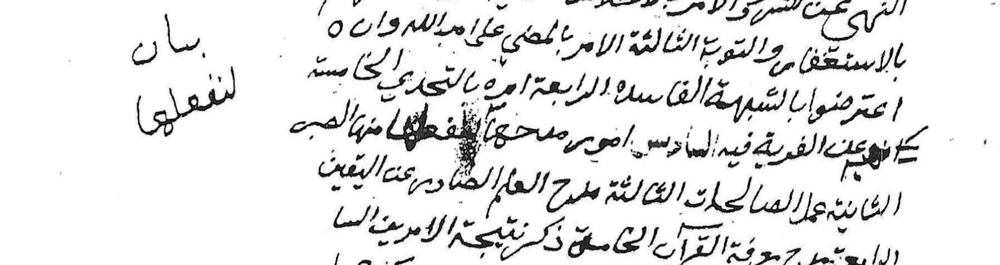
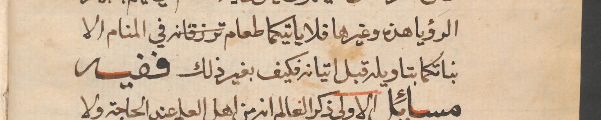
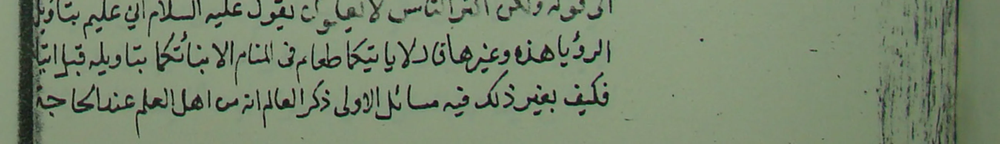
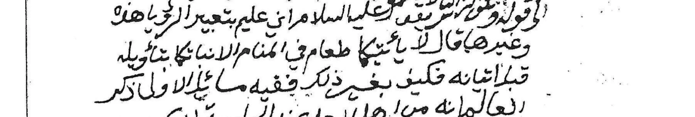
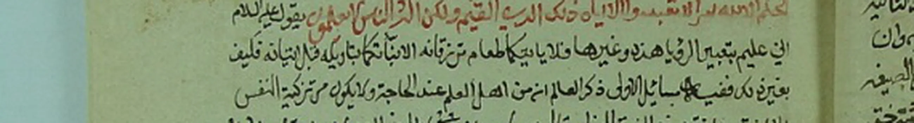

#+TITLE: Manuscrits contre éditions imprimées, les écarts qui comptent
#+SUBTITLE: pièces justificatives, 1219 clichés
#+STARTUP: overview

* Objet
Chaque image de ce dossier est le fac-similé de l'endroit précis du manuscrit
où se lit une leçon que les éditions imprimées ont perdue, altérée ou
ajoutée. Elles servent de pièces à l'appui des notes de l'apparat : une note
qui dit "ainsi dans ك" renvoie ici, et le lecteur vérifie de ses yeux.

Sigles, manuscrits : ب Berlin Ms. or. oct. 3968 (XIIe s. h.), ك King Saud 2351
(XIVe s. h.), ض Riyad KFNL ٥١٦/٨٦ (1286 h.), ر Riyad KFNL ٤٧٢/٨٦ (1251 h.),
ز Riyad KFNL ٦٧٢/٨٦ (XIVe s. h.), ش Riyad KFNL ١٠١٤/٨٦ (XIIIe s. h.),
ع Kawla DAR-19974, ن dépôt non identifié.
*Les trois manuscrits du fonds ٨٦ portent trois lettres qui se suivent*, ر puis ز
puis ش, de sorte que le même fonds se voit d'un coup d'œil.

Sigles, imprimés et témoins indirects : ط Muʾallafāt al-Shaykh juzʾ 5,
غ Muʾallafāt juzʾ 1 (Maǧmūʿat al-rasāʾil), ف Muʾallafāt juzʾ 4 (fatāwā),
د al-Durar al-saniyya, س le second manuscrit de ط, connu de ses seules notes,
ح al-Ḥusaynī, Manhaǧ al-Šayḫ fī l-tafsīr.

Les images sont des recadrages à l'échelle 3 à 6, *aux couleurs de la
photographie, sans aucun traitement*. Ni balance des blancs, ni renforcement
de contraste, ni désaturation. Deux essais ont été faits et tous deux
abandonnés: l'un creusait le fond vert du carton sur lequel King Saud a été
photographié au lieu de l'éclaircir, l'autre, qui désaturait tout sauf le
rouge, vidait du même coup le parchemin et l'encre brune. Une pièce
justificative doit montrer ce que montre la photographie.

La couleur compte ici, puisque ces manuscrits sont écrits à deux encres et
que la rouge porte du sens: rubriques, citations coraniques, séparateurs
d'hémistiches. La couleur
n'est pas un ornement : ces manuscrits sont écrits à deux encres, et la rouge
porte du sens, puisqu'elle marque les rubriques qui structurent l'ouvrage,
les citations coraniques et les séparateurs d'hémistiches. Une planche en
niveaux de gris efface cette information, et plusieurs des faits établis ici
se voient d'abord à l'encre.

Chaque planche montre *la ligne entière du manuscrit*, avec assez de blanc
au-dessus et au-dessous pour que les hampes et les points ne soient pas
rognés, et sans englober les lignes voisines : le mot en cause reste dans sa
ligne, qui se lit d'un bout à l'autre.

Les planches ne portent *aucune marque d'éditeur*. J'avais essayé deux fois
de surligner le passage en cause, et deux fois le calage s'est fait à
l'estime : plusieurs marques tombaient à côté du mot, et une marque fausse
égare le lecteur plus sûrement que pas de marque du tout. Le cadrage sert
donc seul de pointeur, et la notice dit quel mot regarder.

La seconde tentative a laissé des marques sur vingt-trois planches, des
sections XXXIV à XLIX, qui ont été recoupées depuis sans elles. La fonction
a été retirée de =outils/planche.py=, pour qu'elle ne revienne pas une
troisième fois.

Le folio figure dans le nom du fichier.

* Bilan de la collation
État au terme des unités 00 à 29, de la Fātiḥa à الأعراف ٢٣.

*Ce dossier est tenu à jour unité par unité*: tout écart où les manuscrits
l'emportent sur les éditions y est versé au moment où il est trouvé, avec un
cliché de chaque témoin qui porte la leçon.

| configuration | relevés | planches |
|---------------+---------+----------|
| les deux manuscrits contre les deux éditions | 24 | 11 |
| ك seul rétablit ce que les deux éditions ont perdu | 4 | 4 |
| ب seul conserve ce que les trois autres ont perdu | 1 | 1 |
| les manuscrits redressent une seule édition | 7 | 7 |
| corrections portées en marge d'un manuscrit | 2 | 1 |
| formule de disciple effacée par les éditions | 2 | 2 |
| pièces portant les deux témoins | | 12 sur 13 possibles |
| recension entière absente de l'imprimé | 10 | 3 |
| compte perdu par l'imprimé | 1 | 2 |
| architecture et mise en page perdues | 3 | 5 |
| gloses d'éditeur absentes des manuscrits | 2 | 3 |
| archaïsme gardé par ك seul | 1 | 1 |

La première ligne est la plus probante : ب et ك ne descendent pas l'un de
l'autre, ils n'ont ni le même ordre des sections, ni le même contenu, ni le
même siècle. Quand ils s'accordent, c'est leur ancêtre commun qui parle.

La quatrième compte aussi, autrement : que ط et د se trompent chacune de son
côté prouve qu'elles ne se recopient pas l'une l'autre, et donc que leur
accord, quand il a lieu, a du poids.

* Concordance : où trouver un passage dans ce dossier
*Ce dossier est rangé par la nature de la trouvaille*, et non par l'ordre du
livre. C'est commode pour lire les règles, et impraticable pour chercher un
passage. *Voici l'entrée qui manquait.* Chaque ligne donne une pièce du livre,
les unités qui la composent, les notices du dossier qui la concernent et le
nombre de clichés.

| pièce | unités | notices | clichés | sigles des notices |
|-------+--------+---------+---------+--------------------|
| الفاتحة | 00 et 01 | 16 | 21 | A1 A13b A14 A2 A3 A4 A5 A6 AK1 AS1 AX1 B2 DH1 FE1 FE2 FF1 |
| البقرة | 02 à 15 | 11 | 20 | A10 A12b A13b A7 A8 B1 B2 B3 B4 FF1 JD7 |
| آل عمران | 16 à 18 | 4 | 5 | B5 D1 JD10 JD8 |
| الأنعام | 19 à 23 | 9 | 15 | A11 B6 BS1 C2 D2 E1 E3 E5 JD9 |
| الأعراف | 24 à 35 | 12 | 22 | F1 F2 G1 H1 I1 J1 JD11 K1 L1 M1 N1 O1 |
| قصة آدم وإبليس | 36 à 52 | 12 | 23 | AD1 BT1 P1 Q1 R1 S1 T1 U1 V1 W1 Y1 Z1 |
| نوح وعاد وثمود ولوط وبلعام | 53 à 60 | 10 | 10 | AE1 AF1 AG1 AH1 AI1 AJ1 AM1 AQ2 B1 BV1 |
| يونس وهود | 61 à 71 | 5 | 5 | AN2 AO1 AQ2 AR1 AT1 |
| يوسف | 72 à 123 | 28 | 33 | BN2 BO2 BQ2 BY1 CB1 CD1 CG1 CH2 CI1 CJ1 CJ2 CL2 CM1 CN1 CP1 CQ1 CV1 CW1 CX1 CY1 DA1 DB1 DC1 DC2 DD1 DH1 JD1 JD4 |
| الحجر | 124 à 132 | 5 | 5 | DJ2 DK2 DL1 DM2 DN1 |
| النحل | 133 à 153 | 26 | 27 | DO2 DQ2 DS2 DV1 DW2 DW4 DW6 DX1 DX2 DX3 DY1 DY2 DZ1 DZ2 DZ3 EA1 EB1 EC2 ED1 EE1 EF1 EG1 EH1 EI1 JD5 JD6 |
| رسالة بيان الحجج | 154 à 158 | 4 | 4 | EJ2 EJ3 EK1 EL2 |
| طه والنور | 159 à 162 | 4 | 4 | EO1 EO2 JD2 JD3 |
| الزمر والحجرات | 163 à 180 | 6 | 6 | EQ1 ES1 EU1 EV1 EX1 EY1 |
| ملحقات الدرر | 181 et 182 | 0 | 1 |  |
| الكهف | 183 à 193 | 0 | 0 |  |
| القصص وزياداتها | 194 à 209 | 1 | 1 | ES1 |

*La Fātiḥa est en tête de ce tableau et non par courtoisie* : c'est la pièce
que ب ne porte pas, de sorte que son texte repose entièrement sur ك, ر, ض
et ش. *Chaque leçon manuscrite y est donc un apport*, et le rapport des
clichés aux unités y est le plus élevé du volume.

* I. Les deux manuscrits contre les deux éditions
*Chaque pièce de cette section porte les deux clichés*, ب puis ك ou
l'inverse. Une section dont l'argument est l'accord de deux témoins n'a pas
le droit de n'en montrer qu'un: le lecteur doit pouvoir lire lui-même la même
leçon sous deux mains différentes, à deux siècles de distance.

** B5 ~وأما قوله تعالى~ contre une formule d'auteur
[[file:B5-wa-amma-qawluhu--B-f14r.png]]

[[file:B5b-wa-amma-qawluhu--K-f8v.png]]

ب, comme ك : ~وأما قوله تعالى ﴿يا أيها الذين آمنوا إن تطيعوا فريقًا...﴾~, qui
enchaîne sur ce qui précède.

ط et د : ~قال الشيخ محمد بن عبد الوهاب رحمه الله تعالى: ومن قوله~.

Réintroduire le nom de l'auteur au milieu d'une suite continue est le geste
d'un compilateur qui découpe, non celui du texte. Les éditions ont fait d'une
articulation interne un début de morceau.

Unité : [[file:../18-al-imran-100-108.html][18]].

** B6 ~فيحصُلوا~ et ~ليُعرِّفَك~
[[file:B6-fayahsulu-liyuarrifak--B-f16r.png]]

[[file:B6b-fayahsulu--K-f9v.png]]

ب, comme ك : ~سلط ذلك عليهم ليتوبوا فيحصُلوا سعادة الدنيا والآخرة~, avec
suppression du nūn par coordination sur le subjonctif, puis ~ليُعرِّفَك أن هذا
من أعظم الجهالة~, avec le lām de finalité qui rattache la réponse à la
question ~كيف لم يتضرعوا؟~.

ط et د : ~فيحصلون~ et ~يعرفك~. Les deux fois, la construction se défait.

Unité : [[file:../20-al-anam-42-45.html][20]].

** B1 ~ألَّا يُعبَد إلا الله~
[[file:B1-alla-yubada-illa-Allah--K-f5v.png]]

[[file:B1b-alla-yubada--B-f12r.png]]

ك, comme ب : ~وهما: ألَّا يُعبَدَ إلا اللهُ، والثانيةُ: لا يُعبَدَ إلا بما شرعَ~.

ط et د : ~لا يُعبَد~. Le texte parle des deux règles, et une règle s'énonce par
un masdar. Les manuscrits sont meilleurs.

Unité : [[file:../15-baqara-140-tafsil.html][15]].

** B3 ~بالأعمال لا بالنسب~
[[file:B3-bil-amal-la-bin-nasab--K-f6r.png]]

[[file:B3b-bil-amal--B-f6r.png]]

ك, comme ب : ~أنَّ التقدُّمَ عند اللهِ بالأعمالِ لا بالنسبِ~.

ط et د ajoutent ~الصالحة~. L'opposition porte sur l'œuvre contre le lignage,
l'adjectif l'affaiblit.

Unité : [[file:../06-baqara-126.html][06]].

** B4 ~ولا تدعوا مع الله أحدا~
[[file:B4-wala-tadu-maa-Allah--K-f5r.png]]

[[file:B4b-wala-tadu--B-f11r.png]]

ك, comme ب, cite ainsi, sans le début du verset.

ط et د restituent l'āya entière ﴿وأنَّ المساجدَ للهِ فلا تدعوا مع اللهِ أحدًا﴾.
C'est une normalisation d'imprimeur, non une variante de tradition.

Unité : [[file:../15-baqara-140-tafsil.html][15]].

** B2 ~ما خليل الله~
[[file:B2-ma-khalil-Allah--K-f6r.png]]

[[file:B2b-ma-khalil-Allah--B-f6v.png]]

ك, comme ب : ~ويقول: ما خليلُ اللهِ يرفعُ قواعدَ بيتِ اللهِ ويخافُ ألا يقبلَه~.

ط et د : ~ما بالُ خليل الله~. Ici l'accord des manuscrits va contre la
grammaire et les éditions ont raison sur le fond : ~ما بال~ est l'expression
consacrée. Mais l'accord des deux manuscrits montre que la chute de ~بال~ est
antérieure à leur séparation. C'est le seul cas de cette série où j'ai gardé
la leçon des éditions dans le texte établi.

Unité : [[file:../07-baqara-127-128.html][07]].

** Les sept autres accords, sans planche
Ils figurent dans l'apparat, faute d'un intérêt visuel : ~كتابه ونبيه~ au
singulier et ~ونصره~ au masdar, ~وأصحابه~ avec la conjonction (unité 15),
~مع فعلهم~ sans ~هذا~ (unité 13), ~بعبيده~, ~يُتلى~, ~فيها المعوج والمستقيم~
(unité 18), ~شرك أصغر~ sans l'incise et ~أصغر وأكبر~ (unité 19), ~بأضيافه~
sans ~بمجيء~ (unité 20).

* II. ك seul rétablit ce que les deux éditions ont perdu
*Les quatre pièces de cette section n'ont qu'un cliché, et pour une raison
qui tient au corpus*: elles appartiennent toutes au tafsīr de la Fātiḥa, qui
*est absent de ب*. Berlin ouvre directement sur les masāʾil, sans le
commentaire suivi qui les précède. ك est donc ici le seul manuscrit qui
existe, non le seul que j'aie regardé. Il en va de même des pièces A5 et A6
de la section IV.

** A1 ~مَلِك يوم الدين~
[[file:A1-malik-yawm-al-din--K-f2r.png]]
[[file:A1b-malik-wa-malik--R-p75.png]]

ك : ~وذكر بعد ذلك ﴿مالكِ يوم الدين﴾ وفي قراءة أخرى ﴿مَلِكِ يوم الدين﴾~, la
seconde vocalisée et sans alif.

ط et د impriment deux fois ~مالك~, ce qui vide la phrase de son sens. C'est le
pivot du passage, puisque l'auteur tire des deux lectures le troisième
attribut, le ~مُلك~, qu'il appuie ensuite sur ﴿مَلِكِ الناسِ﴾. Preuve interne :
à la seconde occurrence du même passage, ط distingue correctement les deux
lectures, donc elle se contredit.

Unité : [[file:../00-fatiha-tafsir.html][00]].

*Et ر porte la même distinction*, p. 75 : sa ligne s'achève sur ~وذكر بعد ذلك مالك يوم الدين وفي قرا~ et la suivante ouvre sur ~أخرى ملك يوم الدين~, la seconde sans alif. *Deux manuscrits, un Riyad de 1251 et un KSU du quatorzième siècle*, contre les deux imprimées qui écrivent deux fois ~مالك~.

** A3 ~والإيمان به~
[[file:A3-wal-iman-bihi--K-f2v.png]]

ك : ~فأين هذا المعنى والإيمانُ به والإيمانُ بما صرَّح به القرآنُ~.

Les deux éditions n'ont qu'un seul ~والإيمان~ : saut du même au même.

Unité : [[file:../00-fatiha-tafsir.html][00]].

** A4 ~العلم النافع~
[[file:A4-al-ilm-al-nafi--K-f3r.png]]

ك : ~تتضمَّن العلمَ النافعَ والعملَ الصالحَ~.

Les deux éditions : ~تتضمن العلم والعمل الصالح~. Un adjectif tombe plus
aisément qu'il ne s'ajoute, et le couple est une formule fixe.

Unité : [[file:../00-fatiha-tafsir.html][00]].

** A14 ~العلّام والعليم~
[[file:A14-allam-alim--K-f1v.png]]

[[file:A14b-allam-alim--Sh-p4.png]]

Il s'agit d'illustrer deux noms d'une même racine dont l'un est plus intense
que l'autre. ك et ش lisent ~العلّام~, avec la šadda visible sur le lām dans
les deux planches, et د les suit. ط lit ~العالِم~, simple participe, sans
intensité, et la comparaison n'illustre plus rien.

*L'entrée manquait à ce registre* alors que la planche de ك existait depuis
le début. Réparé le 29 septembre 2026 en y joignant ش.

Unité : [[file:../00-fatiha-tafsir.html][00]].

** A2 ~عبد الزبير~
[[file:A2-abd-al-zubayr--K-f2r.png]]

[[file:A2b-abd-al-zubayr--Sh-p8.png]]

ش, p. 8, ajouté le 29 septembre 2026 : la masʾala entière, de ~ثم دعا الله
في تفريج كربته~ jusqu'à ~وإقراره له بالعبودية~. Les trois ~عبد~ y sont, comme
dans ك. *Second témoin manuscrit* contre les deux imprimés.

ك : ~أو قولِ عبدِ عليٍّ، أو عبدِ النبيِّ، أو عبدِ الزبيرِ~, les trois noms sur le
même patron.

ط et د : ~أو عبد النبي أو الزبير~. La série se casse et le lecteur comprend
qu'on invoque al-Zubayr, au lieu de comprendre qu'on se nomme d'après lui.

Unité : [[file:../00-fatiha-tafsir.html][00]].

* III. Un trait rouge lu à l'envers, et la pièce qu'il a fallu retirer
Cette section portait le titre /ب seul conserve ce que les trois autres ont
perdu/, et elle a longtemps été donnée pour l'apport le plus fort de Berlin.
*Elle reposait sur une erreur de lecture, et elle est retirée.*

** C1 le verset ﴿ومن يرغب عن ملة إبراهيم﴾, biffé et non souligné
[[file:C1-aya-ibrahim-biffee--B-f7r.png]]

ب, f. 7r. On lit ~مسألة مهمة يدل قوله ومن يرغب عن ملة ابراهيم قول من رغب عن~.

*Le trait rouge ne souligne pas le verset, il le barre.* Il passe au milieu des
lettres, coupe l'alif de ~ابراهيم~ et le lām de ~ملة~, et ne s'élève jamais
au-dessus d'elles. *Et sous le rouge court un second trait, à l'encre du
texte*, qui suit le même chemin. Les mots sont donc annulés deux fois, une fois
par la plume qui les a écrits et une fois par la rouge.

** C1d la même page, deux lignes plus haut
[[file:C1d-trait-de-rubrique--B-f7r.png]]

~الثالثة~ et ~الرابعة~ portent, elles, une vraie rubrique : un trait rouge fin
posé *au-dessus* du mot, dans le blanc de l'interligne, qui ne touche aucune
lettre. La comparaison ne laisse pas de place au doute, et elle était
disponible à deux lignes de distance.

** Ce que c'est, et pourquoi c'est banal chez ce copiste
Le répertoire de correction de ب est décrit au fil de l'apparat, et la biffure
par un trait au milieu des lettres en fait partie :

- f. 53v, trait rouge au milieu des lettres sur quatre mots, un début de verset
  pris pour un autre,
- f. 56r, trait rouge oblique au milieu des lettres,
- f. 60v, trait rouge horizontal au milieu des lettres, sur un mot répété,
- ff. 58r, 59r, 66v, 69r, 72v, 84r, trait à l'encre du texte,
- f. 77r, hachurage.

*Et la cause est ici la même qu'au f. 53v*, où il avait commencé ﴿ائتوني به
أستخلصه لنفسي﴾ au lieu de ﴿إني أرى سبع بقرات﴾, les deux versets s'ouvrant sur
~وقال الملك~. Au f. 7r sa plume est allée à l'āya dont il est en train de
traiter, et dont il venait d'écrire le titre en rouge deux lignes plus haut,
~وأما الآية السابعة~. Il s'est repris et il a barré.

*C'est même la plus ancienne biffure du volume*, quarante-six feuillets avant
celle du f. 53v, que l'apparat donnait pour la première. Et c'est la seule où
deux encres se superposent.

** Ce qui reste établi
[[file:C1b-sans-aya-ibrahim--K-f6v.png]]

[[file:C1c-sans-aya-ibrahim--R-p90.png]]

ك f. 6v et ر p. 90 : ~وهذه المسألة مهمة يدل قوله من رغب عن سنتي فليس مني~, sans
le verset et sans ~عليه~. ط et د : ~يدل عليه قوله~, sans le verset non plus.

*Les cinq témoins sont donc sans le verset*, ب parce qu'il l'a rayé lui-même.
Il n'y a pas de texte entier perdu à restituer, et le ~عليه~ des imprimés n'est
pas la trace d'un verset disparu : il renvoie tout simplement à la septième
āya, annoncée deux lignes plus haut. Reste un désaccord mince, ~عليه~ chez les
imprimés contre son absence chez ك et ر, tranché en faveur des imprimés parce
qu'un pronom se perd plus aisément qu'il ne s'invente.

*La pièce du dossier des apports a été retirée*, et la note de l'unité 08
récrite.

** La leçon
/Une marque ne se lit pas seule./ Le même rouge sert chez ce copiste à
rubriquer et à annuler, et ce qui les sépare n'est pas la couleur mais la
hauteur du trait. Le témoin du sens était sur la même page, à deux lignes. Je
ne l'avais pas regardé.

Unité : [[file:../08-baqara-129-130.html][08]].

* IV. Les manuscrits redressent une seule édition

** A5 les vers de la Burda, contre ط
[[file:A5-abyat-al-burda--K-f2v.png]]

[[file:A5b-abyat-al-burda--R-p77.png]]

ك écrit les six hémistiches à la file, séparés par une marque à l'encre
rouge, et l'appariement est le bon : ~جاهك بي~ va avec ~إذا الكريم تحلى باسم
منتقم~, et non avec ~فإن لي ذمة منه بتسميتي~.

ط imprime les trois premiers hémistiches puis les trois seconds, si bien
qu'aucun vers ne tient plus ni au mètre ni au sens. د est correcte.

*Second cliché, ajouté le 29 septembre 2026.* ر, p. 77, donne les mêmes trois
vers, un par ligne, les deux hémistiches séparés par un signe, dans l'ordre de
la qaṣīda. *ك n'est donc plus le seul manuscrit de ce lieu*, et ر le devance
de trente-cinq ans, étant achevé en 1251. Le hadith de Fāṭima est en tête du
cliché, comme dans notre texte.

ر lit par ailleurs ~تجلى~ au premier vers, et c'est *le troisième manuscrit à
le faire* après ض et ش. Notre texte garde ~تحلى~, qui est le mot de la
qaṣīda. Cela ne touche pas à la division des vers, qui est l'objet de cette
pièce.

Unité : [[file:../00-fatiha-tafsir.html][00]].

** A6 ~فكيف بمن فعلها~, contre ط
[[file:A6-fa-alaha--K-f3r.png]]

ك : ~فكيف بمن فعلَها في تاجٍ وأمثالِه~.

ط : ~فكيف بمن لها في تاج وأمثاله~, le verbe est tombé. د est correcte.

Unité : [[file:../00-fatiha-tafsir.html][00]].

** A7 ~لو عمَّ العاصيَ~, contre ط
[[file:A7-amma-la-alima--K-f6r.png]]

[[file:A7b-amma--B-f6r.png]]

ك : ~فأخبرَ أنه لو عمَّ العاصيَ فيه بالأمنِ والرزقِ فإنه يضطرُّه إلى عذابِ النارِ~.

ط : ~لو علم العاصي~, qui ne s'accorde pas au raisonnement. ب et د portent
~عمَّ~ : la faute de ط était déjà probable, ce cliché la rend certaine, deux
manuscrits contre une édition.

Unité : [[file:../06-baqara-126.html][06]].

** A11 ~أبواب كل شيء~, contre ط
[[file:A11-abwab-kull-shay--B-f16r.png]]

[[file:A11b-kull-shay--K-f9v.png]]

ب, comme ك et د : ~فتحت عليهم أبوابُ كلِّ شيءٍ، فيا لها من مسألةٍ~.

ط : ~أبواب كل الدنيا~. C'est le verset même qui vient d'être cité, ﴿فتحنا
عليهم أبواب كل شيء﴾ : ط contredit le texte qu'elle commente.

Unité : [[file:../20-al-anam-42-45.html][20]].

** A8 ~والسَّدَنة~, contre ب
[[file:A8-al-sadana--K-f5r.png]]

[[file:A8b-al-sunna--B-f11r.png]]

ك : ~وجعلِ الأوقافِ والسَّدَنةِ عليها من دينِ الجاهليةِ~.

ب : ~والسنة~, tashīf manifeste, puisqu'il s'agit des biens de mainmorte et des
gardiens du tombeau. J'avais corrigé par conjecture, ك le confirme.

Unité : [[file:../15-baqara-140-tafsil.html][15]].

** A10 ~قبل مجيئه~, contre ب
[[file:A10-qabla-majiihi--K-f4v.png]]

[[file:A10b-sans-qabla-majiihi--B-f4v.png]]

ك : ~وكانوا يستفتحون به قبلَ مجيئِه على من ظلمهم~.

ب omet les deux mots, et j'avais établi ce passage sur ب avant de disposer de
ك : le texte que j'avais imprimé était donc lacunaire. Ces deux mots sont le
ressort de la masʾala, puisqu'ils désignent l'appel à la victoire par le
Prophète avant sa venue. ط et د les ont.

Unité : [[file:../03-baqara-109.html][03]].

* V. Une main ancienne corrige en marge

** C2 ~أهل العلم~ et ~من يدعي العلم~
[[file:C2-man-yaddai-al-ilm--B-f15v.png]]

[[file:C2b-ahl-al-ilm--K-f9r.png]]

ب porte dans le corps du texte ~ما يظن فيه أهلُ العلمِ~, et ك porte la même
chose. Un correcteur a ajouté sous la ligne de ب, d'une encre plus pâle,
~من يدعي~, qui est la leçon de د : ~ما يظن فيه من يدعي العلمَ~.

ط imprime ~ما يظن فيه من أنْ ما يدعي العلمَ~, qui ne veut rien dire.

Ce cliché montre donc deux états du texte, non une faute : *les deux
manuscrits portent ~أهل العلم~, les deux éditions ~من يدعي العلم~*, et
quelqu'un a collationné ب sur un exemplaire de la seconde famille. Le sens
n'est pas le même, ~أهل العلم~ pouvant s'entendre par ironie et ~من يدعي
العلم~ étant un reproche ouvert. Quelle que soit la leçon retenue, ط est
fautive, car son texte n'est celui d'aucun témoin. On voit aussi, dans la
marge de droite, ~من هذا~, second ajout de la même main, qui comble une
omission de la même phrase.

Unité : [[file:../19-al-anam-40-41.html][19]].

* VI. Ce que les éditions ont effacé de la transmission

** D2 ~قال شيخنا محمد بن عبد الوهاب قدس الله روحه~
[[file:D2-qala-shaykhuna--B-f15r.png]]

En-tête de la sourate al-Anʿām dans ب, à l'encre rouge dans le manuscrit.

*ب et ك portent cette ligne mot pour mot*, y compris ~في الكلام على سورة
الأنعام~. ط et د la remplacent par un titre ~سورة الأنعام~ suivi de ~وقال
الشيخ محمد أيضا رحمه الله تعالى~.

Deux manuscrits qui ne dépendent pas l'un de l'autre, séparés par deux
siècles, s'accordent sur ~شيخنا~ et ~قدس الله روحه~ : la première formule
n'est dite que par un disciple, la seconde que d'un mort. *Leur archétype
commun a donc été écrit par un élève de l'auteur, après 1206 de l'hégire.*
Les deux éditions ont effacé cette trace.

Unité : [[file:../19-al-anam-40-41.html][19]].

** D1 le même fait dans ك, à Āl ʿImrān
[[file:D1-qala-shaykhuna--K-f8r.png]]

~قال شيخنا شيخ الإسلام محمد بن عبد الوهاب رحمه الله ورضي عنه وكرمه~, en-tête à
l'encre rouge de la sourate Āl ʿImrān.

ك est une copie du XIVe siècle de l'hégire : la formule "notre shaykh" n'est
donc pas de son copiste, elle vient d'un modèle écrit par quelqu'un qui
tenait l'auteur pour son maître. ب porte à cet endroit ~وقال رحمه الله وقدَّس
روحَه~, ط un simple titre de sourate.

Unité : [[file:../16-al-imran-79-80.html][16]].

* VII. Une recension entière que l'imprimé a écartée
C'est le résultat le plus lourd du dossier, et il n'apparaît qu'à partir de
la sourate al-Anʿām.

À la قصة إبراهيم, ط dit en note qu'elle abandonne son manuscrit habituel, le
ms =س=, pour un autre qu'elle cote =٥١٦-٨٦=, "parce qu'il y a dans س quelques
fautes d'écriture en cet endroit". Or ب et ك, deux manuscrits qui ne
dépendent pas l'un de l'autre et que deux siècles séparent, portent pour ce
fascicule un texte *identique entre eux et différent de l'imprimé*, non par
des mots isolés mais par la construction des phrases :

| | ط et د | ب et ك |
|---+---+---|
| le proverbe | ~من جعل الحمار قاضيا~ | ~كجعل الفرس قاضيا مفتيا~ |
| la 2e masʾala | ~القدح في حجتهم~ | ~القدح في الدليل~ |
| | ~الرسوخ في مخالفتهم~ | ~رسوخه بالنفي~ |
| la preuve des palmiers | ~من رأى نخلا كثيرا لا يتخالجه شك~ | ~من له أدنى عقل يعرف~ |
| Nemrod et Pharaon | ~فإن كان اتخذه بعد موته~ | ~وخصوصا قبره~ |
| la 32e masʾala | ~وحبوط عمله ولو كان من أعبد الناس~ | ~**وقتاله** ولو كان عابدا~ |

Aucun copiste ne passe par distraction de ~من رأى نخلا كثيرا لا يتخالجه شك~
à ~من له أدنى عقل يعرف~, et deux copistes encore moins. *Ce que l'éditeur a
écarté comme des fautes d'écriture est une seconde recension du fascicule*,
celle que portent les deux témoins manuscrits, et dont il ne subsiste rien
dans l'imprimé, puisque د suit ط ici de bout en bout.

** E1 et E2 ~وقتاله~, dans les deux manuscrits
[[file:E1-qitaluh--B-f19v.png]]

[[file:E2-qitaluh--K-f11r.png]]

La masʾala que l'auteur appelle lui-même ~العظيمة التي لم يعرفها أكثر من يدعي
الدين~. ب et ك portent, mot pour mot : ~وهي مسألة تكفير من أشرك بالله وقتاله
ولو كان عابدا~. ط et د : ~تكفير من أشرك وحبوط عمله، ولو كان من أعبد الناس
وأزهدهم~.

Les quatre témoins s'accordent sur le takfīr et se séparent sur ce qui en
découle : *le combat* dans les manuscrits, *la ruine des œuvres* dans les
éditions. La différence de portée n'a pas besoin d'être commentée. J'ai gardé
la leçon imprimée dans le texte établi, selon la règle suivie partout ici, et
donné l'autre dans l'apparat.

Unité : [[file:../23-al-anam-74-90.html][23]].

** E5 ~من له أدنى عقل يعرف~
[[file:E5-adna-aql--K-f10v.png]]

[[file:E5b-adna-aql--B-f18r.png]]

ك, comme ب : ~فإن من له أدنى عقل يعرف أن المدبر لهذا النخل الكبير ليس هذه
النخلة منه~.

ط et د : ~لأن من رأى نخلا كثيرا لا يتخالجه شك أن المدبر له ليس نخلة واحدة
منه~.

Même argument, deux phrases entièrement distinctes. C'est le cliché qui
montre le mieux qu'il s'agit de deux rédactions et non de deux copies.

Unité : [[file:../23-al-anam-74-90.html][23]].

* VIII. Un compte que l'imprimé a perdu

** E3 et E4 ~أربعة عشر جوابا~
[[file:E3-arbaata-ashar-jawaban--B-f17v.png]]

[[file:E4-arbaata-ashar-jawaban--K-f10r.png]]

ب et ك ouvrent le fascicule de الأنعام ٧١-٧٣ ainsi : ~فيه جوابات تجاوب بها من
أشار عليك بشيء تصير به مرتدا، **أربعة عشر جوابا**~. ط écrit seulement ~فيه
مسائل~ : le compte a disparu.

Trois choses l'établissent. D'abord le décompte : les réponses sont bien
quatorze. Ensuite ط elle-même, qui imprime à la suite un second fascicule sur
les mêmes versets, tiré du ms ٥١٦-٨٦, et qui s'ouvre par ~ففيه أربعة عشر
جوابا لمن أشار عليك بموافقة السواد الأعظم على الباطل~ : le chiffre est donc
dans les deux recensions. Enfin, et c'est le plus fin, *ك compte au masculin*
d'un bout à l'autre, ~الثاني~, ~الرابع~, ~السادس~, ~السابع~, ~الثامن~,
~التاسع~, ~العاشر~, parce que ce sont pour lui des **جوابات**. ط, ayant perdu
le mot, compte au féminin comme s'il s'agissait de ~مسائل~. L'accord du genre
sur quatorze occurrences n'est pas un hasard de copie.

Unité : [[file:../22-al-anam-71-73.html][22]].

* Une pièce retirée
Ce dossier comptait une planche A9, qui donnait ب pour fautif à
~وبلغنا عن الله أنه يقول~, avec ~عن أحمد~ au lieu du nom divin. *La lecture
était mienne et elle était fausse*: sur une image plus nette, ب porte
~عن الله~ comme les trois autres témoins. La planche a été retirée et la note
de l'unité 15 rectifiée. Ce qui subsiste du passage est l'accord ب+ك sur la
citation abrégée ~ولا تدعوا مع الله أحدا~, que les deux éditions complètent
en ﴿وأن المساجد لله فلا تدعوا مع الله أحدا﴾, et c'est la planche B4.

* IX. Une architecture que l'imprimé ne rend pas
À partir de سورة الأعراف, le livre change de plan: l'auteur numérote les
versets, et place sous chacun ses propres masāʾil, renumérotées à partir de
un. Deux niveaux, donc, et le copiste de ب les distingue par l'encre.

** F1 le numéro d'āya en rouge, le numéro de masʾala surligné
[[file:F1-deux-encres--B-f20r.png]]

Sur ce cliché, ~الثانية~ est *écrit entièrement en rouge*: c'est le numéro du
verset. ~الثالثة~, ~الرابعة~, ~الخامسة~ sont en noir avec un trait rouge
au-dessus: ce sont les numéros de masʾala. Un lecteur du manuscrit voit d'un
coup d'œil à quel niveau il se trouve.

L'imprimé aligne tout sur le même plan typographique, avec un ~الآية الثانية~
suivi de ~الأولى~, ~الثانية~ qui ne se distinguent que par la lecture. Ce
n'est pas une variante de texte, c'est une mise en page perdue, et elle
gouvernait la lecture.

Unité : [[file:../24-al-araf-2-7.html][24]].

** F2 et F3 le décompte des versets, ~الثامنة~ contre ~الحادية عشرة~
[[file:F2-al-thamina--B-f20v.png]]

[[file:F3-al-thamina--K-f11r.png]]

Au même verset, الأعراف ١٢, *ب et ك écrivent tous deux* ~الثامنة~ et ط écrit
~الحادية عشرة~. L'écart de trois s'est constitué en amont: les manuscrits
groupent ٧/٤ avec ٧/٥, puis ٧/٦ avec ٧/٧, et comptent ﴿والوزن يومئذ الحق﴾
avec ﴿ومن خفت موازينه﴾ pour un seul verset, là où ط dit ~السابعة والثامنة~.

Deux copistes indépendants, séparés de deux siècles, ne tombent pas sur le
même chiffre par accident dans une série où l'erreur d'un cran serait si
facile. *Le compte des manuscrits est celui de l'archétype*, et l'éditeur a
détaillé.

Unités : [[file:../24-al-araf-2-7.html][24]], [[file:../25-al-araf-8-11.html][25]] et [[file:../26-al-araf-12-13.html][26]].

** G1 et G2 ~أنه على صراط الله المستقيم~, sans ~قاعد~
[[file:G1-sans-qaid--B-f21r.png]]

[[file:G2-sans-qaid--K-f11v.png]]

Quatrième masʾala de l'āya où Iblīs annonce son embuscade. *ب et ك écrivent
tous deux* ~الرابعة: أنه على صراط الله المستقيم~, le verbe suivant
immédiatement le numéro. ط et د intercalent ~قاعد~: ~أنه قاعد على صراط الله
المستقيم~.

Le participe vient du verset lui-même, ﴿لأقعدن لهم صراطك المستقيم﴾, et il
explicite ce que la masʾala laissait entendre. C'est donc une glose
d'éditeur, utile mais surajoutée, et les deux manuscrits montrent le texte
sans elle.

Unité : [[file:../27-al-araf-14-17.html][27]].

** H1 et H2 ~جميع ما فيها~, et ~وزوجه~ dans ك
[[file:H1-zawjih-ma-fiha--B-f21r.png]]

[[file:H2-zawjih-ma-fiha--K-f11v.png]]

Deux leçons sur deux lignes voisines, à l'āya où Ādam reçoit le Jardin.

*Les deux manuscrits* écrivent ~إباحته لهما جميع ما فيها إلا شجرة واحدة~, où
le pronom renvoie au Jardin nommé dans le verset. ط et د explicitent:
~جميع ما في الجنة~.

*ك écrit en outre* ~ما ذكر من إكرام آدم وزوجه~, sans tāʾ, là où ب, ط et د ont
~وزوجته~. C'est l'usage classique, où ~الزوج~ vaut pour l'homme comme pour la
femme, et c'est le mot du verset que la masʾala commente,
﴿اسكن أنت وزوجك الجنة﴾, comme de tous les autres passages coraniques:
﴿أمسك عليك زوجك﴾, ﴿زوجناكها﴾. La forme avec tāʾ est postérieure et admise,
mais ك a gardé celle de la citation. C'est la leçon que j'ai établie.

Unité : [[file:../28-al-araf-18-19.html][28]].

** I1 et I2 la coupure que la Ṭabʿa ne voit pas
[[file:I1-khamisa-ashar--B-f21v.png]]

[[file:I2-khamisa-ashar--K-f11v.png]]

ط range dix masāʾil sous un seul intitulé, ~وفي التاسعة عشرة والعشرين
والحادية والعشرين~. *ب et ك les coupent tous deux en deux groupes de cinq*,
et à la même place: après ~ذكر تدليته إياهما بالغرور~ s'ouvre un numéro
d'āya neuf, ~الخامسة عشر~, que le copiste de Berlin écrit à l'encre rouge
comme tous les numéros de verset.

C'est l'inverse de ce qu'on a vu jusqu'ici, où les manuscrits groupaient ce
que l'imprimé détaillait. Ils ne suivent donc pas un principe mécanique: ils
suivent un découpage, et le point de coupure, ﴿فلما ذاقا الشجرة بدت لهما
سوآتهما﴾, le moment où la faute produit son effet, a un sens. Deux témoins
indépendants coupant au même verset, c'est le plan de l'auteur.

*Et ط l'avoue à demi-mot.* Quelques lignes plus loin, sur l'āya ٢٦, elle note
en bas de page: ~في الأصل (الثامنة عشر)، وفي هذا الموضع من المخطوطة شيء من
الخطأ في عد الآيات~, puis corrige en ~السادسة والعشرين~. Son manuscrit
portait donc le même compte que ب et ك, et l'éditeur l'a pris pour une
erreur au lieu d'y reconnaître un système.

Unité : [[file:../29-al-araf-20-23.html][29]].

* X. Le mot que ط corrige, et que les deux manuscrits portent
** J1 et J2 ~الثامنة عشر~
[[file:J1-thamina-ashar--B-f21v.png]]

[[file:J2-thamina-ashar--K-f11v.png]]

La section précédente finissait sur une note de bas de page de ط, à l'āya
٢٦: ~في الأصل (الثامنة عشر)، وفي هذا الموضع من المخطوطة شيء من الخطأ في عد
الآيات~. L'éditeur avoue que son manuscrit portait ~الثامنة عشر~, décide que
c'est une faute, et imprime ~السادسة والعشرين~.

*Voici le mot.* ب l'écrit à l'encre rouge en fin de ligne, ~الثامنة~, la
suite ~عشر~ au début de la ligne d'après. ك l'écrit de même, ~الثامنة عشر~,
deux lignes sous ~السابعة عشر~. Trois témoins indépendants, dont celui de
l'éditeur, portent le même chiffre.

*Et ce chiffre est juste.* Le compte de l'auteur est un compte suivi des
versets qu'il commente, non des versets du muṣḥaf, et il ne se rompt nulle
part : ١٥ à ﴿فلما ذاقا الشجرة﴾, ١٦ à ﴿قالا ربنا ظلمنا﴾, ١٧ à ﴿اهبطوا﴾, ١٨
ici, ١٩ à ﴿يا بني آدم لا يفتننكم﴾.

*C'est le compte de ط qui se rompt.* Deux lignes plus haut, pour l'āya ٢٤,
elle garde son propre compte suivi et écrit ~الثالثة والعشرين~, en notant en
bas de page que le verset est le ٢٤. Puis, ici, elle passe sans le dire au
numéro du muṣḥaf, ~السادسة والعشرين~. Elle change de système entre deux
lignes, et impute le désordre au copiste.

*Et د, quatrième témoin, ne la suit pas.* Là où ط écrit ~السادسة والعشرين~,
د (p. 5998) écrit ~الخامسة والعشرون~, puis ~السادسة والعشرون~ à l'āya ٢٧ et
~السابعة والعشرون~ à l'āya ٢٨, toujours un cran sous le numéro du muṣḥaf.
Le compte de د est donc suivi lui aussi, comme celui de ب et de ك, avec un
point de départ différent. Sur ce point précis, trois témoins sur quatre
comptent les versets commentés, et ط seule compte ceux du muṣḥaf, tout en
qualifiant d'erreur le compte des autres.

Unité : [[file:../30-al-araf-24-26.html][30]].

** Trois accords mineurs de la même page, sans planche
- ~إخبار لهم بما لهم في الأرض~ dans ب et ك, contre ~إخباره لهما بما لهم في
  الأرض~ dans ط, qui se contredit dans la même phrase.
- ~مضرة المعصية ولو تاب منها~ dans ب et ك, contre ~ولو تاب فاعلها منها~.
- ~ذكر الحكمة في ذلك~ dans ب et ك, contre ~ذكره الحكمة~. Le mot ouvre le
  f. ١٢و de ك, annoncé par la réclame ~دسة~ au bas du folio précédent.

* XI. ~أمره بالقول~, que ط seule a perdu
** K1 et K2 la masʾala sur ﴿قل إن الله لا يأمر بالفحشاء﴾
[[file:K1-amaruhu-bil-qawl--B-f22r.png]]

[[file:K2-amaruhu-bil-qawl--K-f12r.png]]

Sur l'āya ٢٨, quatrième masʾala, ط imprime ~أمره بالتقوى الذي فيه تنزيه الله
عن ذلك~. *ب, ك et د portent tous trois* ~أمره بالقول~.

*La leçon de ط ne tient pas, et son propre texte le dit.* Le verset ne parle
pas de taqwā : il ordonne de dire, ﴿قل إن الله لا يأمر بالفحشاء﴾, et c'est
cette parole qui innocente Dieu de ce qu'ils lui attribuent. Surtout, ط
écrit ~بالتقوى الذي~, au masculin, alors que ~التقوى~ est féminin. Le
relatif est resté accordé au mot qu'elle a perdu.

C'est le premier endroit du travail où د se range du côté des manuscrits
contre ط sur un mot de sens, et non sur un simple pronom.

Unité : [[file:../31-al-araf-27-28.html][31]].

** Deux accords mineurs de la même page, sans planche
- ~فيها إنكاره عليهم هذه الفاحشة~ dans ب, ك et د, contre ~الفاحشة~ sans
  démonstratif dans ط. L'auteur vise une faute précise, la circumambulation
  nus, non le genre des turpitudes.
- Le numéro d'āya, une fois de plus : ~التاسعة عشر~ et ~العشرون~ à l'encre
  rouge dans ب et ك, contre ~السابعة والعشرين~ et ~الثامنة والعشرين~ dans ط,
  et ~السادسة والعشرون~ et ~السابعة والعشرون~ dans د.

* XII. Un mot que l'éditeur a dû gloser, et que ب restitue
** L1 et L2 ~ذكر الأمر العظيم~ contre ~ذكر تعظيم~
[[file:L1-al-amr-al-azim--B-f22v.png]]

[[file:L2-dhikr-tazim--K-f12r.png]]

Onzième masʾala de ﴿قل أمر ربي بالقسط﴾. ط imprime ~ذكر تعظيم وهو اتخاذهم
الشياطين أولياء~, et l'éditeur, qui sent que la phrase ne se tient pas,
ajoute en bas de page : ~يعني: عظم ذلك الأمر وخطورته على فاعليه~.

*ب écrit* ~ذكر الأمر العظيم وهو اتخاذهم الشياطين أولياء~, et *د écrit la
même chose*. La glose de l'éditeur ne fait que remettre dans le texte le mot
~الأمر~ qui en était tombé : ~تعظيم~ est un maṣdar qui appelle un
complément, et le ~وهو~ qui suit s'accorde avec ~الأمر~.

*Mais ك est du côté de ط*, et c'est pourquoi la planche L2 est ici : elle
montre ~ذكر تعظيم و~ en fin de ligne, puis ~هو اتخاذ الشياطين أولياء~ à la
ligne suivante, sans le pronom que ب et ط ont tous deux.

C'est le premier endroit de cette partie où les témoins se séparent en deux
paires, ب avec د contre ك avec ط, au lieu de se ranger manuscrits contre
imprimés. J'ai retenu la leçon de ب et د, non pas en comptant les voix, mais
parce que l'autre laisse une phrase que son propre éditeur a dû compléter en
note.

Unité : [[file:../32-al-araf-29-30.html][32]].

** Un accord des trois contre ط, sans planche
~ذكر أمره بالعدل~ dans ب, ك et د, contre ~ذكره أمره بالعدل~ dans ط. C'est le
tic de cette édition dans ces pages : elle attache au maṣdar un pronom que
les autres témoins n'y mettent pas. On l'a déjà vu à ~إخبار~, ~ذكر الحكمة~,
~إخبار بخير اللباسين~.

* XIII. La série des numéros, suivie dans ب, cassée dans ك
** M1 et M2 trois numéros d'āya à la file
[[file:M1-serie-des-numeros--B-f22v.png]]

[[file:M2-serie-des-numeros--K-f12r.png]]

Sur six lignes, ب écrit à l'encre rouge ~الثانية والعشرون~, ~الثالثة
والعشرون~, ~الرابعة والعشرون~. La série court sans accroc depuis
~السابعة عشر~ : ١٧, ١٨, ١٩, ٢٠, ٢١, ٢٢, ٢٣, ٢٤.

*ط, elle, n'a plus de série du tout.* Après avoir compté pour son propre
compte jusqu'à l'āya ٢٤, elle donne ici ٣١, puis ٣٢, puis ٣٣, c'est-à-dire
les numéros du muṣḥaf. Le passage d'un système à l'autre, qu'elle avait
amorcé à l'āya ٢٦ en traitant le chiffre du manuscrit d'erreur, est
désormais complet et silencieux.

*Et ك casse.* Après avoir écrit ~العشرون~ à l'āya ٢٨, il redescend à
~الحادية عشر~, puis à ce qui se lit ~الرابعة عشر~, puis ~الثالثة عشر~, puis
~الرابعة عشر~ de nouveau. Il perd le ~والعشرون~ et répète un chiffre. La
planche M2 est ici pour cela : elle montre que le désordre est du copiste de
Riyad, non du système. C'est ب qui porte le compte de l'auteur, et c'est sur
lui que repose la démonstration des sections VIII et X.

Unité : [[file:../33-al-araf-31-32.html][33]].

** Un mot que ب et د gardent, chacun à sa place
Troisième masʾala de l'āya ٣١. ط et ك : ~النهي عن السرف~. د : ~ذكر النهي عن
السرف~. *ب : ~النهي عن ذكر السرف~*, où le mot est là mais déplacé, et où la
phrase ne veut plus rien dire, puisque l'interdit porte sur l'excès et non
sur le fait d'en parler.

Deux témoins qui gardent ~ذكر~ en le plaçant différemment ont hérité d'un
texte qui l'avait. Les deux masāʾil précédentes commencent d'ailleurs par
lui : ~ذكر الأمر~, ~ذكر الأكل~. J'ai retenu la place de د.

* XIV. La fin des masāʾil, et ce qui vient après
** N1 et N2 la dernière masʾala, et la jonction
[[file:N1-la-jonction--B-f22v.png]]

[[file:N2-la-jonction--K-f12r.png]]

*Deux choses sur ces deux planches.*

*La première est un mot.* Septième et dernière masʾala : ط imprime ~تحريم
القول بلا علم~. ب, ك *et د* écrivent tous trois ~تحريم القول على الله بلا
علم~. Le verset finit sur ~وأن تقولوا على الله ما لا تعلمون~, et c'est là
tout le sens de la masʾala : l'interdit ne porte pas sur le fait de parler
sans savoir en général, mais sur le fait de parler de Dieu sans savoir.
Trois témoins d'accord, et le verset avec eux : ط est seule, et c'est une
chute d'impression.

*La seconde est un ordre.* Que vient-il après les masāʾil de l'Aʿrāf ? Les
quatre témoins donnent trois réponses.

- *ب* enchaîne sans rien entre deux, sur la même page : le commentaire suivi
  de ﴿وإذا فعلوا فاحشة﴾ jusqu'à ﴿ويحسبون أنهم مهتدون﴾, verset à l'encre
  rouge, glose au noir. Le commentaire finit au f. 23v, et *c'est là* que ب
  ouvre ~قصة آدم وإبليس~.
- *ك et ط* enchaînent d'abord sur ~قصة آدم وإبليس~. ك l'écrit en rouge sur
  la même page, et ط la donne aux pp. 76 à 93, *puis seulement* imprime le
  commentaire de ﴿وإذا فعلوا فاحشة﴾ à la p. 94, dix-neuf pages plus loin.
- *د* place ~قصة آدم وإبليس~ avant les masāʾil, puis les masāʾil jusqu'à
  l'āya ٣١, puis le commentaire, puis le reste des masāʾil (p. 6001).

Les deux pièces sont donc simplement interverties entre ب d'un côté, ك et ط
de l'autre, et د les redistribue encore autrement. Le recueil est un recueil
de risālas dont l'ordre n'était pas fixé, et c'est une chose qu'une édition
devrait dire dans sa préface. ط ne le dit pas.

*Un détail de formule, qui va dans le même sens.* Au seuil de la risāla, ب
écrit ~وتكلم رحمه الله على قصة آدم وإبليس فقال~, avec un simple pronom, tandis
que ك et ط nomment : ~تكلم الشيخ محمد بن عبد الوهاب رحمه الله ورضي عنه~.
Nommer est le geste de celui qui introduit une pièce détachée. Voir la
section VI.

Enfin, à l'ouverture de ce commentaire, ب écrit ~هذه الآيات~ au pluriel,
alors que ط et د ont ~هذه الآية~. Trois versets viennent d'être cités, de
٢٨ à ٣٠ : c'est ب qui a raison.

Unité : [[file:../34-al-araf-33.html][34]].

* XV. Une symétrie que les deux éditions cassent
** O1 et O2 ~ما أمرتكم بها~
[[file:O1-ma-amartukum--B-f23r.png]]

[[file:O2-ma-amartukum--K-f16v.png]]

Dans le commentaire suivi de ﴿قل أمر ربي بالقسط﴾, l'auteur fait parler Dieu :
les choses par lesquelles vous prétendez M'adorer, Je ne vous les ai pas
commandées, et celles que Je vous ai commandées, vous ne les faites pas.

ط et د impriment ~الأمور التي تعبدوني بها لم آمركم بها، والأمور التي أمرتكم
بها لا تفعلونها~. *ب et ك écrivent tous deux* ~ما أمرتكم بها~ à la place de
~لم آمركم بها~.

La phrase est bâtie sur une opposition, et l'opposition ne tient que si le
verbe est le même des deux côtés : ~ما أمرتكم بها~ / ~أمرتكم بها~. Les
éditions changent de forme au milieu, ~لم آمركم~ puis ~أمرتكم~, et la figure
disparaît. Les deux manuscrits la gardent.

Unité : [[file:../35-al-araf-28-30-tafsir.html][35]].

** Où se trouve ce passage dans ك
Il occupe le dernier folio du manuscrit de Riyad, f. ١٦ظ, après la risāla
~قصة آدم وإبليس~, et il est suivi par les masāʾil de ﴿ولقد أرسلنا نوحا إلى
قومه﴾ (al-Aʿrāf ٥٩), à l'encre rouge. ك a donc bien la pièce, mais à une
autre place que ب, ce qui confirme ce que dit la section XIV sur l'ordre
flottant du recueil.

* XVI. Un terme technique que ط désamorce
** P1 et P2 ~من التشخص إلى النوع~
[[file:P1-min-al-tashakhkhus--B-f24r.png]]

[[file:P2-min-al-tashakhkhus--K-f12v.png]]

Dans ~قصة آدم وإبليس~, l'auteur explique qu'un verset peut commencer par Adam
lui-même puis glisser vers l'homme en général. ط imprime ~وقد يستطرد سبحانه
من الشخص إلى نوع~. *ب et ك écrivent tous deux* ~من التشخص إلى النوع~.

Le couple ~التشخص~ / ~النوع~ est un couple de métier : l'individuation d'un
côté, l'espèce de l'autre. C'est exactement ce que le passage décrit. En
perdant les deux lettres du premier mot et l'article du second, ط remplace
un terme par une tournure vague, et le lecteur ne voit plus que l'auteur
emploie ici le vocabulaire des logiciens.

Unité : [[file:../36-qissat-adam-1.html][36]].

** Trois notes de la même page, sans planche
- ~والحمأ الطين الأسود المتغير اللون~ : ك et ط l'ont, ب l'a perdu par saut
  d'un ~المتغير~ à l'autre. La définition va par paires, couleur puis odeur,
  et ب n'en garde qu'une.
- ~يقال سُنَّ الماء~ dans ب et ك, contre ~سنى الماء~ dans ط, qui n'est pas le
  verbe. Il se peut que ce soit un accident de saisie plutôt que d'impression.
- ~قال ابن القيم~ est dans les trois témoins, à l'ouverture du commentaire de
  ﴿ولقد خلقناكم ثم صورناكم﴾. Les endroits où le Shaykh cite Ibn al-Qayyim
  nommément sont peu nombreux : celui-ci est à noter pour le chantier
  principal.

* XVII. Deux attributs que ط perd dans la même ligne
** Q1 et Q2 ~وعلمه~ et ~وهيبته~
[[file:Q1-wa-haybatih--B-f24v.png]]

[[file:Q2-wa-haybatih--K-f12v.png]]

La création d'Adam, dit l'auteur, prouve la résurrection, et prouve aussi
les attributs divins, qu'il énumère. ط imprime : ~وعلى قدرته سبحانه وعظمته
ورحمته وعقوبته وإنعامه وكرمه~.

*ب et ك écrivent tous deux* ~وعلى قدرته سبحانه *وعلمه* ورحمته وعقوبته
*وهيبته* وإنعامه وكرمه~, et *د porte ~وهيبته~ elle aussi*.

ط perd donc deux choses en une ligne. Elle laisse tomber ~هيبته~, que les
trois autres témoins ont. Et elle met ~عظمته~ là où les deux manuscrits ont
~علمه~. Le résultat : une liste de six où deux mots font double emploi, au
lieu d'une liste de sept sans redite, où la puissance et la science ouvrent
la série comme elles l'ouvrent dans le Coran chaque fois qu'il argumente du
premier commencement vers le second.

Unité : [[file:../37-qissat-adam-2.html][37]].

** Trois notes de la même page, sans planche
- ~في غير موضع~ dans ب, ك et د, contre ~في غير موقع~ dans ط. Faute
  d'impression manifeste : les travaux modernes qui citent ce passage
  d'après ~مؤلفات الشيخ~ le citent avec ~موضع~.
- ~كما استدل به~ dans ب et ك, contre ~كما استدل عليه~ dans ط et د.
- ~وعبر لمن اعتبرها~ dans ب et ك, contre ~لمن اعتبر بها~ dans ط et د. ك
  rubrique tout l'intitulé ~وفي القصة فوائد وعبر لمن اعتبرها~ en rouge, ب le
  laisse au fil du texte.

* XVIII. Une phrase que ط rend illisible
** R1 et R2 ~كما استدل بها السلف على هذا الأمر~
[[file:R1-kama-istadalla--B-f25r.png]]

[[file:R2-kama-istadalla--K-f13r.png]]

Parmi les leçons de l'histoire, dit le Shaykh, la retenue du croyant devant
l'ordre de Dieu et de son Messager, qu'il ne contredit pas par son seul
avis. ط imprime :

~تأدب المؤمن من معارضة أمر الله ورسوله بالرأي على استدل بها السلف كل هذا
الأمر~

La phrase ne veut rien dire. *Les trois autres témoins la donnent
entière* : ب ~كما استدل بها السلف على هذا الأمر~, ك ~كما استدل به السلف على
هذا الأمر~, د ~كما استدل بها السلف على هذا الأمر~. Deux mots ont basculé
dans ط : ~كما~ est devenu ~على~, et ~على~ est devenu ~كل~. Rien d'autre ne
manque, et la phrase se relève d'un coup.

Unité : [[file:../38-qissat-adam-3.html][38]].

** Trois accords de la même page, sans planche
- ~لكن مقل ومكثر~ dans ب, ك et د, contre ~لكل مقل ومكثر~ dans ط. Le sens :
  nul n'en réchappe que celui que Dieu préserve, mais les gens s'y partagent
  entre ceux qui en ont peu et ceux qui en ont beaucoup. Avec ~لكل~, la
  phrase se referme sur elle-même.
- ~تأدب المؤمن عن معارضة~ dans ب et ك, contre ~من معارضة~ dans ط et د.
  ~تأدب عن~ est la tournure : s'abstenir par égard.
- ~ومنها وهو من أعظمها~ dans ب et ك, contre ~وهي~ dans ط et د, aux deux
  endroits où la formule revient.

* XIX. Une faute commune, qui dit d'où viennent les deux manuscrits
** S1 et S2 ~اخرج منها~ pour ﴿فاهبط منها﴾
[[file:S1-ukhruj-minha--B-f25v.png]]

[[file:S2-ukhruj-minha--K-f13r.png]]

*Cette pièce ne plaide pas pour les manuscrits, elle renseigne sur eux.*

L'auteur cite al-Aʿrāf ١٣. ط et د impriment ﴿فاهبط منها فما يكون لك أن
تتكبر فيها﴾, qui est le texte du muṣḥaf. *ب et ك écrivent tous deux* ~اخرج
منها فما يكون لك أن تتكبر فيها~, qui n'existe pas : le verset dit ~فاهبط
منها~ au début et ~فاخرج إنك من الصاغرين~ à la fin, et les deux manuscrits
soudent le second au milieu du premier.

Deux copistes indépendants ne tombent pas par hasard sur le même
télescopage. Il vient de leur source commune, et peut-être de l'auteur
citant de mémoire. C'est donc une *faute conjonctive* : elle ne corrige
rien, mais elle établit que ب et ك remontent à un même exemplaire, ce que
les accords de leçon suggéraient sans le prouver.

Reste à savoir ce qu'ont fait les éditions. Ou bien elles descendent d'une
autre branche restée saine, ou bien leur éditeur a rendu au verset sa forme
sans le dire. Vu ce que les sections précédentes ont montré des habitudes
de ط, la seconde hypothèse est la plus vraisemblable, mais je ne la donne
pas pour acquise.

J'ai gardé ﴿فاهبط منها﴾ dans le texte établi, parce que c'est la parole
révélée et que les témoins sont ici deux contre deux, et j'ai consigné la
leçon des manuscrits parce qu'elle témoigne de l'archétype.

Unité : [[file:../39-qissat-adam-4.html][39]].

** Trois notes de la même page, sans planche
- ~لما لم يخضع له~ dans ب et ك, contre ~لما لم يخضع~ dans ط et د.
- ~بين آدم وذريته وبين إبليس وذريته~ : ك, ط et د l'ont entier, ب perd le
  premier ~وذريته~ et casse la symétrie, une descendance en face d'une autre.
- ~ممن له علم ورتبة~ : ك, ط et د l'ont, ب écrit ~ممن له رتبة~ alors que le
  passage parle justement de ne pas se fier au savoir *et* au rang.

* XX. Un mot que les éditions ajoutent pour aligner
** T1 et T2 ~ومنها شدة عداوة عدو الله لنا~
[[file:T1-shiddat-adawa--B-f26r.png]]

[[file:T2-shiddat-adawa--K-f13r.png]]

ط et د impriment ~ومنها معرفة شدة عداوة عدو الله لنا~. *ب et ك écrivent tous
deux* ~ومنها شدة عداوة عدو الله لنا~, sans ~معرفة~, et ك met la formule en
rouge comme les autres têtes de paragraphe.

*Pourquoi je tiens la version courte pour l'originale.* La fadia précédente
s'ouvre sur ~ومنها معرفة العداوة التي بين آدم وذريته~, la suivante sur
~ومنها معرفة الطرق~. Glisser ~معرفة~ dans celle du milieu, c'est aligner les
trois sur un même moule. C'est un geste de copiste ou d'éditeur, pas
d'auteur, et le sens n'y gagne rien : c'est bien l'intensité de l'inimitié
qui est la leçon à tirer, pas seulement le fait de la connaître.

Le cas rejoint ceux de la section B5 : cinquième endroit où les deux
manuscrits vont au plus court et où les deux imprimés étoffent.

Unité : [[file:../40-qissat-adam-5.html][40]].

** Deux notes de la même page, sans planche
- ~كما ذكر الله في القصة عنه~ dans ب et ك, contre ~ذكر الله تعالى عنه في
  القصة~ dans ط : les manuscrits ont le ~كما~ qui rattache la phrase à ce qui
  précède, et l'ordre des mots y est plus simple.
- *Une erreur de ط dans son propre apparat* : sa note renvoie ﴿لأقعدن لهم
  صراطك المستقيم﴾ à « al-Aʿrāf, āya ١٧-١٨ », alors que c'est ١٦-١٧. Le
  compte des versets n'est pas sûr dans cette édition, ce que la section X
  a déjà montré autrement.

** Ce que ب se doit encore à lui-même
Au même endroit, ~من دوني~ manque au texte de ب et se trouve ajouté dans sa
marge, visible à gauche de la planche T1. ك, ط et د l'ont dans la ligne.
C'est la dixième reprise marginale relevée dans le manuscrit de Berlin :
voir la section B6.

* XXI. Un nom que ط écorche, et que sa propre note dément
** U1 et U2 ~قال قتادة~
[[file:U1-qala-qatada--B-f26v.png]]

[[file:U2-qala-qatada--K-f13v.png]]

ط imprime ~قال ابن قتادة: أتاك الشيطان يا ابن آدم من كل وجه~. *ب, ك et د
écrivent tous trois* ~قال قتادة~.

Ce n'est pas une variante, c'est une faute, et l'édition se contredit
elle-même : une page plus tôt, à la première mention du personnage, elle
l'identifie en note comme ~أبو الخطاب الضرير الأكمه قتادة بن دعامة السدوسي~.
L'homme est Qatāda fils de Diʿāma, il n'est le fils de personne qui
s'appelle Qatāda. La note de ط le sait, son texte l'ignore.

Les deux copistes tirent un trait rouge au-dessus de ~قال~, comme ils le font
partout où ils marquent une attribution : la référence est chez eux délibérée
et tenue. Et د lit comme eux. ط est donc seule contre trois.

Unité : [[file:../41-qissat-adam-6.html][41]].

** Trois compléments de la page précédente, sans planche
- ﴿ولا تجد أكثرهم شاكرين﴾ : ك et ط l'ont, ب s'arrête à ﴿وعن شمائلهم﴾.
- ~وإنما يعرف عظمة هذه الفائدة~ dans ب et ك, contre ~تعرف~ dans ط.
- ~انتصب الصراط~ dans ب seul, contre ~انتصب صراط~ dans ك et ط, qui est la
  formulation des grammairiens, puisqu'il s'agit du mot ~صراطك~ dans le
  verset.
- ~قال ابن القيم~ est dans les trois témoins.

* XXII. Une préposition qui décide du sens
** V1 et V2 ~فهو من نصيبه المفروض~
[[file:V1-min-nasibih--B-f27v.png]]

[[file:V2-min-nasibih--K-f14r.png]]

Sur ﴿لأتخذن من عبادك نصيبا مفروضا﴾, l'auteur explique : celui qui suit
Iblīs entre dans la part qui lui a été assignée. ط *et د* impriment ~فهو
نصيبه المفروض~. *ب et ك écrivent tous deux* ~فهو *من* نصيبه المفروض~.

*C'est le ~من~ qui fait tenir la phrase suivante*, laquelle partage
l'humanité en deux : ~فالناس قسمان: نصيب الشيطان ومفروضه، وحزب الله
وأولياؤه~. Celui qui suit est *une part* du lot, non le lot entier. Sans la
préposition, chaque suiveur est à lui seul la totalité de ce qui a été
assigné à Iblīs, ce qui n'a pas de sens dans un texte qui compte deux camps.

Les deux copistes traitent d'ailleurs la phrase du partage comme une maxime
détachée : ك l'écrit tout entière à l'encre rouge, ب la fait précéder d'une
marque de séparation rouge. L'imprimé la noie dans le paragraphe.

Unité : [[file:../43-qissat-adam-8.html][43]].

** Le f. 27v de ب, ou trois reprises marginales sur une seule page
~في الأمور~, ~فاتبعوه~ et ~قطع~ manquent au texte de ب et se trouvent tous
trois ajoutés dans ses marges. ك et ط les ont dans la ligne. C'est la
densité la plus forte rencontrée jusqu'ici, et elle porte le compte des
reprises marginales de Berlin à treize (section B6).

Le copiste de ب relisait donc encore ce cahier, et il ne relisait pas au
hasard : les trois mots qu'il rattrape sont ceux sans lesquels la phrase
boite. L'encre et la main sont celles du texte : c'est lui qui revient sur
son propre travail.

* XXIII. Le hadith rendu à sa forme
** W1 et W2 ~ومن كتمه فقد كفره~
[[file:W1-wa-man-katamah--B-f28v.png]]

[[file:W2-wa-man-katamah--K-f14v.png]]

Le Shaykh cite : *celui à qui l'on fait du bien et qui le mentionne l'a
remercié.* ط *et د* poursuivent ~فإن كتم فقد كفره~. *ب et ك écrivent tous
deux* ~ومن كتمه فقد كفره~.

C'est la forme du hadith, et c'est aussi la seule qui tienne debout comme
phrase : deux propositions bâties sur ~من~, avec dans chacune le complément
exprimé, ~فذكره~ d'un côté, ~كتمه~ de l'autre. ط casse le parallélisme en
passant à ~فإن~ et laisse tomber le complément.

Unité : [[file:../45-qissat-adam-10.html][45]].

** Deux autres accords de la même page
- ~هذا في الشيء الذي من بني آدم~ dans ب et ك, contre ~هذا في الأشياء التي
  تصدر من بني آدم~ dans ط et د. Les manuscrits sont plus courts, et la suite
  leur donne raison : elle repart au singulier, ~فكيف بنعم المنعم~.
- ~من بعثة محمد~ dans ب, ك *et د*, contre ~من بعثه محمد~ dans ط seule. La
  leçon des trois est la tournure courante, celle de ط demanderait ~محمدا~ à
  l'accusatif, qu'elle n'écrit pas.
- *Un ajout propre à د* : après ~من بعثة محمد ﷺ~ elle porte ~وجلس الفضيل وابن
  أبي ليلى يتذاكران~, que ni ط ni ب ni ك ne connaissent.

** Et une marge encore vide
Le f. 28v de ب porte un saut d'un ~الشكر~ à l'autre, qui emporte tout le
motif (~لأن شكرها مبني على معرفتها وذكرها، فمعرفة النعم من الشكر~), et son
copiste ne l'a pas rattrapé. Quant au ~لم~ de ~كما لم يعذر من خالف
النصوص~, qui retourne le raisonnement, il n'est pas propre à ب : *د le porte
aussi*, et les témoins s'y partagent deux contre deux. J'ai suivi ك et ط,
pour la raison donnée dans l'unité.

Deux folios de suite, 28r et 28v, où la marge se tait devant une faute
nette. Après treize reprises toutes justes, c'est la limite du travail de ce
révision qui apparaît : elle n'a pas atteint les derniers cahiers. Rien là
contre le texte ni contre le copiste, dont les quatorze reprises sont toutes
justes. Voir le relevé des marges, [[file:../00-marginalia.html][00-marginalia.org]].

* XXIV. ~لا يخوضون~, et une marge qui a encore raison
** X1 et X2 ~وكان السلف لا يخوضون مع أهل الباطل~
[[file:X1-la-yakhudun--B-f29r.png]]

[[file:X2-la-yakhudun--K-f14v.png]]

ط imprime ~وكان السلف لا يخرجون مع أهل الباطل في رد باطلهم~. *ب, ك et د
écrivent tous trois* ~لا يخوضون~.

Le mot de ط ne veut rien dire ici. Tout le passage est bâti sur ce verbe :
deux lignes plus haut, ~فإن *الخوض* معه في إبطالها تضييع للزمان~. Et la
suite, ~بل يعاقبونهم إن قدروا وإلا أعرضوا عنهم~, oppose la sanction et le
retrait à la controverse, non à une sortie. Les anciens n'entraient pas en
discussion avec les gens du faux : c'est cela que dit la phrase. Les trois
autres témoins s'accordent, le ḫāʾ et le rāʾ se ressemblent assez pour qu'un
typographe s'y trompe : ce n'est pas une variante de tradition, c'est une
coquille de ط.

** Et sur la même planche, la marge de ب
À gauche de la ligne du dessus, un mot ajouté : ~تضييع~. Il manque à la ligne
de ب, qui écrit ~في إبطالها للزمان وإتعاب للحيوان~, et le copiste l'a rétabli
de sa propre main. ك, ط et د l'ont dans le texte.

*C'est la quatorzième reprise marginale de Berlin, et elle est juste comme
les treize autres.* Pas une seule, jusqu'ici, ne contredit ce que portent les
autres témoins. C'est la raison pour laquelle chaque unité lit désormais le
folio entier et non le bloc de texte : voir [[file:../00-marginalia.html][00-marginalia.org]].

** Un troisième accord de la même page
~ولم يُعلم أنه عاتب خالدا~ dans ب et ك, contre ~ولا نعلم~ dans ط et د. Le
passif est la formule des gens de la transmission, et il évite de revendiquer
un savoir.

Unité : [[file:../46-qissat-adam-11.html][46]].

* XXV. ~وحماية الله لأهله~
** Y1 et Y2 le nom divin que ط laisse tomber
[[file:Y1-himayat-Allah--B-f29v.png]]

[[file:Y2-himayat-Allah--K-f14v.png]]

ط imprime ~ومنها معرفة قدر الإخلاص عند الله، وحماية لأهله~. *ب, ك et د
écrivent tous trois* ~وحماية *الله* لأهله~.

La fāʾida tient en deux membres accordés : le prix de la sincérité *auprès de
Dieu*, et la protection *de Dieu* pour ceux qui la pratiquent. Le nom divin
figure dans les deux, et le second se calque sur le premier. Sans lui, il
reste un maṣdar indéfini sans agent, ~وحماية لأهله~, dont on ne sait plus qui
protège qui. Trois témoins contre un : c'est une chute d'impression.

Unité : [[file:../47-qissat-adam-12.html][47]].

** Un accord de plus, et une marge encore muette
~لا سبيل له إلى أهل الإخلاص~ dans ب et ك, contre ~عليهم~ dans ط et د. Les deux
tournures se disent, mais les manuscrits s'accordent.

Le f. 29v de ب porte deux fautes qui lui sont propres, un départ de mot
inachevé et non biffé, ~قدر *الخلا* الإخلاص~, et ~الذي~ pour ~الذين~. Sa
marge ne dit rien : troisième folio de suite dans ce cas, après 28r et 28v.
La planche Y1 montre le premier des deux, à même la ligne.

* XXVI. Un chiasme que les deux imprimés cassent à moitié
** Z1 et Z2 ~أي أن بعض العلوم العلم به الجهل والجهل به هو العلم~
[[file:Z1-baad-al-ulum--B-f30r.png]]

[[file:Z2-baad-al-ulum--K-f15r.png]]

Le Shaykh explique le hadith ~إن من العلم جهلا~. ط et د impriment ~أي من بعض
العلم ما العلم به جهل، والجهل به هو العلم~. *ب et ك écrivent tous deux*
~أي أن بعض العلوم العلم به الجهل، والجهل به هو العلم~.

*La phrase est un chiasme, et les manuscrits le gardent entier* : le savoir
en est ignorance, l'ignorance en est savoir, deux membres taillés sur le même
patron, où le second échange les termes du premier. Les imprimés alourdissent
le premier membre, ~من بعض العلم ما العلم به جهل~, et gardent le second tel
quel : la figure boite au milieu d'une seule phrase. Garder la symétrie aux
deux bouts vaut mieux que la rompre à un seul.

ك pousse même l'équilibre d'un cran, avec le pronom de séparation :
~العلم به *هو* الجهل~, qui répond exactement au ~والجهل به هو العلم~ de la
suite.

Unité : [[file:../48-qissat-adam-13.html][48]].

** Et une faute de ب que sa marge ne voit pas
~إن *القلب* خب لئيم~ pour ~إن *الفاجر* خب لئيم~. Le hadith est bâti sur
l'opposition du fājir et du muʾmin, et ب y met un cœur. ط et د ont le mot
juste. La marge du f. 30r est vide : quatrième folio de suite.

* XXVII. Un blanc laissé dans la ligne, et ce qu'il prouve
** AA1 et AA2 le trou de ب et ce qui le comble
[[file:AA1-le-blanc--B-f30v.png]]

[[file:AA2-le-blanc--K-f15v.png]]

*Le folio de Berlin porte un vide au milieu d'une ligne.* On y lit
~قد يتلطخ بها الإنسان وهو لا يشعر~, puis un espace de trois ou quatre mots,
puis ~من الصغائر الظاهرة~. Rien n'a été ajouté, ni dans la ligne, ni dans la
marge.

Ce qui manque est ~ولعله يتورع عن بعض~, que ط et د portent, et que ك porte
sous la forme ~ولعله يتورع عن الصغائر الظاهرة~, sans le ~بعض~.

*Un blanc n'est pas une omission.* Le copiste qui saute par distraction
recolle ce qui précède à ce qui suit et ne laisse pas de trou. Celui qui
laisse un trou a vu qu'il y avait quelque chose et n'a pas pu le lire :
il s'abstient de deviner et réserve la place à celui qui collationnera.
Le f. 30v de ب témoigne donc que son *exemplaire* était illisible à cet
endroit précis, ce qui est un renseignement sur l'ascendance du manuscrit et
non sur la négligence du scribe.

Et la place est restée vide. C'est le cinquième folio de suite où la marge
se tait, après 28r, 28v, 29v et 30r.

** Le même passage donne un accord
~قد يتلطخ بها *الإنسان*~ dans ب et ك, contre ~بها *الرجل*~ dans ط et د. Le
propos est celui des péchés du cœur, qui ne visent pas un sexe plutôt que
l'autre : le mot général convient mieux, et les deux manuscrits l'ont.

Unité : [[file:../49-qissat-adam-14.html][49]].

* XXVIII. Deux règles que les imprimés changent en deux versets
** AD1 et AD2 ~لهاتين القاعدتين العظيمتين~
[[file:AD1-al-qaidatayn--B-f32r.png]]

[[file:AD2-al-qaidatayn--K-f16r.png]]

Au terme de la risāla, le Shaykh récapitule : l'histoire d'Adam et d'Iblīs
réunit les deux plus grandes règles de la Loi. ط et د impriment ~فانتظمت هذه
القصة لهاتين *الآيتين* العظيمتين~. *ب et ك écrivent tous deux*
~لهاتين *القاعدتين* العظيمتين~.

*Le mot juste est celui des manuscrits, et le contexte le crie.* Ce qui
précède immédiatement, ce sont deux fāʾid-s énoncées en toutes lettres comme
des règles : ~ومنها الشهادة *للقاعدة* المعروفة~, ~ومنها الشهادة *للقاعدة*
الثانية~. Ce qui suit immédiatement : ~*القاعدة* الأولى فيها حديث عمر،
و*القاعدة* الثانية حديث عائشة~. Le mot ~قاعدة~ figure quatre fois autour du
passage. Et il n'a été cité qu'un seul verset, ﴿اهبطوا منها جميعا﴾ : on ne
peut pas renvoyer à « ces deux versets ».

Unité : [[file:../52-qissat-adam-17.html][52]].

*Les deux planches ont été recoupées le 28 septembre 2026*, la seconde parce
que le directeur du chantier a vu que le mot en cause n'y était pas : le
cadre tombait une ligne trop haut et s'arrêtait sur ﴿اهبطوا منها جميعا﴾. La
faute est dans la manière dont j'avais posé le cadre, en comptant les lignes
de mémoire au lieu de lire la page avant de couper. *Une planche se vérifie
en la regardant, pas en la calculant.*

*Et le recoupage a rendu autre chose.* Sur AD1 on lit ~فانتضمت القصة لهاتين
القاعدتين~, sans ~هذه~, alors que ك, ط et د portent ~فانتظمت *هذه* القصة~. Le
mot manque à ب et la première collation ne l'avait pas relevé. C'est une
omission mineure, elle ne touche pas le sens, mais elle est maintenant à
l'apparat de l'unité 52.

** Ce que ب perd sur la même page
Deux fois : ~والأعمال~ dans la liste des qualités où le croyant l'emporte, et
la phrase entière ~ولو كان للفجار شيء من ذلك~. ك, ط et د les ont. Il cite
en outre le verset de Sabaʾ avec ~إلا قليلا~ au lieu de ﴿إلا فريقا من
المؤمنين﴾, ce qui est une faute de récitation et non de transmission.

Troisième folio de suite où ب perd quelque chose, huitième où sa marge se
tait.

* XXIX. La bénédiction que ط retire, et le titre qu'elle raccourcit
** AE1 et AE2 ~تكلم شيخنا محمد بن عبد الوهاب قدس الله روحه~
[[file:AE1-takallama-shaykhuna--B-f32v.png]]

[[file:AE2-takallama-shaykhuna--K-f16v.png]]

Au seuil de la risāla sur Nūḥ, les quatre témoins donnent quatre en-têtes.

- *ب*, à l'encre rouge : ~تكلم *شيخنا* محمد بن عبد الوهاب *قدس الله روحه* على
  قصة نوح وعاد وثمود وقوم لوط في سورة الأعراف، فقال *رحمه الله*~.
- *د* (p. 6006) : ~وقال أيضا الشيخ محمد بن عبد الوهاب، *قدس الله روحه ونور
  ضريحه*~.
- *ط* (p. 96) : ~وقال أيضا الشيخ محمد بن عبد الوهاب~, et rien d'autre.
- *ك* : pas d'en-tête du tout, il ouvre directement sur le verset.

*Trois choses en sortent.*

La première : la prière pour le défunt, ~قدس الله روحه~, est dans ب *et dans
د*. Seule ط la retire. Ce n'est donc pas une particularité de Berlin mais un
état du texte que deux témoins indépendants portent et qu'une édition efface.
Elle date aussi le texte : on ne sanctifie pas l'âme d'un vivant.

La deuxième : ~شيخنا~, *notre maître*, n'est que dans ب. C'est un mot de
disciple, pas d'éditeur. Il rejoint ce que montre la section VI.

La troisième : ب seul annonce l'étendue de la risāla, ~نوح وعاد وثمود وقوم
لوط~. On sait par lui que les quatre récits font une seule pièce. ط les
imprime l'un après l'autre sans le dire, et le lecteur croit à quatre
morceaux.

Unité : [[file:../53-nuh-1.html][53]].

** Une leçon isolée de ب qu'on aimerait suivre
Cinquième masʾala : ك, ط et د portent ~تفسير الآية~, *ب porte* ~تفسير
الإله~. Les masāʾil voisines sont toutes des points précis, et « le
commentaire du verset » détonne entre elles, tandis que « le sens de *ilāh* »
est une question définie, tirée de ﴿ما لكم من إله غيره﴾, et le sujet propre
de cet auteur. Mais trois témoins disent ~الآية~, dont ك qui ne dépend pas
des imprimés. J'ai gardé le nombre et consigné ب.

* XXX. ~بقولهم~, ou le manuscrit resté seul corrige les deux imprimés
** AF1 ~زيادة العتو بقولهم فأتنا بما تعدنا~
[[file:AF1-bi-qawlihim--B-f33v.png]]

*Une seule planche à partir d'ici*, puisqu'il ne reste qu'un manuscrit : ك
s'est arrêté à l'unité 54.

Quinzième zāʾida de l'histoire de ʿĀd. ط et د impriment tous deux ~زيادة
العتو *بقوله* ﴿فأتنا بما تعدنا﴾~, au singulier. *ب écrit* ~بقولهم~.

*Les deux se défendent, et il faut le dire.* ~بقوله~ peut renvoyer à Dieu :
c'est la formule ordinaire pour introduire une expression coranique, même
quand les mots cités sont ceux d'un personnage. Ce n'est donc pas une faute
d'impression.

*Mais la leçon de ب est la meilleure, pour deux raisons.* La première est
l'usage de l'auteur dans cette risāla même : le pronom y suit celui qui parle
dans le verset, non Celui qui l'a fait descendre. Septième zāʾida de ʿĀd :
~لقوله ﴿واذكروا﴾~, et ﴿واذكروا﴾ est de la bouche de Hūd. Troisième masʾala de
Nūḥ : ~لقوله ﴿يا قوم﴾ أضافهم إلى نفسه~, où le pronom est celui de Nūḥ sans
discussion possible, puisque c'est lui qui « les rattache à lui-même ». Or
﴿فأتنا بما تعدنا﴾ est dit par le peuple : ~*قالوا* أجئتنا لنعبد الله وحده...
*فأتنا* بما تعدنا~ (al-Aʿrāf ٧٠). La seconde raison est que les masāʾid
voisines sont toutes au pluriel : ~وصفهم نبيهم~, ~وصفهم إياه~, ~ذكر ما
أجابوه~.

J'ai donc retenu ب, parce que sa leçon est explicite là où l'autre est
seulement possible. C'est le premier endroit où ب, resté seul, fait pencher
la balance contre les deux éditions : un témoin unique reste un témoin, mais
il ne suffit pas à prouver qu'elles ont tort.

Unité : [[file:../55-ad-1.html][55]].

* XXXI. ~الأسماء~ contre ~الأشياء~
** AG1 ~معرفة الأسماء التي لا حقيقة لها من الحقائق~
[[file:AG1-al-asma--B-f34r.png]]

Dix-neuvième zāʾida de l'histoire de ʿĀd. ط et د impriment ~معرفة *الأشياء*
التي لا حقيقة لها من الحقائق~. *ب écrit* ~معرفة *الأسماء*~.

*La leçon de ب tient au verset, celle des imprimés flotte.* La masʾala
précédente porte sur le fait de s'appuyer sur une preuve que Dieu n'a pas
révélée, et le verset commenté est ﴿أتجادلونني في *أسماء* سميتموها أنتم
وآباؤكم ما نزل الله بها من سلطان﴾ (al-Aʿrāf ٧١). Il s'agit donc de connaître
les *noms* dont ils baptisent leurs objets de culte et qui ne répondent à
rien : c'est un point de doctrine central chez cet auteur, et non une
remarque générale sur « les choses ».

Les deux mots ne se distinguent que par la place des points, ~الأسماء~ et
~الأشياء~ : la confusion est facile, et elle coûte cher.

C'est la trouvaille la plus nette que ب ait donnée seul depuis l'arrêt de ك.

Unité : [[file:../56-ad-thamud.html][56]].

** Une habitude de ب qu'il faut signaler sans la suivre
Troisième zāʾida de Thamūd : ط et د ont ~ذكر إضافة الناقة إلى الله~, *ب* a
~إلى الاسم~. Ce n'est pas un lapsus isolé : à l'unité [[file:../33-al-araf-31-32.html][33]], sur ﴿زينة الله﴾,
ب écrivait déjà ~إضافتها إلى اسمه~ là où ك et ط avaient ~إلى الله~. Deux fois,
à grande distance, il rend l'annexion au nom divin par ~الاسم~.

La tournure est fine en soi, puisque l'annexion dans ﴿ناقة الله﴾ comme dans
﴿زينة الله﴾ se fait au nom suprême. Mais rien ne l'appuie, et j'ai gardé la
leçon des imprimés en consignant l'habitude.

* XXXII. ~عدم~ deux fois, que ط imprime ~علم~
** AH1 ~أن العلة في عدم القبول عدم المحبة للناصح~
[[file:AH1-adam-al-qabul--B-f34v.png]]

Dernière zāʾida de Thamūd. ط imprime ~ذكر أن العلة في *علم* القبول *علم*
المحبة للناصح، لا عدم البيان~. *ب et د portent tous deux* ~في *عدم* القبول
*عدم* المحبة~.

La phrase de ط ne se comprend pas : « la cause du savoir de l'acceptation est
le savoir de l'amour pour celui qui conseille ». Et elle se réfute dans sa
propre fin, qui dit ~لا *عدم* البيان~ : l'opposition est entre deux absences,
non entre deux savoirs. Le sens est celui-ci : s'ils n'ont pas accepté, c'est
faute d'aimer celui qui les conseillait, non faute d'explication.

Le dāl et le lām ne diffèrent que d'une dent : la coquille est facile, et د
y a échappé.

Unité : [[file:../57-thamud-lut.html][57]].

** Un accroc dans le compte de ب
Sur ce folio ب écrit ~الرابعة عشر~ deux fois de suite, pour deux zawāʾid
différentes. Tout son compte se décale ensuite d'un cran jusqu'à la fin du
récit : sa quinzième est la seizième de ط, et ainsi de suite. J'ai retenu le
compte des imprimés, un même numéro deux fois n'étant pas un compte.

Le fait mérite d'être noté à côté de la section X, qui montre ب seul gardant
un compte de versets juste là où ط se perd : le copiste de Berlin est
scrupuleux sur les numéros d'āya, il l'est moins sur ceux des masāʾil.

* XXXIII. ~العقول~, que ط réduit à ~القول~
** AI1 ~تنبيههم على مخالفة العقول والشهوات~
[[file:AI1-al-uqul--B-f35r.png]]

Cinquième zāʾida de Lūṭ. ط imprime ~تنبيههم على مخالفة *القول* والشهوات~.
*ب et د portent tous deux* ~مخالفة *العقول* والشهوات~.

La suite de la masʾala tranche : ~فتتركون موضع الشهوة مع حسنه *عقلا* ونقلا،
وتستبدلون به غير المشتهى مع قبحه *عقلا* ونقلا~. La raison y est nommée deux
fois, et l'opposition est bien entre les intelligences et les appétits : ils
ont contrevenu aux unes et aux autres à la fois. « La parole » n'a rien à
faire là, ni dans le verset ni dans la glose.

Le ʿayn et le qāf se ressemblent quand les points manquent. د y a échappé.

Unité : [[file:../58-lut.html][58]].

** Un ~لـ~ de ب qui vaut mieux
Septième zāʾida : ط et د ont ~هذا الجواب العجاب تلك النصيحة~, deux substantifs
juxtaposés sans lien. *ب écrit* ~العجاب *لتلك* النصيحة~ : une réponse
étonnante *à* pareil conseil. J'ai retenu le lām.

** Où les témoins se séparent une troisième fois
Après la onzième zāʾida de Lūṭ, ب enchaîne en rouge sur l'histoire de Balʿam,
﴿واتل عليهم نبأ الذي آتيناه آياتنا﴾ (al-Aʿrāf ١٧٥). د, elle, insère d'abord
un morceau où le Shaykh cite nommément Ibn Taymiyya : ~قال شيخ الإسلام في
تفسير آيات أشكلت: ومنها ﴿لنخرجنك يا شعيب﴾~.

*Et ce titre est celui du troisième ouvrage annoncé sur la garde de ب*,
~تفسير آيات أشكلت من القرآن~. Le recueil dans lequel notre texte a été copié
contient donc le livre que son auteur cite ici. Voir [[file:../00-marginalia.html][00-marginalia.org]].

* XXXIV. Une ~زيادة~ que les deux éditions ont perdue
** AJ1 ~زيادة الانسلاخ من الآيات ثم ظن كثير أن الانسلاخ منها يعصم منها وعكسه~
[[file:AJ1-ziyada--B-f35v.png]]

Première pièce de la risāla de Balʿam (al-Aʿrāf ١٧٥). Entre la quatrième
masʾala et la cinquième, ب porte, *dans la ligne et non dans la marge*, une
phrase que ni ط ni د n'ont :

#+begin_quote
ومعرفة حيله. *زيادة*: الانسلاخ من الآيات، ثم ظن كثير أن الانسلاخ منها يعصم
منها وعكسه.
#+end_quote

*C'est une seconde rédaction de la cinquième masʾala.* Celle-ci dit : ~أن من
انسلخ من الآيات أدركه الشيطان، ومن لم ينسلخ منها حمته منه، ثم صار أكثر من
ينتسب إلى العلم يظن العكس~. Même idée, autre tour, et le mot ~العكس~ termine
les deux.

*Le mot ~زيادة~ est ce qui compte.* C'est un terme de collation : on le met
devant ce qu'un autre exemplaire donne en plus ou autrement. Il prouve que
l'ancêtre de ب a été confronté à une seconde copie, et que la cinquième
masʾala circulait sous deux formes. Le copiste de Berlin a recopié la chose
telle qu'il l'a trouvée, à l'encre du texte et sans rubrique : la collation
est antérieure à lui.

Les deux imprimés passent de la quatrième à la cinquième sans rien.

Unité : [[file:../59-balaam-1.html][59]].

** AK1 ~الثامنة~, rendue par la marge
[[file:AK1-al-thamina--B-f35v.png]]

Sur la même page, ب saute une masʾala. ط et د lisent :

#+begin_quote
السابعة: عدم الاغترار بغزارة العلم. الثامنة: عدم الاغترار بصلاح العمل.
#+end_quote

Le texte de ب, lui, finit sa dixième ligne sur ~السابعة~ et reprend la
onzième par ~عدم الاغترار بصلاح العمل~, puis ~التاسعة~. Les deux masāʾil
commencent par les mêmes mots, ~عدم الاغترار~ : l'œil est passé de l'une à
l'autre, et le compte saute de sept à neuf.

*Le copiste s'en est aperçu.* Dans la marge extérieure, à la hauteur exacte
de cette ligne, il a écrit ~الثامنة~ en noir sous un trait rouge, comme il
rubrique les numéros de masʾala dans le corps du texte, puis, dans la
largeur étroite de la marge et en lettres serrées, ce que je lis ~عدم
الاغترار بغزارة العلم~.

*Deux conséquences.* La première : les deux masāʾil sont sauves dans ب, mais
l'ordre s'inverse, la septième devenant ~صلاح العمل~ et la huitième ~غزارة
العلم~. J'ai suivi ط et د, parce qu'une réparation est par nature postérieure
à ce qu'elle répare, et parce que la suite savoir, œuvre, charismes est la
progression que la cinquième masʾala annonce déjà en parlant de ~من ينتسب
إلى العلم~.

La seconde touche au manuscrit lui-même. J'avais écrit que les marges de ب
se taisaient à partir du f. 28 et que sa révision n'avait pas atteint les
derniers cahiers. C'est faux : le balayage complet des ff. 29r-97r, fait
depuis, trouve vingt-trois marges écrites, dont onze reprises du copiste, la
plus longue au f. 65v où il rend trois masāʾil de Yūsuf tombées par saut du
même au même. Le relevé et les planches sont dans [[file:../00-marginalia.html][00-marginalia.org]].

** Un troisième apport, sans planche
Troisième masʾala. ط et د : ~معرفة الدين الصحيح *و*الدين الباطل~. *ب* :
~معرفة الدين الصحيح *من* الدين الباطل~. Il ne s'agit pas de connaître deux
religions, mais de distinguer l'une de l'autre, et la justification qui suit
est tout entière une opposition : ~نزلت في إبطال دينهم الذي نصروا وتأييد
دينه الذي أنكروا~. J'ai retenu le ~من~ de ب. La planche AJ1 ne couvre pas
cette ligne et je n'en ai pas fait une seconde pour une seule lettre.

** Ce que ب n'apporte pas ici, et qu'il fallait vérifier
Onzième masʾala : ~أن من أخلد إلى الأرض واتبع هواه *فلو* عرف الحق وأحبه~. La
phrase ne se tient pas, le ~لو~ restant sans réponse, et le compilateur de د
l'a senti : il met en note ~لعله فقد انسلخ، ولو عرف إلخ~, en donnant sa
conjecture pour ce qu'elle est.

*ب lit ~فلو عرف~ comme les deux imprimés.* Le désordre n'est donc ni de
l'éditeur de Riyad ni du compilateur des Durar : il est dans l'archétype,
plus vieux que notre plus vieux témoin. La conjecture de د n'a aucun appui,
et le texte reste en l'état.

C'est un résultat négatif, et il vaut d'être écrit : un manuscrit ancien
sert aussi à montrer qu'une correction moderne n'a pas de fondement.

* XXXV. La citation que les deux éditions coupent trop court
** AM1 ~ساء مثلا القوم الذين كذبوا~
[[file:AM1-saa-mathalan--B-f36r.png]]

Dernière masʾala de la risāla de Balʿam. ط et د impriment :

#+begin_quote
الحادية والعشرون: قوله: ~ساء مثلا~ كقوله: ~بئس مثل القوم~.
#+end_quote

*ب donne la première citation plus loin* : ~قوله ساء مثلا *القوم الذين
كذبوا* كقوله بئس مثل القوم *الخ*~.

*Et c'est la comparaison qui en dépend.* Le Shaykh rapproche deux versets, et
la ressemblance est dans le relatif et sa suite :

- al-Aʿrāf ١٧٧ : ﴿ساء مثلا *القوم الذين كذبوا بآياتنا*﴾
- al-Jumuʿa ٥ : ﴿بئس مثل *القوم الذين كذبوا بآيات الله*﴾

Coupée après ~ساء مثلا~, la première citation n'a plus de commun avec la
seconde que le mot ~مثل~, et le rapprochement ne veut plus rien dire. Avec
les trois mots de ب, il saute aux yeux.

*L'éditeur de ط l'a senti.* Il met sous ~بئس مثل القوم~ une note où il cite
le verset de la Jumuʿa en entier pour rendre le passage intelligible. Le
manuscrit rend la note inutile : il cite assez.

*Et ب écrit ~الخ~ après la seconde citation*, pour avertir qu'elle est
tronquée. Les deux imprimés la donnent nue.

Unité : [[file:../60-balaam-2.html][60]].

** Deux choses que ب garde à la fin de la risāla
*Un numéro perdu, mais pas la masʾala.* ب saute le mot ~العشرون~ et enchaîne
~ذكر الحكمة في الأمر به~ sur la dix-neuvième, si bien que le compte va de
dix-neuf à vingt et un. C'est un défaut de ب, non un apport, et il vaut
d'être dit : la masʾala elle-même y est tout entière, seule la rubrique
rouge manque. Au f. 70r le copiste rattrape une omission du même genre en
écrivant le numéro dans la marge *à l'encre rouge*. Ici il ne l'a pas fait.

*La formule de clôture.* ب ferme la risāla sur ~والحمد لله رب العالمين وصلى
الله على محمد وسلم~, ط sur ~والله أعلم، وصلى الله على محمد وآله وصحبه وسلم
تسليما كثيرا~. *د n'a rien* : elle passe de ~بئس مثل القوم~ directement à
une question posée à Sulaymān b. ʿAbd Allāh. Le compilateur des Durar soude
ses pièces bout à bout et supprime ce qui les sépare. Le manuscrit garde la
coupure, et garde une clôture.

* XXXVI. Deux mots que ب rend à la risāla de Yūnus
Ici le dossier dispose d'un contrôle qu'il n'a pas ailleurs. Cette risāla est
imprimée une seconde fois dans les mêmes *Œuvres du Shaykh*, au tome I, dans
la ~مجموعة رسائل في التوحيد والإيمان~ (pp. 59-60), que j'appelle *غ*. Son
éditeur a collationné la ~روضة الأفكار والأفهام~ d'Ibn Ghannām, historien de
la daʿwa et disciple de ses premiers tenants, donc la source najdie la plus
proche de l'auteur. Quand ب et غ s'accordent contre ط et د, le témoignage
est lourd.

** AN1 ~وجود الترك والفعل~
[[file:AN1-al-tark--B-f36v.png]]

Troisième des huit états. ط et د impriment ~إن قدرنا أنه ظن وجود *الشرك*
والفعل منه~. *ب porte* ~وجود *الترك* والفعل منه~.

*La leçon imprimée ne veut rien dire.* Il s'agit d'un homme qui a quitté le
shirk, et on lui suppose la présence du shirk.

*La structure de la risāla le prouve.* Chaque état compte ceux qui
précèdent : le quatrième suppose ~هذه الثلاث~, le cinquième ~الحالات
الأربع~, le sixième ~الخمس~, le septième ~الست~. Le troisième doit donc en
nommer *deux*, et ce sont les deux premiers états : quitter le culte des
autres, c'est ~الترك~, et donner au cœur son dû, c'est ~الفعل~. « Le shirk
et l'acte » ne font pas deux états, ils ne font rien.

*غ lit ~الترك~ avec ب.* Le shīn et le tāʾ ne diffèrent que par les points.

** AN2 ~فقد يدعو من غير قلبه~
[[file:AN2-min-ghayr-qalbih--B-f36v.png]]

Septième état. ط et د : ~فقد يدعو *من قلبه* نبيا أو غيره~. *ب* : ~فقد يدعو
*من غير قلبه* نبيا أو غيره~.

*Et l'éditeur de غ dit en toutes lettres que les imprimés sont fautifs.* Sa
note sur ce mot : « وقع في بعض نسخ الكتاب *خلل* في هذه العبارة، والصواب ما
أثبتناه، وهو الموجود في روضة الأفكار والأفهام لابن غنام وفي طبعة مطبعة أم
القرى ». Ce qu'il imprime est ~من غير قلبه~, la leçon de ب.

*Le sens suit.* Le septième état vise l'invocation sans assentiment du cœur :
un homme appelle un prophète pour quelque fin, le cœur n'y étant pas, puis
*se figure* que d'avoir parlé sans le cœur le met hors d'atteinte. Les deux
membres de la phrase portent sur la même chose, et le second explique la
supposition du premier. Avec ~من قلبه~, l'invocation devient sincère et le
lien avec ce qui suit se rompt.

Unité : [[file:../61-yunus-1.html][61]].

** Où ب confirme les deux éditions contre la troisième
Au même endroit, ب écrit ~الطواغيت الذين *لم يبلغوا* الغاية في العداوة~,
comme ط et د qui ont ~لا يبلغون~. *غ imprime l'affirmatif*, ~الذين يبلغون
الغاية~.

La négation est la bonne, et pas seulement parce que trois témoins sur
quatre la portent : le propos monte en degré. Il faut se déclarer, quitte à
fuir un pays dont les tyrans ne sont même pas des plus acharnés, et à plus
forte raison ailleurs. L'affirmatif aplatit la phrase.

C'est à noter pour ce qu'elle vaut : la concordance de ب avec غ n'est pas
mécanique, et là où غ s'écarte seule, le manuscrit reste avec ط et د.

* XXXVII. Le titre des علوم de Hūd, et trois choses que ب y garde
** AO1 ~وذكر رحمه الله ما في صدر سورة هود من العلوم~ ... ~الأول~
[[file:AO1-wa-dhakara-rahimahu-llah--B-f37r.png]]

ب écrit la ligne entière à l'encre rouge, et fait suivre d'un ~الأول~ tracé
en noir et en grand module. ط et د ouvrent au contraire une section neuve.

- *ب* : ~وذكر رحمه الله ما في *صدر* سورة هود من العلوم. *الأول*:~
- *ط* : ~سورة هود / قال الشيخ محمد بن عبد الوهاب أجزل الله له الأجر
  والثواب: ذكر ما في *صدر* سورة هود من العلوم: *الأول*: علم معرفة الله:~
- *د* : ~سورة هود / [ذكر ما في سورة هود من العلوم] / قال الشيخ محمد بن عبد
  الوهاب أجزل الله له الأجر والثواب: ذكر ما في سورة هود من العلوم: الأولى:
  علم معرفة الله~

*Premièrement, la voix.* Le wāw de ~وذكر~ rattache la pièce à celle qui
précède, et ~رحمه الله~ sans le nom est la manière de quelqu'un qui recueille
les propos de son maître et les enchaîne. C'est la voix qu'on a déjà
entendue dans ~قال شيخنا... قدس الله روحه~ (section XXIX). Les deux imprimés
coupent le fil et fabriquent une entrée neuve, avec le nom complet de
l'auteur et une autre eulogie.

*Deuxièmement, ~صدر~.* ب et ط portent ~ما في *صدر* سورة هود~. *د le laisse
tomber*, et deux fois : dans son texte et dans le titre entre crochets
qu'elle ajoute elle-même. La perte fausse la description de la pièce, qui ne
tire ses « sciences » que des onze premiers versets, comme la note de ط le
montre en les citant tous et rien qu'eux.

*Troisièmement, ~الأول~.* ب l'écrit en grand noir, en tête de la première
science, exactement comme il écrira ~الثاني~ six lignes plus bas. ط le
garde. *د le perd*, si bien que son énumération commence sur ~الأولى~ sans
avoir de tête, et que le lecteur ne peut pas savoir que le passage se divise
en « sciences » avant d'être surpris par ~الثاني~.

Unité : [[file:../62-yunus-2-hud-1.html][62]].

** Où le manuscrit tranche une question de rubriques
La seconde science donne la clé de la première. ب y écrit ~الثاني: الإيمان
باليوم الآخر: *ذكر أنه إليه المرجع*. الثانية: ولئن قلت إنكم مبعوثون~ : la
première subdivision n'est pas numérotée, le compte part de ~الثانية~. ط la
numérote, ~الأولى: ذكر أنه إليه المرجع~.

Ce que l'archétype faisait est donc clair : après le titre d'une science, la
première subdivision court sans numéro. Le ~الأولى~ que portent ب et د dans
la première science est une régularisation, et l'on constate qu'il manque au
manuscrit sur lequel travaille la thèse d'al-Ḥusaynī, dont l'auteur note en
propres termes qu'il l'a ajouté pour la clarté.

C'est un cas où le manuscrit ne fournit pas une meilleure leçon mais un
meilleur critère : c'est sa manière de faire, observée deux fois sur la même
page, qui dit ce qu'il faut penser d'un mot.

** Deux menues pertes de د au même endroit
- ~من تفصيل القدرة~ (ب, ط) devient ~من تفاصيل *القدر*~ dans د. Le propos est
  la puissance de Dieu, prouvée par ﴿وما من دابة في الأرض إلا على الله
  رزقها﴾, non le décret.
- ~ذكر *شيئا* من تفصيل القدرة~ (ب, ط) devient ~ذكر *شيء*~ dans د, qui est
  un solécisme.

* XXXVIII. Une page où ط fabrique trois fois la même rubrique
Le f. 37v porte les sciences trois à six de la sourate Hūd. Sur cette seule
page, ط ajoute trois fois un ~الأولى~ en tête de liste, et trois fois le
connecteur que l'archétype employait se trouve avalé ou laissé en suspens.
ب et د, chacun de son côté, gardent le connecteur.

** AP1 ~ذكر أولا المسألة الكبرى~
[[file:AP1-dhakara-awwalan--B-f37v.png]]

Troisième science. *ب et د* : ~الثالث: تقرير الرسالة: ذكر *أولا* المسألة
الكبرى. الثانية: ...~ *ط* : ~الثالث: تقرير الرسالة: / *الأولى*: ذكر المسألة
الكبرى.~

L'adverbe ~أولا~, « il a mentionné d'abord », est devenu le numéro ~الأولى~,
et a disparu de la phrase.

Le deuxième cas est à la quatrième science. *ب et د* : ~ذكر الوعد والوعيد،
*وذكر* المتاع الحسن لمن قبله. الثانية: ...~ *ط* : ~الرابع: ذكر الوعد
والوعيد: / *الأولى*: *و*ذكر المتاع الحسن~. Le wāw resté dans ط trahit
l'addition : si le numéro était d'origine, il n'y aurait pas devant lui une
conjonction sans rien à conjoindre.

** AP2 ~الثامنة: أولئك لهم مغفرة وأجر كبير~, et une erreur que je corrige
[[file:AP2-al-thamina--B-f37v.png]]

La quatrième science, ~ذكر الوعد والوعيد~, s'arrête dans les deux imprimés à
la septième, ~وعيد من استهزأ بالقرآن~. ب ajoute ~الثامنة: أولئك لهم مغفرة
وأجر كبير~.

*J'ai d'abord écrit ici que les deux éditions avaient perdu cette
subdivision. C'est faux.* Elle est chez elles aussi, mais ailleurs : à la fin
de la huitième science, celle des « éparses », sous la forme ~الثامنة: *من
الوعد* ﴿أولئك لهم مغفرة وأجر كبير﴾~ (ط p. 114, د p. 6041). Et la huitième
science de ب, elle, s'arrête à la septième. Je ne l'ai vu qu'en collationnant
le folio suivant.

*Le désaccord porte donc sur la place, non sur l'existence.* Et j'ai suivi
les imprimés. L'arrangement de ب est le plus logique, la subdivision étant
une promesse et sa place le chapitre de la promesse, et c'est précisément ce
qui le rend suspect : qu'un copiste trouve dans le fourre-tout un article
étiqueté « de la promesse » et le rende à son chapitre se comprend, l'inverse
ne se comprend pas. L'étiquette ~من الوعد~ n'a d'ailleurs de sens que dans le
fourre-tout.

*Ce qui reste à ب* est de citer le verset sans l'étiquette, et d'avoir une
huitième science de sept articles au lieu de huit.

** AP3 ~نهيه عن المرية~
[[file:AP3-al-mirya--B-f37v.png]]

Cinquième science. *ب et د* : ~نهيه عن *المرية*~. *ط seule* : ~نهيه عن
*الفرية* فيه~.

La « fabrication de mensonge » a déjà servi : le défi lancé à la quatrième
subdivision, ~أمره بالتحدي~, est précisément la réponse à ﴿أم يقولون
افتراه﴾ (Hūd ١٣). Lui donner en plus un article à elle seule ferait double
emploi. Le doute, lui, n'a pas encore été relevé, et il a son verset :
﴿فلا تك في *مرية* منه﴾ (Hūd ١٧), dernière défense du passage.

** ~نذير وبشير~, sans planche
Même page, deuxième subdivision de la troisième science. *ب* : ~أنه نذير
وبشير من الله لنا~. *ط et د* : ~أنه نذير *من الله* وبشير لنا~.

Le verset est ﴿إنني لكم منه *نذير وبشير*﴾ (Hūd ٢) : les deux qualités sont
jointes et le ~منه~ porte sur les deux. Les imprimés glissent « de Dieu »
entre elles, et l'on se retrouve avec un avertisseur envoyé de Dieu et un
annonciateur envoyé pour nous. La ligne est celle de la planche AP1, qui la
montre en entier.

** Et un endroit où c'est ب qui se trompe
Il faut le dire dans le même mouvement. À la cinquième science, د lit ~ذكر
الأمر والنهي، *فذكر* النهي عن الشرك والأمر بالإخلاص. الثانية: الأمر
بالاستغفار~, exactement comme la quatrième science est bâtie. *ب perd le
connecteur ~فـ~ et numérote ~الثانية~ la première subdivision*, si bien que
son compte court ensuite avec une unité d'avance jusqu'à la fin de la
science.

C'est, dans cette partie du livre, la première fois que les Durar ont raison
seuls. Je les ai suivis.

Unité : [[file:../63-hud-2.html][63]].

* XXXIX. ~لفعلها~, et la parallèle qui le prouve
** AQ1 ~أمور مدحها لفعلها منها الصبر~
[[file:AQ1-li-filiha--B-f38r.png]]

Sixième science de Hūd. Trois témoins, trois mots :

- *ب* : ~أمور مدحها *لفعلها* منها الصبر~
- *ط* : ~أمور مدحها *لنفعها* منها~
- *د* : ~أمور مدحها *لنفعلها*: منها الصبر~

*La science suivante tranche.* Les deux sont bâties en vis-à-vis :

| السادس | أمور مدحها *لفعلها* | منها الصبر |
| السابع | أمور كرهها ذكرها *لتترك* | منها التولي |

Il a loué des choses *pour qu'on les fasse*, il en a détesté d'autres *pour
qu'on les laisse*. Le faire et le laisser se répondent. Avec ~لنفعها~, «
pour leur utilité », il n'y a plus rien en face de ~لتترك~.

*Et le mot de د se dénonce lui-même.* ~لنفعلها~ n'est pas un mot arabe. C'est
la superposition des deux leçons : ~لفعلها~ dans lequel s'est glissé le nūn
de ~لنفعها~. Les Durar avaient donc ~لفعلها~ sous les yeux, et la leçon de
l'autre édition y a coulé.

** AQ4 ~بيان لنفعلها~, la marge de ن

*ن, p. 59 (numéro du copiste ; p. 61 du PDF).* Dans la ligne, ~مدحها ل…فعلها
منها الصبر~ : une tache d'encre couvre la dent qui suit le lām. En marge
gauche, en face, ~بيان~ puis ~لنفعلها~ : le lām, une dent à un seul point, le
fāʾ pointé, le ʿayn, le lām et ها. La marge rend lisible ce que la tache cache.

*Ce qui précède sur ~لنفعلها~ est en partie retiré.* Le mot est arabe :
~لِنَفْعَلَها~, lām de but et inaccompli de la première personne du pluriel,
et un manuscrit le porte. Ce n'est donc pas une superposition propre à د.

*Il ne l'emporte pas pour autant sur ب.* La parallèle avec ~ذكرها لتترك~ ne
le sert pas : ~لنفعلها~ est un actif à la première personne du pluriel, ~لتترك~
un passif, ou une deuxième personne. Et la forme ne dit pas le sens de la
copie : ~لفعلها~ gagnant une dent donne ~لنفعلها~, qui perdant son lām donne
~لنفعها~, un trait à chaque pas. La forme ne tranche donc pas, et le texte
établi suit le nombre : ~لنفعلها~, avec ر, ن et د, contre ب seul
(unité [[file:../64-hud-3.html][64]]).

*Et ب ne tient pas le parallèle non plus.* À la science suivante, il porte
~ذكر لنترك~, une dent à un point puis une dent à deux points, là où ض, ر, ن,
ط et د ont ~لتترك~.

** AQ2 ~كونهم ما يستطيعون السمع إلى آخره~
[[file:AQ2-ma-yastatiun--B-f38r.png]]

Huitième science. *ب* : ~كونهم *ما* يستطيعون السمع *إلى آخره*~. *ط* :
~كونهم *لا* يستطيعون السمع~. *د* : ~كونهم *لا* يستطيعون~, sans même
l'objet.

Le verset est ﴿*ما* كانوا يستطيعون السمع وما كانوا يبصرون﴾ (Hūd ٢٠). Le
Shaykh dépouille un verset, il en reprend la lettre. Et le ~إلى آخره~ de ب,
qui avertit que la citation est coupée, n'est pas un ornement : la fin du
verset, ﴿وما كانوا يبصرون﴾, est ce qui rend intelligible l'article suivant,
~الفرق بين العالم والجاهل~.

C'est la troisième fois que ب signale une citation tronquée là où les
imprimés la donnent nue : ~الخ~ à l'unité [[file:../60-balaam-2.html][60]], ~إلى آخره~ à l'unité [[file:../63-hud-2.html][63]] et
ici.

** Trois autres écarts de la même page, sans planche
- *ب et ط* : ~السادسة: الإيمان. السابعة: الإخبات إلى الله~. *د* soude les
  deux, ~السادسة: الإيمان الإخبات إلى الله~, et perd un numéro.
- *ب* : ~ثني *الصدور*~, d'après ﴿يثنون *صدورهم*﴾ (Hūd ٥). *ط et د* : ~ثني
  الصدر~.
- Septième science : *ب et د* gardent ~ذكرها لتترك، *منها* التولي~ sans
  numéroter le premier article. *ط* écrit ~لتترك منها. / الأولى: التولي~, et
  sépare ainsi ~منها~ de ce qu'il régit. C'est le quatrième cas en trois
  pages.

Unité : [[file:../64-hud-3.html][64]].

* XL. La couche de transmission, et un blanc de deux tiers de page
** AR1 le blanc du f. 38v
[[file:AR1-le-blanc-du-f38v--B.png]]

Les deux tiers supérieurs du folio sont vides, et l'écriture ne commence
qu'aux environs de 55 % de la hauteur. *C'est le second blanc réservé de ب*,
après celui du f. 30v, et il est d'un tout autre ordre : trois ou quatre mots
là, deux tiers de page ici.

Je ne tranche pas sur la cause. Le copiste a pu réserver la place d'une
suite qu'il ne trouvait pas dans son exemplaire, et l'on notera que sa
huitième science s'arrête à sept articles là où les imprimés en ont huit
(unité [[file:../64-hud-3.html][64]]). Il a pu aussi vouloir séparer nettement deux pièces. La
première hypothèse ressemble davantage à l'homme qu'on a vu réserver la
place de ce qu'il ne déchiffrait pas.

** AR2 ~قال~ ... ~فنقول~
[[file:AR2-qala-fa-naqul--B-f38v.png]]

Après le verset, *ب* écrit ~**قال** ــ **فنقول**: قد ذكر عن السلف من أهل
العلم~. Le ~قال~ porte un lām étiré sous un trait rouge, la manière dont ce
copiste rubrique toutes les formules d'attribution.

*ط* : ~*وقد* ذكر عن السلف~. *د* : ~قد ذكر عن السلف~. Les deux mots ont sauté
chez l'une et chez l'autre.

*Or ce sont les deux mots qui portent la chaîne.* Le montage de ب a trois
étages :

1. ~وتكلم الشيخ رحمه الله *على* قوله تعالى ﴿...﴾~ : le compilateur annonce
   une séance.
2. ~*قال*~ : il ouvre la citation.
3. ~*فنقول*~ : le Shaykh parle, à la première personne.

Les supprimer fait s'effondrer les trois étages en un seul, et le texte
cesse d'être une séance rapportée pour devenir un traité rédigé.

** La troisième formule du disciple
C'est aussi la troisième fois que cette voix se fait entendre, et chaque fois
autrement :

- ~*قال شيخنا* محمد بن عبد الوهاب قدس الله روحه~ (unité [[file:../55-ad-1.html][55]], section XXIX)
- ~*وذكر رحمه الله* ما في صدر سورة هود~ (unité [[file:../62-yunus-2-hud-1.html][62]], section XXXVII)
- ~*وتكلم الشيخ رحمه الله على* قوله تعالى~ (ici)

Toutes trois commencent par un wāw, toutes trois le nomment sans son nom
complet, toutes trois parlent *de* lui et non *comme* lui. ط et د écrivent
ici ~وقال أيضا الشيخ محمد رحمه الله تعالى: ﴿من كان يريد...﴾~, et le Shaykh
devient celui qui prononce le verset au lieu de celui qui en parle.

** ~وصلة~ et non ~وصلاة~
*ب et د* : ~من صدقة *وصلة* وإحسان إلى الناس~. *ط seule* : ~من صدقة *وصلاة*
وإحسان~.

Les trois termes sont des actes tournés vers autrui, aumône, maintien des
liens de parenté, bienfaisance, et la suite est de la même farine : ~وكذلك
ترك ظلم أو كلام في عرض~. La prière n'est pas de ce registre et rompt la
série.

Surtout, le propos est celui d'un acte fait pour Dieu dont on attend le
salaire ici-bas, ~بحفظ ماله وتنميته وحفظ أهله وعياله~. L'exemple qui porte
cela est l'aumône, le lien de parenté, la bienfaisance, non la prière
obligatoire. Le ṣād et le lām sont les mêmes, un alif les sépare.

Unité : [[file:../65-hud-dunya-1.html][65]].

* XLI. Deux reprises de plus, et le premier ~صح~ du manuscrit
** AS1 ~أنه~ et ~حابط صح~
[[file:AS1-annahu-wa-habit--B-f39r.png]]

Le f. 39r porte deux mots dans sa marge de gauche, tous deux de la main et de
l'encre du texte.

*Le premier*, ~أنه~. La ligne en regard écrit ~ظن *أن* يسميه إخلاصا~, sans le
pronom, et la phrase ne se tient pas. ط et د lisent ~ظن *أنه* يسميه إخلاصا~.

*Le second*, ~حابط~, et c'est celui qui apprend le plus. La ligne écrit
~وإلا فهو عمل *حبط* في الآخرة~, avec un verbe. La marge donne le participe,
~حابط~, celui de ط et de د. *Et le copiste a écrit ~صح~ au-dessus.*

*C'est le premier ~صح~ que je lis dans ce manuscrit.* Les vingt reprises
relevées jusqu'ici sont un mot nu dans la marge, sans marque. Ici le copiste
y ajoute le signe de validation des collationneurs, pour dire que c'est la
marge qui porte la bonne leçon et non la ligne. Il ne se contente plus de
rétablir, il tranche.

Le compte des reprises passe de dix-neuf à vingt et une, et aucune ne s'est
encore trompée. Voir [[file:../00-marginalia.html][00-marginalia.org]].

** Des barres rouges dans la ligne
Même page, huit lignes plus bas. *ط et د* : ~وإنما صلى *أو* صام *أو* تصدق
*أو* طلب العلم~. *ب* : ~*وإن* صلى ▌ وصام ▌ وتصدق ▌ وطلب العلم~, avec le wāw
partout, *et trois petites barres verticales rouges* entre les membres.

C'est le premier signe de ponctuation interne que je relève dans ce codex.
Le copiste en avait besoin : ayant coordonné par le wāw, qui ne marque pas
l'alternative, il a mis les barres pour que la lecture retrouve ce que le
~أو~ des imprimés dit par le mot. Les deux témoins disent la même chose par
deux moyens.

** Les rubriques des « espèces », où personne n'est cohérent
J'avais écrit ici que ب seul suivait une règle. Le folio suivant le dément.
Voici les trois séries :

- *ب* : ~الأول~, ~الثاني~, puis ~*النوع* الثالث~, ~*النوع* الرابع~
- *ط* : ~النوع الأول~, ~والنوع الثاني~, ~النوع الثالث~
- *د* : ~الأول~, ~والنوع الثاني~, ~النوع الثالث~

Aucun des trois ne s'y tient. Il n'y a donc rien à tirer de ce détail, et
c'est ce qu'il fallait écrire.

** Et trois menues fautes de ب, pour l'équilibre
~أن الآية *التي* نزلت فيه~, où le ~التي~ laisse ~أن~ sans prédicat, ~لا
*لطلب* ثواب الآخرة~ pour ~لا طلب~, ~لأجل الناس يمدحونه~ pour ~لأجل *أن*
الناس يمدحونه~.

Unité : [[file:../66-hud-dunya-2.html][66]].

* XLII. ~تعس عبد الخميلة~, le quatrième membre du hadith
** AT1 ~تعس عبد الخميصة، تعس عبد الخميلة~
[[file:AT1-abd-al-khamila--B-f39v.png]]

Au troisième genre, le Shaykh cite le hadith d'Abū Hurayra. *ط et د*
s'arrêtent à trois membres et écrivent ~إلخ~ :

#+begin_quote
تعس عبد الدينار، تعس عبد الدرهم، تعس عبد الخميصة، إلخ.
#+end_quote

*ب en a quatre*, et vocalise le tout : ~تَعِسَ عبدُ الدينارِ، تَعِسَ عبدُ
الدرهمِ، تَعِسَ عبدُ الخميصةِ، *تَعِسَ عبدُ الخميلةِ*، الخ~.

*Le hadith en a bien quatre.* Al-Bukhārī (2887) : ~تعس عبد الدينار، تعس عبد
الدرهم، تعس عبد الخميصة، *تعس عبد الخميلة*، إن أعطي رضي وإن لم يعط سخط~.

*Et le petit-fils de l'auteur le cite ainsi.* ʿAbd al-Raḥmān b. Ḥasan Āl
al-Shaykh, dans *Fatḥ al-Majīd*, donne les quatre membres puis glose
~الخميلة~ à part, d'après Abū l-Saʿādāt : ~ذات الخمل، ثياب لها خمل من أي شيء
كان~. Le membre était donc connu dans la maison même du Shaykh.

~الخميصة~ et ~الخميلة~ ne diffèrent que par un point, et la seconde suit
immédiatement la première : la perte est un saut du même au même.

Unité : [[file:../67-hud-dunya-3.html][67]].

** Un mot de marge que je ne peux pas lire
Le même folio porte dans sa marge de droite, en regard de la ligne où ب lit
~وكما يتعلم *الرجل* لأجل أهله~ et où ط et د lisent ~يتعلم *العلم* لأجل
*مدرسة* أهله~, un mot dont l'encre a coulé au point de souder les lettres.

Sa place admet deux fonctions : restituer le ~مدرسة~ qui manque à la ligne,
ou donner la source du hadith qui précède. Je n'ai pas su trancher, je l'ai
porté parmi les non-lus de [[file:../00-marginalia.html][00-marginalia.org]], et je n'ai rien bâti dessus.

J'ai suivi les imprimés pour la ligne : ~مدرسة أهله~, ~مكسبهم~, ~رياستهم~
sont trois choses d'une même sorte, les biens qui se transmettent dans une
maison, et la leçon de ب retranche la première.

* XLIII. ~قم~, le mot qui rend l'ordre intelligible
** AU1 ~كقوله ﷺ: قم صل فإنك لم تصل~
[[file:AU1-qum-salli--B-f40r.png]]

*ط et د* : ~كقوله ﷺ: صل فإنك لم تصل~. *ب* : ~كقوله صلى الله عليه وسلم: *قم*
صل فإنك لم تصل~.

*C'est la forme sous laquelle les juristes citent ce hadith.* Celui de
l'homme qui priait mal se lit dans les deux Ṣaḥīḥ ~ارجع فصل فإنك لم تصل~,
et les livres de fiqh et de takhrīj le donnent ~*قم* صل فإنك لم تصل~ ou ~قم
*ف*صل~. Ainsi al-Zaylaʿī dans *Naṣb al-rāya* : ~قال لأعرابي أخف الصلاة: قم
صل فإنك لم تصل~, al-ʿAynī dans *Minḥat al-sulūk* : ~قال ﵇ لمن خفف الصلاة:
قم صل فإنك لم تصل~, et Ibn Ḥajar dans *al-Dirāya* de même.

*Sans ~قم~ l'ordre ne s'entend plus.* « Prie, car tu n'as pas prié » adressé
à un homme qui vient de prier est une injonction en l'air. C'est ~قم~ qui
dit qu'il doit recommencer.

** Un pronom qui redresse la phrase
*ب* : ~فهذا *قصده* وجه الله والدار الآخرة~. *ط et د* : ~فهذا *قصد* وجه
الله~.

Avec le pronom, ~هذا~ est sujet et ~قصده وجه الله~ la phrase nominale qui en
est le prédicat. Sans lui, on prédique d'un homme qu'il est un « but », qui
est un nom d'action.

** Les deux taches du f. 40r, et deux explications écartées
La marge de gauche porte deux petites marques d'encre coulée, illisibles.
J'ai essayé sur elles les deux explications mécaniques :

- *le décalque de la page d'en face* (f. 39v, dont la marge de droite porte
  justement un mot empâté) : les deux pages se pressent l'une contre
  l'autre, le transfert se fait en miroir, et la marque retournée ne se
  superpose pas au mot voisin,
- *la transparence du verso* (f. 40v) : à cet endroit le verso est vierge.

Reste de l'encre posée sur la page, tache ou annotation noyée. Je la laisse
parmi les non-lues de [[file:../00-marginalia.html][00-marginalia.org]].

Unité : [[file:../68-hud-dunya-4.html][68]].

* XLIV. Le second ~قال~, et la quatrième formule du disciple
** AV1 ~وقال الشيخ رحمه الله~ ... ~قال: إذا تأمل الإنسان~
[[file:AV1-wa-qala-l-shaykh--B-f40v.png]]

Ouverture de la pièce sur ﴿تلك من أنباء الغيب﴾ (Hūd ٤٩). *ب* écrit le titre
tout entier à l'encre rouge, avec un lām étiré dans ~وقال~, puis en noir :

#+begin_quote
^^وقال الشيخ رحمه الله^^: قوله عز وجل لما ذكر قصة نوح *عليه السلام* ﴿تلك من
أنباء الغيب...﴾ *قال*: إذا تأمل الإنسان حاله أولا...
#+end_quote

Le second ~قال~ porte lui aussi un trait rouge, la marque des formules
d'attribution chez ce copiste.

*ط* : ~وقال الشيخ محمد بن عبد الوهاب رحمه الله تعالى *في* قوله ﷿ لما ذكر
قصة نوح: ﴿...﴾ إذا تأمل الإنسان~. *د* : un titre entre crochets de son
compilateur, puis ~وقال الشيخ محمد بن عبد الوهاب رحمه الله تعالى: قوله ﷿...:
إذا تأمل~.

*Les deux perdent le second ~قال~*, et c'est la seconde fois : la même chose
s'était produite au f. 38v (section XL). Le montage à trois étages, annonce
du compilateur, verset, puis ouverture de la parole du Shaykh, est donc une
manière régulière du recueil, et non un accident de copie.

*C'est aussi la quatrième formule du disciple*, après ~قال شيخنا... قدس الله
روحه~, ~وذكر رحمه الله~ et ~وتكلم الشيخ رحمه الله على~. Toutes quatre
nomment le Shaykh sans son nom complet et parlent de lui, là où les imprimés
mettent partout le nom entier et la même eulogie.

** Un saut de ب qu'il n'a pas rattrapé
*ط et د* : ~مثل أن يحج *فرضه لله ثم يحج* بعده لأجل الدنيا~. *ب* : ~مثل أن
يحج بعد لأجل الدنيا~.

L'œil est passé de ~يحج~ à ~يحج~. Et l'exemple s'écroule avec la chute :
l'homme dont il s'agit accomplit d'abord son pèlerinage obligatoire pour
Dieu, *puis* en ajoute un pour le monde. Sans le premier membre, il n'y a
plus de cas à juger. C'est une faute de ب, non un apport, et la marge ne
l'a pas réparée.

** ~في حقه~ contre ~في خلقه~
*ب* : ~ولا ندري ما يفعل الله *في حقه*~. *ط et د* : ~*في خلقه*~.

La leçon de ب a un vrai appui : le propos porte sur un homme pris pour
exemple, et la suite reprend le même pronom, ~وهو لما غلب عليه منهما~. J'ai
pourtant gardé celle des imprimés, qu'ils portent tous deux et qui est une
formule courante de remise à Dieu. La différence tient à un point et un
lām, et je note la variante plutôt que de trancher contre deux témoins.

Unité : [[file:../69-hud-nuh-1.html][69]].

* XLV. Ce que د laisse tomber dans les masāʾil de Nūḥ
** AW1 ~ولم يأخذ عمن يعلم ما عند أهل الكتاب فلم يستطيعوا أن يردوا عليهم مع شدة العداوة~
[[file:AW1-lam-yakhudh--B-f41r.png]]

Troisième masʾala. *ب et ط* :

#+begin_quote
معرفة آيات رسول الله ﷺ حيث وافق ما قصه مع كونه لم يعلم *ولم يأخذ عمن يعلم
ما عند أهل الكتاب، فلم يستطيعوا أن يردوا عليه مع شدة العداوة*.
#+end_quote

*د s'arrête à ~لم يعلم~* et passe à la quatrième.

*Avec la chute, la masʾala n'a plus d'objet.* La preuve tirée du verset est
composée de trois pièces : ce que le Prophète a raconté de Nūḥ s'accorde
avec ce que savent les gens du Livre, il ne l'a appris de personne, et eux
n'ont pas pu le réfuter malgré leur hostilité. Il ne reste dans د qu'un ~لم
يعلم~ suspendu, et le lecteur ne voit plus en quoi le verset est un signe.

** ~عند الله~, deux mots que د perd aussi
Première masʾala. *ب et ط* : ~عظمة الشرك *عند الله* ولو قصد صاحبه التقرب~.
*د* : ~عظمة الشرك، ولو قصد صاحبه التقرب~.

Le complément n'est pas ornemental : ce qui est en cause est le poids du
shirk *dans la balance de Dieu* quand bien même l'intention de celui qui le
commet serait bonne. Sans lui, la phrase parle de la gravité du shirk en
général, ce qui n'est pas la question.

** Et deux fautes de ب sur la même page
- ~تبري الرسل *من أن دعوا وعندهم* خزائن الله~ pour ~تبرؤ الرسل *من دعوى أن*
  عندهم خزائن الله~.
- ~خزائن الله *أو علم الله*~ pour ~*وعلم الغيب*~. Les imprimés ont la lettre
  du verset, ﴿ولا أقول لكم عندي خزائن الله *ولا أعلم الغيب*﴾ (Hūd ٣١), celui-là
  même que le Shaykh cite à la masʾala suivante.

Unité : [[file:../70-hud-nuh-2.html][70]].

* XLVI. ~رؤساء~, une reprise que j'avais mal classée
** AX1 ~التحذير من اتباع رؤساء الدنيا~
[[file:AX1-ruasa--B-f41v.png]]

Onzième masʾala. *ط et د* : ~التحذير من اتباع *رؤساء* الدنيا وقبول حججهم~.
*Le corps du texte de ب* : ~التحذير من اتباع الدنيا وقبول حججهم~, sans le
mot, et la phrase se casse : le pronom de ~حججهم~ n'a plus d'antécédent, et
« le bas monde » n'argumente pas.

*Au-dessus de ~الدنيا~, une petite marque d'insertion*, et dans la marge de
droite, en regard de la ligne, ~رُؤَسَاء~, *entièrement vocalisé*.

*C'est la vingt-deuxième reprise du copiste, et la plus soignée.* Les
précédentes sont un mot nu dans la marge. Au f. 39r il ajoutait un ~صح~
au-dessus. Ici il fait les deux choses qui manquaient : il marque dans la
ligne l'endroit exact où le mot s'insère, et il vocalise le mot rendu.

*Et c'est une correction à mon propre relevé.* J'avais rangé ce ~رؤساء~
parmi les *gloses*, en le prenant pour une vocalisation d'un mot présent
dans la ligne. La ligne ne l'a pas. C'est un mot rétabli, et le relevé de
[[file:../00-marginalia.html][00-marginalia.org]] est rectifié.

** Une addition de ب qu'on peut lire de deux façons
Huitième masʾala. *ط et د* : ~التحذير *من* الشبهة التي أدخلت أكثر الناس
النار~. *ب* : ~التحذير *عن* *المدخلة* الشبهة التي أدخلت أكثر الناس النار~.

Le plus probable est que le copiste ait anticipé le ~أدخلت~ qui vient deux
mots plus loin et n'ait pas biffé. On peut aussi lire en apposition,
« l'avertissement contre ce qui fait entrer, à savoir le doute qui a fait
entrer le plus grand nombre dans le Feu ». Je ne l'ai pas retenue.

** Deux menues fautes de ب dans les citations
- ~ما نراك إلا *البشر* مثلنا~ pour ﴿ما نراك إلا *بشرا* مثلنا﴾ (Hūd ٢٧).
- Et, sans conséquence, ~بما ليس *بحجة*~ là où ط écrit ~بما ليس حجة~, د
  s'accordant ici avec le manuscrit.

Unité : [[file:../71-hud-nuh-3.html][71]].

* XLVII. Le troisième ~قال~, et un mot que chaque branche garde à moitié
** AY1 ~ذكر ما ذكر الشيخ رحمه الله تعالى على سورة يوسف من المسائل. قال~
[[file:AY1-qala-yusuf--B-f42r.png]]

Ouverture de la sourate Yūsuf. *ب* écrit le titre entier à l'encre rouge et
le ferme sur un ~قال~ au lām étiré, rouge lui aussi. *ط* : ~سورة يوسف. /
ذكر ما ذكر الشيخ *محمد* رحمه الله على سورة يوسف من المسائل:~ *د* de même.

*Les deux perdent le ~قال~, et c'est la troisième fois en cinq folios* :
f. 38v (section XL), f. 40v (section XLIV), et ici. Trois fois le même mot,
trois fois au même endroit, trois fois absent des deux imprimés. Ce n'est
donc l'inadvertance de personne.

*Mais il faut préciser où le mot tombe.* Les imprimés gardent ailleurs le
~قال~ qui attribue une glose au milieu du texte courant, comme au f. 44v
(section LII). Ce qu'ils perdent est le ~قال~ qui suit un titre de
compilateur, parce qu'ils convertissent ce titre en parole du Shaykh, et
qu'une fois la conversion faite le mot n'a plus de place.

ب écrit du reste ~الشيخ~ sans ~محمد~, comme il fait partout.

*Et il donne la basmala* avant ﴿الر تلك آيات الكتاب المبين﴾, en noir, le sīn
étiré en travers de la ligne sous un trait rouge. Les deux imprimés
commencent au verset. C'est un usage de copiste plus qu'une leçon, et je
l'ai dit en note plutôt que d'en faire un gain.

** Un mot que chacun garde à moitié
Second récit, celui de ʿAwn b. ʿAbd Allāh. Les Compagnons demandent au
Prophète un récit.

- *ب* : ~فقالوا يا رسول *الله* ما فوق الحديث ودون القرآن~ : il a le
  complément du vocatif, il n'a pas le verbe.
- *ط et د* : ~فقالوا يا رسول، *حدثنا* ما فوق الحديث ودون القرآن~ : ils ont le
  verbe, ils n'ont pas le complément, et ~يا رسول~ sans annexion ne tient
  pas debout.

*L'original est ~فقالوا: يا رسول الله، حدثنا ما فوق الحديث ودون القرآن~*, et
c'est ce que j'ai établi. Un mot est tombé d'un côté, un autre de l'autre,
et il faut les deux branches pour refaire la phrase.

C'est le cas qui montre le mieux à quoi sert de collationner : ici aucun
témoin seul ne donne le texte.

Unité : [[file:../72-yusuf-1.html][72]].

* XLVIII. ~من التوراة~, un mot que ط seule manque
** BA1 ~أنه استكتب جوامع من التوراة~
[[file:BA1-min-al-tawrat--B-f42v.png]]

Le récit de ʿUmar et du feuillet. *ب et د* : ~أنه استكتب جوامع *من*
التوراة، وقال: ألا أعرضها عليك؟~ *ط seule* : ~جوامع *مع* التوراة~.

*Et la leçon de ط ne veut rien dire.* Ce que rapporte le hadith est que
ʿUmar s'était fait copier des morceaux *tirés de* la Torah et les avait
présentés au Prophète, qui s'en irrita. « Des morceaux avec la Torah » ne
s'entend pas.

Le mīm et le nūn se confondent quand les points manquent, et د y a échappé.

** Un mot de marge, et pourquoi il compte ici
La même page porte dans sa marge de gauche, en regard de la fin d'une ligne,
un petit mot que je ne sais pas lire : son tracé admet ~نعم~ comme ~صح~.

La ligne est complète, donc ce n'est pas un ajout. Ce qui le rend
intéressant est l'endroit : elle finit sur ~وأنا حظكم من *الأنبياء*~, là où
ط et د lisent ~من *النبيين*~. Une marque de collation posée en face d'un mot
qui diffère d'un autre exemplaire serait exactement à sa place. Je le note
sans en rien conclure, et il est porté parmi les non-lus de
[[file:../00-marginalia.html][00-marginalia.org]].

** Quatre menues pertes de ب sur la page
~من الكتب~ après ~كاف عما سواه~, qui restreint utilement le propos aux
livres des gens du Livre, ~حيا~ après ~لو أصبح فيكم موسى~, ~هذه~ dans
~أول هذه السورة~, et, en sens inverse, ب lit ~أي *تفقهون* معانيه~ là où les
deux imprimés ont ~تفهمون~. La leçon du manuscrit est la plus précise, mais
elle est seule et je l'ai seulement signalée.

Unité : [[file:../73-yusuf-2.html][73]].

* XLIX. La fin du verset que د coupe, et la masʾala qui en dépend
** BB1 ~إن الشيطان للإنسان عدو مبين~
[[file:BB1-inna-l-shaytan--B-f43r.png]]

Le songe de Yūsuf. *ب et ط* citent les deux versets jusqu'à ﴿*إن الشيطان
للإنسان عدو مبين*﴾. *د s'arrête à ﴿فيكيدوا لك كيدا﴾* et n'ajoute rien.

*Et ce qu'elle coupe porte une masʾala qui vient ensuite.* Quelques lignes
plus bas, le Shaykh écrit : ~وفيها *التنبيه على السبب وهو عداوة الشيطان
للإنسان*~. C'est tiré mot pour mot de la phrase que د a retranchée. Le
lecteur des Durar rencontre donc un article sans rien dans le verset cité
qui le fonde.

Chez ب le trait rouge s'arrête juste après ﴿عدو مبين﴾ : la limite de la
citation se voit à l'œil, et le copiste n'a mis aucun ~قوله ﷿~ devant, la
couleur lui tenant lieu d'annonce comme partout ailleurs.

** ~ولا يحدث به إلا من يحب~
*ب seul* ajoute le pronom : ~أمر من رأى ما يحب أن يحدث به، ولا يحدث *به* إلا
من يحب~. *ط et د* : ~ولا يحدث إلا من يحب~.

Sans le pronom, ~إلا من يحب~ se prend volontiers pour le complément d'objet
du verbe, alors que c'est l'interlocuteur : on ne raconte le songe qu'à qui
l'on aime. Le mot de ب lève l'équivoque, et je l'ai retenu.

** Et quatre endroits où ب est en défaut
~على *أن* جلالة الله~ et ~على *أن* عظيم نعمته~, où le ~أن~ ne se construit
pas, ~عن *يسار*~ sans pronom, et ~و*فيه* عدم الوثوق~ au masculin alors que
ب lui-même écrit ~وفيها~ dans les deux articles suivants.

Unité : [[file:../74-yusuf-3.html][74]].

* L. Une faute de ب que son propre commentaire dénonce
** BC1 ~إن ربك حكيم عليم~, et la glose qui dit le contraire
[[file:BC1-hakim-alim--B-f43v.png]]

Le verset Yūsuf ٦ finit sur ﴿إن ربك *عليم حكيم*﴾, et c'est ce qu'impriment ط
et د. *ب intervertit les deux noms*, et deux fois : dans la citation en
rouge, où l'encre s'arrête juste après ~عليم~ et marque donc nettement la
fin de l'emprunt, puis dans la reprise ~وقوله إن ربك حكيم عليم~.

*Mais la glose qui suit immédiatement rétablit l'ordre* : ~أي *عليم* بمن
يصلح للاجتباء، *حكيم* يضع الأشياء في مواضعها~. Le commentateur prend les
deux noms dans l'ordre du verset, le copiste les a retournés dans le texte
cité et non dans la glose.

*La faute est donc de sa main et non de son modèle*, et c'est ce que la
planche montre en une seule vue, la citation et sa glose sur deux lignes
qui se suivent.

*Il y a là une règle de méthode.* Quand, dans un même témoin, le texte cité
et son commentaire se contredisent, c'est le commentaire qu'il faut croire :
un copiste se trompe en récitant de mémoire une formule qu'il connaît, il ne
se trompe guère en transcrivant une phrase longue qu'il a sous les yeux.

** Quatre pertes menues de ب sur la page
~البشارة~ devenu ~بشارة~ sans article, ~تعالى~ après ~سؤال الله~, ~من
عباده~ à la fin de ~يمن الله به على من يشاء~, et ~لمن *سأل*~ pour ~لمن
*يسأل*~, alors que le verset porte ﴿آيات *للسائلين*﴾ et que la suite
explique ~فإنه خبر يستحق السؤال~.

Unité : [[file:../75-yusuf-4.html][75]].

* LI. ~وفيها مسائل~, un titre que les imprimés noient
** BD1 le passage d'un genre à l'autre, marqué par le module et par le rouge
[[file:BD1-wa-fiha-masail--B-f44r.png]]

*ب écrit ~وفيها مسائل~ en grand*, d'un calame qui fait le double de celui du
texte, le premier mot à la fin d'une ligne et le second au début de la
suivante, chacun sous un trait rouge.

*ط et د* le laissent couler dans la phrase : ~﴿وهو أرحم الراحمين﴾. وفيها
مسائل: منها ما نبه الله تعالى عليه~.

*Le titre a sa raison.* Le propos change de nature à cet endroit précis. Ce
qui précède est une glose de mots, verset par verset, ~أي أسفله~, ~أي
المارة من المسافرين~. Ce qui suit est le relevé des masāʾil tirées de toute
l'histoire, celui où le Shaykh rapporte qu'on y a compté plus de mille
questions. Le manuscrit signale l'articulation par le module et par
l'encre, les imprimés la font disparaître.

** ~أي~ à sa place
*ب et د* : ~﴿ونحن عصبة﴾ *أي* جماعة~. *ط* : ~شقيقه *أي* ﴿ونحن عصبة﴾ جماعة~,
qui met le ~أي~ devant le mot à expliquer au lieu de son explication. C'est
une coquille de ط, et l'accord du manuscrit avec les Durar la désigne.

** Cinq endroits où ب est le plus faible
~في ضلال~ sans le lām du verset ﴿إن أبانا *لفي* ضلال مبين﴾ et sans ~مبين~,
~أي *يتوبون*~ pour ~تتوبون~ alors que le verset est à la deuxième personne,
~لئلا *يقع* بينهم القطيعة~ au masculin, ~*وإذا* زين له المعصية~ dont le wāw
coupe la protase de son apodose, et ~ومناه *بالتوبة*~ pour ~ومناه التوبة~.

Unité : [[file:../76-yusuf-5.html][76]].

* LII. Une page sans gain, et deux choses qu'elle apprend quand même
Le f. 44v n'apporte rien contre les imprimés. Il est partout le témoin le
plus faible, et il vaut de le dire aussi nettement que les pages
précédentes ont servi le manuscrit. Mais il fournit une correction de ma
part et un fait de scribe.

** Ce que je dois corriger sur le ~قال~
J'ai écrit à la section XLVII que ط et د perdaient systématiquement le
~قال~ qui ouvre la parole du Shaykh, trois fois en cinq folios, et que ce
ne pouvait être l'inadvertance de personne. La page-ci oblige à préciser.

Le manuscrit porte ici ~*قالــ*: إنه ليشق علي مفارقته~, avec le lām étiré
sous le rouge comme d'habitude. *Et ط et د l'impriment.*

La différence entre les deux situations est claire. Les trois ~قال~ perdus
suivaient tous un *titre de compilateur* : ~وتكلم الشيخ... قال~, ~وقال
الشيخ... قال~, ~ذكر ما ذكر الشيخ... قال~. Là, les éditions transforment le
propos *sur* le Shaykh en propos *de* lui, et le ~قال~ tombe par voie de
conséquence. Ici il est au milieu du texte courant, où il attribue une
glose, et rien n'appelle sa suppression : il est resté.

Ce n'est donc pas une tendance générale des imprimés, mais l'effet d'un
seul geste en un seul endroit, la conversion du titre. C'est plus juste que
ce que j'avais écrit.

** BE1 le premier mot biffé du manuscrit
[[file:BE1-mot-biffe--B-f44v.png]]

Après ~ومن الأمثال~, une *croix de ratures* couvre un mot, et le copiste
reprend ~البلاء موكل بالمنطق~. Le tracé sous les hachures commence par ~ال~
et descend : il avait selon toute apparence commencé ~البلاء~, manqué son
coup, barré et recommencé.

*C'est le troisième outil de cet homme.* On lui connaissait vingt-deux
reprises en marge et deux blancs réservés. Il faut y ajouter la rature dans
la ligne. Les trois se répartissent selon le moment : il barre ce qu'il
gâte pendant qu'il écrit, il réserve la place de ce qu'il ne déchiffre pas,
et il renvoie en marge ce qu'il découvre en se relisant.

** Et quatre endroits où ب est en dessous
~إنه *يشق عليه* مفارقته~ pour ~إنه *ليشق علي*~, alors que la suite, ~وقت
ذهابكم~, est à la deuxième personne et exige le discours direct, ~ذهابكم~
sans ~به~, ~بما *أراد*~ au singulier pour ~أرادوا~, et ~إنا إذا
*العاجزون*~ pour ~*لعاجزون*~, qui calquait ﴿إنا إذا *لخاسرون*﴾ du verset.

Unité : [[file:../77-yusuf-6.html][77]].

* LIII. ~أسفل الجب~, et un wāw qui trahit une chute
** BF1 ~اتفقوا على إلقائه في أسفل الجب~
[[file:BF1-asfal-al-jubb--B-f45r.png]]

*ب et ط* : ~أنهم اتفقوا على إلقائه في *أسفل* الجب~. *د* : ~في الجب~.

Le mot n'est pas de remplissage. Deux lignes plus haut, le Shaykh a glosé
﴿في غيابة الجب﴾ par ~أي أسفله~, et il reprend ici le mot de sa propre
glose. La chute coupe le fil entre l'explication et son emploi.

** BG1 ce que ب perd, et le wāw qu'il met à la place
[[file:BG1-wa-tadharu--B-f45r.png]]

*ط et د* : ~لما رجعوا إليه باكين *إظهارا للحزن على يوسف* اعتذروا
باستباقهم~. *ب* : ~لما رجعوا إليه باكين *و*اعتذروا باستباقهم~.

Le membre perdu dit pourquoi ils pleuraient : pour faire montre de deuil.
Sans lui, ~باكين~ et ~اعتذروا~ se touchent sans rien entre eux, et *c'est
là qu'un wāw a été glissé* pour que la phrase se tienne.

*L'ajout dénonce la perte.* Dans l'original, ~باكين~ est un ḥāl, ~إظهارا
للحزن~ le complément de cause qui l'explique, et ~اعتذروا~ la réponse de
~لما~, sans conjonction. Le wāw n'a de raison d'être qu'une fois le
complément tombé.

C'est le cas inverse de celui de la section XXXVIII, où un wāw resté en l'air
devant un numéro trahissait une addition de ط. Ici un wāw ajouté trahit une
soustraction. La lettre en trop témoigne du manque comme la lettre restée
témoigne du surplus.

** Un mot où les Durar ont raison contre tout le monde
*ب et ط* : ~وفيه أن *الله* سبحانه وقت البلاء نعما عظيمة~. *د* : ~وفيه أن
*لله* سبحانه وقت البلاء نعما عظيمة~.

Avec le lām, la phrase est complète : ~لله~ prédicat antéposé, ~نعما~ sujet
postposé, ~وقت البلاء~ complément de temps, « Dieu a, au moment de
l'épreuve, de grands bienfaits ». Sans lui, ~الله~ reste sujet de ~أن~ sans
prédicat.

C'est la deuxième fois dans cette partie que les Durar sont seuls à avoir
raison, après la cinquième science de Hūd (section XXXVIII). Il ne s'agit
chaque fois que d'une lettre, mais elle décide de la phrase.

** Et deux fautes de ب
~أي لا يشعرون *أنك* يوسف~ sans le bāʾ, et ~ولكن لا *يشعرون*~ au pluriel
alors que le propos porte sur ~الماكر~ au singulier et que la suite, ~ولو
*شعر* لما فعل~, est au singulier chez les trois témoins. Le pluriel vient
du ﴿وهم لا يشعرون﴾ du verset cité deux lignes plus haut.

Unité : [[file:../78-yusuf-7.html][78]].

* LIV. Une seconde page sans gain, et une réserve de méthode
Le f. 45v, comme le f. 44v avant lui, ne donne rien contre les imprimés. Il
faut le dire aussi souvent que le contraire, sans quoi le dossier finirait
par laisser croire que chaque page du manuscrit corrige l'édition.

*Deux fois ب y est en dessous.* Il écrit dans le verset ~والله عليم بما
*يفعلون*~ là où le texte révélé porte ﴿بما *يعملون*﴾ (Yūsuf ١٩), et le rouge
couvre le mot, donc il le tient bien pour coranique : la faute est dans la
transcription du texte récité, celle dont il faut le plus se garder. Et il
lit ~يرد الماء *ليستقي* للقوم~ pour ~يستسقي~, ce qui se défend, le lām
faisant du membre un complément de but au lieu d'un circonstant, mais que je
n'ai pas retenu contre l'accord des deux imprimés.

*Une fois il est au-dessus de د*, avec ط : ~عدم *الاغترار* ببكاء الخصم~,
que la numérisation des Durar donne ~عدم *الاعتذار*~. La suite immédiate,
~وعدم الاغترار بزخرف القول~, tranche.

** Et cela oblige à une réserve
Les deux imprimés sont lus ici dans leur version numérisée. Pour un mot, une
phrase, un ordre, une absence, cela ne change rien. *Mais quand l'écart
tient à un point diacritique et à lui seul*, ~اعتذار~ pour ~اغترار~, ~يسع~
pour ~يسعى~, ~القدر~ pour ~القدرة~, il peut aussi bien venir de la saisie
que du typographe, et je ne bâtis rien dessus.

La réserve ne vaut pas pour une lettre insérée au milieu d'un mot, comme le
~لنفعلها~ de د à la section XXXIX : une machine confond des lettres
voisines, elle n'ajoute pas un nūn. L'avertissement est porté dans
[[file:../00-methode.html][00-methode.org]].

Unité : [[file:../79-yusuf-8.html][79]].

* LV. Les versets sont le point faible de ب, et il faut le dire
** BH1 ~أو نتخذه ولدا وهم لا يشعرون~
[[file:BH1-wa-hum-la-yashurun--B-f46r.png]]

Yūsuf ٢١ se lit ﴿عسى أن ينفعنا أو نتخذه ولدا وكذلك مكنا ليوسف في الأرض﴾.
*ب intercale* ﴿وهم لا يشعرون﴾ entre les deux membres, et le trait rouge le
couvre : il le tient donc pour coranique. Le membre vient de Yūsuf ١٥,
qu'il avait copié deux folios plus tôt.

** BH2 ~ولما بلغ أشده واستوى~
[[file:BH2-wa-stawa--B-f46r.png]]

Yūsuf ٢٢ : ﴿ولما بلغ أشده آتيناه حكما وعلما﴾. *ب écrit* ﴿ولما بلغ أشده
*واستوى* آتيناه حكما وعلما﴾, qui est al-Qaṣaṣ ١٤, sur Mūsā. Les deux versets
sont identiques mot pour mot sauf celui-là, et l'un a tiré l'autre à soi.

** Six fois en six folios
Le fait n'est plus isolé. En rassemblant :

| folio | ب | le texte révélé | unité |
|-------+---+-----------------+-------|
| 41r | ~ولا أقول *للذي* تزدري~ | ﴿للذين﴾ | [[file:../70-hud-nuh-2.html][70]] |
| 41v | ~ما نراك إلا *البشر* مثلنا~ | ﴿بشرا﴾ | [[file:../71-hud-nuh-3.html][71]] |
| 43v | ~إن ربك *حكيم عليم*~ | ﴿عليم حكيم﴾ | [[file:../75-yusuf-4.html][75]] |
| 45v | ~والله عليم بما *يفعلون*~ | ﴿يعملون﴾ | [[file:../79-yusuf-8.html][79]] |
| 46r | ~ولدا *وهم لا يشعرون*~ | rien | 80 |
| 46r | ~بلغ أشده *واستوى*~ | al-Qaṣaṣ ١٤ | 80 |

*Et il y a une raison à cela.* Cet homme sait le Coran par cœur. Arrivé à un
verset, il l'écrit de mémoire au lieu de suivre son modèle lettre à lettre,
et c'est précisément de le connaître qui l'égare. Dans la prose il fait le
contraire : il transcrit ce qu'il voit, et c'est là qu'il est le meilleur
témoin, comme les cinquante sections qui précèdent le montrent.

*Conséquence pour l'établissement du texte.* Le point faible de ce manuscrit
est ce qu'on croirait le plus sûr. Là où ب s'écarte des deux imprimés dans
la lettre d'un verset, la présomption est contre lui, et il faut une raison
particulière pour le suivre. Ailleurs la présomption reste en sa faveur.

Cela s'accorde du reste avec ce qu'on savait déjà : c'est le même homme qui
ponctue ses citations de rouge, qui les vocalise avec soin et qui écrit
~الخ~ ou ~إلى آخره~ quand il les coupe. Il traite le verset avec égard, mais
de mémoire.

Unité : [[file:../80-yusuf-9.html][80]].

* LVI. Deux chutes de ب, et la confirmation d'un usage
** BI1 ~يجازي المحسن بإعطائه العلم والحكمة~
[[file:BI1-yujazi-l-muhsin--B-f46v.png]]

*ط et د* : ~بل الله سبحانه يجازي *المحسنين بخير الدنيا والآخرة، ومن ذلك أنه
يجازي المحسنين* بإعطائه العلم والحكمة~. *ب* : ~بل الله سبحانه يجازي
*المحسن* بإعطائه العلم والحكمة~.

L'œil est passé de ~يجازي المحسنين~ à ~يجازي المحسنين~, et ب a écrit le
singulier, sans doute au recollement.

*Ce qui tombe est l'articulation du propos.* Le Shaykh généralise la portée
du verset en deux temps : la récompense n'est pas propre à Yūsuf, c'est *le
bien d'ici-bas et de l'au-delà* en général, *et il en fait partie* que Dieu
donne la science et la sagesse. Le général puis le particulier. Avec la
chute il ne reste que le particulier, et la récompense des bienfaisants se
réduit à la science et à la sagesse.

** ~لقوله أحسن مثواي~, que ب perd aussi
Troisième masʾala. *ط et د* : ~شكر نعمة المخلوق، *لقوله: ﴿أحسن مثواي﴾*~.
*ب* : ~شكر نعمة المخلوق. الرابعة...~

La masʾala perd sa preuve. Le Shaykh tire la gratitude envers la créature de
l'éloge que Yūsuf fait de son maître, ﴿أحسن مثواي﴾, et sans la citation
l'affirmation reste en l'air. *Et ب connaît le mot*, puisqu'il le glose au
bas de la même page, ~أحسن مثواي أي أكرمني~. C'est donc un saut, non un
abrègement.

** BI2 ~فيه مسائل~, la seconde fois
[[file:BI2-fihi-masail--B-f46v.png]]

Le même titre en grand qu'au f. 44r (section LI), ~فيه~ à la fin d'une ligne
et ~مسائل~ au début de la suivante, d'un calame double et sous deux traits
rouges.

*Et il est au même endroit du propos* : là où le texte cesse de gloser les
mots du verset pour relever les masāʾil. Deux fois de suite, à la même
articulation. Ce n'est donc pas un caprice de mise en page mais une règle de
cette copie, que les deux imprimés ne rendent pas.

** Et un ordre où ب vaut mieux, sans que je l'aie suivi
ب groupe les gloses de mots, ~هيت لك أقبل~, ~معاذ الله أعوذ بالله~, ~إنه
ربي سيدي~, ~أحسن مثواي أي أكرمني~, en bloc après les huit masāʾil. ط les
disperse, trois d'entre elles dans la septième masʾala et la quatrième à la
fin de la huitième.

L'arrangement du manuscrit est le plus net, et il est conforme à ce qu'il
fait ailleurs. J'ai pourtant gardé celui des imprimés, qu'ils portent tous
deux, en le signalant.

Unité : [[file:../81-yusuf-10.html][81]].

* LVII. Un cahier faible, et ce que cela confirme
** BJ1 ~غير إيمانه الأول~, et ce qui suivait
[[file:BJ1-ghayr-imanihi-l-awwal--B-f47r.png]]

Deuxième masʾala. *ط et د* : ~أن الذي صرفه عن ذلك فضل تفضل الله عليه به تلك
الساعة، غير إيمانه الأول؛ *وهذه من أعظم ما يعرف الإنسان نفسه*~. *ب* passe
de ~غير إيمانه الأول~ à ~الثالثة~.

Ce qui tombe est la leçon de la masʾala. Elle établit que la préservation,
à cette heure-là, fut une grâce survenue et distincte de la foi acquise,
et le Shaykh conclut que *c'est par là surtout qu'un homme se connaît*,
c'est-à-dire que sa droiture ne vient pas de lui. Sans la conclusion,
l'article n'est plus qu'un constat.

** BJ2 ~تجاوز عن لهذه الأمة~
[[file:BJ2-tajawaza-an--B-f47r.png]]

Le hadith se lit ~إن الله تجاوز *لهذه الأمة عما* حدثت به أنفسها~, et ainsi
chez ط et د. *ب* écrit ~تجاوز *عن*~ à la fin d'une ligne, puis ~لهذه الأمة
*ما* حدثت به أنفسها~ à la suivante.

La préposition qui devait se souder à ~ما~ pour donner ~عمّا~ a sauté
par-dessus le complément, et l'on se retrouve avec ~عن~ suivi d'un lām, ce
qui ne se dit pas. Qu'elle soit le dernier mot de la ligne dit assez que
c'est un accident de main.

** Un cahier faible, et il faut le dire
Sur les six folios 44v à 47r, le manuscrit n'a rien apporté contre les deux
imprimés, sauf un mot au f. 45r, et il a en revanche accumulé :

- deux contaminations coraniques au f. 46r (section LV),
- deux sauts du même au même aux ff. 46v et 47r,
- une transposition de préposition au f. 47r,
- une chute réparée par un wāw au f. 45r (section LIII),
- et une dizaine de menues fautes d'accord ou de pronom.

*Et les marges y sont muettes.* La dernière reprise du copiste est au
f. 41v. Depuis, six folios sans une correction marginale, pendant que les
fautes s'accumulent.

Cela s'accorde exactement avec ce qu'on avait conclu du blanc du f. 30v et
de celui du f. 38v : *la révision de cette copie n'est pas allée jusqu'au
bout*. Là où le copiste s'est relu, il a bien fait, vingt-deux fois sans une
erreur. Là où il ne s'est pas relu, ses fautes sont restées. Le présent
cahier est de la seconde sorte, et un apparat honnête doit le signaler au
lecteur au lieu de le laisser croire le manuscrit égal d'un bout à l'autre.

Unité : [[file:../82-yusuf-11.html][82]].

* LVIII. Les deux moitiés du verset interverties
** BK1 ~قد من دبر فكذبت~ avant ~قد من قبل فصدقت~
[[file:BK1-qubul-dubur--B-f47v.png]]

Yūsuf ٢٦-٢٧ : ﴿إن كان قميصه قد من *قبل* فصدقت وهو من الكاذبين، وإن كان
قميصه قد من *دبر* فكذبت وهو من الصادقين﴾, et ainsi chez ط et د.

*ب met le second membre d'abord* : ~إن كان قميصه قد من *دبر* فكذبت وهو من
الصادقين، وإن كان قميصه قد من *قبل* فصدقت وهو من الكاذبين~.

*L'interversion porte sur l'ordre, non sur le sens.* Chaque condition garde
sa conséquence juste, le dos avec « elle a menti » et « il est des
véridiques », le devant avec « elle a dit vrai » et « il est des menteurs ».
Le copiste n'a pas brouillé le raisonnement, il a simplement commencé par la
seconde moitié.

*Et l'on voit pourquoi.* Dans les quinze lignes qui précèdent, ~دبر~ revient
trois fois : ﴿وقدت قميصه من *دبر*﴾, puis ~وقوله من *دبر* أي من خلف~, puis
~تيسيره شق القميص من *دبر*~. Le mot était sous sa main, il a ouvert avec
lui.

*C'est le septième écart de ب dans la lettre du Coran* sur cette portion du
manuscrit, et le plus étendu : deux propositions entières déplacées. Il
confirme ce qui a été dit à la section LV, et il en donne la mécanique :
non pas l'ignorance du verset, mais l'amorce prise sur le mot qu'on vient
d'écrire.

** Les titres en grand, quatrième et cinquième fois
La même page en porte deux, ~فيها مسائل~ au milieu et ~فيه مسائل~ à la fin,
tous deux au calame double et sous le rouge.

*Et leur libellé apprend quelque chose.* ب écrit ~في*ها*~ au premier et
~في*ه*~ au second, *et ط fait exactement de même*, le pronom renvoyant une
fois au verset et une fois à la parole citée. Le genre n'est donc pas un
choix du copiste : les mots viennent de l'auteur, et ce qui appartient au
manuscrit est seulement de les tracer en grand et de les souligner. La
distinction vaut d'être faite, elle sépare ce que la copie ajoute de ce
qu'elle transmet.

Unité : [[file:../83-yusuf-12.html][83]].

* LIX. Un saut à huit lignes de distance, et comment on le voit
** BL1 ~الرابعة: ذكر الله تعالى ذلك على سبيل التصويب~
[[file:BL1-al-rabia-ala-sabil--B-f48r.png]]

** BL2 ~الرابعة: ذكر الله تعالى ذلك غير منكر له~
[[file:BL2-al-rabia-ghayr-munkir--B-f48r.png]]

Les deux lignes sont sur la même page, à huit lignes l'une de l'autre.

*ط et د* donnent au second endroit : ~الرابعة: *عظمة كيد النساء*، وذكره
تعالى ذلك غير منكر له، مع قول النبي ﷺ: إنكن لأنتن صواحب يوسف~.

*ب* écrit ~الرابعة: ذكر الله تعالى ذلك غير منكر له، مع قول النبي...~, et le
sujet de l'article a disparu.

*La cause se lit sur la page même.* Huit lignes plus haut, le copiste avait
écrit ~*الرابعة: ذكر الله تعالى ذلك* على سبيل التصويب~. Arrivé à un second
article numéroté quatre, sa main a repris la même formule et enjambé ce qui
aurait dû la précéder.

Ce n'est donc pas le saut du même au même ordinaire, d'un mot à son voisin
identique à quelques lettres de distance. C'est l'attraction d'une tournure
par sa jumelle à huit lignes, ce que permet une page où les articles
commencent tous par un ordinal suivi d'un verbe. La mise en page qui fait la
clarté du texte fait aussi ce genre de piège.

*Et ce qui tombe est le propos.* ~عظمة كيد النساء~ est la leçon, ~وذكره
تعالى ذلك غير منكر له، مع قول النبي ﷺ: إنكن لأنتن صواحب يوسف~ en est la
preuve. Il reste la preuve sans ce qu'elle prouve.

** Et le verset, pour une fois, est juste
La citation de Yūsuf ٢٨-٢٩ est ici conforme chez ب. Après les sept écarts
relevés aux sections LV et LVIII, il faut le noter : le défaut est fréquent
dans cette partie du manuscrit, il n'y est pas constant.

Unité : [[file:../84-yusuf-13.html][84]].

* LX. ~يقصر عنه~, et un mot dont la chute change la thèse
** BM1 ~كمال عقلها الذي يقصر عنه أكثر عقول الرجال~
[[file:BM1-yaqsuru-anhu--B-f48v.png]]

*ب* : ~بيان كمال عقلها الذي *يقصر* عنه أكثر *عقلاء* الرجال~. *ط et د* :
~الذي *ينقص* عنه أكثر *عقول* الرجال~.

*Le verbe du manuscrit est le bon.* ~قصر عن الشيء~ se dit de qui n'arrive
pas à l'atteindre, et c'est le sens voulu : une intelligence que la plupart
des intelligences n'atteignent pas. ~نقص عنه~ se dit d'une quantité
moindre, et convient mal.

*Le complément des imprimés est le meilleur* : ~كمال *عقلها* الذي ينقص عنه
أكثر *عقول* الرجال~, une intelligence en regard des intelligences. J'ai donc
pris le verbe au manuscrit et le complément aux imprimés, en le disant.

** ~عندهن~, un mot qui fait la différence entre un rapport et une thèse
Cinquième masʾala du même groupe. *ط et د* : ~جلالة الملائكة *عندهن*، وأنهم
أكمل من البشر~. *ب* passe de ~جلالة الملائكة~ à ~وأنهم~.

*Ce que le mot retenait.* Le Shaykh tire des paroles des Égyptiennes, ﴿إن
هذا إلا ملك كريم﴾, ce qu'elles croyaient : il écrit avant ~معرفت*هن*
بالملائكة~ et après ~وصف*هن* الملك بالكرامة~. Tout le groupe rapporte leur
croyance.

Sans ~عندهن~, la phrase cesse d'être un rapport et devient une affirmation
sur la supériorité des anges sur les hommes, question débattue chez les
savants et qui n'est pas celle que le verset fournit ici. Un mot de trois
lettres déplace l'article d'un registre à l'autre.

** Un endroit que je laisse ouvert
Deuxième masʾala du premier groupe. *ب* : ~مما *يعنيها*~, le nūn bien pointé
au-dessus dans le manuscrit. *ط et د* : ~مما *يعينه*~. Aucune des deux ne
donne un sens net dans une série qui est tout entière de blâme. Celle de ب a
pour elle de garder le pronom sur la femme, qui est le sujet du passage.
J'ai suivi les imprimés parce qu'ils s'accordent, et j'ai écrit que le lieu
n'est pas établi.

Unité : [[file:../85-yusuf-14.html][85]].

* LXI. Deux fois le commentaire reste et l'objet s'en va
** BN1 ~معرفته عليه السلام بنفسه وأن القوة التي فيه~
[[file:BN1-bi-nafsihi--B-f49r.png]]

*ط et د* : ~معرفته ﵇ بنفسه *وبربه*، وأن القوة التي فيه لا تنفع إلا أن أمده
الله بمدد منه~. *ب* : ~معرفته ﵇ بنفسه وأن القوة...~

*L'article portait sur deux connaissances, et la glose qui suit les nomme
encore toutes deux.* ~وأن القوة التي فيه *لا تنفع*~ est le versant de
soi-même, ~*إلا أن أمده الله بمدد منه*~ le versant du Seigneur. Chez ب
l'explication est intacte et la chose expliquée amputée de moitié.

C'est exactement ce qui s'était produit au f. 48v (section LX) avec
~عندهن~, et au f. 48r (section LIX) avec ~عظمة كيد النساء~ : la preuve
survit à ce qu'elle prouvait.

** BN2 ~كما أخبرتهن~, et non ~لما~
[[file:BN2-lamma-akhbaratuhunna--B-f49r.png]]

*ط et د* : ~*كما* أخبرتهن بجماله الظاهر بالحسن، أخبرتهن بجماله الباطن
بالعفة~. *ب* : ~*لما* أخبرتهن...~

*Le kāf est la masʾala.* Ce que le Shaykh relève est la symétrie : de même
qu'elle leur a montré sa beauté visible en le faisant sortir devant elles,
elle leur a montré sa chasteté en disant ﴿ولقد راودته عن نفسه فاستعصم﴾. Le
kāf noue la comparaison.

Avec ~لما~, « lorsque », il ne reste qu'une succession de deux actes, et
l'article n'apprend plus rien. Le kāf et le lām se ressemblent dans cette
main quand la boucle est sommaire.

Unité : [[file:../86-yusuf-15.html][86]].

* LXII. La marge reparle, et ce qu'elle dit n'est chez personne
** BO1 ~هو~, en marge du f. 49v
[[file:BO1-huwa-al-mudhnib--B-f49v.png]]

Après huit folios de marges muettes, le copiste écrit de nouveau dans la
sienne, de sa main et de son encre, un seul mot : ~هو~.

*La ligne en regard*, chez *ب et د*, se lit ~فأرادوا سجنه إظهارا للناس أنه
المذنب~. Le mot de la marge se place dans ~أنه *هو* المذنب~, et c'est là
qu'il fait son office : ce qu'ils voulaient montrer aux gens, c'est que le
coupable *c'était lui*, et non elle. Le pronom de séparation porte tout le
déplacement de l'accusation.

*Il n'est ni dans ط ni dans د.* C'est la première des vingt-trois reprises
de ce copiste qu'aucun autre témoin ne confirme, les vingt-deux précédentes
s'accordant toutes avec l'un des imprimés au moins.

*Deux explications, et je ne tranche pas.* Ou bien le mot était dans son
modèle et a disparu de la branche imprimée, ou bien il l'ajoute de son chef
pour redresser la phrase. Sa conduite dans les marges, jusqu'ici toujours
juste, incline vers la première, et le mot améliore le sens sans le forcer.
Je l'ai mis entre crochets dans le texte établi et dit pourquoi.

*Et il rompt le silence relevé à la section LVII* : depuis le f. 41v les
marges ne disaient rien pendant que les fautes s'accumulaient. Elles
reprennent ici.

** ط perd de quoi comprendre la phrase
Même ligne. *ب et د* : ~فأرادوا *سجنه إظهارا للناس* أنه المذنب~. *ط* :
~فأرادوا *إظهار* أنه المذنب~.

Il manque à ط l'objet, ~سجنه~, sans quoi on ne sait plus ce qu'ils
voulaient, alors que le verset porte précisément ﴿ليسجننه﴾, et il lui
manque ~للناس~, qui est le ressort de l'affaire, car c'est l'opinion des
gens qu'il s'agissait de détourner.

** BO2 ~أنه هو السميع العليم~
[[file:BO2-huwa-al-sami--B-f49v.png]]

*ب* : ~ختمه سبحانه ما ذكر بوصف نفسه أنه *هو* السميع العليم~. *ط et د* :
~بوصف نفسه *بأنه* السميع العليم~.

Le verset est ﴿إنه *هو* السميع العليم﴾, et la masʾala consiste à rapporter
la clausule telle qu'elle est. Le pronom en fait partie. Après les sept
écarts coraniques des sections LV et LVIII, il faut noter celui-ci en sens
inverse : ici c'est le manuscrit qui a la lettre.

Unité : [[file:../87-yusuf-16.html][87]].

* LXIII. Une quatrième manière de se corriger, et un trou dans mon relevé
** BP1 ~بتفسيره~, ajouté entre les lignes
[[file:BP1-bi-tafsirihi--B-f50r.png]]

La ligne porte ~نبئنا بتأويله إنا نراك من المحسنين~. Le mot ~بتفسيره~, qui
glose ﴿بتأويله﴾ et que ط et د ont dans le fil du texte, manquait. Le copiste
l'a écrit *au-dessus de la ligne*, d'un calame plus fin, avec un petit signe
de renvoi entre les deux mots.

*C'est son quatrième outil.* On lui connaissait la rature dans la ligne
(f. 44v), le blanc réservé (ff. 30v et 38v) et la reprise en marge
(vingt-trois). Voici l'interligne, qui est le plus léger et qui convient à
ce qu'on remarque sur-le-champ et qui tient en un mot.

** Et un trou dans mon propre travail
Le balayage des marges a porté sur *les deux bandes extérieures* de chaque
page, de zéro à vingt-deux pour cent et de soixante-dix-huit à cent de la
largeur. Ce qui est écrit *entre les lignes, à l'intérieur du bloc*, n'a
jamais été cherché.

Or il y en a : celui-ci, et celui du f. 34r où le mot rendu figure à la fois
en interligne et en marge (section LIII). Je ne les ai rencontrés que parce
que la collation passait dessus.

*Il reste donc à relire le manuscrit pour les interlignes seuls*, comme il a
été relu pour les marges. Je ne sais pas combien il y en a, et c'est
précisément pourquoi il faut le dire. La tâche est inscrite dans
[[file:../00-marginalia.html][00-marginalia.org]]. *Elle a été faite depuis*,
et son résultat est à la section LXVI.

** Le reste de la page
Rien qui départage sérieusement les témoins. ب et د gardent ~القصة~ là où ط
a ~قصة~, ب et ط ont ~عصر الخمر~ d'après ﴿أعصر خمرا﴾ contre le ~عصير~ de la
numérisation des Durar, et ب écrit ~المسألة الأولى~ là où les deux imprimés
n'ont que l'ordinal. Trois broutilles, et je les note pour qu'on voie
qu'elles ont été vues.

Unité : [[file:../88-yusuf-17.html][88]].

* LXIV. Une répétition dans ط, une glose dans ب
** BQ1 ﴿يا صاحبي السجن أأرباب متفرقون خير أم الله الواحد القهار﴾, une fois
[[file:BQ1-ya-sahibay-al-sijn--B-f50v.png]]

ط imprime la clause *deux fois de suite* dans sa citation de Yūsuf ٣٧-٤٠.
Le verset ne la porte qu'une fois, et ب comme د ne l'ont qu'une fois.

Je ne sais pas si la répétition est du typographe ou de la saisie
numérique, et cela ne change rien au fait : elle n'est pas du texte. Le
manuscrit le montre en deux lignes, où ﴿القهار﴾ est immédiatement suivi de
﴿ما تعبدون من دونه﴾.

** BQ2 ~في المنام~, que ب seul ajoute
[[file:BQ2-fi-l-manam--B-f50v.png]]

Reprenant le verset dans son commentaire, le Shaykh écrit ~فلا يأتيكما طعام
ترزقانه إلا نبأتكما بتأويله قبل إتيانه~. *ب insère* ~في المنام~ après
~ترزقانه~.

*C'est une glose, non une altération du Coran.* La phrase est ici une
reprise à l'intérieur du commentaire, écrite en noir et non sous le rouge :
elle n'appartient pas au texte récité que la page rubrique plus haut.

*Mais elle tranche une question débattue.* Les commentateurs se partagent
sur ﴿طعام ترزقانه﴾ : la nourriture réelle que Yūsuf annoncerait avant
qu'elle n'arrive, comme signe de sa science, ou la nourriture vue en songe.
~في المنام~ choisit la seconde.

*Or la suite du Shaykh penche vers la première* : ~قبل إتيانه، فكيف بغير
ذلك؟~, et la gradation ne vaut que s'il s'agit d'annoncer un événement à
venir. Je ne l'ai donc pas retenue, en notant qu'elle pourrait être une
vieille glose marginale passée dans le corps du texte.

Unité : [[file:../89-yusuf-18.html][89]].

* LXV. Un mot entre deux lignes qui sauve une règle
** BR1 ~وهذا جائز على غير سبيل الافتخار~
[[file:BR1-ghayr-sabil-al-iftikhar--B-f51r.png]]

Le copiste avait écrit dans sa ligne ~وهذا جائز على سبيل الافتخار~. Il a
ensuite ajouté ~*غير*~ au-dessus, entre ~على~ et ~سبيل~, d'un calame plus
fin.

*Sans cet ajout, la règle s'inverse.* ط et د lisent ~وهذا جائز على *غير*
سبيل الافتخار، خصوصا عند الحاجة~ : il est permis de se réclamer de sa
maison *pourvu qu'on n'y cherche pas la gloire*. Sans ~غير~, c'est la
vanterie elle-même qui devient licite, et la suite ne se tient plus, car
~خصوصا عند الحاجة~ ne s'entend que d'une permission restreinte.

** Ce que cet ajout apprend sur le compte des corrections
C'est le deuxième ajout interlinéaire rencontré en deux folios, après
~بتفسيره~ au f. 50r (section LXIII), et le troisième si l'on compte celui du
f. 34r. *Les trois ont été trouvés par hasard*, la collation passant dessus,
puisque le balayage systématique n'a porté que sur les bandes extérieures.

Et celui-ci montre que l'interligne n'est pas réservé aux vétilles : un mot
de trois lettres y tient une règle de droit.

*Le nombre des corrections que ce copiste a faites sur lui-même est donc
supérieur à ce que j'ai compté, et je ne sais pas de combien.* La relecture
du manuscrit pour les seuls interlignes est à faire, et elle a désormais
deux raisons plutôt qu'une. *Elle a été faite*, et elle occupe la section
LXVI : elle a rendu deux interlignes de plus et un troisième déjà connu sous
un autre nom, et elle a montré du même coup ce qu'elle ne pouvait pas voir.

Unité : [[file:../90-yusuf-19.html][90]].

* Une unité qui n'a rien donné
L'unité [[file:../42-qissat-adam-7.html][42]] (ط pp. 83-84, ب f. 27r, ك f. 13v) n'ajoute aucune pièce à ce
dossier, et il vaut de l'écrire.

Les écarts y sont tous minces. Deux sont des accords des deux manuscrits
contre ط, ~مرات عديدة~ et ~ولو أراد أن يمكر~, mais ce sont des synonymes :
rien du sens n'en dépend, et une planche ne montrerait rien. Un troisième,
~حتى يفعلها~ au féminin, appartient à ب seul et corrige un accord
grammatical, pas le texte. Nulle part sur cette page un manuscrit ne répare
un défaut de l'imprimé.

Un dossier de trouvailles donne, à la longue, l'impression que chaque page
du manuscrit corrige l'édition. Ce n'est pas le cas, et c'est le genre de
chose qu'un apparat honnête doit dire aussi.

* Seconde partie : ce que les éditions gardent et que les manuscrits ont perdu
Tout ce qui précède va dans un seul sens, des manuscrits vers les éditions.
Cette seconde partie fait le compte inverse, et il faut qu'elle existe : une
édition critique qui ne recenserait que les gains de ses manuscrits serait un
plaidoyer, pas un apparat.

Elle n'a pas de planches. Montrer qu'un mot est absent d'un folio demanderait
de photographier l'endroit où il n'est pas, ce qui ne prouve rien à qui ne
lit pas la ligne entière. Les références aux unités tiennent lieu de preuve :
chaque item y est dans l'apparat, à sa place, avec le contexte.

** B1. Jusqu'où va chaque témoin
Avant de parler de ce qui manque, il faut dire ce que chacun couvre.

- *ط* : 377 pages, de la Fātiḥa aux trois dernières sourates. C'est le seul
  témoin complet.
- *د* : pas un livre mais un recueil. Elle donne les mêmes pièces dispersées
  dans son tome, parfois dans un autre ordre, parfois coupées en deux
  (voir la section XIV), et elle en a au moins une que personne d'autre n'a
  (B3 ci-dessous).
- *ب* : 193 vues. Le premier ouvrage du volume, nos masāʾil, s'achève au
  f. 96r, sur al-Ḥujurāt ٩-١٠, la page s'arrêtant à mi-hauteur. Suivent dans
  le même volume, comme l'annonce son feuillet de garde, le ~كتاب الإيمان~ et
  le ~تفسير آيات أشكلت من القرآن~ d'Ibn Taymiyya. *ب ne contient donc pas tout
  le tafsīr du Shaykh* : les pp. 346 à 377 de ط, de al-Jinn aux sourates
  brèves, n'y sont pas, et resteront sans témoin manuscrit.
- *ك* : 19 vues, soit 16 folios. *Il s'arrête au f. ١٦ظ*, en plein milieu de
  la quinzième masʾala de ﴿لقد أرسلنا نوحا إلى قومه﴾ (al-Aʿrāf ٥٩), aux mots
  ~وذكر أدلته العقلية على تحقيقه وإبطال الباطل~, sous lesquels le copiste a
  tracé la réclame ~وذكر~. La copie continuait donc, c'est la reproduction
  qui s'arrête. Le dernier endroit collationné sur les deux manuscrits est
  l'unité [[file:../54-nuh-2.html][54]]. Au-delà, l'apparat n'a plus qu'un manuscrit contre deux
  imprimés, et aucun accord de manuscrits n'y sera plus possible.

*Conséquence, et c'est la plus grosse absence du dossier* : tout ce que ط
imprime à partir de al-Aʿrāf ٥٩, c'est-à-dire de la p. 96 à la p. 377, est
hors de portée de ك. Yūnus, Hūd, Yūsuf, al-Ḥijr, al-Kahf, la قصة موسى والخضر,
Ṭā-Hā, al-Muʾminūn, al-Nūr, al-Qaṣaṣ, al-Zumar, al-Ḥujurāt, al-Jinn,
al-Muddaththir, al-ʿAlaq et les sourates brèves ne seront jamais collationnés
que sur ب seul, contre les deux imprimés.

** B2. تفسير سورة الفاتحة, que ب n'a pas
ط (pp. 4-16), د et ك (ff. ١و-٣و) portent un commentaire suivi de la Fātiḥa,
avec la lettre à l'amir. *ب ne l'a pas* : il ouvre directement sur les
masāʾil de la Fātiḥa, au f. 1v. C'est la plus longue pièce que le manuscrit
de Berlin ignore, et c'est pourquoi l'unité [[file:../00-fatiha-tafsir.html][00]] est la seule de tout le
chantier établie sans lui.

** B3. المستفاد من سورة البقرة, que د seule conserve
د donne aux pp. 5904-5906 une pièce intitulée ~المستفاد من سورة البقرة~,
sur les cinq premières āyas, qui commence ~الأولى: ﴿ذلك الكتاب﴾ معنى هذا
الرجل~ et va jusqu'à ﴿وأولئك هم المفلحون﴾.

*Aucun des trois autres témoins ne l'a.* ط ouvre sa sourate al-Baqara (p. 17)
directement sur l'āya ١٠٢, ﴿واتبعوا ما تتلوا الشياطين﴾. ب passe des masāʾil
de la Fātiḥa (f. 2r) à cette même āya ١٠٢. ك fait exactement pareil : son
f. 3v ferme les quatorze masāʾil de la Fātiḥa sur ~انتهى، والله أعلم~ et la
ligne rouge suivante ouvre ~وقال الشيخ رحمه الله ورضي عنه: قوله تعالى
﴿واتبعوا ما تتلوا الشياطين على ملك سليمان﴾~.

C'est dans cette pièce que se trouve, sur ﴿ومما رزقناهم ينفقون﴾, la phrase :

~عامة لجميع النفقات، لكن أعلاها الزكاة، وذكر أن وزنة من الزكاة خير من أربعين
غيرها~

*Le mot ~وزنة~ n'est pas du vocabulaire du fiqh*, c'est une mesure de poids
du Najd, que l'éditeur des Durar a dû expliquer en note : ~الوزنة: عيار
للوزن، معروف في نجد، يساوي أقة وخمسا تقريبا~. Le Shaykh chiffre la zakāt dans
l'unité de son pays, et c'est le seul endroit du corpus où on l'y prenne.

Cette pièce reste à établir. Elle ne pourra l'être que sur د seule, ce qui
est une situation inverse de tout le reste du chantier.

** B4. Le second fascicule de الأنعام ٧١-٧٣
ط imprime sur ces versets deux fascicules successifs, le sien puis un second
tiré d'un manuscrit qu'elle cote ٥١٦-٨٦, ouvrant sur ~ففيه أربعة عشر جوابا
لمن أشار عليك بموافقة السواد الأعظم على الباطل~.

*ب ne l'a pas* : il passe de la quatorzième réponse à قصة إبراهيم sans rien
entre les deux. *ك non plus, semble-t-il* : son f. ١٠ظ enchaîne de la même
façon sur les masāʾil de قصة إبراهيم. Je donne ce second point comme une
observation de sondage, ff. ١٠و-١١و, et non comme une collation exhaustive.

*Mais il n'est pas propre à ط* : د le porte aussi, p. ٥٩٦٧, introduit par
~ونقل عنه أيضا~. Il est donc attesté par les deux imprimés contre ب, et non
par un seul témoin.

*Et la note de ط ٥٦ nomme les deux recensions* : « ~هذا نص ما ورد في
المخطوطة ٥١٦-٨٦، وما ورد في صلب التفسير قبل ذلك في تفسير هذه الآيات هو ما
جاء في المخطوطة س~ ». Le premier fascicule est celui de ~س~, le second celui
de ٥١٦-٨٦, et ب n'a que le premier. Le manuscrit ٥١٦-٨٦ est identifié
depuis : c'est le ~استنباط القرآن~ de la Bibliothèque saoudienne de Riyad, à
Dukhna. C'est lui aussi que ط dit suivre à قصة إبراهيم, en abandonnant ~س~ :
voir la section VII.

** B5. Ce que les deux manuscrits omettent ensemble
Ces endroits sont les plus intéressants, parce que l'accord de deux copistes
sur une absence pose la question dans l'autre sens : le mot manque-t-il aux
manuscrits, ou les éditions l'ont-elles ajouté ? J'ai tranché au cas par cas,
et la colonne de droite dit comment.

| lieu | mot des éditions | ce que j'ai retenu |
|------+------------------+--------------------|
| البقرة ١٢٥, unité [[file:../05-baqara-125.html][05]] | ~الصالحة~ dans ~العمل الصالحة~ | addition d'éditeur : l'opposition est entre l'acte et la filiation |
| البقرة ١٢٧, unité [[file:../07-baqara-127-128.html][07]] | ~جعل~ | addition d'éditeur |
| البقرة ١٣٩, unité [[file:../13-baqara-139-140-mujmal.html][13]] | ~هذا~ | addition d'éditeur, quatrième cas où les mss abrègent et les imprimés étoffent |
| الأنعام ٤٠, unité [[file:../19-al-anam-40-41.html][19]] | ~وأما قوله تعالى~ en tête | formule de liaison ajoutée par les imprimés |
| الأعراف ١٤, unité [[file:../27-al-araf-14-17.html][27]] | ~في~ | retenu : la préposition est nécessaire |
| الأعراف ١٦, unité [[file:../27-al-araf-14-17.html][27]] | ~قاعد~ | addition d'éditeur, tirée du verset ﴿لأقعدن لهم﴾ |
| قصة آدم, unité [[file:../40-qissat-adam-5.html][40]] | ~معرفة~ dans ~معرفة شدة عداوة~ | alignement sur les fāʾid-s voisines, voir section XX |
| قصة نوح, unité [[file:../54-nuh-2.html][54]] | ~لأنه سبب الرحمة~ | glose de ﴿ولعلكم ترحمون﴾ entrée dans le texte |

** B9. La plus grosse perte de ب, et pourquoi elle a des planches
[[file:AB1-le-saut--B-f31r.png]]

[[file:AB2-le-saut--K-f15v.png]]

Cette partie n'a pas de planches, sauf ici, parce qu'il ne s'agit pas de
montrer qu'un mot est absent mais de montrer une *soudure* : dans ب les deux
bords de la coupure sont sur la même ligne, et on la voit.

ب écrit : ~وذلك من قوله تعالى عن إبليس ﴿ولآمرنهم فليغيرن خلق الله﴾ فإنهم قد
ذكروا معناه قطع آذان البحيرة~. Il a rattaché son premier ~فإنهم~ à ce qui
suit le second, deux lignes plus bas, et perdu une trentaine de mots.

*Ce qui tombe est double* : d'abord toute la glose de ﴿فليغيرن خلق الله﴾,
~أي آمرهم بتغيير خلق الله، وهي فطرته التي فطر عباده عليها وهي الإسلام لله
وحده لا شريك له~. Ensuite *une fāʾida entière*, celle qui porte la grande
règle de la Loi et le hadith ~من أحدث في أمرنا هذا ما ليس منه فهو رد~, avec
son rattachement au verset du fendage des oreilles.

*Et la faute a une conséquence de sens.* Privé de sa fāʾida, le commentaire
du fendage des oreilles de la baḥīra se retrouve accroché au verset du
changement de la création : ب explique un verset par ce qui appartient à
l'autre.

Le saut vient d'un retour de l'œil d'un ~فإنهم ذكروا~ à l'autre. ك, ط et د
ont le texte entier, la planche AB2 le montre pour ك. La marge de ب ne dit
rien : sixième folio de suite.

C'est, à ce stade du travail, la perte la plus lourde d'un témoin, et elle
touche un texte que cet auteur cite partout ailleurs.

** B10. Un mot qui porte toute une maxime, et que ب perd
[[file:AC1-al-taqwa--B-f31v.png]]

[[file:AC2-al-taqwa--K-f16r.png]]

Le Shaykh rapporte un mot des anciens : ~والله إن معالجة التقي *التقوى* أهون
من معالجة غير التقي *الناس*~. ك, ط et د le donnent ainsi. *ب perd ~التقوى~*
et écrit ~إن معالجة التقي أهون من معالجة غير التقي *من* الناس~.

La phrase oppose deux maṣdar-s, chacun avec son sujet et son complément : le
pieux a affaire à la piété, l'autre a affaire aux gens, et le premier s'en
tire à meilleur compte. Ôtez le premier complément et la phrase n'oppose plus
que deux « fréquentations » dont une seule a un objet, il a même fallu à ب
ajouter un ~من~ pour rattacher ~الناس~ à ce qui précède, ce qui achève de
dissoudre la figure.

Les planches montrent les deux états sur une ligne chacune. C'est le second
cas, avec B9, où l'image sert à prouver non une absence mais une soudure.

** B6. Ce que ب seul a perdu
Le manuscrit de Berlin est le plus fautif des deux par omission. *Mais neuf
de ces chutes ont été rattrapées en marge par le copiste lui-même*, ce
qui est en soi un fait sur la qualité de l'exemplaire : quelqu'un a relu.

*Rattrapées en marge* : ~بها~ ([[file:../03-baqara-109.html][03]]), ~بين~ ([[file:../14-baqara-139-tafsil.html][14]]), la phrase ~وأما يكون يترك
طريقه~ ([[file:../10-baqara-133.html][10]]), ~من هذا~ ([[file:../19-al-anam-40-41.html][19]]), ~لوط~ ([[file:../20-al-anam-42-45.html][20]]), ~فعلها~ ([[file:../22-al-anam-71-73.html][22]]), ~من في~ et ~من طريقهم ما
فيه من~ ([[file:../23-al-anam-74-90.html][23]]), et le mot ~معناه~ ([[file:../38-qissat-adam-3.html][38]]).

*Non rattrapées, et qui coûtent au sens* :
- ~قبل مجيئه~ ([[file:../03-baqara-109.html][03]]) : sans ces deux mots on ne comprend plus que les Juifs
  demandaient la victoire par le Prophète *avant* sa venue.
- ~ما على~ ([[file:../16-al-imran-79-80.html][16]]) : la phrase ne se tient plus.
- ~لو~ ([[file:../15-baqara-140-tafsil.html][15]]) : le souhait devient une affirmation.
- ~وذريته~ ([[file:../39-qissat-adam-4.html][39]]) : la symétrie des deux descendances tombe.
- ~المتغير اللون~ ([[file:../36-qissat-adam-1.html][36]]) : l'une des deux moitiés de la définition disparaît.
- ~ولا يتخلص من هذا~ ([[file:../38-qissat-adam-3.html][38]]) : la phrase reste suspendue.
- ~علم و~ ([[file:../39-qissat-adam-4.html][39]]) : le passage traite pourtant du savoir *et* du rang.
- ~سبب~ ([[file:../16-al-imran-79-80.html][16]]), ~كبيرهم~ ([[file:../10-baqara-133.html][10]]), ~حنيفا~ ([[file:../11-baqara-134-135.html][11]]), ~قدر~ ([[file:../39-qissat-adam-4.html][39]]).

*Dans la portion Yūsuf, où ب est seul contre les deux imprimés* : la phrase
~وقد صح بذلك الحديث عن النبي ﷺ~ à la quatrième masʾala de la rūʾyā du roi
([[file:../96-yusuf-25.html][96]]), et ~بنعم الدين أنعمنا عليه~ à la première
masʾala de ﴿وكذلك مكنا﴾ ([[file:../102-yusuf-31.html][102]]), perdu par saut
du même au même et traité à la section LXXVII. Elle est dans ط ١٤٥ et dans د ٦٠٨٠, la
ligne de ب passe de ~باطل~ à ~الخامسة~, et il n'y a pas de blanc réservé à
sa place. C'est une des rares pages où ب est plus pauvre que les imprimés
sans rien leur opposer en retour.

*Menues* : ~الدين~ ([[file:../13-baqara-139-140-mujmal.html][13]]), ~به~ ([[file:../14-baqara-139-tafsil.html][14]] et [[file:../27-al-araf-14-17.html][27]]), ~لكن~ ([[file:../14-baqara-139-tafsil.html][14]]), ~وحده~ ([[file:../08-baqara-129-130.html][08]]),
~المسألة~ ([[file:../21-al-anam-50-55.html][21]]), ~أكثر~ ([[file:../21-al-anam-50-55.html][21]]), ~العظيم~ ([[file:../37-qissat-adam-2.html][37]]), ~عليه~ ([[file:../31-al-araf-27-28.html][31]]), ~ما~ ([[file:../28-al-araf-18-19.html][28]]),
~أنه~ ([[file:../15-baqara-140-tafsil.html][15]]), la lām de ~لأن~ ([[file:../18-al-imran-100-108.html][18]]), ~هذا~ et le pronom de ~قاله~ ([[file:../36-qissat-adam-1.html][36]]),
~من~ et le pronom de ~منعنيه~ ([[file:../38-qissat-adam-3.html][38]]), ~الكثير~ et ~به~ ([[file:../23-al-anam-74-90.html][23]]).

** B7. Ce que ك seul a perdu
Moins nombreuses, mais deux d'entre elles sont graves, et toutes les deux
dans la même pièce, le تفسير الفاتحة ([[file:../00-fatiha-tafsir.html][00]]), celle-là même que ب n'a pas,
si bien qu'à cet endroit ك est le seul manuscrit et qu'il est mauvais.

*Graves* :
- ~واليد~ : le Shaykh démontre que la gratitude engage trois organes contre
  deux pour la louange, et cite ﴿اعملوا آل داود شكرا﴾ pour la main. Sans le
  mot, la démonstration ne tient plus.
- de ~وغير ذلك~ à ~ذلك المحمود~ : un saut qui emporte le cœur de l'argument,
  à savoir comment toute louange revient à Dieu.
- de ~لا يلقي لها بالا~ à ~ما بلغت~ dans le hadith de Bilāl ([[file:../38-qissat-adam-3.html][38]]), par retour
  de l'œil d'un ~سخط~ à l'autre.

*Menues* : ~تعالى~, ~هما~, ~هو~, ~دائما~, ~المضاعفة~ ([[file:../00-fatiha-tafsir.html][00]]), ~في الحديث~ ([[file:../03-baqara-109.html][03]]),
~أي~ ([[file:../16-al-imran-79-80.html][16]]), ~دين~ ([[file:../17-al-imran-81-82.html][17]]), ~كثير~ ([[file:../38-qissat-adam-3.html][38]]), ~أنّ~ ([[file:../07-baqara-127-128.html][07]]), le mīm de ~عنهما~ ([[file:../31-al-araf-27-28.html][31]]),
le mīm de ~الموطن~ ([[file:../27-al-araf-14-17.html][27]]) et celui de ~مما~ ([[file:../39-qissat-adam-4.html][39]]).

*Un cas où l'omission vaut mieux* : ~إذا كانت~ ([[file:../14-baqara-139-tafsil.html][14]]). Les trois autres témoins
l'ont, mais c'est une protase sans apodose, et la phrase de ك est complète
sans elle. J'ai suivi ك.

** B8. Comment lire cette partie
Trois choses à ne pas conclure trop vite.

*Une absence n'est pas toujours une perte.* Six fois sur la même page
(section B5), l'accord des deux manuscrits sur une absence m'a paru
désigner une addition d'éditeur plutôt qu'une chute de copiste. Le critère
n'est jamais le nombre de témoins, c'est de savoir lequel des deux gestes,
ajouter ou omettre, explique mieux l'état des autres.

*Le déséquilibre des deux listes est en partie un artefact.* B6 est plus
longue que B7 parce que ب est collationné sur toute l'étendue du travail et
ك seulement jusqu'à al-Aʿrāf ٥٩. Rapportées au nombre de folios comparés,
les deux copies se valent à peu près.

*Le seul endroit vraiment fragile de l'édition* est le تفسير الفاتحة, où ب
manque et où ك se trouve être fautif trois fois. C'est la seule pièce du
chantier qui repose sur un manuscrit unique et médiocre, et il faut le dire
au lecteur plutôt que de le laisser croire à un texte également assuré d'un
bout à l'autre.

* LXVI. Le balayage des interlignes, et ce qu'il a rendu
La relecture du manuscrit pour les seuls interlignes, annoncée à la section
LXIII et promise à la section LXV, a été faite. Elle a porté sur les cent
quatre-vingt-treize vues, c'est-à-dire sur les ff. 1r à 97r, et elle a été
conduite autrement que le balayage des marges.

** Comment elle a été conduite, et ce qu'elle ne peut pas voir
Le balayage des marges était visuel : deux bandes découpées à pleine
résolution, quatre folios par planche, lues une à une. Le blanc entre deux
lignes ne se découpe pas ainsi, parce qu'il traverse le bloc et qu'il faudrait
quatre ou cinq planches par page, soit huit cents planches.

*Deux mesures séparent un mot ajouté d'une hampe ou d'une queue.* La première
est l'endroit où la forme repose : une forme qui appartient à une ligne écrite
a son point le plus bas sur la ligne, un mot glissé entre deux lignes ne
repose sur rien. La seconde est le calame : ces ajouts sont souvent écrits
d'une plume plus fine, et le double de la médiane de la transformée de
distance donne quatre pixels pour le texte de la page et moins de trois pour
un ajout.

*Aucune des deux ne suffit seule, et aucune n'est exigée.* Le ~غير~ du f. 51r
est fin mais posé bas, à un quart de l'interligne. Le ~بتفسيره~ du f. 50r est
haut, à la moitié, mais écrit aussi gras que le texte. Une forme est donc
retenue si elle se détache nettement de la ligne, *ou* si elle s'en détache un
peu et qu'elle est d'une plume plus fine. L'encre rouge est écartée avant tout
calcul : le filet des rubriques est une rangée d'encre plus forte qu'aucune
ligne d'écriture, et laissé en place il fait prendre pour un interligne chaque
mot de chaque rubrique.

Deux cent soixante-cinq formes ont passé ce filtre sur les cent
quatre-vingt-treize vues. Elles ont été découpées avec leur contexte, posées
quinze par planche, et lues une à une, en dix-huit planches.

*Et voici ce que la méthode ne voit pas.* Le ~لمن~ du f. 34r n'a pas été
retrouvé par elle. Il n'est pas écrit *au-dessus* de la ligne mais *serré
dedans*, entre ~والدنيا~ et ~قبلها~, à la même encre et au même module que le
texte, et il repose sur la même ligne d'écriture que lui. Le copiste l'a
pourtant bien signalé : une petite marque de renvoi le surmonte dans la
ligne, et la même marque surmonte la reprise en grand dans la marge. Les deux mesures le
manquent l'une et l'autre. *Le compte qui suit reste donc un minimum*, et il
le reste pour une raison qu'on peut nommer : les ajouts glissés dans la ligne
échappent à toute mesure qui se fonde sur la position ou sur le calame.

** BS1 ~شان~, et le premier signe de renvoi du volume
[[file:BS1-shan--B-f16v.png]]

Le f. 16v porte dans sa ligne ~الحادية عشر عظمة صلاة العصر والصبح~, et ط et د
lisent ~عِظَم *شأن* صلاة العصر والصبح~. Le mot manquant est écrit *au-dessus
de la ligne*, d'un module plus petit et d'une encre très diluée, et le copiste
a marqué dans la ligne, juste après ~عظمة~, *une croix d'encre épaisse* qui
dit où il s'insère.

*Cela corrige deux choses que j'avais écrites.* J'avais donné ce ~شان~ comme
une reprise *marginale*, dans l'apparat de l'unité [[file:../21-al-anam-50-55.html][21]] : il est
interlinéaire, et le bloc de texte s'étend bien au-delà de lui vers la gauche.
Et j'avais écrit, à propos du f. 41v, que c'était « la première fois qu'il
pose un signe de renvoi dans la ligne » : le f. 16v est vingt-cinq feuillets
plus tôt.

** BT1 le signe qui accompagne une reprise de marge
[[file:BT1-tadyi--B-f29r.png]]

Au f. 29r, la ligne porte ~فإن الخوض معه في إبطالها للزمان وإتعاب للحيوان~, où
~تضييع~ est tombé, et le copiste l'a rendu dans la marge gauche. La planche
montre la marge et la ligne ensemble, et elle montre *une troisième chose*,
qui n'avait pas été vue : au-dessus de la ligne, exactement entre ~إبطالها~ et
~للزمان~, c'est-à-dire à la place où le mot rendu doit entrer, se tient une
petite marque de trois ou quatre lettres, à la même encre diluée que le ~شان~
du f. 16v.

*Je ne la lis pas.* Sur la numérisation dont je dispose elle se résout en une
cuvette à droite, une haste à tête, des dents, et une descendante à gauche. Ce
peut être le mot ~تضييع~ lui-même écrit une seconde fois en petit, comme le
~لمن~ du f. 34r et le ~هو~ du f. 95v sont écrits deux fois, en interligne et
en marge. Ce peut être aussi un mot-signe, ~ملحق~ ou ~صح~. Je le consigne tel
qu'il se voit, et la lecture reste à établir sur une meilleure image.

Unité : [[file:../46-qissat-adam-11.html][46]].

** BU1 une note interlinéaire au-dessus du seul mot où ب s'écarte
[[file:BU1-al-muarraf--B-f68r.png]]

Le f. 68r appartient aux masāʾil de sourate al-Ḥijr, que l'édition n'a pas
encore atteintes. *ط ١٧٨ et د ٦١٠٨ s'accordent* : ~الثالثة: معنى الكتاب
*المعرَّف* بالألف واللام~. La ligne de ب porte ~المعروف~, avec un wāw.

Et c'est au-dessus de ce mot-là, et d'aucun autre de la page, qu'un mot de
trois ou quatre lettres est écrit entre les lignes, d'une plume plus fine. La
première lettre porte deux points au-dessus.

*Le fait vaut d'être noté même sans la lecture.* La seule note interlinéaire
de la page se tient au-dessus du seul mot de la page où ب s'écarte des deux
imprimés. Que ce soit la correction ~المعرَّف~, un ضبط, ou la mention d'une
autre copie, elle porte sur le lieu exact de la divergence. Le mot sera
collationné quand l'édition atteindra le f. 68r.

** BV1 ~لمن~, serré dans la ligne et repris dans la marge
[[file:BV1-lman--B-f34r.png]]

*ط ١٠٢* : ~نعم الدين والدنيا *لمن* قبلها ما لا يظنه الظانون~. ب a d'abord
sauté ~لمن~. La planche montre les deux gestes de la réparation dans un même
champ : le mot glissé dans la ligne entre ~والدنيا~ et ~قبلها~, à l'encre et
au module du texte, surmonté d'une petite marque de renvoi, et le même mot
écrit en grand dans la marge gauche sous la même marque.

*C'est le cas qui fixe la limite de la méthode.* Rien ici ne se détache de la
ligne et rien n'est d'une plume plus fine. Un filtre qui mesure la hauteur et
l'épaisseur ne peut pas le voir, et ne l'a pas vu. Seule la collation le
rencontre.

Unité : [[file:../56-ad-thamud.html][56]].

** Le compte, après le balayage
| folio | interligne | état |
|-------+------------+------|
| 16v | ~شان~, avec croix de renvoi dans la ligne | lu, [[file:../21-al-anam-50-55.html][21]] |
| 29r | marque au lieu d'insertion de la reprise marginale ~تضييع~ | vu, non lu |
| 34r | ~لمن~, serré dans la ligne sous une marque de renvoi, *et* repris en grand dans la marge | lu, [[file:../56-ad-thamud.html][56]] |
| 50r | ~بتفسيره~, avec signe de renvoi | lu, [[file:../88-yusuf-17.html][88]] |
| 51r | ~غير~, qui tient une règle de droit | lu, [[file:../90-yusuf-19.html][90]] |
| 68r | un mot au-dessus de ~المعروف~ | vu, non lu |
| 95v | ~هو~, en interligne et dans la marge | à collationner |
| 56v | ~الذي~, dans ~لأجل علمه *الذي* تبين له~ | lu, [[file:../101-yusuf-30.html][101]] |

Trois autres marques ont été retenues par le filtre et regardées de près sans
qu'on puisse en tirer rien : au f. 39r un trait pâle et courbe qui n'est pas
une lettre, au f. 47r une petite marque dense au-dessus de la jointure de
~برهان~ et de ~كذلك~, au f. 39v le mot de la marge droite qui était déjà sur
la liste des choses à lire et dont on voit maintenant qu'il compte cinq
lettres, commence par un mīm et finit par un ʿayn ou une tāʾ marbūṭa. Les
réclames des ff. 18r, 18v et d'ailleurs, écrites sous la dernière ligne, ne
sont pas des ajouts et n'entrent pas au compte.

*Le total des corrections que ce copiste a faites sur lui-même est donc de
vingt-cinq reprises marginales, deux blancs réservés, quatre ratures dans la
ligne, et huit interlignes*, dont six lus. La dernière rature, au f. 57v, est
la seule qui s'accompagne d'un remplacement en marge. Et il reste un minimum, pour la
raison dite plus haut.

* LXVII. Le copiste numérote ses masāʾil en chiffres rouges
Cherché sur le f. 51v une addition entre les lignes, j'ai trouvé autre chose,
et de plus de portée.

** BW1 un chiffre au-dessus du filet, et il ne dit pas ce qu'on attend
[[file:BW1-arqam-hamra--B-f52r.png]]

Au-dessus du filet rouge qui surmonte un numéro de masʾala, une main écrit *le
rang en chiffres arabes, à la même encre rouge*. La planche montre deux des
masāʾil de Yūsuf ٣٩. Sur le premier filet, celui de ~العشرون~, la vingtième,
on lit ~١٩~. Sur le second, celui de ~الحادية والعشرون~, la vingt-et-unième,
on lit ~٢٠~.

*Le chiffre est en retard d'une unité sur le nombre écrit, et il l'est
partout.* Le f. 52r porte six filets numérotés, et voici ce qu'ils donnent :

| nombre écrit dans la ligne | chiffre rouge au-dessus |
|----------------------------+-------------------------|
| ~السابعة عشر~ (17) | ~١٦~ |
| ~الثامنة عشر~ (18) | ~١٧~ |
| ~التاسعة عشر~ (19) | ~١٨~ |
| ~العشرون~ (20) | ~١٩~ |
| ~الحادية والعشرون~ (21) | ~٢٠~ |
| ~الثانية والعشرون~ (22) | ~٢١~ |

** BX1 où le retard commence, au f. 51v
[[file:BX1-khamisa-sadisa--B-f51v.png]]

Au f. 51v, le filet de la onzième et celui de la treizième ne portent rien.
Celui de la douzième porte une marque rouge que je ne lis pas. *Celui de la
quinzième porte ~١٤~*, et celui de la seizième ~١٥~.

*Donc le retard d'une unité commence exactement à la quinzième*, c'est-à-dire
au premier numéro qui suit la masʾala perdue.

** BX2 la marque de la douzième, que je ne lis pas
[[file:BX2-marque-douzieme--B-f51v.png]]

Le seul filet du f. 51v à porter quelque chose avant le trou est celui de la
douzième, et ce qu'il porte n'est pas un chiffre. La planche le donne à
pleine taille : deux éléments rouges superposés, avec des points, d'un module
plus grand que les chiffres et disposés autrement.

*Je le consigne sans le lire.* Il tient à l'honnêteté de la démonstration de
le montrer, parce que c'est le seul objet qui pourrait la contredire : s'il
se lisait ~١٢~, il faudrait dire que la numérotation ne commence pas au trou.
Les filets de la onzième et de la treizième, eux, sont entièrement nus.

** CC1 et CC2 les deux contrôles négatifs
[[file:CC1-filets-nus--B-f51r.png]]

Le f. 51r, juste avant. Deux filets de rubrique, *rien au-dessus*. Les
masāʾil y vont de la quatrième à la dixième, toutes antérieures au trou.

[[file:CC2-filets-nus--B-f52v.png]]

Le f. 52v, juste après. Les filets de la ~الرابعة والعشرون~ et de la
suivante, *rien au-dessus* non plus. La liste s'achève là, et la main qui
numérotait s'arrête avec elle.

*Ces deux planches portent la moitié de la preuve.* Sans elles on pourrait
croire à une habitude du copiste, ou à une numérotation partout présente et
lisible seulement par endroits. Elles montrent que les huit chiffres sont un
bloc, encadré de deux feuillets nus, et que ce bloc commence au trou et finit
avec la liste.

** BZ1 ce que le compte rouge démontre : une masʾala perdue
[[file:BZ1-rabia-ashara--B-f51v.png]]

*ط ١٤١ et د ٦٠٧٣* : ~فدعاهما أولا بالعقل، ثم بالنقل، وهي الثالثة عشرة.
*الرابعة عشرة*: قوله ﴿أأرباب متفرقون﴾~. *ب* passe de ~وهي الثالثة عشر~ à
~قوله أأرباب~ sans numéro.

La planche montre le filet de ~الثالثة عشر~ sans chiffre au-dessus, et rien
après lui : pas de filet, pas de numéro, pas de chiffre pour la quatorzième.

*Et c'est cette absence que le compte rouge mesure.* Celui qui a posé les
chiffres a compté les masāʾil telles qu'il les trouvait dans ب, et non telles
que les nombres écrits les annoncent. Tant que rien n'a chuté, les deux
comptes coïncident. À partir de la quinzième, le chiffre reste d'une unité en
arrière et ne se rattrape jamais, jusqu'à ~الثانية والعشرون~ qui porte ~٢١~.

*L'écart vaut donc démonstration.* Il dit, sans recourir à ط ni à د, qu'une
masʾala et une seule est tombée avant la quinzième. ط et د disent laquelle.

** À quoi servaient ces chiffres
Le relevé complet des deux feuillets et de leurs voisins :

| feuillet | masʾala écrite | chiffre rouge |
|----------+----------------+---------------|
| 51r | de la 4e à la 10e | aucun |
| 51v | 11e | aucun |
| 51v | 12e | une marque rouge d'un autre module, non lue |
| 51v | 13e, ~وهي الثالثة عشر~ | aucun |
| 51v | *14e* | *absente, ni filet ni numéro* |
| 51v | 15e | ~١٤~ |
| 51v | 16e | ~١٥~ |
| 52r | de la 17e à la 22e | ~١٦~ ~١٧~ ~١٨~ ~١٩~ ~٢٠~ ~٢١~ |
| 52v et suivants | 23e, 24e et la suite | aucun |

*Quatre faits, et un seul geste qui les explique.* Les chiffres commencent
exactement à la première masʾala qui suit le trou. Ils sont exactement en
retard d'une unité. Il n'y en a aucun avant. Ils s'arrêtent quand la liste
s'achève. Quelqu'un a donc lu la série, a vu qu'elle sautait de ~الثالثة
عشر~ à ~الخامسة عشر~, et a *renuméroté à partir du saut* : celle qui
s'annonce quinzième est en vérité la quatorzième de ب, et ainsi jusqu'au
bout. Rien à corriger avant le trou, rien à corriger après la fin de la
liste, la suivante repartant de un.

*La fonction n'est donc ni de compter ni d'étiqueter, mais de rectifier.* Un
lecteur qui compte pour son usage commence au commencement. Une numérotation
reportée d'une autre copie n'aurait pas de raison de débuter au trou.

*Et l'annotateur s'est trompé de diagnostic.* Il a pris la chose pour une
erreur de numérotation, réparable en décalant. ط ١٤١ et د ٦٠٧٣ montrent que
c'est une masʾala entière qui est tombée, avec son numéro. Ses chiffres ne
corrigent pas la perte, *ils la datent* : quelqu'un lisait déjà ب avec ce
trou dedans, et n'avait pas de quoi le combler.

*Réserve.* La marque rouge de la douzième n'est pas lue. Elle n'a ni la
disposition ni le module des chiffres, et les filets de la onzième et de la
treizième sont entièrement nus, ce qui va dans le même sens. Tant qu'elle
n'est pas lue, on ne peut pas exclure tout à fait qu'il ait numéroté aussi
avant le trou.

** BY1 ~قوَّتهم~, là où ط imprime un mot qui ne veut rien dire
[[file:BY1-quwwatuhum--B-f52r.png]]

*ط ١٤١* : ~فهذه *قولة*؛ وهذا عجزهم~. *د ٦٠٧٤* : ~فهذه *قوته*؛ وهذا عجزهم~.
*ب* : ~فهذه *قوَّتهم* وهذا عجزهم~, avec la shadda sur le wāw et le pronom
pluriel.

*Et ب donne l'état dont les deux autres descendent.* Le propos porte sur les
objets d'adoration pris en dehors de Dieu : ~وما سواه لا يحصيهم إلا هو~, ils
sont si nombreux que nul autre que Lui ne les dénombre. ~فهذه قوَّتهم~, voilà
tout ce qu'ils ont de force, le nombre. ~وهذا عجزهم~, et voilà leur
impuissance. Puis ~فكيف يعدل به واحد منهم أو عشرة أو مائة؟~ : toute la preuve
roule sur *leur* nombre et *leur* impuissance.

~قوَّتهم~ répond à ~عجزهم~, même pronom, même construction. ~قوته~ dans د
casse la symétrie, en renvoyant le premier terme à Dieu et le second à eux.
~قولة~ dans ط est le dernier degré de la corruption, un lām de trop et le
pronom perdu.

*Ce paragraphe est dépassé.* ض (p. 48) et ن (p. 80) lisent ~قوته~ comme د ;
ر (p. 135) a ~قوتهم~ comme ب. Deux manuscrits contre deux, et le texte établi
suit maintenant ~قوَّته~ : la phrase oppose Sa force, celle du ~القهار~, à leur
impuissance. Le ~هم~ de ب et ر s'explique par ~يحصيهم~ avant et ~عجزهم~ après.

Unité : [[file:../91-yusuf-20.html][91]].

* LXVIII. Deux gains du f. 52r, dont un qui rend son sens à une phrase
** CA1 ~استقامته~, et le membre de phrase que les deux imprimés ont perdu
[[file:CA1-istiqamatah--B-f52r.png]]

*ط ١٤٢ et د ٦٠٧٤-٦٠٧٥, du même mot* : ~وكل ما خالفها أو ليس منها فليس بقيم
بل أعوج، فعلامة الحق أن العقول السليمة تعرف *اعوجاجه* بالفطرة~.

Cela ne veut rien dire. Le signe du vrai serait que les esprits sains
reconnaissent sa *torsion* ?

*ب* : ~فعلامة الحق أن العقول السليمة تعرف *استقامته* بالفطرة، *وعلامة الباطل
أن العقول السليمة تعرف* اعوجاجه~.

*Et la cause de la chute est sur la planche.* Les deux membres partagent
~أن العقول السليمة تعرف~. L'œil a sauté du premier au second, laissant la
tête du premier, ~فعلامة الحق~, soudée à la queue du second, ~اعوجاجه
بالفطرة~. Un saut du même au même dans les règles.

*Il est commun à ط et à د*, donc antérieur aux deux, et il est de ceux qui ne
se réparent pas par conjecture : il fallait un manuscrit.

*Ce que ب rend est l'articulation de la masʾala.* Le propos est que le tawḥīd
est le ~الدين القيم~, le droit, et que ce qui s'en écarte est ~أعوج~, tordu.
Les deux signes se répondent terme à terme : du vrai la fiṭra reconnaît la
*droiture*, du faux elle reconnaît la *torsion*. Avec le membre perdu
disparaît aussi le mot ~استقامته~, qui est l'écho de ~القيم~ au début de la
masʾala.

** CB1 ~أحكام الدين~, et ب se range du côté d'un témoin de ط
[[file:CB1-ahkam-al-din--B-f52r.png]]

*ط ١٤٢ et د ٦٠٧٤* : ~وهي أن أحكام *الدنيا* إلى الله لا إلى آراء الرجال~.
*ب* : ~أحكام *الدين*~.

Et ط note en bas de page : « ~هذا ما ورد في المخطوطة ٥١٦-٨٦، وفي س: أحكام
الدين~ ». Son manuscrit de base porte ~الدنيا~, son second témoin ~الدين~, et
c'est ce second que ب rejoint.

*L'accord a du poids parce que les dates l'interdisent d'être un emprunt.* ب
est du douzième siècle, et ~س~, de la main de ʿAlī b. Salmān, est achevée en
١٢٧٦, plus d'un siècle après. Deux branches séparées gardent la même leçon,
et la copie de base de ط s'isole.

*Le contexte va dans le même sens.* La règle est appuyée par ﴿وما اختلفتم
فيه من شيء فحكمه إلى الله﴾, et le désaccord dont il s'agit est celui des
religions, non celui des affaires du monde. Toute la suite depuis la
dix-neuvième masʾala porte sur ~الواجب على العبد *في الأديان*~. ~أحكام
الدين~ répond au verset et à ce qui précède.

Unité : [[file:../92-yusuf-21.html][92]].

* LXIX. Un fascicule que د seule porte, et que ب et ط ignorent
** CD1 ب passe directement de la vingt-cinquième masʾala au verset suivant
[[file:CD1-ya-sahibay-al-sijn--B-f52v.png]]

La planche montre la jonction telle que ب la donne : ~بل تعليمه إضاعة للعلم~,
puis, à la ligne, le lemme coranique à l'encre rouge, ~يا صاحبي السجن أما
أحدكما فيسقي ربه خمرا~, Yūsuf ٤١. Aucune formule de passage.

*ط ١٤٣* met la formule du compilateur, ~وقال رحمه الله تعالى، قوله تعالى~,
puis suit ب mot pour mot.

*د ٦٠٧٥-٦٠٧٦ intercale ici tout autre chose.* Avant d'arriver à Yūsuf ٤١,
د revient en arrière, à Yūsuf ٣٩ : ~وقال رحمه الله، على قوله حكاية عن يوسف
﴿يا صاحبي السجن أأرباب متفرقون﴾ الآية، دعاهم يوسف عليه السلام إلى التوحيد
بأنواع من الأدلة~, puis dix chefs, puis ~ثم قرره بالأدلة العقلية، وذلك من
وجوه~, et dix autres.

*Ce fascicule n'existe que dans د.* Je l'ai cherché dans les 8425 livres de
la Shamela : une seule occurrence, celle de د.

*Contrôle refait après l'erreur de la section CCCXCII*, où une recherche de ce
genre avait porté seule le poids d'une négation et s'était trouvée fausse. Le
résultat tient ici : ~ثم قرره بالأدلة العقلية~ ne donne que د 6076, les autres
réponses étant ~ثم قرر ذلك بالدليل العقلي~ chez Ibn al-Qayyim, qui est autre
chose. *Mais le contrôle a montré aussi la fragilité de l'outil* : la phrase
~دعاهم يوسف عليه السلام إلى التوحيد~ ne donne rien du tout, pas même د qui la
porte, les sigles de prière y étant composés en ligature. *Une réponse vide de
cette recherche ne prouve donc rien par elle-même*, et il faut toujours deux
formulations.

*Et l'absence chez les deux autres est lourde.* ب est un manuscrit du
douzième siècle, ط repose sur deux autres manuscrits, et les deux branches
sont indépendantes. Leur accord pour ne pas l'avoir, joint au fait que le
morceau *revient à un verset déjà traité*, donne la réponse : ce n'est pas
une chute chez eux, c'est un ajout du compilateur. الدرر السنية est un
recueil, et son auteur a l'habitude de réunir sous un même chapitre ce qu'il
trouve du Shaykh en des endroits divers.

*Cela ne le retranche pas de l'œuvre du Shaykh*, cela en fait une pièce
séparée sur le même verset. Elle sera établie sur د seule, comme ~المستفاد من
سورة البقرة~.

Unité : [[file:../93-yusuf-22.html][93]].

* LXX. ~عليه ذلك~, l'état d'où descendent les deux fautes imprimées
** CE1
[[file:CE1-alayhi-dhalika--B-f53r.png]]

Trois formes pour le même endroit, Yūsuf ٤١ :

| témoin | leçon |
|--------+-------|
| ط ١٤٣, texte, d'après ~س~ | ~من قضاء الله *على* ذلك~ |
| ٥١٦-٨٦, en note de ط | ~من قضاء الله *عليك* ذلك~ |
| *ب* | ~من قضاء الله *عليه* ذلك~ |

*Et seul ب se laisse lire.* ~على ذلك~ ne se rattache à rien. ~عليك ذلك~
s'adresse au questionneur, alors que le propos est celui qui va être crucifié.
~قضاء الله عليه ذلك~ est le décret de Dieu prononçant cela contre lui, et
c'est ce que la phrase demande.

*Les deux fautes s'expliquent par lui et par rien d'autre.* Ôtez le hāʾ de
~عليه~ et vous avez ~على~, qui est ce que porte ~س~ et ce que ط imprime.
Lisez ce hāʾ comme un kāf et vous avez ~عليك~, qui est ce que porte ٥١٦-٨٦.
Deux accidents différents, un seul point de départ, et ce point de départ est
dans ب.

*C'est le schéma le plus net qu'on ait rencontré jusqu'ici.* Ailleurs ب
conserve ce que les autres perdent. Ici il conserve ce dont les autres sont
deux déformations distinctes : deux branches se corrompent chacune à sa façon
à partir d'un même état.

** Ce qui dans cette section est à moi, et ce qui ne l'est pas
*La leçon ~عليه~ n'est pas une trouvaille.* La thèse d'al-Ḥusaynī l'imprime
déjà dans son texte, avec la note « ~في س والمطبوعة: على~ ». Elle est donc
établie depuis longtemps, sur ~ض~, ~ب~ et ~ق~ contre ~س~.

*Ce que la section ajoute est le rapprochement.* al-Ḥusaynī n'a pas eu la note
de ط ١٤٣, qui seule donne le ~عليك~ de ٥١٦-٨٦. En la joignant à sa leçon on
obtient les trois formes ensemble, et c'est là seulement qu'apparaît le fait
intéressant : les deux formes fautives sont deux accidents différents du même
mot, l'un par chute du hāʾ, l'autre par lecture du hāʾ en kāf.

*Et cela reste un apport pour l'édition*, puisque ط et د impriment tous deux
un texte inutilisable, et que ni l'un ni l'autre ne signale la difficulté.

Unité : [[file:../94-yusuf-23.html][94]].

* LXXI. Le f. 53v montre le copiste en train de se corriger, deux fois
** CF1 un début de verset biffé à la rouge
[[file:CF1-ratura-al-malik--B-f53v.png]]

Après ~وقال الملك~ le copiste a écrit ~ائتوني به أستخلصه لنفسي~, qui est
Yūsuf ٥٤. Il a barré les quatre mots *d'un trait rouge passant au milieu des
lettres*, et il a repris ~إني أرى سبع بقرات~, qui est Yūsuf ٤٣.

*La cause est dans le rasm.* Les deux versets s'ouvrent l'un et l'autre sur
~وقال الملك~, onze versets les séparent, et le second vient un peu plus loin
dans cette même risāla. Sa plume est allée à ce qu'il savait devoir écrire.

*Et la couleur du trait dit quand il s'en est aperçu.* Il a barré à l'encre
rouge, qui est celle des rubriques et non celle du texte. La correction est
donc venue au moment où il tenait le calame rouge, c'est-à-dire au passage de
rubrication, et non dans la séance d'écriture.

** CG1 un verset entier rendu au pied de la page
[[file:CG1-sabun-shidad--B-f53v.png]]

La ligne de ب va de ~إلا قليلا مما تأكلون~ à ~ثم يأتي من بعد ذلك عام فيه يغاث
الناس~, et perd en route Yūsuf ٤٨ tout entier : ~ثم يأتي من بعد ذلك سبع شداد
يأكلن ما قدمتم لهن إلا قليلا مما تحصنون~.

*C'est un saut du même au même parfait.* Les deux ~ثم يأتي من بعد ذلك~ sont
identiques lettre pour lettre, et rien dans la phrase ne signale le manque.

*Le copiste l'a vu et l'a rendu*, en deux lignes obliques sous la dernière
ligne, en répétant ~ثم يأتي من بعد ذلك~ pour marquer où l'on recoud.

*Et il a tracé au-dessus de ces deux lignes deux filets rouges, obliques
comme elles.* C'est ce qui tranche la lecture de la planche : ces traits ne
barrent pas, ils rubriquent. Le texte rendu est du Coran, et l'usage du
copiste est de tirer un filet rouge au-dessus du Coran dans le bloc. Il a
fait au pied de la page ce qu'il fait dans la ligne.

*C'est la plus longue de ses reprises*, la vingt-quatrième, et elle est juste
comme les précédentes : ce qu'il rend est le texte du muṣḥaf, celui que ط ١٤٥
et د impriment.

Unité : [[file:../95-yusuf-24.html][95]].

* LXXII. Une lettre que ط perd, et une phrase que les deux imprimés ajoutent
** CH1 ~غلبن~, et le lām que ط laisse tomber
[[file:CH1-ghalabna--B-f54v.png]]

*ط ١٤٦* : ~فالتوت اليابسات على الخضر حتى *غبن* عليهن~.
*ب et د ٦٠٨١* : ~حتى *غلبن* عليهن~.

Le mot de ط ne se construit pas. Le ghabn est celui du marché ou du jugement,
et l'on ne dit pas qu'une chose ~غبن~ sur une autre. Le propos est celui des
épis secs qui s'enroulent sur les verts jusqu'à les couvrir, et c'est la
ghalaba même.

*Un manuscrit et une édition d'une autre branche ne s'accordent pas pour
ajouter un lām.* La chute est dans ط, et elle est de composition.

** CH2 ~وكان ﷺ يدخر لأهله قوت سنة~, que nul manuscrit ne porte
[[file:CH2-al-sabia-ashar--B-f54v.png]]

*ط ١٤٧ et د ٦٠٨١*, à la dix-septième masʾala : ~ادخار الطعام للحاجة، وأنه لا
يصير من الاحتكار المذموم؛ *وكان ﷺ يدخر لأهله قوت سنة*~.

*ب ne l'a pas.* La planche montre la ligne passant de ~الاحتكار المذموم~ à
~الثامنة عشر~ sans rien entre les deux.

*Et l'édition d'al-Ḥusaynī ne l'a pas non plus.* Elle établit ce passage sur
quatre manuscrits, ~ض~, ~س~, ~ب~ et ~ق~, son texte s'arrête à ~الاحتكار
المذموم~, et son apparat ne signale aucune copie qui ajouterait la phrase.

*Donc la phrase est dans les deux imprimés et dans aucun témoin manuscrit
connu.* Je ne l'ai pas retenue dans le texte, et j'en rends compte en note.

*Le même folio donne le cas inverse, et il faut le dire.* À la dix-septième
toujours, ب abrège : il écrit ~أن هذا لا يصير~ là où les quatre autres ont
~ادخار الطعام للحاجة وأنه لا يصير~. Il abrège encore à la quinzième, en
perdant ~السنين~ de ~لأجل السنين الجدب~. Sur cette page ب est donc court des
deux côtés, et ce n'est pas lui qui dicte le texte.

Unité : [[file:../97-yusuf-26.html][97]].

** Et le folio suivant redouble le premier cas
Au f. 55r, à la vingt-et-unième masʾala, la même chose se reproduit dans la
même glose lexicale : *ط* lit ~والملأ كبار القوم *ورؤساؤهم*~, *ب et د* lisent
~*ورؤوسهم*~.

Le propos est de gloser ~الملأ~ par deux synonymes, ~كبار القوم~ puis
~رؤوسهم~. Le ~رؤساؤهم~ de ط est une redite, le raʾīs étant le kabīr. Deux
fois de suite, sur deux folios voisins, ب et د vont ensemble contre ط seule
dans le même passage.

Unité : [[file:../98-yusuf-27.html][98]].

* LXXIII. ~تعصرون~, une lecture canonique dans la ligne de ب
** CI1
[[file:CI1-tasirun--B-f55r.png]]

Glosant le vocabulaire de la rūʾyā, ب écrit ~﴿*تَعصرون*﴾ قيل من العنب
عصيرا~, avec un tāʾ. ط ١٤٧ et د ٦٠٨٢ écrivent ~﴿يعصرون﴾~, avec un yāʾ.

*Ce n'est pas une faute.* ﴿وفيه تَعصرون﴾ est la lecture de Ḥamza et d'al-
Kisāʾī, ﴿يعصرون﴾ celle des autres. Les deux sont canoniques, et le Shaykh
glose le mot qu'il a écrit.

*On n'en tirera pas beaucoup*, puisqu'un copiste écrit volontiers selon la
lecture qu'il récite. Mais le fait se consigne, parce qu'il n'entre pas dans
la liste des fautes de ب, où il aurait figuré sans cette vérification.

*Le même folio donne deux vraies fautes de ب*, et il faut les mettre en
regard : ~تختزنون~ pour ~تخزنون~, qui reste un mot, et ~يتهمون~ pour
~يهتمون~, qui est une métathèse et n'en est plus un. Le propos est l'affaire
dont on se soucie assez pour y aller soi-même, non l'accusation.

Unité : [[file:../98-yusuf-27.html][98]].

* LXXIV. Deux pronoms rendus, et ب se range une quatrième fois avec ~س~
** CJ2 ~قولهن~ et ~قولها~
[[file:CJ2-qawluhunna-qawluha--B-f55v.png]]

Deux masāʾil qui se suivent, la septième et la huitième, commentent deux
paroles rapportées par le Coran.

| masʾala | le verset commenté | ط et د | ب, et ~س~ d'après la note de ط |
|---------+--------------------+--------+--------------------------------|
| 7e | ﴿*قلن* حاش لله ما علمنا عليه من سوء﴾ | ~قوله~ | ~قولهن~ |
| 8e | ﴿*قالت امرأة العزيز* الآن حصحص الحق﴾ | ~قوله~ | ~قولها~ |

*Le verset décide dans les deux cas.* La première parole est celle des
femmes, ~قلن~, donc ~قولهن~. La seconde est celle de la femme du ʿAzīz,
~قالت~, donc ~قولها~. Le ~قوله~ des deux imprimés ne renvoie à personne.

*Et ط se dénonce elle-même.* Elle imprime ~قوله~ aux deux endroits et note en
bas de page, aux pp. ١٤٨ et ١٤٩, que sa copie ~س~ lit ~قولهن~ puis ~قولها~.
Son texte suit donc ٥١٦-٨٦, qui se trompe deux fois de suite, et sa note
conserve la bonne leçon sans la retenir. د reproduit le même ~قوله~.

*C'est la troisième et la quatrième fois que ب se range avec ~س~ contre le
manuscrit de base de ط*, après ~أحكام الدين~ de l'unité
[[file:../92-yusuf-21.html][92]] et le fascicule d'al-Anʿām. Dans les trois
cas c'est ~س~ et ب qui ont raison.

** CJ1 ~لم يُسمَع~, et ط pour la troisième fois en trois folios
[[file:CJ1-lam-yusma--B-f55v.png]]

*ط ١٤٨* : ~هذا الأمر العظيم الذي لم *يُسمَح* بمثله~. *ب et د ٦٠٨٣* : ~لم
*يُسمَع*~, avec un ʿayn.

Le ḥāʾ ne construit pas : donner sa permission pour une chose ne se dit pas
ainsi d'une chose inouïe. Le propos est qu'on n'a pas entendu parler de
pareil, et c'est le verbe de l'étonnement.

*Trois folios de suite, ط est seule avec une lettre fausse*, et les deux
autres témoins s'accordent contre elle : ~غبن~ au f. 54v, ~رؤساؤهم~ au
f. 55r, ~يسمح~ ici. Aucun des trois n'est une variante de tradition.

*ب lit aussi ~مثله~ sans le bāʾ*, ce que ni ط ni د ne portent, et j'ai gardé
le bāʾ.

Unité : [[file:../99-yusuf-28.html][99]].

* LXXV. Une seconde rature rouge, et ط seule fautive pour la quatrième fois
** CK1 ~قوله~ biffé à la rouge
[[file:CK1-ratura-qawlihi--B-f56r.png]]

Le copiste a écrit ~ولم يعتب عليه في *قوله* هذا~, puis il a barré ~قوله~ d'un
trait rouge oblique passant au milieu des lettres. Reste ~ولم يعتب عليه في
هذا~, qui est le texte de ط ١٤٩ et de د ٦٠٨٤.

*Cette planche confirme la lecture de la section LXXI.* On y avait dû trancher
entre rature et rubrication pour les traits obliques du f. 53v, et l'on avait
conclu à la rubrication. Le présent trait montre à quoi ressemble une rature
chez ce copiste : *oblique, court, au milieu des lettres*. Les traits du
f. 53v étaient horizontaux et posés au-dessus des mots. Les deux gestes ne se
confondent pas.

*Et elle confirme autre chose.* Le rouge est l'encre des rubriques. Ces deux
corrections, celle du f. 53v et celle-ci, sont donc venues au moment où le
copiste rubriquait, non pendant qu'il écrivait le texte. Sa relecture a une
date dans la fabrication du livre.

** ط seule, quatre folios de suite
| folio | ط | ب et د | unité |
|-------+---+---------+-------|
| 54v | ~غبن عليهن~ | ~غلبن عليهن~ | [[file:../97-yusuf-26.html][97]] |
| 55r | ~ورؤساؤهم~ | ~ورؤوسهم~ | [[file:../98-yusuf-27.html][98]] |
| 55v | ~لم يُسمَح~ | ~لم يُسمَع~ | [[file:../99-yusuf-28.html][99]] |
| 56r | ~يقال~ | ~كما يقال~ | [[file:../100-yusuf-29.html][100]] |

Quatre fois, et toujours du même genre : une lettre qui tombe ou qui change à
la composition. Aucune n'est une variante de tradition, et dans les quatre le
manuscrit et le recueil, qui sont de branches différentes, s'accordent contre
l'imprimé.

*C'est le genre de série qui vaut mieux qu'un cas isolé*, parce qu'elle
caractérise un témoin. Sur cette portion, ط est à contrôler mot à mot.

Unité : [[file:../100-yusuf-29.html][100]].

* LXXVI. Un huitième interligne, et ط laisse tomber ~كما~ deux fois de suite
** CL1 ~الذي~ ajouté entre les lignes
[[file:CL1-alladhi--B-f56v.png]]

La ligne de ب porte ~بل لأجل علمه تبين له لما كلمه~, où ~الذي~ manque et où
~علمه~ reste sans relative. Le copiste a écrit ~الذي~ *au-dessus de la ligne*,
entre ~علمه~ et ~تبين~, de l'encre du texte et d'un module à peine plus petit.

*J'ai mesuré l'encre* parce que le mot est tout près du filet rouge de la
troisième masʾala et que je l'avais d'abord pris pour du rouge : l'écart du
rouge au vert est de dix-neuf pour le mot ajouté, de vingt-cinq pour la ligne
en dessous, de quatre-vingts pour le filet. C'est l'encre noire.

*C'est le huitième interligne relevé, et il est juste comme les précédents* :
~الذي~ est dans ط ١٥٠ et dans د ٦٠٨٤.

*Et le filtre ne l'a pas trouvé*, comme il n'avait pas trouvé le ~لمن~ du
f. 34r. Il est du même genre : encre du texte, posé bas, distingué ni par la
hauteur ni par la finesse du calame. Les deux mesures de la section LXVI le
manquent l'une et l'autre, et c'est exactement ce que cette section annonçait.

** CL2 ~كما~, tombé deux folios de suite
[[file:CL2-kama-fi-l-aya--B-f56v.png]]

*ط ١٥١* : ~الولاية لها ركنان: القوة، والأمانة في الآية الأخرى~.
*ب et د ٦٠٨٤* : ~والأمانة، *كما* في الآية الأخرى~.

Sans ~كما~, le complément se rattache à ~الأمانة~ et l'on comprend que c'est
l'honnêteté qui se trouve dans l'autre verset, ce qui n'est pas le propos : le
propos est que les deux piliers se retrouvent ailleurs, en ﴿إن خير من استأجرت
القوي الأمين﴾.

*C'est la cinquième fois en cinq folios que ط seule est fautive*, et la
seconde fois en deux folios que le mot tombé est celui-là même : ~كما يقال~
au f. 56r, ~كما في الآية~ ici. Voir le tableau de la section LXXV.

Unité : [[file:../101-yusuf-30.html][101]].

* LXXVII. Un saut du même au même de ب, et la soudure est visible
** CM1 ~أنعمنا عليه~, deux fois dans ط et د, une seule dans ب
[[file:CM1-naamna-alayhi--B-f57r.png]]

*ط ١٥٢ et د ٦٠٨٥* : ~قيل معنى ذلك: كما أنعمنا عليه *بنعم الدين* أنعمنا عليه
بنعم الدنيا~.

*ب* : ~كما أنعمنا عليه بنعمة الدنيا~.

*La cause est dans la répétition.* ~أنعمنا عليه~ revient deux fois, l'œil a
passé de la première à la seconde, et ce qui les séparait est tombé.

*Et la planche montre la soudure*, parce que les deux bords de la coupure
sont sur deux lignes qui se suivent : la cinquième finit sur ~كما~, la sixième
commence sur ~أنعمنا عليه بنعمة الدنيا~. On lit le raccord sans avoir à le
supposer.

*Le sens se casse.* ~كما~ appelle une apodose, et l'apodose est justement
~أنعمنا عليه بنعم الدنيا~. Privée de son premier terme, la comparaison reste
une particule en l'air, et la phrase ne veut plus rien dire.

*C'est le cas inverse de la plupart des sections de ce dossier*, celui où
l'imprimé répare le manuscrit. Il est assez rare chez ب pour qu'on le note,
et il va avec la partie B6, qui recense ce que ce témoin perd seul.

*Le même endroit donne encore deux formes propres à ب* : ~بنعمة~ au singulier
contre ~بنعم~, qui répondait à ~بنعم الدين~, et plus bas ~الذين يغبطهم
المؤمنون~ au pluriel là où l'antécédent ~الرجلين~ est un duel et où ط et د
écrivent ~اللذين يغبطهما المؤمن~. L'allusion est au hadith ~لا حسد إلا في
اثنتين~, où ils sont deux.

Unité : [[file:../102-yusuf-31.html][102]].

* LXXVIII. ~قرن~, le mot qui porte la règle, et une vingt-cinquième reprise
** CO1 ~إذا قُرِنَ بينهما~ contre ~إذا فُرِّقَ بينهما~
[[file:CO1-qurina--B-f57v.png]]

*ط ١٥٢ et د ٦٠٨٦* : ~وأما إذا *فُرِّقَ* بينهما كما هنا، فالإيمان الأمور
الباطنة والتقوى الأمور الظاهرة~.
*ب* : ~وأما إذا *قُرِنَ* بينهما كما هنا~.

*C'est la règle des deux mots qui est en jeu*, celle qu'on énonce ~إذا اجتمعا
افترقا، وإذا افترقا اجتمعا~. Pris seul, ~الإيمان~ couvre toute la religion,
et ~التقوى~ de même, ce que l'auteur vient d'écrire à la ligne précédente.
*Réunis* dans une même phrase, comme en ﴿آمنوا وكانوا يتقون﴾, leurs sens se
partagent, l'un prenant l'intérieur et l'autre l'extérieur.

*Le ~فُرِّقَ~ des imprimés retourne la démonstration*, puisque le verset cité
réunit les deux mots et ne les sépare pas : ~كما هنا~ ne se rattache à rien.
Avec ~قُرِنَ~ la phrase se tient d'un bout à l'autre.

Au grossissement, le qāf à deux points, le rāʾ et le nūn pointé sont nets, et
il n'y a ni fāʾ ni qāf final. *Je l'ai retenu*, et c'est l'un des rares
endroits où je m'écarte des deux imprimés à la fois.

** CN1 ~من أحسن عملا~, biffé dans la ligne et rendu dans la marge
[[file:CN1-man-ahsana-amalan--B-f57v.png]]

Le copiste a écrit ~وهي أن الله لا يضيع أجر *المحسنين*~, puis il a tiré un
trait fin au milieu de ~المحسنين~ et écrit dans la marge droite, en regard :
~*من أحسن عملا*~.

*Le trait est très pâle, je l'ai mesuré.* La luminance médiane des lignes de
papier voisines est de 195 à 200, celle de la rangée du trait de 174, celle
des lettres elles-mêmes de 137. C'est peu d'encre d'un calame sec, non un pli
ni une rayure.

*Et l'on voit pourquoi il s'est trompé.* Le verset sous commentaire est Yūsuf
٥٦, ﴿ولا نضيع أجر *المحسنين*﴾. Sa plume est allée au mot qu'il avait sous les
yeux, alors que l'auteur citait une autre āya, al-Kahf ٣٠, ﴿إنا لا نضيع أجر
*من أحسن عملا*﴾. Il s'en est aperçu, a barré et a rendu en marge.

*C'est un procédé nouveau chez lui* : une rature dans la ligne accompagnée
d'un remplacement en marge. Ses trois ratures précédentes, aux ff. 44v, 53v et
56r, annulaient sans rien mettre à la place. C'est la vingt-cinquième reprise
du volume, et elle est juste comme les autres.

Unité : [[file:../103-yusuf-32.html][103]].

* LXXIX. ~مثل هذا السؤال في~, trois mots qui rendent son sujet à une règle
** CP1
[[file:CP1-hadha-l-sual--B-f63r.png]]

À la quatrième masʾala de ﴿مسنا وأهلنا الضر﴾, Yūsuf ٨٨ :

*ط ١٦٧ et د ٦٠٩٧*, du même mot : ~الرابعة: سؤالهم عند الحاجة، فيدل على أن
مثل *هذه الحال* لا يذم~.

*ب* : ~فيدل على أن مثل *هذا السؤال في* مثل هذه الحال لا يذم~.

*Et la règle change de sujet selon qu'on a les trois mots ou non.* Sans eux,
la phrase dit que *l'état* n'est pas blâmable, ce qui ne se discute pas et
n'apprend rien. Avec eux, elle dit que *la demande*, faite dans un tel état,
n'est pas blâmable, et c'est le point de droit : la masʾala porte sur le
suʾāl, et celle qui suit immédiatement le confirme, ~الخامسة: سؤالهم الصدقة،
فيدل على أنها غير محرمة عليهم~. Toute la série traite de ce qu'il est permis
de demander et à quelles conditions.

*Ce n'est pas ب qui ajoute, ce sont les imprimés qui perdent.* L'édition
critique d'al-Ḥusaynī, p. ٣٨٠, imprime la phrase longue : ses quatre
manuscrits, ~ض~, ~س~, ~ب~ et ~ق~, l'ont donc tous. La tradition manuscrite est
unanime, et ce sont ط et د qui se rejoignent dans la chute.

*Et il faut dire ce qui est à lui et ce qui ne l'est pas.* La leçon est dans
son texte, elle n'est pas une trouvaille de ce chantier. *Mais il ne signale
pas que l'imprimé la perd*, alors qu'il collationne ط tout autour : deux
lignes plus haut il note ~في المطبوعة: رديئه~, et à la page suivante ~في
المطبوعة: ما يهون~, deux leçons qui sont bien celles de ط. Il avait donc
l'imprimé en main et n'a pas vu la chute de trois mots. Ce que cette section
ajoute est donc la collation, la mesure de ce que la chute coûte au sens, et
sa cause.

*Le contraste avec le f. 61v mérite d'être noté.* Là, il avait vu : sa p. ٣٧٠
porte que la lacune des trois masāʾil de Yūsuf ٧٧ est ~ساقط من «ب»~. Il voit
ce que le manuscrit perd, et il laisse passer ce que l'imprimé perd. C'est la
pente naturelle d'une édition qui prend l'imprimé pour repère, et c'est
précisément pourquoi il faut refaire la collation soi-même.

*La chute s'explique d'elle-même* : ~مثل~ revient deux fois, ~أن مثل هذا
السؤال في مثل هذه الحال~, et l'œil a sauté du premier au second. Un saut du
même au même, commun aux deux imprimés, donc antérieur aux deux.

Unité : [[file:../104-yusuf-33.html][104]].

* LXXX. Le grand calame est un choix, et le f. 58r le prouve
** CQ1 ~فيه مسائل~ écrit petit, biffé, repris grand
[[file:CQ1-fihi-masail-mabsut--B-f58r.png]]

Au bas du f. 58r, le copiste a écrit ~فيه مسائل~ *au calame du texte et à sa
taille*, en fin de ligne. Il a barré les deux mots d'un trait épais, puis les
a réécrits à leur gauche *au grand calame*, sur le double du module, et a tiré
le filet rouge au-dessus.

*Cela règle une question restée ouverte.* Dix-sept fois dans ce volume, à
l'articulation entre la glose des mots et la liste des masāʾil, ce copiste
écrit ~فيه مسائل~ ou ~وفيها مسائل~ en lettres doubles. On pouvait soutenir
qu'il grossissait quand la place s'y prêtait, et que le module suivait la
mise en page. La planche dit le contraire : il avait écrit petit, la place
était prise, il a effacé et recommencé grand.

*Le grand module est donc une articulation voulue*, et il compte dans la
structure du livre au même titre qu'un titre rubriqué. C'est un argument de
plus pour le rendre dans l'édition, ce que fait l'apparat depuis l'unité 66.

Unité : [[file:../105-yusuf-34.html][105]].

* LXXXI. Une shadda qui départage les deux imprimés
** CR1 ~وأكدوه بإنَّ واللام~
[[file:CR1-bi-inna-wa-l-lam--B-f59r.png]]

*ط ١٥٥* : ~أنهم وعدوه حفظه وأكدوه، بأن، واللام~, sans vocalisation.
*د ٦٠٨٩* : ~وأكدوه *بإنَّ* واللام~.

*Il s'agit des deux particules d'insistance du verset*, ﴿و*إنَّ*ا له
*لَ*حافظون﴾, Yūsuf ٦٣. د a donc raison, et le rasm nu de ط, ~بأن~, laisse
croire à la conjonction ~أنْ~.

*Et ب tranche par un signe.* Il écrit ~بأنَّ~ *avec la shadda sur le nūn*,
visible sur la planche. La shadda exclut ~أنْ~ et impose la particule
redoublée. Le manuscrit vient donc à l'appui de د contre la forme non
vocalisée de ط.

*C'est le premier endroit du chantier où un signe de vocalisation, et non une
lettre, fait l'arbitrage.* Le copiste ne vocalise presque jamais : il l'a fait
ici parce que le mot est cité comme mot, dans une phrase qui parle de
grammaire, et que sans la shadda il ne se lit pas.

** La même ligne porte une rature
Après ~بأنَّ~ il a écrit un mot qu'il a barré d'un trait oblique épais, et que
je lis ~والصلاة~, avant d'écrire ~واللام~. La cause est au bout de la ligne :
elle finit sur ~عليه السلام~, et sa plume est allée à ~الصلاة والسلام~ avant
l'heure. C'est la quatrième rature dans la ligne relevée dans ce volume.

Unité : [[file:../107-yusuf-36.html][107]].

* LXXXII. Où se met le numéro, et ce que ب en apprend aux deux imprimés
** CU1 ~أذن~ ajouté entre les lignes, sur la question des ḥiyal
[[file:CU1-adhina--B-f60v.png]]

À la première masʾala de la ruse de la coupe, ب porte dans sa ligne un ~ذلك~
répété, *barré d'un trait rouge horizontal*, et au-dessus de la ligne, à
l'encre du texte, un mot que je lis ~أذن~.

*ط ١٥٩ et د ٦٠٩٢* donnent ~لأن ذلك مما *أذن* الله *فيه* ليوسف~, ce qui
confirme l'ajout.

*Et l'enjeu n'est pas un mot mais un statut.* Le propos réfute ceux qui se
réclament de la ruse de Yūsuf pour justifier les stratagèmes usuraires, et la
réfutation tient à ceci que le geste de Yūsuf fut *permis* à lui en propre, et
non *ordonné* comme une règle. Entre ~أذن~ et ~أمر~ il y a la distance de la
dispense particulière à la loi générale, et avec ~أمر~ la réfutation
deviendrait un argument pour l'adversaire.

C'est la troisième rature rouge du volume, après les ff. 53v et 56r, et toutes
tombent dans la séance de rubrication.

** Où le Shaykh met le numéro de sa masʾala
Trois états pour le même endroit, ﴿وأنا به زعيم﴾ :

| témoin | forme |
|--------+-------|
| *ب* | ~قوله ﴿وأنا به زعيم﴾ استدل به على صحة الضمان ولزومه، *وهي الرابعة*~ |
| *ط ١٦٠* | ~*الرابعة*: قوله ﴿وأنا به زعيم﴾ ... ولزومه، *وهي الرابعة*~ |
| *د ٦٠٩٢* | ~*الرابعة: وهي* قوله ﴿وأنا به زعيم﴾ ... ولزومه~ |

*Et le manuscrit explique les deux autres.* L'auteur rejette parfois le
numéro à la fin, ~وهي الثانية عشرة~, ~وهي المسألة الثامنة~, et on l'a vu aux
unités [[file:../97-yusuf-26.html][97]] et
[[file:../102-yusuf-31.html][102]]. ط a trouvé étrange qu'une masʾala
s'ouvre sans numéro, l'a mis en tête, *et a gardé celui de la fin* : d'où la
redondance qui se lit dans son propre texte. د l'a mis en tête aussi, mais a
supprimé celui de la fin : sa phrase est nette et le geste de l'auteur est
perdu.

*al-Ḥusaynī imprime la forme du manuscrit*, p. ٣٦٦, mais *ne signale pas* que
l'imprimé en diffère, alors qu'il le collationne dans la même ligne. C'est la
même lacune qu'à la section LXXIX.

*Le même endroit donne encore une leçon propre aux manuscrits* : ب et ~ض~
lisent ~نيل الأجر~ là où les imprimés ont ~بذل الأجرة~, ce que sa note 1
enregistre. Les deux regardent la juʿāla par ses deux bouts, celui qui verse
et celui qui touche. La masʾala suivante, sur ﴿وأنا به زعيم﴾, est du côté du
garant, et j'ai suivi les imprimés.

Unité : [[file:../110-yusuf-39.html][110]].

* LXXXIII. ~قبل وعاء أخيه~, sans quoi la masʾala n'a plus de raison
** CV1
[[file:CV1-qabla-wia-akhih--B-f61r.png]]

*ط ١٦٠ et د ٦٠٩٢*, du même mot : ~السابعة: بداءته بأوعيتهم إبعادا عن تهمته،
وذلك من كيد الله له~.

*ب* : ~بداءته بأوعيتهم *قبل وعاء أخيه* إبعادا من تهمته~.

*La masʾala ne tient pas sans ces trois mots.* Le mérite n'est pas d'avoir
fouillé les sacs, c'est d'avoir commencé par ceux des frères *avant* celui de
son frère, en sorte qu'il n'ait pas paru le viser d'emblée : voilà ce qui
écarte le soupçon. Et c'est le mot même du verset, ﴿فبدأ بأوعيتهم *قبل وعاء
أخيه*﴾, Yūsuf ٧٦. En les ôtant on garde la règle et l'on perd sa cause.

*Ici al-Ḥusaynī a vu.* Sa p. ٣٦٧, note 7, porte ~ساقطة من «ض» والمطبوعة~ : il
imprime les trois mots d'après ب, ~س~ et ~ق~, et signale qu'ils manquent à
~ض~ *et à l'imprimé*. C'est l'un des rares endroits où il collationne dans ce
sens.

*C'est le quatrième endroit de ces folios où les deux imprimés se rejoignent
dans une chute*, après ~مثل هذا السؤال في~ (unité
[[file:../104-yusuf-33.html][104]]), ~عنه~ de ﴿سنراود عنه أباه﴾ (unité
[[file:../106-yusuf-35.html][106]]) et la place du numéro de la quatrième
masʾala (unité [[file:../110-yusuf-39.html][110]]). La portion Yūsuf est, de
ce point de vue, la plus mal servie par les deux éditions.

Unité : [[file:../111-yusuf-40.html][111]].

* LXXXIV. Une soudure sans trace, et trois masāʾil perdues
** CW1 ~في نفسه~ soudé à ~إلى قوله ﴿إنا إذا لظالمون﴾~
[[file:CW1-al-luhma--B-f61v.png]]

*ط ١٦١-١٦٢ et د ٦٠٩٣* donnent à Yūsuf ٧٧ un lemme propre, ﴿قالوا إن يسرق فقد
سرق أخ له من قبل فأسرها يوسف في نفسه﴾ إلى قوله ﴿تصفون﴾, puis ~فيه مسائل~ et
trois masāʾil :

- ~إبطال قياس الشبه~ (ط) ou ~إبطال قياس التشبيه~ (د)
- ~أن تعيير غيرك بذنب قد فعلت أكبر منه غير صواب~
- ~كون المظلوم المرمي بشيء خفي يتعزى بعلم الله تعالى~

Puis seulement le lemme de ٧٨-٧٩ et sa propre liste.

*ب soude les deux.* Il va de ~فأسرها يوسف في نفسه~ directement à ~إلى قوله
﴿إنا إذا لظالمون﴾~, qui est la fin du verset ٧٩, puis ouvre ~فيه مسائل~ au
grand calame et enchaîne sur la liste du second bloc. Entre les deux
disparaissent le lemme du ٧٨ et les trois masāʾil.

*Et la soudure ne porte aucune trace.* Ni blanc réservé, ni marque, ni reprise
en marge. J'ai regardé les deux marges du folio : elles sont nues. Cela
tranche avec le f. 65v, où une chute de même forme, trois masāʾil de Yūsuf
١٠١, avait été rendue en marge avec son numéro rubriqué.

*Le fait était connu.* al-Ḥusaynī le consigne, p. ٣٧٠, note 5 : ~ما بين
المعقوفتين من «الأولى» إلى نهاية قوله «فيه مسائل» ساقط من «ب»~. Ce n'est donc
pas une trouvaille de ce chantier, et la section le dit.

*La plus lourde des trois est la première.* ~إبطال قياس الشبه~ est le seul
endroit de tout ce tafsīr où le Shaykh touche au qiyās al-shabah, qui est une
question d'uṣūl. ط et د diffèrent sur la forme même du mot, ~الشبه~ contre
~التشبيه~, et c'est le manuscrit qui aurait tranché. Il ne l'a plus.

Unité : [[file:../112-yusuf-41.html][112]].

* LXXXV. ~هو خير الحاكمين~, et la règle des qawāʿid kulliyya
** CX1
[[file:CX1-huwa-khayr--B-f62r.png]]

Quatre témoins, trois formes, pour la quatrième masʾala de ﴿فلما استيأسوا
منه﴾ :

| témoin | leçon |
|--------+-------|
| *ب* | ~معرفة أن الله *هو خير* الحاكمين~ |
| ط ١٦٣ et د ٦٠٩٤ | ~معرفة أن الله *خير* الحاكمين~ |
| ~ض~, ~س~, ~ق~, texte de ح ٣٧٣ | ~معرفة أن الله *أحكم* الحاكمين~ |

*Le verset commenté tranche.* Il s'agit de la parole de leur aîné, ﴿أو يحكم
الله لي *وهو خير الحاكمين*﴾, Yūsuf ٨٠.

*Et l'usage de l'auteur tranche aussi.* Dans cette risāla, la ~قاعدة كلية~ est
toujours nommée par les mots mêmes du verset, jamais par un équivalent : ~وهي
﴿وأن الله لا يهدي كيد الخائنين﴾~, ~وهي قوله ﴿إن ربي غفور رحيم﴾~, ~وهي ﴿إن
الله يجزي المتصدقين﴾~, ~وهي قوله ﴿إنه هو العليم الحكيم﴾~.

*ب est donc le seul à garder le pronom du verset.* ط et د le suppriment, et
les trois autres manuscrits remplacent ~خير~ par ~أحكم~, qui est le mot d'un
autre verset, ﴿أليس الله بأحكم الحاكمين﴾, entré ici par attraction.

*Je l'ai retenu*, parce qu'il explique les deux autres : la chute de ~هو~ est
légère, et le passage de ~خير~ à ~أحكم~ est l'attraction d'une āya célèbre.
al-Ḥusaynī donne la leçon de ب en note, p. ٣٧٣ note 3, sans la retenir.

Unité : [[file:../113-yusuf-42.html][113]].

* LXXXVI. ~الحزن~, un mot dont la chute casse la phrase
** CY1
[[file:CY1-al-huzn--B-f62v.png]]

*ط ١٦٥, د ٦٠٩٥ et le texte de ح ٣٧٧* : ~السابعة: معاتبتهم له *على الحزن* مع
مصيبة طال العهد بها~.

*ب* : ~معاتبتهم له *على* / *مع* مصيبته طال العهد بها~, la sixième ligne
finissant sur ~على~ et la septième commençant sur ~مع~, sans blanc entre les
deux.

*La phrase cesse d'être grammaticale.* Deux prépositions se suivent, ~على~
puis ~مع~, et la première reste sans régime. Ce sur quoi on le blâme, c'est le
*chagrin*, nommé dans les deux masāʾil précédentes et dans le verset ﴿حتى
تكون حرضا﴾.

*Et al-Ḥusaynī ne le signale pas*, alors qu'il annote le mot suivant de la
même ligne, ~في ب: مصيبته~ (p. ٣٧٧, note 8). La ligne était sous ses yeux.
C'est le second manque relevé dans son relevé, après ~أو استحب~ du f. 53r, et
il est plus lourd, parce que la chute ne laisse pas une phrase possible mais
une phrase impossible.

Unité : [[file:../114-yusuf-43.html][114]].

* LXXXVII. ~ينبه~, et la parenté de ب avec ~س~ trouve sa limite
** DA1
[[file:DA1-yunabbih--B-f64r.png]]

À la vingt-quatrième masʾala, ط ١٦٨ imprime ~صار أكبر المصالح لهم في دنياهم
وفي دينهم *يبينه*~, d'après sa copie ~س~, et note en bas de page : ~في ٥١٦-٨٦:
*ينبه*~. د ٦٠٩٨ lit ~يبينه~ et le ponctue comme une annonce de la masʾala
suivante, ~يبينه: الخامسة والعشرون~.

*ب lit ~ينبه~*, avec nūn et bāʾ, nettes sur la planche.

*C'est le premier accord de ب avec ٥١٦-٨٦ contre ~س~.* Jusqu'ici, quatre fois
et dans le fascicule d'al-Anʿām, ب s'était rangé avec ~س~ contre la copie de
base de ط, et toujours du bon côté. Ce cas va en sens inverse, et il suffit à
borner l'hypothèse : il y a des accords, il n'y a pas de filiation
démontrable.

*Et ici ~س~ a raison.* ~يبينه~ introduit la masʾala suivante, qui est
précisément l'explication de celle-ci. ~ينبه~ reste sans sujet ni objet
apparent. J'ai suivi les imprimés.

Unité : [[file:../116-yusuf-45.html][116]].

* LXXXVIII. ~كرهوا كراهة~, et la première marque de renvoi rouge
** DB1
[[file:DB1-karihu--B-f64v.png]]

À la fin de la vingt-huitième masʾala de ﴿اذهبوا بقميصي هذا﴾, *ط ١٦٩ et
د ٦٠٩٩* impriment ~بسبب ارتفاعه الذي *كرهوه كراهية* شديدة~.

*Le texte de ح ٣٨٤*, établi sur ض, س et ب, porte ~الذي *كرهوا كراهة* شديدة~,
avec une note sur le seul second mot : ~في المطبوعة: كراهية~.

*Et ب le confirme sur la planche*, mais en deux temps. Sa ligne avait sauté le
verbe : elle donne ~ارتفاعه الذي كراهة شديدة~, ce qui ne se lit pas. Le
copiste a rendu ~كرهوا~ dans la marge de droite, à l'encre et au module du
texte, et il a marqué la place dans la ligne, entre ~الذي~ et ~كراهة~.

*Deux gains, l'un textuel, l'autre matériel.*

Le premier : les trois manuscrits s'accordent contre les deux imprimés sur
~كرهوا~ sans le pronom de rappel, et sur ~كراهة~ contre ~كراهية~. L'ellipse du
ʿāʾid manṣūb est licite, et la leçon des manuscrits est la plus brève. Les
imprimés ont comblé. J'ai suivi les manuscrits.

Le second est dans la couleur. *La marque de renvoi est rouge*, un petit
crochet au-dessus des deux mots, alors que le mot rendu est noir. C'est la
première marque de renvoi rouge du volume : celle du f. 16v est une croix à
l'encre épaisse du texte, celle du f. 41v de même. La rature du f. 53v, le
~ذلك~ biffé du f. 60v et le numéro ~التاسعة~ du f. 70r sont rouges eux aussi.
Toutes ces corrections-là sont donc venues pendant la rubrication, c'est-à-dire
après l'écriture de la page, et non au fil du calame.

*Enfin, al-Ḥusaynī ne dit pas que son ب porte ce mot dans la marge*, alors
qu'il le précise ailleurs pour ~س~ (p. ٣٨٥, note 7 : ~في س مثبتة في الهامش~).
Il ne signale pas davantage le ~كرهوه~ des imprimés. Son apparat donne la
leçon, non l'état de la page.

Unité : [[file:../117-yusuf-46.html][117]].

* LXXXIX. ~وهي الثانية عشرة~, la charpente des masāʾil que les imprimés ont écrasée
** DC1
[[file:DC1-lam-yaqul--B-f65r.png]]

Le Shaykh a un procédé fixe : il compte comme une masʾala le fait de ramener
le particulier à la règle générale, puis il compte la règle générale elle-même
comme la masʾala suivante. On l'a vu à l'unité [[file:../116-yusuf-45.html][116]] : ~رد هذه المسألة الجزئية
إلى القاعدة الكلية، وهي الثانية والعشرون~.

*ب le donne ici deux fois de suite, en quatre numéros appariés* :

#+begin_quote
الحادية عشر: رد هذه المسألة الجزئية إلى القاعدة الكلية وهي أن ربه تبارك
وتعالى لطيف لما يشاء فلذلك أجرى ما أجرى *وهي الثانية عشر*.
الثالثة عشر: رد ذلك إلى القاعدة الكلية أيضا وهي أنه هو العليم الحكيم *وهي
الرابعة عشر*.
#+end_quote

*Les deux imprimés ont perdu le premier ~وهي~*, et avec lui la charpente.
ط ١٧١ agglutine : ~الثانية عشرة، والثالثة عشرة: رد ذلك إلى القاعدة الكلية
أيضا~. د ٦١٠٠ va plus loin et agglutine une seconde fois : ~... وهي: /
الرابعة عشر، الخامسة عشر: كرمه~. Deux couples symétriques deviennent une
bouillie de six numéros.

*Le diagnostic est d'al-Ḥusaynī*, p. ٣٨٧ note 5 : ~في ض مثبتة في الهامش
وساقطة من المطبوعة، ولذا جمعت في المطبوعة: الثانية عشرة والثالثة عشرة~. Dans
ض le mot est une reprise marginale. *Dans ب il est dans la ligne, de première
main*, ce que la planche montre et que son apparat ne dit pas.

Unité : [[file:../118-yusuf-47.html][118]].

* XC. Un trou dans la numérotation de ب, ١٦ puis ١٨, et ce qu'il prouve
** DC1
[[file:DC1-lam-yaqul--B-f65r.png]]
** DC2
[[file:DC2-al-thamina-ashar--B-f65v.png]]

*ط ١٧١ et د ٦١٠٠* donnent deux masāʾil distinctes, chacune sur un mot du
verset :

#+begin_quote
الخامسة عشرة: كرمه ﵇ في قوله: ﴿أخرجني من السجن﴾ *ولم يقل* من الجب.
السادسة عشرة: كرمه في قوله: ﴿نزغ﴾ *ولم يقل* بعد ما ظلموني.
#+end_quote

*ب n'en a qu'une*, faite du début de la première et de la fin de la seconde :
~الخامسة عشر: كرمه عليه السلام في قوله ﴿أخرجني من السجن﴾ ولم يقل بعد ما
ظلموني~. C'est un saut du même au même sur ~ولم يقل~.

*Les deux faits sont dans l'apparat d'al-Ḥusaynī.* La lacune, p. ٣٨٧ note 9.
Et le numéro qui suit, p. ٣٨٨ note 1 : ~في ب: السادسة عشر. وهو خطأ~. Aucune
des deux lectures n'est une trouvaille, et il faut le dire.

*Ce qui n'y est pas, c'est le rapprochement.* Il traite le numéro comme une
faute isolée et s'arrête là. Or, après la masʾala fondue, ب écrit ~السادسة
عشر~ pour ~أن إخراج الله الآدمي من البدو نعمة تشكر~, là où ط et د écrivent
~السابعة عشرة~ : il a compté de lui-même à la suite du quinze qu'il venait
d'écrire. Puis, au premier mot du folio suivant, il revient aux chiffres de
son modèle et écrit ~الثامنة عشر~ pour ~دعاؤه بهذا الدعاء~, qui est le
dix-huit de tous les autres témoins, et sur lequel personne n'a rien à noter
puisqu'il concorde. *Entre les deux, le dix-sept n'existe pas.*

#+begin_quote
٦٥و, dernière ligne : ... السادسة عشر: أن إخراج الله الآدمي من البدو نعمة
تشكر ففيه فضل الحاضرة
٦٥ظ, première ligne : على البادية. *الثامنة عشر*: دعاؤه بهذا الدعاء وهو في
غاية نعيم الدنيا.
#+end_quote

*Et ce trou est une preuve.* Si le modèle de ب avait déjà été privé de la
masʾala de ﴿نزغ﴾, sa numérotation aurait été continue et aucun trou
n'apparaîtrait. Le trou établit donc que le modèle portait la masʾala et son
numéro, comme ط, et que le saut a été commis par ب lui-même. Du même coup, le
~السادسة عشر~ n'est pas une faute de numérotation : c'est la trace du saut.
La leçon longue des imprimés est l'originale, et ce n'est plus une conjecture
de critique interne : c'est le manuscrit qui le dit contre lui-même.

Unité : [[file:../118-yusuf-47.html][118]].

* XCI. La marge du f. 65v, rubriquée et signée ~صح~
** DD1
[[file:DD1-sah-marginal--B-f65v.png]]

La reprise elle-même a déjà sa notice : c'est la plus longue du manuscrit,
deux masāʾil et un numéro rendus dans la marge de droite après un saut du même
au même de ~العشرون~ à ~والعشرون~, et al-Ḥusaynī en connaît les trois faits
(pp. ٣٨٨, notes 5, 6 et 7). Ce qui suit porte sur l'objet, non sur le texte.

*La planche est prise la page tournée*, parce que la note est écrite
verticalement dans la marge et ne se lit pas autrement. Elle donne :

#+begin_quote
شكر نعمة التعبير *الحادية والعشرون* ثناؤه على ربه أنه فاطر السموات والأرض *صح*
#+end_quote

*Deux choses que la marge dit et que l'apparat ne dit pas.*

*Le numéro est rubriqué.* Au-dessus de ~الحادية والعشرون~ court un trait
rouge, qui apparaît sur la page non tournée comme une barre rouge verticale le
long de la note. C'est exactement le traitement que le copiste réserve aux
numéros dans le bloc de texte. Sa restitution marginale n'est donc pas un
repentir jeté au bord de la page : il la traite comme du texte, et il la
rubrique dans le même mouvement.

*Et elle est signée.* La note s'achève sur un ~صح~. C'était le second du
manuscrit, après celui du f. 39r, et le relevé des marges affirmait jusqu'ici
que toutes les autres reprises étaient un mot nu. Elles sont maintenant deux à
porter la validation du collationneur.

*Enfin, c'est le même accident qu'au folio précédent, à un détail près.* Aux
ff. 65r et 65v, coup sur coup : saut du même au même, puis un numéro compté de
sa propre tête au lieu d'être copié, puis retour aux chiffres du modèle et
trou dans la suite. *Au f. 65v il s'en est aperçu et a tout rendu. Au f. 65r
il ne s'en est pas aperçu*, et la masʾala de ﴿نزغ﴾ est perdue pour ce témoin.
Le même homme, la même faute, deux issues.

Unité : [[file:../119-yusuf-48.html][119]].

*Deux planches ont été ajoutées ici après coup*, parce que la section
n'en portait qu'une et que ce qu'elle décrit ne s'y voyait pas.

[[file:AL1-shukr-nimat-al-tabir--B-f65v.png]]

*La ligne où le saut se produit*, f. 65v. On y lit ~التاسعة عشر شكر نعمة الملك
العشرون إقراره لله بكونه وليه في الدنيا والآخرة الثالثة والعشرون توسله بذلك
كله~. Le regard est passé de ~العشرون~ à ~والعشرون~, et ce sont les deux
masāʾil rendues en marge qui manquent entre les deux. Les numéros sont
soulignés de rouge dans le bloc, ce qui permet de comparer avec la marge.

[[file:AL2-la-marge-entiere--B-f65v.png]]

*La marge non tournée, entière.* C'est la planche qui montre ce que la notice
affirmait sans le prouver : le trait rouge du numéro, vu de champ, court le
long de la note comme une barre verticale. La note elle-même se lit sur DD1,
qui est prise la page tournée.

* XCII. Le f. 66r, où l'apparat d'al-Ḥusaynī se vérifie ligne à ligne
** DE1
[[file:DE1-aminu-interligne--B-f66r.png]]
** DE2
[[file:DE2-muridun-al-qusur--B-f66r.png]]

Ce folio a été collationné mot à mot contre ط ١٧٣-١٧٤, د ٦١٠١-٦١٠٢ *et contre
les notes d'al-Ḥusaynī*, pp. ٣٨٩-٣٩٠, qui portent sur les mêmes lignes. Voici
le relevé.

** Ce que ب ajoute, et qui vient du Coran
ط et د lisent ~يمرون عليها ويعرضون عن الانتفاع بها~. ب lit :

#+begin_quote
يمرون عليها *وهم عنها معرضون* ويعرضون عن الانتفاع بها
#+end_quote

*L'addition est le verset lui-même*, ﴿وكأين من آية في السماوات والأرض يمرون
عليها وهم عنها معرضون﴾ (Yūsuf ١٠٥). Le copiste a vu le début de l'āya et l'a
achevée de mémoire, puis il est revenu au texte de l'auteur. Ce n'est pas la
main du Shaykh : ~ويعرضون عن الانتفاع بها~ est sa glose de ~يمرون عليها~, et
l'addition la rend redondante.

*al-Ḥusaynī signale bien l'addition* (p. ٣٨٩ note 5), mais ce qu'il attribue à
ب diffère du folio en deux lettres : il donne ~وهم عنها يعرضون ويعرفون~, la
page porte ~وهم عنها معرضون ويعرضون~. Le mīm initial de ~معرضون~ est tracé en
toutes lettres et il n'y a pas de yāʾ. Une part au moins peut venir de la
saisie, car cette page de son édition porte aussi ~يغط~ pour ~يخط~, ~حفرهم~
pour ~حضرهم~ et ~الأرضة~ pour ~الأرضية~. *Ce qui ne dépend pas de la saisie,
c'est que l'addition est du Coran*, et cela disparaît si l'on lit ~يعرضون~.

** Un mot qu'il donne pour tombé et qui est là
Note 6, p. ٣٨٩ : ~في ض وب: وليس في هذا القصور البيان~. La planche DE2 montre
~وليس في هذا القصورُ *في* البيان~, la préposition écrite nettement entre les
deux mots. Erreur de collation ou saut de composition, la règle est la même :
on lit le folio.

Et les quatre témoins divergent tous les quatre ici : ط ~وليس هذا قصورا في
البيان~, د ~وليس في هذا قصور في البيان~, ح ~وليس هذا للقصور في البيان~, ب
~وليس في هذا القصور في البيان~.

** Trois choses qu'il ne dit pas
1. *~عقوبة~ est dans la ligne de ب.* Le mot manque à ط, à د et à ض, et il est
   dans la marge de ~س~ (note 3, p. ٣٩٠). ب l'a dans le corps du texte. C'est
   un témoin de plus pour la leçon marginale de ~س~, et le meilleur, puisqu'il
   n'est pas marginal. al-Ḥusaynī ne nomme pas ب dans cette note.
2. *ب lit ~على البصيرة~*, avec l'article, là où tous les autres lisent ~على
   بصيرة~, qui est le mot du verset. Non signalé.
3. *~على~ tombe de ب* dans ~ودعا إلى الله على غير بصيرة~. La note 7 donne la
   chute pour ض seul. Elle est aussi dans ب.

** Et une reprise entre les lignes que personne n'avait relevée
[[file:DE1-aminu-interligne--B-f66r.png]]

La ligne de ب portait ~الثانية عشر: كيف أن تأتيهم الساعة بغتة~, ce qui ne se
lit pas. Le copiste a écrit ~أمنوا~ *au-dessus de la ligne*, entre ~كيف~ et
~أن~, à l'encre du texte et d'un calame plus fin, sans marque de renvoi.

C'est un interligne de plus, et il ne figurait pas au tableau de
[[file:../00-marginalia.html][00-marginalia.org]], qui s'arrêtait aux ff. 16v, 29r, 34r, 50r, 51r, 56v, 59v,
60v, 63v, 68r et 95v. al-Ḥusaynī ne pouvait pas le noter : la leçon obtenue
est celle de son texte, donc il n'a rien à signaler. Son apparat enregistre
des leçons, pas des gestes.

Unité : [[file:../120-yusuf-49.html][120]].

* XCIII. Deux lignes et demie biffées, et ce qu'elles prouvent
** DF1
[[file:DF1-trois-lignes-biffees--B-f66v.png]]

*C'est la plus grande biffure du manuscrit.* Le f. 66v s'ouvre sur deux lignes
et demie barrées d'un trait horizontal continu, tracé à l'encre du texte et
non en rouge, qui s'arrête net sur le mot ~كره~ et ne mord pas sur la suite.

Ce qui est barré :

#+begin_quote
ذكر حرصه صلى الله عليه وسلم على إيمان الناس. السادسة: أنه لا مانع مع هذا
البيان مثل سؤال الأجر. السابعة: أنه ذكر لهم مع شدة كراهتهم له كما كره
#+end_quote

*C'est un passage déjà copié, un folio plus tôt*, au f. 65v : les cinquième,
sixième et septième masāʾil de ﴿ذلك من أنباء الغيب﴾.

*Et la cause est un numéro.* Le f. 66r se termine sur un seul mot, le chiffre
~الخامسة~, qui ouvre la cinquième masʾala de ﴿قل هذه سبيلي﴾. Le copiste tourne
le feuillet, revient des yeux à son modèle, et tombe sur l'autre ~الخامسة~,
celle de la section précédente, ~الخامسة: ذكر حرصه ﷺ على إيمان الناس~. Il
repart de là. Deux lignes et demie plus loin il s'en aperçoit, barre, et
reprend au bon endroit.

*Aucune édition ne le signale*, et c'est normal : ce n'est pas une leçon,
c'est un geste, et les apparats enregistrent des leçons.

** Et la biffure corrige une leçon
*** DF2, ٦٦ظ, la copie fautive, barrée
[[file:DF2-dhakara-lahum-biffe--B-f66v.png]]
*** DF3, ٦٥ظ, la copie retenue
[[file:DF3-dhakarahum--B-f65v.png]]

Au f. 65v, ب écrit ~أنه *ذكرهم* مع شدة كراهتهم *لهم*~, contre ~أنه ذكر لهم مع
شدة كراهتهم له~ de ط, de د et du texte de ح. La phrase cesse de se tenir : les
haïsseurs sont les destinataires, le haï est le Prophète, et ~كراهتهم لهم~
retourne le pronom sur eux-mêmes. C'était porté au compte de ب, et
al-Ḥusaynī n'en disait rien.

*La biffure du f. 66v tranche.* En recopiant le même passage par erreur, le
copiste l'écrit correctement : ~أنه *ذكر لهم* مع شدة كراهتهم له~, le lām
dressé et net entre le rāʾ et le hāʾ, là où le f. 65v n'en a aucun.

Donc *le modèle portait ~ذكر لهم ... له~*, et la leçon du f. 65v est une
bévue de ce copiste-ci, non un état de son exemplaire. La démonstration ne
repose sur aucune conjecture : une faute barrée en corrige une autre qui ne
l'a pas été.

Unité : [[file:../121-yusuf-50.html][121]], et [[file:../119-yusuf-48.html][119]] pour le passage corrigé.

* XCIV. ~تأخر النصر عن الرسل~, où les deux imprimés se trompent ensemble
** DG1
[[file:DG1-taakhkhur-an-al-rusul--B-f67r.png]]

Première masʾala de ﴿حتى إذا استيأس الرسل﴾.

*ط ١٧٥ et د ٦١٠٣* : ~تأخير النصر *على* الرسل حتى استبطؤوا~.

*ب* : ~تأخُّر النصر *عن* الرسل~, net sur la planche. Et le texte de ح ٣٩٤ lit
de même, avec la note 1 : ~في المطبوعة: تأخير النصر على الرسل~. Ses quatre
copies portent donc la même chose que ب.

*Les manuscrits ont raison contre les deux impressions.* ~تأخَّر~ se construit
avec ~عن~, et le sens voulu est que le secours a tardé *à leur venir*,
jusqu'à ce qu'ils le crussent trop long, ce qui est le mot même du verset.
~تأخير النصر على الرسل~ laisse la préposition sans emploi.

*C'est le cas le plus net de ce dossier* : cinq témoins manuscrits d'un côté,
les deux éditions imprimées de l'autre, et la langue tranche.

* XCV. ~متبع~ et ~دفعه~, deux fautes propres à ط sur un seul folio
** DG2
[[file:DG2-muttabi-lahum--B-f67r.png]]

*Deuxième masʾala.* ط ١٧٥ imprime ~فكيف يستعجل من يزعم أنه *سميع* لهم~. ب
porte ~أنه *متبع* لهم~, avec tāʾ, bāʾ et ʿayn distinctes, et د ٦١٠٤ et le
texte de ح ٣٩٤ lisent de même, ce dernier sans note, donc ses quatre copies
aussi.

Le sens ne laisse pas d'hésitation : il s'agit de celui qui *se réclame de
suivre* les messagers et qui s'impatiente de ce qu'eux n'ont pas hâté.
~سميع لهم~ ne veut rien dire ici.

*Sixième masʾala, même folio.* ط ١٧٦ : ~لم يقدر على *رفعه* أحد~. ب et
د ٦١٠٤ : ~على *دفعه*~, le dāl net.

Deux fautes propres à ط sur un même folio, à ajouter à la série ~غبن~,
~رؤساؤهم~, ~يسمح~, ~يقال~ et ~أو لا يخط~.

** Et ce folio lave l'apparat d'al-Ḥusaynī
Quatre notes y portent sur ب, et les quatre sont exactes au trait près : ~أن
فيهم~ (p. ٣٩٢ n. 3), le point où ب coupe le verset (p. ٣٩٣ n. 2), ~تأخر النصر
عن~ (p. ٣٩٤ n. 1) et ~من صريح~ (p. ٣٩٤ n. 5). Cela vient après trois folios où
ce qu'il prêtait à ب divergeait de la page. Le défaut est intermittent, non
systématique, ce qui interdit à la fois de s'y fier et de l'écarter en bloc :
il faut regarder chaque endroit.

Unité : [[file:../122-yusuf-51.html][122]].

* XCVI. ~التي~ entre les lignes, et un troisième mode d'annulation
** DH1
[[file:DH1-allati-interligne--B-f67v.png]]

Onzième masʾala de ﴿حتى إذا استيأس الرسل﴾. La ligne de ب porte ~من العلوم
[un mot] جاءت بها الرسل~, et ~التي~ est écrite *au-dessus de la ligne*, entre
les deux, à l'encre du texte et d'un calame plus fin, lām redoublé et yāʾ
pointée.

*Le mot qui était dans la ligne n'a pas été barré : il a été couvert d'encre.*
C'est une masse pleine, illisible même à fort grossissement. On tient donc un
*troisième procédé d'annulation* chez ce copiste, après le trait fin sur un
mot (ff. 57v, 59v) et le trait long sur toute une ligne (f. 66v). Ici il
noircit.

C'est le treizième ajout interlinéaire relevé dans ب, après celui du f. 66r.
Le tableau des interlignes de [[file:../00-marginalia.html][00-marginalia.org]] est complété en conséquence.

*al-Ḥusaynī ne pouvait pas le noter* : une fois l'ajout fait, ب lit comme son
texte, donc il n'a rien à signaler. Son apparat enregistre l'état final, pas
le chemin.

* XCVII. ~أنه لا يفهم~, une leçon de ب déjà entrée dans un texte imprimé
Neuvième masʾala. ط ١٧٦ et د ٦١٠٥ impriment ~أنَّ *ما* يفهم هذه العبرة مع
وضوحها إلا أولو الألباب~, et c'est aussi la leçon de ض. ~س~ écrit ~أنما~.

*ب lit ~أنه *لا* يفهم~*, et c'est ce que ح ٣٩٦ établit dans son texte, sa note
1 renvoyant les autres en bas de page. Il ne lui restait, pour cette leçon,
que ب et ~ق~.

*Et ب a raison.* ~أنه~ est un pronom de l'affaire, ~لا يفهم... إلا~ une
négation suivie d'une exception, tour courant et correct. ~أنَّ ما يفهم~
suppose un ~ما~ négatif introduit après ~أنَّ~, construction que l'usage
n'admet guère.

*L'intérêt du cas est ailleurs.* Il montre que ب n'est pas un témoin vierge :
certaines de ses leçons sont déjà passées, par la thèse d'al-Ḥusaynī, dans un
texte imprimé du Shaykh. Compter ce qu'il apporte suppose donc de savoir
chaque fois ce que ح en a déjà tiré.

Unité : [[file:../123-yusuf-52.html][123]].

* XCVIII. Le passage d'une sūra à l'autre, et le grand calame qui remplace un mot
** DI1, la fin de Yūsuf et le début d'al-Ḥijr
[[file:DI1-colophon-yusuf-et-hijr--B-f68r.png]]

*ب ferme Yūsuf par la plus longue souscription des témoins* :

#+begin_quote
آخره، والحمد لله رب العالمين، وصلى الله على محمد وعلى آله وصحبه وسلم،
والحمد لله رب العالمين أولا وآخرا وظاهرا وباطنا.
#+end_quote

ط ١٧٧ n'a que ~والحمد لله رب العالمين~, et ~س~ ~آخره والحمد لله رب العالمين~.
al-Ḥusaynī cite ب en entier (p. ٣٩٧ n. 5) et son relevé est exact au mot près.

Suivent deux lignes de blanc, puis la basmala seule sur sa ligne, avec un long
trait horizontal tiré du sīn de ~بسم~ jusqu'au bord : un ornement de coupure,
rien d'autre. *Et ب passe de la basmala à ~هذه مسائل مستنبطة من سورة الحجر~
sans aucune formule d'attaque* : ni le ~سورة الحجر. وقال أيضا الشيخ محمد رحمه
الله~ de ط, ni le ~قدس الله روحه~ de د, ni le ~قال الشيخ محمد بن عبد الوهاب~
que ~س~ met avant la basmala.

** DI2, un faux départ, et ce qu'il révèle
[[file:DI2-faux-depart-al-thaniya--B-f68r.png]]

*al-Ḥusaynī note que ~الآية~ manque à ض et à ب* (p. ٣٩٩ n. 1) devant ~الثانية:
فيها الرد على الخوارج~. C'est exact, et c'est la moitié du fait.

*L'autre moitié est que ب remplace le mot par le calame.* De cette rubrique
jusqu'à la fin du fascicule d'al-Ḥijr, il écrit le rang de l'āya *au grand
calame*, au double du module courant : ~الثانية~, ~الثالثة~, ~الرابعة~,
~الخامسة~, sans jamais dire ~الآية~. Le mot tombé est compensé par l'encre.

C'est le prolongement de ce qu'il faisait dans Yūsuf, où il écrivait ~فيه
مسائل~ au grand calame à l'articulation du verset et de la liste, vingt-huit
fois. Le fascicule d'al-Ḥijr n'a pas de ~فيه مسائل~ : le grand calame a changé
d'emploi sans changer de fonction, qui est de marquer l'articulation.

*Et la première de ces rubriques porte un faux départ.* Le copiste a
commencé ~الثا~ au calame ordinaire, s'est arrêté, ne l'a pas barré, et a
recommencé ~الثانية~ au grand calame à côté. C'est le geste du f. 58r, où il
avait écrit ~فيه مسائل~ petit, l'avait biffé et repris en grand. Ici il
laisse le départ en place. Dans les deux cas le choix du module se fait *après*
le premier trait, non avant.

** Deux chutes contiguës, sur un mot répété
Le texte plein porte : ~الثالثة: *معنى* الكتاب المعرف بالألف واللام. الرابعة:
*معنى* القرآن~. ب perd le premier ~معنى~, puis la quatrième masʾala tout
entière, qui commence par le second. al-Ḥusaynī consigne les deux chutes
(p. ٣٩٨ nn. 4 et 6) dans deux notes séparées et ne les rapproche pas. Qu'elles
tombent l'une et l'autre sur le même mot répété dans la même ligne invite à
n'y voir qu'un seul accident.

** Et une entrée du registre à retirer
Le relevé des interlignes portait, pour le f. 68r, « un mot au-dessus de
~المعروف~, non lu ». *Il n'y a pas de mot.* La ligne porte ~المعرَّف~, comme
ط et د, et ce qui la surmonte est une shadda avec sa fatḥa, plus une ḍamma sur
le fāʾ. C'est du ḍabṭ, pas un ajout. L'entrée est supprimée, et il ne reste
qu'un seul interligne non collationné dans tout le volume, celui du f. 95v.

Unité : [[file:../124-al-hijr-1.html][124]].

* XCIX. Trois gouttes rouges, une marque de fin de section jamais relevée
** DJ1
[[file:DJ1-trois-gouttes-rouges--B-f68v.png]]

Au f. 68v, la douzième masʾala de la cinquième āya s'achève sur ~كافية على
إنزال الملائكة~, et il reste du blanc au bout de la ligne. Le copiste le
comble par *trois gouttes accolées*, cernées à l'encre du texte et remplies de
rouge, pointe en haut.

*Ce n'est pas un ornement gratuit.* La ligne suivante ouvre une section
nouvelle, avec le rang de l'āya au grand calame. Les trois gouttes bouchent le
blanc et signalent la coupure du même geste.

*C'est le premier exemplaire relevé dans le volume.* Le relevé des marges
avait déjà noté que ce codex porte des points d'encre décoratifs, mais
c'est autre chose : ceux-là sont dans les marges et isolés, ceux-ci sont au
bout d'une ligne de fin de section, groupés et colorés. *Un balayage du volume
entier pour cette marque reste à faire*, et il se ferait bien par le masque
rouge déjà écrit pour les rubriques.

* C. ~العجيب~, où l'apparat d'al-Ḥusaynī se trompe une quatrième fois
** DJ2, et la même ligne porte ~بالعناية~
[[file:DJ2-bi-al-inaya--B-f68v.png]]

*Le cas de ~العجيب~.* ح ٤٠٣ établit ~هذا الخبر العجيب مع انقيادهم للكذابين~ et
note (n. 4) : ~في ض وب والمطبوعة: العجب~. Or ط ١٨٠ imprime ~العجيب~, et seule
د ٦١٠٩ lit ~العجب~. *Et ب porte ~العجيب~*, le yāʾ formé entre le jīm et le
bāʾ. ب est donc du côté du texte qu'il établit, non du côté qu'il lui prête,
et l'imprimé qu'il vise n'est pas celui-ci.

C'est la quatrième fois en cinq folios que ce qu'il attribue à ب diffère de la
page, après ~معرضون~ et ~القصور في البيان~ au f. 66r et ~لمن~ au f. 66v.

*Et la même page porte une leçon qu'il ne signale pas.* À la cinquième masʾala,
tous les témoins lisent ~عدم تصريحهم *بالمعاتبة*، بل تعللوا بتكذيبه~. ب écrit
~بالعناية~ : pas de mīm après le lām, pas de tāʾ ni de bāʾ avant le hāʾ, deux
points sous l'avant-dernière lettre. Le mot ne veut rien dire ici, puisque le
propos est qu'ils n'ont pas formulé leur reproche et se sont retranchés
derrière l'accusation de mensonge. C'est une corruption propre à ب, et son
apparat l'ignore alors qu'il annote la masʾala d'avant et celle d'après.

Unité : [[file:../125-al-hijr-2.html][125]].

* CI. ~السحاب~ rendu en marge, et le mot barré que l'apparat ne dit pas
** DK1
[[file:DK1-al-sahab-marge--B-f69r.png]]

Le relevé des marges portait, pour le f. 69r, ~السحاب~ « à faire ». Le voici
collationné.

*ط ١٨٢, د ٦١١٠ et le texte de ح ٤٠٥* : ~الثانية: أنها تلقح *السحاب* والشجر~.

*ب* : dans la ligne, après ~تلقح~, un mot *barré d'un long trait horizontal*,
que je lis ~الريح~. Et dans la marge de gauche ~السحاب~, à l'encre et au
module du texte.

*La cause est une anticipation.* La masʾala précédente finit sur ~ذكر إنعامه
بإرسال *الرياح*~. Le calame a ramené le mot deux mots plus loin, à la place de
~السحاب~. Le copiste s'en est avisé, a barré, et a rendu le bon mot en marge.

*al-Ḥusaynī connaît la correction* (p. ٤٠٥ n. 4 : ~في ب مصححة في الهامش~) et
son relevé est exact. *Mais il ne dit ni quel mot a été barré ni pourquoi*, et
c'est là tout l'intérêt : sans le mot barré, la reprise est un fait de
copiste. Avec lui, c'est un mécanisme nommable, celui qui explique la moitié
des fautes de ce manuscrit.

*Un détail reste ouvert.* Au-dessus de la fin de la même ligne, une écriture
menue de trois ou quatre lettres, qui se lit ~الشجر~ ou ~التسخ~, résiste à
l'agrandissement. Elle rejoint la liste des endroits qui demandent un cliché
de meilleure définition.

** DK2, et les trois gouttes rouges reviennent
[[file:DK2-gouttes-rouges-2--B-f69r.png]]

Au bout de la treizième masʾala, ~كوننا لا نرزقهم مع كونهم لنا~, le même
groupe de trois gouttes cernées de brun et remplies de rouge comble la fin de
la ligne, juste avant une rubrique au grand calame. C'est le second exemplaire,
au folio suivant celui de la section XCIX : *le procédé est une habitude, non
un accident*, et il marque la fin de chaque section d'āya.

* CII. Les numéros d'āya de ط sont ceux de son éditeur, et il le dit
À la rubrique de la douzième āya d'al-Ḥijr, ب écrit ~الثانية عشر وأربع بعدها~.
د ٦١١٠ écrit ~الآية الثانية عشر، وأربع بعدها~. Le texte de ح ٤٠٤ écrit de
même, sur ses quatre copies. *ط ١٨١ écrit ~الآية السادسة عشرة~.*

Ce n'est pas une variante de témoin. C'est une correction, et son auteur
l'annonce, p. ١٨٠ note 2 :

#+begin_quote
مع ملاحظة أننا نكتب الآيات هنا بالرجوع إلى المعاني المفسرة في صلب التفسير،
وإن أدى ذلك إلى اختلاف في عد الآيات مع ما ذكر في المخطوطات، لأن المعاني
المفسرة هي الحكم في ذكر الآيات التي تتضمن هذه المعاني.
#+end_quote

*Conséquence pour l'apparat : les numéros d'āya de ط ne témoignent de rien.*
Le compte de l'auteur, lui, est régulier et se lit sans accroc sur ب, د et ح :
1, 2, 3, 4, 5 + 2, 8 + 3, 12 + 4, 17, 18 + 3. ط le rompt en un seul point.

*Et elle n'a pas appliqué sa propre règle*, puisqu'elle garde ~السابعة عشرة~
et ~الثامنة عشرة~ des manuscrits deux rubriques plus loin. La correction est
locale, non systématique, ce qui la rend d'autant plus trompeuse pour qui
collationne.

Unité : [[file:../126-al-hijr-3.html][126]].

* CIII. Un lām déplacé, et une note qui n'en voit que la moitié
** DL1
[[file:DL1-lam-deplace--B-f69v.png]]

Troisième masʾala de la vingt-deuxième āya d'al-Ḥijr.

*ط ١٨٣, د ٦١١٠ et le texte de ح ٤٠٧* : ~إخبار الله *للملائكة* بمادته وأنه
*بشر*~.

*ب* : ~إخبار الله *الملائكة* بمادته وأنه *لبشر*~. Sur la planche, pas de lām
devant ~الملائكة~, et un lām dressé devant ~بشر~.

*Les deux écarts n'en font qu'un.* Le lām de la préposition, qui appartient à
~للملائكة~, a glissé de deux mots et s'est posé sur ~بشر~. ب n'a ni ajouté ni
retranché une lettre : il l'a déplacée.

*al-Ḥusaynī ne relève que la seconde moitié* (p. ٤٠٧ n. 3 : ~في ب: وأنه
لبشر~), et son relevé y est exact. Il ne dit rien de la première, qui est
pourtant la cause. Qui lit sa note seule croit à un lām ajouté. La page
montre un lām migrant. C'est la différence entre une variante et un accident
de copie, et elle décide si le lieu vaut d'être porté à l'apparat.

Unité : [[file:../127-al-hijr-4.html][127]].

* CIV. ~التاسعة~ en rouge, relié à sa place par une file de points
** DM1
[[file:DM1-al-tasia-rouge--B-f70r.png]]

*C'est la reprise la plus singulière du volume.* Le numéro ~التاسعة~ est tombé
de la ligne, qui donne ~وأما العذاب الأليم فوصف به عذابه تأكيد الضمير المتصل
بالمنفصل~ sans coupure.

Le copiste l'a rendu dans la marge de gauche, *et il l'a écrit tout en rouge*,
non pas en noir sous un filet rouge comme il traite les numéros dans le bloc.
Puis il l'a relié à sa place exacte par *une file de points rouges* courant
dans le blanc de la ligne précédente et s'achevant sur une petite marque rouge
au-dessus du point d'insertion, entre ~عذابه~ et ~تأكيد~.

*Rien de tel ailleurs dans le manuscrit.* La file de points dispense de la
marque de renvoi ordinaire et rend la reprise impossible à manquer.

*Et la couleur date l'intervention.* Le numéro est rouge, les points sont
rouges, la marque est rouge : il n'y a pas un trait de noir dans tout le
dispositif. La correction est donc venue *pendant la campagne de rubrication*,
quand le copiste repassait sur son livre au calame rouge pour tracer les filets
des numéros et des versets. *Cette campagne était donc aussi une relecture*, ce
qui explique d'un coup la rature rouge du f. 53v, le ~ذلك~ biffé en rouge du
f. 60v et la marque de renvoi rouge du f. 64v.

C'est la vingt-huitième reprise du registre, et la première écrite entièrement
en rouge.

*al-Ḥusaynī sait qu'elle est en marge* (p. ٤١١ n. 1 : ~في ب مثبتة في الهامش~)
et son relevé est exact. Il ne dit pas qu'elle est en rouge, ni qu'une file de
points la relie à sa place : or c'est de là que se tire la date de la
correction. Son apparat donne la leçon, non l'objet.

** DM2, et sous ~النصب~, une glose de lexique
[[file:DM2-glose-al-taab--B-f70r.png]]

Sous le mot ~النصب~ de la cinquième masʾala, d'un calame plus fin et à l'encre
du texte, un seul mot : ~التعب~. C'est une *glose lexicale*, non une
correction : le naṣab du verset ﴿لا يمسهم فيها نصب﴾ est la fatigue.

C'est la troisième annotation du volume qui ne soit pas une reprise, après le
~نعم~ du f. 40r et le ~من حسن عملا~ du f. 57v, *et la première qui explique un
mot*. C'est aussi la première écrite *sous* la ligne et non au-dessus.

* CV. ط numérote deux rubriques de suite ~الثامنة والأربعون~
La section CII montrait que les numéros d'āya de ط sont ceux de son éditeur.
Ce folio le prouve sans recourir à son aveu.

| témoin | rubrique 1 | rubrique 2 |
|--------+------------+------------|
| ب | ~الثانية والأربعون~ et cinq après | ~الثامنة والأربعون~ et trente et une après |
| د ٦١١١-٦١١٢ | ~الثانية والأربعون~ et cinq après | ~الثامنة والأربعون~ et trente après |
| ح ٤١٠ | ~الثانية والأربعون~ et cinq après | |
| *ط ١٨٥-١٨٦* | *~الثامنة والأربعون~* et cinq après | *~الثامنة والأربعون~* et trente et une après |

ط imprime donc le même numéro à deux rubriques consécutives, à une page
d'intervalle. Le compte des manuscrits est continu : 42, plus cinq, ce qui
mène à 47. Puis 48.

*al-Ḥusaynī l'avait vu* et l'écrit sans détour, p. ٤١٠ note 2 : ~في المطبوعة:
الثامنة. وهو خطأ~.

Unité : [[file:../128-al-hijr-5.html][128]].

* CVI. ~لقولهم بعده~, et le pluriel que les deux imprimés ont perdu
Dix-neuvième masʾala de la quarante-huitième āya.

*ط ١٨٧ et د ٦١١٣* : ~ليس نقصا في حقه، *لقوله* بعده: ﴿وأتيناك بالحق وإنا
لصادقون﴾~.

*ب* : ~*لقولهم* بعده~, avec le mīm.

*ب a raison, et la preuve est dans le verset.* Les mots cités sont ceux des
anges, qui parlent au pluriel de bout en bout : ~بشرناك بالحق~, ~وأتيناك
بالحق وإنا لصادقون~. Le singulier de ط et de د n'a pas de référent.

*al-Ḥusaynī établit ~لقولهم~* et note (p. ٤١٣ n. 1) : ~في المطبوعة: لقوله~.
La leçon n'est donc pas neuve. Ce qui suit l'est.

*Et le même folio la confirme deux fois.* À la neuvième masʾala, tous les
témoins écrivent ~لقولهم ﴿فلا تكن من القانطين﴾~, qui est aussi parole d'anges
à la vingtième, tous écrivent ~من قولهم ﴿بشرناك بالحق﴾~. L'auteur est régulier,
et les deux imprimés ont flanché au seul endroit où le pluriel est le plus
éloigné de son antécédent.

** Et deux chutes qui renversent un jugement
Le même folio perd deux mots dans ب, et les deux touchent le sens et non la
forme.

~ليس~ tombe de la huitième : ~أن استبعاد مثل هذا *من القنوط*~ au lieu de ~ليس
من القنوط~. Or la masʾala suivante dit qu'il en est seulement la *présomption*
(~مظنة~), et le verset écarte le qunūṭ des prophètes, ﴿ومن يقنط من رحمة ربه
إلا الضالون﴾. Sans ~ليس~, la masʾala accuse Ibrāhīm.

~قدرة~ tombe de la onzième : ~لا يخرج من معرفة الله~ au lieu de ~معرفة قدرة
الله~. Ce qu'on pourrait croire mis en cause par l'étonnement d'Ibrāhīm, c'est
la connaissance de la *puissance* de Dieu à donner un fils après la vieillesse,
non la connaissance de Dieu.

al-Ḥusaynī signale les deux, et son relevé est exact aux deux endroits.

Unité : [[file:../129-al-hijr-6.html][129]].

* CVII. Un trou de numérotation, pour la troisième fois, et ce qu'il tranche
** DN1
[[file:DN1-saut-de-numero--B-f71v.png]]

*ط ١٨٩ et د ٦١١٣* portent, après ~الحادية والأربعون: تخصيص المؤمنين بالآية~ :

#+begin_quote
الثانية والأربعون: *توضيح الآية بكونها على الطريق الواضح*.
الثالثة والأربعون: الآية في أصحاب الأيكة.
الرابعة والأربعون: ذكر السبب وأنه ظلمهم.
الخامسة والأربعون: ذنب أصحاب الحجر.
#+end_quote

La quarante-deuxième y répète mot pour mot la trente-neuvième, ~توضيح الآية
بكونها على الطريق~, à un mot près.

*ب ne l'a pas*, et le texte de ح ٤١٥ non plus. ب écrit :

#+begin_quote
الحادية والأربعون: تخصيص المؤمنين بالآية. *الثانية والأربعون*: الآية التي في
أصحاب الأيكة. *الثالثة والأربعون*: ذكر السبب وأنه ظلمهم. *الخامسة والأربعون*:
ذنب أصحاب الحجر.
#+end_quote

*La quarante-quatrième n'existe pas dans ب.*

*Et c'est le même geste que deux fois déjà.* Le copiste saute une masʾala, puis
compte de sa propre tête et écrit 42 et 43 pour les deux suivantes, puis
revient aux chiffres de son modèle et écrit 45. Le 44 reste en creux. On l'a vu
au f. 65r (16 puis 18) et au f. 65v (20 puis 23). *Trois fois : c'est une
habitude de ce copiste, non un accident*, et cela fait de ses trous de
numérotation un instrument de datation utilisable.

*Ici il tranche une question de sens.* Le trou prouve que le modèle de ب
portait la masʾala dupliquée avec son numéro, comme ط et د. La répétition est
donc ancienne, elle n'est pas une bévue d'imprimeur, et c'est ب qui l'a
nettoyée. J'imprime le texte de ب, une liste numérotée ne supportant pas le
doublon, mais le fait est l'inverse de ce qu'on aurait conclu sans les
chiffres.

*al-Ḥusaynī connaît le déplacement* (p. ٤١٥ n. 6 : la masʾala est absente de
ض, et l'imprimé la donne « repoussée »). Il ne dit rien du trou, qui est
pourtant ce qui désigne le sens du changement.

Unité : [[file:../131-al-hijr-8.html][131]].

* CVIII. Un départ biffé, à l'endroit même où les témoins se divisent
** DO1
[[file:DO1-al-tha-biffe--B-f72v.png]]

Au seuil de la deuxième āya d'al-Naḥl, *le texte de ح ٤٢٢* porte ~الثانية: فيها
تنزيله الملائكة~, avec la note 8 : ~في س وب: الأولى~. *ط ١٩٣* cumule les deux,
~الثانية: فيها: الأولى: تنزيله الملائكة~.

*ب porte ~الأولى~*, et le relevé d'al-Ḥusaynī est exact. Mais la page dit
davantage.

Devant ~الأولى~, il y a dans la ligne un mot *au grand calame*, dont seules
trois lettres ont été tracées, ~الثا~, *et barré d'un long trait horizontal*.
Puis ~الأولى~ est écrite au calame ordinaire, sous un filet rouge.

*Le copiste a donc hésité, et son hésitation est visible.* Il commençait
~الثانية~ au grand calame, c'est-à-dire qu'il la traitait comme une rubrique
d'āya, ce qu'il avait fait tout au long du fascicule d'al-Ḥijr. Il s'est
repris, a barré, et a écrit ~الأولى~.

*Et le point où il hésite est exactement celui où les copies se séparent* :
ض et ~ق~ d'un côté avec ~الثانية~, ~س~ et ب de l'autre avec ~الأولى~. La
variante n'est pas un accident de transmission : c'est une ambiguïté réelle
de la structure, que le copiste a rencontrée comme les autres et tranchée
sous nos yeux.

*C'est aussi le premier faux départ biffé du volume.* Celui du f. 68r et celui
du f. 71v avaient été laissés en place.

** DO2, la fin d'une sūra et le titre de la suivante
[[file:DO2-fin-al-hijr-titre-al-nahl--B-f72v.png]]

La dernière masʾala d'al-Ḥijr est suivie des *trois gouttes rouges*, pour la
quatrième fois. Les trois précédentes fermaient une section d'āya. Celle-ci
ferme une sūra entière. La marque vaut donc pour toute fin de section, quelle
qu'en soit l'échelle.

Puis vient ~سورة النحل~ *au grand calame*, seul au milieu de sa ligne. C'est
le troisième emploi de ce calame dans le volume : ~فيه مسائل~ dans Yūsuf, les
rangs d'āya dans al-Ḥijr, un titre de sūra ici.

*Et le fascicule d'al-Ḥijr n'avait pas de titre de cette espèce* : il
s'ouvrait sur ~هذه مسائل مستنبطة من سورة الحجر~ au fil de la ligne. Les deux
fascicules ne sont donc pas bâtis de la même façon, ce qui est à retenir pour
la question des sources de ce recueil.

Unité : [[file:../133-al-nahl-1.html][133]].

* CIX. ~السابعة~ en marge : le premier titre courant du manuscrit
** DP1
[[file:DP1-al-sabia-marge--B-f73r.png]]

Le relevé des marges portait, pour le f. 73r : « note verticale, non lue ».
Elle est lue : c'est un seul mot, *~السابعة~*.

*Et ce n'est pas une reprise.* Le numéro est déjà dans la ligne, entre ~ورحمته
بنا~ et ~ذكر الخيل~. La marge le répète *d'une grande écriture qui court sur
la hauteur de trois lignes*, la page tournée, son pied à hauteur de la ligne
qui le porte.

*C'est donc un repère de section*, ce que les manuscrits appellent un titre
courant marginal : le copiste inscrit le rang du fascicule dans la marge, en
grand, pour qu'on le trouve en feuilletant. *C'est le premier du volume*, et
il se distingue de tout le reste : les vingt-neuf reprises relevées jusqu'ici
sont petites, au module de la ligne, et placées à hauteur exacte de leur point
d'insertion. Celle-ci est grande et couvre trois lignes.

*Un détail va avec.* Le numéro, dans la ligne, *n'a pas de filet rouge*, alors
que tous les autres numéros de la page en ont un. Ou bien le rubricateur l'a
sauté parce que la marque marginale a retenu son œil, ou bien la marque a été
faite parce qu'il l'avait sauté. La première explication est la plus simple.

** Et les deux numérotations d'al-Naḥl sont deux systèmes entiers
ب rubrique, au grand calame : ~الثانية~ pour ﴿خلق السماوات والأرض بالحق﴾,
~الثالثة~ pour ﴿خلق الإنسان من نطفة﴾, ~الرابعة~ pour ﴿والأنعام خلقها لكم﴾,
~السابعة~ pour ﴿والخيل والبغال والحمير﴾. ط ١٩٤-١٩٥ écrit pour les mêmes :
الثالثة, الرابعة, الخامسة, الثامنة.

*L'écart est constant, et il s'explique par le début.* ب n'a pas donné de
numéro au premier fascicule, ﴿أتى أمر الله﴾, qu'il a ouvert par ~قوله~. Il a
donc commencé à compter au suivant, ce qui est la raison du ~الأولى~ du
f. 72v, là où les autres écrivent ~الثانية~. ط compte le premier pour un.

al-Ḥusaynī relève les deux premiers écarts (p. ٤٢٣, nn. 2 et 4 : ~في س وب~) et
son relevé est exact. Mais il les traite comme des variantes ponctuelles et
ramène tout au compte des āyāt du muṣḥaf. *Ce sont deux systèmes cohérents*, et
celui de ب, partagé avec ~س~, se tient d'un bout à l'autre de la sūra.

Unité : [[file:../134-al-nahl-2.html][134]].

* CX. ~التاسعة والعاشرة~, une rubrique double que l'imprimé réduit
** DQ1
[[file:DQ1-al-tasia-wa-al-ashira--B-f73v.png]]

*ب rubrique au grand calame* : ~التاسعة *والعاشرة*~, nommant les deux āyāt du
fascicule.

*ط ١٩٦* : ~العاشرة: فيها: ﴿لكم﴾~, n'en nomme qu'une, et intercale le mot
﴿لكم﴾, qui n'a pas d'emploi là et dont ب n'a pas trace. Puis elle reprend
~الأولى: الاستدلال بإنزال المطر~.

*Le fascicule est bien de deux versets*, ﴿هو الذي أنزل من السماء ماء﴾ et
﴿ينبت لكم به الزرع﴾, comme la note de ط le dit elle-même. La double
dénomination de ب est donc la juste, et elle est conforme à son usage constant,
qui écrit ailleurs ~والآيتان بعدها~ et ~وأربع بعدها~.

*Et elle achève de montrer lequel des deux systèmes se tient.* Dans ب, le rang
du fascicule est celui de sa première āya moins un, partout : la quatrième pour
l'āya 5, la septième pour l'āya 8, la huitième pour l'āya 9, la neuvième et la
dixième pour les āyāt 10 et 11, la onzième pour l'āya 12. ط nomme le fascicule
par le rang vrai de sa première āya à la dixième, puis revient au compte de ب à
la onzième. Elle mêle deux comptes. ب n'en a qu'un.

** DQ2, et un second repère marginal, au folio d'en face
[[file:DQ2-repere-marginal--B-f73v.png]]

Le relevé portait aussi, pour le f. 73v : « note verticale, non lue ». *Son
espèce est maintenant connue, sa lettre non.*

C'est un mot ou deux, à l'encre et de la main du texte, écrits la page tournée,
courant sur deux lignes, le pied à hauteur de la ligne où s'ouvre le onzième
fascicule, dont le numéro est déjà dans la ligne. *C'est donc un repère de
section comme le ~السابعة~ du f. 73r*, et non une reprise.

Son tracé est compatible avec ~الحادية عشر~, ce que sa place fait attendre, et
je ne l'affirme pas : le cliché ne supporte pas le grossissement qui
séparerait les lettres, et la binarisation n'a rien ajouté. Elle rejoint la
liste des endroits qui demandent une meilleure image.

*Le résultat tient sans la lecture* : les repères marginaux ne sont pas un
accident du f. 73r, il y en a deux sur deux folios qui se suivent. C'est un
usage, et il faut en chercher d'autres dans le reste du fascicule d'al-Naḥl.

Unité : [[file:../135-al-nahl-3.html][135]].

* CXI. ~أولوا الألباب~ : deux versets qui n'en font qu'un
** DR1
[[file:DR1-ulu-al-albab--B-f74r.png]]

Troisième masʾala du quinzième fascicule. ط ١٩٨ et le texte de ح ٤٢٨ citent
﴿وما يتذكر إلا من ينيب﴾ (Ghāfir 13).

*ب écrit* : ~وما يتذكر إلا *أولوا الألباب* من ينيب~.

Les mots ajoutés viennent d'ailleurs : ﴿إنما يتذكر أولوا الألباب﴾ (al-Raʿd 19,
al-Zumar 9). *Le copiste a fondu deux versets qui partagent le verbe
~يتذكر~*, et le résultat n'est ni l'un ni l'autre.

*C'est le mécanisme le plus régulier de ce manuscrit.* On l'a vu au f. 66r, où
~يمرون عليها~ s'est trouvé complété par ~وهم عنها معرضون~, mot pour mot du
verset. La mémoire du copiste achève la citation que son œil a commencée. Il
faut donc traiter toute citation coranique de ب comme un lieu à risque, et la
confronter au muṣḥaf autant qu'aux autres témoins.

*al-Ḥusaynī ne le signale pas*, alors qu'il annote le mot d'avant et celui
d'après dans la même ligne.

** Et deux wāw qui changent une énumération
Même fascicule, première masʾala. ط ١٩٨ et ح : ~الدليل القاطع البديهي الفطري
الضروري~, quatre adjectifs juxtaposés.

*ب* : ~الدليل القاطع البديهي *و*الفطر *و*الضروري~, avec deux wāw et sans le
yāʾ de ~الفطري~.

al-Ḥusaynī note ~الفطر~ (p. ٤٢٨ n. 4) et rien des wāw, qui pèsent pourtant
davantage : ils font de la série une coordination au lieu d'une accumulation.

Unité : [[file:../136-al-nahl-4.html][136]].

* CXII. Deux « additions » de ب qui sont deux gestes de copiste
** DS1, ~الا~ devant ~الأتباع~
[[file:DS1-illa-al-atba--B-f74v.png]]

al-Ḥusaynī note, p. ٤٣٠ n. 4 : ~في ب: زيدت «الا» قبل «الأتباع» ولا وجه لها~.
Le relevé est exact, la page porte bien ~أنهم جهال ولو ظن *الا* الأتباع غيره~.

*Mais il y a un vūjh, et il est dans le mot suivant.* ~الأتباع~ commence par
alif et lām. Le ~الا~ qui le précède est un départ abandonné : le copiste a
commencé le mot, s'est arrêté, l'a recommencé en entier et n'a pas barré le
premier jet.

*C'est le quatrième cas relevé dans le volume*, et le troisième laissé sans
rature : ~الثا~ devant le ~الثانية~ au grand calame du f. 68r, ~التنبيه~ au
bout de la ligne du f. 71v, celui-ci. Le quatrième, au f. 72v, est barré. Le
faux départ est une habitude de cette main, et cette « addition » n'a pas
besoin d'autre explication.

** DS2, ~وأنه أتاه من القواعد~, écrit deux fois
[[file:DS2-anticipation-qawaid--B-f74v.png]]

al-Ḥusaynī note aussi, p. ٤٣٠ n. 9 : ~زاد في ب: أنه أتاه من القواعد~. Exact
encore. Mais la ligne suivante dit d'où cela vient :

#+begin_quote
... ذكر ما فعل بمن قبلهم لما مكروا *وأنه أتاه من القواعد*.
الثانية: أنه *أتاهم* من القواعد.
#+end_quote

*La phrase est écrite deux fois*, une fois soudée à la fin de la première
masʾala, une fois à sa place dans la seconde. Et les deux ne sont pas
identiques, ~أتاه~ puis ~أتاهم~, ce qui montre que la première est une
anticipation de l'œil sur ce qui venait, non une seconde copie du modèle.

*Dans les deux cas, le relevé d'al-Ḥusaynī est juste et son diagnostic
manque.* Il enregistre une lettre en trop et une phrase en trop. La page
montre un départ repris et un œil qui court en avant, c'est-à-dire deux
accidents connus, nommables, et qui ne comptent pas comme variantes.

Unité : [[file:../137-al-nahl-5.html][137]].

* CXIII. ~مع الإثبات من النفي~, second accord de ب avec ٥١٦-٨٦ contre ~س~
** DT1
[[file:DT1-maa-al-ithbat--B-f75v.png]]

Quatrième masʾala du vingt-neuvième fascicule d'al-Naḥl, sur ﴿أن اعبدوا الله
واجتنبوا الطاغوت﴾.

*Le texte de ط ٢٠٣* : ~أنه لا بد *من الإثبات مع* النفي~.
*Sa note 3* : ~في ٥١٦-٨٦: *مع الإثبات من*~.
*ب* : ~أنه لا بد *مع الإثبات من* النفي~, net sur la planche.

ب porte donc la leçon de ٥١٦-٨٦, la copie de base de ط, et le texte imprimé
de ط suit ~س~.

*C'est le second accord de ب avec ٥١٦-٨٦ contre ~س~*, après ~ينبه~ au f. 64r,
qui avait déjà servi à borner l'hypothèse d'une parenté ب/~س~ (section
LXXXVII). Deux accords dans un sens, plusieurs dans l'autre : ce sont des
ressemblances, non une filiation, et il faut cesser d'attendre un arbre de ces
quatre copies.

*Et ici la leçon de ب est la meilleure.* L'ordre du verset est l'affirmation
puis la négation, ﴿اعبدوا الله﴾ puis ﴿اجتنبوا الطاغوت﴾, et la masʾala
précédente porte précisément sur ces deux mots. ~لا بد مع الإثبات من النفي~
suit cet ordre, ~من الإثبات مع النفي~ le renverse. Je l'ai retenue.

** Et le numéro de fascicule diverge dans les trois témoins
ب écrit ~الثانية والعشرون~, ط ٢٠٤ ~الحادية والثلاثون~, ~س~ ~الثلاثون~.

*Celui de ب est une bévue*, et sa propre page le prouve : les deux rubriques
qui précèdent, sur le même folio, sont ~الثامنة والعشرون~ et ~التاسعة
والعشرون~. Il a écrit ~العشرون~ pour ~الثلاثون~, un saut de dizaine.

*Ce qui mérite d'être retenu est l'aveu qui l'accompagne.* Le correcteur de ط
écrit en note : ~وعلى وجه العموم فهناك اختلاف في عد الآيات في المخطوطتين،
لكننا نذكر النص القرآني الذي فيه المعاني المفسرة~. C'est la seconde fois qu'il
déclare que ses numéros d'āya ne sont pas une transcription, après la note de
la p. ١٨٠ citée à la section CII.

Unité : [[file:../139-al-nahl-7.html][139]].

* CXIV. Les gestes de la main, et pourquoi il faut les compter ensemble
** DV1, ~رسول رسول~
[[file:DV1-rasul-rasul--B-f76v.png]]

Au f. 76v, ب écrit ~أن كل *رسول رسول* لا يرسل إلا ببينات~, les deux mots
côte à côte, de même forme, sans rature ni marque. al-Ḥusaynī le note
exactement : ~كلمة «رسول» مكررة في «ب»~ (p. ٤٣٧ n. 10).

C'est le sixième cas d'une même famille, et le moment de les réunir.

| folio | ce qui est écrit en trop | barré ? | ce que c'est |
|-------+--------------------------+---------+--------------|
| 68r | ~الثا~ devant ~الثانية~ au grand calame | non | changement de calame en cours de mot |
| 71v | ~التنبيه~ au bout de la ligne, repris à la ligne suivante | non | manque de place |
| 72v | ~الثا~ au grand calame devant ~الأولى~ | *oui* | hésitation entre deux leçons |
| 74v | ~الا~ devant ~الأتباع~ | non | départ du mot suivant |
| 76r | ~كره~ après ~ذكر~ | non | reprise avortée du mot précédent |
| 76v | ~رسول~ écrit deux fois | non | dittographie pure |

*Un seul est barré sur six.* Cette main commence, s'interrompt, recommence, et
ne revient presque jamais effacer. C'est un trait de tempérament de copiste,
au même titre que ses restitutions marginales et ses quinze interlignes.

*Et voici pourquoi le compte groupé change quelque chose.* Pris un par un, ces
six lieux se présentent comme des mots en trop, et c'est ainsi que l'apparat
d'al-Ḥusaynī les enregistre quand il les voit : ~زيدت~, ~مكررة~, ~ولا وجه لها~.
Pris ensemble, ils cessent d'être des variantes. Ce sont des accidents
d'exécution, connus, nommables, et qui n'ont pas à figurer parmi les
divergences textuelles entre témoins. Les porter à l'apparat comme des leçons,
c'est gonfler artificiellement la distance entre ب et les autres copies.

*La règle que j'en tire pour cette édition* : un mot en trop dans ب qui est
soit le début du mot voisin, soit une répétition du mot voisin, n'entre pas
dans l'apparat des variantes. Il est signalé dans la notice du folio, avec son
mécanisme, et renvoyé à ce tableau.

Unité : [[file:../141-al-nahl-9.html][141]].

* CXV. Le hachurage, une manière de biffer que ce volume n'avait pas montrée
** DW1, le faux départ dans ~الثانية~
[[file:DW1-thaniya-mushabbaka--B-f77r.png]]

** DW2, le faux départ devant la rubrique ~الثالثة والأربعون~
[[file:DW2-faux-depart-mushabbak--B-f77r.png]]

Le f. 77r porte deux biffures, à quatre lignes d'intervalle, faites de la même
façon : *deux traits horizontaux que recoupent de courtes barres verticales*,
en sorte que le mot disparaît sous un grillage.

*Cette manière est nouvelle.* Le volume avait livré jusqu'ici, pour corriger :
la restitution en marge, l'ajout entre les lignes, le trait fin passé sur un
mot, le long trait horizontal sur une ligne entière, l'*effacement à l'encre*
du f. 67v, et l'insertion au caret rouge. Le hachurage ne s'était pas
présenté. Il se présente ici deux fois.

*Les deux biffures portent sur la même chose*, un faux départ, et même sur le
même mot, ~الثا~ :

- Ligne 3, *à l'intérieur du mot* : la page donne ~الثا~, puis la masse
  hachurée, puis ~نية~. Le mot final est ~الثانية~, conforme à ط, à د et au
  texte d'al-Ḥusaynī. Ce qui est sous le grillage n'est pas lisible sur
  l'image dont je dispose. Sa place le désigne pourtant : elle est là où
  devrait être le nūn, et la masʾala suivante, à la ligne d'après, s'appelle
  ~الثالثة~. Un regard porté en avant est l'explication la plus simple. *Je la
  donne pour une conjecture et ne construis rien dessus.*
- Ligne 7, *devant la rubrique* : un petit mot au calame ordinaire précède
  ~الثالثة~ écrite au grand calame, et il est grillagé. C'est le septième faux
  départ du volume, et le troisième qui se produit au changement de calame,
  après 68r et 72v. Dans ces trois lieux, le copiste commence la rubrique avec
  la plume du texte, se reprend, et recommence avec la plume d'apparat.

*Et cela oblige à nuancer le tableau de la section CXIV.* J'y ai écrit qu'un
seul des six accidents de main était barré, et que cette main ne revient
presque jamais sur ce qu'elle a laissé. Le f. 77r en barre deux sur deux. La
règle d'édition ne bouge pas, ces mots-là ne sont pas des variantes. Mais la
description du copiste, elle, doit s'arrêter : *il ne barre pas au fil de la
plume, il barre quand il repasse.* Les deux biffures du f. 77r sont
rapprochées, faites du même geste, et ressemblent à ce qui avait été établi au
f. 70r pour la mise en rouge, où une seule reprise avait servi à la fois de
rubrication et de collation.

Unité : [[file:../142-al-nahl-10.html][142]].

* CXVI. Cinquième divergence entre l'apparat d'al-Ḥusaynī et la page
** DW6, ~الاستدلال بأن دينه~
[[file:DW6-bi-anna-dinah--B-f77r.png]]

Sa note (p. ٤٤٠ n. 6) dit : ~في «ب»: أن~, c'est-à-dire sans la préposition.

*La page porte ~بأن~.* Après le lām final de ~الاستدلال~ vient une dent
surmontée d'un point *souscrit*, puis un alif, puis un nūn pointé :
~الاستدلال بان دينه~. Le point sous la dent est net à fort grossissement, et
c'est lui qui tranche. La leçon est celle de ط ٢٠٨ et de د ٦١٢٦.

*C'est le cinquième lieu où son relevé de ب ne correspond pas au folio*, après
deux au f. 66r, un au f. 66v et un au f. 68v. Le compte général reste ce qu'il
était : sur cette page même, six de ses sept notes sont exactes. Mais le
rapport de un à sept ou huit se maintient de folio en folio, et il interdit de
recopier son apparat sans regarder.

Unité : [[file:../142-al-nahl-10.html][142]].

* CXVII. Une masʾala tombée du texte imprimé d'al-Ḥusaynī
Au f. 77r, le quarante-septième fascicule se lit ainsi :

~جعلهم حقا من الذي أعطاهم الله لغيره. الثانية: أنهم لا يعلمونه. *الثالثة:
الوعيد.* الرابعة: أنه بالقسم~.

~الثالثة: الوعيد~ est *dans ب*, en plein milieu de la ligne, *dans ط ٢٠٩* et
*dans د ٦١٢٦*. Elle manque au texte d'al-Ḥusaynī p. ٤٤١, qui passe de la
deuxième à la quatrième, et aucune note ne le signale.

*Ce n'est pas une variante de copie, c'est un saut d'impression*, et il
appartient à une catégorie plus lourde que ses erreurs de relevé. Une note
fausse peut être vérifiée sur la planche, parce qu'elle annonce le lieu où
regarder. Une masʾala absente n'annonce rien : le lecteur qui suit son texte
compte les masāʾil et n'en voit pas manquer, puisque les numéros qu'il
imprime, ~الثانية~ puis ~الرابعة~, sont ceux de sa source et non les siens.
C'est le numéro qui trahit, et seulement si on le lit.

*Règle à ajouter pour la suite* : vérifier les suites de numéros dans son
texte, et pas seulement ses notes.

Unité : [[file:../142-al-nahl-10.html][142]].

* CXVIII. Les trous du numérotage des fascicules sont au-dessus de ب et de ط
Le f. 77r présente quatre rubriques : ~الثانية والأربعون~, ~الثالثة
والأربعون~, ~السابعة والأربعون~, ~الثامنة والأربعون~. Le fascicule précédent,
au f. 76v, est ~التاسعة والثلاثون~.

| témoin | suite des numéros | trous |
|--------+-------------------+-------|
| ب | 39, 42, 43, 47, 48, 50 | 40-41, 44-46, 49 |
| ط | 39, 42, 43, 47, 48, 50 | 40-41, 44-46, 49 |
| د | 39, 42, *44*, 47, 48, 50 | 40-41, 45-46, 49 |

Le troisième trou, 48 puis 50, est relevé au f. 77v : il est lui aussi dans
les trois témoins. Et à partir de là le compte redevient continu, 50, 51, 52,
53, 54, 55 sur ce seul folio.

*ب et ط ont exactement les mêmes trous.* ط est imprimée sur ٥١٦-٨٦ et ~س~, ب
n'est ni l'une ni l'autre : les deux trous sont donc au-dessus des trois
copies, dans un état commun. Ils ne se jugent pas, ils se constatent.

*Et il faut les distinguer nettement des trous déjà rencontrés.* Aux ff. 65r,
65v et 71v, les trous étaient dans le numérotage *des masāʾil à l'intérieur
d'un fascicule*, ils étaient propres à ب, et ils prouvaient qu'une masʾala
était tombée dans ب lui-même : le copiste sautait, comptait de son chef, puis
revenait aux numéros de son modèle. Ici le trou est dans le numérotage *des
fascicules*, il est partagé, et il ne prouve rien sur ب. Confondre les deux
registres ferait dire à ce folio le contraire de ce qu'il dit.

*د seule écrit ~الرابعة والأربعون~* là où ب et ط ont ~الثالثة~, et personne ne
la suit. Elle ajoute par ailleurs, dans les deux rubriques, ~وآية بعدها~ et
~وآيتان بعدها~, absents de ب et de ط.

Unité : [[file:../142-al-nahl-10.html][142]].

* CXIX. د se range avec ب contre ط
Au quarante-huitième fascicule, ﴿ويجعلون لله البنات﴾ :

| témoins | leçon |
|---------+-------|
| ب, texte d'al-Ḥusaynī (donc ~ق~), د ٦١٢٦ | ~جعلهم *لله* الأوكس~ |
| ط ٢٠٩, ~ض~, ~س~ | ~جعلهم *الله* الأوكس~ |

Le partage est donné par sa note 8, ~في «ض» و«س» والمطبوعة: «الله»~, qui
exclut ب de ce groupe. Le tracé du folio, deux lām emboîtés, ne tranche pas à
lui seul sur l'image dont je dispose.

*Le sens tranche* : l'ouaks est la part la plus maigre, et ils l'attribuent à
Dieu. ~جعلهم الله الأوكس~ ne veut rien dire.

*Ce qu'il faut retenir est la position de د.* Dans tout ce volume د suit le
côté de ط. Qu'elle s'en sépare ici, et pour rejoindre ب, montre que la copie
sur laquelle الدرر السنية a été imprimée n'est pas ط et n'en dépend pas
entièrement. Cela ne fait pas de د un témoin manuscrit, mais cela interdit de
la traiter comme un simple double de ط, et *oblige à la collationner pour
elle-même*, ce qui est du reste la consigne suivie depuis le début.

Unité : [[file:../142-al-nahl-10.html][142]].

* CXX. Deux mots en marge, et deux points qui n'étaient pas des signes
** DW3, la note du bas de la marge droite
[[file:DW3-hashiya-hakadha--B-f77r.png]]

Le registre portait, pour ce folio : ~٧٧و | يمين | علامتان في الطرف الأقصى، لم
تُقرآ~. La ligne était juste de n'avoir rien affirmé, et fausse sur les deux
points.

*Les « deux signes » sont deux gouttes d'encre.* Elles sont en haut de la
marge droite, à hauteur de la deuxième ligne, rondes, sans course de plume ni
sens d'écriture. Le folio en porte d'autres : dans la marge gauche, en haut de
page, en bas de page, et *une à l'intérieur même d'une ligne du f. 76v*, entre
~جميع~ et ~الدواب~. Une plume qui coule explique tout. Une ponctuation
n'expliquerait pas celles des marges. *Elles sortent du registre des marques.*

*Et la vraie marginale n'y était pas.* En bas de la même marge droite, à
hauteur de la rubrique ~الثامنة والأربعون~, il y a *une note de deux mots*, à
l'encre du texte et d'une plume plus fine, l'un au-dessus de l'autre.

- Le mot supérieur, je le lis ~هكذا~ : un hāʾ, un kāf dont la barre passe
  au-dessus du hāʾ, un ḏāl pointé, un alif détaché. *Lecture probable, non
  certaine.*
- Le mot inférieur, *je ne le lis pas*. Son tracé est entièrement dépourvu de
  points : une attaque descendante venue du haut à droite, deux dents, puis
  une cuvette finale dont la pointe remonte. ~نسخة~, ~صح~ et d'autres restent
  ouverts. *Je ne tranche pas.*

Ce qui est acquis tient en peu de mots : *il y a une marginale au f. 77r*,
elle est de la main du texte, elle ne comporte ni mot à insérer ni caret qui
la rattache à la ligne, et elle appartient donc à la collation et non au
texte. Elle se trouve en regard d'une rubrique, et le numérotage des rubriques
de ce folio est troué deux fois (section CXVIII) : un commentaire sur le
numéro est possible. *Possible seulement.*

Le lieu rejoint la liste des endroits qui demandent une image meilleure que le
PDF.

** DW4 et DW5, deux corrections que ce folio impose au précédent
[[file:DW4-al-dawabb--B-f76v.png]]

[[file:DW5-taqiba-al-ashira--B-f76v.png]]

La collation du f. 77r a obligé à revenir de deux pas en arrière, et les deux
retours valent d'être dits, parce qu'ils viennent chacun d'une négligence
nommable.

*Premier retour, ~الدواب~.* Au f. 76v, ب écrit ~ذكر جميع *الدواب* السماء
والأرض~, avec l'article, là où ط ٢٠٧, د ٦١٢٥ et le texte d'al-Ḥusaynī portent
~دواب~ en annexion. Sa note l'enregistre exactement (p. ٤٤٠ n. 1). *Je l'avais
manquée*, et pour la raison qui s'est déjà présentée quatre fois : ses notes
sur la fin d'un folio tombent sur la page suivante de son édition. La consigne
est acquise et se répète ici parce qu'elle a encore failli : *pour chaque
folio, lire les deux pages d'al-Ḥusaynī, celle où le texte commence et celle
où il finit.*

*Second retour, la réclame.* J'avais écrit dans l'unité 141 que la réclame du
f. 76v était ~تعالى~. Elle est ~العاشرة~ : l'alif-lām, le ʿayn, le šīn à trois
points, le rāʾ et le tāʾ marbūṭa sont nets au grossissement. C'est exactement
le premier mot du f. 77r, et le raccord des deux folios est donc entier.
*L'erreur est du type déjà relevé trois fois au f. 75r* : l'œil complète un
tracé serré selon ce qu'il attend d'y trouver, et ~تعالى~ est ce qu'on attend
au bas d'une page.

Unité : [[file:../142-al-nahl-10.html][142]], et correction de [[file:../141-al-nahl-9.html][141]].

* CXXI. Un trou de numérotage sans perte de texte, et ce qu'il corrige
** DX2, la cinquième masʾala du cinquante et unième fascicule
[[file:DX2-khamisa-saqita--B-f77v.png]]

Au f. 77v, ب écrit :

~الرابعة: ذكر أنه مع ذلك لا يهمل *التأخير إلى أجل مسمى*. السادسة: أنه إذا جاء
لا يستأخرون ساعة~.

~الخامسة: أن~ manque. al-Ḥusaynī le note exactement (p. ٤٤٣ n. 1), et ط ٢١٠ et
د ٦١٢٦ portent les deux mots.

*Ce lieu corrige une inférence faite trois fois dans ce dossier.* Aux ff. 65r,
65v et 71v, j'ai tiré d'un trou dans la numérotation des masāʾil qu'une
masʾala était tombée de ب, et l'inférence était bonne dans ces trois cas,
parce que la phrase y était coupée. *Ici le trou est le même et il n'y a rien
de perdu* : le texte de la cinquième masʾala est là, entier, simplement soudé
à la quatrième, et la sixième revient au numéro du modèle.

| ce qui manque | ce qui reste | comment on le voit |
|---------------+--------------+--------------------|
| le mot-numéro ~الخامسة~ et le ~أنَّ~ qui le suit | tout le texte de la masʾala | la phrase se lit sans rupture |

*La règle qui en sort, et qui vaut pour tout le reste du volume* : un trou
dans la numérotation de ب ne prouve pas à lui seul qu'un texte est perdu. Il
prouve que *le mot-numéro* est tombé. Il faut ensuite lire la phrase : si elle
se tient d'un bout à l'autre, seul le numéro manque. Si elle se casse, la
masʾala est partie avec lui.

*Et cela dit quelque chose du copiste.* Ce que son œil lâche en premier, c'est
le mot qui compte, ~الخامسة~, ~السادسة عشرة~, et non la proposition qui suit.
Le mot-numéro est court, il revient à chaque ligne, il ressemble à celui d'à
côté : c'est exactement ce qu'un œil qui fait la navette entre deux pages
saute le plus volontiers. Les quatre trous connus s'expliquent tous par là,
et deux seulement ont emporté du texte avec eux.

Unité : [[file:../143-al-nahl-11.html][143]].

* CXXII. Un lieu où ب corrige les deux imprimés et l'édition critique
** DX3, ~ذكر الحكمة في إنزال الكتب عليه~
[[file:DX3-al-hikma-al-kutub--B-f77v.png]]

Au cinquante-quatrième fascicule, sur ﴿وما أنزلنا عليك الكتاب إلا لتبين لهم
الذي اختلفوا فيه﴾ :

| témoins | leçon |
|---------+-------|
| ب, ~ض~ | ~ذكر *الحكمة* في إنزال الكتب عليه~ |
| ط ٢١١, د ٦١٢٧, texte d'al-Ḥusaynī | ~ذكر *الحكم* في إنزال الكتاب عليه~ |

Le partage est donné par sa note 3 p. ٤٤٤, ~في «ض» و«ب»: الحكمة~, et il est
exact : la page porte bien ~الحكمة~ avec le tāʾ marbūṭa.

*La leçon de ب est la bonne, et trois choses le montrent.*

1. Le verset énonce une finalité, ﴿إلا لتبين﴾. C'est une sagesse de la
   révélation, non un statut juridique. ~الحكم~ ne dit rien ici.
2. La masʾala suivante est ~الحصر في ذلك~. Ce qui est enserré par ﴿إلا﴾, c'est
   précisément la finalité : la masʾala d'après ne se tient que si celle
   d'avant porte sur une ḥikma.
3. *Et le fait qui tranche* : l'auteur a écrit la même chose, dans la même
   sourate, deux folios plus haut. Au f. 76v, ~الثامنة: ذكر *الحكمة* في إنزال
   القرآن على محمد، وأنها لبيان المنزل~. Même tournure, même objet, même
   sourate. C'est sa formule.

*L'intérêt du lieu dépasse la leçon.* al-Ḥusaynī avait ب et ~ض~ sous les yeux,
il a relevé leur accord en note, et il a tout de même imprimé ~الحكم~ dans son
texte. Deux manuscrits contre le reste, et la formule propre de l'auteur
attestée deux folios plus haut : l'arbitrage était possible et il ne l'a pas
fait. *C'est l'autre visage de ce qui a été dit de son apparat* : il voit
bien, il rapporte bien, et il ne conclut pas toujours.

*Sur l'autre mot de la même ligne, en revanche, ب a tort.* Il écrit ~الكتب~
sans alif, un pluriel, là où le verset a ﴿الكتاب﴾ au singulier et déterminé.
La note 4 le relève, exactement. J'ai retenu ~الكتاب~.

Unité : [[file:../143-al-nahl-11.html][143]].

* CXXIII. Le mot voisin attire, une fois de plus
** DX1, ~ذكر حكمه~ pour ~ذكر حلمه~
[[file:DX1-hukmah--B-f77v.png]]

Au f. 77v, la rubrique du cinquante et unième fascicule est suivie dans ب de
~ذكر حكمه~. Le kāf est net, avec sa barre et son crochet intérieur. Ce n'est
pas un lām. al-Ḥusaynī le note et tranche : ~في «ب»: حكمه، والصواب ما أثبته~
(p. ٤٤٢ n. 4). ط ٢١٠ et د ٦١٢٦ portent ~حلمه~.

*La cause est dans la ligne d'au-dessus.* La dernière masʾala du fascicule
précédent est ~الرابعة: ذكر *حكمته*~. Les deux expressions se suivent à trois
mots d'intervalle, elles commencent par le même ~ذكر~, et la seconde a pris la
forme de la première.

*Et le verset ne laisse pas d'hésitation* : ﴿ولو يؤاخذ الله الناس بظلمهم ما
ترك عليها من دابة﴾ est le verset du ḥilm, de l'ajournement, non celui de la
ḥikma. Les masāʾil qui suivent le confirment toutes, ~ذكر أنه مع ذلك لا
يهمل~, ~أن التأخير إلى أجل مسمى~.

Le cas s'ajoute au relevé des attractions par le mot voisin, à côté de celles
par un verset célèbre.

Unité : [[file:../143-al-nahl-11.html][143]].

* CXXIV. L'attraction par la racine, troisième espèce d'attraction
** DY2, ~من تلك الأبيات والأمكنة~
[[file:DY2-al-abyat-wal-amkina--B-f78r.png]]

Au f. 78r, ب écrit ~إلهامها اتخاذ تلك *البيوت* من تلك *الأبيات* والأمكنة~. ط
٢١٢ et د ٦١٢٧ n'ont que ~من تلك الأمكنة~. al-Ḥusaynī le relève lettre pour
lettre (p. ٤٤٥ n. 2).

~الأبيات~ est un autre pluriel de la racine de ~البيوت~, écrit trois mots plus
loin. Le mot d'avant a tiré le suivant vers sa racine, puis le copiste a écrit
~الأمكنة~ correctement et n'a rien barré.

*Et le folio précédent avait donné le même mécanisme.* Au f. 77v, ~ذكر حكمه~
pour ~ذكر حلمه~, tiré par ~ذكر حكمته~ de la ligne d'au-dessus. Deux folios de
suite, deux fois la même chose.

*Cela fait une troisième espèce, à côté des deux déjà nommées.*

| espèce | ce qui attire | exemple |
|--------+---------------+---------|
| attraction par un verset célèbre | la forme coranique attendue | ~إلهين *اثنين*~ au f. 77r |
| répétition du mot voisin | le mot lui-même | ~رسول رسول~ au f. 76v |
| *attraction par la racine* | un mot de la même racine, sous une autre forme | ~الأبيات~ f. 78r, ~حكمه~ f. 77v |

La troisième est la plus dangereuse pour un éditeur, parce qu'elle ne se voit
pas : un mot en trop se repère, un mot répété aussi, mais une forme
sœur ressemble à une leçon. ~حكمه~ contre ~حلمه~ se serait très bien porté à
l'apparat comme une variante, et c'en est une en apparence seulement.

*Règle, dans le prolongement de la section CXIV* : avant de porter à l'apparat
un mot de ب qui diffère des autres témoins, regarder les trois mots qui le
précèdent. S'il en partage la racine, c'est la main et non le texte.

Unités : [[file:../144-al-nahl-12.html][144]] et [[file:../143-al-nahl-11.html][143]].

* CXXV. Un interligne qui ne supplée rien
** DY1, ~عين~ au-dessus de ~النوعين~
[[file:DY1-interligne-ayn--B-f78r.png]]

Au f. 78r, la ligne porte ~اتخاذ النوعين منها~, et ~عين~ est écrit au-dessus
de la fin du mot, à la même encre, d'une plume plus fine, les points en place.

*Aucun témoin ne diffère ici.* ط ٢١٢, د ٦١٢٧ et le texte d'al-Ḥusaynī portent
tous ~النوعين~, et ب aussi une fois l'ajout lu. Le lieu n'a donc aucune valeur
textuelle, et c'est pour cela qu'il mérite d'être noté.

*C'est le seizième interligne du volume, et le premier de son espèce.* Les
quinze autres suppléent un mot tombé de la ligne : ~شان~, ~غير~, ~أصابهم~,
~أمنوا~, et les autres. Celui-ci ne supplée rien. Les deux dernières lettres
du mot sont dans la ligne, mal formées, empâtées dans ce qui précède, et le
copiste les a refaites plus haut pour qu'elles se lisent.

*Ce que cela change pour la lecture des interlignes.* Un ajout entre deux
lignes se lit spontanément comme la réparation d'une omission, et c'est ainsi
que les quinze premiers ont été lus, à juste titre. Le seizième montre que
l'instrument sert aussi à réécrire ce qui est venu illisible. *Il faut donc,
devant chaque interligne, regarder d'abord si la ligne se tient sans lui* :
si elle se tient, ce n'est pas une omission réparée, c'est une main qui se
relit.

Unité : [[file:../144-al-nahl-12.html][144]].

* CXXVI. Le mot-numéro tombe et se dédouble, et c'est la même cause
** DZ2, ~الثالثة~ écrite deux fois de suite
[[file:DZ2-thalitha-mukarrara--B-f78v.png]]

Au f. 78v, ب écrit ~ذكر تفرده بعلم الغيب *الثالثة* ذكر أمر الآخرة *الثالثة* ذكر
قدرته~. al-Ḥusaynī le note et tranche (p. ٤٤٧ n. 6). Le compte de ب donne
donc 3 puis 3.

Le folio précédent avait donné l'autre moitié : ~الخامسة: أن~ tombée, et le
compte 4 puis 6 (section CXXI).

| f. 77v | le mot-numéro tombe | 4 puis 6 | le texte reste entier |
| f. 78v | le mot-numéro se dédouble | 3 puis 3 | le texte reste entier |

*Une seule cause pour les deux* : le mot-numéro est court, sa forme revient à
chaque ligne, et son voisin lui ressemble. C'est ce qu'un œil qui fait la
navette entre deux pages saute le plus volontiers, et aussi ce qu'il écrit
deux fois.

*Conséquence pratique* : les numéros de ب ne se lisent pas un par un, ils se
comptent en suite. Un numéro isolé ne prouve rien, ni sur une perte ni sur un
ajout.

Unités : [[file:../145-al-nahl-13.html][145]] et [[file:../143-al-nahl-11.html][143]].

* CXXVII. Deux divergences qui n'en font qu'une
** DZ1, ~والتي بعدها المثلين العظيمين القاطعين~
[[file:DZ1-al-mathalayn--B-f78v.png]]

Au f. 78v, deux notes d'al-Ḥusaynī tombent sur le même membre de phrase, et
les deux sont exactes :

| témoins | leçon |
|---------+-------|
| ب, ~ض~, ~س~ | ~والتي بعدها *المثلين العظيمين القاطعين*~, sans ~فيهما~ |
| ~ق~, ط ٢١٤, د ٦١٢٨ | ~والتي بعدها *فيهما* المثلان العظيمان القاطعان~ |

*Ce ne sont pas deux fautes, c'est une seule construction dans deux états.*
Avec ~فيهما~, le nom est sujet et se met au nominatif. Sans ~فيهما~, la phrase
se rattache au ~ذكر~ sous-entendu des rubriques voisines et le nom se met au
cas oblique. Chaque groupe de témoins est d'accord avec lui-même.

*C'est un avertissement contre la collation mot à mot.* Qui relève ~فيهما~
d'un côté et ~المثلين~ de l'autre compte deux divergences et les porte comme
deux fautes de ب. Il n'y en a qu'une, et elle n'est pas une faute.

J'ai retenu l'état complet, avec ~فيهما~ et le nominatif, en signalant
l'autre.

Unité : [[file:../145-al-nahl-13.html][145]].

* CXXVIII. Des traits isolés dans la marge extérieure
** DZ3, le lieu difficile du f. 78v
[[file:DZ3-zanan--B-f78v.png]]

Deux choses à consigner, sans conclure ni sur l'une ni sur l'autre.

*Le lieu difficile.* À la troisième masʾala du soixante-huitième fascicule,
al-Ḥusaynī écrit ~غير مقروءة في «ب»~ (p. ٤٤٨ n. 6), là où ط ٢١٥ et د ٦١٢٨
portent ~ظعنا وإقامة~. Je n'en donne pas de lecture non plus. Ce que
l'agrandissement ajoute est ceci : *il y a deux groupes de lettres et non un*.
Le premier répond trait pour trait à ~ظعنًا~, hampe pointée, coupe large,
alif à deux fatḥa. Le second, une boucle empâtée d'où sort une hampe, ne
correspond à rien dans les imprimés. La difficulté vient donc d'un excès
d'encre, non d'une usure, ce qui désigne un départ repris plutôt qu'un mot
perdu. *Cela explique l'obstacle, cela ne lit pas le mot.* Le lieu va à la
liste des clichés à demander.

*Les traits de la marge extérieure.* Le f. 78r porte trois traits isolés dans
sa marge droite, le f. 78v un trait dans sa marge gauche : dans les deux cas,
la marge *extérieure*. Tête épaisse, queue qui descend, une seule course de
plume. Ils ne forment aucune lettre lisible, ils ne répondent à aucun manque
ni à aucun ajout dans la ligne d'en face, et ils ne suivent pas les rubriques.
Ils sont d'une autre espèce que les gouttes rondes du f. 77r. *Je les inscris
au registre comme une catégorie à surveiller et je ne les nomme pas* : il faut
voir si elles se poursuivent sur les folios suivants avant d'en dire quoi que
ce soit.

Unité : [[file:../145-al-nahl-13.html][145]].

* CXXIX. Corriger en réécrivant, sans rien barrer
** EA1, ~السابعة دسة~ pour ~السادسة~
[[file:EA1-sabia-dasa--B-f79r.png]]

Au f. 79r, après ~نعته بالبيان~, la page porte deux groupes accolés, ~السابعة~
puis ~دسة~, sans rature ni signe, suivis de ~العجب العجاب~. Le numéro attendu
est ~السادسة~ dans ط ٢١٦, د ٦١٢٩ et le texte d'al-Ḥusaynī, et ~السابعة~
arrive bien, à la ligne suivante.

Le copiste a écrit le numéro suivant par anticipation, puis a posé ~دسة~ à
côté pour que ~السا~ se lise avec elle. *Il n'a pas barré.* C'est sa manière
constante, déjà relevée six fois au tableau de la section CXIV : commencer,
s'arrêter, recommencer, et laisser les deux. Ce qui est nouveau ici est que la
reprise vient *après* le faux départ et non avant.

al-Ḥusaynī n'en dit rien, ce qui est conforme à ce qu'on sait de lui : il
décrit la page comme une leçon, jamais comme un objet.

Unité : [[file:../146-al-nahl-14.html][146]].

* CXXX. Deux manières de ne pas suivre les manuscrits
Le f. 79r donne côte à côte les deux façons dont l'édition d'al-Ḥusaynī
s'écarte de ses témoins, et elles ne se jugent pas de la même manière.

*La note incomplète.* À ~وهو الإذن~, sa note 9 p. ٤٥٠ énumère ~ض~, ~س~ et
l'imprimé pour ~وهو~, et ne nomme pas ب. Par sa propre convention, ب est donc
censé porter le ~وهي~ de son texte. *La page porte ~وهو~*, nettement. La note
n'est pas fausse, elle est incomplète, et qui la lit croit ses quatre
manuscrits partagés alors qu'un seul l'est. C'est la répétition exacte de ce
qui avait été relevé au f. 65r.

*La conjecture déclarée.* À la même masʾala, il imprime ~في الآخرة~ et écrit
en note : ~في جميع النسخ المخطوطة والمطبوعة: الدنيا، والذي يتمشى مع معنى
الآية ما أثبته~. Tous ses témoins et les deux imprimés portent ~الدنيا~, et il
le dit. *C'est un choix d'éditeur, annoncé comme tel*, et il n'y a rien à lui
reprocher sinon le choix lui-même, qui me paraît mauvais : les moyens de salut
dont il s'agit, la permission de s'excuser et la demande de grâce, sont ceux
de la vie d'ici-bas, et c'est leur absence au jour du jugement qui est la
masʾala. J'ai gardé ~الدنيا~.

*La distinction vaut d'être tenue* : une note incomplète trompe sans prévenir,
une conjecture déclarée se discute. La première oblige à vérifier, la seconde
à juger.

Unité : [[file:../146-al-nahl-14.html][146]].

* CXXXI. Ce que ب a déjà donné à l'imprimé, troisième cas
Au f. 79v, à ~التنبيه على قبح ذلك بجعلهم الله عليهم كفيلا~, al-Ḥusaynī imprime
la leçon de ب contre ses trois autres témoins et contre les deux imprimés, et
il le dit : ~في «ض» و«س» والمطبوعة: كفيلا عليهم. وما أثبته من «ب» وهو متمش مع
سياق الآية ونسقها~ (p. ٤٥٢ n. 3). Le verset lui donne raison, ﴿وقد جعلتم الله
*عليكم كفيلا*﴾.

C'est le troisième endroit relevé où une leçon de ب est déjà passée dans un
texte imprimé par cette voie, après ~أنه لا يفهم~ au f. 67v et ~خروج ذلك
الشراب~ au f. 78r.

*Conséquence pour le compte des apports.* Un lieu où ب a raison contre ط et د
n'est pas pour autant un apport de cette édition : il peut être lu, choisi et
publié depuis une trentaine d'années. Avant de porter un lieu au crédit de ب
comme nouveauté, il faut voir ce qu'al-Ḥusaynī en a fait, et distinguer trois
cas : il l'ignore, il le relève en note, ou il l'adopte dans son texte. Seul
le premier est entièrement neuf.

Unité : [[file:../147-al-nahl-15.html][147]].

* CXXXII. Le huitième faux départ
** EB1, ~كوني~ entre la rubrique et ~ذكر~
[[file:EB1-kawni--B-f79v.png]]

Au f. 79v, ب écrit ~الرابعة *كوني* ذكر أن ذلك اختبار منه سبحانه~. Le tracé est
net, kāf, wāw, nūn, yāʾ pointé dessous, et rien n'est barré. Le mot n'est ni
dans ط ٢١٩, ni dans د ٦١٣٠, ni dans le texte d'al-Ḥusaynī, *qui n'en dit
rien*.

La masʾala précédente est ~أنه لأجل *كون* أمة أربى من أمة~. Le copiste a
recommencé sur ce mot, s'est repris avec ~ذكر~, et a laissé le début en place.
C'est le huitième cas du volume, et le sixième laissé sans rature.

Ce folio-ci et le précédent en donnent un chacun, ~دسة~ au f. 79r et ~كوني~
ici, et les deux tombent sur un début de masʾala, juste après le mot-numéro.
*C'est le point de la ligne où cette main hésite*, et c'est le même point où
elle laisse tomber ou double le numéro (sections CXXI et CXXVI). Un seul
endroit concentre tous ses accidents : le passage d'une masʾala à la suivante.

Unité : [[file:../147-al-nahl-15.html][147]].

* CXXXIII. Les traits de la marge extérieure sont un seul trait par feuillet
** EC1, le trait du f. 79r, marge droite
[[file:EC1-trait-recto--B-f79r.png]]

** EC2, le trait du f. 79v, marge gauche
[[file:EC2-trait-verso--B-f79v.png]]

J'avais inscrit au registre, sur quatre folios de suite, des traits isolés
dans la marge extérieure, tête épaisse et queue descendante, et j'avais écrit
qu'ils formaient une catégorie à surveiller. *Le compte était faux, et il
faut le dire avant de le corriger* : trois au f. 78r, un au f. 78v, deux au
f. 79r, un au f. 79v, un au f. 80r.

Le f. 79r et le f. 79v sont le recto et le verso du *même feuillet*. Leurs
traits sont à la même hauteur, à la même distance du bord. En retournant
l'image du verso, les deux se superposent : même tête anguleuse avec son
entaille, même descente à deux coudes, même petit pied. Ce n'est pas un trait
sur chaque face, *c'est un seul trait que l'encre a traversé le papier pour
montrer des deux côtés*. La même vérification faite sur le feuillet 78 donne
le même résultat.

*Conséquence pour le registre* : ces marques se comptent par feuillet et non
par page, et les entrées 78v, 79v doivent être lues comme l'envers de 78r,
79r. Il reste, pour le feuillet 78, deux autres traits que le verso ne montre
pas, et qui sont donc bien sur le recto seul.

*Et il reste à dire de quel côté chacun a été tracé*, ce que l'image du PDF ne
permet pas de trancher : sur les deux clichés le trait est également net.
Le lieu va à la liste des clichés à demander.

*La leçon de méthode.* Un signe qui paraît se répéter de page en page doit
être vérifié contre le feuillet avant d'être compté comme une série. Le papier
de ce manuscrit est mince, l'encre le traverse, et la numérisation, qui
présente des pages et non des feuillets, invite à la double comptée.

Unité : [[file:../148-al-nahl-16.html][148]].

* CXXXIV. Deux chutes du mot-numéro sur un seul folio
** ED1, la cinquième masʾala sans son numéro
[[file:ED1-khamisa-saqita--B-f80r.png]]

Au f. 80r, ب laisse tomber deux fois le mot qui numérote la masʾala :

| lieu | ce qu'on lit | le texte |
|------+--------------+----------|
| l. 9-10 | ~...لا سلطان له على هؤلاء~ puis ~عطف التوكل على الإيمان~ puis ~السادسة~ | entier |
| l. 13-14 | ~الثالثة جوابهم~ puis ~سببه عدم العلم~ puis ~الخامسة~ | entier |

Les deux fois, le compte saute un cran et la phrase ne perd rien. Ce sont les
troisième et quatrième cas du volume, après le f. 77v et, en sens inverse, le
doublement du f. 78v. La règle de la section CXXI en sort confirmée : *le trou
du numérotage est une chute du mot-numéro, non la preuve d'un texte perdu.*

*Et al-Ḥusaynī n'en note qu'un.* Il relève la chute de ~الرابعة~ (p. ٤٥٦ n. 8)
et ne dit rien de celle de ~الخامسة~, cinq lignes plus haut, qui est de même
espèce et de même taille. Son silence n'est donc ni une règle ni une
négligence d'ensemble : c'est une attention qui se coupe par endroits. *C'est
la configuration la plus dangereuse pour qui voudrait le recopier*, puisque
rien, dans la page imprimée, ne distingue le lieu qu'il a vu de celui qu'il a
manqué.

Unité : [[file:../148-al-nahl-16.html][148]].

* CXXXV. Une note vraie de la ligne et fausse de la page
** EE1, le bas de la marge du f. 80v
[[file:EE1-bil-batil-hamish--B-f80v.png]]

al-Ḥusaynī écrit, p. ٤٥٩ n. 8, que ~بالباطل~ est tombé de ب, à la sixième
masʾala du quatre-vingt-douzième fascicule.

*Sur la ligne, il a raison* : le dernier vers du f. 80v s'arrête sur ~السادسة
أنها تكون مع شدة المعرفة~ et rien ne suit.

*Sur la page, non.* Dans la marge inférieure, sous la fin de cette même ligne,
il y a un mot, à l'encre du texte, d'une plume plus fine, très serré. En
dessous et plus à gauche vient la réclame ~السابعة~, d'une encre plus pâle, et
elle est bien la réclame : le f. 81r commence par ~السابعة أنها تكون مع محبة
الدين~. Le mot du dessus n'est donc pas la réclame.

*Son tracé* : deux hampes sur un corps horizontal, puis une boucle d'où part
une queue descendante. *C'est compatible avec ~بالباطل~*, qui est le mot que
le sens demande et que portent ط ٢٢٤, د ٦١٣١ et son propre texte. Je ne
tranche pas la lecture, l'image du PDF est à sa limite.

*Ce qui est acquis sans la lecture* : à l'endroit exact où le mot manque, la
marge porte une écriture de la main du copiste. Une restitution marginale est
l'explication la plus simple, et ce manuscrit en compte déjà vingt-neuf.

*C'est le défaut le plus constant de cet apparat*, et il vaut mieux le nommer
une fois pour toutes : il lit la ligne, il ne regarde pas la page. Les reprises
marginales, les ajouts entre les lignes, les ratures et les faux départs ne
figurent chez lui que lorsqu'ils changent la leçon. Ici, ils la changent, et
sa note dit le contraire de ce que la page montre.

Le lieu va à la liste des clichés à demander, et l'entrée est portée au
registre des marges comme trentième reprise, sous réserve.

Unité : [[file:../149-al-nahl-17.html][149]].

* CXXXVI. Le cinquième mot coupé en fin de ligne
** EF1, ~البا~ dans la ligne, ~طل~ au-dessus
[[file:EF1-al-batil-maqtua--B-f81r.png]]

Au f. 81r, la première ligne manque de place pour ~الباطل~. Le copiste écrit
~البا~ sur la ligne et pose ~طل~ au-dessus de sa fin, relevé vers la gauche.
Aucun témoin ne diffère : ط ٢٢٤, د ٦١٣١ et le texte d'al-Ḥusaynī portent tous
~الباطل~.

C'est le cinquième cas du volume, avec les ff. 72r, 75r, 86r et 89r, et il
ressemble à celui du f. 75r : les deux lettres restantes tiennent dans la
justification et ne sortent pas en marge.

*Pourquoi il faut le distinguer des interlignes.* Ce qui est au-dessus de la
ligne n'est pas un mot suppléé mais la fin d'un mot commencé, et il ne
témoigne d'aucune omission réparée. Compté avec les seize interlignes, il
gonflerait le nombre des endroits où ب s'est repris. La même distinction avait
été posée à la section CXXV pour le ~عين~ du f. 78r, qui refaisait des lettres
mal venues.

*Trois choses passent donc au-dessus de la ligne dans ce manuscrit*, et une
seule intéresse le texte :

| ce qui est au-dessus | ce que c'est | intéresse le texte |
|----------------------+--------------+--------------------|
| un mot entier avec signe de renvoi | omission réparée | *oui*, quinze cas |
| des lettres refaites | tracé raté | non, un cas |
| la fin d'un mot | manque de place | non, cinq cas |

Unité : [[file:../150-al-nahl-18.html][150]].

* CXXXVII. Un trou qui est dans le texte et non dans le numéro
** EG1, le saut du f. 81v
[[file:EG1-saut-khatm--B-f81v.png]]

La dernière ligne du f. 81v porte ~الرابعة شرط ذلك *الخامسة نهيه عن التحليل*~,
et la page s'arrête là, réclame ~والتحريم~.

Manquent ~ختم الحكم بالصفتين~, la rubrique ~الثانية بعد المائة~ et le
~الأولى~ qui la suit, tous présents dans ط ٢٢٧ et د ٦١٣٢. al-Ḥusaynī le note
exactement (p. ٤٦٤ n. 3).

*Le copiste a écrit son numéro, puis son œil est tombé au-delà de la
rubrique suivante.* C'est le second endroit du volume où une masʾala et une
rubrique de fascicule partent ensemble.

*Et c'est le contre-exemple qu'il fallait à la règle de la section CXXI.* J'y
ai posé qu'un trou dans la numérotation de ب signale la chute du mot-numéro et
non une perte de texte, et les ff. 77v, 78v et 80r l'ont confirmé quatre fois.
*Ici rien ne manque au numérotage* : ~الخامسة~ est à sa place, le compte ne
saute pas. C'est le texte qui manque, et seul le sens le révèle : ~ختم الحكم
بالصفتين~ porte sur le verset de l'interdiction, ~نهيه عن التحليل~ sur celui
qui le suit, et les deux ne peuvent pas être la même masʾala.

*La règle complète se formule donc ainsi* :

| ce qu'on observe | ce qu'il faut conclure |
|------------------+------------------------|
| le compte saute, la phrase se tient | seul le mot-numéro est tombé |
| le compte saute, la phrase se casse | la masʾala est partie avec lui |
| *le compte est intact, la phrase se casse* | *le texte est tombé sans son numéro* |

Le troisième cas est le plus dangereux, parce que la numérotation, qui est
l'instrument de contrôle habituel, ne signale rien.

Unité : [[file:../151-al-nahl-19.html][151]].

* CXXXVIII. La seule manière dont ce copiste remplace un mot par un autre
** EH1, ~مجتبى~ biffé, ~اجتباه~ au-dessus
[[file:EH1-ijtabah--B-f82r.png]]

Au f. 82r, la ligne porte ~كونه *مجتبى*~, le mot est barré d'un trait fin en
biais, et ~اجتباه~ est écrit au-dessus, à l'encre du texte et d'une plume plus
fine. Après correction, ب dit ce que disent ط ٢٢٨, د ٦١٣٣ et le texte
d'al-Ḥusaynī.

*C'est le dix-septième interligne du volume et le second de cette espèce*,
après ~أتوه~ substitué à ~أعطوه~ biffé au f. 59v. Sur dix-sept, quinze
suppléent un mot tombé, un refait des lettres mal venues (f. 78r, section
CXXV), et deux seulement remplacent un mot par un autre. *Quand cette main
change un mot, elle barre.* C'est l'unique circonstance où elle barre au fil
de l'écriture, et il faut la distinguer des deux hachurages du f. 77r, qui
étaient une reprise de relecture (section CXV).

*La faute réparée est d'un genre connu* : ~مجتبى~ et ~اجتباه~ sont de la même
racine, et ~كونه~ appelle un participe. C'est l'attraction par la racine de la
section CXXIV, à ceci près que le copiste s'en est aperçu.

al-Ḥusaynī n'en dit rien, et il n'y a rien à lui reprocher : après correction
le mot est celui de son texte, et il ne décrit jamais la page.

Unité : [[file:../152-al-nahl-20.html][152]].

* CXXXIX. Le ḍād et le ẓāʾ, pris sur le fait
** EI1, ~والظال والضال~
[[file:EI1-al-zal-wal-dal--B-f82v.png]]

Au f. 82v, ب écrit ~بالمهتدي *والظال والضال*~ : le mot est écrit deux fois, la
première avec un ẓāʾ dûment pointé, la seconde avec un ḍād. Rien n'est barré.
ط ٢٢٩, د ٦١٣٣ et le texte d'al-Ḥusaynī n'ont que ~والضال~, et il n'en dit
rien.

*Le mélange du ḍād et du ẓāʾ était acquis pour cette main*, et il avait été
relevé au f. 76v, où ~الضلال~ est écrit pour ~الظلال~. Mais là il se
constatait de l'extérieur, en comparant au verset. *Ici on le voit se
produire et se réparer* : le copiste pose la forme fautive, s'en aperçoit,
récrit la bonne à côté, et laisse la première en place selon son habitude.

*C'est une espèce nouvelle de faux départ*, et il faut l'ajouter au tableau de
la section CXIV : ni le début d'un autre mot, ni la répétition du voisin, mais
*le même mot deux fois sous deux graphies*. Aucun autre cas dans le volume.

Sa valeur est de méthode. Chaque fois que ce manuscrit porte un ḍād là où le
sens veut un ẓāʾ, ou l'inverse, on est fondé à corriger sans hésiter : la page
montre que le copiste lui-même tenait la distinction pour une faute à réparer,
et qu'il ne la maîtrisait pas du premier coup.

Unité : [[file:../153-al-nahl-21.html][153]].

* CXL. La fin d'al-Naḥl, et un changement dans la forme du livre
Le f. 82v porte la fin des masāʾil d'al-Naḥl, ~آخره والحمد لله رب العالمين~,
puis *un blanc d'une ligne*, puis une rubrique au grand calame : ~وتكلم رحمه
الله على آخر هذه السورة أيضا فقال~.

Ce qui suit n'est plus une liste numérotée. C'est un commentaire suivi, verset
par verset, où chaque membre du verset reçoit une glose rimée : ~قانتا لله~ لا
للملوك ولا للتجار المترفين، ~حنيفا~ لا يميل يمينا ولا شمالا كفعل العلماء
المفتونين.

*C'est le premier changement dans la forme du livre depuis al-Aʿrāf*, où
l'auteur avait cessé de traiter un groupe de versets d'une seule suite pour
numéroter des fascicules. Ici il quitte la masʾala numérotée pour la glose
continue, et il le signale lui-même par ~وتكلم... أيضا~, qui présente le
morceau comme une seconde prise de parole sur la même sourate.

*Pour l'édition, deux conséquences.* La collation ne peut plus s'appuyer sur
les numéros, qui étaient jusqu'ici l'instrument de contrôle le plus sûr et
qui ont servi à toutes les sections CXXI à CXXXVII. Et la mise en page des
unités change : il n'y a plus de masʾala à isoler, mais des membres de verset
et leurs gloses.

** Et les deux imprimés ne le marquent pas de la même façon
Le passage est dans l'un et dans l'autre. La manière de l'amener les sépare.

| témoin | colophon d'al-Naḥl | ce qui introduit le passage | ce qui s'intercale |
|--------+--------------------+-----------------------------+--------------------|
| ب | ~آخره والحمد لله رب العالمين~, puis un blanc d'une ligne | ~وتكلم رحمه الله على آخر هذه السورة أيضا فقال~, au grand calame | rien |
| ط ٢٣٠-٢٣١ | le même, augmenté de la ṣalwala | *la même rubrique, mot pour mot* | rien |
| د ٦١٣٥-٦١٣٧ | *aucun* | ~وقال رحمه الله~, sans plus | *une masʾala ajoutée et une fatwā* |

*ب et ط sont identiques*, jusqu'à la formule de transition. Le manuscrit y
ajoute ce que l'imprimé ne peut rendre, la rubrique au calame d'apparat et le
blanc qui l'isole, et ces deux signes disent que le copiste a compris
l'articulation comme l'auteur l'avait posée.

*د ne la marque pas du tout.* Il n'a pas le colophon, il enchaîne la dernière
masʾala avec ~وقال أيضا رحمه الله تعالى: السادسة~ suivi d'une question et
d'une réponse sur le sulṭān de Satan, qui est une fatwā et non du tafsīr, puis
donne le passage sur Abraham deux pages plus loin sous un simple ~وقال رحمه
الله~.

*Ce que cela règle.* الدرر السنية est un recueil de fatwās, et son compilateur
range ce qu'il rassemble selon son propre plan. *Sa suite n'est pas celle du
livre*, et une articulation qu'il ne marque pas ne prouve rien contre le
livre. C'est un point à retenir pour toute la suite : ب et ط témoignent de la
structure, د témoigne du texte.

*Un détail de pagination reste à vérifier sur l'imprimé* : dans le texte
électronique de ط, le passage est à la p. 230 et la fin des masāʾil à la
p. 231, soit l'ordre inverse de celui du manuscrit. Le contenu des deux pages
suit ب exactement, et l'anomalie paraît tenir à la numérotation électronique
plutôt qu'au livre. Je ne bâtis rien dessus.

Unité : [[file:../153-al-nahl-21.html][153]].

* CXLI. Un saut qui a laissé sa trace sur la page
** EJ3, le ~كما~ resté en l'air
[[file:EJ3-kama-saut--B-f83r.png]]

Au f. 83r, ب écrit :

~وجعله هدى لأهل القرن الثاني عشر *كما* ومن بعدهم ومن أعظم البيان الذي فيه~.

ط ٢٥٥ et د ٦١٥٧ portent : ~لأهل القرن الثاني عشر *ومن بعدهم، كما جعله هدى
لأهل القرن الأول* ومن بعدهم~.

Il manque donc ~ومن بعدهم كما جعله هدى لأهل القرن الأول~, et la cause est
visible : ~ومن بعدهم~ revient deux fois, et l'œil a sauté de la première à la
seconde.

*Ce qui rend le lieu précieux est que ~كما~ est resté dans la ligne.* Le
copiste avait commencé la proposition sautée, il en avait écrit le premier
mot, et c'est en revenant à la page que son œil s'est posé sur le second ~ومن
بعدهم~. Le mot orphelin marque *le point exact du saut*.

*C'est le seul cas du volume.* Un saut du même au même se referme
d'ordinaire sur lui-même : la phrase reste lisible, rien ne dépasse, et seule
la collation le découvre. Ici le mécanisme s'est arrêté à mi-course et a
laissé son témoin.

*La conséquence pratique dépasse ce lieu.* Un mot isolé qui ne construit pas,
dans ce manuscrit, doit faire chercher un saut avant de faire penser à un faux
départ. Les deux se ressemblent sur la page et ne se ressemblent pas du tout
dans leurs effets : le faux départ n'ôte rien au texte, le saut en ôte une
proposition entière.

La lecture de ~كما~ est probable et non certaine : le tracé donne un kāf ou un
ḥāʾ, un mīm et un alif. C'est le lieu qui la commande.

Unité : [[file:../154-al-nahl-22.html][154]].

* CXLII. L'ordre de ب n'est pas celui de l'imprimé
** EJ2, la jonction du f. 83r
[[file:EJ2-fatwa-taha--B-f83r.png]]

Après le colophon du commentaire sur la fin d'al-Naḥl, ب ouvre au grand calame
~*و*سئل رحمه الله عن هذه الآية﴿رب لم حشرتني أعمى وقد كنت بصيرا﴾ الآية،
فأجاب~. C'est une fatwā sur Ṭā-Hā 125.

| témoin | où le morceau se trouve | comment il est amené |
|--------+-------------------------+----------------------|
| ب, f. 83r | *immédiatement après al-Naḥl* | ~وسئل~, avec un wāw de liaison |
| ط ٢٥٥ | sous la rubrique ~سورة طه~, vingt-trois pages plus loin | ~سئل... عن *معنى* هذه الآية~, sans wāw |
| د ٦١٥٧ | sous la rubrique ~سورة طه~ | de même |

Entre al-Naḥl et Ṭā-Hā, ط donne ~سورة الكهف~ (p. ٢٣٢) et la suite, dans
l'ordre du muṣḥaf. *ب ne les a pas à cette place.*

*Et le wāw n'est pas rien.* ط ouvre une section nouvelle, ب continue une
phrase. Un copiste qui recopierait une suite de sourates n'aurait pas de
raison de lier par un wāw ce qui commence une sourate. Le wāw dit que dans le
modèle de ب ce morceau était attaché à ce qui précède.

*Et le balayage a été fait.* J'avais écrit, sur des vignettes, que la suite
ressemblait à un recueil de fatwās et de risālas. *C'était faux*, et voici ce
que donne la lecture de la première ligne de chaque folio de 83v à 96r :

| ب | contenu |
|---+---------|
| 83r-85v | la fatwā sur Ṭā-Hā 125, en prose suivie |
| 85v-... | les masāʾil de *sourate al-Nūr*, numérotées, au grand calame |
| ... | la suite, numérotée sans interruption jusque dans les soixante-dix |
| 96r | ﴿وإن طائفتان من المؤمنين اقتتلوا﴾, *sourate al-Ḥujurāt*, où le manuscrit s'arrête |

Ce n'est donc pas un recueil d'autre chose. *C'est le même livre, et dans le
même ordre que ط*, à une exception près :

| ط | ب |
|---+---|
| al-Naḥl, jusqu'à p. ٢٣١ | al-Naḥl, jusqu'au f. 83r |
| *سورة الكهف, pp. ٢٣٢-٢٥٤* | *rien* |
| la fatwā sur Ṭā-Hā, pp. ٢٥٥ et suiv. | la fatwā, ff. 83r-85v |
| al-Nūr, pp. ٢٦٤ et suiv. | al-Nūr, ff. 85v et suiv. |

*ب n'a pas la section d'al-Kahf*, vingt-trois pages de ط, et il passe
directement d'al-Naḥl à la fatwā de Ṭā-Hā. Tout le reste suit.

*Et ce n'est pas un feuillet perdu.* La jonction se fait *à l'intérieur d'une
page*, au milieu du f. 83r, entre le colophon du commentaire d'al-Naḥl et le
~وسئل~ au grand calame. Rien ne manque physiquement. C'est le modèle de ب qui
ne portait pas al-Kahf à cet endroit.

*Deux explications restent ouvertes*, et le travail folio par folio les
départagera : ou bien la section d'al-Kahf n'appartenait pas encore au recueil
que ب copie, ou bien l'éditeur de ط l'a tirée de l'une de ses deux copies et
insérée à sa place coranique. Sa note de la p. ٢٠٤, où il avoue reconstruire
la numérotation des āyāt, montre qu'il intervient sur l'ordonnance.

*Ce qu'il faut faire.* Vérifier, à chaque folio, que le contenu de ب répond
bien à celui de ط page pour page, et relever tout autre manque. La table
ci-dessus est un premier relevé, pas une collation.

Unité : [[file:../154-al-nahl-22.html][154]].

* CXLIII. Un quatrième imprimé entre en collation
La fatwā sur Ṭā-Hā 125 n'est pas seulement dans le volume du tafsīr. Elle est
aussi imprimée dans مؤلفات الشيخ, *القسم الرابع, فتاوى ومسائل*, p. ٧١, sous
~المسألة السادسة عشرة~, sur d'autres copies que celles de ط. Je l'appelle ~ف~
et elle entre en collation du f. 83v jusqu'à la fin de la fatwā.

*Dès la première ligne du f. 83v, les quatre témoins se répartissent
autrement qu'on ne s'y attendait* :

| lieu | ب | ط | د | ف | ~س~ (par la note de ط) |
|------+---+---+---+---+------------------------|
| ~بيان ... الحجج الصحيحة~ | sans ~الصحيحة~ | avec ~جواب~ *et* ~الصحيحة~ | comme ط | ~الحجج الصحيحة~ | ~الحجج الصحيحة~ |
| ~بطلان الحجج الفاسدة~ | *avec* ~بطلان~ | *sans* | avec | avec | avec |

*ط est seule à porter ~جواب~ devant ~الحجج~*, ce qui fait doublon avec le
~والجواب~ qui suit, et seule à omettre ~بطلان~, dont sa propre note dit qu'il
est dans ~س~. *ف s'accorde avec ب et avec ~س~ sur le second point.*

*Ce que cela change pour le reste de la fatwā.* Ni l'un ni l'autre des deux
imprimés ne dérive de l'autre, et le texte de cette fatwā a circulé par
plusieurs voies. Là où ط et د allaient souvent ensemble contre ب, on a
désormais quatre témoins qui se regroupent différemment d'un lieu à l'autre,
ce qui est la situation normale d'un texte de fatwā recopié séparément.

*Et il faut le dire, parce que c'est une perte* : la thèse d'al-Ḥusaynī
s'arrête avant ce folio. Elle indiquait les lieux à regarder, et la collation
en tirait un gain de vitesse considérable. Son remplacement est la collation
sur quatre imprimés et les notes de ط sur ~س~, qui rendent une part de ce
service.

Unité : [[file:../155-taha-1.html][155]].

* CXLIV. Une dittographie venue du saut de ligne
** EK1, ~من الهدى والعلم~ écrit deux fois
[[file:EK1-dittographie-al-huda--B-f83v.png]]

Au f. 83v, la deuxième ligne s'achève sur ~ماذا حرمه المعرضون عن كتاب الله *من
الهدى والعلم*~, et la troisième commence : ~*ولا* ولكن لا معطي لما منع الله
*من الهدى والعلم* وهذه التي سئلت عنها~.

ط ٢٥٥, د ٦١٥٧ et ف ٧١ ne l'ont qu'une fois, à sa place.

*Deux accidents se suivent.* Le ~ولا~ du début de ligne est un faux départ de
~ولكن~, laissé sans rature comme d'habitude. Et ~من الهدى والعلم~ est repris
parce que l'œil, en revenant à la page après avoir écrit ~ولكن لا معطي لما منع
الله~, s'est posé sur la fin de la ligne du dessus au lieu du point où il en
était.

*C'est la première répétition du volume qui vienne du passage d'une ligne à
l'autre.* Les six autres, tabulées à la section CXIV, tenaient toutes au
voisinage immédiat : un mot repris à trois lettres d'intervalle, un début de
mot avalé par le suivant. Celle-ci a l'amplitude d'un saut du même au même,
et le même mécanisme, à ceci près qu'elle ajoute au lieu d'ôter.

*La paire est instructive à rapprocher du f. 83r* (section CXLI), où le même
va-et-vient de l'œil entre deux occurrences avait fait *tomber* une
proposition. Le même geste, selon qu'il retombe trop tôt ou trop tard, produit
un doublon ou une lacune. *Il faut donc chercher l'un quand on trouve
l'autre*, et se méfier, dans ce manuscrit, de tout mot qui se répète à une
ligne de distance.

Unité : [[file:../155-taha-1.html][155]].

* CXLV. Un verset altéré par attraction de pronom
** EL2, ~لئلا يكون للناس عليكم حجة~
[[file:EL2-alaykum-hujja--B-f84r.png]]

Au f. 84r, ب cite النساء ١٦٥ ainsi : ~لئلا يكون للناس *عليكم* حجة بعد الرسل~.
Le verset porte ﴿على الله﴾, et ط ٢٥٧, د ٦١٥٨ et ف ٧٢ l'ont tous les trois.

*La cause est dans les deux lignes qui précèdent.* Dieu y parle à la seconde
personne du pluriel et six pronoms se suivent : ~أجليتكم~, ~وطنكم~, ~إليكم~,
~رأيكم~, ~علمائكم~, ~إليكم~. Arrivé au verset, le copiste a continué sur la
lancée et écrit ~عليكم~ à la place du nom divin.

*C'est le plus lourd changement de lettre coranique du volume*, parce qu'il
retourne le sens : le verset nie que les hommes aient un argument *contre
Dieu*, et ب le fait porter contre les interlocuteurs.

*Et il tranche une question de méthode.* On pouvait se demander si le copiste
vérifiait ses citations. Il ne les vérifie pas : il les écrit comme elles
viennent, dans le mouvement de la phrase qui les amène. *Toute citation
coranique de ب doit donc être collationnée sur le muṣḥaf avant d'être
retenue*, au même titre que le reste du texte et non davantage.

Unité : [[file:../156-taha-2.html][156]].

* CXLVI. Deux sauts en deux folios, et ce qu'ils font au sens
** EL1, la chute de ~بل الهدى في حقهم~
[[file:EL1-saut-haqqihim--B-f84r.png]]

Au f. 84r, la dixième ligne s'achève sur ~فليس هدى في~ et la onzième commence
~حقهم أن كل فرقة تتبع ما وجدت عليه الآباء~. ط ٢٥٧, د ٦١٥٩ et ف ٧٢ portent
~فليس هدى في حقهم، *بل الهدى في حقهم* أن كل فرقة تتبع~.

~حقهم~ revient deux fois, et l'œil a sauté de l'un à l'autre. C'est le second
saut du même au même en deux folios, après ~ومن بعدهم~ au f. 83r.

*Ce saut ne retranche pas, il retourne.* L'auteur raille : la guidance n'est
rien pour eux, leur guidance à eux est que chaque secte suive ses pères. Sans
la proposition, ب dit : « il n'est pas une guidance pour eux que chaque secte
suive ce sur quoi elle a trouvé ses pères », c'est-à-dire l'inverse du
sarcasme, une condamnation plate du taqlīd.

*Il faut en tirer une règle de lecture.* Une lacune par saut se reconnaît
d'ordinaire à ce que la phrase boite. Ici elle ne boite pas : elle se tient
parfaitement et dit autre chose. *Un texte de ب qui se lit bien n'est donc pas
un texte complet*, et c'est la collation seule, non le sens, qui décide.

** Et une biffure sur la même ligne
Entre ~أكثر الناس~ et ~فليس~, un mot est barré d'un trait fin en biais. Son
tracé sous la rature est compatible avec ~فكيف~ et je ne tranche pas. Rien ne
lui répond dans les trois imprimés.

C'est la quatrième biffure au trait fin du volume, après ~أعطوه~ (f. 59v),
~مجتبى~ (f. 82r) et ~الكبير~ (f. 83r). Toutes les quatre confirment la règle
de la section CXXXVIII : cette main ne barre que pour substituer un mot ou
réparer un regard porté en avant, jamais pour supprimer purement et
simplement.

Unité : [[file:../156-taha-2.html][156]].

* CXLVII. ~ومن كلامه~ : le modèle de ب est un recueil, et ط l'a rangé
** EO1, la basmala et la rubrique d'al-Nūr
[[file:EO1-basmala-al-nur--B-f85v.png]]

Au f. 85v, la fatwā de Ṭā-Hā s'achève sur ~والله أعلم~. Vient ensuite *un
blanc d'une ligne*, puis ~بسم الله الرحمن الرحيم~ au grand calame, le sīn
étiré en travers de la ligne, puis ~ومن كلامه رحمه الله على سورة النور:
مسائل~.

ط ٢٦٣ imprime : ~سورة النور~, puis ~ومن كلامه ﵀ على سورة النور~, puis
~فيه مسائل~.

| | ب | ط |
|--+---+---|
| basmala | *oui* | non |
| titre ~سورة النور~ | non | *oui* |
| formule ~ومن كلامه رحمه الله على سورة النور~ | oui | oui |
| ~مسائل~ / ~فيه مسائل~ | ~مسائل~ | ~فيه مسائل~ |

*Le titre de sourate est du fait de l'éditeur*, et sa propre page le prouve :
le texte dit ensuite ~على سورة النور~, ce qui serait une répétition s'il était
dans le modèle. C'est le second endroit où l'on prend son intervention sur le
fait, après les numéros d'āya de la section CII.

*Et la formule commune est décisive.* ~ومن كلامه رحمه الله~ n'est pas une
formule d'auteur, c'est une formule de compilateur : on n'écrit pas « et
parmi ses paroles, Dieu lui fasse miséricorde » en tête de son propre
commentaire. *Le modèle de ب est donc un recueil de morceaux du Shaykh*, avec
ses basmalas d'ouverture et ses formules de transmission, et ب le copie tel
quel.

*Ce que ط fait de ce recueil.* Il en efface les marques : pas de basmala, pas
de blanc, et un titre de sourate à la place. Il présente comme un commentaire
suivi ce qui était une collection. *Cela explique enfin l'écart d'ordre relevé
à la section CXLII* : ce n'est pas que ب ait perdu al-Kahf, c'est que le
recueil que ب copie ne contenait pas ce morceau à cette place, et que ط a
rangé les morceaux dans l'ordre du muṣḥaf.

*Conséquence pour l'édition.* Les articulations de ب, ses basmalas, ses blancs
et ses formules de liaison, ne sont pas des ornements de copiste : *ce sont
des données sur la composition du corpus*, et elles doivent être éditées comme
du texte.

Unité : [[file:../159-taha-5-al-nur-1.html][159]].

* CXLVIII. Un accord avec ٥١٦-٨٦ dans l'erreur
** EO2, ~ليس مخالفا لهم معايشهم~
[[file:EO2-mukhalifan--B-f85v.png]]

Au f. 85v, ب écrit ~ليس *مخالفا* لهم معايشهم~. Le texte de ط ٢٦٠ porte
~مخلفًا لهم معاشَهم~, et sa note 7 dit : ~في ٥١٦-٨٦: مخالفًا~.

*C'est le troisième accord de ب avec ٥١٦-٨٦ contre le texte de ط*, après
~ينبه~ au f. 64r et ~مع الإثبات من النفي~ au f. 75v.

*Et c'est le plus probant des trois, parce que la leçon commune est fautive.*
~مخلفًا~ vient de ~أخلف الوعد~ : ils pensaient que Dieu ne leur ferait pas
défaut de leur subsistance malgré leur mauvaise opinion de lui. ~مخالفًا~ ne
donne pas ce sens.

*Deux copistes tombent ensemble sur une leçon juste par hasard. Ils ne
tombent pas ensemble sur la même faute.* Une erreur partagée suppose une
source commune. Les deux accords précédents portaient sur des leçons
défendables et ne prouvaient donc rien. Celui-ci porte sur une faute et
compte.

*Il ne fait pas pour autant un arbre.* Le même folio montre ب d'accord avec
~س~ contre le texte de ط en deux autres endroits, ~إن هذا~ et ~الزاني~. *Un
folio, les deux copies de ط, chacune dans un lieu différent* : c'est le
croisement le plus net du volume, et il confirme ce qui a été posé à la
section LXXXVII. Il faudrait, pour conclure, un relevé systématique des
fautes conjonctives, que les notes de ط ne permettent pas : elles ne donnent
les variantes de ses deux copies qu'au hasard de ce qui a paru digne d'être
noté.

Unité : [[file:../159-taha-5-al-nur-1.html][159]].

* CXLIX. Correction à la section CXLII : ب est une suite partielle de ط
** EQ1, la jonction du f. 87v
[[file:EQ1-basmala-al-zumar--B-f87v.png]]

Au f. 87v, al-Nūr s'achève sur ~آخره والحمد لله رب العالمين~, puis vient un
blanc, une basmala au sīn étiré, et ~هذه معان مستنبطة من سورة الزمر~.

ط ٣٠٨ imprime la même pièce sous ~سورة الزمر~ et ~هذه مسائل مستنبطة من سورة
الزمر~, mais *trente-six pages plus loin*, après ~سورة القصص~ (p. ٢٧٢) et
d'autres sourates.

*J'ai écrit à la section CXLII que « l'ordre de ب n'est pas celui de
l'imprimé ». C'était mal dit, et il faut le corriger.*

| ب | ط |
|---+---|
| al-Naḥl | al-Naḥl |
| - | *al-Kahf* |
| fatwā de Ṭā-Hā | fatwā de Ṭā-Hā |
| al-Nūr | al-Nūr |
| - | *al-Qaṣaṣ et la suite* |
| al-Zumar | al-Zumar |

*L'ordre est le même de part et d'autre, et c'est celui du muṣḥaf.* Ce qui
diffère est le nombre des pièces : ب en a moins. *Sa suite est une
sous-suite de celle de ط*, non un autre arrangement.

*Et la différence entre les deux formulations est considérable.* Dire que ب
range autrement, c'est en faire le témoin d'un autre plan. Dire qu'il a moins
de pièces dans le même plan, c'est en faire *le témoin d'un état plus étroit
du recueil* : soit antérieur, soit copié sur un exemplaire incomplet. La
seconde hypothèse est la plus économique et c'est elle qu'il faut chercher à
réfuter, en vérifiant si les manques de ب tombent sur des limites de cahier.
Ils n'y tombent pas : les deux jonctions se font *à l'intérieur d'une page*,
au milieu du f. 83r et au milieu du f. 87v. *Aucun feuillet ne manque*, donc
le manque est dans le modèle, non dans la copie.

Unité : [[file:../163-al-nur-5-al-zumar-1.html][163]].

* CL. Quatre accords avec ٥١٦-٨٦, dont deux additions sur un seul folio
Le f. 87v porte deux lieux où ط imprime une addition qu'il tire de ٥١٦-٨٦
seule, et *ب les a toutes les deux* :

| lieu | ce que dit la note de ط |
|------+-------------------------|
| ~وعليه من الشكر أكثر~ | ~زيادة من المخطوطة ٥١٦-٨٦~ (p. ٣٠٨ n. 3) |
| ~إبطال~ اتخاذ الأولياء | ~زيادة من المخطوطة: ٥١٦-٨٦~ (p. ٣٠٩ n. 2) |

*Cela porte à quatre les accords de ب avec ٥١٦-٨٦*, après ~ينبه~ (f. 64r),
~مع الإثبات من النفي~ (f. 75v) et ~مخالفا~ (f. 85v).

*Et une addition pèse plus qu'une variante de mot.* Un mot peut être changé de
deux côtés indépendamment. Une proposition entière présente ici et absente
là suppose ou bien qu'elle était dans la source et qu'une branche l'a perdue,
ou bien qu'elle a été introduite dans une branche. Dans les deux cas, ب et
٥١٦-٨٦ sont du même côté de la coupure.

*Cela ne fait toujours pas d'arbre*, puisque ب s'accorde ailleurs avec ~س~
contre ٥١٦-٨٦, et le f. 85v l'a montré s'accordant avec les deux dans le même
folio. Mais le dossier des relations s'est enrichi, et il faudra, à la fin du
manuscrit, dresser le relevé complet des accords des trois côtés avant de
dire quoi que ce soit.

Unité : [[file:../163-al-nur-5-al-zumar-1.html][163]].

* CLI. Un décalage du compte qu'on avait pris pour une espèce, et qui est ancien
** ES1, ~الثانية بيان الشرك الرابعة حمد نفسه~
[[file:ES1-tarqim-mazhuf--B-f90v.png]]

Au f. 90v, le vingt-deuxième fascicule d'al-Zumar contient quatre masāʾil dans
ب comme dans ط, avec le même texte. ط les numérote 1, 2, 3, 4. *ب les numérote
1, 2, 4, 5.*

Cela fait une troisième espèce, à ajouter aux deux posées aux sections CXXI et
CXXVI :

| espèce | ce qui se passe | où on l'a vue |
|--------+-----------------+---------------|
| chute du mot-numéro | le texte reste, le compte saute, puis revient au compte du modèle | ff. 77v, 80r |
| doublement du mot-numéro | un numéro écrit deux fois | ff. 78v, 82r |
| *décalage du compte* | un numéro faux, et l'erreur se propage jusqu'au bout du fascicule | *ff. 90v, 92r* |

*La troisième est la plus difficile à voir*, et c'est ce qui la rend
importante. Dans les deux premières, la suite des numéros se casse et l'œil du
collationneur s'arrête. Ici elle ne se casse pas : 2 puis 4 puis 5 se suit
régulièrement, et rien dans la page ne signale l'anomalie. *Elle ne se
découvre qu'en comptant les masāʾil et en comparant ce nombre aux témoins.*

*Règle ajoutée* : il ne suffit pas que les numéros de ب se suivent. Il faut
compter les masāʾil de chaque fascicule et confronter le total.

*Et le total ne suffit pas non plus.* À al-Šuʿarāʾ (unité 205), د perd une
masʾala au début du chapitre en renumérotant proprement tout ce qui suit, puis
en coupe une autre en deux à la fin sans toucher aux numéros. Les deux défauts
se compensent : د finit sur trente comme ط, et le compte ne dit rien. Le seul
contrôle qui ne trompe pas est la confrontation article par article.

*Correction, après la collation de ر (2 octobre 2026).* Ce qui précède donnait
le décalage pour une habitude du copiste de Berlin. *Il n'en est pas une* : ر
numérote exactement de même, 1, 2, 4, 5, au même endroit. Deux manuscrits ne
sautent pas le même numéro par hasard, donc le saut est dans leur modèle et ce
sont les deux imprimés qui réparent.

*La troisième espèce du tableau tombe donc*, et avec elle le f. 92r, qui est à
revoir sur ر pour la même raison. Restent les deux premières, qui sont bien du
copiste.

*Ce qui reste du lieu, et qui vaut mieux* : le saut est ancien, et il signifie
soit qu'une masʾala est tombée entre ~بيان الشرك~ et ~حمد نفسه~ avant la
séparation des deux manuscrits, soit qu'un compte a sauté très tôt. Le numéro ne
dit pas lequel. *Mais il dit qu'il s'est passé quelque chose*, et la
renumérotation des deux imprimés efface cela. Le texte établi porte désormais la
numérotation des manuscrits, le trou visible.

Unités : [[file:../169-al-zumar-7.html][169]], [[file:../205-al-qasas-12.html][205]].

* CLII. Le relevé complet : ب contre les deux copies de ط
Le relevé annoncé au f. 91r est fait, d'un bout à l'autre du manuscrit. Il ne
retient que les lieux où *l'éditeur de ط déclare que ses deux copies
diffèrent*, car ce sont les seuls où ب puisse être placé d'un côté ou de
l'autre. Trente-neuf lieux en tout, tous collationnés sur la photographie.

** ب du côté de ٥١٦-٨٦, contre ~س~ : vingt-huit lieux
Vingt-trois sont des variantes de mot, où ب porte ce que ط imprime et non ce
que sa note attribue à ~س~ : ff. 84v ~ذكر~, 85v ~الرأفة~, 86v ~بالكلمات~, 87r
~في المكاتبة~ et ~أنزله~, 88r ~ذكره~ et ~تسخير النيرين~, 88v ~ساعاته~ et ~ما
عبدتك~, 89r ~لا عذر~, 90r ~عن ذكر الله~, 91v ~أن من اهتدى~, 92r ~الطالب~, 92v
~كلام الله~ et ~عرفت~, 93r ~ومس السوء~ et ~إليك~, 93v ~وضع الكتاب~, 95r ~هذا
بهذه~, 95v ~أنه هو المصلحة~, plus ~ينبه~ au f. 64r et l'ordre ~مع الإثبات من
النفي~ au f. 75v.

*Cinq avaient été comptés comme pesant plus lourd*, parce que ce sont des
additions ou une faute, et non un choix entre deux mots possibles :

| folio | lieu | nature | ce qu'il en reste |
|-------+------+--------+-------------------|
| 85v | ~مخالفا~ | *faute partagée* | *tient*, et lu sur la page, planche JD2 |
| 87v | ~وعليه من الشكر أكثر~ | addition | /tombé/ : ر l'a |
| 87v | ~إبطال~ | addition | /tombé/ : ر l'a |
| 90v | ~بيان~ مذهب أهل السنة | addition | /tombé/ : ر l'a |
| 91r | ~بالحق~ | addition | /tombé/ : ر l'a |

*Quatre des cinq sont tombés à la collation de ر*, et tous pour la même raison.
Quand ب, ٥١٦-٨٦ et ر portent un mot que «س» n'a pas, l'événement à expliquer est
la chute chez «س», non la présence chez les trois. Une note qui dit «ajouté
d'après ٥١٦-٨٦» décrit l'état des deux copies de l'éditeur, elle ne dit pas qui
a bougé.

*Il faut y joindre le ~غاية~ de l'unité 12*, que l'éditeur de ط tire de ٥١٦-٨٦
seule et que ب porte. *Il est de la même forme que les quatre tombés, et il est
tombé comme eux* : ر le porte, p. 93, planche JD7. *Cinq sur cinq.*

*Et le même examen vaut pour les vingt-trois variantes de mot ci-dessus* : celles
où ب et ٥١٦-٨٦ sont le grand nombre ne prouvent rien, seules comptent celles où
ils sont le petit. ~ينبه~ au f. 64r est de celles-là, deux contre quatre, et il
est lu sur la page, planche JD4. ~مع الإثبات من النفي~ au f. 75v n'en est pas,
car ر porte le même ordre, planche JD5.

** ب du côté de ~س~, contre le texte de ط : dix lieux
ff. 52r ~أحكام الدين~, 55v ~قولهن~ et ~قولها~, 83v ~بطلان الحجج الفاسدة~, 84r
~كل الفرق~, 85r ~وهو عذاب القبر~, 85v ~إن هذا~ et ~الزاني~, 88v ~عليك~, 93v
~عقلا وعرفا~.

*Et dans six de ces dix, ~س~ et ب ont raison ensemble contre l'imprimé* :
~قولهن~ et ~قولها~ (le sujet est la femme du ʿAzīz), ~الزاني~ (le mot du
verset), ~إن هذا~, ~وهو عذاب القبر~, ~كل الفرق~. Un accord dans l'erreur
prouve une parenté. Un accord dans le vrai ne prouve rien, puisque deux
copies peuvent conserver séparément ce que la troisième a perdu. *Ces dix-là
ne pèsent donc pas ce que pèsent les cinq du haut.*

** ب contre les deux : deux lieux
Au f. 91r, ~حقيق أن يتوكل عليه كل عاقل~ : ~س~ n'a pas ~كل~, ٥١٦-٨٦ porte
~حقيقة~ que l'éditeur donne pour fautif, et ب seul a la forme qui se tient.
Au f. 53r, ~من قضاء الله عليه ذلك~ : ٥١٦-٨٦ porte ~عليك~, ~س~ porte ~على~, et
ب donne l'état dont les deux autres descendent (section LXX).

** Ce que le compte permet de dire, et ce qu'il ne permet pas
*Vingt-huit contre dix.* Là où les deux copies de ط se séparent, ب va presque
trois fois sur quatre avec ٥١٦-٨٦. Et le biais qu'on pourrait redouter n'existe
pas : l'éditeur a choisi les lieux à annoter d'après le désaccord de ses deux
copies, sans rien savoir de ب. Le compte est donc net.

*Il reste que ب n'est pas une copie de ٥١٦-٨٦*, et le f. 85v suffit à
l'établir : dans un seul feuillet, ب est du côté de ~س~ trois fois (~إن هذا~,
~الزاني~, et un troisième lieu) et du côté de ٥١٦-٨٦ une fois (~مخالفا~).

*Et ce qui manque manque toujours.* Une parenté se démontre par les fautes
communes, et on n'en connaît qu'une seule, ~مخالفا~, parce que l'éditeur de ط
ne signale pas les fautes de ٥١٦-٨٦ lorsqu'il les corrige en silence.

*Il avait été écrit ici qu'il faudrait pour aller plus loin collationner ٥١٦-٨٦
elle-même, à Riyad, et que la démonstration ne pouvait pas être faite.* /Cela
est caduc./ Le manuscrit est en images dans le dossier du chantier, cinquante-
trois clichés, et il porte notre texte. Les planches JD1 à JD6 sont les
premières lues sur ses pages. *Le relevé reste à refaire sur le manuscrit même*,
et il se fera.

Unités : [[file:../170-al-zumar-8.html][170]], et les trente-neuf lieux ci-dessus.

* CLIII. Un blanc que les trois copies partagent
** EU1, ~إذا لم~ et le blanc du f. 92r
[[file:EU1-bayad-idha-lam--B-f92r.png]]

Au f. 92r, la treizième ligne s'achève sur ~التاسعة تذكير الخصم بالقاعدة
المسلمة~. La quatorzième commence par ~إذا لم~, *puis un blanc de trois mots*,
puis ~العاشرة ذكر تناقض الخصم~.

L'éditeur de ط note au même endroit (p. ٣٢٧ n. 1) : ~بياض في هذا الموضع في
المخطوطتين~, et imprime ~تذكيرك الخصم بالقاعدة المسلمة إذا لم ...~.

*Le blanc est donc dans trois copies indépendantes* : ٥١٦-٨٦, ~س~ et ب. Il
remonte au-dessus des trois.

*Deux conséquences, l'une sur le texte, l'autre sur le copiste.*

*Sur le texte* : le manque n'est pas l'œuvre des copistes, il est dans la
matière qu'ils recopient. Ou bien l'auteur a laissé la place pour y revenir
et n'y est pas revenu, ou bien l'exemplaire dont tout descend était déjà
défectueux. *Rien de ce que nous avons ne permet de choisir*, et il faut
résister à la tentation de compléter : les trois témoins disent la même chose,
qui est qu'ils ne savent pas.

*Sur le copiste de ب* : il laisse le blanc. C'est un point à porter à son
crédit, et il corrige l'image que ce dossier a donnée de lui. Cent pages de
collation l'ont montré distrait, sautant des mots, doublant des numéros,
altérant un verset par attraction de pronom. *Elles ne l'ont jamais montré
comblant un trou de son propre fonds.* Il se trompe, il n'invente pas. Un
copiste qui aurait voulu faire propre aurait soudé ~بالقاعدة المسلمة~ à
~العاشرة~ et le manque aurait disparu sans laisser de trace.

*C'est la distinction qu'il faut tenir dans l'apparat* : les fautes de ب sont
des fautes d'exécution, jamais des interventions. Ce qui se lit dans ب est ce
qu'il a cru lire, non ce qu'il a jugé bon d'écrire.

Unité : [[file:../172-al-zumar-10.html][172]].

* CLIV. Un saut du même au même, et sa réparation en marge
** EV1, la ligne et la marge du f. 92v
[[file:EV1-istidrak-hamishi--B-f92v.png]]

Dans la ligne, au f. 92v : ~السابعة الوعيد الشديد الثامنة الأمر باتباع الأحسن
*العاشرة*~. Le compte passe de huit à dix, et la huitième masʾala a pris le
texte de la neuvième.

Dans la marge droite, en regard, *une écriture tournée à quatre-vingt-dix
degrés*, qui se lit quand on tourne le feuillet :

~المنزل خاصة التاسعة الأمر باتباع~

C'est exactement ce qui manque. ط ٣٢٨ porte : ~الثامنة: الأمر باتباع *المنزل
خاصة*. *التاسعة*: الأمر باتباع الأحسن. العاشرة...~.

*Le mécanisme est le plus net du volume* : ~الأمر باتباع~ revient deux fois, et
l'œil a sauté de la première occurrence à la seconde. Ailleurs le mot répété
était unique. Ici ce sont trois mots, ce qui rend la démonstration
inattaquable.

*Et le copiste s'en est aperçu.* Trois traits de cette main se tiennent
maintenant ensemble, et ils ne disent pas la même chose :

| trait | ce qu'il établit | où |
|-------+------------------+-----|
| il saute, double, altère | l'exécution est distraite | partout |
| il laisse les blancs de son modèle | il n'invente rien | f. 92r, section CLIII |
| *il relit et répare en marge* | il y a une passe de collation | *f. 92v* |

Les deux derniers corrigent le premier sans l'annuler. *Un copiste fautif
n'est pas un copiste infidèle*, et la distinction commande la manière de se
servir de ب : ses leçons singulières sont à écarter quand elles s'expliquent
par un accident d'exécution, et à peser quand elles n'ont pas d'explication
de ce genre, car il ne les a pas inventées.

*Conséquence de méthode, et elle est la principale.* Le trou du numérotage
signalait ici une vraie perte, et la perte était réparée à trois centimètres
de là. *Un folio ne se juge pas sur sa justification seule.* Il faut lire les
quatre marges avant de conclure à une lacune, et cela vaut rétrospectivement
pour tout ce qui a été noté comme « tombé de ب » dans ce dossier : les folios
où je l'ai écrit sont ceux dont j'ai noté les marges vides, mais la
vérification mérite d'être refaite sur les lieux les plus lourds.

C'est la première restitution marginale de cette partie du volume, après les
vingt-neuf relevées dans la première.

Unité : [[file:../173-al-zumar-11.html][173]].

* CLV. La plus grande addition de ب
** EX1, ~إذا جاءهم مثل هذا والنهي عن العجلة~
[[file:EX1-ziyada-idha-jaahum--B-f95r.png]]

Au f. 95r, à la troisième masʾala du verset ﴿إن جاءكم فاسق بنبإ فتبينوا﴾, ب
porte six mots que ni ط ٣٤٣ ni د ٦٢٣٢ n'ont :

~وهو أمر المسلمين بعدم العجلة *إذا جاءهم مثل هذا والنهي عن العجلة*~

L'addition se divise en deux. ~إذا جاءهم مثل هذا~ est de la matière neuve :
elle rattache la règle au cas du verset. ~والنهي عن العجلة~ reprend ce qui
précède. *Et cette reprise plaide pour l'authenticité de la première partie* :
un copiste qui ajoute de son chef n'a pas besoin de renouer le fil. Celui qui
copie un texte plus long, oui.

*Le lieu est choisi.* Deux lignes plus haut, l'éditeur de ط note que ~س~ est
lacunaire ici. *Son texte repose donc sur ٥١٦-٨٦ seule*, et l'addition de ب ne
s'oppose pas à deux témoins mais à un. C'est la situation où un manuscrit
nouveau compte le plus.

C'est la plus longue addition de ب dans tout le volume.

Unité : [[file:../178-al-hujurat-3.html][178]].

* CLVI. Le dernier interligne du volume
** EY1, ~هو~ au-dessus de la ligne et dans la marge
[[file:EY1-huwa-interligne-hamish--B-f95v.png]]

Le registre des marges portait depuis le début du chantier : ~٩٥ظ | هو، في
الإلحاق وفي الهامش | للمقابلة~. C'était le dernier lieu resté non collationné.

Au f. 95v, la ligne porte ~تقديم الرأي عليه المضرة~. Au-dessus, entre ~عليه~ et
~المضرة~, ~هو~ d'une plume plus fine, avec *un signe d'insertion* sous elle
dans la ligne. Et dans la marge droite, à la même hauteur, ~هو~ *une seconde
fois*.

Après correction, ب dit ce que disent ط ٣٤٤ et د ٦٢٣٢. Le lieu n'a pas de
valeur textuelle et c'est pour cela qu'il mérite d'être décrit.

*Trois signes pour un seul mot* : le mot au-dessus, le caret dans la ligne, le
mot répété en marge. Cette forme complète ne se rencontre nulle part ailleurs
dans le volume. Les trente restitutions sont le plus souvent en marge seule ou
au-dessus de la ligne seule, quelques-unes avec un caret. *L'accumulation des
trois, sur le dernier interligne du manuscrit, ressemble à une passe de
relecture soignée*, du même genre que celles repérées aux ff. 70r et 92v.

*Avec ce lieu, le registre des interlignes et des marges est entièrement
collationné.* Ne restent ouverts que les endroits portés « non lu », qui
attendent un meilleur cliché.

Unité : [[file:../179-al-hujurat-4.html][179]].

* CLVII. ~حكم~ pour ~حلم~, trois fois, et la fin du manuscrit
** EZ1, la dernière page
[[file:EZ1-akhir-al-mujallad--B-f96r.png]]

*La troisième occurrence, et la plus probante.* Au f. 96r, ب écrit ~ما قرن شيء
إلى شيء أزين من *حكم* إلى علم~ là où ط ٣٤٥ porte ~من حلم إلى علم~. Le second
membre du proverbe est ~أقبح من جهل إلى خرق~ : l'opposition est entre le ḥilm
et le ḫurq comme entre le ʿilm et le jahl, et ~حكم~ la détruit.

| folio | ce que ب écrit | ce qu'il faut |
|-------+----------------+---------------|
| 77v | ~ذكر حكمه~ | ~ذكر حلمه~ |
| 88v | ~حكمه سبحانه~ | ~حلمه سبحانه~ |
| 96r | ~أزين من حكم~ | ~أزين من حلم~ |

*Trois contextes différents, un seul sens de substitution* : toujours du ḥilm
vers le ḥukm, jamais l'inverse. Ce n'est donc pas un tracé ambigu qu'on lit
mal des deux côtés, c'est une attente : ~الحكمة~ revient à toutes les pages de
ce livre, et la main va vers ce qu'elle a l'habitude d'écrire. *Règle : devant
chaque ~حكم~ de ب, demander si le sens veut un ~حلم~.*

** Et le manuscrit s'arrête où s'arrête l'imprimé
La dernière ligne écrite du f. 96r pose le verset ﴿وإن طائفتان من المؤمنين
اقتتلوا﴾ jusqu'à ﴿لعلكم ترحمون﴾, puis ~فيه~ au grand calame, *et s'interrompt*.
Le reste de la page est blanc, sans réclame et sans colophon. Le mot commencé
devait être ~فيه مسائل~.

ط s'arrête au même endroit, et son éditeur écrit : ~وهذا آخر ما وجد من تفسير
سورة الحجرات للشيخ محمد بن عبد الوهاب رحمه الله~.

*Trois conséquences.*

1. *ب n'est pas mutilé.* Le texte lui-même s'arrête là, dans les deux témoins.
   On ne cherchera pas de suite à ce manuscrit.
2. *Le manque est au-dessus des trois copies*, comme le blanc du f. 92r et
   comme la chute du numéro au f. 92v. C'est le troisième défaut commun, et le
   plus grand.
3. *La notice de Berlin est vérifiée au mot près*. Elle dit que la copie
   ~تنتهي أثناء الكلام على سورة الحجرات~, et la page montre exactement cela :
   une interruption au milieu d'une formule.

Unité : [[file:../180-al-hujurat-5.html][180]].

* CLVIII. Quatre manuscrits contre un imprimé
** La planche est CD1, déjà au dossier
[[file:CD1-ya-sahibay-al-sijn--B-f52v.png]]

Le lieu est celui de la section LXIX : la jonction du f. 52v de ب, où le texte
passe de la vingt-cinquième masʾala au lemme de Yūsuf ٤١ sans rien entre les
deux. Ce qui est nouveau, c'est le compte des témoins.

En établissant le fascicule de د sur Yūsuf ٣٩ (unité 181), j'ai relu ح ٣٣٢,
qui donne cette même jonction. Son texte va de ~بل تعليمه إضاعة للعلم~ au
verset, et sa note dit seulement : ~هنا في المطبوعة: وقال رحمه الله تعالى:
قوله تعالى~. Or il collationne là ض، س et ب.

| copie | statut | porte le fascicule ? |
|-------+--------+----------------------|
| ب (Berlin) | vu sur la planche | non |
| ٥١٦-٨٦ | base de ط | non |
| س | seconde copie de ط, et copie de ح | non |
| ض | copie de ح | non |

*Quatre copies manuscrites, dont trois collationnées à cet endroit même par un
tiers, et aucune ne porte le morceau.* L'unité 93 concluait déjà à un ajout du
compilateur sur deux branches indépendantes. Le compte est maintenant de
quatre copies, et ح fournit la preuve pour les deux que je n'ai pas sous les
yeux : il n'y a chez elles, à cet endroit, pas même la formule de passage que
l'imprimé ajoute.

*Ce qui ne retranche rien.* Le morceau reste du Shaykh, sur les mêmes versets,
dans une autre rédaction. Il est établi sur د seule, et la seule vérification
possible y est interne : les vingt chefs suivent l'ordre des mots de Yūsuf
٣٧-٤٠, et la correspondance est complète.

Unités : [[file:../93-yusuf-22.html][93]], [[file:../181-yusuf-39-durar.html][181]].

* CLIX. Un texte à témoin unique, et ce qui remplace la collation
** Pas de planche : ce lieu n'est dans aucun manuscrit
Le ~المستفاد من سورة البقرة~ de د ٥٩٠٤-٥٩٠٦ porte sur al-Baqara ٢-٥. ب
commence cette sourate au verset ١٠٢, ط aussi, et ح ne le connaît pas. Aucune
image ne peut donc entrer au dossier : il n'y a pas de folio.

*Et pourtant ce texte se contrôle.* En l'établissant (unité 181 faite, puis
celle-ci), j'ai cherché d'où venaient ses matériaux, parce qu'il cite Qatāda,
Abū al-ʿĀliya et une gradation de la taqwā en trois degrés. Ils viennent tous
du même endroit : le tafsīr d'Ibn Kaṯīr sur al-Baqara ٢-٣. Quatorze lieux du
fascicule suivent l'ordre d'Ibn Kaṯīr, dont un mot pour mot, la parole de
Qatāda.

*Deux de ces quatorze ne sont pas chez Ṭabarī* : le hadith ~لا يبلغ العبد أن
يكون من المتقين~, qu'Ibn Kaṯīr ajoute d'après Tirmiḏī, et le mot ~عبارات~ qui
est la charnière de son exposé sur le ġayb. Je les ai cherchés chez Ṭabarī,
ils n'y sont pas. C'est donc Ibn Kaṯīr lui-même que le Shaykh a sous les yeux,
non la source commune.

*Ce que cela donne, concrètement, sur un texte à copie unique.*

1. *Un endroit illisible devient lisible.* La première masʾala, dans د, se lit
   ~﴿ذلك الكتاب﴾ معنى هذا الرجل، ولا ينفي أن غيره ليس هو رجل~, qui ne se tient
   pas. Ibn Kaṯīr donne ~أن ذلك بمعنى هذا~ d'après Ibn ʿAbbās et cinq autres.
   La phrase se coupe donc en deux : ~ذلك~ veut dire ~هذا~, puis le ~الرجل~
   commence une comparaison sur l'article de ~الكتاب~.
2. *On sait, à chaque ligne, ce qui est emprunt et ce qui est du Shaykh.* Les
   cinq ~عبارات~ sur le ġayb sont les cinq expressions des salaf telles qu'Ibn
   Kaṯīr les range, mais les deux versets cités sous la deuxième, ﴿ومن يتق
   الله﴾ et ﴿وإن جندنا لهم الغالبون﴾, et le renvoi à ~ما وقع في هذا الزمان~
   sont à lui. De même le ~وزنة من الزكاة خير من أربعين غيرها~, qui traduit la
   zakāt dans la mesure de poids du Najd.
3. *Le défaut de numérotation se diagnostique comme dans ب.* د annonce cinq
   expressions et compte ~الثانية، الثالثة، الرابعة، الخامسة~ : le numéro de
   la première est tombé, la première elle-même est là, sous le nom d'Abū
   al-ʿĀliya. Compte interrompu, phrase intacte : c'est la première des trois
   espèces relevées dans ب, la chute du mot-numéro seul.

*Et la limite que je me suis donnée* : rien d'Ibn Kaṯīr n'entre dans le texte
établi, aucun mot n'est corrigé d'après lui. Il sert à lire et à répartir, pas
à réécrire. Un seul témoin reste un seul témoin.

Unité : [[file:../182-al-baqara-mustafad.html][182]].

* CLX. La source tranche entre les deux imprimés
** Pas de planche : al-Kahf n'est pas dans ب
Le même feuillet d'apparat, à al-Kahf ١٠, donne deux divergences entre ط et د,
et le tafsīr d'Ibn Kaṯīr les résout en sens contraire.

| lieu | ط | د | ce que porte Ibn Kaṯīr, à ce verset |
|------+---+---+-------------------------------------|
| ﴿من لدنك رحمة﴾ | rien | + ~من عندك~ | ~أي: هب لنا من عندك رحمة~ |
| le hadith | ~وما قضيت لنا~ | ~وما قضيت لي~ | ~وما قضيت لنا من قضاء~ |

*Première ligne : د a raison.* Les deux mots ~من عندك~ ne sont pas une glose du
compilateur, c'est le mot par lequel Ibn Kaṯīr explique ~من لدنك~. ط les a
perdus.

*Seconde ligne : ط a raison, contre le hadith.* Le hadith, dans al-Adab
al-mufrad (٦٣٩) d'après ʿĀʾiša, porte ~لي~. Ibn Kaṯīr, lui, le cite avec ~لنا~
et le cite précisément sous ﴿وهيئ لنا من أمرنا رشدا﴾, c'est-à-dire là même où le
Shaykh le cite. Le Shaykh a donc écrit ~لنا~, d'après son intermédiaire, et د
a corrigé sur le hadith. La correction est juste et n'est pas de l'auteur.

*Ce que cela établit sur la méthode.* Quand il n'y a pas de manuscrit, deux
imprimés ne se départagent pas l'un par l'autre : ils n'ont pas de rang.
Ce qui les départage, c'est le texte que l'auteur avait sous les yeux. Une
leçon qui reproduit la source est de l'auteur. Une leçon qui améliore la
source est d'un éditeur, même quand elle est meilleure.

*Et la même page donne un troisième indice, qui n'est pas une leçon* : le
Shaykh cite ce hadith au verset où Ibn Kaṯīr le cite, ni avant ni après. C'est
le troisième point de contact relevé, après la sourate al-Baqara (section
CLIX) et le récit du sabab al-nuzūl d'al-Kahf.

Unités : [[file:../183-al-kahf-1.html][183]], [[file:../184-al-kahf-2.html][184]].

* CLXI. Ce que le manuscrit a donné, en chiffres
Le dossier est clos du côté du manuscrit. Voici le compte, tiré des cent
quatre-vingts unités et vérifié sur elles.

| ce que ب apporte | nombre |
|------------------+--------|
| lieux où sa leçon l'emporte sur les deux imprimés | 30 |
| mots ou phrases qu'il a seul, et que les imprimés n'ont pas | 18 |
| lieux où il est placé d'un côté ou de l'autre des deux copies de ط | 39 |
| chutes qui lui sont propres | 96 |
| corrections de sa propre main (marges, interlignes, biffures) | 47 |
| défauts de numérotation relevés | 9 |

*Les deux premières lignes sont le gain.* Trente lieux où le texte imprimé
depuis 1978 se corrige par lui, dont quelques-uns changent le sens : le
~لا يفهم~ du f. 67v contre le ~ما يفهم~ des deux imprimés, le ~عليه ذلك~ du
f. 53r qui explique d'où viennent les deux fautes des deux copies de ط, le
~من الغاوين~ du f. 69v qui est le mot du verset. Et dix-huit endroits où il
conserve un mot que personne d'autre n'a gardé, dont ~في المنام~ au f. 50v et
les trois mots du f. 61r sans lesquels la masʾala ne tient pas.

*La quatrième ligne est le revers, et c'est le même fait.* Quatre-vingt-seize
chutes dans un manuscrit de quatre-vingt-seize feuillets : une par feuillet en
moyenne. Un copiste qui perd un mot par page n'est pas un copiste soigneux.

*Mais les deux vont ensemble, et c'est ce qui donne au témoin son prix.* Ce
copiste perd des mots parce qu'il va vite, et il garde ce que les autres ont
lissé parce qu'il ne corrige pas ce qu'il ne comprend pas. Il laisse les blancs
de son modèle au lieu de les combler (f. 92r), il laisse un numéro faux au lieu
de le réparer (f. 90v), il laisse ~كره~ sans le biffer (f. 76r). *Un témoin
négligent dans l'exécution et honnête dans la transmission vaut mieux, pour
établir un texte, qu'un témoin soigneux qui arrange.*

*Ce que le manuscrit a tranché* : que le modèle était un recueil de pièces
séparées et non un commentaire suivi (sections CXLVII et CXLIX). Que ب est
une sous-suite de ce que ط imprime, dans le même ordre, et non un autre plan
que trois défauts sont au-dessus de toutes les copies, le blanc du f. 92r, le
numéro tombé du f. 92v et l'interruption du f. 96r. Et que l'apparat
d'al-Ḥusaynī, mesuré sur cent trente de ses relevés, est exact quand il lit la
ligne et muet sur tout le reste.

*Ce qu'il n'a pas tranché* : la parenté entre ب et les copies de ط. Le relevé
est complet (section CLII), le compte est net, la démonstration ne l'est pas,
et elle ne le sera pas sans collationner ٥١٦-٨٦ elle-même.

* CLXII. ~حِلم~ contre ~عِلم~, les deux manuscrits contre les deux imprimés
** A12, ب, f. 2v
[[file:A12-saat-hilm-Allah--B-f2v.png]]
** A12b, ك, f. 3v
[[file:A12b-saat-hilm-Allah--K-f3v.png]]

À al-Baqara ١٠٢, treizième masʾala : *ط ١٨ et د ٥٩١١* portent ~سعة علم الله
ومغفرته ورحمته~. *ب et ك portent tous deux* ~سعة حلم الله ومغفرته ورحمته~, le
ḥāʾ sans point, la lecture certaine à l'agrandissement dans les deux copies.

*Le contexte décide.* Clémence, pardon, miséricorde forment une seule série, et
la science n'en est pas. La masʾala vient après celle qui dit que nul n'est à
l'abri de la ruse de Dieu et qu'il faut lui demander le salut : ce qu'on
célèbre ici est qu'il supporte et pardonne, non qu'il sait.

*Et l'accord des deux manuscrits ferme la discussion.* Berlin est du douzième
siècle, KSU du quatorzième, l'un et l'autre d'un pays différent. Deux copies
séparées par deux siècles ne commettent pas le même accident sur le même mot.
Le ḥāʾ non pointé et le ʿayn se ressemblent, et ce sont les imprimés qui ont
glissé, chacun de son côté ou tous deux d'après une source commune.

*Ce lieu avait échappé au dossier* jusqu'à ce que le directeur du chantier le
réclame. Il était dans l'apparat de l'unité 2 depuis le début, mais le
dépouillement qui a servi à bâtir la page des apports cherchait des tournures
comme ~لا يستقيم~ ou ~انفردت ط~, et cette note-ci est rédigée autrement. *La
leçon vaut pour la suite* : un relevé fondé sur la forme des notes manque ce
qui est dit en d'autres mots.

Unité : [[file:../02-baqara-102.html][2]].

* CLXIII. ~كتاب~ au-dessus de la ligne, ou un gain qui n'en était pas
** A13, ب, f. 3r
[[file:A13-ghayr-kitab-Allah--B-f3r.png]]
** A13b, ك, f. 4r
[[file:A13b-ghayr-kitab-Allah--K-f4r.png]]

À al-Baqara ١٠٢, trente-troisième masʾala, *ط et د* portent ~أن اتباع كتاب غير
كتاب الله ضلال~. La collation avait noté que *ب et ك donnaient le texte sans
~كتاب~*, et ce second accord des deux manuscrits contre les deux imprimés avait
été versé au dossier à côté de ~حِلم~.

*Le retour au folio l'a retiré.* Sur la planche A13, la ligne de ب porte bien
~ان اتباع غير كتاب الله ضلال~, mais le mot ~كتاب~ est écrit au-dessus, entre
~اتباع~ et ~غير~, d'un calame plus fin et d'une encre voisine de celle du
texte. La photographie ne dit pas si la main est celle du copiste ou d'un
autre, mais elle dit que le mot est là.

*Et ك ne dit pas le contraire.* Sur la planche A13b, au même endroit, entre
~أن~ et ~اتباع~, un mot est biffé d'un trait en biais. Son tracé commence par
un kāf. La résolution de la reproduction de KSU, qui donne une page en seize
cents pixels de large, ne permet pas d'aller plus loin. Ce qu'on peut dire est
que le mot ~كتاب~ a existé à cet endroit dans les deux copies, écrit au-dessus
de la ligne dans l'une et annulé dans l'autre.

*Conclusion.* Le lieu sort des apports. Il n'y avait pas une leçon plus courte
dans les manuscrits, il y avait une ligne lue sans son interligne. Le compte
des accords de ب et ك contre les deux imprimés, dans cette sourate, retombe de
deux à un, et ~حِلم~ y reste seul.

*Ce qui se gagne malgré tout.* Le f. 3r ne figurait pas au relevé des
interlignes, qui en comptait seize sur les quatre-vingt-seize feuillets. Il y
est porté maintenant, et il fait le dix-septième. C'est le seul cas du
volume où un interligne manqué a produit, dans l'apparat, une variante qui
n'existait pas.

Unité : [[file:../02-baqara-102.html][2]]. Relevé des interlignes :
[[file:../00-marginalia.html][marges et interlignes]].

* CLXIV. Quatre vers d'un lecteur dans la marge de ر
[[file:FD1-vers-du-lecteur--R-p73.png]]

[[file:FD2-vers-en-place--R-p73.png]]

Marge extérieure de la p. 73 de ~ر~ (٤٧٢/٨٦), écrite à quatre-vingt-dix degrés
du bloc de texte, d'une main menue qui n'est pas celle du copiste. Le premier
cliché est redressé d'un quart de tour dans le sens des aiguilles, le second
donne la page entière sans rotation, pour la place des vers dans la marge.

#+begin_quote
أَأَنْتَ فِي سَكْرَةٍ أَمْ أَنْتَ مُنْتَبِهُ ... أَمْ غَرَّكَ الأَمْنُ أَمْ أُلْهِيتَ بِالأَمَلِ

فَخُذْ لِنَفْسِكَ زَادًا تَسْتَعِدُّ بِهِ ... وَاخْتَرْ لَهَا مُرْضِيًا مِنْ صَالِحِ الْعَمَلِ
#+end_quote

« Es-tu dans l'ivresse, ou bien es-tu éveillé ? Le sentiment d'être à l'abri t'a-t-il abusé, ou
l'espérance t'a-t-elle distrait ? Prends donc pour toi-même un viatique dont
tu te munisses, et choisis pour elle, parmi les œuvres bonnes, ce qui agrée. »

*Ce ne sont pas des notes de collation.* Aucun ~صح~, aucune marque d'insertion,
aucun mot rendu à la ligne. Les marges de ~ض~ font l'inverse sept fois, celles
de ~ش~ sont nues.

*Ils ne sont pas attribués*, ni ~قال فلان~, ni ~أنشد~, ni ~للشيخ~, *et ils ne sont
pas identifiés*, dix recherches dans le corpus n'ayant rien rendu.

*Le dernier mot du second vers se lit ~مُرْضِيًا~*, et il a demandé trois essais.
J'avais lu ~عِوَضًا~ sur la mesure et sur le tracé, et le sens l'a défait, ~عوضًا
من~ voulant dire « au lieu de ». La racine est sûre, ~ر ض ي~ : le rāʾ est net, le
ḍād porte son point, et devant le rāʾ se voit le petit mīm. La mesure choisit
la forme, le pied étant un ~فاعلن~ plein que ~رِضًا~ ne remplit pas et que
~مَرْضِيًّا~ déborde. Et ~من~ y redevient partitif, « parmi ».

*Une cinquième ligne court sous le bloc, frottée.* On en lit ~طالما~ et rien de
plus. Quatre traitements de couleur ont été essayés, canal rouge, canal bleu,
chromaticité, saturation, tous avec division par le fond. Le bleu est le
meilleur et il ne suffit pas, l'encre n'y est plus. Elle porte peut-être une
attribution, peut-être un troisième vers, peut-être autre chose.

*Une machine a lu la marge.* Le modèle /Phoenix/ (RASAM, TariMa) passé par
kraken sur la page tournée d'un quart de tour, calibré d'abord sur le bloc de
texte contre notre collation, où il fait 19,6 % de caractères faux. Passé
quatre fois sur quatre préparations de la même image : ce qui revient
identique vient de la page, ce qui change vient de lui. Les quatre passages
lisent un *nūn* final à ~الأمن~, et rendent *quatre fois la même chaîne* à la
quatrième ligne, ~واخترها ترضى من صالح العمل~, ce qui met la racine ~ر ض ي~ hors
de doute. Sur la cinquième ligne, ~طالما~ sort des quatre, et tout ce qui suit
change à chaque fois, 48,9 % d'accord seulement : *absence de signal*, non
lecture difficile. /Aucune leçon ne repose sur ce modèle/, il ne sert qu'à
départager la page du lecteur.

*Balayage.* Les marges des p. 72 à 80 de ~ر~, ouverture par ouverture, et la
marge de la p. 73 sur toute sa hauteur. Ce bloc est le seul, et il n'y a rien
au-dessus de lui.

Dossier : [[file:../00-apports-qui-changent-le-sens.html][préambule des apports]]. Registre :
[[file:../00-marginalia.html][marges et interlignes]].

* CLXV. Deux lieux de ر dans la risāla sur la Fātiḥa
** FE1 ~ودين نبيك محمد صلى الله عليه وسلم~, une addition partagée
[[file:FE1-nabiyyika-muhammad--R-p78.png]]

ر, p. 78. Après ~ودين نبيك~, il écrit ~محمد صلى الله عليه وسلم~. *ض et ش
portent la même addition*, mais au duel, ~عليهما~, ce qui fait tomber la
bénédiction sur Abraham et sur Muḥammad ensemble.

*Trois manuscrits contre notre texte*, et ك seul avec nous. Nous ne l'avons
pas retenue : c'est le genre d'ajout qu'un copiste fait par piété au nom du
Prophète, et le contexte ne l'appelle pas. *Le duel de ض et ش est la leçon
difficile*, et le singulier de ر en est l'aplanissement, ce qui range ر plus
loin de la source de l'addition que les deux autres, bien qu'il soit le plus
ancien des trois.

Unité : [[file:../00-fatiha-tafsir.html][00]].

** FE2 ~من~ restée sans régime, ou comment une chute prouve le texte
[[file:FE2-min-sans-suite--R-p77.png]]

ر, p. 77, deux lignes. La première s'achève sur ~لا أغني عنك من الله شيئًا
من~, et la seconde ouvre sur ~ولن يضيق~. *Les trois mots ~قولِ صاحبِ البردةِ~
manquent*, et la préposition ~من~ reste suspendue, sans mot à régir.

*C'est un saut du regard, non une variante.* La preuve est cette ~من~ même :
si les mots n'avaient pas été dans son modèle, le copiste n'aurait pas écrit
la préposition. ر est donc ici un *témoin muet en faveur de notre texte*, et
non contre lui.

La marge extérieure de la page, vérifiée sur toute sa hauteur, est vide :
personne n'a réparé la chute. C'est le contraire de ce que fait ض, dont le
correcteur répare sept fois sur sept.

Unité : [[file:../00-fatiha-tafsir.html][00]].

* CLXVI. ر articule le texte en risālas titrées
** FF1 ~وقال الشيخ محمد رحمه الله ورضي عنه~, là où nous avons une basmala
[[file:FF1-qala-al-shaykh-muhammad--R-p81.png]]

ر, p. 81, deux lignes, à la jonction des masāʾil de la Fātiḥa et d'al-Baqara
١٠٢. Il lit ~وكل آية أفرد معناها بالتصانيف. انتهى. والله أعلم~, puis un
séparateur, puis ~وقال الشيخ محمد رحمه الله ورضي عنه في قوله: ﴿واتبعوا ما
تتلوا الشياطين﴾~.

*Deux faits en un seul lieu.*

*Le colophon.* ب écrit ~انتهى كلامه~, qui est la marque de fin de citation et
répond à ~هذه مسائل استنبطها الشيخ~ en tête. ر écrit ~انتهى. والله أعلم~. ك
écrit la même chose et y ajoute la ṣalāt. Les deux imprimés ne gardent que
~والله أعلم~. *Quatre degrés, et le mot qui tombe le premier est ~كلامه~*,
c'est-à-dire le mot qui porte tout le sens. Le plus ancien des témoins, ر,
1251, est déjà au deuxième degré : la corruption est ancienne et progressive.

*La basmala remplacée.* Là où ب ouvre la section par ~بسم الله الرحمن الرحيم~
puis ~قوله تعالى~, ر soude les deux pièces par une formule d'isnād. Voir FF2.

Unités : [[file:../01-fatiha-masail.html][01]], [[file:../02-baqara-102.html][02]].

** FF2 ~قال الشيخ محمد بن عبد الوهاب~, le titre d'une risāla indépendante
[[file:FF2-ras-masail-al-araf--R-p95.png]]

ر, p. 95. Basmala ornée, puis ~قال الشيخ محمد بن عبد الوهاب رحمه الله ورضي
عنه: مسائلُ في سورة الأعراف~, puis ~الآية الأولى فيها وصفه بأنه كتابه،
الثانية كونه منزل إليه~.

*Ceci dit la forme du livre.* ر présente la matière comme un recueil de pièces
titrées, chacune sous le nom de son auteur, là où ب enchaîne ses sections.
C'est un fait acquis, lu sur la page.

*Ce qui ne l'est pas.* J'avais conclu de l'alignement automatique que ر
omettait Āl ʿImrān et al-Anʿām et suivait un autre ordre. /Retiré./ L'ancrage
décroche sur neuf pages de cinquante, et il s'est trompé en silence à la
p. 88, placée à al-Baqara ١٢٤ alors qu'elle cite ~﴿تلك أمة قد خلت﴾~, qui est
al-Baqara ١٣٤. *Un alignement dit où regarder, il n'établit rien.*

*Reste à faire* : la table du recueil, relevée à la tête de chaque page.

*Et la titulature grandit.* P. 81, ~الشيخ محمد~. P. 95, ~الشيخ محمد بن عبد
الوهاب~. Le même copiste, à quatorze pages d'écart, nomme l'auteur de deux
façons, ce qui rejoint le relevé des incipit : l'honorifique s'allonge avec la
distance au maître, et ~شيخنا~ des témoins anciens est la forme primitive.

Unité : [[file:../24-al-araf-2-7.html][24]].

* CLXVII. ر, p. 82 : une règle coupée en deux par un saut du regard
[[file:FG1-qaida-amputee--R-p82.png]]

Trois lignes. La vingt-septième masʾala d'al-Baqara ١٠٢ y lit ~القاعدة التي هي
خاصية العقل وهو ارتكاب أدنى الشرين لدفع أعلاها~, et s'arrête là : la
vingt-huitième suit immédiatement.

*Il manque le second membre*, ~وتفويت أدنى الخيرين لتحصيل أعلاهما~. Or la
règle ne tient que par ses deux membres, prendre le moindre de deux maux pour
écarter le pire, et laisser le moindre de deux biens pour obtenir le meilleur.
Amputée, elle n'est plus une /خاصية العقل/.

*La cause est visible.* Le copiste a sauté de ~أعلاهما~ à ~أعلاهما~, du même au
même, dans sa forme la plus nette. *Et le saut a laissé sa trace dans le mot* :
il écrit ~أعلاها~ sans mīm, parce que le duel ne se justifie que par le membre
qu'il vient d'omettre.

Donc ر est ici *un témoin muet en faveur de notre texte* : sans les deux mots
identiques dans son modèle, le saut n'aurait pas eu lieu. La marge est vide,
personne n'a réparé.

*Au passage.* La suite des rangs de cette page, de la dix-neuvième à la trente
et unième, est intacte et répond mot pour mot à la nôtre. La numérotation, qui
est un point faible de cette tradition et qui casse ailleurs, ne casse pas ici.

Unité : [[file:../02-baqara-102.html][02]].

* CLXVIII. ر, p. 83 : une masʾala perdue, et le trou qu'elle laisse dans le compte
[[file:FG2-trou-de-numerotation--R-p83.png]]

Cinq lignes. Le compte des masāʾil d'al-Baqara ١٠٢ y va ~الرابعة والأربعون~,
puis ~الخامسة والأربعون~, puis ~السابعة والأربعون~. *Le quarante-sixième rang
n'est jamais employé.*

Et le contenu dit pourquoi. Ce que ر numérote quarante-cinquième est ce que
nous numérotons quarante-sixième, ~أن السبب في هذا الشرك اشتراء شيء خسيس تافه
من الدنيا~. *La quarante-cinquième a disparu*, ~بيان غبنهم والتسجيل على فرط
جهلهم في هذا الشراء~, et il n'y a pas la place de l'écrire entre les deux
lignes.

*Elle est dans la marge. Voir la section CXCI*, qui donne la planche et corrige
ce qui suit.

*Le trou est la cicatrice.* Le copiste a sauté une masʾala, a donné son numéro
à la suivante, puis s'est réaligné sur la quarante-septième : sans la masʾala
dans son modèle, le compte n'aurait pas été entamé. ر était donc tenu ici pour
*un témoin muet en faveur de notre texte*. *Il ne l'est plus*: la masʾala se
lit dans sa marge, avec son numéro, et il est devenu un témoin exprès. C'est le troisième trou de numérotation relevé dans
ces copies, les deux premiers étant dans ب.

*La même planche donne deux autres leçons de ر* : ~وعظامهم~ pour ~وغرامهم~,
qu'on peut lire ~وإعظامهم~, et surtout ~كتاب الله الذي عندهم~, sur quoi voir
la pièce suivante.

Unité : [[file:../02-baqara-102.html][02]].

* CLXIX. ~الذي عندهم~ : une marge de ب enfin lue, et notre texte corrigé
[[file:FH1-alladhi-indahum-marge--B-f3v.png]]

ب, f. 3v. La ligne porte ~نبذوا كتاب الله وراء ظهورهم~, *avec une marque
d'insertion au-dessus, entre ~الله~ et ~وراء~*, et le mot manquant est écrit
verticalement dans la marge : ~الذي عندهم~.

*Cette marge était portée comme illisible.* L'apparat disait qu'un mot y était
ajouté sans qu'on pût le lire sur la photographie. Redressée d'un quart de
tour et aplatie, elle se lit sans hésitation.

*Et cela corrige notre texte.* Nous imprimions ~نبذوا كتاب الله وراء ظهورهم~
en suivant la ligne de ب, en disant que ب seul omettait ~الذي عندهم~ contre ك,
ط et د. ب ne l'omet pas : son copiste l'a sauté et son correcteur l'a rendu.
Avec ر, qui la porte aussi (p. 83), *les cinq témoins sont unanimes*, et les
deux mots entrent au texte.

*Ce qui décide en dernier ressort, c'est le sens de la faute.* La phrase vient
d'al-Baqara ١٠١, ~نبذ فريق من الذين أوتوا الكتاب كتاب الله وراء ظهورهم~, et
*le verset ne porte pas ~الذي عندهم~*. Une addition non coranique, aucun
copiste ne l'invente. C'est la plume qui glisse vers la lettre du verset et
l'efface. C'est ce qui est arrivé à ب, et sa marge le prouve.

Unité : [[file:../02-baqara-102.html][02]].

* CLXX. Où finit une pièce et où commence la suivante, et ce que cela dit de ب
[[file:FI1-colophon-fin-de-piece--R-p84.png]]

[[file:FI2-titre-rubrique--R-p85.png]]

*Première planche, ر p. 84.* La dix-septième masʾala d'al-Baqara ١٠٩ s'achève,
puis ~والله سبحانه وتعالى أعلم، وصلى الله على محمد وصحبه وسلم تسليما كثيرا~,
puis, *dans un triangle dessiné sous la ligne*, ~كلما ذكره الذاكرون وغفل عن
ذكره الغافلون~. C'est un colophon de fin d'ouvrage, non une fin de chapitre.

*Seconde planche, ر p. 85.* Un titre en grand module, vocalisé, ~ذِكْرُ بَعْضِ
مَا فِي قَوْلِ اللهِ عَزَّ وَجَلَّ~, puis ﴿قل أتحاجوننا في الله﴾, al-Baqara ١٣٩.

*Ce que les deux planches établissent.* ر va d'al-Baqara ١٠٩ à al-Baqara ١٣٩
sans rien entre les deux. Or l'apparat notait déjà que ك fait de même, sa ṣalāt
close par la même formule étant suivie de ﴿قل أتحاجوننا في الله﴾ à l'encre
rouge, et que c'est aussi l'ordre des deux imprimés.

*Donc quatre témoins contre un.* ك, ر, ط et د enchaînent les deux pièces, et
*Et le désaccord est une transposition, non une omission* : la p. 88 de ر,
après l'unité 15, ferme la pièce et ouvre ~﴿وإذ ابتلى إبراهيم ربه بكلمات﴾~,
qui est notre unité 04. L'ordre de ر est 03, 14, 15, 04 et la suite. Celui de
ب est 03, 04 à 13, 14, 15. *Les deux pièces que ب rejette à la fin, les quatre
autres témoins les placent aussitôt après al-Baqara ١٠٩.* Voir la pièce CLXXII.

*Et ce qui suit le titre dans ر est notre unité 14*, le tafṣīl d'al-Baqara
١٣٩, suivi mot pour mot. Ce qui est chez nous une phrase dans le fil du texte,
~وقال أيضا رحمه الله: ذكر بعض ما في قوله تعالى~, ر en fait *un titre isolé en
grand module*, sans ~وقال أيضا رحمه الله~, et avec ~في قول الله عز وجل~ pour
~في قوله تعالى~.

*Et l'ordre de notre édition est l'ordre d'un seul témoin.* Nous ne le
changeons pas, ب est la base de l'édition, mais cela doit être su.

Unité : [[file:../03-baqara-109.html][03]].

* CLXXI. ~وإنما~, un mot que sa réclame authentifie et que le sens refuse
[[file:FJ1-innama-et-sa-reclame--B-f10v-11r.png]]

*En haut, ب f. 10v.* La ligne coranique en rouge, puis ~أنا إذا أجمعنا على
الإمام والأئمة أنهم على الحق ومن تبعهم~, et en bas à gauche, isolé, *le mot
~وإنما~ écrit comme réclame*.

*En bas, ب f. 11r.* La page s'ouvre sur ~وإنما وإن من خالفهم فهو على الباطل
فهذه أيضا مثل التي قبلها~.

*Ce que la réclame règle.* L'apparat portait ce mot comme une lecture dont
nous n'étions pas sûrs. Nous en sommes sûrs maintenant : un copiste n'écrit
pas une réclame au hasard, il annonce le mot qu'il va écrire. ب a voulu
~وإنما~.

*Ce que le sens refuse.* ~ومن تبعهم وإنما، وإن من خالفهم~ ne se construit pas.
Et le mot manque à ر, p. 85, qui lit ~ومن اتبعهم وأن من خالفهم فهو على
الباطل~, comme à ط, qui lit ~أنهم ومن اتبعهم على الحق، ومن خالفهم فهو على
الباطل~.

*Donc le mal est dans le modèle de ب, non dans sa plume.* Il l'a recopié
fidèlement, selon son habitude de ne rien redresser de ce qu'il trouve. Le mot
est retiré du texte établi, et la phrase retrouve la construction de ر.

*Et cela dit quelque chose de la méthode.* Une réclame ne prouve pas qu'un mot
est bon, elle prouve seulement qu'il était déjà là avant le copiste. C'est un
instrument pour dater une faute, non pour la justifier.

Unité : [[file:../15-baqara-140-tafsil.html][15]].

* CLXXII. ر revient à al-Baqara ١٢٤ après les deux tafṣīl, et c'est une transposition
[[file:FK1-retour-a-al-baqara-124--R-p88.png]]

ر, p. 88. La sixième masʾala s'achève sur ﴿تلك أمة قد خلت لها ما كسبت﴾, puis
~والله سبحانه وتعالى أعلم~, puis *une ṣalāt disposée en pyramide descendante*,
~وصلى الله على سيدنا محمد وسلم~.

Et aussitôt, en grand module : ~قال الشيخ رحمه الله: ذكر بعض ما في قوله تعالى
﴿وإذ ابتلى إبراهيم ربه بكلمات فأتمهن﴾ إلى آخر الجزء~.

*C'est notre unité 04.* Donc ر ne perd rien : il déplace. Son ordre est 03,
14, 15, puis 04 et la suite. Celui de ب est 03, 04 à 13, puis 14 et 15.

*Les deux pièces que ب rejette à la fin de la série d'al-Baqara, ك, ر, ط et د
les placent aussitôt après al-Baqara ١٠٩.* Quatre témoins contre un sur
l'ordre, et notre édition suit ب.

*Trois lectures successives de ce lieu.* J'ai d'abord cru, sur un alignement
automatique, que ر omettait ces pièces. Puis retiré la conclusion faute de
l'avoir vérifiée. Puis, les pages ouvertes, cru à une omission avérée. C'est
une transposition, et il a fallu la p. 88 pour le voir. /Une structure ne se
lit pas à une page, elle se lit à la page suivante./

Unité : [[file:../03-baqara-109.html][03]], [[file:../04-baqara-124.html][04]].

* CLXXIII. ~وهي الخامسة~, et une masʾala que notre édition imprimait deux fois
[[file:FL1-al-khamisa-sans-doublon--R-p88.png]]

ر, p. 88. Quatre lignes. On y lit ~سألها للذرية وهي الخامسة~, puis ~السادسة: أن
الله أجابه أن هذه المرتبة لا ينالها الظالم ولو من ذرية الأنبياء~, puis la
septième. *Une seule fois.*

*Ce que la planche corrige chez nous.* Notre texte lisait, avec ب, ~سألها
لذريته وهي الخاصة~, puis imprimait la masʾala suivante *deux fois*, une fois
sous le nom de cinquième et une fois sous celui de sixième, avec le même texte
mot pour mot. C'était notre erreur, née d'une tentative de concilier le compte
de ب et celui des autres.

*Le bon texte est celui des quatre.* ك, ط et د lisent ~للذرية~ et ~الخامسة~,
donc la demande compte pour une masʾala et la suite est sixième, septième,
huitième. ر, p. 88, est le quatrième, et il ne double rien.

*Et ب témoigne contre lui-même.* Son copiste a écrit ~السادسة~ d'abord, puis
l'a biffée et porté ~الخامسة~ en rouge dans la marge. Son modèle suivait donc
le compte des autres, et c'est lui qui l'a changé pour l'accorder à sa lecture
~الخاصة~. Les deux mots ne diffèrent que d'un mīm.

Unité : [[file:../04-baqara-124.html][04]].

* CLXXIV. ~معرفة قدر التكبر~, la lecture qui explique les deux autres
[[file:FO1-maarifa-qadr--R-p101.png]]

[[file:FO2-al-takabbur-wa-ukhruj--R-p101.png]]

*Première planche, ر p. 101.* La ligne se termine par ~ومنها معرفة قدر~. Le
mot ~قدر~ touche le bord de la reliure, et rien ne suit sur la ligne.

*Seconde planche, la ligne suivante.* Elle s'ouvre sur ~التكبر عند الله
تعالى~. Alif, lām, puis un tāʾ à deux points. *Pas de mīm.* Donc ~التكبر~, le
fait de s'enorgueillir, et non ~المتكبر~, celui qui s'enorgueillit.

*Ce que les deux planches réunies donnent.* ~ومنها معرفة قدر التكبر عند الله
تعالى~.

*Et ce que cela règle.* Les autres témoins se partageaient en deux :
- ب lit ~معرفة التكبر عند الله~, sans ~قدر~
- ك, ط et د lisent ~معرفة قدر المتكبر عند الله~.

Aucune des deux ne rend compte de l'autre. Celle de ر rend compte des deux :
on perd ~قدر~ et il reste la leçon de ب, on tire ~التكبر~ vers ~المتكبر~ par
attraction du mot qui précède et il reste celle de ك, ط et د. L'inverse ne se
produit pas, car rien n'amènerait un copiste à rétablir ~قدر~ et à remettre le
masdar au singulier du même mouvement.

*Le contexte va dans le même sens.* Le verset cité juste après porte sur
l'acte, ﴿فما يكون لك أن تتكبر فيها﴾, non sur la personne.

Notre texte portait ~معرفة قدر المتكبر~. Il porte désormais ~معرفة قدر
التكبر~.

Unité : [[file:../39-qissat-adam-4.html][39]].

* CLXXV. ﴿اخرج منها فما يكون لك أن تتكبر فيها﴾, un troisième témoin
[[file:FO2-al-takabbur-wa-ukhruj--R-p101.png]]

ر, p. 101, seconde moitié de la ligne. Après ~خصوصا مع قوله~ vient ~اخرج منها
فما يكون لك ان~, la ligne suivante donnant ~تتكبر فيها~.

*Ce que la citation mêle.* Le verset est ﴿قال فاهبط منها فما يكون لك أن تتكبر
فيها فاخرج إنك من الصاغرين﴾, al-Aʿrāf ١٣. La forme citée prend le ~اخرج~ de la
fin et le soude au ~فما يكون لك~ du début. Cette suite de mots n'est pas dans
le muṣḥaf.

*Elle était déjà dans ب et dans ك*, et l'apparat en tirait que le mélange
venait de leur modèle commun, deux copistes indépendants ne tombant pas sur le
même par hasard.

*ر est le troisième.* Autre recueil, autre ville, autre date, ١٢٥١. Trois
copistes indépendants, la même soudure. Ce qui se disait de deux se dit de
trois avec bien plus de force : la citation est celle de l'auteur, faite de
mémoire, et ce sont les deux imprimés qui l'ont ramenée au muṣḥaf sans le dire.

Notre texte garde la forme du muṣḥaf, mais l'une des deux raisons qui le
justifiaient est tombée. On disait que les témoins se partageaient par
moitiés. Ils ne se partagent plus par moitiés.

Unité : [[file:../39-qissat-adam-4.html][39]].

* CLXXVI. Une fin de ligne passée dans la marge, à angle droit
[[file:FQ1-sakhatahu-fil-hamish--R-p100.png]]

ر, p. 100, marge extérieure. *La planche est tournée d'un quart de tour* : sur
la page, ces mots sont écrits perpendiculairement au texte, de bas en haut.

On y lit ~سخط الى يوم يلقاه~, puis deux points qui ferment.

*Ce n'est pas une glose, c'est la fin de la dernière ligne.* Le bas de la page
s'arrête sur ~يكتب الله له بها~, et la p. 101 reprend sur ~قال علقمة~. Les mots
manquants sont donc ceux de la marge, et le hadith se lit en entier :
~إن العبد ليتكلم بالكلمة من سخط الله لا يلقي لها بالا، ما يظن أن تبلغ ما بلغت،
يكتب الله له بها سخطه إلى يوم يلقاه~.

*Le hāʾ de ~سخطه~ n'est pas tracé.* Le sens l'exige, la plume ne le donne pas,
et il est rapporté ici tel qu'il est.

*Ce que la planche vaut par ailleurs.* ك avait perdu tout le milieu de ce
hadith, de ~لا يلقي~ à ~ما بلغت~, l'œil du copiste ayant sauté de ~سخط الله~ à
~سخطه~. ر a le passage entier, et c'est le quatrième témoin à l'avoir.

*Et elle montre une habitude de ce copiste.* Quand la ligne est trop longue,
il en loge la fin ailleurs : au-dessus de la ligne précédente, ou, comme ici,
dans la marge à angle droit. Les marges de ر ne sont donc pas nues.

Unité : [[file:../38-qissat-adam-3.html][38]].

* CLXXVII. ~منزلا إليه~, et une ligne où ب a raison et tort à la fois
[[file:FM1-munzal-ilayhi--B-f20r.png]]

[[file:FM2-munzal-ilayhi--R-p95.png]]

*Première planche, ب f. 20r.* Les rangs des masāʾil sont rubriqués. On lit
~الثانية: كونه منزلا إليه~, avec le simple pronom. Puis, quatre mots plus loin,
~الرابعة: في التفريع~.

*Seconde planche, ر p. 95.* Le même pronom, ~منزلا إليه~, et à la ligne
suivante ~فاء التفريع~, correctement.

*Ce que la confrontation donne.* Sur une seule ligne, ب a raison contre les
deux imprimés et tort contre ses confrères.
- ~منزلا إليه~ : ب, ك et ر. ط et د écrivent ~منزلا إلى النبي صلى الله عليه
  وسلم~. La forme brève est la difficile : on explicite un renvoi, on ne réduit
  pas un nom à un pronom, et l'on n'efface pas une ṣalāt une fois écrite.
- ~في التفريع~ : ب seul. ك, ر, ط et د portent ~فاء التفريع~, et le propos est
  bien la particule ~فاء~ de ﴿فلا يكن﴾. ~في التفريع~ ne veut rien dire.

Notre texte imprime au premier lieu la leçon des éditions contre ses trois
témoins. La note de l'unité pose la question du retour.

Unité : [[file:../24-al-araf-2-7.html][24]].

* CLXXVIII. Le seuil de la qiṣṣa d'Adam dans ر, et une thèse qui tombe
[[file:FN1-ras-qissat-adam--R-p99.png]]

ر, p. 99. La page ouvre par *deux basmalas*, puis ~وتكلم الشيخ محمد بن عبد
الوهاب رحمه الله تعالى على قصة آدم وإبليس، فقال:~

*Ce que nous en avions tiré d'abord, et qui était faux.* Nous avions écrit que
l'honorifique s'allonge à mesure qu'on s'éloigne du maître : ب, le plus ancien,
met un simple pronom, ك et ط nomment. La page 99 défait ce raisonnement, car ر
est daté de 1251 et ك est du quatorzième siècle, donc ر est *plus ancien* que
ك, et sa formule est *plus pleine*.

*Ce qui est la vraie variable : le contenant.* ب emploie un pronom parce que ce
qui précède dans son volume est déjà du Shaykh, et qu'on ne renomme pas un
auteur au milieu de son propre livre. ر nomme en toutes lettres parce que
chaque pièce y est une risāla autonome dans un majmūʿ, précédée de sa basmala
et suivie de son colophon. La formule ne mesure pas la distance au maître, elle
mesure ce que le copiste croit être en train de commencer.

*Et les deux basmalas le confirment.* Une pièce qui s'ouvre deux fois est une
pièce que le copiste tient pour détachée.

Unité : [[file:../36-qissat-adam-1.html][36]].

* CLXXIX. ~حلم الله~, un troisième manuscrit, et un ~سعة~ qui n'y est pas
[[file:A12c-hilm-Allah--R-p81.png]]

ر, p. 81. La ligne entière. On y lit ~العافية. الثالثة عشر حلم الله ومغفرته
ورحمته. الرابعة عشر: حمل نظره~.

*Le ḥāʾ est sans point.* À ce grossissement la lettre ne se confond pas avec un
ʿayn : tête fermée, pas d'ouverture vers le haut. ~حلم~, la clémence.

*Troisième témoin manuscrit.* ب f. 2v et ك f. 3v portaient déjà ~حلم~, et les
deux imprimés ~علم~. Un Berlin du douzième siècle, un Riyad du quatorzième et un
Riyad daté de 1251 ne se trompent pas du même point. Voir la section où la
planche de ب et celle de ك sont données.

*Et une seconde chose, que la planche montre aussi.* ر écrit le rang puis
directement ~حلم الله~, *sans* ~سعة~. Les quatre autres témoins portent ~سعة حلم
الله ومغفرته ورحمته~, où le mot régit les trois termes de la série. Notre texte
le garde.

Cette manière d'abréger le début d'une masʾala revient chez ce copiste : à
al-Aʿrāf ٢ il fond le rang de la première masʾala dans le titre du verset. C'est
un trait de présentation, non une variante de fond, et il faut le connaître pour
ne pas compter chaque abrègement comme une omission.

Unité : [[file:../02-baqara-102.html][02]].

* CLXXX. Deux copistes sautent la même ligne, et l'un des deux le trahit
[[file:FP1-dhikr-al-niam-saut--B-f28v.png]]

[[file:FP2-dhikr-al-niam-saut--R-p105.png]]

*Première planche, ب f. 28v, les deux premières lignes.* ~آل فرعون وانتم تنظرون
وغير ذلك وذكر النعم هو أصل الشكر بل هي أم الشكر كما قال في الحديث من أسدي~. Le
trait rouge sur ~قال~ est la marque que ce copiste met partout où il cite.

*Seconde planche, ر p. 105.* ~وذكر النعم هي أصل الشكر بل هي أم الشكر كما في
الحديث من أسدي إليه~.

*Ce qui manque aux deux.* Le texte de ك, ط et د porte ici ~وذكر النعم *التي هي*
أصل الشكر الذي هو الدين، لأن شكرها مبني على معرفتها وذكرها، فمعرفة النعم *من
الشكر*، بل هي أم الشكر~. Les deux manuscrits passent de ~أصل الشكر~ à ce qui
suit ~من الشكر~ : l'œil a sauté d'un ~الشكر~ à l'autre.

*Deux copistes ne sautent pas de la même syllabe à la même syllabe par hasard.*
La chute est dans un modèle commun à ب et à ر, non dans la plume de l'un ou de
l'autre.

*Et ر garde la trace que ب a effacée.* Le saut emporte ~التي~ et laisse ~هي~
sans antécédent, devant un mot masculin, ~ذكر~. C'est exactement ce qu'on lit
sur la seconde planche. Le copiste de Berlin a corrigé ce qui restait et écrit
~هو~. Celui de ر a copié ce qu'il voyait.

*Ce pronom de trop donne le sens de la dérivation* : le texte long est
l'original, le court en descend. Si le passage avait été ajouté par la branche
de ك, rien n'expliquerait un pronom féminin sans antécédent chez ر.

Unité : [[file:../45-qissat-adam-10.html][45]].

* CLXXXI. Quatre planches versées après coup, et pourquoi elles manquaient
[[file:B1c-alla-yubada--R-p87.png]]

[[file:T3-shiddat-adawa--R-p102.png]]

[[file:U3-qala-qatada--R-p102.png]]

[[file:W3-wa-man-katamah--R-p105.png]]

Ces quatre lignes de ر portent des lectures que le dossier attribuait à deux
témoins seulement, ب et ك. Les pages étaient collationnées, les lectures
étaient les bonnes, et rien n'avait été versé.

*La cause est dans la manière de collationner.* On lit un témoin nouveau
/contre/ le texte établi et l'on note ce qui s'en écarte. Un témoin qui
s'accorde ne produit rien et ne laisse aucune trace. C'est juste pour
l'apparat, qui n'enregistre que des variantes, et faux pour ce dossier, dont
chaque notice compte les témoins : un accord silencieux y est la donnée même,
puisqu'il déplace le compte.

*Ce que chaque planche ajoute.*
- ر p. 87 : ~وهما ألا يعبد إلا الله~, avec l'alif que les imprimés perdent.
  Troisième manuscrit. Section XXII.
- ر p. 102 : ~ومنها شدة عداوة عدو الله لنا~, sans le ~معرفة~ des imprimés.
  Troisième manuscrit.
- ر p. 102 : ~قال قتادة أتاك الشيطان~, contre le ~ابن قتادة~ de ط. Quatrième
  témoin.
- ر p. 105 : ~ومن كتمه فقد كفره~, contre le ~فإن كتم~ des imprimés. Troisième
  manuscrit.

*La règle qui en sort.* Quand un témoin entre dans une portion, il ne suffit
pas de relever ses écarts : il faut reprendre une à une les notices du dossier
qui tombent dans cette portion et vérifier positivement ce qu'il y lit,
l'accord comme le désaccord. Un outil fait désormais ce pointage,
~outils/couverture.py~, et il sépare ce qui est à corriger de ce qui attend
encore une lecture de première main.

* CLXXXII. Deux lieux de la p. 106 où ر vient en quatrième contre ط seule
[[file:X3-la-yakhudun--R-p106.png]]

[[file:Y3-himayat-Allah--R-p106.png]]

*Première planche, ر p. 106.* ~وكان السلف لا يخوضون~, puis ~مع أهل الباطل في رد
باطلهم~ à la ligne suivante. ط seule imprime ~لا يخرجون~, qui n'a pas de sens
ici, puisque tout le passage porte sur le fait d'entrer dans la discussion et
non d'en sortir. ب, ك et د lisaient déjà ~يخوضون~, ر est le quatrième.

*Seconde planche, même page.* ~ومنها معرفة قدر الإخلاص عند الله وحماية الله
لأهله~. ط seule imprime ~وحماية لأهله~, sans le nom divin, et la symétrie se
défait : le bénéfice est double, le prix de la sincérité /auprès de Dieu/ et la
protection /de Dieu/ pour les siens. ر est le quatrième témoin du nom.

*Ces deux planches ont été versées le jour même où la page a été lue*, et non
plusieurs jours après comme les quatre de la section précédente. C'est la règle
nouvelle qui s'applique : une portion n'est finie que lorsque le pointage des
notices du dossier a été refait sur elle.

Unités : [[file:../46-qissat-adam-11.html][46]], [[file:../47-qissat-adam-12.html][47]].

* CLXXXIII. La page 124 de ر, où trois isolements de Berlin tombent ensemble
[[file:FT1-khatima-nuh--R-p124.png]]

*ر p. 124, la clausule.* ~والله أعلم والحمد لله رب العالمين وصلى الله على محمد
سيد المرسلين وعلى آله وصحبه تسليما كثيرا~, en triangle sur trois lignes. Les
deux imprimés s'arrêtent net à ~ويحسبون أنهم مهتدون~ et enchaînent sur le titre
de Yūsuf. La notice disait « clausule dans ب seul » : ils sont deux. Les mots
ne sont pas les mêmes, et je n'en tire donc pas un texte, seulement ceci, que
la pièce finit là dans les copies manuscrites.

[[file:FS1-basmala-yusuf--R-p124.png]]

*Même page, la basmala.* ~بسم الله الرحمن الرحيم وبه نستعين~, le sīn étiré en
travers de la ligne exactement comme dans ب. La notice disait « basmala dans ب
seul » : ils sont deux. Le ~وبه نستعين~ que ر ajoute est d'ailleurs la preuve
que la formule vient du copiste et non de l'auteur, puisque deux copistes ne
la tracent pas de la même façon.

*Et ce que la même page retire.* Entre la clausule et la basmala, ر n'a aucun
titre : ni ~سورة يوسف~, ni ~ذكر ما ذكر الشيخ~, ni le ~قال~ rouge. Il passe de
~تسليما كثيرا~ à la basmala sans rien. Les deux choses que je tenais pour une
seule couche se séparent donc : la basmala est chez ب et chez ر, le titre chez
ب seul, et ر rejoint les imprimés sur la couche de transmission comme il
l'avait déjà fait à la page 120 (section sur ~قال~ et ~فنقول~).

[[file:FR1-ya-rasul-Allah-ma-fawq--B-f42r.png]]

[[file:FR2-ya-rasul-Allah-haddithna--R-p124.png]]

*Le lieu où chaque branche gardait une moitié.* ب f. 42r porte ~فقالوا يا رسول
الله ما فوق الحديث ودون القرآن~ : le nom divin, pas le verbe. ط et د portent
~فقالوا يا رسول حدثنا ما فوق الحديث ودون القرآن~ : le verbe, pas le nom divin,
et un vocatif sans complément qui ne tient pas debout. L'édition avait rétabli
~يا رسول الله حدثنا ما فوق الحديث~ en recollant les deux moitiés, et avait dit
que c'était là le plus clair exemple de ce que vaut la réunion des témoins.

*ر p. 124 porte la phrase entière*, ~فقالوا يا رسول الله حدثنا فوق الحديث ودون
القرآن~. La restitution avait été faite avant que cette page fût lue. C'est la
meilleure vérification qu'une conjecture puisse recevoir : être tirée de deux
témoins mutilés, puis se trouver telle quelle dans un troisième qu'on n'avait
pas.

*Un mot reste en suspens, et je le dis.* Le ~ما~ que ب et ط portent tous deux
n'est ni dans ر ni chez al-Ṭabarī, qui est la source du récit et qui écrit
~يا رسول الله حدثنا فوق الحديث ودون القرآن~ (ǧāmiʿ al-bayān, aṯar 18775, lu sur
le texte et non sur un apparat). Ou bien l'auteur l'a ajouté en citant de
mémoire, ce qu'il fait ailleurs, et alors il est dans son livre sans être dans
sa source. Ou bien le copiste de ر l'a retiré. Deux témoins qui l'écrivent
pèsent plus qu'un qui l'omet, je le garde, et je ne tranche pas.

Unités : [[file:../71-hud-nuh-3.html][71]], [[file:../72-yusuf-1.html][72]].

* CLXXXIV. Douze planches de ر restées hors du registre, p. 89 à p. 121
Ces douze planches servent déjà dans le dossier des apports, chacune sous la
notice qu'elle appuie, et leurs légendes ont été écrites en les regardant.
*Ce qui manquait, c'est leur entrée ici*, et le registre est le seul endroit
où l'on voit d'un coup ce que ce témoin a donné. La cause du retard est celle
que la section CLXXXI a déjà nommée : la collation avance page par page, et
le versement au registre se fait par accès.

[[file:A7c-amma--R-p89.png]]

*ر p. 89.* La šadda de ~عمَّ~ est nette. Notice ~nAmma~ du dossier.

[[file:B3c-bil-amal--R-p89.png]]

*ر p. 89.* La masʾala entière, sans ~الصالحة~. Notice ~nNasab~.

[[file:B2c-khalil-Allah-sans-particule--R-p90.png]]

*ر p. 90.* Ni ~ما~ ni ~بال~. Notice ~nKhalil~.

[[file:AD3-al-qaidatayn--R-p110.png]]

*ر p. 110.* ~لهاتين القاعدتين العظيمتين~, puis le hadith de ʿUmar à la ligne
suivante. Notice ~nQaida~, où les deux imprimés lisent ~الآيتين~.

[[file:AG2-al-ashya--R-p113.png]]

*ر p. 113.* ~معرفة الأشياء التي لا حقيقة لها~, les trois points du šīn
visibles. Notice ~n56~, et c'est le lieu où ر va contre ب.

[[file:AH2-adam-al-qabul--R-p114.png]]

*ر p. 114.* Le dāl est net aux trois endroits. Notice ~eII4~.

[[file:AI2-al-qawl--R-p115.png]]

*ر p. 115.* ~مخالفة القول والشهوات~, et à la ligne suivante ~مع حسنه عقلا
ونقلا~. Notice ~eII5~, où ر rejoint ط.

[[file:AN4-min-qalbih--R-p117.png]]

*ر p. 117.* ~فقد يدعو من قلبه~, puis ~نطق بذلك من غير قلبه~ à la ligne
suivante. Notice ~n61a~.

[[file:AN3-al-tark--R-p117.png]]

*ر p. 117.* ~وجود الترك والغفلة منه~ : le tāʾ-rāʾ-kāf est net. Notice ~n61b~.

[[file:FB2-nadhir-wa-bashir--R-p118.png]]

*ر p. 118.* ~الثانية أنه نذير وبشير من الله لنا~. Les noms de rang y sont
soulignés à l'encre du texte. Notice ~n63~.

[[file:AQ3-li-filiha--R-p119.png]]

*ر p. 119.* ~أمور مدحها لنفعلها منها الصبر~ : après le lām, deux dents
pointées, nūn puis fāʾ. La lecture ~لفعلها~ donnée ici d'abord était fausse.
Notice ~n64~.

[[file:AT2-al-khamisa-ilakh--R-p121.png]]

*ر p. 121.* Trois membres du hadith, puis ~الخ~. Notice ~n67~, et c'est le lieu
où abréger n'est pas perdre.

Unités : [[file:../05-baqara-125.html][5]], [[file:../06-baqara-126.html][6]],
[[file:../07-baqara-127-128.html][7]], [[file:../52-qissat-adam-17.html][52]],
[[file:../56-ad-thamud.html][56]], [[file:../57-thamud-lut.html][57]],
[[file:../58-lut.html][58]], [[file:../61-yunus-1.html][61]],
[[file:../63-hud-2.html][63]], [[file:../64-hud-3.html][64]],
[[file:../67-hud-dunya-3.html][67]].

* CLXXXV. ر p. 116, une masʾala tombée de la ligne et rendue en marge, signée ~صح~
[[file:AJ3-saut-al-sadisa--R-p116.png]]

*La ligne, p. 116.* ~الخامسة عشر ذكر مشيئة الله وذكر السبب من العبد. السابعة
عشر تمثيل هذا العالم بالكلب في اللهث على كل حال~. La seizième a disparu tout
entière, *et le numéro n'a pas bougé* : celle qui suit reste la dix-septième,
de sorte que le trou se dénonce lui-même. Au-dessus de ~السابعة~, un 7 tracé
au calame, seul chiffre de la page, qui a tout l'air d'être de la collation.

[[file:AJ2-sahha-fil-hamish--R-p116.png]]

*La marge extérieure, planche prise la page tournée* puisque la note est
écrite à quatre-vingt-dix degrés sur deux lignes. Elle donne ~السادسة عشر أن
محبة الدنيا تكون سببا لردة العالم عن الإسلام~, puis ~صح~. *Le texte rendu
répond mot pour mot au nôtre*, numéro compris.

*C'est le premier ~صح~ qu'on rencontre dans ر, et il vaut plus que le passage
qu'il ramène.* ~صح~ est le signe de la collation : on ne l'écrit qu'après avoir
confronté sa copie à une autre et y avoir trouvé ce qui manquait. *Ce manuscrit
a donc été collationné sur un second exemplaire.* Ce qui vaut pour cette page
vaut pour les autres, et c'est pourquoi les marges de ر sont désormais
balayées page par page en même temps que les lignes.

*Qui a écrit la marge, on ne le tranche pas.* La mesure a été faite sur la même
image et au même grossissement : le calame de la marge est plus fin que celui
de la ligne d'environ un huitième, le module est plus petit d'autant, et les
formes sont de la même famille. *C'est l'écart qu'on obtient d'une même main
qui écrit dans une marge*, et il ne suffit pas à poser un second scribe.

Unité : [[file:../60-balaam-2.html][60]].

* CLXXXVI. Quinze planches de ب restées hors du registre
Même cause et même remède qu'à la section précédente. Ces quinze-là sont
citées dans l'apparat de leur unité, ou dans le dossier des apports, ou dans
les deux, et n'avaient pas d'entrée ici.

[[file:A15-fakayfa-bi-man-faalaha--K-f3r.png]]

*ك f. 3r.* ~فإذا كان الصحابة لو يعدونها مع النبي ﷺ كفرا بعد إسلامهم فكيف بمن
فعلها في تاج وأمثاله~. ط imprime ~فكيف بمن لها في تاج~, sans le verbe, et la
phrase ne tient plus. ك et د s'accordent sur ~فعلها~.

[[file:FA1-yakhruj-al-ujb--B-f19v.png]]

*ب f. 19v.* Notice ~n23~ du dossier, faire sortir la suffisance et non
paraître l'étonnement.

[[file:FB1-nadhir-wa-bashir--B-f37v.png]]

*ب f. 37v.* Notice ~n63~, annonciateur et avertisseur dans l'ordre du verset.
À comparer avec FB2 ci-dessus, qui est la même masʾala dans ر.

[[file:FC1-izharan-lil-nas--B-f49v.png]]

*ب f. 49v.* Notice ~n87c~, ce qu'ils voulaient montrer.

[[file:CS1-atawhu--B-f59v.png]]

*ب f. 59v.* Un mot biffé dans la ligne et son remplaçant au-dessus : le copiste
avait écrit ~أعطوه~, entraîné par le ~أعطوه~ de la ligne précédente, puis a
barré d'un trait fin et écrit ~أتوه~ au-dessus. Dixième des ajouts
interlinéaires de ce manuscrit.

[[file:CT1-wa-ilmuhu--B-f60r.png]]

*ب f. 60r.* ~وعلمه بالنصيحة~ dans la ligne, ~وعمله~ dans la marge de gauche en
regard. Vingt-septième reprise marginale de ce copiste, et comme les
vingt-six autres elle va dans le sens des témoins.

[[file:CZ1-dhanbakum--B-f63v.png]]

*ب f. 63v.* ~أني لا أذكر لكم عفوكم بعد اليوم~ dans la ligne, une reprise courte
en marge que cette image ne permet pas de lire. Al-Ḥusaynī donne ~ذنبكم~ pour
cette marge, et le lieu reste dans la liste de ceux qui demandent une
meilleure photographie.

[[file:DU1-asabahum-interligne--B-f76r.png]]

*ب f. 76r.* ~أصابهم~ ajouté au-dessus de la ligne entre ~الذي~ et ~صبروا~, à
l'encre du texte et d'un calame plus fin, avec un petit signe de renvoi.
Quinzième ajout interlinéaire.

[[file:EJ1-al-kabir-madrub--B-f83r.png]]

*ب f. 83r.* ~ثم ختم هذا الثناء الكبير العظيم بالأمر~, le premier mot barré d'un
trait fin ondulé. C'est le mot de la ligne suivante, appelé trop tôt.

[[file:EM1-hadha-interligne--B-f84v.png]]

*ب f. 84v.* Un ~هذا~ d'un calame plus fin, *sous* la ligne et non au-dessus.
C'est le seul de tout le volume dans cette position, et rien dans les deux
lignes ne le réclame.

[[file:EN1-fa-bana-laka--B-f85r.png]]

*ب f. 85r.* Notice ~eI9~, une chute qui fait entrer dans le hadith ce qui n'en
est pas.

[[file:EP1-al-mawsufat--B-f86v.png]]

*ب f. 86v.* Notice ~n161~, une conjecture d'éditeur contre trois copies.

[[file:ER1-hamish-wa-darb--B-f88r.png]]

*ب f. 88r.* Un mot barré d'un long trait horizontal dans la ligne, à la place
du numéro de la masʾala, et en regard dans la marge de gauche une écriture
grande sur deux lignes, d'une encre plus grasse. *Je n'ai tranché la lecture
ni de l'un ni de l'autre.* Le plus vraisemblable est un numéro écrit, barré,
puis refait en marge pour qu'il se voie, comme aux ff. 73r et 73v.

[[file:ET1-al-istihza--B-f91v.png]]

*ب f. 91v.* ~وهي الاستهزاء من هذا والاستبشار بذلك~. Le mot du verset est
~اشمأزت~, et ط imprime ~الاشمئزاز~, qui est juste. Les deux mots partagent
alif, lām, sīn et tāʾ, et ~يستهزئون~ revient quatre masāʾil plus loin.

[[file:EW1-basmala-al-hujurat--B-f94r.png]]

*ب f. 94r.* La basmala qui ouvre la dernière pièce du volume, sīn étirée au
milieu de la ligne, puis ~يا~ à la fin de la même ligne, qui est le début du
verset. *Ni titre de sourate ni formule de collecteur*, là où ط imprime les
deux.

Unités : [[file:../00-fatiha-tafsir.html][Fātiḥa]],
[[file:../108-yusuf-37.html][108]], [[file:../109-yusuf-38.html][109]],
[[file:../115-yusuf-44.html][115]], [[file:../140-al-nahl-8.html][140]],
[[file:../154-al-nahl-22.html][154]], [[file:../157-taha-3.html][157]],
[[file:../158-taha-4.html][158]], [[file:../161-al-nur-3.html][161]],
[[file:../164-al-zumar-2.html][164]], [[file:../171-al-zumar-9.html][171]],
[[file:../176-al-zumar-14-al-hujurat-1.html][176]].

*Après ce versement, toutes les planches du dossier sont au registre.* Le
contrôle se fait d'une ligne : tout fichier du répertoire doit être nommé dans
ce fichier. Il l'était pour vingt et une planches au début, il ne l'était plus
pour trente et une au moment où cette section a été écrite, et il l'est de
nouveau pour toutes. Le compte exact est en tête du fichier, et il se refait à
chaque versement.

* CLXXXVII. La page 125 de ر, neuf lieux tranchés d'un coup, et un mot retiré du texte
[[file:FU1-min-al-tawrat--R-p125.png]]

*ر p. 125.* ~وفي لفظ أنه استكتب جوامع من التوراة وقال ألا~. Le nūn est pointé.
Notice ~eII7~ du dossier : ط seule imprimait ~مع التوراة~, qui ne veut rien
dire, et elle se trouvait jusqu'ici contre ب et د. ر est le troisième, et ce
lieu quitte la liste de ceux qui reposent sur Berlin seul.

*Ce que la même page règle encore.* La page couvre l'unité 73 presque entière,
et le témoin y prend parti neuf fois. *Quatre fois il va avec ب* : l'absence
de ~من الكتب~, l'absence de ~حيا~ après ~موسى~, le ~أي~ devant ~الواضح~, le
~من~ de ~أي من الجاهلين به~. *Cinq fois il va avec les imprimés* :
~فيخبرونكم~, ~وفي لفظ~, ~من النبيين~, ~أول هذه السورة~, ~تفهمون~. Les deux
derniers de la première liste étaient donnés pour propres à ب : ils ne le sont
plus.

*Et un mot sort du texte établi.* J'avais imprimé ~كاف عما سواه من الكتب~ sur
la foi des deux imprimés, en jugeant la restriction utile. ب ne l'a pas, ر ne
l'a pas non plus, et al-Ḥusaynī rapporte que son ~س~ ne l'a pas et que son ~ض~
la porte *en marge*. Une addition dont la trace la plus ancienne qu'on connaisse
est une marge, et que deux manuscrits indépendants ignorent, est une addition.
Je l'ai retirée. *Le lieu ne va pas au dossier des apports* : la phrase qui
suit prouve le point par le livre que ʿUmar apporte, de sorte que la restriction
est dans le sens même sans être dans les mots.

*Une conséquence sur une marge de ب.* Au f. 42v, en regard de la ligne qui
porte ~من الأنبياء~, le copiste de Berlin a tracé un petit mot que je n'ai pas
su lire, et dont le tracé admet ~نعم~ comme ~صح~. La notice supposait qu'il
pouvait s'agir d'une marque de collation posée en face d'un mot sur lequel les
copies divergent. *ر divise maintenant les témoins trois contre un sur ce mot
précis*, ب restant seul avec ~الأنبياء~. La supposition ne devient pas une
preuve, mais elle porte sur le bon mot.

Unité : [[file:../73-yusuf-2.html][73]].

* CLXXXVIII. La page 126 de ر, une inversion de Berlin confirmée et un accord dont je me méfie
[[file:FV1-alim-hakim--R-p126.png]]

*ر p. 126.* ~وإسحاق. إن ربك عليم حكيم. أي كاختيارك لهذه الرؤيا كذلك~. ب
intervertit les deux noms divins, ~حكيم عليم~, et il le fait deux fois, dans la
citation et dans sa reprise. L'apparat montrait déjà que Berlin se réfute
lui-même, puisqu'il glose ensuite ~أي عليم بمن يصلح للاجتباء، حكيم يضع الأشياء
في مواضعها~, dans l'ordre du verset. *ر lit ~عليم حكيم~ aux deux endroits*, et
l'inversion reste à Berlin seul contre trois témoins.

[[file:FV2-wa-fihi-adam-al-wuthuq--R-p126.png]]

*Même page, quelques lignes plus haut.* ~فإنها لا تضر وفيه عدم الوثوق~. Les
imprimés portent ~وفيها~. J'avais compté le masculin de Berlin pour une
inadvertance, puisque les tournures voisines dans Berlin même sont au féminin.
ر le porte aussi, et une inadvertance partagée par deux copistes n'en est plus
une. Le masculin a d'ailleurs un sens ici : ce qui précède est le hadith sur
les songes, ce qui suit est le verset, et le pronom change de référent en
changeant de phrase.

[[file:FV3-wa-fihi-tawliyat-al-nima--R-p126.png]]

*Et voici pourquoi je n'en tire pas davantage.* Vingt lignes plus bas, même
page, ر écrit ~وفيه تولية النعمة~ là où ب, ط et د s'accordent tous trois sur
~وفيها~. *Ce copiste flotte sur ce pronom précis.* Son accord avec Berlin peut
donc venir de son habitude et non de son modèle. J'ai suivi les deux manuscrits
dans le texte établi, et je l'ai écrit dans la note : le lieu n'entre pas au
dossier des apports, parce qu'un accord qu'on ne peut pas distinguer d'une
coïncidence ne prouve rien contre un imprimé.

*Ce que la page règle encore.* Quatorze autres lieux, répartis sur trois unités.
ر suit les imprimés sur ~عن يساره~, ~البشارة~, ~تتوبون~, ~أي جماعة~ après
﴿عصبة﴾ et non avant. Il suit Berlin sur l'absence de ~تعالى~ après
﴿سؤال الله﴾ et sur l'absence de ~من عباده~, où sa ligne s'arrête à ~على من
يشاء~ en laissant du blanc, de sorte que l'arrêt est visible et non supposé.
Il rejoint د seul, mot pour mot, sur ~في ضلال مبين~. Et il a en propre
~كاختيارك~ pour ~كما اختارك~, ~ولا يعتني بها~ pour ~ولا يعتنى به~, ~لمن يسأل
الله~ pour ~لمن يسأل~, ~أي في تقديمهما~ pour ~أي تقديمهما~, ~المارين~ pour
~المارة~, toutes leçons que je n'adopte pas et que l'apparat enregistre.

Unités : [[file:../74-yusuf-3.html][74]], [[file:../75-yusuf-4.html][75]],
[[file:../76-yusuf-5.html][76]].

* CLXXXIX. La page 127 de ر, et un témoin qui se disqualifie lui-même
Le lieu est ﴿إنا إذا لخاسرون﴾ d'un côté, et la glose du Šayḫ de l'autre, où il
remplace ~خاسرون~ par ~عاجزون~ en gardant le moule de la phrase. Les imprimés
écrivent ~لعاجزون~ avec le lām d'insistance. ب écrit ~العاجزون~ avec l'article,
et j'avais donc imprimé le lām, en tenant l'article de Berlin pour ce qui
défaisait l'imitation du verset.

[[file:FW1-al-khasirun-dans-la-aya--B-f44v.png]]

*Voici ce qui retire à Berlin le droit de témoigner ici.* Six lignes plus haut,
au même folio, il cite le verset lui-même et écrit ~ونحن عصبة إنا إذا الخاسرون~,
*avec l'article aussi*, là où le Coran porte ﴿لخاسرون﴾. Cette main met alif-lām
à la place du lām d'insistance sans distinguer. Son ~العاجزون~ ne prouve donc
rien, et il faut le dire, même si la thèse y perd un témoin. (On voit au passage
le ~قالــــ~ à lām étirée, rubriqué, qui est la marque des formules de
transmission dans ce manuscrit.)

[[file:FW2-al-ajizun--B-f44v.png]]

*ب f. 44v, la glose.* ~أي إن عدا عليه فأكله ونحن جماعة إنا إذا العاجزون~.

[[file:FW3-la-khasirun-dans-la-aya--R-p127.png]]

*ر p. 127, le verset.* ~ونحن عصبة إنا إذا لخاسرون. قال إنه ليشق علي مفارقته~.
Après ~إذا~, *un seul jambage*, le lām. Ce copiste-là respecte le lām
d'insistance du verset.

[[file:FW4-al-ajizun--R-p127.png]]

*ر p. 127, la glose, quatre lignes plus bas.* ~ونحن جماعة إنا إذا العاجزون~.
*Deux jambages*, alif et lām. Le même homme, dans la même page, à quatre lignes
d'intervalle, écrit le lām dans le verset et l'article dans la glose. Son
article n'est donc ni une habitude de sa main ni un lapsus : c'est ce qu'il
lisait dans son modèle.

*Ce que j'en fais.* J'ai corrigé le texte établi en ~العاجزون~. Le témoignage
repose sur *un seul manuscrit*, non sur deux, et je l'écris ainsi dans la note.
Ce qui l'appuie est double : la leçon des imprimés est la plus facile, puisqu'elle
remet la phrase dans le moule du verset, et c'est exactement le geste d'un
copiste ou d'un éditeur. Et la leçon difficile est celle du seul témoin qui
distingue les deux graphies. *Le lieu n'entre pas au dossier des apports*, parce
que le sens n'en est pas renversé.

*Le reste de la page.* Six autres lieux. ر suit les imprimés sur ~إذا زين~ sans
le wāw, sur ~ومناه التوبة~ sans le bāʾ, sur ~به~ après ~وقت ذهابكم~, et sur
~بما أرادوا~ au pluriel. Il suit Berlin sur l'absence de ~الآية~ après
﴿ونحن عصبة﴾. Il n'a en propre que ~ولكنه خاف~ pour ~ولكن خاف~.

*Et deux endroits où il ne témoigne de rien, ce qui se dit aussi.* Sa ligne
s'achève sur ~لئلا~ et la suivante reprend sur ~بينهم القطيعة~ : le verbe a
sauté au passage d'une ligne à l'autre, de sorte qu'il ne peut rien dire sur
~تقع~ contre ~يقع~. Et plus bas, sa ligne finit sur ~على قدر دي~ avec les
dernières lettres écrasées contre l'ombre de la reliure, la suivante reprenant
sur ~بعض ما فيها من المسائل~. *On ne prononce pas une omission au bord de la
couture*, et le ~وسيأتي~ reste indécis.

Unités : [[file:../76-yusuf-5.html][76]], [[file:../77-yusuf-6.html][77]].

* CXC. La page 128 de ر, sixième leçon intermédiaire, et un wāw orphelin expliqué
[[file:FX1-bakin-wa-itadharu--B-f45r.png]]

*ب f. 45r.* ~تصفون. لما رجعوا إليه باكين واعتذروا باستباقهم وهو الترامي~. Le
wāw est là, les quatre mots ~إظهارا للحزن على يوسف~ n'y sont pas. Les imprimés
font l'inverse: ils portent les quatre mots et n'ont pas le wāw.

*Ce que l'apparat disait, et qui tombe.* J'expliquais le wāw de Berlin comme
une réparation: le complément de cause tombé, ~باكين~ se trouvait collé à
~اعتذروا~ sans lien, et le copiste aurait glissé un wāw pour que la phrase
tienne. C'était une hypothèse, et elle demandait deux gestes du copiste, perdre
puis réparer.

[[file:FX2-izharan-lil-huzn-wa-itadharu--R-p128.png]]

*ر p. 128.* ~رجعوا إليه باكين إظهارا للحزن على يوسف واعتذروا باستباقهم وهو
الترامي~. *Les deux ensemble.*

*Et tout s'explique d'un coup.* Si l'original est celui de ر, l'œil du copiste
de Berlin passe de ~باكين~ au wāw et emporte ce qui est entre les deux. Il reste
~باكين واعتذروا~, *avec un wāw hérité et non inventé*, ce qui est le texte de
Berlin lettre pour lettre, en une seule opération et sans réparation. Les
imprimés n'ont perdu que le wāw, ce qui remet du même coup l'apodose de ~لما~
en place.

*Chaque branche se tire de la forme de ر par une seule opération, aucune ne se
tire de l'autre.* C'est la sixième fois que ce manuscrit se trouve dans cette
position, après ~معرفة قدر التكبر~, ~هي أصل الشكر~, ~ولم نعلم~, ~وعظه إياهم~ et
~التحقق بكون المخلوق~.

*Le wāw de Berlin est orphelin*, il n'a rien à coordonner, ~باكين~ étant un
circonstant et ~اعتذروا~ un verbe. Sa survivance est la trace de ce qui a
disparu, comme le ~هي~ sans antécédent l'était à la page 105.

*Le reste de la page.* ر porte ~أسفل~, que د seule omet, et il est le troisième
témoin de ce mot. Il écrit ~لا يشعر~ au singulier, où ب met le pluriel contre
les trois autres. Et il ajoute un ~في~ que personne n'a: ~أن لله سبحانه في وقت
البلاء نعم عظيمة~, ce qui appuie de loin la leçon de د, seule à porter ~لله~,
puisque la phrase ne tient qu'avec ce datif.

*Deux endroits que cette photographie ne permet pas de trancher*, et je les
note comme tels: le ~بأنك~ ou ~أنك~ de la ligne du milieu, et le mot litigieux
~لله~ ou ~الله~ lui-même, dont le tracé admet les deux. Ils vont à la liste des
lieux qui demandent un meilleur cliché.

*Enfin, une réclame.* Le pied de la page 127 porte ~أنهم اتفقوا~, qui est le
début de la page 128. Le raccord entre les deux pages est donc garanti, rien
n'a sauté entre elles, et le mot y est *sans wāw*, comme dans notre texte, là
où Berlin écrit ~وأنهم~.

Unité : [[file:../78-yusuf-7.html][78]].

* CXCI. La marge de la page 83, et un balayage qu'il a fallu refaire
[[file:FZ1-masala-46-rendue-en-marge--R-p83.png]]

*Planche tournée d'un quart de tour*, la note étant écrite verticalement dans
la marge extérieure. Deux lignes, de la main du texte et d'un calame plus fin :

#+begin_quote
بيان غبنهم والتسجيل على فرط جهلهم في هذا الشرا. *السادسة والأربعون*.
#+end_quote

*C'est la masʾala que la section CLXVIII donnait pour perdue*, rendue mot pour
mot, et avec elle le numéro qui manquait dans la ligne. La section avait établi
que le rang quarante-six n'existait nulle part dans la copie et que ce trou
était la cicatrice de l'omission. Le trou et ce qui le bouche se répondent.

*Le rang admet deux lectures et je ne tranche pas*: ou bien le correcteur a
numéroté la masʾala rendue avec le rang resté libre, ou bien il a écrit le rang
corrigé de celle qui suit, que la ligne appelle quarante-cinquième et qui est
la quarante-sixième. Dans les deux cas la prédiction se vérifie.

*Et voici la faute d'outil qui l'avait cachée.* ~outils/planche-marges.py~
prenait sa bande à partir de la borne rendue par ~cadre.blocs~, sur le principe
que cette borne déborde et que la marge est donc à l'intérieur. *Le principe ne
tient pas d'un feuillet à l'autre*: sur les clichés des pages 123 à 128 la
borne tombe exactement sur la première colonne écrite, si bien que la bande se
plaçait *dans le bloc de texte* et rendait des fins de ligne qui ressemblent à
des annotations. Dix pages avaient ainsi été déclarées annotées qui sont nues,
et les vraies marges n'avaient jamais été vues.

Un détecteur automatique du bord du texte a été essayé puis abandonné : la
marge extérieure de ces clichés n'est pas une bande blanche, la tranche du
livre, l'ombre de la couture et une large tache brune la traversent, de sorte
que le profil ne descend jamais au creux qu'un tel détecteur demande. *La règle
retenue est brutale et sûre* : prendre le cinquième extérieur du cliché, quoi
qu'il contienne. Elle prend du carton et, à son bord intérieur, les derniers
mots des lignes, ce qui ne cache rien, et elle ne peut rien manquer. Elle a été
vérifiée sur la seule note connue de cette portion, la restitution signée ~صح~
de la page 116, qui ressort entière.

*Le balayage a été refait sur les pages 81 à 130*, et voici ce qu'il donne :
- p. 83, la masʾala rendue ci-dessus, *qui n'avait jamais été vue*,
- p. 100, le dégagement de fin de ligne ~سخط الى يوم يلقاه~, déjà relevé,
- p. 102, le dégagement ~عليهم~ avec son trait de liaison, déjà relevé,
- p. 116, la restitution signée ~صح~, déjà relevée,
- p. 122, *deux lignes dans la marge que je n'ai pas su lire* sur ce cliché,
  essayées dans les deux sens de rotation, et portées à la liste des lieux qui
  demandent un meilleur cliché,
- les quarante-cinq autres pages nues.

*Ce qui change dans le portrait du témoin.* On lui connaissait une reprise
marginale. Il en a trois désormais, à quoi s'ajoute l'ajout interlinéaire de la
page 129 : ~الناس~ au-dessus de la ligne, entre ~أفرس~ et ~ثلاثة~. Ce copiste a
donc les mêmes gestes que celui de Berlin, la reprise dans la marge et l'ajout
au-dessus de la ligne, et sa copie a été collationnée.

Unité : [[file:../02-baqara-102.html][02]].

* CXCII. La page 129 de ر, ~حين~ rendu aux deux manuscrits, et un ajout au-dessus de la ligne
[[file:FY3-hina-tafarrasa--B-f46r.png]]

*ب f. 46r.* ~قالــ ابن مسعود أفرس الناس ثلاثة العزيز حين تفرس في~. On voit au
passage le ~قال~ à lām étirée, souligné de rouge, qui est la marque des formules
de transmission dans ce manuscrit.

[[file:FY1-hina-tafarrasa--R-p129.png]]

*ر p. 129, la même ligne.* ~قال ابن مسعود أفرس الناس ثلاثة العزيز حين تفرس في
يوسف والمرأة~. Les deux manuscrits portent ~حين~, les deux imprimés ~حيث~. La
nūn se distingue à l'œil de la ṯāʾ de ~ثلاثة~, trois points en triangle, dans
la même ligne et au même grossissement. J'ai rendu ~حين~ au texte établi.

*Et cela remet le passage d'aplomb.* La suite porte ~والمرأة حين قالت~ chez les
imprimés et ~والمرأة التي قالت~ chez Berlin. L'original disait donc ~حين~ aux
deux endroits, et les trois hommes sont nommés par le moment de leur
clairvoyance et non par leur nom. *Chaque branche en a gâté un et gardé l'autre*:
ط a changé le premier, ب a changé le second.

[[file:FY2-al-nas-interligne--R-p129.png]]

*Même ligne, l'ajout.* Le copiste de ر avait écrit ~أفرس ثلاثة~, puis a ajouté
~الناس~ au-dessus de la ligne, d'un calame plus fin et de l'encre du texte.
C'est le premier ajout interlinéaire relevé dans cette copie. Le mot ajouté ne
donne aucune leçon nouvelle, il s'accorde aux trois autres témoins : ce qu'il
apprend porte sur le copiste, non sur le texte. *Il a donc les deux gestes de
celui de Berlin*, la reprise dans la marge et l'ajout au-dessus de la ligne.

*Ce que la page règle encore.* ر a le ~أي~ devant ~الذي يجري~, que Berlin seul
omet. Il n'a pas le ~واستوى~ que Berlin fait entrer dans ﴿ولما بلغ أشده﴾ en
l'attirant de la sourate al-Qaṣaṣ, et l'interpolation reste à Berlin seul contre
trois. Il a en propre ~وهو أعطاؤنا~ pour ~وهي إعطاؤنا~.

*Et deux silences qui n'en sont pas.* ر coupe le verset à ~أكرمي مثواه~ et écrit
~إلى آخر الـ~, de sorte qu'il n'atteint pas l'endroit où Berlin insère
~وهم لا يشعرون~ : son silence est celui de qui n'est pas arrivé, non de qui a
regardé. Et sa ligne s'achève sur ~والمرأة~, dont le tāʾ entre déjà dans l'ombre
de la couture, la ligne suivante reprenant sur ~قالت~ : on ne prononce pas une
omission au bord de la reliure, et ce qu'il portait entre les deux reste indécis.

Unité : [[file:../80-yusuf-9.html][80]].

* CXCIII. Le bas de la page 129 et la page 130 de ر, un proverbe rendu et un second trou de numérotation
[[file:GA4-isabat-al-mahazz--B-f46v.png]]

*ب f. 46v.* ~حكما وعلما: العلم معرفة الأشياء، والحكم العمل به وإصابة المحز~. Le
~المحز~ est en toutes lettres. Les deux imprimés portent ~الحق~.

[[file:GA5-isabat-al-mahazz--R-p129.png]]

*ر p. 129.* ~وإصابة المخبر~ : un point sur le ḥāʾ, puis une dent avec un point
dessous, puis le rāʾ. *J'avais lu ~المحز~ sur le tracé de ب, à tort* ; le
pointage se lit au zoom. Et al-Ḥusaynī lit ~المحز~ dans son ~ض~, qu'il glose
~مفصل الأمور~. *Deux copies, ب et ض, pour ~المحز~* ; ن et les deux impressions
ont ~الحق~, ر seul ~المخبر~. Le mot reste rendu au texte : voir la notice
~nMahazz~ du dossier.

[[file:GA2-yujazi-al-muhsin--B-f46v.png]]

*ب f. 46v, le saut.* ~بل الله سبحانه يجازي المحسن بإعطائه العلم والحكمة~. Les
imprimés ont entre ~يجازي~ et ~بإعطائه~ six mots que Berlin n'a pas.

[[file:GA1-yajzi-al-muhsin--R-p129.png]]

*ر p. 129.* ~والآخرة ومنها أنه يجزي المحسن بإعطائه العلم والحكم~. Le texte est
plein, *et le singulier ~المحسن~ y est aussi*.

*Ce qui tombe, et ce qui le remplace.* L'apparat expliquait le singulier de
Berlin comme une cicatrice : les deux membres soudés, le copiste aurait rectifié
le nombre. ر montre que non, le singulier est hérité. *Et c'est lui qui a rendu
le saut possible* : les deux bouts ne sont pas identiques mais semblables,
~يجازي المحسنين~ puis ~يجزي المحسن~, et l'œil saute plus volontiers d'un mot à
son sosie que d'un mot à lui-même. al-Ḥusaynī imprime d'ailleurs le singulier,
et note que ~ض~ a le pluriel.

[[file:GA3-ordre-des-gloses--R-p129.png]]

*Même page, l'ordre des gloses.* ~براءته عليه السلام من الحول والقوة بقوله معاذ
الله. إنه ربي أي سيدي. أحسن مثواي أي أكرمني. الثامنة: الاعتذار بحق المخلوق...
ومعنى هيت لك أي أقبل~. *C'est l'ordre des imprimés*, non celui de Berlin qui
rassemble les quatre gloses après la huitième.

*Et cela corrige mon propre texte.* La note disait que j'avais gardé l'ordre des
imprimés, et je ne l'avais pas fait : le texte suivait Berlin. Quatre témoins
portent l'autre ordre, ط, د, ر, et la marge de ض d'après al-Ḥusaynī, qui précise
que dans son ~ب~ le passage manque à cet endroit et se trouve après ~أقبل~,
c'est-à-dire notre manuscrit même. C'est corrigé.

[[file:GB1-trou-de-la-huitieme--R-p130.png]]

*ر p. 130.* ~رد على ما ذكر بعض المفسرين أن الصارف له آية من آيات الله أراه
إياها~, puis ~التاسعة: عطف الفحشاء على السوء~. *Le rang huitième n'est écrit
nulle part*, et les deux masāʾil sont soudées. À la page 83, c'était la masʾala
elle-même qui manquait et le numéro qui trahissait le trou. Ici le texte est
entier et seul le numéro est tombé.

*Le saut du compte confirme notre découpage.* Si l'auteur avait donné le passage
comme une seule masʾala, rien ne resterait vide dans le compte de ر. Et si ر
avait fondu les deux exprès, il aurait renuméroté. Le texte qu'il avait sous les
yeux en comptait bien neuf.

*La page ferme la section sur trois marques en forme de hāʾ*, espacées en fin de
ligne. Cette copie n'a pas de rouge, et c'est par là qu'elle marque ses coupes.

*Et quatre accords avec le ~س~ d'al-Ḥusaynī, en deux pages.* ر écrit ~فيها
مسائل~ et non ~فيه~, ~بقوله معاذ الله~ et non ~لقوله~, ~الآية~ après ~عن نفسه~,
et ~الآية~ après ~وهم بها~. al-Ḥusaynī donne ces quatre leçons pour celles de son
~س~, contre son ~ض~ et contre l'imprimé. *Quatre en deux pages méritent d'être
consignées*, étant entendu que ~س~ ne nous est connu que par lui et qu'on ne bâtit
pas une parenté là-dessus.

Unités : [[file:../81-yusuf-10.html][81]], [[file:../82-yusuf-11.html][82]].

* CXCIV. La page 131 de ر, une masʾala rendue à Berlin, et deux fois où la reliure impose le silence
[[file:GC2-premiere-rabia--B-f48r.png]]

*ب f. 48r, ligne 3.* ~الثالثة الحكم بالدلالة والقرائن. الرابعة ذكر تعالى ذلك
على سبيل التصويب~. Retenir la formule : *~الرابعة ذكر تعالى ذلك~*.

[[file:GC3-seconde-rabia--B-f48r.png]]

*Même folio, huit lignes plus bas.* ~الجزئية خارجة من قضايا كلية. الرابعة ذكر
تعالى ذلك غير منكر~. *La même formule revient*, pour un autre quatrième rang,
et le copiste est passé de l'une à l'autre.

[[file:GC1-azamat-kayd-al-nisa--R-p131.png]]

*ر p. 131, la même ligne.* ~الجزئية خارجة عن قضايا كلية. الرابعة عظمة كيد
النساء. وذكره~. *Trois mots que Berlin n'a pas*, et qui sont la masʾala
elle-même : Berlin garde la queue, ~وذكره تعالى ذلك غير منكر له~, et perd la
tête. Les imprimés les portaient déjà, ر est le troisième, et Berlin se trouve
seul contre trois.

*La cause se voit à l'œil sur la planche.* Deux lignes du même folio commencent
par ~الرابعة ذكر تعالى ذلك~, et le regard a sauté de la première à la seconde.
Ce n'est pas une variante, c'est un accident dont on tient les deux bouts.

*Ce que la page règle encore.* ر suit les imprimés sur ~أن ذكر الخصم~, sur
~على أهله~ contre le ~على الأهل~ de Berlin, et sur ~خارجة عن~ contre son ~من~.
Il a en propre ~يصح العمل بها~ pour ~يصح الحكم بها~, ~ذكره تعالى~ pour ~ذكر الله
تعالى~, l'absence de ~ممن أتى به~, celle de ~أنه~ après ~والعجب~, et une
deuxième masʾala refaite, ~إذا كان الشاهد من قرابة المشهود عليه كان أبلغ~, sans
le ~أن~ et au singulier.

*Et deux fois la reliure impose le silence.* Sa ligne s'achève sur ~الأولى أن~
et la suivante reprend sur ~بالقسط~ : ou bien ~القيام~ manque, ou bien il est
dans le pli. Plus bas, le mot ~بالدلال~ court jusqu'au pli et son dernier groupe
s'y perd, de sorte qu'on ne sait pas s'il portait ~بالدلالات~ comme les imprimés
ou ~بالدلائل~. *On ne prononce pas une omission au bord de la couture*, et c'est
la troisième fois sur ce témoin.

Unités : [[file:../83-yusuf-12.html][83]], [[file:../84-yusuf-13.html][84]].

* CXCV. La page 132 de ر, deux verbes rendus à leur différence et un texte que j'avais panaché
[[file:BN2-lamma-akhbaratuhunna--B-f49r.png]]

*ب f. 49r.* ~لما أخبرتهن بجماله الظاهر بالحسن~. Les imprimés portent la même
chose avec ~كما~ au lieu de ~لما~.

[[file:GD1-lamma-arathunna--R-p132.png]]

*ر p. 132.* ~الثالثة لما أرتهن جماله الظاهر~. *Le premier verbe est ~أرتهن~, et
le complément n'a pas de bāʾ.*

*Ce que cela rend à la masʾala.* Elle oppose deux verbes et non deux moments :
la femme a *montré* aux Égyptiennes la beauté visible de Joseph en le faisant
sortir devant elles, puis elle leur a *dit* sa chasteté cachée, car la chasteté
ne se voit pas. Avec le même verbe deux fois, la remarque se réduit à un ordre
de propos et perd son objet.

*La préposition dénonce le changement.* ~أرى~ régit un complément direct, et ر
écrit ~جماله~ sans bāʾ. ~أخبر~ régit par bāʾ, et les deux autres écrivent
~بجماله~ avec. La bāʾ est entrée avec le verbe.

*Et les trois états se suivent.* Le second verbe a tiré le premier à lui,
~أرتهن~ est devenu ~أخبرتهن~ et la bāʾ a suivi : c'est Berlin, à un pas. Le
~لما~ se trouvait alors devant deux verbes identiques, et on l'a changé en ~كما~
pour rendre une comparaison à la phrase : ce sont les imprimés, à deux pas.
L'inverse ne se conçoit pas. La leçon de ر est au texte, et la notice
~nArathunna~ au dossier.

[[file:GD2-uqala-al-rijal--R-p132.png]]

*Même page, plus haut.* ~مسائل الأولى بيان كمال عقلها الذي يقصر عنه أكثر عقلاء
الرجال~. Berlin porte les deux mêmes mots, les imprimés portent ~ينقص~ et
~عقول~.

*Et cela corrige un panachage.* J'avais pris ~يقصر~ de Berlin et ~عقول~ des
imprimés, et le texte établi ne se lisait nulle part. ر vient sur Berlin pour
les deux mots : les manuscrits donnent une forme, les impressions une autre, et
il n'y a pas de raison de les mêler. C'est corrigé.

*Le reste de la page.* ر porte ~عندهن~ après ~جلالة الملائكة~, que Berlin seul
omet, et ~وبربه~ dans la troisième masʾala de la sourate suivante, que Berlin
seul omet aussi : ce sont deux endroits où Berlin reste seul contre trois. Il
n'a pas le mot commencé puis abandonné que Berlin laisse entre ~إحساسهن~ et
~بقطع~. Il suit Berlin sur ~إظهارها عذرها~ et sur le ~تعالى~ après le nom divin,
qu'il garde ici alors qu'il l'omet ailleurs, de sorte qu'on ne peut pas dire
qu'il l'efface par habitude.

Unités : [[file:../85-yusuf-14.html][85]], [[file:../86-yusuf-15.html][86]].

* CXCVI. La page 133 de ر, troisième trou de numérotation, et trois notices du dossier rouvertes
[[file:GE2-cinq-masail-numerotees--B-f49v.png]]

*ب f. 49v.* ~تمالوا على ذلك ليس رأيا لزوجها خاصة. *الثانية* أن تلك الحيلة لم
تنفع بل أظهر الله ما يكرهون على الرغم منهم. *الثالثة* ابتلاء الله أحب الخلق إليه
وهم الأنبياء بالسجن. *الرابعة* أن السبب~. Les numéros sont soulignés de rouge, et
la suite 2, 3, 4 est entière.

[[file:GE1-trou-de-la-troisieme--R-p133.png]]

*ر p. 133.* ~فيه مسائل الأولى أنهم قالوا ذلك ليس رأيا لزوجها خاصة. *الثانية*
ابتلاء أحب الخلق إليه وهم الأنبياء بالسجن. *الرابعة* أن السبب الذي أظهروا أكبر
بلية~.

*La deuxième masʾala a disparu*, celle de la ruse qui n'a pas servi, et c'est
celle qui la suivait qui a pris son numéro. Puis le compte s'est réaligné sur la
quatrième, de sorte que le rang *troisième* n'existe nulle part dans cette copie.

*C'est le geste de la page 83*, trait pour trait : une masʾala tombe, la suivante
hérite de son numéro, le compte reprend, et il reste au milieu un rang que rien
n'occupe. *Troisième trou dans ce manuscrit*, le deuxième étant celui de la page
130 où c'est le numéro seul qui était tombé et non le texte.

*Mais ici la marge est nue.* Le balayage des pages 131 à 136 a été fait au ruban
extérieur, et seule la page 135 porte quelque chose. Il n'y a donc pas de
restitution comme à la page 83, et ر reste sur ce lieu un témoin muet en faveur
de notre texte : sans la masʾala dans son modèle, son compte n'aurait pas été
entamé.

*Trois notices du dossier ont été rouvertes sur cette ouverture, et deux en
sortent affaiblies.*

- ~n87c~, ~سجنه إظهارا للناس~ que ط seule abrège : *ر le porte*, la notice passe
  de Berlin seul à deux manuscrits, et ط reste seule contre trois.
- ~n87b~, ~أنه هو السميع العليم~ : *ر va avec les imprimés*, et Berlin se trouve
  seul contre trois. Je le suis quand même, parce que ~وصفه بكذا~ est la tournure
  courante et qu'on ne fabrique pas une tournure raide à partir d'elle, tandis
  que l'inverse se fait tout seul. La notice le dit désormais en toutes lettres.
- ~n87a~, le ~هو~ écrit dans la marge de Berlin : *ر ne l'a pas non plus*. La
  marge se trouve seule contre trois témoins, dont un manuscrit indépendant de la
  branche imprimée. Cela ne l'annule pas, cela rend plus probable qu'elle vienne
  du correcteur et non de son modèle, et la notice porte maintenant les deux
  hypothèses avec ce qui les sépare.

*Le reste de la page.* ر porte ~والقطع على المسألة~ avec le wāw, où Berlin écrit
~القطع على الملة~ sans wāw et sans le mot juste : Berlin reste seul contre trois.
Il a en propre ~قالوا ذلك~ pour ~تمالؤوا على ذلك~, qui perd l'accord au profit du
propos, et l'absence du nom divin dans ~ابتلاء الله أحب الخلق~.

*Le bas de la même page, qui est l'unité 88.* Berlin y avait oublié ~بتفسيره~,
le mot qui glose ﴿بتأويله﴾, et l'avait ajouté entre les lignes d'un calame plus
fin avec un renvoi. *ر le porte dans la ligne*, comme les imprimés : la reprise
du copiste de Berlin rend bien un mot tombé, et c'est la vingt-quatrième fois
qu'une de ses corrections se trouve confirmée.

ر suit les imprimés sur quatre autres lieux de ce bas de page, ~الأولى~ sans le
~المسألة~ que Berlin ajoute, ~ذكره الله~ avec le pronom, ~لأجل ذلك~, et
~فيه دلالة~ indéfini. Il suit Berlin et ط sur ~عصر الخمر~, contre le ~عصير~ de
د. Et il a en propre ~تعبير الرؤيا~ pour ~عبارة الرؤيا~, qui est le mot ancien,
apparemment aligné sur les deux ~تعبير~ qui suivent, ainsi que ~وكلام العرب~
pour ~ولغة العرب~.

Unités : [[file:../87-yusuf-16.html][87]], [[file:../88-yusuf-17.html][88]].

* CXCVII. La page 134 de ر, une correction de Berlin blanchie et un démonstratif rendu
[[file:GF1-la-ala-sabil-al-iftikhar--R-p134.png]]

*ر p. 134.* ~وهذا جائز *لا على* سبيل الافتخار خصوصا عند الحاجة~.

*Ce que cela règle.* Berlin avait écrit dans sa ligne ~وهذا جائز على سبيل
الافتخار~, ce qui autorise la vantardise, puis avait ajouté ~غير~ au-dessus,
entre ~على~ et ~سبيل~, d'un calame plus fin. Sans cet ajout le jugement était
retourné. Les imprimés portent ~على غير سبيل~. *ر porte une troisième forme du
même refus*, ~لا على سبيل~, avec la particule de négation au lieu du mot
~غير~.

*Trois témoins, trois tournures, une seule négation.* Trois copies ne se
rencontrent pas sur un ~ne pas~ qui ne serait dans aucune d'elles. L'ajout
interlinéaire de Berlin rend donc bien un mot tombé, et non une correction de
son cru: c'est la vingt-cinquième fois qu'une reprise de cette main se trouve
confirmée, et il ne reste aucun doute sur celle-ci.

[[file:GF2-fadluhu-hadha--R-p134.png]]

*Même page, plus bas.* ~العاشرة أن فضله سبحانه *هذا* ليس مخصوصا بنا بل عاما~.

*Trois états d'un même mot.* Berlin écrit ~هنا~, ici, qui ne veut rien dire à
cette place. Les imprimés n'ont rien du tout. *ر écrit ~هذا~*, ce, et le dāl est
net et sans point.

*Et ~هذا~ est le mot qui explique les deux autres.* La démonstration renvoie à
la neuvième masʾala qu'on vient de lire, ~وهو مجرد فضل الله فقط عليهم~ : ce
bienfait-là, dit la dixième, n'est pas réservé à nous mais commun à tous. Entre
~هدا~ et ~هنا~ il y a un point, et Berlin l'a mis où il ne fallait pas. Puis la
branche imprimée, trouvant un mot sans emploi, l'a laissé tomber. *Le mot est
rendu au texte*, parce qu'il engendre les deux autres états et qu'aucun des deux
ne l'engendre.

*Et une zone où ر rejoint Berlin contre les imprimés.* Au bas de la page
précédente, dans la reprise du verset à l'intérieur du commentaire, ~فلا يأتيكما
طعام *في المنام* إلا نبأتكما بتأويله~. Ces deux mots étaient donnés pour propres
à Berlin. Ils sont dans les deux manuscrits. *Et les deux copistes font la même
différence*: ni l'un ni l'autre ne les met dans la citation du verset lui-même,
quelques lignes plus haut, tous deux les mettent dans la reprise. Ce n'est donc
pas une altération du texte coranique mais une glose entrée dans une paraphrase,
et l'accord de deux mains indépendantes la fait remonter à leur modèle commun.
*Je ne l'imprime toujours pas*, parce que la suite du raisonnement du Šayḫ,
~قبل إتيانه فكيف بغير ذلك~, suppose une nourriture réelle et non rêvée, mais le
lieu passe des variantes du copiste aux questions ouvertes de l'édition.

*Le reste de la page.* ر a le ~هو~ de ~البيت الذي هو أشرف~ que Berlin omet, et
il ajoute de son côté ~ذرية~ dans ~أنه من ذرية هؤلاء الأكرمين~, que je ne
retiens pas, faute d'un second témoin.

Unités : [[file:../89-yusuf-18.html][89]], [[file:../90-yusuf-19.html][90]].

* CXCVIII. La page 135 de ر, un ~صح~ en marge, et le même piège vu à trois profondeurs
[[file:GG1-istiqamatah-en-marge--R-p135.png]]

*ر p. 135.* La ligne porte ~السليمة تعرف بالفطرة وعلامة الباطل أن العقول
السليمة تعرف اعوجاجه~, et dans la marge extérieure, à sa hauteur, un mot rendu :
*~استقامته~*, avec *~صح~* au-dessous.

*Le lieu est celui de la notice ~eI4~.* Les deux imprimés y sautent d'un
~تعرف~ à l'autre et perdent la moitié de la phrase, si bien que le signe du
vrai devient chez eux que les esprits sains en reconnaissent *la torsion*.
Berlin seul gardait le passage. *ر le garde aussi*, et il ajoute même un second
~بالفطرة~ à la fin, de sorte que les deux signes sont symétriques jusqu'au bout.

*Et sa page montre le piège à une troisième profondeur.* Son copiste n'a pas
sauté d'un ~تعرف~ à l'autre, il a seulement laissé tomber ~استقامته~, et un
correcteur l'a rendu dans la marge, à l'encre et de la main du texte, signé.
*Le même endroit fait donc trébucher trois mains à trois degrés* : Berlin passe,
ر perd un mot et le répare, les imprimés perdent la moitié de la phrase. On voit
la cause, on voit la réparation, et on voit ce qu'elle aurait dû empêcher.

*C'est le second ~صح~ de ce manuscrit*, après celui de la page 116, et son
quatrième geste de correction avec la masʾala rendue en marge à la page 83 et
l'ajout interlinéaire de la page 129. Il a été trouvé par le balayage des
marges des pages 131 à 136, refait avec l'outil corrigé.

[[file:GG2-quwwatuhum--R-p135.png]]

*Même page, plus haut.* ~أنه هو القهار مع كونه واحدا وما سواه لا يحصيهم إلا هو
فهذه قوتهم وهذا عجزهم~. Notice ~eI3~ : ط imprime ~قولة~, qui ne veut rien dire,
د imprime ~قوته~, qui renvoie à Dieu et rompt la symétrie. *ر porte le pluriel
comme Berlin.* Deux impressions, deux déformations différentes, et deux
manuscrits d'accord : deux fautes distinctes ne descendent pas l'une de l'autre,
elles descendent du mot juste.

*Ce que la page règle encore.* ر porte ~الرابعة عشر~, le rang que Berlin saute
et dont l'absence se lit dans ses propres numéros rouges. Il n'a pas le ~الله~
que Berlin ajoute dans ~هو الله الذي جبلت القلوب~. Il suit Berlin sur
~تتفرع منها تلك المسائل الجزئية~ contre l'abrègement des imprimés, et sur
~أحكام الدين~ contre le ~أحكام الدنيا~ du texte imprimé, *qui est la cinquième
fois qu'il rencontre le ~س~ d'al-Ḥusaynī*.

*Et un endroit où je ne prononce pas.* Sa ligne s'achève sur ~أنه ليس له كفؤ
ال~, l'article entrant dans l'ombre de la couture, et la suivante reprend sur
~أنه هو القهار~. Le rang ~السادسة عشر~ est donc selon toute apparence écrit en
fin de ligne et perdu dans le pli, puisqu'on en voit le début. Ce n'est pas un
quatrième trou de numérotation.

Unités : [[file:../91-yusuf-20.html][91]], [[file:../92-yusuf-21.html][92]].

* CXCIX. La page 136 de ر, deux retours en arrière sur mes propres choix
[[file:GH1-al-akthar-al-jumhur--R-p135.png]]

*ر p. 135, la ligne de la vingt-troisième masʾala.* ~التي أشكلت على الناس وهي
أن الله بين لنا بيانا واضحا أن *الأكثر الجمهور* الذين~ يضيقون الديار. *Sans le
wāw.* Berlin fait de même, les deux imprimés écrivent ~الأكثر والجمهور~.

*Et j'avais mal classé cette absence.* Je l'avais comptée pour la seconde
disparition de wāw du folio, à côté de celle de ~وتبطيل ذلك وتغليظ~. Les deux ne
sont pas de la même espèce : la première manque à Berlin seul, ر l'ayant, et
celle-ci manque aux deux manuscrits. *La première est un accident, la seconde
est une leçon.*

*Et c'est la bonne.* ~الأكثر الجمهور~ est une apposition, le plus grand nombre
qui est la masse des gens, et c'est ce que la suite décrit, ~الذين يضيقون
الديار ويغلون الأسعار~, un seul groupe nommé deux fois. Avec le wāw ils
deviennent deux groupes, et il n'y en a pas deux. La tournure sans lien est la
plus rude et la mieux attestée : je l'ai rendue au texte.

*Le second retour en arrière.* À ~بخلاف من يقول ليس هذا بأهل للعلم~, j'avais
imprimé la forme de Berlin, ~ليس هذا من أهل العلم~, en disant qu'elle est *plus
courante*. C'était une raison de ne pas la suivre et je l'avais prise pour une
raison de la suivre. La forme courante est celle vers laquelle les plumes
glissent. La rare est celle qu'on abandonne. Et le sens y gagne: il s'agit de
nier l'aptitude d'un homme à recevoir un enseignement, non de le rayer de la
classe des savants, puisqu'on parle de deux serviteurs de roi. *ر porte la forme
des imprimés*, Berlin se trouve seul contre trois, et le texte est corrigé.

*Le reste de l'ouverture.* ر a le wāw de ~وتبطيل ذلك وتغليظ~ que Berlin perd. Il
a ~من السماء~ là où Berlin écrivait ~عن السماء~ au folio précédent, ce qui
confirme que ce ~عن~ était un accident de plume. Il écrit ~عن ما~ en deux mots,
comme Berlin ailleurs. Et il a en propre ~باب المهم~ pour ~بابا إلى المهم~, avec
un ~هم~ répété et non biffé juste après, qui est un départ abandonné, ainsi que
deux déformations dans ~الآيات النفسية والأفقية~, qu'il écrit ~النفيسة
والانفقية~, là où le mot vient de ﴿سنريهم آياتنا في الآفاق وفي أنفسهم﴾.

Unités : [[file:../93-yusuf-22.html][93]].

* CC. Le bas de la page 136 de ر, une prédiction vérifiée et un doublon du dossier
[[file:GI1-ala-dhalika--R-p136.png]]

*ر p. 136.* ~بما ذكر من قضاء الله *على* ذلك. وقال للذي ظن أنه ناج منهما~. Lu au
grossissement : ʿayn, lām, alif maqṣūra, sans hāʾ.

*Le lieu est celui de la notice ~eI5~.* Berlin écrit ~من قضاء الله *عليه* ذلك~,
le décret de Dieu porté *sur lui*, sur l'homme du songe. ط imprime ~على ذلك~,
qui ne se rattache à rien, et sa note donne ~عليك ذلك~ d'après ٥١٦-٨٦, qui
s'adresse à celui qui interroge alors qu'il est question du crucifié. La notice
disait que les deux fautes se tirent du mot de Berlin, l'une par la chute du
hāʾ, l'autre par sa lecture en kāf.

*ر vient confirmer la démonstration au lieu de l'entamer.* On avait posé que la
chute du hāʾ était facile. La voici survenue dans un manuscrit et non seulement
sous une presse. Berlin reste seul à porter le mot entier, et c'est le mot dont
les trois autres se tirent. *Un témoin de plus du côté de la faute ne pèse rien
quand la faute est précisément celle que l'hypothèse prédit.*

*Et le dossier portait ce lieu deux fois.* Les notices ~eI5~ et ~n94~ décrivaient
le même endroit du même folio avec les mêmes témoins, sous deux titres. L'une a
été supprimée et l'autre a reçu ce qu'elle avait de meilleur. Le dossier passe
de 52 à 51 lieux, non parce qu'un lieu a été perdu mais parce qu'il était compté
deux fois. *Le contrôle qui l'a montré est celui du pointage de couverture*, qui
a signalé les deux entrées ensemble pour la même unité.

*Le reste de la page.* ر suit Berlin sur ~منها أنه يجوز للمفتي~, contre la
tournure des imprimés. Il suit les imprimés sur ~أن يفتي~ contre le ~أن ينبئ~ de
Berlin, sur ~المالك~ contre son ~الملك~, sur ~إلى الأنبياء~ contre son
~للأنبياء~, et sur l'absence du wāw de ~وقيل الظن~, où il ajoute un ~إن~ de son
cru. Il n'a pas la glose ~أي أنسى الشيطان~ que Berlin porte seul contre les
imprimés : *cela ne touche pas la question d'exégèse*, puisque ~يوسف~ est chez
lui comme chez tous le second complément, et que l'oublieux reste Joseph.

Unité : [[file:../94-yusuf-23.html][94]].

* CCI. La page 137 de ر, une phrase rendue à Berlin et une glose rendue au texte
[[file:GJ1-sahha-bi-dhalika-al-hadith--R-p137.png]]

*ر p. 137.* ~أحلام يدل على أنه مما يراه النائم فيه رؤيا حق وفيه أضغاث أحلام
باطلة *وقد صح بذلك الحديث عن رسول الله ﷺ*~.

*La phrase manquait à Berlin seul.* Sa ligne s'arrête à ~باطل~ et la suivante
reprend sur ~الخامسة~, sans blanc réservé, de sorte que ce n'est pas un de ces
espaces qu'il se ménage quand il hésite. Les imprimés la portent, al-Ḥusaynī
notait déjà l'absence chez lui, et ر la porte aussi, avec ~رسول الله~ là où les
imprimés écrivent ~النبي~. *Quatre témoins contre un*, et la masʾala récupère sa
caution : c'est le hadith qui fonde la distinction entre le songe vrai et le
rêve brouillé.

[[file:GJ2-ay-dhakara--R-p137.png]]

*Même page, la septième masʾala.* ~السابعة قوله وادكر *أي ذكر* بعد أمة أي دهر~.

*Deux mots que notre texte n'avait pas.* al-Ḥusaynī les donne d'après son ~ض~ et
son ~س~ et note qu'ils manquent à ~ب~ et à l'imprimé. Je les avais donc laissés
de côté, Berlin et les deux impressions faisant trois. *Mais ce n'est pas ainsi
qu'il faut compter.* Les copies manuscrites sont quatre ici : ر, ض et س les
portent, ب seul les omet. ط et د ne sont pas deux témoins de plus, elles sont
une seule branche du côté de l'abrègement.

*Et la glose sert à quelque chose.* ﴿ادَّكر﴾ est un ifta'ala de ~ذكر~ dont le tāʾ
s'est changé en dāl puis assimilé, si bien que le mot ne ressemble plus à sa
racine. L'expliquer par ~أي ذكر~ est exactement ce que le Šayḫ fait tout au long
du passage, ~أي دهر~ pour ~أمة~, ~أي أسفله~ pour ﴿غيابة الجب﴾. *La chute
s'explique d'elle-même* : ~أي ذكر~ puis ~أي دهر~ dans la même ligne, et l'œil
passe d'un ~أي~ à l'autre. Les deux mots sont rendus au texte.

*Le reste de l'ouverture.* ر porte ~باطلة~ au féminin, où Berlin met le
masculin. Il écrit ~سأل~ avec alif, c'est-à-dire à l'actif sans ambiguïté, là où
Berlin écrit un ~سئل~ dont le tracé admet les deux voix et où les imprimés
ajoutent un pronom : trois états d'un même mot. Il donne ~الثامنة~ une seule
fois, comme Berlin et د, contre ط qui la répète. Et il abrège le long verset en
~إلى آخر الكلام~, de sorte qu'il ne peut rien dire ni sur le faux départ que
Berlin a biffé au rouge, ni sur le saut que Berlin a réparé au bas de sa page.

Unités : [[file:../95-yusuf-24.html][95]], [[file:../96-yusuf-25.html][96]].

* CCII. La page 138 de ر, une phrase que j'avais déclarée sans témoin manuscrit
[[file:GK1-yaddakhir-li-ahlihi--R-p138.png]]

*ر p. 138.* ~لا يصير من الاحتكار المذموم *وكان النبي صلى الله عليه وسلم يدخر
لأهله قوت سنة*~, au milieu de la ligne, ni en marge ni entre deux lignes.

*Ce que j'avais écrit.* «Une addition des deux imprimés sans aucun témoin de
l'écrit», et je concluais que la phrase n'était dans aucune des cinq copies
connues. *C'était faux*, et la faute est dans le raisonnement autant que dans le
fait : je m'étais appuyé sur le silence d'al-Ḥusaynī, qui édite sur quatre
manuscrits et ne signale rien ici. Or il a été établi à l'unité 94 que son
relevé *n'est pas exhaustif* et qu'il se tait parfois sur ce qui contredit son
texte. *Un silence n'est pas une absence*, et je l'avais traité comme telle.

*Et la phrase appartient à la masʾala.* Celle-ci dit que mettre des vivres en
réserve pour le besoin n'est pas l'accaparement blâmable. Le fait du Prophète en
est la preuve, et sans lui l'affirmation reste sans appui, ce qui est justement
le défaut que ce dossier relève ailleurs chez les imprimés. Elle est rendue au
texte, dans la forme de ر, qui est le témoin manuscrit.

*Ce que la même ouverture règle encore.* ~حتى غلبن عليهن~, où ط seule écrit
~غبن~ : ر vient en troisième et la notice ~eII8~ quitte Berlin seul. ~استحصت~
sans dāl, que j'avais mis au compte d'une plume distraite chez Berlin, est aussi
chez ر : la forme n'est bonne ni chez l'un ni chez l'autre, mais elle vient de
leur modèle et non d'un accident. Et ~ادخار الطعام للحاجة~, ~الحلم~ contre le
~الحكم~ de Berlin, ~تخزنون~ contre son ~تختزنون~ : trois fois il va avec les
imprimés. Il va avec ط seule sur ~ورؤساؤهم~, contre ب et د.

Unités : [[file:../97-yusuf-26.html][97]], [[file:../98-yusuf-27.html][98]].

* CCIII. La page 139 de ر, cinq fois contre les imprimés
[[file:GL1-ordre-des-deux-paroles--R-p139.png]]
[[file:GL2-ordre-des-deux-paroles--B-f55v.png]]
[[file:GL3-faajarahu-Allah--R-p139.png]]
[[file:GL4-faajarahu-Allah--B-f56r.png]]
[[file:GL5-bi-maana-min--R-p139.png]]
[[file:GL6-bi-maana-min--B-f56r.png]]
[[file:GL7-khalisan-li-wa-kama-yuqal--R-p139.png]]
[[file:GL8-khalisan-duna-ghayrih-wa-kama-qila--B-f56r.png]]
[[file:GL9-wa-bayanuha--R-p139.png]]
[[file:GL10-wa-bayanuha--B-f56r.png]]

*Une seule page de ر, cinq corrections.* Les unités 99 et 100 tiennent dans la
page 139 de ر et dans les folios 55v-56r de Berlin. Cette page est la plus
rentable rencontrée jusqu'ici, et elle l'est de la façon la plus utile : à
chaque fois, elle vient en second derrière un témoin qui était seul, et c'est
ce second témoin qui fait basculer le texte.

*L'ordre des deux paroles.* ~سواء كان هذا من كلام يوسف عليه السلام أو كلام
امرأة العزيز~. Berlin nomme Yūsuf le premier, les deux imprimés nomment la
femme du ʿAzīz la première. J'avais gardé les imprimés, et je l'avais écrit en
toutes lettres dans la note : *parce que* Berlin était seul. ر nomme Yūsuf le
premier. L'argument interne allait déjà dans ce sens, puisque la neuvième
masʾala, trois lignes plus haut, range les deux hypothèses dans l'ordre ~ردّ
الرسول أو إقرارها~, donc ce qui regarde Yūsuf d'abord. Le texte suit désormais
les deux manuscrits. La particule de liaison, au début de la ligne de ر, reste
illisible, mais l'ordre ne dépend pas d'elle.

*Le sujet exprimé.* ~فأجاره الله من شرّ نفسه~. Berlin écrit le nom divin, les
imprimés le suppriment et laissent le sujet sous-entendu. ر l'écrit. Un nom de
Dieu ne s'ajoute pas en recopiant, il tombe, et il tombe plus facilement encore
à l'impression. ر écrit en revanche ~عن شرّ نفسه~ là où les trois autres ont
~من~, ce qui n'est pas la langue du passage et reste à l'apparat.

*La particule.* ~قيل إنّ «ما» في هذا الموضع بمعنى «مَن»~. Berlin a un mīm net,
les imprimés ont ~عن~. ر a le mīm, et al-Ḥusaynī imprime le mīm d'après ses
copies en n'attribuant ~عن~ qu'à l'imprimée. J'avais écrit que la phrase ne se
tenait d'aucune façon et gardé les imprimés faute de mieux : *c'était une
erreur de ma part*, et elle venait de ce que je cherchais ~هذا الموضع~ dans ce
qui suit. *Il est dans ce qui précède*, ﴿إلا ما رحم ربي﴾, et la phrase est
al-Baġawī mot pour mot, ~و«ما» بمعنى «من» كقوله تعالى ﴿فانكحوا ما طاب لكم﴾ أي
مَن طاب لكم~, que répètent al-Qurṭubī et Ibn Kaṯīr. Avec ~عن~, rien ne se
construit.

*Le datif.* ~أي أجعله خالصاً لي دون غيري~. Ici les quatre témoins divergent
tous les quatre : Berlin ~أن أجعله خالصاً دون غيره~, ر et د ~أي أجعله خالصاً
لي دون غيري~, ط ~خالصاً لنفسي دون غيري~. Le ~لنفسي~ de ط est l'attraction du
verset ﴿أستخلصه لنفسي﴾ qui précède de six mots, c'est-à-dire l'accident
d'impression le plus banal qui soit. *Et j'avais imprimé ط*, en écrivant que
Berlin ne s'en séparait que sur ~غيره~ : la collation de la ligne était
incomplète, Berlin n'a pas ~لنفسي~ du tout et commence par ~أن~ et non par
~أي~. Le texte suit ر et د, que al-Ḥusaynī confirme puisqu'il imprime ~لي~ et
ne relève en note que la leçon de Berlin.

*Le septième mot intermédiaire.* ~وكما يقال: لينظر أحدكم من يخالل~. Trois
états : ر porte ~يقال~, Berlin ~قيل~, les imprimés ~قال~. Et le ~ض~
d'al-Ḥusaynī porte ~يقال~, sa note le dit expressément. Les deux autres formes
dérivent de ~يقال~ par une seule opération, la chute du préfixe pour ~قال~, le
déplacement du yāʾ pour ~قيل~, et aucune ne produit ~يقال~ de la même façon.
~يقال~ s'accorde en outre avec ce qui le précède dans la même ligne, ~كما يقال:
الرفيق قبل الطريق~. Le ~قال~ des imprimés ressemble à une correction de pieux
scrupule, le propos cité étant un hadith marfūʿ.

*Le féminin.* ~وبيانها~. Berlin et ر ont le féminin, qui renvoie à la masʾala,
les imprimés ont le masculin, qui renvoie au propos. al-Ḥusaynī imprime le
féminin et n'attribue le masculin qu'à l'imprimée. Le pronom reprend bien la
masʾala, celle que la phrase vient de dire ~أعجب~.

*Ce que la page coûte.* ر abrège cinq fois dans la même page, ﴿وما أبرّئ﴾ sans
~نفسي~, ~ردّ~ tombé, ~أنّ هذا~ tombé, ~في هذا~ tombé, ~أن يكشف~ tombé. Aucune
de ces chutes n'ajoute rien, aucune n'est compensée par une addition, et les
trois autres témoins sont chaque fois d'accord contre elle. C'est une page de
hâte, et elle est en même temps la plus utile du volume : les deux choses ne se
contredisent pas, parce qu'un copiste pressé abrège mais n'invente pas.

Unités : [[file:../99-yusuf-28.html][99]], [[file:../100-yusuf-29.html][100]].

* CCIV. La page 140 de ر, et le folio le plus fautif de Berlin
[[file:GM3-bi-niam-al-din-anamna--R-p140.png]]
[[file:GM4-tasmiyat-Allah--R-p140.png]]
[[file:GM5-tasmiyatuhu--B-f57r.png]]
[[file:GM1-al-ladhina-yaghbituhum-al-mumin--R-p140.png]]
[[file:GM2-al-ladhina-yaghbituhum-al-muminun--B-f57r.png]]

*Le sens de la page s'est renversé.* Partout ailleurs ر vient confirmer Berlin
contre les imprimés. Ici c'est l'inverse : le folio 57r de Berlin porte sept
fautes, et ر est chaque fois avec les autres.

*Le saut.* ~قيل معنى ذلك كما أنعمنا عليه بنعم الدين أنعمنا عليه بنعم الدنيا~.
Berlin n'a qu'un membre, ~كما أنعمنا عليه بنعمة الدنيا~, parce que ~أنعمنا
عليه~ est répété et que l'œil a passé de l'un à l'autre. ر porte les deux
membres, à cheval sur deux lignes, et al-Ḥusaynī note le saut de Berlin dans
les mêmes termes. L'apparat le tenait déjà pour un saut : il est maintenant
établi sur un second manuscrit et non sur le seul raisonnement.

*Trois mots perdus dans une ligne.* ~الثالثة: تسمية الله سبحانه ذلك رحمة في
قوله ﴿نصيب برحمتنا من نشاء﴾~. Berlin écrit ~تسميته سبحانه رحمة في قوله نصيب
برحمتنا~ : il met le pronom à la place du nom divin, il perd ~ذلك~, il arrête
la citation avant ~من نشاء~. ر, ط, د et les copies d'al-Ḥusaynī ont les trois.
*Et j'avais imprimé le pronom de Berlin sans même le signaler*, ce qui faisait
du texte établi un composé : le mot de Berlin, et les deux mots des imprimés
qu'il n'a pas.

*Le relatif et son pronom.* ~وهو أحد الرجلين الذين يغبطهم المؤمن~. Quatre
témoins portent le relatif au pluriel, Berlin, ر, د et le ~س~ d'al-Ḥusaynī
trois le mettent au duel, ~ض~, ~ق~ et ط. Berlin met en outre le sujet au
pluriel, ~المؤمنون~, et il est seul. *J'avais suivi ط «pour sa clarté»*, et
c'est une raison qui vaut contre elle : le duel est ce que la grammaire
appelle, donc ce qu'un copiste rétablit, et le pluriel est la forme rude que
personne n'introduit. Le texte suit désormais ر et د.

*Le reste du folio.* Berlin ajoute ~من~ devant ~بعضهم~, ajoute le nom divin
dans ~عطاء الله الدنيا~, ajoute ~يدل~ dans ~وكلاهما يدل على غير الصواب~. Trois
additions, aucune reprise en marge, aucune entre les lignes. C'est le folio le
plus fautif rencontré jusqu'ici dans ce manuscrit, et il tombe exactement là où
ر devient disponible.

*Et la dernière ligne de la page règle un lieu capital.* ~وأما إذا قرن بينهما
كما ههنا~, qāf pointé, nūn pointé. C'est la leçon de Berlin, qui était seul, et
c'est elle qui fait tenir la règle : réunis, les deux mots se partagent le sens.
Les imprimés écrivent ~فرق~, qui retourne la règle et fait mentir l'exemple.
al-Ḥusaynī imprime ~قرن~ lui aussi et n'attribue ~فرق~ qu'au ~ض~ et à
l'imprimée, en ajoutant ~ولعله تصحيف~. La notice ~eI6~ quitte donc Berlin seul.

[[file:GN1-idha-qurina-baynahuma--R-p140.png]]

*Et la cinquième masʾala rend au Šayḫ sa phrase.* ~وهي أن الله لا يضيع أجر من
أحسن عملا~ : c'est le texte de Berlin après sa correction marginale, celui de ر,
celui des copies d'al-Ḥusaynī. Les deux imprimés mettent à la place le verset
lui-même, ﴿إنا لا نضيع أجر من أحسن عملا﴾. Le Šayḫ renvoyait à la Kahf 30 par le
sens, comme il fait partout quand il ramène une masʾala à sa règle. L'imprimé
l'a ramené à la lettre du muṣḥaf. *Et j'avais imprimé l'imprimé.*

Unités : [[file:../101-yusuf-30.html][101]], [[file:../102-yusuf-31.html][102]], [[file:../103-yusuf-32.html][103]].

* CCV. La page 141 de ر : un huitième mot intermédiaire, et les années de disette
[[file:GO1-ahabbana-ila-abina--R-p141.png]]
[[file:GO2-akhina-min-abina--B-f58r.png]]
[[file:GO3-sinun-al-jadb--R-p141.png]]
[[file:GO4-al-sinin-al-jadb--B-f57v.png]]

*Le huitième mot intermédiaire.* Les frères de Yūsuf racontent au ʿAzīz qu'ils
étaient douze et qu'un frère a péri dans le désert. Trois états de la phrase
qui suit :

- ر : ~وكان أحبَّنا إلى أبينا~
- Berlin : ~وكان أخينا من أبينا~
- ط et د : ~وكان أحبَّ إلى أبينا منا~

*Celui de ر explique les deux autres, et aucun des deux ne l'explique.* Deux
points déplacés donnent le ~أخينا~ de Berlin, et le ~إلى~ suit en ~من~ pour
accompagner le contresens. Le pronom déplacé de la fin du premier mot à la fin
de la phrase donne le ~منا~ des imprimés, qui est l'aisance même : ~أحبَّنا إلى
أبينا~ est un superlatif en annexion, construction correcte mais serrée, et
c'est elle qu'on défait, non elle qu'on fabrique.

*Et il faut corriger ce que l'apparat disait de Berlin.* Je lisais ~أحبَّنا من
أبينا~ et je le déclarais impossible, le ~من~ ne pouvant être ni tamyīz ni
ibtidāʾ de ġāya. Le mot est ~أخينا~, ḫāʾ pointée au-dessus, yāʾ pointée au
dessous, toutes deux nettes au grossissement. Le défaut est ailleurs : le frère
vient d'être nommé une ligne plus haut, ~فذهب أخ لنا~, et le redire n'apprend
rien, alors que le récit demande ici pourquoi le père y tenait tant.

*Les années de disette.* ~ودخلت سنون الجدب~. Les cinq manuscrits portent
~الجدب~ : Berlin, ر, et les trois copies d'al-Ḥusaynī, qui n'attribue
~المجدبة~ qu'à l'imprimée. *Les deux imprimés sont donc seuls*, et leur
~المجدبة~ est l'attraction du ~المخصبة~ qui précède de deux mots. J'avais gardé
~المجدبة~ : c'était garder le texte imprimé contre tout l'écrit.

*Et c'est ر qui donne la forme juste*, ~سنونُ الجدبِ~, annexion sans article,
~الجدب~ étant un maṣdar. Les quatre autres manuscrits écrivent ~السنين الجدب~,
la même annexion avec l'article indûment porté sur le premier terme, et avec le
~السنين~ pour ~السنون~ qui est l'habitude de ces copies. Une opération par
branche, encore une fois.

*Le même folio de Berlin perd deux autres choses* que ر garde : ~ما أصابهم~
pour ~ما أصاب غيرهم~, qui ôte à la phrase son objet, puisqu'il s'agit de dire
que la Syrie a souffert ce qu'ont souffert les autres pays. Et ~ابن يامين~
pour ~بنيامين~, qu'al-Ḥusaynī relève déjà.

Unités : [[file:../103-yusuf-32.html][103]], [[file:../105-yusuf-34.html][105]].

* CCVI. Les pages 142 et 143 de ر : quatre fois Berlin cesse d'être seul
*Pas de planche nouvelle ici.* Les quatre lieux sont de ceux où ر vient
confirmer une leçon de Berlin déjà photographiée, et où le gain est de
raisonnement : un manuscrit isolé qu'on avait écarté devient deux.

*Les quatre.* ~لا غِنى بهم عن التردد~ contre le ~لا غَناء لهم~ des imprimés
(unités 106 et 107, la phrase est à cheval sur les deux folios). ~أنَّ هذا يدل
على~ contre ~مما يدل على~, où l'imprimé adoucit une affirmation que l'auteur
pose partout ailleurs sans adoucissement (unité 106). ~أنَّ توكُّلَه عليه وحده~
contre ~أنه توكَّل~, le maṣdar contre le verbe, c'est-à-dire le plus lourd
contre le plus coulant (unité 109). ~توكُّل المتوكلين كلهم عليه~ contre ~على
الله~, où l'imprimé nomme ce que le pronom désignait de loin (unité 109).

*Et ر redresse Berlin six fois dans les mêmes pages*, chaque fois avec les
imprimés : ~ما صنع الله له~, ~أنهم وعدوه~, ~وفتحوا المتاع~, ~السبب الذي أمرهم
به~ et non ~المسبِّب~, ~لما أرادوا دخول البلاد~ contre un ~لما أراد وأدخلوا
الأبواب البلد~ qui ne se construit pas, et ~عامل بما علمه~ contre ~عاقل~. Elle
confirme aussi les deux corrections que le copiste de Berlin a faites lui-même,
le ~أتوه~ ajouté entre ses lignes et le ~وعمله~ rendu dans sa marge. *Vingt-sept
reprises de ce copiste, et pas une seule qui aille contre les autres témoins.*

*Ce que ر perd en propre dans ces deux pages* : ~والأذى~, ~العمل~ dans
~لا يثمر العمل~, ~على الأبواب~ dans ~ولو تفرقوا~, ~أنهم~ devant ~لم يعلموا~,
~إليهم~ après ~ردت~. Et deux lectures fausses, ~إلى أبيهم~ pour ~إلى التهمة~ et
~توكُّله إليه~ pour ~عليه~. Le compte est constant depuis la p. 139 : ce copiste
abrège et se trompe de points, il n'invente pas.

Unités : [[file:../106-yusuf-35.html][106]], [[file:../107-yusuf-36.html][107]], [[file:../108-yusuf-37.html][108]], [[file:../109-yusuf-38.html][109]].

* CCVII. La page 144 de ر : trois verrous qui sautent, et une notice qui faiblit
[[file:GP1-bidaatuhu-bi-awiyatihim--R-p144.png]]

*Trois lieux qui étaient en suspens sont réglés.*

~وإلا لو يفعل ذلك الآن رجل~. Le tracé de Berlin, ~وإلالو~ sans intervalle,
pouvait se lire ~والأولى~, et l'apparat le disait. ر écrit ~وإلا لو~ en deux
mots nets, en tête de ligne. Le lieu sort de ce qui est douteux.

~مما أذن الله فيه ليوسف~. Le copiste de Berlin avait biffé au rouge et ajouté
~أذن~ au-dessus de sa ligne. ر porte le mot dans sa ligne, et avec ~فيه~ et non
~به~. La reprise est confirmée par un troisième témoin, et non plus seulement
par les imprimés. *Vingt-sept reprises de ce copiste, aucune qui aille contre.*

~وهي الرابعة~, le numéro rejeté à la fin. Berlin le mettait là seul. ط le met
aux deux bouts, ce qui est manifestement fautif. د le met en tête. ر fait
comme Berlin, mot pour mot. Deux manuscrits d'accord, deux imprimés qui
divergent : c'est la figure d'un original et de deux rameaux.

*Et ~نيل الأجر~ s'en va.* Berlin et le ~ض~ d'al-Ḥusaynī portaient ~جواز نيل
الأجر~, les imprimés ~جواز بذل الأجرة~. ر est avec les imprimés, et le contexte
aussi, puisque la masʾala suivante regarde le garant qui verse. J'avais gardé
les imprimés sur le seul contexte. Ils ont maintenant un témoin de l'écrit.

*En revanche une notice du dossier faiblit.* ~بداءته بأوعيتهم قبل وعاء أخيه~ :
la planche montre que ر omet les trois mots, comme ~ض~ et comme les deux
imprimés. Ils étaient trois contre trois, ils sont quatre contre trois. Le texte
les garde, mais pour le sens seul, et la notice ~eI7~ le dit désormais.

*Un dernier lieu change de forme.* ~أنه ذكر أن كل عالم فوقه أعلم منه~ : ر
rejoint le ~س~ d'al-Ḥusaynī et ط. J'avais imprimé le ~فوق كل ذي علم عالما أعلم
منه~ de ~ض~ et ~ق~ *parce qu'il fait écho au verset* ﴿وفوق كل ذي علم عليم﴾. La
raison vaut contre elle-même : ressembler au Coran est ce qu'un copiste produit,
non ce qu'il défait.

Unités : [[file:../110-yusuf-39.html][110]], [[file:../111-yusuf-40.html][111]].

* CCVIII. La page 145 de ر comble le trou de Berlin, et nomme le mot d'uṣūl
[[file:GQ1-ibtal-qiyas-al-tashbih--R-p145.png]]

*Berlin perd un morceau entier* au folio 61v : il va de ~فأسرها يوسف في نفسه~
droit à ~إلى قوله إنا إذا لظالمون~, et laisse tomber le texte de l'āya 78 et
trois masāʾil. Pas de blanc, pas de signe, rien en marge. al-Ḥusaynī l'avait
relevé, et jusqu'ici le passage ne tenait qu'aux deux imprimés et à ses copies.
*ر le porte en entier*, dans l'ordre, et la planche le montre.

*Et elle tranche le mot qui importe.* La première des trois masāʾil est
~إبطال قياس التشبيه~ selon ر et د, ~إبطال قياس الشبه~ selon ط. C'est le seul
endroit de tout le livre où le Šayḫ touche au qiyās al-šabah des usuliens, et
l'apparat tenait son libellé pour perdu avec le folio. *Le texte prend
~التشبيه~* : ~قياس الشبه~ est le terme technique, donc celui vers lequel on
corrige, et ~التشبيه~ le mot ordinaire que personne ne fabrique.

*Ce que la page règle encore.* ~في حفظ أخاهم~ à l'accusatif, le maṣdar
gouvernant son objet, chez ر comme chez ~ض~ et ~س~, contre le génitif des
imprimés et contre le ~أخيه~ de Berlin : trois manuscrits sur la forme la plus
rude. ~أن الرجل~ que Berlin et ~ض~ laissent tomber. ~ما فهموا أنه من
المحسنين~, où Berlin seul écrit un ~فهو أنه~ qui ne se rattache à rien.
~يعقوب~ dans ~لم يعرفوا يعقوب معرفة تامة~, que Berlin perd aussi.

*Et une faute de méthode corrigée du même coup.* Le passage manquant était
décrit en note et absent du texte établi : le texte reproduisait donc la lacune
de son témoin de base tout en expliquant au bas de la page qu'elle n'était pas
authentique. Il est rendu au texte. La règle est écrite au manuel : *ce qui
tombe d'un seul témoin et se lit chez tous les autres se rend au texte et se
signale en note.*

Unité : [[file:../112-yusuf-41.html][112]].

* CCIX. Quatre passages qui étaient tombés entre les feuillets
*Ce n'est pas un apport des manuscrits : c'est une faute de l'éditeur, trouvée
en collationnant ر, et réparée.* Elle vaut d'être écrite ici parce qu'elle
touche le texte même et qu'elle a un remède mécanique.

*L'origine.* L'édition est transcrite feuillet par feuillet, une unité par côté
de folio de Berlin. Ce qui est à cheval sur le pli n'appartient, dans l'œil du
transcripteur, ni à l'un ni à l'autre fichier. Il tombe alors *sans qu'aucun
témoin l'ait perdu et sans qu'aucune note le dise*, puisque l'apparat ne parle
que de ce qui est dans le texte.

*Les quatre.*

- *Yūsuf ٨٠*, entre les unités 112 et 113 : le texte de l'āya et deux masāʾil,
  ~أنهم بالغوا حتى استيأسوا منه~ et ~ثقل الأمر عليهم كما فعل كبيرهم~.
- *Yūsuf ٨٤*, entre 113 et 114 : la deuxième masʾala, ~قوله ﴿يا أسفى على
  يوسف﴾~. Berlin en omet d'ailleurs le numéro et écrit ~وقال~ pour ~قوله~. ر
  et les imprimés ont le numéro.
- *Yūsuf ٨٧*, entre 114 et 104 : *quatre masāʾil entières*, cinq lignes au haut
  du f. 63r, sur l'ordre donné aux fils de chercher Yūsuf et sur le désespoir
  de la miséricorde de Dieu. L'unité 104 commençait à l'āya suivante et laissait
  le haut de son propre folio.
- *Qiṣṣat Ādam*, entre 45 et 46 : ~فإنه سبحانه لما أبدى له إبليس شبهته فعل به
  ما فعل، ولما عتب على الملائكة في قيلهم أبدى لهم~. Sans elle, le ~وقد وقعت هذه
  الثلاث لرسول الله ﷺ~ qui suit immédiatement n'a plus d'antécédent : on
  annonçait trois choses sans les avoir dites.

*Le remède.* =outils/jonctions.py=. Il range les unités par le côté de folio
que porte leur sous-titre et non par leur numéro de fichier, parce que l'ordre
des deux diffère, puis imprime la queue de l'une et la tête de l'autre,
débarrassées des notes. *Les deux doivent se lire comme une seule phrase.*
Quand elles ne se lisent pas ainsi, il manque quelque chose. Il signale en
outre les folios qu'aucune unité ne couvre, ce qui est l'autre forme du même
accident. Il n'en reste aucun.

Unités : [[file:../45-qissat-adam-10.html][45]], [[file:../104-yusuf-33.html][104]], [[file:../112-yusuf-41.html][112]], [[file:../113-yusuf-42.html][113]], [[file:../114-yusuf-43.html][114]].

* CCX. Les pages 146 et 147 de ر : un mot qu'al-Ḥusaynī avait manqué, et le cinquième témoin
[[file:GR1-ala-al-huzn--R-p146.png]]
[[file:GR2-wa-hiya-al-masala-al-thamina--R-p146.png]]
[[file:GS1-hadha-al-sual-fi--R-p147.png]]

*~على الحزن~, que Berlin perd et qu'al-Ḥusaynī ne relève pas.* ~السابعة:
معاتبتهم له على الحزن مع مصيبة طال العهد بها~. Berlin écrit ~معاتبتهم له على /
مع مصيبته~, deux prépositions qui se suivent sans que la première ait de régime,
et la phrase ne se construit plus. L'apparat tenait la chute pour certaine par le
sens et par les deux imprimés. *ر la montre*, lām, zāy et nūn nettes. Le lieu
importe aussi parce qu'al-Ḥusaynī collationne cette ligne même, où il relève
~مصيبته~ au mot suivant, et ne dit rien du mot perdu : c'est le second endroit où
son relevé est pris en défaut.

*~وهي المسألة الثامنة~, le numéro rejeté à la fin.* Berlin le porte, les deux
imprimés le suppriment, et je ne l'avais pas admis au texte parce que Berlin
était seul. ر le porte aussi. C'est la même figure qu'à ~وهي الرابعة~ de la page
144 : une habitude de l'auteur, qui redit le numéro en fin de masʾala, que
l'écrit garde et que l'impression efface. Le texte l'admet.

*~هذا السؤال في~, et le compte passe à cinq.* La masʾala dit que la demande
faite dans la nécessité n'est pas blâmable. Les deux imprimés perdent trois
mots et lui font dire que c'est la *situation* qui n'est pas blâmable, ce que
personne ne conteste et dont rien ne se tire. L'apparat comptait quatre
manuscrits, Berlin et les trois copies d'al-Ḥusaynī. ر est le cinquième. *Les
cinq manuscrits contre les deux imprimés*, et la cause de la chute est sous les
yeux : ~مثل~ est répété, et l'œil a passé du premier au second. La notice
~nSual~ est au dossier.

*Le reste des deux pages.* ر est avec Berlin sur ~كما قال~, sur ~وانتفع
السامع~ avec le wāw qui joint les deux conditions au lieu de les offrir au
choix, sur ~بهذا تلك المدة~, sur ~أنَّ الله يجزي~. Elle est contre lui sur
~مع مصيبة~ indéfini, sur ~وليس هذا من ازدراء النعمة~, sur ~المتصدقين~ avec le
tāʾ. Et elle écrit les āyas ٨٨ à ٩٣ en entier là où les trois autres abrègent.

Unités : [[file:../104-yusuf-33.html][104]], [[file:../114-yusuf-43.html][114]].

* CCXI. La page 148 de ر lit une marge de Berlin que l'œil ne lisait pas
[[file:GT1-dhanbakum--R-p148.png]]
[[file:GT2-qawluhum--R-p148.png]]

*Un mot rendu dans une marge, et illisible.* Au f. 63v, le copiste de Berlin
écrit ~أن لا أذكر لكم عفوكم بعد اليوم~, par entraînement du ~عفوي~ qui précède
de deux mots, puis corrige dans sa marge gauche. *Le mot de la marge ne se lit
pas sur ce PDF* : il s'y voit une trace, rien de plus. al-Ḥusaynī dit que
Berlin porte ~ذنبكم~ corrigé en marge, et l'apparat en était réduit à le
rapporter.

*ر écrit ~ذنبكم~ dans sa ligne.* La reprise de Berlin est donc attestée par un
témoin de l'écrit, et non plus par le seul relevé d'un éditeur et par les deux
imprimés. C'est la première fois qu'une marge de Berlin que l'œil ne lit pas se
trouve lue par un autre manuscrit : *la liste des lieux qui demandent un
meilleur cliché peut se réduire autrement qu'en demandant des photographies.*

*~قولهم~ et non ~قوله~.* La seizième masʾala porte sur ~﴿تالله لقد آثرك الله
علينا﴾~, et ce sont les frères qui parlent, ~قالوا~. Berlin, le ~ض~
d'al-Ḥusaynī et les deux imprimés écrivent le singulier. Ses ~س~ et ~ق~
écrivent le pluriel, et ر avec eux. Le texte prend le pluriel. C'est la même
figure qu'aux ~قولهنَّ ﴿حاش لله﴾~ et ~قولها ﴿الآن حصحص الحق﴾~ de l'unité 99, à
ceci près que Berlin y était du bon côté et qu'il est ici du mauvais.

*Le reste de la page.* ر corrige Berlin sur ~انتصار الله له~, où il met un
pronom de trop, et sur le ~عفى~ qu'il ajoute sans raison. Elle le suit sur ~ما
يهونه عليهم~, sur ~هذا الإذلال العجيب~ contre le ~هنا~ de ط, et sur l'absence
de ~ومعرفة الإيمان~, que les cinq manuscrits ignorent et que les imprimés
portent. Elle écrit ~لا تغيير عليكم~ pour ~لا تعيير~, à un point près, là où le
mot glosé est ~التثريب~.

Unité : [[file:../115-yusuf-44.html][115]].

* CCXII. Les pages 149 à 153 de ر : la marge de Berlin confirmée, et son décompte
[[file:GU1-shukr-nimat-al-tabir--R-p150.png]]

*Deux masāʾil rendues dans une marge, et ر les porte dans sa ligne.* Au f. 65v,
le copiste de Berlin saute de ~العشرون~ à ~والعشرون~ et perd deux masāʾil et un
numéro, puis se reprend en marge droite et écrit, sur une ligne qui se lit le
feuillet tourné : ~شكر نعمة التعبير الحادية والعشرون ثناؤه على ربه أنه فاطر
السموات والأرض صح~, avec un filet rouge au-dessus du numéro et un ~صح~ pour
clore. ر a les mêmes mots dans sa ligne, sans accident. *Elle ajoute ~علم~*,
~شكره نعمة علم التعبير~, et elle porte le ~الثانية والعشرون~ que Berlin a perdu
en marge comme dans son texte, et le bāʾ de ~بأنه~ qu'il a laissé tomber.

*Le décompte de la page 150 confirme en entier celui de Berlin.* ~وهي الثانية
عشر. الثالثة عشر: رد ذلك إلى القاعدة الكلية أيضا وهي ﴿إنه هو العليم الحكيم﴾ وهي
الرابعة عشر. الخامسة عشر: كرمه~. C'est son architecture, numéro par numéro :
l'auteur compte le renvoi du particulier au général pour une masʾala et la règle
elle-même pour une autre. Les deux imprimés l'ont défaite, ط en collant deux
numéros, د en en perdant un de plus, et la cause en est, comme le disait
al-Ḥusaynī, la chute d'un ~وهي~.

*Trois autres reprises de Berlin se trouvent confirmées* dans ces pages :
le ~أمنوا~ qu'il ajoute entre deux lignes au f. 66r, le ~كرهوا~ qu'il rend en
marge avec un renvoi rouge au f. 64v, le ~وعمله~ de sa marge gauche au f. 60r.
*Vingt-sept reprises, aucune contre les autres témoins*, et désormais plusieurs
d'entre elles attestées par un manuscrit et non par les seuls imprimés.

*Et deux endroits où le relevé d'al-Ḥusaynī est pris en défaut se trouvent
tranchés* : ~القصور في البيان~, où il donne ~في~ pour absente de Berlin alors
qu'elle y est, et ~بمن خالف~, où il lui prête un ~لمن~ que la page n'a pas. ر
lit comme la page dans les deux cas.

*Ce que ر corrige chez Berlin dans les mêmes pages* : ~بل القلوب~ pour ~بالقلوب~,
~القضية~ pour ~العطية~, l'absence de la citation coranique ~وهم عنها معرضون~ qu'il
insère au milieu de la phrase de l'auteur, ~متبع~ là où ط écrit ~سميع~, et ~عن~
dans ~تأخر النصر عن الرسل~ où les deux imprimés mettent ~على~, et cinq manuscrits
contre deux imprimés sur ce dernier.

Unités : [[file:../118-yusuf-47.html][118]], [[file:../119-yusuf-48.html][119]], [[file:../120-yusuf-49.html][120]], [[file:../121-yusuf-50.html][121]], [[file:../122-yusuf-51.html][122]], [[file:../123-yusuf-52.html][123]].

* CCXIII. La page 156 de ر : deux chutes de Berlin qui n'avaient qu'un imprimé pour elles
[[file:GW1-anna-al-bishara--R-p156.png]]
[[file:GW2-alim-bi-la-alif--R-p156.png]]
[[file:GW3-laysa-min-al-qunut--R-p156.png]]
[[file:GW4-qudrat-Allah--R-p156.png]]
[[file:GW5-wahdaha--R-p156.png]]
[[file:GW6-li-qawlihim-wa-inna-la-sadiqun--R-p156.png]]
[[file:GV12-marifat-annahum-umiru--R-p156.png]]

*Le f. 70v de Berlin perd deux mots qui retournent le sens*, et jusqu'ici ni
l'un ni l'autre n'avait de manuscrit pour le corriger.

~ليس~ tombe de la huitième : ~أن استبعاد مثل هذا من القنوط~ au lieu de ~ليس من
القنوط~. Sans lui, la masʾala accuse Ibrāhīm de ce que le verset réserve aux
égarés. ~قدرة~ tombe de la onzième : ~لا يخرج من معرفة الله~ au lieu de ~معرفة
قدرة الله~. *ر porte les deux*, et le compte passe d'un imprimé contre un
manuscrit à trois témoins contre un.

*ر transpose au même endroit* : ~أن استبعاد هذا مثل ليس من القنوط~. J'ai comparé
son tracé à celui de ~مثل هذا~ qu'elle écrit elle-même deux lignes plus bas
(~العاشرة: مثل هذا لا يخرج من التوكل~) : l'ordre y est bien inverse. C'est une
bévue de sa plume, non une leçon.

*Quatre autres endroits de la page se trouvent clos.* ~أنَّ البشارة~, que Berlin
ajoute et que les deux imprimés n'ont pas : ر est avec Berlin, les manuscrits
contre les imprimés. ~عليم~ sans alif, où ط était seule à vocaliser : ر fait le
quatrième témoin contre elle. ~وحدها~, dont la note d'al-Ḥusaynī est illisible
dans sa copie numérique faute de numéros d'appel cohérents : ر l'a, et les quatre
témoins avec elle, de sorte que la question de savoir à quelle copie il
l'attribuait n'engage plus le texte. ~لقولهم~ au pluriel, où les imprimés
écrivent ~لقوله~ : ر est avec Berlin et avec le texte d'al-Ḥusaynī, et la raison
interne tient, car le propos cité, ﴿وأتيناك بالحق وإنا لصادقون﴾, est celui des anges.

*Et le verset lui-même est rendu.* Berlin écrit ~وانا الصادقون~, hors de la
lettre du Coran. ر écrit ~وانا لصادقون~. J'ai compté les hampes sur la planche :
deux et non trois, l'alif de ~إنا~ puis le lām de l'affirmation. Si le mot était
~الصادقون~, il y en aurait une de plus.

*Le bas de la page porte enfin ~معرفة~* devant ~أنهم أمروا بها إلى مكان معين~,
que Berlin perd et qu'al-Ḥusaynī avait relevé : son relevé est exact, et il a
maintenant un manuscrit derrière lui. La même ligne de ر donne d'un trait ce que
Berlin coupe entre deux feuillets, ~معرفة قدر كونه آخر الرفقة في السفر كما كان
النبي صلى الله عليه وسلم يتخلف في آخرهم~.

Unités : [[file:../129-al-hijr-6.html][129]], [[file:../130-al-hijr-7.html][130]].

* CCXIV. La page 157 de ر comble le trou de numérotation de Berlin, et une marge signée ~صح~ le prouve
[[file:GV1-marge-restitue-trois-masail--R-p157.png]]
[[file:GV2-marge-restitue-trois-masail-tournee--R-p157.png]]

*C'est la contre-épreuve de la notice CVII.* On y lisait que Berlin a sauté une
masʾala, celle que ط et د donnent, ~توضيح الآية بكونها على الطريق الواضح~, et
que son propre comptage le trahit : il écrit 42, 43, puis 45, et le 44 reste en
creux. On en concluait, par la seule force du trou, que la masʾala dupliquée
était ancienne et que c'est Berlin qui l'avait ôtée. *C'était un raisonnement
sur un indice. ر en fait un témoignage.*

Sa ligne porte : ~توضيح الآية بكونها على الطريق. الأربعون: ⟨caret⟩ الآية التي في
أصحاب الأيكة. الثالثة والأربعون: توضيح الآية بكونها على الطريق الواضح. الرابعة
والأربعون: ذكر السبب وأنه ظلمهم. الخامسة والأربعون: ذنب أصحاب الحجر~.

Le copiste avait sauté de ~الأربعون~ à ~الآية التي في أصحاب الأيكة~, s'en est
aperçu, a marqué un petit renvoi au-dessus de la ligne et rendu le manquant dans
la marge droite, en deux lignes écrites à angle droit et closes par un ~صح~ :
~إقامتها الحادية والأربعون تخصيص / المؤمنين بالآية الثانية والأربعون / صح~. La
seconde planche est la marge seule, tournée d'un quart de tour pour la lire.

*Trois choses en sortent, et chacune ferme une question.*

Une : la masʾala dupliquée est bien dans la tradition manuscrite, et non une
bévue d'imprimeur. Deux : l'ordre de Berlin est celui de l'original, ~الأيكة~
puis ~الواضح~, et ce sont les deux imprimés qui ont interverti la paire. Trois :
les numéros de Berlin sont justes à partir du quarante-cinquième, puisque ر, qui
n'a pas sauté, écrit les mêmes.

*J'ai donc retiré ce que j'avais fait.* J'avais imprimé le texte de Berlin,
masʾala dupliquée ôtée, et renuméroté à la suite à partir de la quarante-quatrième,
au motif qu'une liste numérotée ne supporte pas le doublon. C'était un jugement
de goût contre trois témoins sur quatre, dont un manuscrit. La masʾala est
rendue à sa place, les numéros de Berlin sont rétablis à partir du
quarante-cinquième, et il ne reste de mon fait que le 44 donné à ~ذكر السبب~, où
Berlin écrit 43 et où ط, د et ر écrivent 44.

Unité : [[file:../131-al-hijr-8.html][131]].

* CCXV. La page 157 de ر : un mot que Berlin avait laissé tomber, et une lecture que je retire
[[file:GV3-amaluha-bihi--R-p157.png]]
[[file:GV4-amaluha-sans-bihi--B-f71v.png]]
[[file:GV5-tanzihihi--R-p157.png]]
[[file:GV6-waqt-al-halak-ahlaha--R-p157.png]]
[[file:GV7-min-al-quwwa--R-p157.png]]
[[file:GV8-ilkh-wa-yuwaddihuhu--R-p157.png]]
[[file:GV9-karamat-rasul-Allah--R-p157.png]]
[[file:GV10-min-sukr-al-shahwa--R-p157.png]]
[[file:GV11-akhbarihi-anna-hadha--R-p157.png]]

*Au f. 71v, Berlin écrit ~ذكر ما عاملوها من الإعراض~*, et porte au-dessus de la
ligne, à cet endroit précis, deux ou trois lettres que je n'avais pas lues. La
notice disait : « le plus probable est ~به~ ». *Les deux planches montrent que
les deux moitiés de cette phrase étaient fausses séparément et justes
ensemble.*

ر, ط et د portent ~عاملوها به من الإعراض~ : le mot appartient au texte, et c'est
la ligne de Berlin qui le perd. Mais la petite écriture au-dessus de sa ligne
*n'est pas ~به~* : son point est au-dessus, et le bāʾ ne se pointe pas ainsi.
Elle se lirait plutôt ~عنه~ ou ~عنها~, ce que j'avais donné comme seconde
hypothèse. Il y a donc ici deux faits et non un : un mot tombé, que trois
témoins rendent, et une surcharge dont on ne sait toujours pas ce qu'elle fait
là. L'endroit reste dans la table des clichés à refaire.

*Trois autres endroits de Berlin cessent d'être seuls contre les imprimés*,
et ce sont trois gestes de copiste : ~الآية~ là où tous écrivent ~إلخ~, le wāw
ajouté à ~ويوضحه~, le masculin de ~السادس والثلاثون~ dans une série toute au
féminin. ر est avec les imprimés aux trois. *Et ~تنزيه~ sans pronom*, où ط, د et
ر écrivent ~تنزيهه~ : Berlin seul, et le pronom est rendu.

*ر écrit en toutes lettres ce que Berlin laisse nu.* ~كرامة رسول الله صلى الله
عليه وسلم بالقسم بحياته~, là où Berlin n'a ni symbole ni formule, et ~كما كان
النبي صلى الله عليه وسلم يتخلف~, où Berlin a le nom et le symbole. C'est la
seconde fois dans le même feuillet, et cela confirme que l'absence chez Berlin
est une économie de plume.

*Ce qui est propre à ر et que je n'ai pas suivi* : ~من القوة~ pour ~من القوى~,
et, dans la dernière ligne du chapitre, ~وقت الهلاك~ pour ~وقت البلاء~ et
~أغنت الأعمال الصالحة أهلها~ sans le ~عن~. Trois en une ligne, à l'endroit
exact où le chapitre se termine : c'est là que la plume de ce copiste fatigue.

*Et un endroit où elle ne dit rien* : ~من أعمال الأنبياء~ tombe chez elle dans
l'ombre de la reliure. Les deux sens de rotation ont été essayés. C'est aussi le
mot où ض porte ~الدنيا~, et il ne reçoit pas de voix de plus.

Unités : [[file:../130-al-hijr-7.html][130]], [[file:../131-al-hijr-8.html][131]].

* CCXVI. Un balayage de marges refait à la bonne proportion, et ce qu'il rendait invisible
[[file:GX1-wa-atat-kulla-wahida-marge--R-p131.png]]
[[file:GX2-wa-atat-kulla-wahida-tournee--R-p131.png]]

*La marge de la p. 157 avait été classée « pas une annotation ».* Le relevé
disait : une tache d'encre grise, floue, large d'un mot et demi, reconnue à son
gris uniforme et à son absence de pleins et de déliés pour un report de l'encre
du feuillet en regard. C'est la restitution de trois masāʾil, signée ~صح~, qui
tranche le trou de numérotation de Berlin au même endroit (notice CCXIV).

*La cause était dans l'outil.* ~planche-marges.py~ mettait chaque bande de force
dans un cadre fixe de 960 sur 170, soit un écrasement d'environ une fois deux
tiers en hauteur contre la largeur. Deux lignes d'une écriture fine y perdent
leur contour et deviennent un gris sans direction : *exactement le signe auquel
on reconnaît un report d'encre*. L'outil fabriquait le faux positif qu'il
servait à écarter.

*La bande garde maintenant ses propres proportions*, et la règle est écrite dans
l'outil : tout ce qui paraît dans la bande est recoupé en pleine définition
avant d'être nommé. Le relevé a été refait de la p. 71 à la p. 160, quatorze
planches-contacts.

*Il en sort un fait nouveau, à la page 131.* Dans la marge extérieure, à hauteur
de la dernière ligne, deux lignes courtes et un ~صح~ : ~وآتت كل واحدة منهن
سكينا~. La ligne de la page saute ces mots et passe de ~متكأ~ à ~وقالت اخرج
عليهن~. *C'est la clause qui porte l'instrument du verset suivant*, ﴿وقطعن
أيديهن﴾ : sans les couteaux, le geste n'a plus de cause. Le copiste s'en est
aperçu et l'a rendue.

*Le reste du balayage confirme le précédent*, marge de la p. 73, masʾala rendue
p. 83, ~صح~ de la p. 116, ajout interligne p. 129, ~صح~ p. 135, les deux lignes
illisibles de la p. 122, et les fins de ligne et réclames partout ailleurs.

*Ce copiste a donc six reprises*, dont quatre signées ~صح~. Il s'est relu, comme
celui de Berlin, et c'est une donnée sur la qualité de sa copie autant que les
leçons qu'elle porte.

Unité : [[file:../85-yusuf-14.html][85]].

* CCXVII. La page 158 de ر : deux chutes opposées au même endroit, et la leçon qu'elles désignent
[[file:GY1-amma-asabahu-wa-amma-surifa--R-p158.png]]
[[file:GY2-qawluhu-inni-ana-al-nadhir--R-p158.png]]
[[file:GY3-bi-al-iqtisam--R-p158.png]]
[[file:GY4-wa-law-kana-indahum-haqiran--R-p158.png]]
[[file:GY5-maana-al-tawakkul--R-p158.png]]

*Au f. 72r, Berlin écrit ~قولهم إني أنا النذير المبين~*, et ط ~قوله لهم~. Le
pronom pluriel est fautif : le verset est ﴿وقل إني أنا النذير المبين﴾, c'est le
Prophète qui parle et non eux. On avait donc imprimé la leçon de ط, sur le sens
seul.

*ر donne un troisième état* : ~قوله~, le hāʾ net, et rien après. Trois formes,
et celle de ط produit les deux autres par une seule chute chacune :

#+begin_quote
قوله لهم  →  قولهم   (saut de ~ـه ل~ à ~لهم~, Berlin)
قوله لهم  →  قوله    (chute du second mot entier, ر)
#+end_quote

*Deux chutes opposées au même endroit valent mieux qu'un raisonnement sur le
sens.* Elles n'ont de cause commune que la ressemblance des deux groupes, et
cette ressemblance n'existe que si le modèle portait les deux mots.

*Quatre autres endroits de la page.* ~فيه التعزية~ sans wāw et ~عما أصابه~ sans
~به~ : ر est avec Berlin et avec le texte d'al-Ḥusaynī, et l'addition est de ط
seule, ce qu'al-Ḥusaynī disait déjà. ~ولو كان عندهم حقيرا~ au singulier et
~بالاقتسام~ avec son tāʾ : ر est avec ط, et Berlin reste seul.

*Et une bévue propre à ر*, dans la même ligne où elle en corrige une autre :
~على الصدع معنى التوكل~ pour ~على الصدع والتوكل~. Le propos porte sur deux
choses que la garantie divine encourage, parler haut et s'en remettre à Dieu,
non sur un sens du tawakkul.

Unité : [[file:../132-al-hijr-9.html][132]].

* CCXVIII. Le bas de la page 158 et la page 159 : une hésitation de Berlin tranchée, et sa réclame lue
[[file:GY6-anna-dhalika-al-jam--R-p158.png]]
[[file:GY7-li-qawlihi-sawfa-yalamun--R-p158.png]]
[[file:GY8-akhiruhu-wa-al-hamd-li-llah--R-p158.png]]
[[file:GY9-surat-al-nahl-bi-la-basmala--R-p159.png]]
[[file:GY10-ityanuhu-bi-sighat-al-madi--R-p159.png]]
[[file:GY11-al-ula-fiha-tanziluhu--R-p159.png]]
[[file:GY12-bi-mashiyyatihi-la-bi-al-iqtirah--R-p159.png]]
[[file:GY13-raqm-al-faslayn--R-p159.png]]
[[file:GY14-al-sabia-dhikr-al-khayl--R-p159.png]]

*Au seuil de la deuxième āya d'al-Naḥl, le copiste de Berlin a hésité au
calame* : il a commencé ~الثا~ au grand calame, l'a barré, et écrit ~الأولى~ au
calame ordinaire sous un filet rouge (notice CVIII). C'est exactement le point
où les copies se divisent, ~ض~ et ~ق~ portant ~الثانية~, ~س~ et Berlin
~الأولى~.

*ر écrit ~الأولى~*, dans le fil de sa ligne, sans grand calame et sans
hésitation. Et elle ne le fait pas une fois : *elle porte les cinq numéros de
section de Berlin*, ~الأولى~, ~الثانية~, ~الثالثة~, ~الرابعة~, ~السابعة~, là où
ط en donne cinq, tous supérieurs d'une unité. Le système que cette édition avait
retenu sur la foi d'un seul manuscrit en a deux.

*Et la réclame illisible du f. 72v est lue.* Berlin s'arrête sur ~أن التخصيص
بمن ينزل عليه بمشيئته لا~ et sa réclame se dessinait ~بالقرا~ ou ~باق~ sans
qu'on pût choisir. ر donne la phrase d'un trait : ~بمشيئته لا بالاقتراح~. Le
mot est ~بالاقتراح~. *Et sa ligne tranche deux autres choses au passage* : le
pronom de ~بمشيئته~, que ط et ~س~ n'ont pas, et le ~لا~ que le livre
d'al-Ḥusaynī a perdu, qui se trouve être une coquille d'impression et non une
leçon.

*ر clôt la sourate autrement que Berlin.* Là où Berlin met trois gouttes rouges,
ر écrit dans sa ligne ~آخره والحمد لله~, puis laisse le reste de la page en
blanc et recommence en tête de la page suivante. *Et elle n'écrit pas de
basmala* : son premier vers porte ~سورة النحل قوله أتى أمر الله~, le titre dans
le fil de la ligne et au calame du texte. Trois degrés, donc : ط ajoute une
dédicace et la basmala, Berlin donne le titre au grand calame puis la basmala,
ر se contente du titre.

*Trois bévues propres à ر* dans ces deux pages : ~سوف~ sans son fāʾ dans
﴿فسوف يعلمون﴾, ~ذلك الجمع~ pour ~ذلك بالجمع~, et la chute de ~سبحانه~. *Et deux
endroits où elle se tait parce que la reliure les prend* : ~والبشارة~, et ce qui
suit ~مع الله~ dans la huitième masʾala, où son tracé ne ressemble ni à ~فلم
يتركوا~ de Berlin ni à rien que je puisse nommer. Les deux sont portés à la
table des clichés à refaire.

Unités : [[file:../133-al-nahl-1.html][133]], [[file:../134-al-nahl-2.html][134]].

* CCXIX. La page 160 de ر : quatre lieux qui cessent d'être le fait de Berlin seul, et une faute qui était la mienne
[[file:GZ1-fa-yadullu-ala-al-talab--B-f73v.png]]
[[file:GZ2-al-tasia-wa-al-ashira--R-p159.png]]
[[file:GZ3-al-sharab-wa-al-mara--R-p160.png]]
[[file:GZ4-min-kull-al-thamarat--R-p160.png]]
[[file:GZ5-anna-fi-hadha-ayat--R-p160.png]]
[[file:GZ6-anna-fi-hadha-aya--B-f73v.png]]
[[file:GZ7-ala-kathratihi-wa-ikhtilafihi--R-p160.png]]
[[file:GZ8-dhikr-taskhir-al-bahr--R-p160.png]]
[[file:GZ14-bada-ma-dhakara-al-shar--R-p159.png]]

*Le f. 73v de Berlin porte, au grand calame, une double rubrique* : ~التاسعة
والعاشرة~, pour un chapitre qui compte deux āyāt. ط n'en nomme qu'une,
~العاشرة: فيها: ﴿لكم﴾~, avec un ﴿لكم﴾ qui n'a là aucun emploi. On avait soutenu
que la double rubrique était la bonne et que tout le système de numérotation de
Berlin en dépendait, puisque c'est elle qui lui fait rattraper le compte de ط au
chapitre suivant.

*ر porte la double rubrique, et pas le ﴿لكم﴾.* Son vers donne ~بعد ما ذكر الشرع.
التاسعة والعاشرة: فيها الاستدلال بإنزال المطر~. Le système est donc celui de
deux manuscrits, et le ﴿لكم﴾ de ط s'explique de lui-même : il est attiré de deux
lignes plus bas, où la troisième masʾala dit ~التنبيه على النعمة بقوله ﴿لكم﴾~.

*Trois autres endroits cessent d'être le fait de Berlin seul* : le ~التنبيه~ que
ط laisse tomber devant ~على أن غيره لا يقدر عليه~, l'ordre de ~على كثرته
واختلافه~ que ط inverse, et le ~ذكر~ de ~ذكر تسخير البحر~ que ط n'a pas. ر est
avec Berlin aux trois.

*Et six endroits où Berlin reste seul* : ~الشرب~ pour ~الشراب~, ~الثمر~ pour
~الثمرات~, ~بعد ذكر الشرع~ pour ~بعد ما ذكر~, ~الثالث عشر~ au masculin dans une
série au féminin, le ~هو~ de ~أنه هو الذي فعله~, et le mot tronqué ~آيا~ que ر
écrit entier, ~آيات~. *Au même endroit, deux choses se corrigent* : le
démonstratif de Berlin est ~هذا~ et non ~هذه~ comme je l'avais lu, et le lām de
ط, ~لآيات~, n'a aucun appui manuscrit.

*Enfin une faute qui n'était celle d'aucun témoin.* Cette édition imprimait
~ففيه الدلالة على الطلب والنظر~. Berlin écrit ~فيدل على الطلب والنظر~, et ط, د
et ر écrivent de même. *Les quatre témoins disent la même chose et je disais
autre chose*, par l'effet ordinaire : l'œil complète ce qu'il connaît, et un mot
court devient une tournure longue. Sans la collation de ر, elle y serait encore.

Unité : [[file:../135-al-nahl-3.html][135]].

* CCXX. Le bas de la page 160 : la citation mêlée de Berlin, et un quatrième état de ~دعاؤه~
[[file:GZ9-hikma-thalitha--R-p160.png]]
[[file:GZ10-al-fitri-al-daruri-daahum--R-p160.png]]
[[file:GZ11-wa-ma-yatadhakkaru-illa-man-yunib--R-p160.png]]
[[file:GZ12-wa-la-yadrun--R-p160.png]]
[[file:GZ13-tawhid-al-ilahiyya--R-p160.png]]
[[file:GZ15-daahum-ila-al-tafakkur--R-p160.png]]

*Au f. 74r, Berlin cite ﴿وما يتذكر إلا أولوا الألباب من ينيب﴾*, en mêlant deux
versets qui partagent le verbe ~يتذكر~ : celui de Ġāfir ١٣, ﴿وما يتذكر إلا من
ينيب﴾, et celui d'al-Raʿd ١٩, ﴿إنما يتذكر أولوا الألباب﴾. C'est son accident le
plus caractéristique, l'attraction du verset su par cœur, et al-Ḥusaynī ne le
relève pas bien qu'il annote la ligne avant et la ligne après.

*ر donne le verset seul*, ~وما يتذكر إلا من ينيب~. L'addition était jusqu'ici
imputée à Berlin sur la foi d'un imprimé. Elle l'est maintenant sur celle d'un
manuscrit.

*Et le mot qui précède prend un quatrième état.* Là où Berlin écrit ~دعاؤه~,
ط ~دعاؤهم~, ~ق~ ~دعائهم~ et ~ض~ et ~س~ ~دعاهم~, ر écrit ~دعاهم~ comme ~ض~ et
~س~. Quatre formes pour cinq témoins, et la majorité va à ~دعاهم~, qui est aussi
la forme que ر répète quatre masāʾil plus bas là où Berlin écrit ~دعاؤهم~.

*Trois autres endroits* : ~حكمة ثالثة~ à l'indéfini, où ر quitte Berlin et ~ق~
pour ~ض~, ~س~ et l'imprimé. ~البديهي الفطري الضروري~ sans les deux wāw de
Berlin. Et ~الإلهية~ pour son ~الألوهية~. *En sens inverse*, ~ولا يدرون~ au
pluriel actif, où ر tient avec Berlin contre le ~ولا يدرى~ de ط, et c'est la
forme du verset, ﴿وما يشعرون أيان يبعثون﴾.

*Une bévue propre à ر*, enfin : ~دعاهم إلى التفكر~ pour ~إلى التذكر~, que la
masʾala suivante réfute dans la même ligne, ~ولكن ليتأمل التذكر ما هو~.

Unité : [[file:../136-al-nahl-4.html][136]].

* CCXXI. La page 161 de ر : deux additions de Berlin qui n'en étaient pas, et deux choix de ط que je retire
[[file:HA1-la-khafa-al-adilla--R-p161.png]]
[[file:HA2-wa-law-zanna-al-atba--R-p161.png]]
[[file:HA3-al-tasia-ashar--R-p161.png]]
[[file:HA4-annahu-kharra-alayhim--R-p161.png]]
[[file:HA5-min-turuq--R-p161.png]]
[[file:HA6-mawtahum-ala-hadhihi-al-hala--R-p161.png]]
[[file:HA7-anna-haula-ahl-al-abwab--R-p161.png]]
[[file:HA8-mimma-yusaf-Allah-bihi--R-p161.png]]

*Le f. 74v de Berlin porte deux mots de trop*, et on avait soutenu, contre
al-Ḥusaynī, que ni l'un ni l'autre n'était une leçon. Le ~الا~ devant ~الأتباع~
est un début abandonné, le copiste ayant commencé l'article du mot suivant. Et
le ~وأنه أتاه من القواعد~ accroché à la fin d'une masʾala est un saut d'œil vers
la masʾala suivante, qui porte la même phrase au pluriel.

*ر n'a ni l'un ni l'autre.* Pour le premier c'était prévisible. Pour le second
c'est une preuve, car quatre mots ne tombent pas dans l'ombre d'une reliure. Les
deux accidents sont donc bien du calame de Berlin, et la démonstration tirée de
la seule page a maintenant un témoin.

*Et deux endroits où cette édition suivait ط se retournent.* ~أنه خر عليهم الذي
بنوا~ au singulier, que j'avais corrigé en ~أنهم~ : les deux manuscrits portent
le singulier, et ~أنه~ y est un pronom d'instance, parfaitement régulier.
~من طرق لم يعلموا بها~ au pluriel, que j'avais corrigé en ~طريق~ : les deux
manuscrits portent le pluriel, *et c'est le pluriel qui s'accorde avec le ~بها~
qui suit*. Les imprimés ont simplifié aux deux endroits et j'ai suivi.

*Trois autres lieux* : ~لخفاء~ avec son lām de trop, que Berlin est seul à
porter. ~مستكبرون~, où il est avec ر contre ط. Et le masculin de ~التاسع عشر~,
troisième de son espèce, où ر écrit comme aux deux précédents le féminin. *Le
masculin est donc une habitude de ce calame et non une leçon.*

*Un seul endroit reste muet* : le troisième mot de ~تهويل ذلك الجزاء~ tombe chez
ر dans l'ombre de la couture, et on ne prononce pas une omission au bord d'une
reliure.

*Au f. 75r enfin, ر fait les deux choses dans la même ligne* : elle écrit
~ذكره موتهم على هذه الحالة~, avec ط contre Berlin pour le pluriel de ~موتهم~, et
avec Berlin contre ط pour le tāʾ de ~الحالة~. *C'est l'image la plus nette de ce
que sont ces copies entre elles* : elles se croisent, elles ne descendent pas
l'une de l'autre.

Unités : [[file:../137-al-nahl-5.html][137]], [[file:../138-al-nahl-6.html][138]].

* CCXXII. La page 162 de ر : un numéro que j'avais corrigé par conjecture, et qui se trouve écrit
[[file:HA9-maa-al-ithbat-min-al-nafy--R-p162.png]]
[[file:HA10-dhikr-anna-hirs-al-rasul--R-p162.png]]
[[file:HA11-al-thalathun--R-p162.png]]
[[file:HA12-shufaauna-indahu--R-p162.png]]

*Au f. 75v, Berlin donne au grand calame le numéro ~الثانية والعشرون~* pour un
chapitre qui vient après ceux qu'il a lui-même numérotés vingt-huitième et
vingt-neuvième. ط écrit ~الحادية والثلاثون~, ~س~ écrit ~الثلاثون~. Cette édition
avait imprimé ~الثلاثون~, non pour suivre ~س~ mais parce que c'est le seul
chiffre qui s'accorde avec la numérotation de Berlin lui-même.

*ر écrit ~الثلاثون~*, au grand calame et sous un filet. La correction était une
conjecture appuyée sur la cohérence interne du témoin. Elle est maintenant une
leçon attestée par deux copies.

*Et le lieu le plus disputé de ce feuillet se décide.* ~أنه لا بد مع الإثبات من
النفي~ : Berlin le porte ainsi, et la note de ط dit que ٥١٦-٨٦ le porte ainsi
aussi, tandis que le texte de ط suit ~س~ avec ~من الإثبات مع النفي~. *ر est avec
Berlin*, ce qui fait trois témoins contre deux, et l'ordre retenu est celui que
le verset impose, ﴿أن اعبدوا الله واجتنبوا الطاغوت﴾, l'affirmation d'abord.

*Trois autres lieux* : ~عنده~ sans le nom divin, où ر rejoint Berlin, ~ض~ et
l'imprimé contre ~س~. ~لأجل هاتين~ sans le pronom que Berlin répète. Et le
~أنَّ~ de ~ذكر أن حرص الرسول~, que Berlin perd et sans lequel la phrase ne tient
pas.

*Une bévue propre à ر* : ~ما لهم من ناصر~ au singulier, là où le verset porte
﴿وما لهم من ناصرين﴾.

Unité : [[file:../139-al-nahl-7.html][139]].

* CCXXIII. La page 163 de ر : un mot qu'al-Ḥusaynī avait laissé passer, et deux débuts abandonnés confirmés
[[file:HB1-azamat-al-amr--R-p163.png]]
[[file:HB2-dhikr-al-hijra--R-p163.png]]
[[file:HB3-alladhi-asabahum-wa-sabaru--R-p163.png]]
[[file:HB4-wa-law-alimu--R-p163.png]]
[[file:HB5-al-irsal-wa-nubuwwat--R-p163.png]]
[[file:HB6-ikhbaruhu-wa-dhikr-al-hikma--R-p162.png]]

*Au f. 76r, Berlin perd le mot sur lequel la masʾala est bâtie.* L'auteur
oppose deux termes dans une seule phrase : ils ont regardé *la grandeur de
l'ordre* et n'ont pas connu *la grandeur de Dieu*. Berlin écrit ~إلى ما نظروا
إلى الأمر~, sans ~عظمة~ et avec ~إلى ما~ pour ~لما~, et la seconde grandeur
reste sans rien en face d'elle. al-Ḥusaynī ne le relève pas.

*ر porte les deux mots*, ~لما نظروا إلى عظمة الأمر ولم يعرفوا عظمة الله~. La
correction reposait sur le sens seul. Elle a maintenant un témoin.

*Et les deux débuts abandonnés du feuillet se confirment.* Le ~كره~ qui suit
~ذكر~ dans ~ذكر كره الهجرة~ : ر écrit ~ذكر الهجرة~. Le ~رسول~ écrit deux fois
dans ~أن كل رسول رسول لا يرسل إلا ببينات~ au f. 76v : ر l'écrit une fois.
*Ce sont les deux accidents de calame les plus visibles du volume*, et chacun
était jusqu'ici attesté contre Berlin par le seul imprimé.

*Le quinzième ajout interligne de Berlin est bon*, comme les quatorze autres :
le ~أصابهم~ qu'il rend au-dessus de sa ligne, ر le porte dans la sienne, *avec
le wāw que Berlin n'a pas rendu*, ~أصابهم وصبروا~.

*Deux endroits où ر quitte Berlin dans une seule phrase* : ~لإرسال~ avec son
lām, où elle rejoint ~ض~, ~س~ et l'imprimé, Berlin restant seul avec l'annexion
et ~نبوة~ sans son bāʾ, où elle rejoint ~ض~ et ~س~ seules, Berlin ayant ط avec
lui. *La description de la première variante était fausse dans cette édition* :
le mot en face de ~إرسال~ n'est pas ~الإرسال~ avec l'article mais ~لإرسال~ avec
la préposition, ce que ط imprime en toutes lettres et ce que le tracé de ر
donne, deux hampes et non trois.

*Et un endroit où cette édition revient sur elle-même* : ~ذكر الحكمة~ par
annexion, que j'avais corrigé en ~ذكره الحكمة~ d'après ط. Les deux manuscrits
portent l'annexion. Dans la même ligne, ر est avec ط pour ~إخباره~ et avec
Berlin pour ~ذكر الحكمة~ : il n'y a pas là de règle à suivre, seulement des
témoins à compter.

Unité : [[file:../140-al-nahl-8.html][140]].

* CCXXIV. Le f. 76v : trois formes pour une phrase, et celle que ر porte entière
[[file:HB7-anna-kulla-rasul--R-p163.png]]
[[file:HB8-al-bayan-al-munzal-tasmiyat-al-dhikr--R-p163.png]]
[[file:HB9-musallam-ind-man-arafa--R-p163.png]]
[[file:HB10-tafayyu-al-zilal--R-p163.png]]
[[file:HB11-dawabb-al-sama--R-p163.png]]

*La huitième masʾala du f. 76v se lit de trois façons.* Berlin : ~وأنها البيان
المنزل~. ط et د : ~وأنها لبيان المنزل~. ر : ~وأنه البيان المنزل~.

Les deux manuscrits s'accordent sur ~البيان المنزل~, défini et sans lām, de
sorte que la forme de ط n'est pas celle de leur modèle. Ils ne diffèrent que par
le pronom, *et celui de ر est le seul qui tienne* : ce qui est l'exposition
révélée, c'est le Coran, non la sagesse. J'ai donc imprimé la leçon de ر, qui
est une leçon entière portée par une seule copie et non un assemblage de deux.

*Deux autres endroits où cette édition revient sur elle-même* : ~تسمية الذكر~
par annexion, et, plus haut, ~ذكر الحكمة~. Dans les deux cas j'avais suivi ط, et
dans les deux cas les deux manuscrits portent l'annexion, qui est la tournure
ordinaire des énumérations de l'auteur.

*Deux corruptions de Berlin sont tranchées.* ~نفي الظلال~ pour ~تفيؤ الظلال~,
qu'al-Ḥusaynī corrigeait sur le verset ﴿يتفيأ ظلاله﴾ : ر écrit ~تفيؤ~, et elle
écrit aussi le ẓāʾ que Berlin rend par un ḍād. Et ~الدواب~ avec son article,
que ر écrit par annexion comme ط.

*Un lieu que ر embrouille à son tour* : ~مسلم عند من عرف العلم النازل من السماء~,
sans le ~كل~ et avec ~السماء~ pour ~الله~. *Et le mot ~العلم~ y est écrit sur un
noir épais*, sans qu'on puisse dire si c'est un mot effacé dessous ou la plume
repassée sur les mêmes lettres. L'endroit va à la table des clichés à refaire.

Unité : [[file:../141-al-nahl-9.html][141]].

* CCXXV. Deux copistes qui butent sur la même masʾala, et deux trous de numérotation vieillis d'un cran
[[file:HC1-marge-bayan-anna-al-ilah-wahid-tournee--R-p163.png]]
[[file:HC2-marge-et-renvoi--R-p163.png]]
[[file:HC3-al-thaniya-wa-al-arbaun--R-p163.png]]
[[file:HC7-al-sabia-wa-al-arbaun--R-p164.png]]
[[file:HC12-al-thalitha-wa-al-arbaun--R-p164.png]]

*Au f. 77r, la deuxième masʾala du chapitre quarante-deuxième porte la seule
rature au treillis du volume* : le copiste de Berlin écrit ~الثا~, barre d'un
quadrillage ce qui suit, puis écrit ~نية~. On n'avait pas lu ce qui est dessous
et l'on avait conjecturé un saut d'œil vers la masʾala suivante.

*Le copiste de ر a buté au même endroit, et autrement.* Sa ligne passe de
~النهي عن اتخاذ إلهين~ directement à ~الثالثة~, *la deuxième masʾala entière
ayant sauté*. Il s'en est aperçu, a marqué un chevron au-dessus de sa ligne et
l'a rendue dans la marge droite, en deux lignes closes par un ~صح~ :
~الثانية: بيان أن الإله واحد. صح~.

*Deux mains, deux accidents différents, une seule masʾala.* C'est le troisième
cas de ce genre, après ~استقامته~ à la p. 135 et le trou de numérotation à la
p. 157. Il n'y a pas là d'héritage, puisque les gestes diffèrent : il y a un
endroit glissant, une masʾala courte prise entre deux numéros qui se
ressemblent.

*Et les deux trous de numérotation du feuillet vieillissent d'un cran.* Berlin
et ط passent tous deux de ~التاسعة والثلاثون~ à ~الثانية والأربعون~, puis de
~الثالثة والأربعون~ à ~السابعة والأربعون~. *ر fait les deux sauts aux mêmes
endroits.* Trois témoins au lieu de deux : les trous sont au-dessus de Berlin et
au-dessus des deux copies sur lesquelles ط est bâtie.

Unité : [[file:../142-al-nahl-10.html][142]].

* CCXXVI. Le f. 77r : cinq lieux où Berlin est seul, trois où il se trouve confirmé
[[file:HC4-ifradahu-bi-al-rahba--R-p163.png]]
[[file:HC5-bi-mulk-al-samawat--R-p163.png]]
[[file:HC6-bi-anna-dinahu-wasib--R-p163.png]]
[[file:HC8-al-thalitha-al-waid--R-p164.png]]
[[file:HC9-jaaluhum-li-llah--R-p164.png]]
[[file:HC10-bi-al-juur--R-p164.png]]
[[file:HC11-al-mutafarrid-biha--R-p164.png]]

*Cinq endroits où ر quitte Berlin.* Le ~بيان~ qu'il perd au début de la
troisième masʾala. Le ~بالألوهية~ qu'il met pour ~بالرهبة~, et qui faisait
tourner la phrase sur elle-même, « parmi les conséquences de son unicité, qu'on
lui réserve la divinité » : le verset dit ﴿فإياي فارهبون﴾, et ر écrit ~بالرهبة~.
Le bāʾ de ~بملك السموات~ qu'il laisse tomber. Le ~اثنين~ qu'il ajoute à ~إلهين~
en complétant le verset de mémoire. Et le ~المنفرد~ qu'il met pour ~المتفرد~.

*Trois endroits où ر le confirme, et le troisième change une incertitude en
constat.* ~بأن دينه واصب~ avec son bāʾ, qu'al-Ḥusaynī donnait pour absent de
Berlin alors qu'il y est : c'est sa cinquième erreur de relevé, et elle a
maintenant deux pages contre elle. ~لا يعلمونه~ avec son pronom, que les deux
imprimés perdent pour la forme même du verset. *Et ~جعلهم لله الأوكس~* : le
tracé de Berlin était ambigu, les deux lām s'y chevauchant, et l'on s'en
remettait à la note d'al-Ḥusaynī pour l'écarter de la leçon ~الله~ de ط et de
~ض~ et ~س~. ر écrit ~لله~ sans alif, en toutes lettres. Trois témoins sur un
mot dont on n'avait qu'un raisonnement.

*La masʾala que le livre d'al-Ḥusaynī a perdue en chemin*, ~الثالثة: الوعيد~,
est aussi dans ر : elle manque dans son texte imprimé à lui, sans note, alors
qu'elle est dans les quatre témoins.

*Un endroit que ر ne tranche pas* : le mot du verset ﴿تجأرون﴾, que les quatre
témoins déforment chacun à sa façon, ~بالجور~ chez Berlin et ~س~, ~بالجؤور~ chez
ط, ~بالجأر~ chez د. *Le tracé de ر porte une hamza*, ce qui l'écarte de Berlin,
mais sa forme exacte ne se laisse pas lire : deux lettres entre le lām et la
hamza au lieu d'une. L'endroit va à la table des clichés à refaire.

Unité : [[file:../142-al-nahl-10.html][142]].

* CCXXVII. Deux pluriels, deux branches qui en singularisent chacune un, et une édition qui avait pris les deux singuliers
[[file:HD4-dhikr-al-hikam--R-p164.png]]
[[file:HD5-fi-inzal-al-kutub--R-p164.png]]

*Le chapitre cinquante-quatrième du f. 77v se lit de trois façons.*

#+begin_quote
ب et ض : ذكر *الحكمة* في إنزال *الكتب* عليه
ط, د et le texte de ح : ذكر *الحكم* في إنزال *الكتاب* عليه
ر : ذكر *الحكم* في إنزال *الكتب* عليه
#+end_quote

*Et c'est la troisième masʾala du même chapitre qui tranche* : ~أنها ثلاثة
أنواع: الأول عام، والثاني والثالث خاص~. Le pronom est un pluriel féminin et
le compté est trois. Ce sont les trois finalités de l'āya, ﴿إلا *لتبين* لهم
الذي اختلفوا فيه *وهدى ورحمة* لقوم يؤمنون﴾, la première générale et les deux
autres pour un peuple déterminé, ce que dit la masʾala suivante, ~ذكر سبب
الخصوص~.

*Donc ~الحكم~ est ici le pluriel de ~حكمة~*, non le masdar, et le tracé est le
même. Qui le lit au singulier doit singulariser ~الكتاب~ pour que la phrase
tienne, et c'est ce qu'ont fait les imprimés. Qui garde ~الكتب~ au pluriel doit
féminiser ~الحكمة~ pour la rattacher au ~أنها~, et c'est ce qu'ont fait Berlin
et ~ض~. *Chaque branche a singularisé l'un des deux pluriels, et ر les garde
tous les deux.*

*Cette édition, elle, avait pris un singulier à chaque branche*, ~الحكمة~ de
Berlin et ~الكتاب~ de ط, et imprimait ainsi une forme qui n'est celle d'aucun
témoin. *C'est la faute la plus grave que puisse commettre un éditeur*, et elle
vient d'avoir été commise deux fois en deux feuillets, ici et au ~ففيه الدلالة~
du f. 73v. Le texte porte maintenant la leçon de ر, entière.

Unité : [[file:../143-al-nahl-11.html][143]].

* CCXXVIII. Le f. 77v : le troisième trou de numérotation, et ce qu'un numéro tombé n'emporte pas
[[file:HD1-al-khamsun-dhikr-anna-mathal-al-su--R-p164.png]]
[[file:HD2-dhikr-hilmihi--R-p164.png]]
[[file:HD3-al-khamisa-anna-al-takhir--R-p164.png]]

*Le troisième trou de numérotation des chapitres passe à quatre témoins.* Berlin,
ط et د vont de ~الثامنة والأربعون~ à ~الخمسون~. ر fait le même saut. Les trois
trous de ce fascicule sont donc au-dessus de tous les témoins connus.

*Mais le trou de la numérotation des masāʾil, lui, reste le fait de Berlin*, et
ر le montre. Berlin écrit ~الرابعة: ذكر أنه مع ذلك لا يهمل التأخير إلى أجل
مسمى~, puis ~السادسة~ : il a perdu ~الخامسة: أنَّ~, deux mots, et le texte de la
masʾala est resté collé à la précédente. ر écrit les deux mots. *La leçon tirée
de cet endroit tient donc* : ce qui tombe d'abord de l'œil de ce copiste est le
*numéro*, et la perte du texte avec lui est un second accident, non une
conséquence. Un trou seul ne prouve pas qu'un texte manque.

*Et le jeu de mots voisins qui a fait trébucher Berlin se voit chez ر intact.*
Il écrit ~الرابعة: ذكر حكمته. الحادية والخمسون: ذكر حلمه~, les deux mots dans la
même ligne et distincts. Berlin écrit ~حكمه~ pour le second, attiré par le
premier. Le chapitre commente ﴿ولو يؤاخذ الله الناس بظلمهم ما ترك عليها من
دابة﴾, qui est une āya de longanimité et non de sagesse.

*Deux autres endroits* : le ~أنَّ~ de ~ذكر أن مثل السوء~, que les deux imprimés
perdent et que ر porte avec Berlin. Et ~الثمرة~ définie, où د reste seule avec
son annexion.

Unité : [[file:../143-al-nahl-11.html][143]].

* CCXXIX. La page 165 de ر : l'attraction par la racine devient un fait attesté
[[file:HE1-min-tilka-al-amkina--R-p165.png]]
[[file:HE2-suluk-subul-rabbiha--R-p165.png]]
[[file:HE3-tilka-al-sharab--R-p165.png]]
[[file:HE4-ilmuhu-al-sadisa-qudratuhu--R-p165.png]]
[[file:HE5-istifham-al-inkar--R-p165.png]]

*Au f. 78r, Berlin écrit ~إلهامها اتخاذ تلك البيوت من تلك الأبيات والأمكنة~.*
Le mot ~الأبيات~ n'est dans aucun imprimé, et l'on avait montré qu'il vient de
~البيوت~ trois mots plus haut : un autre pluriel de la même racine, appelé par
elle. On avait nommé cela *l'attraction par la racine*, à côté de l'attraction
par le verset su par cœur et de la répétition du mot voisin, et on l'avait
rapprochée du ~حكمه~ pour ~حلمه~ du f. 77v, tiré par ~حكمته~.

*ر écrit ~من تلك الأمكنة~ sans rien de plus.* Le mot est donc bien du calame de
Berlin, et le mécanisme cesse d'être une hypothèse de lecture pour devenir un
fait constaté sur deux témoins.

*Deux lieux où ر quitte Berlin* : ~سبل~ au pluriel, qui est la forme du verset
﴿فاسلكي سبل ربك ذللا﴾ et que les imprimés portent déjà. Et ~تلك الشراب~, où
elle rejoint ~ض~, ~س~ et les deux imprimés contre le ~ذلك~ de Berlin et du texte
de ح.

*Ce dernier reste imprimé tel quel, et il faut dire pourquoi.* Cinq témoins
contre deux, mais la différence est d'un seul point sur une seule lettre, le
ḏāl et le tāʾ ne se distinguant pas autrement dans un tracé non pointé. Et
~شراب~ est masculin, de sorte que ~تلك~ ne se construit pas. *Qui écrit ~تلك~
écrit ce qui se lit, qui écrit ~ذلك~ écrit ce qui se tient.* Le choix est donc
fait sur le sens seul, et la notice le dit.

*Et deux lectures que j'avais corrigées moi-même se trouvent confirmées* :
le ~النوعين~ que Berlin a dû réécrire au-dessus de sa ligne parce que ses deux
dernières lettres avaient mal tourné, et le ~علمه~ serré entre deux numéros que
j'avais d'abord cru absent.

Unité : [[file:../144-al-nahl-12.html][144]].

* CCXXX. Le mot qu'al-Ḥusaynī a déclaré illisible, écrit en clair par l'autre copie
[[file:HF5-zanan-wa-iqama--R-p165.png]]

*Au f. 78v, à la troisième masʾala du chapitre soixante-huitième, al-Ḥusaynī
écrit : « non lisible dans ب ».* J'y avais passé longtemps sans conclure, et
n'avais pu dire que ceci : l'endroit porte *deux* groupes de lettres et non un,
le premier se lit lettre pour lettre comme ~ظعنا~, le second n'a de correspondant
dans aucun imprimé.

*ر l'écrit sans difficulté* : ~الثالثة: استخفافهم ظعنا وإقامة~, le ẓāʾ pointé,
le ʿayn ouvert, l'alif net. Le mot est donc ~ظعنا~, comme le verset ﴿يوم ظعنكم
ويوم إقامتكم﴾ et comme ط.

*Et ce qui reste chez Berlin reste sans correspondant*, ce qui renforce la seule
chose que j'avais pu en dire : la seconde masse d'encre est un départ abandonné
ou une reprise de la plume, non un mot du texte. *Un endroit déclaré illisible
peut l'être pour deux raisons*, parce que le tracé est mauvais, ou parce qu'il y
a là plus d'encre que le texte n'en demande. Ici c'est la seconde.

Unité : [[file:../145-al-nahl-13.html][145]].

* CCXXXI. La page 165 de ر : une forme intermédiaire à ~فيها~, et quatre accidents de Berlin confirmés
[[file:HF1-fiha-al-mathlayn--R-p165.png]]
[[file:HF2-al-thaniya-dhikr-amr-al-akhira--R-p165.png]]
[[file:HF3-wahb-al-alat--R-p165.png]]
[[file:HF4-dhikr-al-tayr-anna-fiha--R-p165.png]]
[[file:HF6-mimma-khalaqa-al-aknan--R-p165.png]]
[[file:HF7-al-sabun-wa-allati-badaha--R-p166.png]]

*Le titre du chapitre soixante-troisième se lit de trois façons.* Berlin et ~ض~
n'ont rien entre ~والتي بعدها~ et ~المثلين~. ~س~ et ر ont ~فيها~. ~ق~ et les
deux imprimés ont ~فيهما~ avec le nominatif ~المثلان العظيمان القاطعان~.

*La forme de ~س~ et de ر est celle d'où les deux autres sortent* : on obtient
celle de Berlin en laissant tomber le seul mot ~فيها~, et celle des imprimés en
complétant le pronom au duel. *On ne passe pas d'un bout à l'autre d'un seul
geste*, puisqu'il faudrait ajouter un mot et changer la flexion de trois autres.
Le texte porte donc ~فيها المثلين العظيمين القاطعين~.

*Et le duel en yāʾ cesse d'être une faute.* Les quatre manuscrits l'écrivent
ainsi, Berlin, ~ض~, ~س~ et ر. Seuls ~ق~ et les imprimés mettent le nominatif.
Dans ces copies nagdies le duel s'écrit en yāʾ à tous les cas, de sorte que
~المثلين~ n'est pas un accusatif à corriger mais la forme ordinaire du duel.
J'avais imprimé le nominatif : c'était normaliser, non éditer.

*Quatre accidents de Berlin se confirment* : le ~الثالثة~ qu'il écrit deux fois
de suite, le ~أن فيها~ qu'il perd, le ~مما خلق~ qu'il perd, et le ~ذكر~ qu'il
ajoute devant ~الأكنان~. ر n'a aucun des quatre.

*Et un lieu où ر est la plus courte des trois* : ~ذكر الطير~ sans ~آية~, là où
Berlin écrit ~آية الطير~ et ط ~آيات الطير~. Ici c'est la forme de Berlin qui
produit les deux autres, par pluralisation chez ط et par chute chez ر.

Unité : [[file:../145-al-nahl-13.html][145]].

* CCXXXII. Le balayage des marges, p. 167 à 172, et une annotation de deux mots qui ne se lit pas
*Une planche-contact de plus, six pages, à la proportion corrigée.* Les p. 167,
168, 170, 171 et 172 ne portent en marge que les fins de ligne et les réclames.

*La p. 169 porte une annotation de deux mots* dans la marge extérieure, à
hauteur des lignes du milieu, d'un calame fin et de l'encre du texte. Elle a été
recoupée en pleine définition, et dans les deux sens de rotation, suivant la
règle imposée par le faux négatif de la p. 157. *Elle ne se lit pas* : son tracé
est menu, sans points assurés, et la définition du cliché s'arrête là.

Elle est consignée ici pour qu'un balayage ultérieur ne la redécouvre pas comme
neuve, et portée à la table des clichés à refaire. *Elle n'est pas comptée parmi
les reprises du copiste*, puisqu'on ne sait pas encore ce qu'elle fait.

* CCXXXIII. La page 166 de ر : une conjecture d'éditeur qui perd son dernier appui
[[file:HG1-al-talim--R-p166.png]]
[[file:HG2-al-sadisa-al-ajab-al-ujab--R-p166.png]]
[[file:HG3-wa-ayatan-badaha-bathihi--R-p166.png]]
[[file:HG4-fi-al-dunya-wa-huwa-al-istitab--R-p166.png]]
[[file:HG5-al-rabia-wa-al-sabun--R-p166.png]]
[[file:HG6-bathatuhu-salla-Allah--R-p166.png]]

*Au f. 79r, al-Ḥusaynī imprime ~الآخرة~ là où toutes ses copies et les deux
imprimés portent ~الدنيا~*, et il le dit en note : « dans toutes les copies
manuscrites et imprimées : الدنيا, et ce que j'ai mis s'accorde mieux au sens
du verset ». *ر porte ~الدنيا~.* Six témoins désormais, et la conjecture n'a
plus d'appui du tout. Le sens d'ailleurs ne la demande pas : ce qui fait défaut
au jour du jugement, ce sont les causes de salut *qui étaient dans ce monde*,
la permission de s'excuser et de se faire agréer.

*Au même endroit, deux autres choses se règlent.* Le ~وهو~ de ~وهو الإذن~, que sa
note omet d'attribuer à Berlin alors que Berlin le porte, de sorte qu'on croirait
Berlin avec lui sur ~وهي~ : ر l'écrit comme la page. Et le ~الاستعتاب~ pour le
~الاستيعاب~ de Berlin, qui vient du verset ﴿ولا هم يستعتبون﴾ : ر l'écrit avec un
ʿayn et un tāʾ bien formés.

*Le mot redoublé du f. 79r est de Berlin seul.* Il écrit ~السابعة دسة~ à la place
de ~السادسة~, ayant anticipé le numéro suivant puis réparé en réécrivant la fin
sans barrer. ر écrit ~السادسة~ d'un trait.

*Et le quatrième trou de numérotation passe à quatre témoins*, comme les trois
autres : après ~الحادية والسبعون~ vient ~الرابعة والسبعون~, chez Berlin, chez ط,
chez د et chez ر.

*Trois endroits où ر quitte Berlin* : ~التعليم~ avec son article, ~وآيتان~ sans
le sien, et ~بعثته~ ﷺ avec son tāʾ. *Et un geste où elle le rejoint* : la
formule de prière écrite en toutes lettres, pour la troisième fois.

Unité : [[file:../146-al-nahl-14.html][146]].

* CCXXXIV. Quand l'accord avec le verset cesse d'être une preuve
[[file:HH1-mustalzim-li-l-amal--R-p166.png]]
[[file:HH2-kafilan-alayhim--R-p166.png]]
[[file:HH3-wa-arba-badaha--R-p166.png]]
[[file:HH4-bi-ittikhadh-al-ayman--R-p166.png]]
[[file:HH5-dhikr-anna-dhalika-ikhtibar--R-p166.png]]
[[file:HH6-li-jaalahum-umma-wahida--R-p167.png]]

*Au f. 79v, al-Ḥusaynī a préféré la leçon de Berlin à celle de ses trois autres
copies*, et il dit pourquoi : ~عليهم كفيلا~ « s'accorde au contexte du verset et
à son ordre », ﴿وقد جعلتم الله عليكم كفيلا﴾. J'avais suivi, pour la même raison.

*ر écrit ~كفيلا عليهم~*, avec ~ض~, ~س~, ط et د. Berlin est seul contre quatre.

*Et l'argument se retourne.* L'accord avec l'ordre du verset n'est pas, dans
cette copie-là, un indice d'authenticité : c'est son mécanisme d'altération le
mieux établi. Berlin insère ~أولوا الألباب~ dans le verset de Ġāfir au f. 76v,
complète ~إلهين~ par ~اثنين~ au f. 77r, achève ~يمرون عليها~ par ~وهم عنها
معرضون~ au f. 66r, et tire ~الأبيات~ de ~البيوت~ au f. 78r. *L'attraction par le
texte su par cœur est chez lui une habitude.* Mettre ~عليهم~ avant ~كفيلا~ est
du même ordre.

*La leçon des quatre est rétablie*, et ce lieu sort de la liste de ceux où une
lecture de Berlin est passée dans l'imprimé par la thèse d'al-Ḥusaynī : il en
reste deux.

*La règle qui en sort* : l'accord avec le Coran est un argument là où le copiste
n'est pas connu pour l'attraction, et une présomption contraire là où il l'est.
Le même fait ne pèse pas le même poids selon la main qui l'a produit.

*Cinq autres lieux de la page.* Le ~وأربع بعدها~ que Berlin perd et sans lequel
le compte des āyāt ne tombe pas juste. Le ~بالاتخاذ~ qu'il définit. Le ~كوني~
qu'il abandonne en chemin devant ~ذكر~. Le ~لاختلاف~ à un seul lām. ر est contre
lui aux quatre. *Et ~للعمل~, ~اختبار~, ~لجعلهم~*, où elle est avec lui, le
dernier contre ~ض~ et ~س~ qui suivent là le verset ﴿لجعلكم﴾.

Unité : [[file:../147-al-nahl-15.html][147]].

* CCXXXV. Le numéro qu'al-Ḥusaynī n'a pas vu, et la limite de la règle d'hier
[[file:HI1-badd-al-khayriyya--R-p167.png]]
[[file:HI2-al-rabia-wa-al-thamanun--R-p167.png]]
[[file:HI3-al-khamisa-rendue--R-p167.png]]
[[file:HI4-annahu-nafy-sultanihi--R-p167.png]]
[[file:HI5-al-rabia-sababuhu-jibrail--R-p167.png]]
[[file:HI6-annahu-bi-al-haqq--R-p167.png]]
[[file:HI7-anna-ma-indahu--R-p167.png]]

*Le f. 80r perd deux numéros de masāʾil, et al-Ḥusaynī n'en relève qu'un.* Berlin
passe de ~الرابعة~ à ~السادسة~ au neuvième vers, et de ~الثالثة~ à ~الخامسة~
cinq vers plus bas. Le second est noté, le premier non. ر porte les deux, ~الخامسة~
et ~الرابعة~. *Les deux chutes sont donc du calame de Berlin, et son silence sur
la première n'est ni une règle ni une négligence constante, mais une coupure
d'attention en un point précis.* C'est ce qui rend l'usage de son relevé sans
vérification plus risqué que celui d'un ouvrage dont on n'attendrait rien.

*Et les deux trous de numérotation des chapitres passent à quatre témoins*, comme
les quatre précédents : les six de ce fascicule sont au-dessus de Berlin comme
des copies sur lesquelles ط est bâtie.

*Le lieu le plus utile est pourtant ailleurs.* Berlin écrit ~أن في نفي سلطانه
عنه~, que les imprimés donnent ~أن نفي سلطانه عنهم~ et qu'al-Ḥusaynī traite de
« déformation du copiste ». *ر écrit ~أنه نفي سلطانه عنهم~*, avec un hāʾ. De
cette forme les deux autres sortent : le hāʾ devient ~في~ chez Berlin, il tombe
chez ط. L'inverse ne marche pas, puisqu'il faudrait à la fois ajouter un mot et
changer un pronom. Le texte porte donc la forme de ر, où ~أنه~ est un pronom
d'instance régulier.

*Enfin, la règle posée au feuillet précédent reçoit sa limite.* On avait dit que
l'accord avec l'ordre du verset est, chez Berlin, une présomption contraire,
parce que l'attraction par le texte su par cœur est son mécanisme le mieux
attesté. *Elle ne l'est que s'il est seul.* Ici, à ~أنه بالحق~, Berlin suit le
verset ﴿نزله روح القدس من ربك بالحق﴾ contre ~ض~, ~س~, ط et د, *et ر est avec
lui* : deux copies indépendantes ne cèdent pas à la même attraction au même
endroit par hasard, et l'accord redevient une preuve.

*Trois autres lieux* : ~الخيرية~ pour le ~الخيرة~ de Berlin, et, en sens inverse,
~وهو~, ~جزاؤهم~, ~بأنه~ et ~جبرائيل~, où ر est avec lui.

Unité : [[file:../148-al-nahl-16.html][148]].

* CCXXXVI. Le mot de la marge inférieure du f. 80v reçoit son nom
[[file:HJ1-anna-dhalika-manahum--R-p168.png]]
[[file:HJ2-anna-al-iman-bi-ayat-Allah--R-p168.png]]
[[file:HJ3-bi-khilaf-al-mukrah--R-p168.png]]
[[file:HJ4-bi-al-batil--R-p168.png]]

*Au bas du f. 80v, la ligne de Berlin s'arrête sur ~أنها تكون مع شدة المعرفة~*,
et al-Ḥusaynī note que ~بالباطل~ y manque. C'est exact de la ligne. Mais la
marge inférieure, juste sous ce vers, porte un mot de la main du copiste, d'un
calame plus fin, dont le tracé est compatible avec ce mot sans qu'on puisse le
lire avec certitude.

*ر écrit ~مع شدة المعرفة بالباطل~ dans sa ligne*, sans reprise. Le compte est
donc : un mot manque à la ligne de Berlin, quatre témoins le portent, et il y a
dans sa marge, à hauteur de ce vers précis, une écriture de sa main dont le
tracé le souffre. *C'est le maximum qu'on puisse atteindre sur un endroit dont
la lecture n'est pas acquise*, et cela suffit pour dire que son « manque » est
une reprise et non une perte.

*Et la note d'al-Ḥusaynī reste ce qu'elle était* : une description de la ligne,
non de la page. C'est le troisième cas du genre, après le f. 65r et le f. 79r.

*Deux lieux où ر tient avec Berlin* : ~بآياته~ abrégé, là où ط écrit ~بآيات
الله~ d'après le verset, et le bāʾ de ~بخلاف المكره~. *Et un où elle est contre
lui* : le ~أنَّ~ de ~أن الإيمان بآيات الله يستلزم العمل~, qu'il perd.

*Une faute propre à ر* : ~والضلال الشر~ pour ~وإيصال الشر~. La phrase oppose deux
termes, *leur être privés du bien* qui est la guidance et *la remise du mal* qui
est le châtiment. La forme de ر défait l'opposition. Les deux tracés se
ressemblent de près, il n'y a entre eux que la place des hampes et un point.

Unité : [[file:../149-al-nahl-17.html][149]].

* CCXXXVII. Les deux corrections déclarées d'al-Ḥusaynī tombent toutes les deux
[[file:HK1-yakfuru-bi-dhalika--R-p168.png]]
[[file:HK2-fihi-an-yutasawwar--R-p168.png]]
[[file:HK3-dhikr-tilka-al-uquba--R-p168.png]]
[[file:HK4-aw-lima-yarju--R-p168.png]]
[[file:HK5-al-sabia-wa-al-tisun--R-p168.png]]

*al-Ḥusaynī corrige deux fois le texte de ses copies en le disant.* Au f. 79r,
il met ~الآخرة~ là où toutes portent ~الدنيا~. Au f. 81r, il met ~أنه~ là où ب,
~ض~ et ~س~ portent ~أن~, « car ce que j'ai mis convient mieux ». *ر est contre
lui aux deux endroits*, et c'est un cinquième témoin pour le premier, un
quatrième pour le second.

Au second, ~أن~ est d'ailleurs régulier : ~فيه أن يتصور أنه مؤمن ولم يطمئن~,
« il y a là qu'on puisse le concevoir croyant alors qu'il n'est pas en paix ».
*Les deux interventions déclarées de son édition tombent donc ensemble*, et ce
n'est pas un reproche de méthode : il les avait annoncées. C'est un reproche de
jugement, et il tient à ce qu'il tranchait sur quatre copies au lieu de cinq.

*Et le septième trou de numérotation, le plus large, est aussi dans ر* : après
~الثانية والتسعون~ vient ~السابعة والتسعون~, quatre chapitres sautés d'un coup,
chez Berlin, ط, د et ر. *Les sept trous de ce fascicule sont maintenant attestés
chacun par quatre témoins* : aucun n'est à mettre au compte de Berlin.

*Un mot que Berlin perd* : ~يكفر بذلك~, sans quoi la masʾala ~الثانية عشرة~ reste
sans prédicat. ر le porte.

*Deux fautes propres à ر* : ~يرجو~ sans alif ni hāʾ, qui n'est qu'une graphie, et
la chute de ~سبب~ dans ~ذكر سبب تلك العقوبة~, qui fait dire que le châtiment *est*
la préférence donnée à ce monde au lieu d'en être la suite.

Unité : [[file:../150-al-nahl-18.html][150]].

* CCXXXVIII. Un mot compté comme perdu par Berlin, et qui n'est à aucune copie
[[file:HL1-wa-allati-badaha--R-p169.png]]
[[file:HL2-haula-al-uqubatayn--R-p169.png]]
[[file:HL3-zalimin-wa-al-mia--R-p169.png]]
[[file:HL4-anna-al-shukr--R-p169.png]]
[[file:HL5-al-khalisa--R-p169.png]]
[[file:HL6-khatm-al-hukm-bi-al-sifatayn--R-p169.png]]

*Berlin saute, au bas du f. 81v, la masʾala ~ختم الحكم بالصفتين~ et le titre du
chapitre ~الثانية بعد المائة~ qui la suit.* al-Ḥusaynī l'avait signalé en
encadrant de crochets, dans son texte, ce que Berlin n'a pas. *ر porte le
passage entier sur une seule ligne*, sans ajout interligné ni signe de reprise,
et le confirme donc par un manuscrit et non par la seule imprimée.

*Mais les crochets contenaient un mot de plus.* Le texte imprimé écrit, après
chaque titre de centaine, ~الأولى~ pour ouvrir la première masʾala, et il le
fait quatre fois de suite ici : à ~المائة~, à ~الحادية بعد المائة~, à ~الثانية
بعد المائة~, à ~الثالثة بعد المائة~. *Les manuscrits ne l'écrivent jamais* :
Berlin donne ~المائة: ذكر قاعدة الشريعة~ d'un seul tenant, et ر fait de même
partout. Ce ~الأولى~ est une mise en page de l'édition.

*On comptait donc, parmi ce que Berlin perd, un mot qu'aucune copie ne porte.*
Ce n'est pas une faute de relevé : al-Ḥusaynī a encadré l'imprimé tel quel. *Ce
n'est pas non plus le silence habituel sur l'état de la page.* C'est un
troisième genre, où le travail d'un typographe passe pour du texte. La règle qui
en sort est courte : *l'étendue d'une lacune se mesure d'un manuscrit à un
autre, jamais d'un crochet à l'autre dans une imprimée.*

*Et le même folio rend quatre lieux à Berlin.* ر lit ~هؤلاء العقوبتين~ avec lui
et avec ~س~, là où j'avais rétabli ~هاتين~ par correction grammaticale : le
démonstratif de pluriel pour deux est de langue, et je corrigeais ce sur quoi
les copies s'accordent. ر lit ~ظالمين~ sans article, ~أنَّ الشكر~ que l'imprimée
perd, et ~الخالصة~ et non ~الخاصة~ : ce dernier était le cinquième endroit où
une leçon de Berlin était entrée dans l'imprimé par la thèse d'al-Ḥusaynī, et il
a maintenant un second témoin manuscrit.

*Un seul lieu tourne contre Berlin sans appel* : il écrit ~الثامنة والتسعون
وأربع بعدها~ là où ر, ~س~, ط et د portent ~والتي بعدها~. J'avais gardé sa
leçon en la disant plus juste. *Le compte des chapitres la condamne* : le titre
suivant est ~المائة~, or ~وأربع بعدها~ irait jusqu'au cent-deuxième. Ce qui
était un arbitrage de goût est devenu une opération arithmétique, et c'est la
cinquième copie qui a permis de la faire.

*Et ~شرط~ au singulier se tranche sur la page elle-même* : la ligne précédente
porte ~من شروط العبادة~ au pluriel, de la même main et à six mots de distance,
avec le wāw en boucle pleine. La forme du pluriel chez ce copiste est donc
connue par un témoin interne, et son absence six mots plus loin n'est pas une
affaire de définition du cliché.

Unité : [[file:../151-al-nahl-19.html][151]].

* CCXXXIX. ~في الأصل~ : le copiste de ر collationnait, et il le disait
[[file:HL7-fi-al-asl--R-p169.png]]

Le balayage des marges avait relevé à la p. 169 de ر *deux mots dans la marge
extérieure, d'un calame fin et de l'encre du texte*, et les avait donnés pour
illisibles. Recoupés depuis l'image brute, sans passer par l'agrandissement qui
avait servi au balayage, *le premier se lit* : ~في الأصل~.

*Cela change la nature de la note.* Ce n'est ni une réclame, ni une fin de
ligne, ni une reprise de mot omis : c'est une note de collation, et elle
suppose que ce copiste distinguait sa copie de l'exemplaire qu'il avait sous les
yeux, et qu'il lui est arrivé de s'en écarter en le notant. *C'est un fait qui
pèse sur la façon de peser ses leçons propres* : une singularité de ر n'est pas
forcément un accident de plume, elle peut être un choix annoncé ailleurs.

*Le second mot ne se lit toujours pas.* On y voit trois éléments, le premier
pointé en dessous, le dernier monté en hampe avec une cuvette. La planche est
versée pour qu'on en juge, et le lieu reste à la table des clichés à refaire.

*La note est en regard d'une ligne précise*, et la planche le montre : son
premier mot est à hauteur de ~الثالثة: تسميته ما حرم عليهم طيبات~, le second à
hauteur de la ligne qui suit.

*Et cette ligne-là porte un blanc.* Elle se lit ~إثبات الظلم على من~, puis
s'arrête au milieu de la page, et le titre ~الرابعة بعد المائة~ reprend plus
loin. Le mot ~ظلم~, que Berlin, ط et د portent tous les trois, n'y est pas, et
sa place n'est pas au bord de la couture mais en plein milieu du feuillet.
*Un copiste ne laisse pas de blanc au milieu de sa ligne sans raison*, et la
raison ordinaire est que son exemplaire ne se lisait pas là.

*Les deux faits s'expliquent l'un l'autre* : un blanc dans la ligne, et contre
lui, dans la marge, une note de la même main qui commence par ~في الأصل~. Le
second mot est, selon toute vraisemblance, du genre de ~بياض~, et il n'est pas
établi. *Ce qui est établi, c'est que l'exemplaire de ر était défectueux ici et
que son copiste l'a dit.*

Voir la planche HM4 à la section suivante, et l'unité
[[file:../152-al-nahl-20.html][152]].

Table : [[file:../00-marginalia.html][00-marginalia.org]].

* CCXL. Berlin et د fautifs ensemble, et cinq singularités de ر
[[file:HM1-wasf-al-alsina-wa-lam-kay--R-p169.png]]
[[file:HM2-al-thaniya-annahu-sabab--R-p169.png]]
[[file:HM3-tasmiyatuhu-wa-tanzihuhu--R-p169.png]]
[[file:HM4-bayad-bad-ala-man--R-p169.png]]
[[file:HM5-dhikr-tazim-ibrahim--R-p169.png]]
[[file:HM6-ijtabahu-wa-al-sirat--R-p170.png]]
[[file:HM7-mamuran-bi-ittiba--R-p170.png]]
[[file:HM8-al-sabt-wa-ikhtilafihim-fihi--R-p170.png]]

*Berlin et د écrivent ensemble ~السنة~ là où ط et ر écrivent ~الألسنة~*, qui est
le mot du verset, <<لما تصف ألسنتكم الكذب>>. ~السنة~ ne veut rien dire à cette
place : c'est la chute d'un alif, donc une faute et non une variante. *C'est le
premier endroit du volume où ces deux témoins se trompent ensemble sans que
personne d'autre les suive*, et cela pèse plus lourd que leurs accords dans le
vrai, puisque deux copies peuvent tomber juste séparément et ne tombent pas
faux séparément.

*Le numéro doublé de Berlin est bien de lui.* Il écrit ~الثالثة~ deux fois de
suite, ر écrit ~الثانية~ à la bonne place. On voyait le doublon à l'œil sur son
feuillet, on ne savait pas s'il venait de sa main ou de son modèle. Un second
manuscrit tranche cela, et rien d'autre ne le pouvait.

*ر rend encore quatre lieux contre Berlin* : ~لام كي~ et non ~اللام~, car le
propos est sur le sens du lām de <<لتفتروا>> et non sur la lettre, ~تنزيهه~ avec
son pronom, ~شاكرا~ et ~مأمورا~ avec leur alif, et ~السبت~ avec ses deux points,
où Berlin écrit ~السبب~. al-Ḥusaynī avait appelé ce dernier un tasḥīf d'après le
verset et l'imprimé seuls, il a maintenant un manuscrit.

*Et le huitième trou de numérotation est aussi dans ر*, de ~الخامسة بعد المائة~
à ~التاسعة بعد المائة~. Les huit trous de ce fascicule sont donc attestés chacun
par quatre témoins, et aucun n'est à mettre au compte de Berlin.

*En retour, cette page donne cinq singularités de ر, dont trois abîment le
sens.* ~سبب~ sans son bāʾ fait de l'interdit la cause de leur injustice au lieu
d'en être la suite, et le lieu se tranche sur la page même, deux points sous le
mot au lieu de trois, avec ~السبب~ huit lignes plus haut pour témoin interne.
~ملته~ tombe, et l'ordre d'imiter reste sans personne à imiter, le copiste ayant
sauté du dernier mot d'un chapitre au titre du suivant, exactement comme Berlin
l'avait fait au f. 81v. Et ~هداه الصراط مستقيم~ remplace ~إلى صراط~ : la formule
de la Fātiḥa a tiré la plume, et la preuve que c'est un entraînement et non une
leçon, c'est que ~مستقيم~ est resté sans article, de sorte que la phrase n'est ni
celle de la Fātiḥa ni celle d'al-Naḥl.

*Les deux autres ne touchent pas au sens* : ~تسميته~ avec un pronom que personne
n'a, ~تعظيم~ sans celui que tout le monde a. *Le même témoin ajoute et retranche
le même pronom dans la même page*, ce qui interdit d'en tirer un départage.

*Enfin, ce feuillet montre l'exemplaire de ر en défaut.* La ligne ~إثبات الظلم
على من~ s'arrête sur un blanc au milieu de la page, là où les trois autres
témoins portent ~ظلم~, et la marge en regard porte la note ~في الأصل~. On avait
posé, en lisant cette note, que ce copiste se distinguait de son modèle. *Ici on
voit le modèle défaillir et le copiste en rendre compte*, ce qui est tout autre
chose qu'une conjecture sur son caractère.

Unité : [[file:../152-al-nahl-20.html][152]].

* CCXLI. L'ordre des deux pièces, et une formule qui n'est pas de l'auteur
[[file:HN1-mamuran-bi-al-dawa--R-p170.png]]
[[file:HN2-bi-al-muhtad-wa-al-dall--R-p170.png]]
[[file:HN3-al-amr-bi-al-sabr--R-p170.png]]
[[file:HN4-tanbihuhu-anna-Allah--R-p170.png]]
[[file:HN5-colophon-al-nahl--R-p170.png]]
[[file:HN6-wa-qala-fi-kalamihi--R-p170.png]]
[[file:HN7-shimalan-wa-al-ulama--R-p170.png]]

*Berlin achève les masāʾil d'al-Naḥl, ferme par ~آخره والحمد لله رب العالمين~,
laisse un blanc, puis ouvre un nouveau morceau sur la fin de la même sourate.*
L'imprimé intervertit : il met ce morceau à la page 230 et le dernier chapitre
de masāʾil à la 231. *ر suit Berlin*, masāʾil complètes, colophon, puis le
morceau. L'ordre de Berlin était jusqu'ici tenu pour le bon sur le seul argument
du sens, il a maintenant un témoin.

*Et le colophon de ر est un triangle.* Six lignes qui se resserrent jusqu'à un
seul mot : ~آخره والحمد لله رب العالمين وصلى الله على سيد المرسلين محمد وعلى
آله وصحبه كلما ذكره الذاكرون وغفل عن ذكره الغافلون~. L'imprimé a une ṣalāt lui
aussi, mais ce n'est pas la même : ~سيدنا ونبينا محمد وآله وصحبه أجمعين~.
*Deux témoins la portent et ils ne la portent pas dans les mêmes mots*, ce qui
la fait sortir du texte de l'auteur : ce qui vient de lui ne varie pas ainsi, ce
qui vient des copistes varie toujours. *Berlin, qui ne l'a pas, est donc le plus
proche de l'original*, et son absence cesse d'être un manque.

*Une préposition quitte le texte établi.* ~على~ dans ~تنبيهه على أن الله مع~
manque à Berlin, à ~س~ et à ر. Seul l'imprimé l'écrit, et l'éditeur de l'imprimé
note lui-même en bas de page que ~س~ porte ~تنبيهه أن~. Trois copies contre une
édition, et la construction sans préposition est régulière.

*Sept lieux rendus à l'imprimé contre Berlin* : ~مأمورا~ et ~بالدعوة~ et non
~بالدعوى~, ~الأمر بالصبر~ qu'il perd en sautant de son titre au numéro suivant,
~تنبيهه~ et non ~التنبيه~, ~الذين جمعوا~ au pluriel comme le verset, ~العلماء~
défini, et ~الضال~ écrit une seule fois. *Ce dernier compte double* : Berlin
écrit ~والظال والضال~, le même mot deux fois sur deux graphies, sans rien barrer.
On voyait le repentir, on ne savait pas s'il était de sa main ou de son modèle.
Un second manuscrit tranche cela, et rien d'autre ne le pouvait.

*Mais ر n'est pas du côté de l'imprimé pour autant.* Elle garde avec Berlin le
~أنه~ de ~أنه لا يكون إلا بالله~, que ~س~ et l'imprimé perdent. Elle intitule le
nouveau morceau ~وقال رحمه الله في كلامه على آخر هذه السورة~, mot pour mot comme
le ~س~ d'al-Ḥusaynī, contre Berlin et l'imprimé qui écrivent ~وتكلم رحمه الله
على آخر هذه السورة أيضا فقال~. *L'accord est de mot à mot, mais il ne fait pas
un type* : à la page suivante, ر écrit ~وتكلم شيخنا رحمه الله على أول سورة
الكهف فقال~, c'est-à-dire l'autre tournure. Les deux circulent chez le même
copiste, et l'accord avec ~س~ se note sans en tirer de filiation. Et elle n'a pas le ~قوله تعالى~ que Berlin et
~ض~ écrivent avant le verset. *Trois répartitions différentes dans un seul
feuillet*, et c'est ce qui interdit de rattacher ر à l'une des deux branches.

*Deux singularités, sans portée* : ~شمالا ولا يمينا~ au lieu de ~يمينا ولا
شمالا~, deux coordonnés intervertis, et ~بالمهتد~ sans son yāʾ, qui est la
graphie du muṣḥaf là où Berlin écrit ~بالمهتدى~ et l'imprimé ~بالمهتدي~. Trois
façons d'écrire un nom défectueux, aucun écart de mot.

Unité : [[file:../153-al-nahl-21.html][153]].

* CCXLII. ر porte la sourate al-Kahf, que Berlin n'a pas
[[file:HO1-nasiya-al-niam--R-p171.png]]
[[file:HO2-al-thana-al-azim--R-p171.png]]
[[file:HO3-tabyinan-wa-furqanan--R-p171.png]]
[[file:HO4-akhir-kalamihi--R-p171.png]]
[[file:HO5-awwal-surat-al-kahf--R-p171.png]]

*Berlin, après avoir fermé al-Naḥl, intercale la réponse sur le verset de
Ṭā-Hā, et il ouvre ce morceau par un wāw, ~وسئل رحمه الله عن هذه الآية~, qui le
rattache à ce qui précède.* L'imprimé met cette réponse vingt-trois pages plus
loin, sous le titre ~سورة طه~, et passe d'al-Naḥl à al-Kahf. On avait laissé la
question ouverte, faute de savoir si Berlin avançait cette seule pièce ou s'il
suivait un autre plan tout entier.

*ر tranche, et pas dans le sens qu'on attendait.* Après le colophon d'al-Naḥl
vient, au gros calame, ~وتكلم شيخنا رحمه الله على أول سورة الكهف فقال~, puis la
basmala, puis les versets, puis ~ذكر ابن عباس أن سبب نزول هذه السورة أن قريشا
بعثت النضر بن الحارث~, qui est le texte de l'imprimé mot pour mot. *Pas de
Ṭā-Hā ici.*

*Elle a bien la réponse sur Ṭā-Hā, mais dix pages plus loin*, à la p. 181, après
al-Kahf, c'est-à-dire exactement à la place que l'imprimé lui donne. *Et elle
l'intitule comme Berlin* : ~*و*سئل رحمه الله عن هذه الآية~, avec le wāw et sans
le ~معنى~ que l'imprimé ajoute. *Même ordre que l'imprimé, mêmes mots que
Berlin.*

*Un argument tombe avec cela.* On avait lu le wāw de ~وسئل~ comme la preuve que
ce morceau était, dans le modèle de Berlin, soudé à ce qui le précédait. ر a le
même wāw et c'est al-Kahf qui le précède : le wāw relie la pièce à ce qui vient
avant, quoi que ce soit, et ne désigne pas de voisin.

*Et le fait qui compte davantage est celui-là* : **ce manuscrit porte al-Kahf,
que Berlin ne porte pas du tout**, et il porte aussi al-Qaṣaṣ et la suite
jusqu'à al-Ǧinn. Les unités 183 à 209 de cette édition, soit vingt-sept, étaient
établies sur ط et د seuls, c'est-à-dire sur deux impressions d'une même branche
et sur aucun manuscrit. *Elles ont maintenant un témoin manuscrit*, et le
travail change de nature à partir d'ici : ر cesse de collationner Berlin
feuillet par feuillet et devient le premier témoin d'un bloc qui n'en avait
aucun.

*Sur le feuillet lui-même, quatre lieux contre Berlin* : ~تبيينا~ et non
~تبيانا~, ~فرقانا~ et non ~فرقا~, l'ordre ~الثناء العظيم بالأمر الكبير~ qui
confirme que le ~الكبير~ biffé de Berlin était l'anticipation du mot de la
proposition suivante, et ~النعم~ au lieu de ~المنعم~.

*Ce dernier n'a pas été suivi.* ~المنعم~ est la leçon la plus difficile, car le
pronom de ~ونسبها~ y renvoie aux ~أنعمه~ du verset cité et non à un mot de la
phrase. La chute d'un mīm entre un lām et un nūn se produit, son addition ne se
produit pas. Et le sens y gagne : oublier *celui qui donne* et s'attribuer ce
qu'il donne fait une opposition, oublier les bienfaits et se les attribuer fait
une répétition.

*Le colophon de ر éclaire enfin une faute d'al-Ḥusaynī.* Il avait prêté à Berlin
~آخر كلامه والحمد لله رب العالمين~, alors que le feuillet porte ~آخره~ en quatre
lettres. On avait supposé que les mots lui étaient venus du colophon de ~ق~
qu'il citait dans la même note. *ر commence précisément par ~آخر كلامه على هذه
السورة~*, suivi d'une longue eulogie en triangle. La formule existe donc bien
dans la tradition, portée par deux copies, ce qui explique le glissement sans
l'excuser.

Unité : [[file:../154-al-nahl-22.html][154]].

* CCXLIII. Deux copistes vocalisent le même mot, et une phrase perdue revient
[[file:HP1-wa-suila-an-hadhihi-al-aya--R-p181.png]]
[[file:HP2-ala-khalqihi-wa-kama-jaalahu--R-p181.png]]
[[file:HP3-al-hujaj-al-sahiha--R-p181.png]]
[[file:HP4-suilat-anha--R-p181.png]]
[[file:HP5-wa-fihima-min-al-ibar--R-p182.png]]
[[file:HP6-bal-al-aks-wa-fa-kana--R-p182.png]]
[[file:HP7-min-al-hidhq--R-p182.png]]

*Berlin perd ici une phrase entière par saut du regard, et il en a laissé la
trace.* Il écrit ~وجعله هدى لأهل القرن الثاني عشر~, puis ~كما~, puis son œil
revient au second ~ومن بعدهم~ et il repart de là, laissant ce ~كما~ suspendu
sans rien à quoi se rattacher. La restitution se faisait sur les deux imprimés.
*ر la donne* : ~ومن بعدهم كما جعله~, puis à la ligne suivante ~لأهل القرن الأول
ومن بعدهم~.

*Et le ~كما~ de Berlin cesse d'être une lecture probable.* Son tracé hésitait
entre kāf et ḥāʾ, et on le lisait ~كما~ parce que le lieu l'exigeait. Le mot qui
ouvre la phrase perdue, chez ر, est précisément ~كما~ : la lecture n'est plus
appuyée sur le sens, elle est appuyée sur un témoin qui montre le mot à sa
place.

*Deux copistes vocalisent le même mot, et c'est le fait le plus rare de ce
feuillet.* Berlin écrit ~وهذه التي سُئِلتُ عنها~ avec une ḍamma sur le sīn, et ر
fait de même. Un ductus non pointé se lit aussi bien ~سألتَ~, et les deux autres
témoins imprimés lisent ainsi. *Une vocalisation ne se recopie pas par habitude,
elle se pose exprès* : deux copistes la posent ici, et au même endroit. On n'a
donc pas seulement deux voix pour une lecture, on a deux témoignages que le lieu
était senti comme douteux et qu'il a été tranché dans le même sens.

*Chacun des imprimés s'isole une fois.* ط ajoute un ~جواب~ avant ~الحجج
الصحيحة~, qui fait de la phrase une redite, et ر ne l'a pas. ط perd ~بطلان~
devant ~الحجج الفاسدة~, alors qu'une preuve fausse ne s'expose pas, c'est sa
fausseté qui s'expose, et ر l'a. ف écrit trois fois seul contre quatre,
~فضله~ pour ~فعله~, ~الحفظ~ pour ~الحذق~, et ~وكان~ pour ~فكان~.

*Et les deux additions de Berlin lui restent.* Il écrit ~من الهدى والعلم~ deux
fois, à la fin d'une ligne et au milieu de la suivante, son œil étant remonté à
la ligne d'au-dessus après avoir écrit le début de la ligne du dessous. Il
commence aussi un ~ولا~ qu'il abandonne pour ~ولكن~. *ر n'a ni l'un ni l'autre.*
On les écartait déjà par règle, on les écarte maintenant par témoin, et la
différence n'est pas rien.

*Deux singularités de ر, sans portée* : ~وفيهما~ au duel, tiré par le
~لذريتهما~ qui suit de trois mots, et ~الفوائد~ avec sa hamza là où Berlin écrit
~الفوايد~ avec un yāʾ. *Et une habitude qui ne témoigne pas* : ce copiste préfère
le fāʾ au wāw, et il écrit ~فكان~ deux fois dans la même page là où les autres
écrivent ~وكان~.

Unités : [[file:../154-al-nahl-22.html][154]] et [[file:../155-taha-1.html][155]].

* CCXLIV. Un verset altéré de la même façon dans les deux manuscrits
[[file:HQ1-an-watanihi-wa-arsil--R-p182.png]]
[[file:HQ2-alaykum-hujja--R-p182.png]]
[[file:HQ3-bal-al-huda-fi-haqqihim--R-p182.png]]
[[file:HQ4-kull-al-firaq-yuqirrun--R-p183.png]]

*Berlin écrit ~لئلا يكون للناس عليكم حجة بعد الرسل~ là où le verset porte ~على
الله~.* On en avait conclu, et c'était l'inférence la plus forte tirée de ce
feuillet, que son copiste n'allait pas vérifier ses citations dans un muṣḥaf, et
qu'il écrivait les versets comme ils lui venaient. Les six pronoms de deuxième
personne qui précèdent, ~إليكم~, ~رأيكم~, ~علمائكم~, ~إليكم~, expliquaient
l'entraînement.

*ر porte la même altération.* Le ʿayn est ouvert, le lām dressé, et il n'y a pas
de nom divin après ~للناس~. *L'inférence tombe* : la faute n'est pas de la main
de Berlin, il en a hérité, puisqu'un manuscrit séparé de lui par un siècle et un
pays la porte aussi.

*Et c'est la première faute commune aux deux manuscrits qui abîme le sens.* Le
discours est tenu par Dieu s'adressant aux hommes : «afin que les gens n'aient
pas d'argument contre vous» fait des gens les adversaires de ceux à qui l'on
parle, qui sont les gens eux-mêmes. Ce n'est pas une seconde façon de dire, c'est
une phrase qui ne tient pas, *et une faute partagée pèse là où un accord dans le
vrai ne pèse rien*. On la verse au dossier de la parenté de ب et ر, en notant
qu'un entraînement aussi fort peut avoir joué deux fois et que le jugement
n'appartient pas à un lieu isolé.

*Le texte garde ~على الله~.* On n'objectera pas que les imprimés ont aligné la
phrase sur le muṣḥaf : un alignement s'invoque là où les deux formes tiennent, et
ici l'une ne tient pas.

*Deux fautes redeviennent celles de Berlin seul.* Il perd ~بل الهدى في حقهم~ en
sautant d'un ~حقهم~ à l'autre, ce qui retourne une raillerie en négation, et ر
porte la phrase. Il biffe un mot entre ~أكثر الناس~ et ~فليس~, et ر n'a rien à
cet endroit, ce qui confirme que le mot biffé était un faux départ.

*Un ajout d'une seule lettre chez ر.* Le copiste écrit ~ما وجد عليه الآباء~ puis
ajoute un tāʾ au-dessus de la ligne, et le mot devient ~وجدت~ comme chez les
autres. *C'est sa huitième reprise, et la plus fine* : non pas un mot, une
lettre. Un copiste qui se relit jusqu'à la lettre ne se laisse pas écarter sans
examen là où il est seul.

*Et il est seul une fois ici* : ~فليس هدى في حقه~ au singulier, là où les quatre
autres écrivent ~حقهم~. Sa leçon se défend, ~أكثر الناس~ étant un singulier de
forme, mais c'est le ~حقهم~ répété des autres qui explique le saut de Berlin.

Unité : [[file:../156-taha-2.html][156]].

* CCXLV. Un mot orphelin trouve sa ligne, et ce n'était pas celle qu'on croyait
[[file:HR1-kitab-Allah--R-p183.png]]
[[file:HR2-man-qaraa-hadha-al-quran--R-p183.png]]
[[file:HR3-alladhina-wa-bi-sabab--R-p183.png]]
[[file:HR4-yahkun-wa-dhakarahu--R-p183.png]]

*Le f. 84v de Berlin porte un petit ~هذا~ écrit d'un calame plus fin entre deux
lignes.* On l'avait rattaché à la ligne du dessus, on avait cherché en vain où
il s'y logerait, on avait conclu à un faux départ entraîné par le ~وهذا~ de la
même ligne, et on avait noté qu'il était le seul ajout *sous* une ligne dans
tout le volume, tous les autres étant au-dessus.

*Tout cela était faux, et d'une seule erreur.* Le mot appartient à la ligne du
dessous, et il est donc au-dessus de sa ligne comme les autres. Cette ligne porte
~قال ابن عباس تكفل الله لمن قرأ القرآن~, et le mot est écrit exactement au droit
de l'intervalle entre ~قرأ~ et ~القرآن~. *C'est une insertion.*

*ر l'a dans sa ligne* : ~تكفل الله لمن قرأ *هذا* القرآن وعمل بما فيه~. Les trois
imprimés ne l'ont pas. *Les deux manuscrits portent donc un mot que les éditions
perdent*, et le texte l'imprime.

*La règle qui en sort tient en une phrase* : un ajout interligné se lit sur la
ligne qui est sous lui, jamais sur celle qui est sur lui, et un mot qu'aucun
imprimé ne confirme attend un second manuscrit avant qu'on le juge.

*Quatre lieux de plus contre Berlin* : ~كتاب الله~ dont il perd le nom divin,
~أن هؤلاء~ sans le ~هم~ qu'il ajoute par anticipation du ~أنهم~ suivant,
~بسبب~ sans l'article qu'il met, et ~واقتصروا~ qu'il écrit juste.

*Et une forme intermédiaire, la dixième de ce manuscrit.* Berlin écrit
~واقتصروا~ au parfait, l'imprimé ~ويقتصرون~ à l'inaccompli, ر écrit ~ويقتصروا~,
qui a le yāʾ de l'un et la finale de l'autre. Le texte garde le parfait, que
~لو~ appelle.

*Trois singularités, dont deux fautives* : un ~الذين~ ajouté qui laisse le
~أنَّ هؤلاء~ sans prédicat, et ~لا يفهموه~ qui ne se construit pas, la nūn étant
requise après la négation. *Et une quatrième rencontre avec ~س~* : ~ذكره~ avec
son pronom, contre Berlin et les deux imprimés.

Unité : [[file:../157-taha-3.html][157]].

* CCXLVI. Une phrase qui tenait à un seul manuscrit en a deux
[[file:HS1-fihi-li-khalqihi--R-p183.png]]
[[file:HS2-kama-qala-taala--R-p184.png]]
[[file:HS3-in-kana-ghaniyyan--R-p184.png]]
[[file:HS4-wa-huwa-adhab-al-qabr--R-p184.png]]
[[file:HS5-fa-bana-laka-anna-Allah--R-p184.png]]
[[file:HS6-adhab-abdanihim--R-p184.png]]

*Le shaykh cite un hadith, puis reprend la parole* : «celui qui cherche la
guidée ailleurs qu'ici, Dieu l'égare». *Il apparaît donc pour toi que Dieu* les
a châtiés par le contraire de leur dessein. ط et د perdent la phrase du milieu,
et ce qui suit se lit alors comme la fin du hadith. Berlin l'avait, ف aussi.
*ر l'a dans sa ligne*, d'un trait : ~أضله الله فبان لك أن الله عاقبهم~.

*La notice du dossier qui portait ce lieu ne tenait qu'à un manuscrit.* Elle en
a deux, séparés par un siècle et par un pays, et la perte des deux impressions
cesse d'être une seconde forme du texte pour devenir une chute.

*Trois autres endroits où l'imprimé ط est seul en défaut.* Il écrit ~أنه كان إنْ
غنيا~, qui ne se construit pas, là où les trois autres écrivent ~أنه إن كان
غنيا~. Il écrit ~وعذاب القبر~ en coordination, ce qui fait du barzaḫ et de la
tombe deux choses, là où les quatre autres écrivent ~وهو عذاب القبر~, qui en
fait une. *Et sa propre note de bas de page donne, pour le second, la leçon qu'il
n'imprime pas.*

*Une conclusion s'efface.* On avait noté que ف semblait plus proche de Berlin
dans les endroits de défaut, et ط plus proche de lui dans l'ordre des mots, en
ajoutant que cela demandait d'autres feuillets. *Les voici* : un quatrième témoin,
indépendant de Berlin et de ف, se range avec eux dans les trois endroits. Ce
n'étaient donc pas des divergences entre deux branches, *c'étaient des fautes de
ط*, et ف n'est pas plus proche de Berlin qu'un autre.

*Et ر tranche un pronom contre Berlin.* La phrase porte deux fois le même renvoi
à ~الشك والحيرة~. Berlin écrit le duel puis le singulier, ف le duel deux fois,
ط et ر le singulier deux fois. *Berlin est ici la forme du milieu*, et c'est lui
qu'on garde, mais l'argument qui le défendait, le duel appelé par deux noms,
tombe : il ne le maintient pas huit mots plus loin.

*Une singularité de ر* : ~الظلمة والعزة~ pour ~الظلمة والحيرة~. La puissance ne
se met pas au nombre des châtiments, et les deux mots ne se distinguent, sans
points, que par un ḥāʾ, un ʿayn et une hampe de yāʾ.

Unité : [[file:../158-taha-4.html][158]].

* CCXLVII. Le recueil se montre, et le témoin de secours a le comptage fautif
[[file:HT1-inna-hadha-bi-sabab--R-p184.png]]
[[file:HT2-mukhlifan-maashahum--R-p185.png]]
[[file:HT3-ya-ayyuha-al-rusul--R-p185.png]]
[[file:HT4-wa-min-kalamihi-al-nur--R-p186.png]]
[[file:HT5-min-al-tasia-ila-al-hadiya-ashar--R-p186.png]]
[[file:HT6-ila-al-akhir--R-p186.png]]
[[file:HT7-hadha-ifk-mubin--R-p186.png]]
[[file:HT8-al-mahdhur-alladhi-waqau--R-p186.png]]
[[file:HT9-rami-al-mawsufat--R-p187.png]]
[[file:HT10-akhiruhu-wa-al-basmala-al-qasas--R-p188.png]]

*Berlin ouvre les masāʾil d'al-Nūr par ~ومن كلامه رحمه الله على سورة النور~.*
On en avait tiré que son modèle est un recueil et non un commentaire d'auteur,
puisqu'on n'écrit pas «et parmi ses propos» de ses propres propos, et que
l'imprimé efface cette formule au profit d'un titre de sourate de sa façon.
*L'argument tenait à un seul manuscrit.* ر porte la même formule, au gros
calame : ~وقال ومن كلامه رحمه الله على سورة النور~. Le titre ~سورة النور~ n'est
dans aucun des deux.

*Et le recueil se montre une troisième fois.* Entre la fin de la fatwā sur
Ṭā-Hā et les masāʾil d'al-Nūr, ر porte une pièce entière que Berlin n'a pas,
sur ﴿يا أيها الرسل كلوا من الطيبات﴾, et elle s'ouvre par ~وقال رحمه الله: قوله
عز وجل~, sans titre de sourate. L'imprimé la donne sous ~سورة المؤمنون~. *Cette
édition ne l'avait pas traitée*, parce qu'elle est entre deux feuillets de
Berlin et non dans les blocs connus pour lui manquer. Elle a maintenant un
témoin manuscrit, et une unité à créer.

*Les trois différences entre les deux manuscrits sont toutes des marques de
compilateur* : Berlin met une basmala et pas ر, ر met ~وقال~ et pas Berlin,
Berlin écrit ~مسائل~ et ر rien. *Et à la fin d'al-Nūr, c'est ر qui met la
basmala et Berlin aussi*, chacun avec le même sīn démesurément étiré. Ce sont
des façons de séparer deux pièces, non des mots d'auteur.

*La fin d'al-Nūr tranche l'autre question.* Berlin ferme par ~آخره والحمد لله~,
que les deux imprimés n'ont pas, puis passe à al-Zumar. ر ferme par les mêmes
mots, puis met la basmala, puis ~طسم. تلك آيات الكتاب المبين~, qui est le début
d'al-Qaṣaṣ, c'est-à-dire ce que l'imprimé donne à la page suivante. *Berlin est
donc bien une sous-suite du même recueil*, et il saute, sans blanc ni marque,
ce qu'il ne retient pas.

*Un accord dans l'erreur se confirme.* Berlin écrit ~ليس مخالفا لهم معايشهم~, et
l'imprimé note que ٥١٦-٨٦ écrit de même, là où son texte porte ~مخلفا... معاشهم~,
qui est le sens requis : ils croyaient que Dieu ne leur *manquerait* pas de
subsistance. *ر écrit comme l'imprimé*, et la faute de Berlin et de ٥١٦-٨٦ cesse
d'être une leçon jugée fautive pour devenir une faute attestée par deux témoins
indépendants.

*Et le comptage de ر est fautif là où celui de Berlin est sain.* Berlin numérote
d'affilée de la septième à la cinquante-quatrième masʾala d'al-Nūr. ر saute trois
numéros, à la dixième, à la treizième et à la cinquante-deuxième, et ses masāʾil
sont pourtant les mêmes : elle finit sur la soixante et unième là où Berlin finit
sur la cinquante-quatrième. *C'est l'inverse de ce que ce chantier a l'habitude
de voir*, et cela règle une question de principe : un trou de numérotation est
une habitude de copiste dans ce genre de liste, il se produit chez l'un comme
chez l'autre, et il ne prouve une perte de texte que si la phrase se casse.

*Trois conjectures confirmées, une levée.* ~الموصوفات~ a maintenant quatre
manuscrits contre la conjecture de l'éditeur, qui n'en a aucun. ~المحذور الذي
وقعوا فيه~ sans ~قد~, ~إلا للأصناف~ et ~فهي~ étaient lus sur un tracé comprimé de
Berlin et se lisent en clair chez ر : *trois lieux quittent la table des clichés
à refaire*, non parce que Berlin est devenu lisible, mais parce qu'on n'a plus
besoin de le lire.

*Et une addition sort du texte.* L'imprimé donne ~ولو من تورى الإنسان~ après
~هذا إفك مبين~, en notant que ses deux manuscrits la portent et sans l'expliquer.
Berlin ne l'a pas, ر non plus. *Deux manuscrits contre deux, et la phrase ne se
comprend pas* : on ne l'imprime pas.

Unités : [[file:../159-taha-5-al-nur-1.html][159]], [[file:../160-al-nur-2.html][160]], [[file:../161-al-nur-3.html][161]], [[file:../162-al-nur-4.html][162]] et [[file:../163-al-nur-5-al-zumar-1.html][163]].

* CCXLVIII. ر se termine où l'imprimé change de bloc, et la collation de Berlin est close
[[file:HU1-fiha-al-muataba--R-p172.png]]
[[file:HU2-butlan-madhhab-al-nasara--R-p172.png]]
[[file:HU3-dhakara-al-fawaid--R-p172.png]]
[[file:HU4-ala-al-kalima-al-uzma--R-p172.png]]
[[file:HU5-hikmat-al-tazyin--R-p172.png]]
[[file:HU6-tul-labthihim--R-p173.png]]
[[file:HU7-bi-hilatina-wa-qadayta-lana--R-p173.png]]
[[file:HU8-la-yajurrak--R-p174.png]]

*La dernière page de ر, la 215, porte son colophon en triangle* : le copiste a
fini le jeudi 19 šaʿbān 1251. Le texte qui précède est al-Ǧinn, c'est-à-dire la
fin de ce que l'imprimé donne à sa page 307. *Al-Zumar, que l'imprimé met aux
pages 308 à 339 et que Berlin porte sur sept feuillets, n'est pas dans ر.*

*Deux conséquences.* La collation de Berlin sur ر est close : elle allait de la
p. 71 à l'unité 163, et les unités 164 à 180, al-Zumar, n'ont pas de second
manuscrit. *Et ce qui reste à faire sur ر est entièrement du côté de ce que
Berlin n'a pas* : al-Kahf, la pièce sur al-Muʾminūn, al-Qaṣaṣ et la suite.

*Ce bloc n'avait aucun manuscrit.* Vingt-sept unités établies sur ط et د, deux
impressions d'une même branche. Les voici avec un témoin écrit, et de
trente-cinq ans antérieur à la copie sur laquelle l'impression est bâtie.

*Ce qu'il donne dès les trois premières unités.* Il tranche six fois pour ط
contre د : ~فيها المعاتبة~, ~بطلان~, ~لا عوج فيه~, ~حكمة التزيين~, ~طول لبثهم~,
~بحيلتنا~, ~قضيت لنا~. *Les singularités de د cessent d'être un désaccord entre
deux impressions pour devenir des écarts d'une seule.* Et il tranche une fois
pour د contre ط : ~لا يجرُّك~ avec son jīm pointé, là où ط écrit ~لا يحرك~. *Le
témoin ne penche d'aucun côté*, ce qui est tout son prix.

*Il défait aussi deux de mes décisions.* J'avais corrigé ~الإنذار على الكلمة~ en
~عن~, sur l'argument qu'on met en garde *contre* une parole et que ~على~ ne se
construit pas : ر écrit ~على~ avec ط, et seul د écrit ~عن~. *Une correction de
grammairien contre deux témoins, dont un manuscrit, ne tient pas.* Et j'avais
ajouté ~من عندك~, que د seul porte, parce qu'Ibn Kaṯīr glose ainsi le verset :
ر ne l'a pas. *L'accord de د avec un commentaire célèbre explique l'entrée du
mot au lieu de la garantir.*

*Un mot qu'il rend au sens.* Le texte annonce ~ذكر الفائدة في إنزاله~ puis
énumère plusieurs profits. ر écrit ~الفوائد~ au pluriel, et la phrase se tient.
Le ~ثلاثا~ qui suit, et qui ne s'accorde pas avec les six profits énumérés,
reste fautif chez les trois témoins : *la difficulté est au-dessus d'eux tous*,
ce qu'on ne pouvait pas dire tant qu'on n'avait que des imprimés.

*Et le recueil se montre une fois de plus.* ر ouvre par ~وتكلم شيخنا رحمه الله
على أول سورة الكهف فقال~, puis la basmala, puis les versets. L'imprimé met un
titre ~سورة الكهف~ et une formule ~قال الشيخ محمد بن عبد الوهاب~ au nom complet.
*La première est d'un disciple qui compile, la seconde d'un éditeur qui
présente.*

Unités : [[file:../183-al-kahf-1.html][183]], [[file:../184-al-kahf-2.html][184]] et [[file:../185-al-kahf-3.html][185]].

* CCXLIX. Le témoin ne penche d'aucun côté, et c'est tout son prix
[[file:HV1-la-yuthmir-khayran--R-p174.png]]
[[file:HV2-al-ithar-alayhim--R-p175.png]]
[[file:HV3-zaama-wa-la-nattakhidhanna--R-p175.png]]
[[file:HV4-lahu-ghayb-al-samawat--R-p176.png]]

*Dans al-Kahf, les deux impressions divergent de place en place et rien ne
permettait de choisir* sinon le sens, le verset cité ou l'usage. Trois unités de
plus sont collationnées sur ر, et la répartition s'établit.

*Six fois ر va avec ط contre د* : ~خيرا~ au singulier, le ~منه~ que د perd,
~عليهم~ au pluriel pour les jeunes gens, ~وأن الساعة لا ريب فيها~ sans le
~آتية~ que د ajoute, ~زعم~ à l'accompli, ~ينفع~ et non ~يقع~.

*Deux fois avec د contre ط.* ~لا يجرُّك~, avec son jīm pointé, là où ط écrit
~يحرك~ : on l'avait choisi sur le verset qui suit, ﴿ولا يجرمنكم شنآن قوم﴾, et le
manuscrit le donne. Et ~لنتخذنَّ~ avec sa nūn d'insistance, qui est le mot du
verset, là où ط l'écrit sans.

*Et une fois elle règle un accident de composition.* ط écrit ~الرد على المخالف
بقوله الله أعلم بما لبثوا له غيب~, en avançant dans la deuxième masʾala les
premiers mots de la troisième. ر sépare : ~بما لبثوا. الثالثة: الرد عليهم بقوله
له غيب السماوات والأرض~. *Le saut de l'œil était lisible chez د seul, il est
lisible chez un manuscrit.*

*Ce qui compte ici n'est aucune de ces leçons prise à part.* C'est que le témoin
corrige l'une et l'autre impression tour à tour, sans préférence. *Un témoin qui
pencherait toujours du même côté ne servirait qu'à confirmer une branche* : ر
tranche six fois pour ط, deux fois pour د, et une fois contre une faute propre à
ط. Elle est donc extérieure aux deux, ce qui est exactement ce qu'il fallait pour
ce bloc.

Unités : [[file:../185-al-kahf-3.html][185]], [[file:../186-al-kahf-4.html][186]] et [[file:../187-al-kahf-5.html][187]].

* CCL. ~بعدم~ et non ~بعلم~ : une lettre qui retourne l'argument
[[file:HW1-bi-umum-al-dawa--R-p177.png]]
[[file:HW2-bi-adam-nubuwwat-al-khidr--R-p178.png]]
[[file:HW3-al-ijara-tajuz--R-p179.png]]

*Le shaykh tire de l'histoire d'al-Ḫiḍr une preuve des charismes des saints.* ط
imprime ~كرامات الأولياء مع القول بعلم نبوة الخضر~, د imprime ~بعدم~. *La
différence d'une lettre retourne l'argument* : si al-Ḫiḍr est prophète, ce qu'il
fait est miracle de prophète et ne prouve rien pour les saints. La condition de
la preuve est donc qu'il ne le soit pas.

On avait corrigé d'après د, sur ce seul raisonnement et sur une impression.
*ر écrit ~بعدم~*, le bāʾ, le ʿayn, le dāl et le mīm nets. *La correction a
maintenant un manuscrit.*

*Et une seconde correction de même espèce.* ط écrit ~أن الإجارة تجوز~, د écrit
~الإجازة~ avec un zāy, ce qui donne «la permission est permise». On avait gardé
ط parce que la masʾala suivante porte sur le salaire. *ر écrit ~الإجارة~ avec son
rāʾ, et fait suivre ~أنه يجوز أخذ الأجرة على العمل~* : les deux masāʾil se
suivent chez le manuscrit comme on l'avait supposé.

*Une troisième, plus légère* : ~بعموم الدعوة~ et non ~بعموم الرسالة~, où ر va
encore avec ط. *Et une quatrième* : ~أن يجيب فيها~ et non ~عنها~, seul écart de
toute l'unité 190, qui est de ce fait la plus saine du bloc.

[[file:HW4-an-yujiba-fiha--R-p178.png]]

*Ce que ces trois lieux montrent ensemble.* Les deux impressions se trompent
chacune à son tour, et sur des mots qui ne se distinguent que par un point ou
une lettre. *Sans manuscrit, on corrigeait par le sens* : on avait raison les
trois fois, mais on avait raison sans preuve. La différence entre les deux
états n'est pas dans le texte imprimé, elle est dans ce qu'on peut en dire.

Unités : [[file:../188-al-kahf-6.html][188]], [[file:../190-al-kahf-8.html][190]] et [[file:../191-al-kahf-9.html][191]].

* CCLI. La fin d'al-Kahf, et une préposition qui revient
[[file:HW5-fiha-khams-masail--R-p180.png]]
[[file:HW6-iftataha-al-aya-bi-dhikr--R-p181.png]]
[[file:HW7-wa-bayna-tawhid--R-p181.png]]

*La dernière page d'al-Kahf chez ر donne trois arbitrages d'un coup.*

~في قوله~ devant ﴿ليس لك من الأمر شيء﴾ : ط l'a, د la perd, ر l'a. *Le texte dit
que la vérité du propos du Prophète sur lui-même est «dans la parole» du verset*,
et sans ces deux mots la phrase ne rattache plus rien.

~افتتح الآية بذكر براءة النبي~ : د dispose autrement, ~بذكره براءة للنبي~, ce qui
défait le parallèle avec ~وختمها بقوله أحدا~ qui suit. *ر écrit comme ط*, et
l'arrangement de د est une singularité.

*Et une préposition rentre dans le texte.* L'imprimé écrit ~ميز بين توحيد
الربوبية وتوحيد الألوهية~, et sa propre note dit que ~س~ écrit ~وبين توحيد~.
د fait de même. *ر aussi.* Trois témoins contre le seul texte de ط, qui vient
ici de ٥١٦-٨٦, et la répétition de ~بين~ est d'ailleurs plus ferme quand le
second terme est long. *On l'imprime.*

*ر y ajoute une faute qui lui est propre* : ~وبين تمييز توحيد الألوهية تمييزا
تاما~, où le premier ~تمييز~ anticipe le dernier mot de la phrase.

*Et l'ordre se confirme une dernière fois.* Après la fin d'al-Kahf, ر ouvre au
gros calame ~وسئل رحمه الله عن هذه الآية ﴿رب لم حشرتني أعمى﴾~, la fatwā que
Berlin porte à son f. 83v. Al-Kahf se termine donc chez les trois témoins au
même mot, et la pièce suivante est la même chez ر et chez l'imprimé.

Unité : [[file:../193-al-kahf-11.html][193]].

* CCLII. ~أي موسى وفتاه~ : la forme qui explique les deux autres, et al-Kahf est close
[[file:HX1-ajaban-ay-musa-wa-fatahu--R-p178.png]]
[[file:HX2-al-sukut-lahu-wa-anna-al-tawil--R-p180.png]]
[[file:HX3-rahma-min-Allah--R-p180.png]]

*Cette section a été corrigée le 3 octobre 2026. Ce qui suit remplace ce qui y
était écrit, et dit d'abord en quoi c'était faux.*

*Ce qui y était écrit.* Que ط et د portent ~أي لموسى~ sans ~وفتاه~, que ~س~ porte
~أي موسى~ sans ~وفتاه~ non plus, et que ر seul est complet avec ~أي موسى وفتاه~.
D'où une filiation en trois degrés : la forme pleine, puis le moignon, puis le
moignon réparé par un lām. C'était présenté comme la plus forte des formes
intermédiaires fournies par ce manuscrit.

*Ce que portent les imprimés, lus sur la page.* ط ٢٤٨ : ~السابعة أن قوله ﴿عجبا﴾
أي لموسى وفتاه~. د ٦١٥٠ : ~السابعة: أن قوله: ﴿عجبا﴾ أي: لموسى وفتاه~. *~وفتاه~
est dans les deux*, et la note de ط sur ~س~ ne porte que sur le lām.

*Il n'y a donc pas de mot tombé, il y a une lettre qui varie.* La filiation en
trois degrés tombe avec elle.

*Et ض, lu le même jour, tranche le peu qui reste.* ض p. 75 : ~السابعة أن قوله
عجبا أي لموسى وفتاه الثامنة~, avec le lām.

Le partage est donc : ~لموسى~ chez ض, ط et د, ~موسى~ chez ر et chez ~س~. Comme ض
est l'exemplaire de ط, et que ط et د sont une seule branche, *cela fait un témoin
d'un côté et deux de l'autre*, les deux plus anciens. Le texte garde ~موسى~.

*Ce que cette correction coûte et ce qu'elle apprend.* Elle ne change pas le
texte établi, elle supprime la raison qu'il en donnait. Et elle n'a pas été
amenée par un témoin nouveau : *elle est venue de la lecture de la page imprimée,
qui n'avait pas été faite.* C'est le même mécanisme qu'à ٥١٦-٨٦ p. 21, et la
règle en sort renforcée : une leçon citée d'après ce qu'on croit savoir d'une
édition n'est pas une leçon citée.

*Trois autres lieux de la même page.* ~أن التأويل~ et non ~التأويل~ : toutes les
masāʾil du passage s'ouvrent par ~أنَّ~, et le texte suit maintenant د et ر
contre ط. ~رحمة من الله~, où la forme pleine de ط et de ر explique l'annexion de
~س~ et le mot nu de د. Et ~السكوت له~, où ر va avec ط.

*Avec cela la sourate al-Kahf est collationnée d'un bout à l'autre* sur son
unique témoin manuscrit, onze unités, de ط 232 à ط 254.

Unités : [[file:../189-al-kahf-7.html][189]] et [[file:../192-al-kahf-10.html][192]].

* CCLIII. ~الأولى~ est de l'imprimeur, et la preuve se refait sans Berlin
[[file:HY1-ahl-al-iman-wa-dhamm-al-uluw--R-p188.png]]
[[file:HY2-sabab-al-minna--R-p188.png]]

*L'imprimé ouvre la première masʾala de chaque section par ~الأولى~.* On l'avait
établi au fascicule d'al-Naḥl, en voyant que Berlin et ر écrivent ~المائة: ذكر
قاعدة الشريعة~ d'un seul tenant là où l'imprimé met le titre sur une ligne, y
accroche la note du verset, puis écrit ~الأولى~. *Un mot avait même été compté
au passif de Berlin pour cette raison.*

*Le même fait se revérifie ici, et sans Berlin.* Dans al-Qaṣaṣ, l'imprimé écrit
~فيه: الأولى: ذم العلو في الأرض. الثانية: ذم جعل الرعية شيعا~. د écrit ~فيه: ذم
العلو في الأرض~ puis ~الثانية~. *ر écrit de même.* J'avais mis cela au compte
d'une habitude de د, propre à ce fascicule : c'est la leçon des manuscrits, et
~الأولى~ est de l'imprimeur. Le texte le perd.

*Ce qui compte, c'est que la preuve se refait sur d'autres témoins.* Un trait
d'édition établi sur Berlin et ر dans une sourate se retrouve sur د et ر dans
une autre, où Berlin fait défaut. *Il n'est donc pas lié à un copiste ni à un
fascicule, il est de l'imprimé partout.*

*Une masʾala qui n'était que dans une copie en a deux.* L'imprimé note que ~أن
العلم بين يعرفه أهل الإيمان~ est une addition de ٥١٦-٨٦ et manque à ~س~. د la
porte, et ر la porte, dans les mots de l'imprimé et non dans ceux de د, qui dit
~أهل القرآن والإيمان~. *C'est donc ~س~ qui perd*, et non ٥١٦-٨٦ qui ajoute.

*Et la basmala de l'ouverture.* د en met une après la formule d'attribution,
l'imprimé n'en met pas. ر en met une, au sīn démesurément étiré, entre le
colophon d'al-Nūr et ﴿طسم تلك آيات الكتاب المبين﴾. *La suppression des basmalas
d'ouverture par l'imprimé est maintenant attestée sur deux manuscrits et dans
quatre endroits.*

Unité : [[file:../194-al-qasas-1.html][194]].

* CCLIV. Une eulogie déplacée que le manuscrit écrit en toutes lettres
[[file:HY3-wa-lam-yafhamu--R-p189.png]]
[[file:HY4-sirr-min-asrar-al-qadar--R-p190.png]]
[[file:HY5-salla-Allah-alayhi-wa-sallam--R-p190.png]]

*Au milieu d'une suite de masāʾil sur Mūsā, les deux imprimés mettent le symbole
de la prière sur le Prophète* : ~ما جبل عليه ﷺ من الشدة~, alors que celui dont on
parle est Mūsā, avant comme après. On avait noté que le défaut était au-dessus
des deux témoins, en ajoutant qu'il tenait peut-être au dessin du symbole, qu'un
typographe aurait mis pour un autre.

*ر l'écrit en toutes lettres* : ~ما جبل عليه صلى الله عليه وسلم من الشدة~.
L'explication par le symbole tombe, puisqu'un manuscrit ne dessine pas un
symbole d'imprimerie. *La formule est donc dans l'ancêtre commun des trois*, et
le plus probable est qu'un copiste ancien l'ait laissée courir à la mention d'un
prophète.

*Et le manuscrit donne lui-même l'argument qui le prouve.* Vingt lignes plus
haut, au même feuillet, il écrit ~ذكر لطف به عليه السلام~, avec le salut et non
la prière. *Il distingue donc les deux formules*, et celle qui détonne n'est pas
de son usage : elle vient de plus haut.

*Deux autres lieux de ces pages.* ~ولم يفهموا~ sans le pronom que د ajoute. Et
~فيه سر من أسرار القدر~, que ~س~ réduit à ~فيه من أسرار القدر~, ce qui laisse la
phrase sans sujet : trois témoins contre elle, dont un manuscrit, et ce n'est
pas une variante mais la chute d'un mot.

*Deux singularités de ر dans une seule phrase* : ~الظاهر~ sans tāʾ et ~في
كلامهم~ au masculin pluriel, là où le renvoi est à la mère de Mūsā ou à sa sœur.

Unité : [[file:../195-al-qasas-2.html][195]].

* CCLV. Deux témoins contre deux, et le camp qui se trompe est nommé
[[file:HZ1-maa-uti-wa-taaddubuhuma--R-p190.png]]
[[file:HZ2-dhikruhuma-al-sabab--R-p191.png]]

*Les deux filles de Madyan disent pourquoi elles attendent*, ﴿لا نسقي حتى يصدر
الرعاء وأبونا شيخ كبير﴾, et la masʾala suivante est bâtie sur cette raison.
L'imprimé écrit ~ذكرهما السبب~ d'après ~س~, et note que ٥١٦-٨٦ écrit ~ذكر إهماله
السبب~, qu'il juge «une faute du copiste». د écrit comme ٥١٦-٨٦.

*ر écrit ~ذكرهما السبب~*, les six lettres nettes. Le lieu cesse d'être une copie
fautive contre un texte : *c'est deux témoins contre deux*, ~س~ et ر d'un côté,
٥١٦-٨٦ et د de l'autre. Et le camp qui se trompe est nommé, puisque la masʾala
qui suit n'a plus d'appui sans la raison mentionnée.

*L'intérêt est dans ce que cela mesure.* Une faute d'une seule copie ne dit
rien. Une faute que deux témoins partagent, quand deux autres ont le vrai, est
un indice de parenté, et celui-ci joint ٥١٦-٨٦ à د. Le passage de ~ذكرهما~ à
~ذكر إهماله~ se fait par un seul redécoupage du tracé, mais il faut encore que
quelqu'un l'ait fait une fois pour deux.

*Le ~الأولى~ de l'imprimé se montre une troisième fois* : ~فيه ما أعطي عليه
السلام من القوة. الثانية~, sans premier numéro, chez ر. Ici د l'a, à la
différence du lieu précédent : *les deux témoins ne sont donc pas d'accord entre
eux*, et le mot reste au texte, en attente.

*Deux lieux mineurs* : ~تأدبهما~ au duel, que د met au singulier, et où ر va avec
l'imprimé. Et ~الترغيب~ pour ~الترتيب~ chez ر seule, deux mots qu'une seule
nuque de lettre sépare, le second étant celui que le verset nomme.

*Et une curiosité du copiste* : il écrit ~إحسانه إليها~ au singulier deux lignes
avant d'écrire ~تأدبهما~ au duel, pour les mêmes deux femmes. *Son flottement
sur ce pronom ne suit donc pas un modèle*, et ses leçons de ce genre ne pèsent
rien.

Unité : [[file:../196-al-qasas-3.html][196]].

* CCLVI. Comment on nomme celui qui parle, et une forme qui engendre les deux autres
[[file:IA1-al-majhul-wa-laysa-lahum--R-p191.png]]
[[file:IA2-qala-al-nabi--R-p191.png]]

*Le shaykh cite le hadith des prophètes bergers pour dire que le métier n'est
pas une tare.* L'imprimé écrit ~وقد قال رسول الله ﷺ~, د écrit ~وقد قال ﷺ~ sans
sujet, *ر écrit ~وقد قال النبي ﷺ~*.

*La forme du manuscrit engendre les deux autres d'un seul geste chacune* : qu'on
efface ~النبي~ et l'on a د, qu'on l'étoffe en ~رسول الله~ et l'on a l'imprimé.
Les deux imprimés, eux, ne s'expliquent pas l'un par l'autre, puisqu'il faudrait
inventer un sujet pour aller de د à ط. *C'est la treizième forme intermédiaire
que ce témoin fournit*, et la seconde qui porte sur la façon de nommer celui
qu'on cite.

*Le texte garde la leçon de ط*, qui est ici le témoin de base et dont le sens ne
diffère pas. La note enregistre la dérivation, qui vaut pour l'histoire du texte
et non pour son établissement.

*Et un lieu à quatre formes.* ~قوله ﴿لا تخف﴾ لأنه ليس لهم سلطان عليهم~ chez ط,
~ليس له~ chez ~س~, ~لأنهم ليس لهم~ chez د, ~أنه ليس لهم~ chez ر. Le pluriel a
trois témoins contre un, et la leçon de ~س~ tombe. La particule varie sans que le
sens bouge.

*Enfin ~المجهول~ sans son ~حاله~*, que د ajoute et que j'avais trouvé plus clair
sans l'introduire : le manuscrit confirme qu'il ne faut pas l'introduire.

Unité : [[file:../197-al-qasas-4.html][197]].

* CCLVII. Un accord que chacun atteint par sa propre route n'est pas un accord
[[file:IA3-tasmiyatuha-burhanan-wa-kawnuha--R-p192.png]]
[[file:IA4-mimma-yujib-wa-ma-lahum--R-p193.png]]

*Le verset dit ﴿فذانك برهانان من ربك﴾, deux preuves.* L'imprimé écrit la masʾala
~تسميتهما برهانان~ puis, deux masāʾil plus loin, ~كونهما إلى فرعون وملئه~, tous
deux au duel. د garde le duel au premier et met le singulier au second, ~كونها~.
*ر met le singulier aux deux.*

*د et ر s'accordent donc sur ~كونها~, et cet accord ne vaut rien.* ر a écrit le
singulier dès le premier endroit, de sorte que le second ne fait que suivre :
elle est d'accord avec elle-même. د a écrit le duel au premier et le singulier
au second : son singulier ne suit rien et reste inexpliqué.

*La règle qui en sort* : un accord entre deux témoins ne compte que si aucun des
deux n'avait de raison interne d'y arriver seul. Quand l'un y est conduit par ce
qu'il a écrit trois lignes plus haut, l'accord est fortuit, et le relevé le note
comme tel. *Cela vaut aussi pour les accords dans la faute*, qui sont la pièce
maîtresse du dossier de parenté : il faut d'abord écarter que la faute soit
l'aboutissement d'un cheminement propre.

*La leçon de ر tombe par ailleurs* : elle ruine la masʾala, dont tout l'objet est
que Dieu les ait appelées deux.

*Trois lieux où ر confirme l'imprimé contre د* : ~مما يوجب~ que د abrège en
~يوجب~, ~ما لهم في الآخرة~ que د contracte en ~مآلهم~, et le ~ما لهم في القيامة~
de la masʾala voisine, qui montre que les deux tournures sont une seule chez le
manuscrit.

*Et le ~الأولى~ de l'imprimé pour la quatrième fois dans cette sourate* : ~وقوله
وجعلناهم أئمة يدعون إلى النار الخ: هذا الجعل القدري~, sans numéro, chez ر.

*Enfin un défaut qui monte au-dessus de tous.* Les deux imprimés écrivent
~التعليل بأنهم قوم ظالمون~ là où le verset porte ﴿قوما فاسقين﴾. ر écrit de même :
*c'est une citation de mémoire de l'auteur*, et non une bévue de copiste.

Unités : [[file:../198-al-qasas-5.html][198]] et [[file:../199-al-qasas-6.html][199]].

* CCLVIII. Un ~لا~ qui retourne une interdiction, et le ~الأولى~ pour la cinquième fois
[[file:IB1-nahyuhuma-an-yaniya--R-p194.png]]
[[file:IB2-li-hadha-al-kalam-al-layyin--R-p194.png]]
[[file:IB3-li-hadhihi-al-taifa--R-p194.png]]

*Dieu dit à Mūsā et à Hārūn ﴿ولا تنيا في ذكري﴾, ne vous relâchez pas.* La
masʾala s'écrit ~نهيهما أن ينيا~ chez l'imprimé, et د ajoute une négation :
~نهيهما أن لا ينيا~, ce qui leur interdit de ne pas se relâcher. *ر écrit sans
la négation.* Le jugement reposait sur le verset seul, il repose maintenant sur
le verset et sur un manuscrit.

*Deux autres singularités de د tombent de la même façon* : ~بهذا الكلام اللين~
pour ~لهذا~, alors qu'on répond *à* un propos et non *par* un propos, et un
~لكن~ ajouté dans ~لآيات لهذه الطائفة~, qui coupe la phrase.

*Et le ~الأولى~ de l'imprimé pour la cinquième fois* : ~وقوله ﴿فمن ربكما﴾ الخ:
هذا جواب اللعين~, sans numéro, chez ر. Le trait est maintenant vérifié dans
deux sourates, sur trois couples de témoins, et sur cinq endroits.

*Ce que ce feuillet dit du témoin d'ensemble.* Sur les six lieux relevés dans
les unités 197 à 202, ر va cinq fois avec l'imprimé contre د et une fois contre
les deux. *Les divergences de د, dans ce bloc, sont donc les siennes*, et non
l'écho d'une autre branche. C'est une conclusion qu'aucun des deux imprimés ne
permettait de tirer seul.

Unités : [[file:../201-al-qasas-8.html][201]] et [[file:../202-al-qasas-9.html][202]].

* CCLIX. L'accord avec le verset est la suspicion, non la preuve
[[file:IB4-tasmiyat-dhalika-wa-jami-kaydihi--R-p195.png]]

*Deux mots passent de l'imprimé ط à l'imprimé د, parce qu'un manuscrit le dit.*

~ذكر جمع كيده~ chez ط, ~ذكر جميع كيده~ chez د. J'avais gardé ط *parce qu'il
s'accorde avec le verset*, ﴿فجمع كيده﴾. ر écrit ~جميع~, le yāʾ net. *Et l'accord
avec le verset est, dans cette branche imprimée, le motif de suspicion le mieux
établi de tout ce chantier* : l'attraction du texte coranique sur une
paraphrase qui le commente est le mécanisme qu'on a vu à l'œuvre une dizaine de
fois. Deux témoins, dont un manuscrit, l'emportent sur une ressemblance qui
s'explique par ce mécanisme.

~مكابرته في تسميته ذلك سحرا~ chez ط, ~في تسمية ذلك~ chez د et chez ر. *Le
pronom de ط redouble celui de ~مكابرته~* et laisse la phrase chargée. Le texte
prend la forme des deux autres.

*Ce sont les deux premiers endroits de ce bloc où ر se range avec د.* Sur les
huit lieux des unités 197 à 203, elle était allée six fois avec ط. *Elle ne suit
donc ni l'un ni l'autre*, et c'est à cette condition que son témoignage sert : un
témoin qui pencherait toujours du même côté ne ferait que doubler une branche.

Unité : [[file:../203-al-qasas-10.html][203]].

* CCLX. La limite de la règle écrite au tour précédent
[[file:IB5-jawabuhu-lahum-wa-min-al-thamarat--R-p195.png]]

*Au tour précédent, l'accord d'une leçon avec le verset qu'elle commente avait
servi à l'écarter* : ط écrivait ~جمع كيده~ comme le verset, د et ر écrivaient
~جميع كيده~, et l'on avait suivi les deux témoins, parce que l'attraction du
texte coranique sur sa paraphrase est le mécanisme le mieux attesté de cette
branche imprimée.

*Ici le même critère donnerait un résultat faux.* ط écrit ~أخذهم بالسنين ونقص
الثمرات~, د et ر écrivent ~ونقص من الثمرات~, qui est le mot du verset
﴿ونقص من الثمرات﴾. *Mais sans le ~من~, le manque devient celui des fruits
eux-mêmes et non un manque pris sur eux* : la préposition n'est pas un ornement
venu du verset, elle est requise par le sens.

*La règle se formule donc en deux temps.* L'accord avec le verset est une raison
d'écarter une leçon *quand la phrase se tient aussi bien sans lui*. Il n'en est
pas une quand le mot en question est nécessaire à la construction. *Ce qui
distingue les deux cas, c'est de demander si l'on pourrait écrire la phrase
autrement*, et non de compter les ressemblances.

*Et un lieu plus simple* : ~جوابه لهم~, où le répondant est Mūsā, contre le
~جوابهم لهم~ de د, qui en fait répondre les interpellants eux-mêmes. ر va avec
l'imprimé.

Unité : [[file:../204-al-qasas-11.html][204]].

* CCLXI. ~الأولى~ pour la sixième fois, et la règle ne bouge plus
[[file:IC1-wa-amma-ma-fi-surat-al-shuara--R-p196.png]]

*Le fasl des additions de la sūrat al-Shuʿarāʾ s'ouvre dans ر comme il s'ouvre
dans د*, par le titre puis la citation, sans numéro : ~وأما ما في سورة الشعراء
من الزيادة قوله ألم نربك فينا وليدا. الثانية: جواب موسى عليه السلام~. Le compte
part de la deuxième.

*C'est la sixième fois*, et la règle posée à l'unité 194 n'a plus besoin d'être
défendue : le ~الأولى~ qui ouvre un fasl dans ط est de l'imprimeur. Il est ici
retranché du texte établi.

Unité : [[file:../205-al-qasas-12.html][205]].

* CCLXII. ~جوابه لموسى~, la masʾala que la Durar a perdue et qu'un manuscrit rend
[[file:IC2-jawabuhu-li-musa--R-p196.png]]

*د saute la onzième masʾala du fasl*, la réponse de Pharaon à Mūsā, et elle
renumérote tout ce qui suit, si bien que son propre compte ne trahit rien.
Le trou ne se voyait que par la collation avec ط.

*ر l'écrit en toutes lettres*, au milieu de sa ligne, sans ajout interligné ni
reprise marginale : ~جواب موسى عليه السلام. الحادية عشر: جوابه لموسى. الثانية
عشر~. L'imprimé a maintenant un témoin manuscrit, et l'omission est à د seule.

*Ce qu'il faut en retenir pour la méthode* : une renumérotation complète efface
la trace de ce qu'elle répare. Un compte qui se tient n'est pas un compte juste,
et il faut lire le texte, non les nombres.

Unité : [[file:../205-al-qasas-12.html][205]].

* CCLXIII. Un blanc dans la ligne, un repère, et ~لعله~ dans la marge
[[file:IC3-bayad-wa-laallahu-inaduhu--R-p196.png]]

*La douzième masʾala s'ouvre dans ر sur un vide.* La ligne porte ~الثانية عشر~,
puis un espace de la largeur d'un mot avec un petit repère au-dessus, puis
~لما أتته الآيات~. Le mot qui ouvre la masʾala n'est pas dans la ligne.

*Et la marge extérieure porte, en regard, deux mots sur deux lignes*, d'une
plume plus fine : ~لعله~, et au-dessous un mot dont le tracé est un ʿayn, une
lettre pointée, un dāl, un hāʾ.

*Le premier mot tranche la nature de la note.* ~لعله~ est le mot de la
conjecture, non celui de la restitution. Ce n'est pas un copiste qui rattrape un
saut, c'est un lecteur qui propose.

*La lecture du second mot est ~عناده~*, qui est le mot de ط et de د et que le
sens appelle. Mais la photographie montre deux points sur la deuxième lettre, et
le nūn de ~عناده~ n'en porte qu'un. *Le cliché ne tranche pas*, et le lieu passe
à ce qui demande une meilleure image.

*La conséquence est la même dans les deux cas* : ر ne témoigne pas pour
~عناده~. Ce qui est dans sa marge est un avis, et un avis ne se compte pas parmi
les témoins. Ce qui est établi, c'est que son exemplaire avait là un endroit qui
ne se lisait pas.

*C'est le deuxième blanc trouvé dans une ligne de ر*, après celui de la p. 169,
où le copiste avait écrit ~في الأصل~ dans la marge. La règle écrite alors tient :
un blanc de ر se relève comme un fait de son exemplaire, et on regarde la marge
en regard avant de conclure.

Unité : [[file:../205-al-qasas-12.html][205]]. Voir aussi [[file:../00-marginalia.html][00-marginalia.org]].

* CCLXIV. Un nombre écrit deux fois, et deux comptes qui se rejoignent sans se connaître
[[file:IC4-al-thalitha-ashar-marratayn--R-p196.png]]

*Deux masāʾil sur une même ligne de ر portent le même numéro* : ~الثالثة عشر
قوله هل أنتم مجتمعون الآية. الثالثة عشر توسلهم بعزة فرعون~. La suite reprend à
~الرابعة عشر~, de sorte que le compte de ر est en retard d'une unité sur celui
de ط jusqu'à la fin du fasl, et finit à vingt-neuf là où ط finit à trente.

*Or à partir de ce point le compte de ر est celui de د, nombre pour nombre.*
Quatorzième ﴿لا ضير﴾, vingt-deuxième l'~اتباعهم إياهم مشرقين~, vingt-quatrième
la réponse de Mūsā, vingt-sixième la description du salut.

*Cet accord ne prouve rien.* د est en retard d'une unité parce qu'elle a perdu
une masʾala, ر l'est parce qu'elle a écrit un nombre deux fois. Deux comptes qui
ont chacun reculé d'un cran coïncident nécessairement ensuite, et la coïncidence
est arithmétique, non généalogique.

*C'est le cas le plus net de la règle du CCLVII* : un accord que chacun atteint
par sa propre route n'est pas un accord. Ici les deux routes sont visibles, et
l'on peut nommer chacune.

Unité : [[file:../205-al-qasas-12.html][205]].

* CCLXV. ~أولئك~ contre ~هؤلاء~, et la masʾala que la Durar coupe en deux
[[file:IC5-wa-halak-ulaika--R-p196.png]]
[[file:IC6-dhikruhu-annahu-huwa-al-aziz--R-p197.png]]

*ط et د écrivent ~ذكره صفة نجاة هؤلاء وهلاك هؤلاء~*, le même démonstratif deux
fois. *ر écrit ~وهلاك أولئك~*, et le tracé porte la madda sur son alif.

*La masʾala est une mise en regard de deux camps*, les sauvés et les noyés. Le
démonstratif de l'éloignement est ce qui les sépare. Répéter ~هؤلاء~ fait du
salut et de la perte le lot d'un seul groupe, et la phrase cesse de dire ce
qu'elle est faite pour dire.

*Et la leçon difficile est la plus ancienne* : on passe de ~أولئك~ à ~هؤلاء~ par
attraction du premier mot sur le second, accident de plume et de composition
également banal, et l'on ne voit pas par quel chemin on ferait l'inverse. ط et د
ne sont pas deux voix sur ce point, elles sont une branche. La leçon de ر est au
texte.

*Le second cliché ferme un autre lieu du même fasl.* د partage la dernière
masʾala en deux, ~ذكره نفسه~ puis ~أنه هو العزيز الرحيم~, et répète pour cela le
nombre vingt-neuf. ر donne une seule masʾala et une seule ligne : ~التاسعة
والعشرون ذكره أنه هو العزيز الرحيم~. La division est de د, et le ~نفسه~ qu'elle
ajoute tombe avec elle.

Unité : [[file:../205-al-qasas-12.html][205]].

* CCLXVI. L'unité qu'on avait sautée parce que les deux imprimés s'accordaient
[[file:ID1-fi-dhalika-al-wadi--R-p193.png]]
[[file:ID2-fihi-sualuhu-anha--R-p193.png]]
[[file:ID3-bi-lazim-dhalika--R-p193.png]]

*L'unité 200 avait été laissée de côté*, et la raison écrite au fichier de
méthode était que ط et د n'y divergeaient qu'en un point, de sorte qu'il n'y
avait presque rien à trancher. *C'est une mauvaise raison*, et la page de ر l'a
montré en trois endroits.

*Le premier renverse un jugement.* Le seul point de divergence était
~إخباره أنه في ذلك الوادي~ chez ط contre ~أنه بذلك الوادي~ chez د. On avait suivi
د, au motif que le verset porte ﴿إنك بالوادِ المقدَّسِ طُوًى﴾. *ر écrit ~في ذلك
الوادي~*, avec ط. Et l'argument qu'on avait pris pour une preuve est exactement
le soupçon : la ressemblance avec le verset est le chemin par lequel on arrive à
la leçon, non la marque qu'elle est bonne, et la préposition est ici
remplaçable sans dommage, ce qui est le cas où la règle du CCLIX s'applique.

*Le deuxième est le ~الأولى~ pour la septième fois.* Le fasl de
﴿وما تلك بيمينك يا موسى﴾ s'ouvre chez د et chez ر sur ~فيه سؤاله عنها وهو أعلم~,
sans numéro, et ر écrit ~وقوله~ d'une plume grasse, comme un titre. ط seule
numérote.

*Le troisième est une leçon propre à ر*, ~أمره بلازم ذلك~ pour
~أمره بلازم التوحيد~. Elle n'a pas été portée au texte : le sens est le même,
~ذلك~ renvoyant à ~تفرده بالإلهية~ de la masʾala précédente, et aucun des deux
sens de l'altération n'est plus probable que l'autre.

*Ce que cela enseigne* : deux témoins d'une même branche qui s'accordent ne
témoignent pas, ils se répètent. *Leur accord est la raison de collationner, non
la permission de s'en dispenser.*

Unité : [[file:../200-al-qasas-7.html][200]].

* CCLXVII. ~الآيات~ n'est pas une addition de «س», c'est une omission de ٥١٦-٨٦
[[file:IE2-jahduhum-al-ayat--R-p197.png]]

*ط imprime ~جحدهم الآيات مع اليقين~ et note en bas de page : «addition de س».*
La formule désigne un mot que son second témoin donne et que son témoin
principal, ٥١٦-٨٦, n'a pas. د le porte aussi.

*ر l'écrit dans sa ligne*, nettement, sans ajout ni reprise. Les témoins qui
portent le mot sont donc trois, «س», د et un manuscrit de 1251, et le seul qui
ne l'ait pas est ٥١٦-٨٦, c'est-à-dire la copie sur laquelle ط est bâtie.

*La description se retourne.* Ce n'est pas un mot ajouté par un témoin, c'est un
mot tombé d'un autre. *La formule «زيادة من س» des notes de ط décrit la copie
que ط a sous la main, et non le texte*, et elle doit se lire ainsi partout où
elle revient.

Unité : [[file:../206-al-qasas-13.html][206]].

* CCLXVIII. Ce que ce copiste perd quand il va vite
[[file:IE4-al-qaida-bila-kulliyya--R-p197.png]]
[[file:IE5-al-iman-wa-al-islam-wa-al-nasiha--R-p197.png]]

*Trois leçons propres à ر dans le même fasl, et aucune ne lui est favorable.*
~القاعدة~ sans ~الكلية~, alors que «la règle universelle» est un terme réglé chez
le Šayḫ et que personne n'ajoute un qualificatif à un mot qui se suffit.
~وقبولهم النصيحة~ pour ~النصح~, sous l'attraction du mot ~نصيحة~ écrit trois
masāʾil plus haut. Et l'ordre ~الإيمان والإسلام~ pour ~الإسلام والإيمان~.

*Le troisième est le plus instructif*, parce qu'il a l'air d'un gain. L'ordre de
ر est celui du verset, ﴿إن كنتم آمنتم بالله فعليه توكلوا إن كنتم مسلمين﴾. *Et
c'est précisément ce qui le rend suspect* : la leçon qui ressemble au verset est
celle vers laquelle les plumes glissent. La règle du CCLIX s'applique ici au
manuscrit comme elle s'applique ailleurs à l'imprimé, *et elle vaut dans les
deux sens ou elle ne vaut pas*.

Unité : [[file:../206-al-qasas-13.html][206]].

* CCLXIX. Un copiste qui recule de quatre numéros, puis reprend
[[file:IF1-al-rabia-ashar-marra-thaniya--R-p197.png]]

*Après la dix-septième masʾala du fasl de Yūnus, ر écrit ~الرابعة عشر~ puis
~الخامسة عشر~*, là où ط et د ont la dix-huitième et la dix-neuvième. Puis il
reprend ~العشرون~ et ~الحادية والعشرون~, qui sont justes.

*La cause est sur la page.* ~الرابعة عشر~ et ~الخامسة عشر~ y sont écrits trois et
quatre lignes plus haut, pour les masāʾil qui les portent légitimement. L'œil
est remonté, la plume a suivi, et le fil du texte n'a pas bougé : les
vingt et une masāʾil sont là, dans l'ordre, chez les trois témoins.

*À rapprocher du CCLXIV*, où le même copiste écrivait deux fois ~الثالثة عشر~.
Là le compte était descendu d'un cran et n'était jamais remonté, ici deux
numéros sont faux et la série se referme. *Dans les deux cas le texte est
intact et le nombre ne l'est pas*, ce qui donne la règle : la numérotation de
ce copiste ne prouve ni la présence ni l'absence d'une masʾala.

Unité : [[file:../207-al-qasas-14.html][207]].

* CCLXX. ~مقدمهم وموردهم~, et deux fasl qui s'ouvrent sans numéro
[[file:IF2-wa-fi-surat-hud-muqaddamahum--R-p197.png]]
[[file:IF3-amr-nabiyyihi-li-sual--R-p197.png]]
[[file:IF4-al-hajj-wa-al-saffat--R-p197.png]]

*Le seul point où les deux imprimés divergent dans ce fasl* est la deuxième
masʾala de Hūd : ط écrit ~كونه يوم القيامة مقدمهم وموردهم~, deux noms, د écrit
~يقدمهم ويوردهم النار~, deux verbes et un complément. *ر va avec ط*, et la leçon
de د est celle qui se rapproche du verset ﴿يقدم قومه يوم القيامة فأوردهم
النار﴾. Encore le même mécanisme, et cette fois c'est د qui y cède.

*Le même cliché montre les deux fasl s'ouvrir sans ~الأولى~*, celui de Hūd et
celui d'al-Isrāʾ, chez د comme chez ر.

*Et deux endroits où ر perd seule.* ~أمر نبيه لسؤال بني إسرائيل~ au lieu de
~أمره نبيه عليه السلام بسؤال~, trois pertes dans deux mots, et ~الخامسة عوقب
بنقيض قصده~ sans le ~أنه~ qui ouvre la proposition.

Unité : [[file:../207-al-qasas-14.html][207]].

* CCLXXI. ~من عند الله~ : la paraphrase de l'auteur contre la citation de l'imprimeur
[[file:IG1-ma-qaluhu-lamma-jaahum--R-p198.png]]
[[file:IG2-min-al-umur--R-p198.png]]
[[file:IG3-biha-ala-adhab-al-qabr--R-p198.png]]

*ط imprime, entre crochets de citation et avec renvoi en note*, ~ما قالوه فلما
جاءهم الحق من عندنا~, qui est le verset mot pour mot. د imprime ~ما قالوه لما
جاءهم الحق من عند الله~. *ر est avec د, à la lettre.*

*La différence n'est pas d'un ḥarf.* La leçon de ط est une citation, celle des
deux autres est la phrase d'un homme qui rapporte : le nom apparent à la place
du pronom de la première personne, et le ~لما~ nu. On ne passe pas du second au
premier par accident, on y passe en reconnaissant un verset et en le rétablissant.
*Ici l'intention est même visible*, puisque l'éditeur a mis le passage en
citation et l'a renvoyé en note, d'ailleurs à un verset qui n'est pas le bon.

*Deux lieux mineurs sur les mêmes clichés* : ~بها~ dans
~استدلال العلماء بها على عذاب القبر~, que د perd et que ر rend à ط, le pronom
étant nécessaire puisqu'il renvoie à la masʾala précédente. Et ~من الأمور~ de ر
pour ~من الأصول~, qui n'a pas été porté au texte : les deux tracés se
ressemblent, et ~الأصول~ est le terme réglé du Šayḫ.

Unité : [[file:../208-al-qasas-15.html][208]].

* CCLXXII. Six fasl de suite s'ouvrent sans ~الأولى~, et la question est close
[[file:IE1-fa-qawluhu-an-burika--R-p197.png]]
[[file:IE3-wa-fi-surat-yunus-min-al-ziyadat--R-p197.png]]
[[file:IH1-wa-fi-surat-al-dukhan--R-p198.png]]
[[file:IH2-wa-fi-surat-al-naziat--R-p198.png]]
[[file:IG5-wa-fi-al-muminin--R-p198.png]]

*La dernière unité de ce bloc contient six fasl, et les six s'ouvrent de la même
façon* chez د et chez ر : le titre, puis la masʾala, sans numéro. al-Zuḫruf,
al-Duḫān, al-Muʾminūn, al-Ḏāriyāt, al-Qamar, al-Nāziʿāt. ط met ~الأولى~ aux six.

*Avec les douze relevés avant eux, cela fait dix-huit.* Ce n'est plus une habitude
de copiste, ni une inattention : c'est une règle de présentation appliquée par
l'éditeur de ط à chaque fasl du volume. Le mot est retranché du texte partout.

*Deux clichés portent en outre ce que ر fait des titres* : elle perd ~سورة~ dans
~وفي المؤمنين~ et l'ajoute dans ~وفي سورة النازعات~, là où les deux imprimés font
l'inverse aux deux endroits. *Deux accidents opposés chez le même copiste
interdisent d'y voir un usage*, et le lieu reste à l'apparat sans toucher au
texte. Et ~وفي سورة يونس من الزيادات~, où elle abrège la formule de titre et met
le pluriel, seule contre les deux.

Unités : [[file:../206-al-qasas-13.html][206]] et [[file:../209-al-qasas-16.html][209]].

* CCLXXIII. ~آخره والحمد لله~, et ce que porte la page suivante
[[file:IG4-min-istidlalatihi--R-p198.png]]
[[file:IG6-akhiruhu-wa-al-hamdu-lillah--R-p198.png]]
[[file:IG7-min-surat-al-zumar--R-p199.png]]

*ر ferme la pièce sur la fin de l'histoire de Mūsā par une formule*, ~آخره والحمد
لله~, écrite au bout de la dernière ligne de sa p. 198 après un blanc. Le bas de
cette page ne porte pas de réclame, alors que la p. 197 en portait une : la pièce
s'arrête là.

*Et la page suivante commence la sūrat al-Zumar*, en haut de la p. 199, sans
basmala et sans ligne d'auteur : ~من سورة الزمر: الآية الأولى، فيها: منته
بالكتاب. الثانية: إنزاله من السماء. الثالثة: منه سبحانه. الرابعة: ذكر عزته في
هذا الموضع. الخامسة: ذكر حكمه فيه~. C'est le texte de ط p. 308, mot pour mot.

*Cela défait une conclusion inscrite au fichier de méthode.* On y avait écrit
qu'al-Zumar n'était pas dans ر et que la collation de Berlin sur ر était close à
l'unité 163. *Elle ne l'est pas* : les unités 164 à 180, sept feuillets de ب,
ont un second témoin manuscrit, et il est à lire.

*Le troisième cliché est sans rapport et sert l'apparat* : ~من استدلالاته~ au
pluriel, pour le ~استدلاله~ des deux imprimés, dans la masʾala sur le discours de
Pharaon.

Unités : [[file:../209-al-qasas-16.html][209]] et [[file:../00-methode.html][00-methode.org]].

* CCLXXIV. Un feuillet qu'on croyait fait, et quatre corrections
[[file:IJ1-fiha-mannatuhu-bil-kitab--B-f87v.png]]
[[file:IJ2-wa-hunna-al-khamisa--B-f87v.png]]
[[file:IJ3-al-thalitha-fiha-ibtal--B-f87v.png]]
[[file:IJ4-wa-hunna-al-khamisa--R-p199.png]]

*Le f. 87v de Berlin ouvre les masāʾil d'al-Zumar, et il avait été collationné
sans second manuscrit*, parce qu'on croyait qu'al-Zumar n'était pas dans ر. Il
y est, à sa p. 199, et le feuillet a été relu en regard. *Quatre choses en sont
sorties, et toutes sont des corrections de l'éditeur.*

*Deux mots que ط ajoute et que j'avais recopiés.* ~الأولى~ devant
~منته بالكتاب~, et ~الأولى~ devant ~إبطال اتخاذ الأولياء~. Berlin ne les a pas,
ر ne les a pas. Et deux ~الآية~ que je mettais devant ~الثانية~ et ~الثالثة~ sans
qu'aucun des trois témoins les porte : Berlin écrit ~الآية~ une seule fois, au
début de la sourate, puis se contente du nombre.

*Un mot mal lu.* Je lisais ~وهنَّ الغاية في الدين كله~. La ligne de Berlin
s'arrête sur ~وهنَّ الخا~ et le reste du mot, ~مسة~, est écrit au-dessus, parce
que la ligne manquait de place. *Le texte est ~وهنَّ الخامسة هي الدين كله~*, et
ر l'écrit d'un trait, sans coupure. ط porte ~وهذه الخامسة~, seule différence
qui reste, et les deux manuscrits ont le pronom pluriel que le sens demande.

*C'est le sixième mot coupé en fin de ligne relevé dans ce manuscrit, et le
premier qui ait fait lire faux.* Les cinq autres ne coûtaient qu'une ligne de
description. Celui-ci coûtait deux mots du texte.

*Et une tache prise pour une lettre* : je lisais ~بما يشاءُ وبذلك~ là où ط, د et
ر lisent ~بما يشابه ذلك~. La tache de Berlin est le ~به~ de ~يشابه~.

*Le dernier point est le plus lourd pour la méthode.* ط imprime
~وعليه من الشكر أكثر~ et ~إبطال~ en notant qu'elles viennent de ٥١٦-٨٦ seule, et
Berlin les porte toutes les deux. J'en avais tiré qu'un ancêtre commun réunit
Berlin et ٥١٦-٨٦ contre «س». *ر les porte aussi.* Trois témoins les ont, un seul
ne les a pas, et il n'y a donc aucun accord à expliquer : il y a une omission
propre à «س». *Ce que les notes de ط appellent «addition d'un manuscrit» décrit
l'état de ses deux copies, et ne dit rien du texte.*

Unité : [[file:../163-al-nur-5-al-zumar-1.html][163]].

* CCLXXV. ~القهر~ contre ~القدر~, et ~سبع جمل~ contre ~جميع~
[[file:IK3-al-rabia-fiha-nafy-ittikhadh--B-f88r.png]]
[[file:IK1-al-rabia-fiha-nafy-ittikhadh--R-p199.png]]
[[file:IK4-dhikr-al-qadr-wa-al-khamisa-madruba--B-f88r.png]]
[[file:IK2-al-khamisa-dhikr-al-barahin--R-p199.png]]
[[file:IK5-fiha-sab-jumal--R-p199.png]]

*Le f. 88r portait deux endroits laissés en suspens et un troisième jugé sur le
sens seul. Les trois sont réglés.*

*Le premier.* Berlin écrit ~الخامسة ذكر القدر فيه~, avec un dāl, là où ط et د
écrivent ~القهر~. On avait suivi l'imprimé sur le raisonnement : le verset dit
﴿هو الله الواحد القهار﴾, la masʾala précédente est l'unicité et la suivante les
noms et attributs, donc le mot est ~القهر~. *ر l'écrit avec le hāʾ.* Le
raisonnement avait raison, mais il a maintenant un témoin, et la faute est à
Berlin seul.

*Le deuxième.* Au bas du même feuillet, un mot est barré d'un long trait
horizontal à l'endroit où devrait venir le numéro de la cinquième āya, et la
marge gauche porte en regard une écriture large sur deux lignes. On n'avait
voulu lire ni l'un ni l'autre. *Agrandi, le mot barré se lit ~الخامسة~*, khāʾ
pointé, mīm et sīn nets. ر donne le même numéro dans sa ligne. Le copiste avait
donc écrit le numéro, l'a barré et l'a repris en gros dans la marge pour qu'il
se voie, ce qui est le geste déjà nommé «repère de section» au registre des
marges. La marge reste illisible et cela ne change rien.

*Ce qui mérite d'être retenu* : le mot n'a pas été déchiffré grâce à une
meilleure photographie, mais en agrandissant celle qu'on avait depuis le début.
*Avant de ranger un lieu parmi ceux qui attendent un meilleur cliché, il faut
avoir regardé le cliché qu'on a, au grossissement.*

*Le troisième.* Berlin écrit ce que je lisais ~فيها جميع كل واحدة مستقلة~, ط
écrit ~فيها سبع جمل، كل واحدة مستقلة~. *ر écrit ~سبع جمل~, au large et sans
compression.* Le tracé de Berlin serre deux mots dans la place d'un seul, et je
les avais lus comme un seul.

*Trois fois dans deux feuillets, ce manuscrit a corrigé ma lecture de Berlin*,
non la leçon de Berlin. Un second témoin ne sert pas seulement à départager des
leçons : il sert à relire la première.

*Et le même cliché montre deux mots de trop dans mon texte*, ~الآية~ devant le
numéro de l'āya, que ni Berlin ni ط ni ر n'écrivent, et ~الأولى~ de ط devant
~نفي اتخاذ الولد~. En revanche ~الأولى~ est bien là, chez les trois, devant
~خلق السموات والأرض~, parce que la phrase qui précède est un titre et non un
~فيها~. *ر ne supprime donc pas ~الأولى~ par habitude : elle l'écrit où le texte
l'a.*

Unité : [[file:../164-al-zumar-2.html][164]].

* CCLXXVI. ~حلمه~ contre ~حكمه~, et le prix d'un raisonnement sans témoin
[[file:IL4-al-rabia-hukmuhu--B-f88v.png]]
[[file:IL1-al-rabia-hilmuhu--R-p200.png]]
[[file:IL2-alayka-wa-marifa--R-p200.png]]
[[file:IL3-al-tasia-al-ula--R-p200.png]]

*Berlin écrit ~الرابعة حكمه سبحانه~, avec un kāf. ط et د écrivent ~حلمه~.* On
avait suivi l'imprimé sur le sens: le verset décrit l'homme que Dieu laisse
oublier après l'avoir secouru, et ce qui est en cause est la longanimité, non la
sagesse. *ر écrit ~حلمه~ avec un lām.*

*C'est le deuxième feuillet de suite où ce manuscrit confirme une correction
faite au jugement*, après ~القهر~ contre ~القدر~ au f. 88r. Les deux sont des
confusions de tracé non pointé, les deux avaient été tranchées sur le sens seul,
et les deux sont maintenant tranchées par un témoin. *Le raisonnement avait
raison les deux fois, et il n'en reste pas moins qu'écrire «le juste est ceci»
sans témoin est une avance sur ce qu'on sait.*

*Et le feuillet a rendu trois autres choses.* ~عليك~, que Berlin porte et que ط
relègue en note comme leçon de «س», est aussi dans ر: trois témoins contre le
seul texte imprimé de ط, et ce qui passait pour un choix indifférent devient une
correction d'éditeur contre ses deux copies. Le ~و~ de ~ومعرفة~, qui n'est que
dans ط, a été retiré du texte. Et ~الآية~ devant le numéro, que je mettais sans
appui, a été retiré ici comme ailleurs.

*Un point qui ferme une objection.* Sur le même feuillet, ~الأولى~ est bien
présent chez les trois témoins devant ~الفرق الظاهر بين النائم واليقظان~, parce
que le numéro suit un autre numéro sans ~فيها~. *ر n'efface donc pas ~الأولى~ par
habitude*: elle l'écrit là où le texte l'a.

Unité : [[file:../165-al-zumar-3.html][165]].

* CCLXXVII. Deux mots voisins, et deux histoires différentes
[[file:IM1-idafat-al-ibada--B-f89r.png]]
[[file:IM3-al-ibada-al-idafa-al-khassa--R-p200.png]]
[[file:IM2-al-hadiya-ashar-al-ula--B-f89r.png]]
[[file:IM4-li-al-khasm-wa-al-laim--R-p200.png]]
[[file:IM5-al-ashira-al-ula--R-p200.png]]

*Berlin écrit ~أن إضافة العبادة إليه إضافة الخاصة لا العامة~, et les deux fautes
sont dans le même pli de la ligne.* On en avait tiré que le trouble d'un copiste
ne vient pas isolé mais par noeuds.

*ر coupe cela en deux.* Elle écrit ~العبادة~ comme Berlin, et
~الإضافة الخاصة~ comme les imprimés. La chute de l'article est donc propre à
Berlin, et le mot ~العبادة~ ne l'est pas. *Deux accidents voisins ne sont pas un
accident unique, et on ne le sait qu'après avoir collationné.*

*Reste le choix sur ~العبادة~, et il est fait contre les deux manuscrits.* Le
verset dit ﴿يا عبادِ الذين آمنوا﴾, la distinction ~الإضافة الخاصة لا العامة~ est
un terme réglé de la ʿubūdiyya et n'a pas d'emploi connu pour la ʿibāda, et la
masʾala suivante renvoie à ~تلك العبودية~, qui demande que des serviteurs aient
été nommés. *Ajouter un tāʾ à ~العباد~ est l'accident le plus banal qui soit*, et
deux copistes peuvent le faire chacun de son côté. Le lieu reste ouvert, et
l'accord de Berlin et de ر y est noté au dossier des parentés.

*Et deux lieux nets.* ~للخصم واللائم~ avec le wāw chez Berlin, د et ر, contre le
~أو~ de ط seule: la masʾala suivante dit ~قوله لهما~ au duel, qui demande les deux
ensemble et non l'un ou l'autre. Et ~الآية~ devant les numéros d'āya, que je
mettais trois fois dans cette unité, retiré partout: ni Berlin, ni ط, ni ر ne
l'écrivent.

Unité : [[file:../166-al-zumar-4.html][166]].

* CCLXXVIII. Un trou comblé à l'imprimé, et rouvert par le manuscrit
[[file:IN2-la-yukhlif-bila-maful--B-f89v.png]]
[[file:IN3-la-yukhlif-al-wad--R-p201.png]]
[[file:IN1-saqt-al-khamisa-sifat-al-ittiba--R-p201.png]]

*Berlin s'arrête sur ~وصف نفسه بأنه لا يخلف~ et passe au numéro d'āya en grosse
plume.* Le verbe reste sans complément, et le trou est de ceux qui reviennent
dans ce manuscrit: la fin d'une ligne, juste avant une rubrique, où le copiste
lève l'oeil. On avait comblé avec ط et د, qui écrivent ~الميعاد~.

*ر écrit ~الوعد~.* Les trois témoins donnent donc trois états: Berlin rien, les
deux imprimés ~الميعاد~, le manuscrit de 1251 ~الوعد~.

*Et ~الوعد~ l'emporte pour deux raisons.* Les deux masāʾil qui précèdent sont
~الوعد الذي لا نظير له في القرآن~ et ~إضافة الوعد إلى الله~: le passage entier
parle du ~وعد~, et la huitième l'achève. Et ~الميعاد~ est le mot du verset
﴿لا يخلف الله الميعاد﴾, c'est-à-dire exactement la direction dans laquelle cette
branche imprimée glisse, et qui est un motif de soupçon et non de preuve.

*La leçon de méthode est la plus utile.* On avait comblé un trou avec le seul
témoin disponible, qui était imprimé, et le mot pris était celui du verset.
*Ce qui se comble depuis une branche imprimée reste en sursis jusqu'à ce qu'un
manuscrit soit passé dessus*, et doit s'écrire comme un complément provisoire,
non comme un texte.

*Le troisième cliché montre la première chute de ce manuscrit dans ce bloc.*
Sa ligne finit sur ~الرابعة الاستماع ثم الانتفاع~ et la suivante commence
~قوله يسروا ولا تعسروا. السادسة~: il manque ~الخامسة صفة الاتباع ففيه~, et son
propre compte le dit, qui saute de quatre à six. Les deux bouts de ligne ont été
regardés avant de conclure, l'un contre la couture, l'autre contre la gouttière,
et rien n'y est caché. *La cause probable est le ~الاتباع~ répété d'une masʾala à
l'autre*, encore que ر écrive ~الانتفاع~ à la première.

Unité : [[file:../167-al-zumar-5.html][167]].

* CCLXXIX. Deux compléments qui ne s'accordent pas, et un mot que je lisais mal
[[file:IO1-an-dhikr-wa-al-sadisa-ashar--B-f90r.png]]
[[file:IO2-an-dhikr-wa-al-sadisa-ashar--R-p201.png]]
[[file:IO3-ittiqa-su-al-adhab-maa-al-hadhf--B-f90r.png]]
[[file:IO4-ittiqa-al-adhab-maa-al-khawf--R-p202.png]]

*Berlin et ر écrivent tous deux ~وهم القاسية قلوبهم عن ذكر~ et s'arrêtent là.*
ط écrit ~عن ذكر الله~, «س» écrit ~عن ذكره~, le verset porte
﴿للقاسية قلوبهم من ذكر الله﴾.

*C'est le désaccord des deux compléments qui tranche.* Si le mot manquant avait
été dans le modèle, les deux témoins qui le portent l'auraient porté sous la
même forme. L'un met un pronom, l'autre le nom: ce sont deux réparations d'un
même endroit court, et la forme courte est celle des deux manuscrits. Le ~الله~
est retiré du texte.

*Et un mot que je lisais mal depuis le début.* J'avais noté que Berlin écrivait
~استفهام التقرير مع المحذوف~ contre le ~مع الحذف~ de ط, et compté cela parmi les
différences des deux copies. *Berlin écrit ~الحذف~*, nettement, au grossissement.
Il n'y avait pas de différence, il y avait ma lecture. La variante disparaît du
relevé de ce feuillet, qui n'en a plus que deux.

*ر, elle, écrit ~مع الخوف~*, qui ne veut rien dire ici: la masʾala porte sur
l'interrogation d'affirmation dont la réponse est sous-entendue, ﴿أفمن يتقي
بوجهه سوء العذاب﴾ pour «comme celui qui est en sûreté». ~الحذف~ et ~الخوف~ ne
diffèrent que par le point du ḥāʾ et la forme du ḏāl contre le wāw. *Et la faute
sert*: le tracé de ر est plus proche de ~الحذف~ que de ~المحذوف~, ce qui confirme
par un détour la leçon commune à Berlin et à ط.

*Deux ~الأولى~ de plus retirés*, devant ~أن أحسن الحديث~ et devant ~اتقاء سوء
العذاب~, que ni Berlin ni ر ne portent. Le compte est à vingt-quatre. Et ر perd
seule le ~سوء~, qui est le mot du verset et que la masʾala demande.

Unité : [[file:../168-al-zumar-6.html][168]].

* CCLXXX. Deux manuscrits sautent le même numéro, et une espèce disparaît
[[file:IP1-al-thaniya-wa-al-ishrun-al-rabia--B-f90v.png]]
[[file:IP2-al-thaniya-wa-al-ishrun-al-rabia--R-p202.png]]
[[file:IP3-bayan-madhhab-ahl-al-sunna--R-p203.png]]

*Au vingt-deuxième fascicule d'al-Zumar, Berlin numérote 1, 2, 4, 5 là où les
deux imprimés numérotent 1, 2, 3, 4.* On en avait fait une troisième espèce de
défaut de numérotation propre à ce copiste, et on avait suivi l'imprimé.

*ر numérote exactement de même, au même endroit.* Deux manuscrits ne sautent pas
le même numéro par hasard: le saut est dans leur modèle, et ce sont les imprimés
qui réparent.

*Et la réparation efface la question.* Le saut signifie soit qu'une masʾala est
tombée entre ~بيان الشرك~ et ~حمد نفسه~ avant que les deux copies ne se
séparent, soit qu'un compte a sauté très tôt. Les numéros ne disent pas lequel,
*mais ils disent qu'il s'est passé quelque chose*, et renuméroter supprime la
seule trace. Le texte établi porte désormais la numérotation des manuscrits et
le trou reste visible.

*C'est le même mécanisme qu'à l'unité 205*, où د perdait une masʾala et
renumérotait proprement tout ce qui suivait, de sorte que son propre compte ne
trahissait rien. Ici les manuscrits n'ont pas réparé, et c'est ce qui les rend
utiles.

*Le troisième cliché ferme un autre dossier.* ط imprime ~بيان مذهب أهل السنة~ en
notant que le mot ~بيان~ vient de ٥١٦-٨٦ seule, et Berlin le porte. J'avais
compté cela comme une cinquième rencontre entre Berlin et ٥١٦-٨٦. *ر le porte
aussi.* Trois témoins sur quatre l'ont, et il n'y a pas de rencontre à
expliquer: c'est «س» qui l'a perdu.

*Trois fois dans ce bloc, le même compte est tombé*, à ~وعليه من الشكر أكثر~,
~إبطال~, ~بيان~. La formule «addition d'un manuscrit» des notes de ط ne dit pas
que ce manuscrit ajoute, elle dit que l'autre omet, et on ne sait lequel sans un
troisième témoin.

Unité : [[file:../169-al-zumar-7.html][169]]. Voir aussi la section CLI, corrigée.

* CCLXXXI. Quatrième fois que la même «addition d'un manuscrit» se renverse
[[file:IQ5-bi-al-haqq-alladhi-yusallimuhu--B-f91r.png]]
[[file:IQ2-mujadalat-al-mubtil-bi-al-batil--R-p203.png]]
[[file:IQ1-al-tafarrud-bi-al-hidaya--R-p203.png]]
[[file:IQ4-kawn-madda-bila-al-tawakkul--B-f91r.png]]
[[file:IQ3-kull-amil-wa-al-tawakkul--R-p203.png]]

*ط imprime ~مجادلة المبطل بالحق الذي يسلمه~ en notant que ~بالحق~ vient de
٥١٦-٨٦ seule*, ce qui veut dire que «س» passe du nom au relatif. Berlin le porte,
et j'avais compté une sixième rencontre entre Berlin et ٥١٦-٨٦.

*ر écrit ~بالباطل~.* C'est une faute, et le sens la dénonce: on réduit
l'adversaire par ce qu'il concède, et ce qu'il concède est le vrai, la masʾala
suivante disant ~أنه تسليم لا يجحدونه~. Le copiste a été tiré par le ~المبطل~
qui précède.

*Mais la faute prouve ce qu'il fallait* : il y avait là un complément. L'absence
chez «س» est donc une perte, non une addition ailleurs, et il n'y a pas de
rencontre à expliquer.

*C'est la quatrième fois dans ce bloc*, après ~وعليه من الشكر أكثر~, ~إبطال~ et
~بيان~. Le dossier des parentés entre Berlin et ٥١٦-٨٦ était bâti sur ces
comptes, et il est à refaire depuis le début. *La formule «زيادة من المخطوطة»
des notes de ط décrit l'état de ses deux copies et ne dit pas laquelle a bougé.*

*Deux trous de Berlin fermés dans le même feuillet.* ~التفرد~, qui manquait en
tête de ligne après le numéro et laissait la masʾala sans régime, est dans ر.
Et ~التوكل~, qu'une longue barre de remplissage remplaçait en fin de ligne: la
barre n'a aucune forme de lettre, ce n'est pas un mot comprimé, et ر écrit le
mot. Les deux lieux étaient en suspens, ils ne le sont plus.

*Et un mot sur lequel les quatre témoins donnent quatre formes*: ط
~كل عاقل~, «س» ~عاقل~ sans ~كل~, ٥١٦-٨٦ ~حقيقة~ que son propre éditeur donne pour
une faute, ر ~كل عامل~ sous l'attraction du ﴿إني عامل﴾ de l'āya suivante. Berlin
va avec le texte de ط contre ses deux copies.

Unité : [[file:../170-al-zumar-8.html][170]].

* CCLXXXII. ~الاشمئزاز~ rendu, et le troisième échange de lettres fermé
[[file:IR1-al-ishmizaz--R-p204.png]]
[[file:IR4-al-amr-bi-tablighihim-bila-lahu--B-f91v.png]]
[[file:IR2-al-amr-lahu-bi-tablighihim--R-p203.png]]
[[file:IR3-al-rabia-wa-al-thalathun-bila-al-ula--B-f91v.png]]

*Berlin écrit ~وهي الاستهزاء من هذا والاستبشار بذلك~.* ط et د écrivent
~الاشمئزاز~, qui est le mot du verset ﴿اشمأزت قلوب الذين لا يؤمنون بالآخرة﴾ et
que la masʾala appelle, puisqu'elle oppose le dégoût au contentement. *ر écrit
~الاشمئزاز~.*

*C'est le troisième échange de lettres propre à Berlin que ce manuscrit tranche
dans ce bloc*, après ~القدر~ pour ~القهر~ au f. 88r et ~حكمه~ pour ~حلمه~ au
f. 88v. Les trois sont des confusions de tracé non pointé entre des mots proches,
les trois avaient été corrigées sur le sens seul, et les trois ont maintenant un
témoin. *Le jugement avait raison les trois fois*, ce qui est une donnée sur
cette copie et non une permission de se passer de témoin.

*Ici la confusion est doublée.* ~الاشمئزاز~ et ~الاستهزاء~ partagent l'alif, le
lām, le sīn et le tāʾ, et ~يستهزئون~ revient quatre masāʾil plus loin dans le
même fascicule, à ﴿وحاق بهم ما كانوا به يستهزئون﴾. Tracé proche et mot à venir
tirent dans le même sens.

*Et un pronom rendu.* ~الأمر له بتبليغهم هذا الجدل~: Berlin perd le ~له~, qui
désigne le Prophète et sans lequel l'ordre n'a pas de destinataire. ر le porte
avec les imprimés.

*Le quatrième cliché montre deux fascicules de suite s'ouvrir sans ~الأولى~*
chez Berlin comme chez ر, aux trente-quatrième et trente-cinquième āyāt. Le
compte est à vingt-sept.

Unité : [[file:../171-al-zumar-9.html][171]].

* CCLXXXIII. Un blanc que quatre copies portent, et un second saut de compte
[[file:IS1-al-bayad-idha-lam--R-p204.png]]
[[file:IS3-al-khamisa-thumma-al-sabia--B-f92r.png]]
[[file:IS2-al-khamisa-thumma-al-sabia--R-p204.png]]

*Au f. 92r, la neuvième masʾala s'arrête sur ~إذا لم~ et un blanc d'environ trois
mots suit, puis la dixième reprend.* L'éditeur de ط note au même endroit: «blanc
dans les deux manuscrits». Le blanc était donc dans trois copies indépendantes,
٥١٦-٨٦, «س» et Berlin.

*ر l'a aussi*, à sa p. 204, au même endroit, de la même taille, en plein milieu
de sa ligne. *Quatre copies, et ر n'est du côté ni de Berlin ni des copies de ط*,
comme tout ce bloc l'a montré. Un accord de quatre témoins sur la place exacte
d'un vide et sur son étendue ne vient pas des copistes: il vient du modèle.

*Ce qu'on en tire reste double et le reste.* Ou bien l'auteur a laissé la place
pour la remplir et ne l'a pas remplie, ou bien l'exemplaire d'où tout descend
était abîmé là. Rien dans les quatre pages ne permet de choisir. *Mais le fait
est maintenant au-dessus de toute copie connue.*

*Et un second point de méthode.* Quatre copistes ont préféré laisser voir le trou
plutôt que de raccorder la phrase. ر l'avait déjà fait deux fois, à ses p. 169 et
196, et chaque fois en marquant le lieu. *Un blanc dans l'une de ces copies se
lit donc comme un manque du modèle*, et non comme une négligence.

*Les deux autres clichés ferment la question ouverte au CLI.* Berlin numérote
ici 1, 2, 3, 4, 5, **7**, **8** pour sept masāʾil, et ر fait exactement de même.
C'est le second saut dans al-Zumar, à deux feuillets du premier, et il est dans
les deux manuscrits comme le premier. *Le «décalage du compte» n'est donc pas une
habitude du copiste de Berlin*, c'est un trait du modèle, et la rétractation
faite à l'unité 169 est confirmée.

*Entre les deux explications, la répétition penche.* Un compteur qui saute saute
plusieurs fois, et deux fois dans la même sourate à deux feuillets d'écart. Une
masʾala qui tombe ne tombe pas deux fois de suite au même endroit d'un texte.
Cela ne tranche pas, mais cela incline.

Unité : [[file:../172-al-zumar-10.html][172]].

* CCLXXXIV. Une reprise marginale confirmée mot pour mot par un autre manuscrit
[[file:IT1-al-amr-bi-ittiba-al-munazzal--R-p205.png]]
[[file:IT2-tahassuruha-an-la-takun--R-p205.png]]
[[file:IT3-al-thaniya-wa-al-ishrun-ruyat-al-adhab--R-p205.png]]

*Au f. 92v, le copiste de Berlin saute trois mots sur un ~الأمر باتباع~ répété,
s'en aperçoit, et écrit la restitution dans la marge droite, tournée d'un quart
de tour* : ~المنزل خاصة التاسعة الأمر باتباع~. On ne pouvait la contrôler que sur
les imprimés.

*ر donne le passage entier, d'un trait* : ~السابعة الوعيد الشديد. الثامنة الأمر
باتباع المنزل خاصة. التاسعة الأمر باتباع الأحسن. العاشرة فيه الرد على من أنكر
تفاضل كلام الله~. La reprise marginale est donc juste dans son texte et dans sa
place, et elle a un témoin manuscrit indépendant. *C'est le plus haut degré de
confirmation qu'une reprise de marge puisse recevoir.*

*Le deuxième saut du même feuillet, lui, n'a pas été rattrapé.* Berlin fond les
dix-huitième et dix-neuvième masāʾil en une seule sur un ~من هذه الطائفة~ répété,
et son compte le dit en passant de 18 à 20. ر porte le texte complet. Le trou
est maintenant bouché depuis un manuscrit, non depuis une branche imprimée.

*Et un troisième défaut de numérotation partagé.* L'éditeur de ط note que
~الحادية والعشرون~ manque dans ses deux copies et l'ajoute de son chef. Berlin
numérote l'endroit ~الثانية والعشرون~, et ر fait exactement de même, puis tous
deux continuent 23 et 24. *Aucun des quatre témoins n'a de vingt et unième*, et
le numéro imprimé est de l'éditeur.

*C'est le troisième cas dans al-Zumar*, après les ff. 90v et 92r, et le seul où
les copies de ط témoignent avec les deux manuscrits. Comme pour le blanc du
f. 92r, le défaut est au-dessus de toutes les copies connues. La numérotation
des manuscrits est au texte, et le trou reste visible.

Unité : [[file:../173-al-zumar-11.html][173]].

* CCLXXXV. Quatre lieux d'un feuillet, et le compte des échanges de lettres
[[file:IU1-inhisar-al-khasara--R-p205.png]]
[[file:IU2-ma-jaa-min-al-samiyyat--R-p205.png]]
[[file:IU3-kibar-al-kadhib--R-p205.png]]

*Le f. 93r portait quatre questions, et ر les ferme toutes les quatre.*

*~انحصار~ contre ~خصال~.* Berlin écrit ~خصال الخسارة في هؤلاء~, les imprimés
~انحصار الخسارة في هؤلاء~. On avait suivi l'imprimé sur le sens: le complément
~في هؤلاء~ se rattache à l'enfermement, non aux traits, et le verset dit
﴿أولئك هم الخاسرون﴾ avec le pronom de restriction. *ر écrit ~انحصار~*, et c'est
le quatrième échange de lettres propre à Berlin que ce manuscrit tranche dans
al-Zumar, après ~القدر~, ~حكمه~ et ~الاستهزاء~.

*~السمعيات~, que Berlin perd en fin de ligne sous une barre de remplissage.*
Le mot est nécessaire: les trois masāʾil qui précèdent sont rationnelles et
celle-ci ouvre les choses reçues par la transmission. ر le porte, et le trou est
bouché depuis un manuscrit.

*~كبر الكذب~ contre ~كبر التكذيب~.* ط est seule à écrire ~التكذيب~. Berlin et د
écrivaient ~الكذب~, ر l'écrit aussi, et c'est le mot du verset
﴿ترى الذين كذبوا على الله﴾ que ط elle-même cite en note.

*Et la numérotation du fascicule.* Berlin y est en avance d'un sur ط, par l'effet
du numéro que l'éditeur de ط avait créé au feuillet précédent. ر numérote comme
Berlin, mot pour mot. *Ce n'était donc pas une avance de Berlin*, c'était la
numérotation des deux manuscrits.

*Un détail qui sert à ne pas compter deux fois.* Les deux manuscrits hésitent
entre masculin et féminin dans les numéros de ce fascicule, et ils hésitent
différemment: Berlin ~الأول~, ~الثاني~, puis ~الثالثة~, ~الرابعة~, et ر ~الأولى~
puis ~الثاني~, ~الثالث~, ~الرابع~. *Deux désordres indépendants sur le même
point ne sont pas un accord*, ils montrent seulement que le modèle n'était pas
régulier.

Unité : [[file:../174-al-zumar-12.html][174]].

* CCLXXXVI. Un troisième témoin corrige la lecture qu'un éditeur avait faite de sa propre copie
[[file:IV1-aqlan-wa-urfan--R-p206.png]]
[[file:IV2-al-khamisa-idha-al-fujaiyya--R-p206.png]]
[[file:IV3-qudiya-baynahum-bi-al-haqq--R-p206.png]]

*ط imprime ~مستحسن عقلا وشرعا~ et note en bas de page: «dans س: ~وعرقا~».* Le mot
qu'elle prête à «س» ne veut rien dire. Berlin écrit ~وعرفا~, avec un fāʾ net, et
le tracé de ~عرفا~ ne diffère de celui de ~عرقا~ que par les points. On en avait
conclu que «س» portait ~عرفا~ et que l'éditeur l'avait mal lue, le texte imprimé
venant de l'autre copie.

*ر écrit ~عقلا وعرفا~.* La reconstruction tenait sur le seul tracé de Berlin,
elle a maintenant un second témoin d'une autre main. *Trois témoins contre un*,
et la leçon de ٥١٦-٨٦ est isolée.

*Ce que cette espèce de lieu apporte.* Un témoin nouveau ne sert pas seulement à
établir son propre texte: il sert à redresser ce qu'une édition rapporte d'un
manuscrit qu'on ne peut pas voir. *Les notes de ط sur «س» sont des lectures, et
une lecture se vérifie.* C'est la deuxième fois dans ce bloc.

*Et deux trous de Berlin, de deux espèces, dans le même feuillet.* Le numéro
~الخامسة~ tombe sans que le texte souffre, et la masʾala ~قضي بينهم بالحق~ tombe
tout entière avec son numéro, le compte passant de onze à douze puis à quatorze.
ر porte l'un et l'autre, et les deux sont désormais des manques propres à
Berlin, bouchés depuis un manuscrit.

*La différence entre les deux espèces est la seule chose à retenir du compte.*
Un trou dans la numérotation ne dit pas s'il manque un mot ou une phrase: il
faut lire. Ici le premier laisse la phrase entière, le second laisse un membre
du verset ﴿وقضي بينهم بالحق ووفيت كل نفس ما عملت﴾ sans son pendant.

*À ne pas confondre avec les trois sauts d'al-Zumar*, aux ff. 90v, 92r et 92v:
ceux-là sont dans les deux manuscrits et viennent du modèle, ceux-ci sont dans
Berlin seul.

Unité : [[file:../175-al-zumar-13.html][175]].

* CCLXXXVII. Une masʾala que j'avais inventée en lisant mal, et un quatrième bloc rendu
[[file:IW0-ithbat-dukhuliha-bi-al-amal--B-f94r.png]]
[[file:IW1-ithbat-dukhuliha-bi-al-amal--R-p207.png]]
[[file:IW2-al-tasia-wa-al-thalathun-wa-al-salam--R-p207.png]]
[[file:IW3-wa-qala-rahimahu-allah-afaghayr--R-p207.png]]

*Au f. 94r, la ligne s'arrête sur ~الخامسة والثلا~ et la suivante commence par
~إثبات دخولها بالعمل~, le tāʾ final de ~إثبات~ étant écrit au-dessus du début du
mot.* J'avais lu ~إثبا~ avec ce tāʾ comme ~أبدا~, et fait de ce mot une masʾala à
lui seul. De là, tout le compte du fascicule avançait d'un, et il finissait sur
~الأربعون~.

*Il n'y a pas de masʾala ~أبدا~.* ط, د et ر écrivent tous ~الخامسة والثلاثون:
إثبات دخولها بالعمل~, et les quatre témoins finissent le fascicule sur
~التاسعة والثلاثون~. La numérotation a été refaite jusqu'au bout.

*C'est le deuxième endroit de ce bloc où une lettre montée au-dessus de la ligne
m'a fait lire faux*, après ~وهنَّ الخامسة~ au f. 87v. Là une lettre manquait au
mot, ici un mot entier devenait une masʾala. *Une lettre hors de la ligne se
lit avec la ligne, et le compte des masāʾil est le contrôle qui le dit.*

*Et la fin de la sourate, dans les deux manuscrits.* Berlin ferme par trois
petits signes qui remplissent la fin de la ligne, ر par une formule,
~والسلام وصلى الله على محمد وسلم~. Les imprimés n'ont ni l'un ni l'autre. *La
marque de fin de pièce est dans les manuscrits et effacée dans la branche
imprimée*, et sa forme change d'un copiste à l'autre, ce qui a déjà été vu trois
fois dans ce volume.

*Le dernier cliché est structural.* Après la fin d'al-Zumar, ر enchaîne sur
~وقال رحمه الله: قوله عز وجل ﴿قل أفغير الله تأمروني أعبد أيها الجاهلون﴾... فيه
مسائل~, qui est le texte de ط p. 335. *C'est la pièce que Berlin n'a pas*, entre
al-Zumar et al-Ḥuǧurāt, et qui n'était établie que sur les deux imprimés. Elle a
maintenant un témoin manuscrit.

*Quatrième bloc que ر porte et que Berlin n'a pas*, après al-Kahf, al-Qaṣaṣ avec
sa suite, et l'histoire de Mūsā. Berlin est bien une suite partielle du même
recueil, dans le même ordre, et c'est ر qui donne le recueil entier.

Unités : [[file:../176-al-zumar-14-al-hujurat-1.html][176]] et [[file:../212-al-zumar-afaghayr.html][212]].

* CCLXXXVIII. Deux rallonges différentes, et la forme courte qui les explique
[[file:IX1-kama-qala-mujarrada--R-p208.png]]
[[file:IX2-fi-rutbat-makhluq--R-p208.png]]

*La pièce sur ﴿قل أفغير الله تأمروني أعبد﴾ n'était établie que sur les deux
imprimés*, Berlin ne la portant pas. ر la porte, et son premier apport est au
lieu le plus embarrassé du morceau.

*ط imprime ~كما قال: ما السماوات السبع والأرضون السبع في كف الرحمن...~ et note
que ses deux copies divergent*: ٥١٦-٨٦ écrit ~كما قال تعالى~, que l'éditeur donne
pour une faute puisque ce n'est pas un verset, et «س» écrit ~كما قال ابن عباس~,
qu'il tient pour la bonne leçon. *Et il n'imprime ni l'une ni l'autre*, mais la
forme nue. On lui en avait fait grief.

*ر écrit la forme nue.* Elle est donc celle du modèle, et les deux copies de ط
l'ont complétée chacune à sa façon. *Le désaccord des deux rallonges est la
preuve qu'il n'y en avait pas*, comme au f. 90r pour ~عن ذكر~. Le texte imprimé
est juste, et il l'est contre ses deux témoins, ce qui est rare et mérite d'être
dit.

*Le second cliché va dans l'autre sens.* ط écrit ~كيف يجعل في رتبته مخلوق لا يملك
لنفسه نفعا ولا ضرا~, د et ر écrivent ~في رتبة مخلوق~. On garde ط, et l'auteur le
justifie lui-même quelques lignes plus bas: ~أكبر مسبة لبعض الصحابة... لو يجعل في
منزلته بعض ملوك زماننا~, puis ~فكيف يجعل للمخلوق... بعض حقوق من هذا بعض عظمته~.
*La construction est partout la même*: on place dans le rang du plus haut celui
qui est au-dessous, et c'est cela l'outrage.

*La chute du pronom est d'une lettre*, et deux copistes peuvent la faire chacun
de son côté. Elle est notée au dossier des parentés sans y peser: c'est le
premier endroit de ce bloc où ر et د se rencontrent contre ط.

Unité : [[file:../212-al-zumar-afaghayr.html][212]].

* CCLXXXIX. Deux numéros de suite pour une seule masʾala, et la cause du saut apparaît
[[file:IY2-al-sadisa-thumma-al-thamina--B-f94v.png]]
[[file:IY1-al-sadisa-al-sabia--R-p209.png]]
[[file:IY3-al-thamina-wujub-talab-al-ilm--R-p210.png]]
[[file:IY4-basmala-thumma-al-aya--R-p209.png]]

*Au f. 94v, Berlin numérote ~السادسة~ puis saute à ~الثامنة~*, et reste ensuite en
avance d'un sur les imprimés jusqu'au bout du fascicule. C'était le troisième
«décalage du compte» relevé dans ce manuscrit.

*ر écrit, au même endroit, deux numéros de suite pour une seule masʾala* :
~الخامسة الاستدلال بالأسماء الحسنى على المسألة. السادسة السابعة مسألة الإحباط
وتقريره~, puis ~الثامنة وجوب طلب العلم~ comme Berlin.

*Un copiste n'écrit pas deux ordinaux consécutifs devant une seule masʾala à
moins que son modèle n'en porte deux.* Entre eux, quelque chose a disparu. Le
plus probable est donc qu'une masʾala est tombée entre ~الاستدلال بالأسماء
الحسنى~ et ~مسألة الإحباط~, avant que les deux copies ne se séparent, et que son
numéro soit resté accroché à la suivante.

*Les deux copistes ont réagi autrement et sont également honnêtes* : ر a gardé
les deux numéros tels qu'elle les trouvait, Berlin en a effacé un et a continué
sur le compte le plus haut. Les imprimés, eux, ont renuméroté proprement et il
ne reste chez eux aucune trace.

*C'est le troisième saut partagé par les deux manuscrits*, après les ff. 90v et
92r, et le seul dont on voie la cause. Il achève la rétractation faite à l'unité
169, où ce genre de défaut avait été donné pour une habitude du copiste de
Berlin.

*Le dernier cliché règle une question laissée ouverte.* Berlin ouvre al-Ḥuǧurāt
par une basmala puis par le verset, sans titre de sourate ni formule
d'attribution, là où ط imprime ~سورة الحجرات~ puis ~هذه مسائل من سورة الحجرات
للشيخ رحمه الله~. On ne pouvait pas dire si Berlin avait perdu la formule ou si
ط l'avait ajoutée. *ر fait exactement comme Berlin* : basmala à sīn allongé,
puis ﴿يا أيها الذين آمنوا لا تقدموا بين يدي الله ورسوله﴾. La formule est de la
branche imprimée.

Unité : [[file:../177-al-hujurat-2.html][177]].

* CCXC. Les six mots du f. 95r ont un second manuscrit
[[file:IZ1-idha-jaahum-mithl-hadha--R-p210.png]]
[[file:IZ2-al-amr-bi-al-tabyin--R-p211.png]]

*Berlin écrit ~وهو أمر المسلمين بعدم العجلة إذا جاءهم مثل هذا والنهي عن العجلة~,
six mots de plus que ط.* د les porte aussi. C'était déjà une addition de ط
retournée en omission, et l'endroit est au dossier public.

*ر les porte à son tour*, à sa p. 210, d'un trait et sans reprise. Trois témoins
contre ط seule, et ط n'a ici qu'une copie, puisqu'elle note deux lignes plus haut
que «س» est lacunaire dans ce passage.

*Et l'accord des deux manuscrits pèse plus que leur nombre.* Berlin et ر ne sont
pas du même côté, ils divergent dans le même feuillet sur ~الأمر بالتبيين~. Leur
rencontre ici, sur six mots et à la lettre, ne peut venir que de leur modèle.

*Le second cliché va dans l'autre sens et sert autant.* Berlin écrit
~فليس في الآية عدم التبيين فيه~, ط et د ~الأمر بالتبيين~. Les deux lectures
s'inversent, et on avait suivi l'imprimé parce que la masʾala sert à montrer que
la nouvelle rapportée par plus d'un n'exige pas de vérification. *ر écrit
~الأمر بالتبيين~*: c'est le cinquième échange de lettres propre à Berlin que ce
manuscrit tranche dans ce bloc.

*Ce feuillet est donc le lieu où le second manuscrit vaut le plus*, parce que ط
y est réduite à une copie. Il confirme ce que Berlin ajoute et corrige ce que
Berlin intervertit, dans le même feuillet et à quelques lignes de distance.

Unité : [[file:../178-al-hujurat-3.html][178]].

* CCXCI. Le dernier ajout interligné du volume, confirmé
[[file:JA1-alayhi-huwa-al-madarra--R-p211.png]]
[[file:JA2-fihi-al-iman-bi-al-amal--R-p211.png]]

*Au f. 95v, Berlin porte le dernier ajout entre les lignes du volume*, et dans sa
forme la plus complète: le mot ~هو~ écrit au-dessus de la ligne, un signe
d'insertion dessous, et le même mot répété dans la marge droite. Les trois
signes pour un seul endroit ne se rencontrent qu'ici.

*ر écrit la phrase d'un trait*: ~وتقديم الرأي عليه هو المضرة~, sans ajout ni
marque. L'insertion est donc juste, et elle a un témoin manuscrit indépendant de
la branche imprimée.

*Avec la reprise marginale du f. 92v, cela fait deux réparations du copiste de
Berlin confirmées dans ce bloc*, et aucune démentie. Les séances de relecture
dont on avait relevé la trace aux ff. 70r et 92v ne sont pas une impression du
collationneur: elles ont produit du juste.

*Le second cliché est mineur et sert au classement.* Là où Berlin et ط écrivent
~فيه أن الأعمال من الإيمان~, ر écrit ~فيه الإيمان بالأعمال~. Le point visé est le
même, les oeuvres entrant dans le nom de la foi, et c'est pour cela que la suite
dit ~ففيه الرد على الأشعرية~. On garde Berlin, plus clair, parce que la tournure
de ر peut se lire «croire aux oeuvres».

*Et un lieu où ر va avec «س» contre Berlin et ٥١٦-٨٦*: ~أنه المصلحة~ sans le
~هو~. C'est la deuxième fois dans ce bloc, après ~ذكر~ au f. 88r. Deux fois ne
font pas une parenté, mais elles entrent au dossier.

Unité : [[file:../179-al-hujurat-4.html][179]].

* CCXCII. La fin du volume, et un proverbe que l'imprimé a ramené à sa forme courante
[[file:JC1-azyan-min-hukm-ila-ilm--R-p211.png]]
[[file:JC2-nihayat-al-qita-wa-basmala--R-p212.png]]

*Le dernier feuillet de Berlin s'arrête au milieu d'une phrase*, sur le verset
﴿وإن طائفتان من المؤمنين اقتتلوا﴾ jusqu'à ﴿لعلكم ترحمون﴾, puis le mot ~فيه~ en
grosse plume, et plus rien. ط s'arrête au même endroit, son éditeur notant que
c'est tout ce qu'on a trouvé.

*ر s'arrête là aussi*, à sa p. 212, sur le même mot du verset, et n'écrit même
pas le ~فيه~. Puis vient un blanc, une basmala à sīn allongé, et une pièce
nouvelle sur le hadith d'Ibn ʿAbbās et le marché de ʿUkāẓ.

*Ce dernier détail achève la démonstration.* Si le modèle de ر s'était
interrompu là, le copiste aurait laissé un vide ou une réclame. Il enchaîne sur
une autre risāla, ce que fait quelqu'un qui a fini de copier, non quelqu'un à
qui l'exemplaire manque. *Le texte lui-même s'arrête ici*, dans deux manuscrits
indépendants et deux imprimés, et Berlin n'est pas mutilé.

*Le second lieu est une rétractation.* Berlin écrit
~ما قرن شيء إلى شيء أزين من حكم إلى علم~, les imprimés ~من حلم إلى علم~, qui est
la forme courante du proverbe. On avait suivi les imprimés et compté ce lieu
comme le troisième ~حكم~ pour ~حلم~ de ce copiste.

*ر écrit ~حكم~.* Et le contexte, qu'on avait laissé de côté, va avec les deux
manuscrits: la masʾala s'intitule ~قرنه سبحانه بين العلم والحكمة~, le verset
finit sur ﴿عليم حكيم﴾, et le proverbe est cité pour éclairer cet appariement-là.
~حكم إلى علم~ l'éclaire, ~حلم إلى علم~ ne l'éclaire pas. Quant au second membre,
﴿أقبح من جهل إلى خرق﴾, le ḫurq est aussi bien le contraire de la ḥikma, puisqu'il
est de mettre les choses hors de leur place.

*Et la leçon des imprimés est la forme connue du proverbe*, ce qui est la
direction habituelle de cette branche. Le texte porte désormais ~حكم~, et les
deux autres ~حكم~ pour ~حلم~ relevés aux ff. 77v et 88v restent propres à Berlin,
ر les ayant démentis l'un et l'autre. *Il y avait deux dossiers, et je les avais
confondus.*

Unité : [[file:../180-al-hujurat-5.html][180]].

* Ce qui n'est pas ici
Restent hors du dossier les fautes propres à chaque copie qui ne changent ni
le sens ni l'établissement du texte, et qui sont toutes dans l'apparat à leur
place : pour ك, le ~لا~ ajouté qui retourne le sens de ~لأنه يكون على المحاسن
والإحسان~, la citation ~رسلنا~ pour ~رسل ربنا~, le ~ضد القصد~ pour ~ضد القسط~,
pour ب, l'omission de ~وليس هذا~ à البقرة ١٣٨, qui inverse le sens et que son
copiste n'a pas rattrapée en se relisant, et le ~ولعل الله لا يقبل~ où il
anticipe la fin de sa phrase, pour ر, le ~عدم~ tombé devant ~الاحتجاج بالقدر
عند المعصية~, qui retourne l'avertissement en recommandation, les mots ~إلا
من سبقت~ tombés devant ~له من الله الحسنى~, qui laissent une phrase boiteuse,
le lām tombé de ~شدة مخالفة الشيطان~, qui donne ~شدة مخافة الشيطان~ et fait de
la crainte du démon le but d'une connaissance dont le but est de le contrarier,
le ~لا~ ajouté à ~لما أبى أن يسجد له~, qui fait d'Iblīs celui qui refusait de ne
pas se prosterner, ~تهويد الخلقة بالجدع~ pour ~تغيير الخلقة~, où le mot de la
proposition précédente a tiré la plume, le bāʾ tombé de ~أنه بسبب ظلمهم~, qui
fait de l'interdit la cause de leur injustice au lieu d'en être la suite, la
chute de ~ملته~ après ~مأمورا باتباع~, qui laisse l'ordre d'imiter sans personne
à imiter, et ~هداه الصراط مستقيم~ pour ~هداه إلى صراط مستقيم~, où la formule de
la Fātiḥa a tiré la plume sans que l'article suive sur le second mot.

** JD1 ~مثل الربا~, et la première ligne de ٥١٦-٨٦ lue de première main
[[file:JD1-mithl-al-riba--Dad-p59.png]]

٥١٦-٨٦, p. 59, lignes 3 à 5, à l'ouverture 32 du recueil d'images. Il lit
~الأكثر له مثل الربا والكذب والخيانة. السابعة: رد شبهتهم في كونه بشر وذا واضحا
لأنهم إذا كانوا ممن يقر~.

*C'est la première planche de ce témoin dans ce dossier*, et elle vaut d'abord
pour ce qu'elle prouve de lui : ض est lisible, nous l'avons en images, et il
n'est plus besoin de le connaître par l'apparat d'un tiers.

*Trois attributions d'al-Ḥusaynī se vérifient sur cette seule ligne.*

- ~الربا~ : il range ض avec les imprimés contre ب qui lit ~الزنا~. *La ligne le
  confirme*, le rāʾ est sans point et le bāʾ porte le sien dessous, là où ~الزنا~
  demanderait deux points dessus.
- ~وذا~ : il range ب et ض ensemble contre ط qui lit ~وذلك~. *Confirmé*, il n'y a
  ni lām ni kāf après le ḏāl.
- ~واضحا~ : il range ب, ض et «س» sur l'accusatif contre les imprimés. *Confirmé*,
  l'alif finale est là.

*Et une quatrième, sur le mot suivant* : ~بشر~ sans alif, que l'apparat donne à
ض, س et ب, contre ~بشرا~ qu'il tire de «ق». L'alif n'est pas sur la ligne.

*Ce que vaut cette planche, et ce qu'elle ne vaut pas.* Les images de ce témoin
donnent une ouverture entière en 1024 sur 768 pixels, c'est-à-dire une page en
512 de large. *La planche est agrandie six fois*, et cet agrandissement est la
limite du témoignage : il suffit pour un mot entier, pour une alif de tanwīn,
pour un point placé dessus ou dessous, et *il ne suffit pas pour trancher entre
deux particules de deux lettres*, ~عن~ et ~من~ par exemple. Ce qui se décide
ainsi sera dit décidé, le reste sera dit indécis.

*La carte des images.* L'ouverture /k/ porte la page /2k-6/ à droite et /2k-5/ à
gauche. Vérifiée sur deux ouvertures, la 28 qui porte ٥٠ en tête de sa page de
droite, et la 32 qui porte ٥٩ en tête de sa page de gauche.

Unité : [[file:../121-yusuf-50.html][121]].

** JD2 ~مخالفا لهم معايشهم~, la seule faute que Berlin partage avec ٥١٦-٨٦
[[file:JD2-mukhalifan-maayishahum--Dad-p79.png]]

٥١٦-٨٦, p. 59 pour la première planche et p. 79 pour celle-ci, ouverture 42. Il
lit ~ليس مخالفا لهم معايشهم مع سوء ظنهم بالله~.

*C'est le lieu le plus important du dossier des parentés*, parce que c'est le
seul où ب et ٥١٦-٨٦ portent ensemble une leçon dont deux témoins indépendants
établissent qu'elle est fautive. Le texte veut ~مخلفا~, de ~أخلف الوعد~ : ils
pensent que Dieu ne leur tiendra pas la promesse de leur subsistance. ~مخالفا~
ne donne pas ce sens.

*La note de ط l'annonçait, la page le montre.* L'alif entre le ḫāʾ et le lām est
debout et nette, et il n'y a pas à hésiter.

*Et la planche donne plus que la note ne disait.* Dans le même membre de phrase,
٥١٦-٨٦ porte ~معايشهم~ au pluriel de معيشة, *comme ب*, là où le texte de ط et ر
portent ~معاشهم~. Personne ne l'avait relevé. *L'accord n'est donc pas un mot,
c'est une suite de deux mots* : ~مخالفا لهم معايشهم~ d'un côté, ~مخلفا لهم
معاشهم~ de l'autre. Deux copistes tombent moins facilement d'accord sur deux
mots voisins que sur un seul.

Unité : [[file:../159-taha-5-al-nur-1.html][159]].

** JD3 ~في الآيتين مسائل~, et ر cesse d'être seul
[[file:JD3-fi-al-ayatayn-masail--Dad-p79.png]]

٥١٦-٨٦, p. 79, les deux lignes qui suivent la précédente. Lemme rubriqué ~قوله
تعالى: يا أيها الرسل كلوا من الطيبات واعملوا صالحا الآيتان~, puis ~في الآيتين
مسائل، الأولى: أن الله أمر الرسل بهذا مع اختلاف أمكنتهم وأزمنتهم~.

*Deux gains d'un coup, et le second renverse une décision.*

*Le premier.* La pièce sur al-Muʾminūn n'est pas dans ب. Elle n'était portée que
par ر parmi les manuscrits, et notre unité 159b a été créée pour elle sur ce
seul témoin. *Elle est ici dans un second manuscrit*, à sa place, dans le même
ordre, entre la fin de la risāla et les masāʾil d'al-Nūr.

*Le second.* Là où ط et د impriment ~فيه مسائل~ et où ر porte ~فالآيتين مسائل~,
٥١٦-٨٦ porte ~في الآيتين مسائل~, avec la préposition écrite en toutes lettres.
*Cette forme explique l'autre* : que la yāʾ de ~في~ se perde dans le trait et on
a le ~فالآيتين~ de ر. Et elle explique l'imprimé : réduire ~في الآيتين~ à un
pronom est un geste d'éditeur, non de copiste.

*J'avais gardé l'imprimé contre ر, au motif que ر était seul.* Le texte porte
désormais ~في الآيتينِ مسائلُ~. *Un témoin n'est seul que tant que le second n'a
pas été ouvert.*

Unité : [[file:../159b-al-muminun.html][159b]].

** JD4 ~ينبه~, la première des deux rencontres avec ٥١٦-٨٦ qui tenaient encore
[[file:JD4-yunabbih--Dad-p57.png]]

٥١٦-٨٦, p. 57, ouverture 31. Il lit ~صار أكبر المصالح لهم في دنياهم وفي دينهم
ينبه. الخامسة والعشرون: وهي قوله اذهبوا بقميصي هذا~.

*Le mot compte quatre lettres, et non cinq.* ~يبينه~, que portent «س», ط et د,
en demande cinq. Et les points sont lisibles : deux sous la première dent, un
sur la deuxième, un sous la troisième, ce qui donne ~ينبه~ et rien d'autre.

*C'est donc la leçon de ب, et la note de ط est exacte.* Ce lieu est l'un des
deux, sur les sept comptés au fil du travail, où ب et ٥١٦-٨٦ se rencontrent
vraiment contre «س», et il est désormais lu sur la page et non rapporté.

*Et il tient pour une raison précise* : ici les deux manuscrits sont le petit
nombre, deux contre quatre, et c'est le petit nombre qui demande une
explication. Là où ils sont trois ou quatre contre un, c'est l'isolé qui a
bougé, et leur accord ne prouve rien. L'autre lieu qui tient est ~مخالفا~,
planche JD2.

Unité : [[file:../116-yusuf-45.html][116]].

** JD5 ~لأجل هاتين المسألتين~ et ~مع الإثبات من النفي~, trois faits sur une ligne
[[file:JD5-maa-al-ithbat-min-al-nafy--Dad-p65.png]]

٥١٦-٨٦, p. 65, dernière ligne, ouverture 35. Il lit ~الثالثة أن تجده الكل لأجل
هاتين المسألتين. الرابعة أن لا بد مع الإثبات من النفي~.

*Un.* ~مع الإثبات من النفي~, dans cet ordre, comme ب, là où le texte de ط porte
~من الإثبات مع النفي~. *La note de ط est vérifiée*, mais le lieu ne compte pas
dans le dossier des parentés : ر porte le même ordre, cela fait trois témoins
contre un, et ce qui demande une explication est l'inversion de «س».

*Deux, et c'est nouveau.* ~المسألتين~, comme ب, comme le texte d'al-Ḥusaynī et
comme ر, là où ط imprime ~الكلمتين~ et attribue cette forme à «س». *L'apparat ne
disait rien de ٥١٦-٨٦ en ce lieu*, et il se trouve que le texte de ط y suit «س»
contre son autre copie. Le mot commence par un mīm et non par un kāf, le trait
est net.

*Trois.* ~لأجل هاتين~ sans pronom, contre le ~لأجلها هاتين~ de ب. *La
singularité de ب est donc bien la sienne*, et la répétition de ~ها~ qu'on y
soupçonnait se confirme comme un accident de sa main.

Unité : [[file:../139-al-nahl-7.html][139]].

** JD6 ~هؤلاء شفعاؤنا عنده~, sans le nom divin
[[file:JD6-shufaauna-indahu--Dad-p65.png]]

٥١٦-٨٦, p. 65. Il lit ~الثانية اعتذارهم أنهم يعبدون من دونه وقولهم هؤلاء
شفعاؤنا عنده. الثالثة~.

Après ~عنده~ vient directement le numéro suivant. *Il n'y a pas le nom divin*,
que «س» ajoute d'après l'apparat, et qui est la forme du verset ﴿هؤلاء شفعاؤنا
عند الله﴾.

*Quatre témoins portent la forme brève et un seul la forme du verset.* La note
de ط est exacte une fois de plus, et le principe déjà posé se vérifie : quand
un seul témoin s'accorde avec le texte coranique contre tous les autres, c'est
lui qu'il faut suspecter.

Unité : [[file:../139-al-nahl-7.html][139]].

** JD7 ~في غاية إنصاف الخصم~, le cinquième «ajout d'après ٥١٦-٨٦» tombe
[[file:JD7-ghayat-insaf-al-khasm--R-p93.png]]

ر, p. 93. Il lit ~وفيها التصريح بأن الإيمان هو العمل. الثانية أن هذا الكلام في
*غاية* إنصاف الخصم. الثالثة أن الذي لا ينقاد~.

*L'éditeur de ط tire ~غاية~ de ٥١٦-٨٦ seule, et ب le porte.* C'était, dans le
relevé CLII, le dernier des cinq lieux «qui pèsent plus lourd» à n'avoir pas
encore été contrôlé sur un troisième témoin. *ر le porte.*

*Donc trois témoins ont le mot et «س» ne l'a pas*, et ce qu'il faut expliquer
est la chute chez «س». *Le lieu sort du dossier des parentés*, comme les quatre
autres additions avant lui.

*Il ne reste de la liste des cinq que ~مخالفا~*, planche JD2, qui n'est pas une
addition mais une faute, et qui est le seul à n'avoir jamais dépendu de la
manière dont les notes de ط nomment les choses.

*Et la pièce a été trouvée en corrigeant une erreur à moi.* Le lieu avait été
cherché dans ر à la suite de l'unité 03, où il tombe chez ب, et il n'y est pas :
ر range la série des dix-sept versets après la pièce sur al-Baqara ١٣٩, non
avant. *L'ordre de ر n'est pas celui de ب*, ce qui était déjà dit de ce recueil
et que j'avais oublié le temps d'une section.

Unité : [[file:../12-baqara-136-138.html][12]].

** JD8 ﴿وإذ أخذ الله ميثاق النبيين﴾, Āl ʿImrān dans ٥١٦-٨٦ et non dans ر
[[file:JD8-mithaq-al-nabiyyin--Dad-p17.png]]

٥١٦-٨٦, p. 17, ouverture 11. Lemme rubriqué ~وإذ أخذ الله ميثاق النبيين لما
آتيتكم من كتاب وحكمة ثم جاءكم رسول~, Āl ʿImrān ٨١, notre unité 17.

*Ceci répond à une question posée le jour même.* Le recensement des pages de ر,
de la p. 71 à la p. 212, attribue chaque page à une pièce connue, et il ne
laisse de place ni pour Āl ʿImrān, nos unités 16 à 18, ni pour al-Anʿām, nos
unités 19 à 23. *ر passe d'al-Baqara à al-Aʿrāf.*

*٥١٦-٨٦ les a.* Ces huit unités avaient déjà ك, qui ne se rompt qu'à l'unité 56,
et elles ont donc maintenant un troisième manuscrit. *Ce qui change n'est pas
qu'elles sortent du témoin unique*, elles n'y étaient pas, c'est que le témoin
qui leur manque est ر et non un autre.

*Et cela retourne le rapport des deux manuscrits.* ر est le plus ancien, 1251,
et le plus complet sur la fin du livre, où il porte des pièces entières que ب
n'a pas. ٥١٦-٨٦ est plus tardif, 1286, et il porte au début ce que ر n'a pas.
*Aucun des deux ne contient l'autre.*

Unités : [[file:../16-al-imran-79-80.html][16]], [[file:../17-al-imran-81-82.html][17]], [[file:../18-al-imran-100-108.html][18]].

** JD9 ﴿وإذ قال إبراهيم لأبيه﴾, al-Anʿām dans ٥١٦-٨٦
[[file:JD9-wa-idh-qala-ibrahim--Dad-p21.png]]

٥١٦-٨٦, p. 21, ouverture 13. Il lit ~إليهم والله أعلم. ومن ذلك قوله: وإذ قال
إبراهيم لأبيه وقومه~, al-Anʿām ٧٤, notre unité 23, le lemme en rouge.

*Le second des deux blocs que ر n'a pas est là aussi*, et à sa place, entre Āl
ʿImrān et al-Aʿrāf, c'est-à-dire dans l'ordre de ب.

*Ce qui reste à faire là-dessus* : lire les pp. 14 à 24 de ٥١٦-٨٦ en regard des
unités 16 à 23. Elles ont déjà ب et ك, et ٥١٦-٨٦ y sera le troisième.

Unités : [[file:../19-al-anam-40-41.html][19]], [[file:../23-al-anam-74-90.html][23]].

** JD10 ~وهو كونه~ et ~وفيه أن أخذه~, ٥١٦-٨٦ fait pencher deux lieux
[[file:JD10-wa-huwa-kawnuhu--Dad-p17.png]]

٥١٦-٨٦, p. 17, les quatre premières lignes après le lemme. Il lit ~فيه ما هو من
أبين الآيات للخاص والعام وهو كونه صلى الله عليه وسلم مذكور مبشر به في كتب
الأنبياء. وفيه حجة على أن دعوته عامة في الظاهر والباطن. وفيه أن الإيمان به لا
يكفي عن نصرته بل لا بد من هذا وهذا. وفيه أن أخذه تعالى الميثاق على الأنبياء
بذلك دليل على شدته~.

*Première collation d'une unité entière sur ce témoin*, et elle rend quatre
choses.

*Deux lieux basculent.* ب et ك portaient ~وهو كونه~ et ~وفيه أن أخذه~, les deux
imprimés ne portaient ni le pronom ni la particule, et j'avais gardé l'imprimé.
٥١٦-٨٦ est avec les deux manuscrits dans les deux cas. *Trois manuscrits contre
une seule branche imprimée* : le texte suit les manuscrits.

*Un lieu départage dans l'autre sens.* Au mot ~والحكمة~, ب écrit ~والحكم~ sans
tāʾ, et ٥١٦-٨٦ a la tāʾ comme ك et les imprimés. La singularité de ب est
confirmée par un témoin de plus.

*Et ٥١٦-٨٦ a ses propres chutes.* Dans la même phrase il perd ~للحق~ puis ~به~ :
~أحق بالانقياد إذا جاء من بعده~ là où les quatre autres portent ~أحق بالانقياد
للحق إذا جاء به من بعده~. *Le sens en souffre*, ~جاء~ reste sans régime. Ce sont
les premières singularités relevées pour ce témoin.

*Ce que cela dit du classement.* Au lieu de ~أن أخذه~, ٥١٦-٨٦ a la particule
avec ب et ك, et l'ordre des mots avec les imprimés. *L'addition d'un côté,
l'ordre de l'autre*, dans le même membre de phrase. C'est ce qui interdit de
ranger ces copies en lignée.

Unité : [[file:../17-al-imran-81-82.html][17]].

** JD11 une masʾala tombée de ر, et le saut de compte qui la cache
[[file:JD11-saqt-al-sadisa--R-p96.png]]

ر, p. 96, deux lignes. Il lit ~الخامسة تفصيله ما اراد فعله انه ياتي من الجهات
كلها. السادسة من الذكاء ما يصير من أهل الفراسة~, puis ~ما فيه من تقبيح المعصية.
التاسعة ما فيه من تقبيح الشكر~.

*Trois faits au même endroit.*

*Un.* La masʾala ~أن القوة على فعل القبيح والتمدح بذلك من فعله~ a disparu. Elle
est dans ب, ك, ط et د.

*Deux.* ر numérote la masʾala du ḏakāʾ «sixième», alors qu'elle est la septième
chez les quatre autres. Son compte est donc en retard d'un rang.

*Trois.* Il revient au compte juste à la neuvième, de sorte qu'entre sa sixième
et sa neuvième il ne reste la place que de deux masāʾil pour trois. *Le saut de
compte masque la chute*, et sans la collation du texte lui-même il serait passé
pour une habitude de copiste.

*Et le texte de la masʾala conservée est lui aussi écourté* : ~من الذكاء ما يصير
من أهل الفراسة~ pour ~أن الفاسق قد يعطى من الذكاء ما يصير به من أهل الفراسة~. Le
sujet et le pronom sont tombés ensemble.

*Ce que cette page enseigne sur le chantier.* Elle n'avait jamais été
collationnée, parce que son unité ne portait pas de page de ر au sous-titre.
*Elle a rendu treize lieux*, dont celui-ci, un ~الكفر~ pour ~الكبر~, un ~فلا
اعتراض~ qui renverse une phrase, et une addition dans un verset. *Une page non
collationnée ne se signale par rien.*

Unités : [[file:../27-al-araf-14-17.html][27]].

* CCXCIII. Huit apports de ر qui étaient au texte sans être au dossier
Le contrôle croisé « notes qui touchent au texte établi » contre « notes qui
renvoient à une planche » a donné quatre-vingt-cinq contre soixante-quatre.
*Treize des vingt et un écarts appartiennent à la famille du ~الأولى~ ajouté par
ط*, qui s'établit d'un coup et non lieu par lieu, et la règle en est écrite plus
haut. *Les huit autres étaient de vraies dettes*, et les voici payées.

** JE1 ~أنه على صراط الله المستقيم~, sans ~قاعد~
[[file:JE1-ala-sirat-allah-al-mustaqim--R-p96.png]]

ر, p. 96. Il lit ~القعود. الرابعة أنه على صراط الله المستقيم. الخامسة~. ب et ك
n'ont pas davantage ~قاعد~, les deux imprimées seules l'ont, et elles ne font
qu'une branche. *Le mot est sorti du texte établi*, unité 27.

** JE2 ~جميع ما فيها~, contre ~جميع ما في الجنة~
[[file:JE2-jami-ma-fiha--R-p96.png]]

ر, p. 96, six lignes plus bas. Il lit ~الثانية إباحته لها جميع ما فيها إلا شجرة~.
ب et ك abrègent de même, les imprimées explicitent. *Trois manuscrits contre une
branche*, unité 28. On notera au passage le ~لها~ pour ~لهما~, qui est la manie
de duel de ce copiste et ne compte pas.

** JE3 ~في إنزال الكتب~, au pluriel
[[file:JE3-inzal-al-kutub--R-p164.png]]

ر, p. 164. Il lit ~في إنزال الكتب جملة. الثانية الحصر في ذلك~, sans alif entre le
tāʾ et le bāʾ. ب écrit de même. ط, د et le texte d'al-Ḥusaynī ont le singulier
~الكتاب~. *J'avais suivi l'imprimé parce qu'il est le mot du verset de la
section, et je suis revenu* : le propos est sur les ḥikam, non sur le Livre
révélé, unité 143.

** JE4 ~وفيها من الأحكام~, au féminin
[[file:JE4-wa-fiha-min-al-ahkam--R-p186.png]]

ر, p. 186. Il lit ~الثامنة ما ذكر الله في رمي الإنسان زوجته وفيها من الأحكام~. ب
porte le même féminin, ط le masculin, et le pronom ne renvoie pas au même mot
selon le cas. *Les deux manuscrits ensemble*, unité 160.

** JE5 ~سألها للذرية وهي الخامسة~
[[file:JE5-saalaha-lil-dhurriyya--R-p88.png]]

ر, p. 88. Il lit ~ولما علم عليه السلام كبر هذه العطية سألها للذرية وهي الخامسة~.
*Ceci a corrigé une faute de mon fait* : je tentais de concilier le compte de ب
et celui des autres, et j'imprimais la masʾala suivante deux fois, sous deux
numéros. ر donne la forme de ك, ط et د, et le compte redevient droit, unité 04.

** JE6 ~وبلغنا عن الله~
[[file:JE6-wa-balaghana-an-allah--R-p86.png]]

ر, p. 86. Il lit ~وبلغنا عن الله أنه يقول لا تدعوا مع الله أحدا~. *Ceci a corrigé
une lecture de mon fait* : j'avais lu dans ب ~عن أحمد~ et bâti là-dessus que son
copiste avait pris le signe du nom divin pour un nom propre. ب porte ~عن الله~,
et ر le confirme, unité 15.

** JE7 ~كتاب الله الذي عندهم~
[[file:JE7-alladhi-indahum--R-p83.png]]

ر, p. 83. Il lit ~نبذ كتاب الله الذي عندهم وراء ظهورهم كأنهم لا يعلمون~. *Ceci a
corrigé un texte et un jugement* : j'imprimais sans ~الذي عندهم~ et je donnais ب
pour seul témoin de l'omission. Le mot est dans la marge de ب, écrit
verticalement, avec le signe de renvoi sur la ligne. *Cinq témoins l'ont donc*,
et l'expression n'est pas coranique, ce qui la protège : un copiste ne l'ajoute
pas, il la perd en glissant vers le mot du verset. Unité 02.

** JE8 quatre masāʾil que j'avais perdues entre deux feuillets
[[file:JE8-arba-masail-yusuf-87--R-p147.png]]

ر, p. 147, quatre lignes. Il lit ~فيه مسائل: الأولى أمره لهم بالتحسس عن يوسف مع
استبعادهم ذلك والطلب. الثانية نهيهم عن اليأس من روح الله. الثالثة وهي العظيمة أن
اليأس من روح الله في مثل هذه القضية. الرابعة إخبارهم بقدر هذا الذنب~.

*Ce faṣl n'a jamais manqué à aucun témoin, il manquait à mon édition.* Il tombait
sur le pli de deux feuillets de ب, et l'unité commençait au verset suivant. Il a
été retrouvé par le contrôle des jonctions, et il est ici dans un second
manuscrit, unité 104.

** Ce que ce contrôle vaut, et quand le relancer
*Une note peut changer le texte établi sans qu'aucune planche en réponde*, et
rien ne le signale, puisque la note est juste et le texte correct. Le contrôle
est d'une ligne : croiser les notes qui portent une marque de changement avec
celles qui citent une planche. *Il se relance après chaque campagne*, au même
titre que =outils/jonctions.py= et que le contrôle unités contre pages.

* CCXCIV. La page 12 de ٥١٦-٨٦, où la série des dix-sept versets commence
Une seule page de ض, lue ligne à ligne, a rendu vingt lieux pour les unités 04,
05 et 06. Six sont ici. *Le reste est à l'apparat des unités*, car ce sont des
accords qui confirment un texte déjà établi et ne le déplacent pas.

*Ce que cette page règle d'abord, c'est une question d'ordre.* Le passage de
l'unité 15 à la série des dix-sept versets s'y voit sur une même page, sans
calcul de feuillets : la taṣliya qui ferme al-Baqara 140, puis le rouge.

** JF6 le passage de la taṣliya au rouge, et l'ordre de ٥١٦-٨٦
[[file:JF6-intiqal-ila-wa-idh-ibtala--Dad-p12.png]]

ض, p. 12, trois lignes. On lit ~والله سبحانه وتعالى أعلم وصلى الله على سيدنا محمد
وعلى آله وصحبه وسلم~, puis à l'encre rouge ~وقال الشيخ رحمه الله ذكر بعض ما في
قوله تعالى وإذ ابتلى إبراهيم ربه بكلمات فأتمهن~, puis la ligne noire ~ففي الآية
الأولى مسائل معرفة أنه تعالى حكيم لا يضع الأشياء إلا في مواضعها~.

*Trois faits sur un même cliché.* L'ordre est celui de ك, de ر et des deux
imprimées, et ب est seul à placer la série avant les unités 14 et 15. La
formule de la rubrique est mot pour mot celle de ك. Et ~أنه تعالى~ est la leçon
des quatre témoins contre ~أن الله تعالى~ de ب. *On voit aussi, dans la marge de
droite, le mot ~الأولى~ avec le signe de correction* : le copiste avait sauté le
numéro de la masʾala dans la ligne et l'a rattrapé au bord. Unité 04.

** JF1 ~سألها للذرية وهي الخامسة~, le cinquième témoin
[[file:JF1-saalaha-lil-dhurriyya--Dad-p12.png]]

ض, p. 12, trois lignes. On lit ~ولما علم عليه السلام كبر هذه العطية سألها للذرية
وهي الخامسة~, puis ~السادسة أن الله أجابه أن هذه المرتبة لا ينالها ظالم ولو من
ذرية الأنبياء~, une seule fois.

*C'est le lieu où j'avais fauté, et il est maintenant à cinq contre un.* Je
tentais de concilier le compte de ب et celui des autres, et j'imprimais la
masʾala suivante deux fois sous deux numéros. ك, ط, د, ر et ض donnent tous la
même forme, et ب porte ~لذريته وهي الخاصة~ avec, sous les yeux, un ~السادسة~
biffé puis corrigé en ~الخامسة~ à la mine rouge dans sa marge. *Son propre
exemplaire était donc sur le compte des autres.* Voir JE5 pour ر, unité 04.

Le cliché donne au passage une leçon de ض seul : ~لا ينالها ظالم~ sans article.
Elle est portée à l'apparat et le texte n'a pas bougé, l'article tenant en deux
lettres que cette définition ne tranche pas.

** JF2 ~فلا يردون عنه~, une fois, et la dalle redoublée
[[file:JF2-fala-yaruddun-anhu--Dad-p12.png]]

ض, p. 12. On lit ~أن فيها الرد على أهل الكتاب والمشركين. الثالثة العجب العجاب
معاكستهم هذا الأمر فلا يردون عنه~.

*Deux incertitudes de ب tombent du même coup.* Le copiste de ب écrit ~فلا يريدون
عنه~ deux fois de suite, et ma lecture du début de la masʾala chez lui n'était
pas assurée. ض donne le début en clair et le verbe une seule fois, dāl
redoublée, shadda visible. *Ce que nous imprimions par conjecture est une
leçon.* Unité 05.

** JF4 ~بالأعمال لا بالنسب~, sans ~الصالحة~
[[file:JF4-bil-amal-la-bil-nasab--Dad-p12.png]]

ض, p. 12. On lit ~الخامسة أن التقدم عند الله بالأعمال لا بالنسب فأمره بتطهيره
لهم~. ب, ك et ر (p. 89) abrègent de même, et ~الصالحة~ n'est que dans ط et د.
*Quatre manuscrits contre une branche*, et l'opposition du passage est entre
l'œuvre et la naissance, non entre l'œuvre bonne et la naissance. Unité 05.

** JF5 ~وذلك من الآيات~, sans ~العظيمة~
[[file:JF5-min-al-ayat--Dad-p12.png]]

ض, p. 12. On lit ~كونه سبحانه جعل البيت الذي بناه إبراهيم مثابة مع المشاق العظيمة
وذلك من الآيات. الثانية~. Le mot ~العظيمة~ est bien là où il doit être, après
~المشاق~, et il n'est pas répété après ~الآيات~ comme chez ب. *L'addition est de
ب seul*, quatre témoins l'ignorent, unité 05.

** JF3 ~دعوة إبراهيم بجعله آمنا~, ب et ٥١٦-٨٦ ensemble
[[file:JF3-bi-jalihi-aminan--Dad-p12.png]]

ض, p. 12, dernière ligne, sous la rubrique rouge de la quatrième āya. On lit
~مسائل الأولى دعوة إبراهيم بجعله آمنا ولا~, avec un bāʾ lié, sa pointe sous la
ligne. ك, ط et د portent ~أن يجعله~.

*C'est une rencontre nouvelle entre ب et ٥١٦-٨٦*, qui s'ajoute à ~ينبه~ et à
~مخالفا~, les deux seules qui avaient survécu au dépouillement du dossier de
parenté. Elle ne le rouvre pas : *une rencontre ne pèse que si elle est une
faute commune*, et les deux tours sont arabes. Elle est inscrite pour être
comptée le jour où le dossier se refera. Unité 06.

* CCXCV. La page 13 de ٥١٦-٨٦, et trois endroits du texte qui changent
La page suivante de ض couvre la fin de l'unité 06, toute l'unité 07 et le début
de l'unité 08. Elle a déplacé le texte établi en trois endroits, et chaque fois
dans le même sens : *l'addition était de la branche imprimée seule*.

*Elle a aussi obligé à rouvrir ر.* Deux des trois lieux n'avaient jamais été
collationnés chez lui, bien que ses pages 89 et 90 soient citées dans les mêmes
unités pour d'autres mots. Les planches JF13 et JF14 sont ce second témoin.

** JF7 et JF13 ~وذلك للفرق بين الدارين~, deux témoins contre deux branches
[[file:JF7-lil-farq-bayna-al-darayn--Dad-p13.png]]

[[file:JF13-lil-farq-bayna-al-darayn--R-p89.png]]

ض, p. 13, et ر, p. 89. Tous deux lisent ~وذلك للفرق بين الدارين~, avec les deux
lām liés au fāʾ, et non un alif suivi d'un lām.

*Le lieu avait trois formes, il en a quatre, et la quatrième est la bonne.* ب
porte ~وذلك الفرق~ sans la suite, ك ~وذلك فرق بين الدارين~, ط et د ~وذلك
للفرق~ sans la suite. J'avais pris la forme de ك parce qu'elle est la plus
complète. *Les deux témoins nouveaux donnent les deux morceaux ensemble* :
~للفرق~, qu'ils partagent avec ط et د, et ~بين الدارين~, qu'ils partagent avec
ك. Et le ~الفرق~ de ب ne diffère de ~للفرق~ que par la place de l'alif dans le
lām, de sorte qu'il en est plutôt une lecture. *Le texte établi est désormais
~وذلك للفرق بين الدارين~*, unité 06.

** JF8 et JF14 ~ما خليل الله~, et le ~بال~ qui n'est dans aucun manuscrit
[[file:JF8-ma-khalil-allah--Dad-p13.png]]

[[file:JF14-khalil-allah-yarfa--R-p90.png]]

ض, p. 13, une ligne entière : ~ويقول ما خليل الله يرفع قواعد بيت الله ويخاف أن لا
يقبله. الثالثة توسلهما بالصفات~. ر, p. 90, deux lignes : ~وكان بعض السلف لما
قرأها يبكي ويقول خليل الله يرفع قواعد البيت ويخاف أن لا يقبله الله~.

*Trois degrés, et l'imprimé est au-dessus des trois.* ر n'a aucune particule, ب,
ك et ض ont ~ما~ seul, ط et د ont ~ما بال~. J'imprimais ~ما بال~ parce que c'est
le tour reçu en arabe, et je m'étais retenu de changer tant que le degré le plus
bas n'avait qu'un témoin. *ض fait trois manuscrits sur le degré du milieu*, et
~بال~ reste sans un seul manuscrit pour le porter. Il est sorti du texte établi.
*Le degré de ر n'a pas été suivi* : un témoin contre trois, mais c'est la forme
la plus difficile, et elle redeviendra discutable si un second témoin paraît.

*Le même cliché règle la fin de la phrase.* ب, ك et ض lisent ~ويخاف أن لا
يقبله~, ر ajoute le sujet ~الله~, et ط et د seuls dépouillent le verbe de son
pronom. *Quatre manuscrits contre une branche*, et ~يقبله~ est au texte. Unité 07.

** JF9 ~يدل قوله~, sans ~عليه~
[[file:JF9-yadullu-qawluhu--Dad-p13.png]]

ض, p. 13 : ~وهذه مسألة مهمة يدل قوله من رغب عن سنتي فليس مني~. ب (une fois sa
ligne biffée lue pour ce qu'elle est), ك et ر lisent de même. ط et د seuls ont
~يدل عليه قوله~.

*J'avais gardé le pronom en disant qu'on perd un pronom plus aisément qu'on ne
l'ajoute.* L'argument ne tient pas devant quatre témoins d'accord, d'autant que
l'addition s'explique toute seule : ~يدل قوله~ sans complément inquiète le
lecteur, qui le complète. *~عليه~ est sorti du texte établi*, unité 08.

** JF10 ~لو عم العاصي~, le quatrième manuscrit contre ط
[[file:JF10-law-amma-al-asi--Dad-p13.png]]

ض, p. 13 : ~السادسة أنه لما أخبر أن ذلك للمؤمن وغيره فقد يتوهم منه كرامة الجميع
فأخبر أنه لو عم العاصي~, la shadda sur le mīm bien visible. ب, ك, د et ر (p. 89)
portent de même, et ط seul a ~علم~. *Quatre manuscrits et une des deux imprimées*
contre une coquille, unité 06.

** JF11 ~التصريح بأن الاثنين بنياه~, et ك reste seul à abréger
[[file:JF11-bi-anna-al-ithnayn-banayah--Dad-p13.png]]

ض, p. 13, sous la rubrique rouge de la cinquième āya : ~الأولى التصريح بأن
الاثنين بنياه~, le verbe au duel, le yāʾ et ses deux points sous la ligne. ر
(p. 89) porte la même chose. ك abrège en ~التصريح بالاثنين بناه~, ce qui défait
la construction. *Quatre témoins contre un*, et le texte ne bouge pas, unité 07.

** JF12 ~ببعث الرسول~, ٥١٦-٨٦ avec ر et contre les autres
[[file:JF12-bi-bath-al-rasul--Dad-p13.png]]

ض, p. 13 : ~وأما الآية السادسة ففيها مسائل الأولى دعوتهما للذرية ببعث الرسول
فكانت~. Le mot finit sur un tāʾ plat, non sur un tāʾ marbūṭa. ب, ط et د portent
~ببعثة~.

*Le lieu est noté sans être suivi.* ر lit aussi ~ببعث~, mais il écrit en même
temps ~دعوتها~ et ~على ملتها~ au singulier, qui sont sa manie et non une leçon,
tandis que ض garde les deux duels. *Ce n'est donc pas le même accident chez les
deux.* Le sens ne change pas, et les deux témoins sont de Riyad et du même
siècle, ce qui ne fait pas deux familles sûres. Unité 08.

* CCXCVI. La page 14 de ٥١٦-٨٦, où le compte de Berlin tombe deux fois
Cette page couvre la fin de l'unité 08, toute l'unité 09 et la plus grande part
de l'unité 10. Elle a rendu une correction au texte et vingt confirmations, dont
*six portent sur des endroits où ma lecture de ب était déclarée incertaine*.

*Elle a fait ouvrir ك et ر en même temps*, car deux des lieux ne tenaient qu'à
un témoin. ك n'avait jamais été collationné à l'endroit de ~واعتقدوا~, et ر pas
davantage.

** JG4, JG6 et JG7 ~واعتقدوا~, quatre manuscrits contre la branche imprimée
[[file:JG6-wa-itaqadu--Dad-p14.png]]

[[file:JG7-wa-itaqadu--R-p91.png]]

[[file:JG4-wa-itaqadu--K-f6r.png]]

ض, p. 14, ر, p. 91, et ك, f. 6r. Tous trois lisent ~اتخذوه هزوا واعتقدوا غاية
جهله~, et ب de même. Chez ك le mot tombe sur la cassure de deux lignes, ~وا~ à
la fin de l'une et ~عتقدوا~ au début de l'autre, ce qui le rend indiscutable.

*Les quatre manuscrits sont donc sur le wāw, et le fāʾ n'est que dans ط et د.*
J'imprimais le fāʾ. La raison de son apparition se voit : la phrase se lit comme
la conséquence de ce qui précède, et un copiste la ponctue. *Le wāw est revenu
au texte établi*, unité 10.

Le même cliché de ر donne ~بل أفتوا بكفره وقتله~, ce qui ôte le dernier doute
sur une phrase que ب rédige autrement. ض écrit ~بل أفتى~ au singulier, qui ne
s'accorde pas avec les deux verbes pluriels qui précèdent : c'est son lapsus.
Et ك s'arrête à ~بكفره~ et passe à ~وتكملة الخامسة قوله~, addition qui lui est
propre.

** JG3 et JG8 ~الآية التاسعة~ puis ~الآية العاشرة~, sur une seule page
[[file:JG3-al-aya-al-tasia--Dad-p14.png]]

[[file:JG8-al-aya-al-ashira--Dad-p14.png]]

ض, p. 14, deux rubriques rouges à douze lignes l'une de l'autre. Il compte
~التاسعة~ pour al-Baqara 132 et ~العاشرة~ pour al-Baqara 133, comme ك, ط et د.
*ب écrit ~العاشرة~ puis ~الحادية عشر~*, ayant sauté un rang, et son compte reste
faussé jusqu'à la fin de la sourate.

*Ce qui est nouveau n'est pas la lecture, c'est le témoin.* Le saut de ب était
établi sur ك et les deux imprimées, c'est-à-dire sur une branche et demie. Un
quatrième témoin le dit maintenant, et il le dit *deux fois sur la même page*,
ce qu'aucun accident de copie n'imite.

** JG5 ~عند من يدعي كمال العلم~, une lecture de ب retirée
[[file:JG5-ahqar-al-taraiq--Dad-p14.png]]

ض, p. 14 : ~الرابعة أن مع هذا التقرير الواضح عند من يدعي كمال العلم ويدعي اتباع
الملة أحقر الطرائق~. J'avais lu dans ب ~عندنا من يدعي~ et noté que je n'en étais
pas sûr. *La lecture était fausse*, et la phrase est celle-ci. Le même cliché
donne ~أحقر الطرائق~ au pluriel, contre le singulier de ب, unité 09.

** JG9 deux endroits de ب que je ne lisais pas, réglés sur une ligne
[[file:JG9-muttabi-muhtad--Dad-p14.png]]

ض, p. 14 : ~كلهم لكن متبع مهتد وضال. السابعة إخبارهم له بلزومهم الإسلام بعد
موته. الثامنة ذكرهم له~. Ce sont, à la suite, les deux masāʾil dont je disais
que ma lecture de ب n'était pas assurée, et ض les donne mot pour mot comme ك et
les deux imprimées. *Les deux notes de prudence sont levées ensemble*, unité 10.

** JG1 et JG2 ~أعجب الجميع~, sans ~من~
[[file:JG1-ajab-al-jami--Dad-p14.png]]

[[file:JG2-ajab-al-jami--R-p90.png]]

ض, p. 14, et ر, p. 90. Tous deux lisent ~الرابعة أعجب الجميع أنهم إذا بين لهم
معناه~, sans la préposition. ب, ط et د l'ont, *et ك aussi*, que j'ai rouvert
pour ce seul mot.

*Le texte n'a pas bougé*, trois côtés contre deux. Mais le lieu mérite d'être
inscrit : la masʾala précédente commence par ~أعجب من ذلك~ chez tous les
témoins, ض compris, de sorte que l'annexion sans ~من~ rompt le parallèle au lieu
de le suivre. *C'est la forme que l'on n'invente pas*, et elle attend un
troisième témoin. Unité 08.

* CCXCVII. La page 15 de ٥١٦-٨٦ : six rubriques rouges, deux repentirs, et ~غاية~ enfin lu
Cette page porte les unités 11 et 12 en entier et le début de la 13. Elle a rendu
deux choses qu'aucune autre n'avait données : *une vérification directe de ce
que l'éditeur de ط rapporte de ce manuscrit*, et *un repentir de copiste du même
type que celui de ب à al-Baqara 130*.

** JH1 une anticipation écrite puis barrée en rouge
[[file:JH1-darb-ahmar--Dad-p15.png]]

ض, p. 15, cinq lignes. En haut, sous la rubrique de la quinzième āya : ~ففيها
مسائل الأولى~, puis quatre mots *barrés de deux traits rouges, l'un au-dessus et
l'autre au-dessous* : ~أمر الله لنا أن نحاجهم بهذه الحجة~. Le texte reprend
ensuite à ~قوله صبغة الله أي دين الله فدل~.

*La cause est sur le même cliché.* Quatre lignes plus bas, sous la rubrique de la
seizième āya, on lit la phrase entière : ~ففيها مسائل الأولى أمر الله لنا أن
نحاجهم بهذه الحجة القاطعة فإذا كان الله رب الجميع~. Le copiste a écrit par
anticipation ce qu'il allait écrire, s'est repris, et a barré.

*C'est exactement ce que fait ب à al-Baqara 130*, où il commence la āya dont il
tient la rubrique deux lignes plus haut, puis la barre en rouge. L'un et l'autre
cas enseignent la même chose : *une main barrée n'est pas une leçon*, et le motif
d'une barre se cherche d'abord dans la page où elle se trouve.

** JH2 ~في غاية إنصاف الخصم~, vérifié dans le manuscrit même
[[file:JH2-ghayat-insaf-al-khasm--Dad-p15.png]]

ض, p. 15 : ~وفيها التصريح بأن الإيمان هو العمل. الثانية أن هذا الكلام في غاية
إنصاف الخصم~.

*C'est le mot que l'éditeur de ط dit tenir d'un manuscrit qu'il sigle ٥١٦-٨٦.*
Jusqu'ici nous le savions par son apparat seul, et nous l'avions retrouvé dans ب
puis dans ر. *Il est maintenant lu dans la page même*, et c'est le premier
endroit où ce que le muḥaqqiq rapporte de ce manuscrit se vérifie sur l'original.
L'attribution est juste, ce qui vaut pour les autres lieux qu'il lui prête, sans
pour autant les établir : *chacun se vérifie à son tour*. Unité 12.

** JH3 ~وليس هذا من إظهار العمل~, le cinquième témoin
[[file:JH3-wa-laysa-hadha--Dad-p15.png]]

ض, p. 15, une ligne continue : ~الأولى أن الله سبحانه أمر أن نقول ما ذكر في
الآية وليس هذا من إظهار العمل الذي إخفاؤه~. ب seul omet ~وليس هذا~, et son texte
dit alors le contraire de ce qu'il doit dire. *Cinq témoins contre lui*, unité 12.

Le même cliché montre que le copiste de ض a lu ~أمر الله~ comme un verbe et non
comme un maṣdar, et qu'il a ajouté ~أن~ en tête pour que la phrase tienne. Le
rasm permet les deux, et toutes les autres masāʾil de la section commencent par
un maṣdar : *la confusion est ancienne, le texte n'en est pas changé*.

** JH4 ~بالفعل~ tombé de la ligne, rendu par la marge
[[file:JH4-bil-fil-sah--Dad-p15.png]]

ض, p. 15. La ligne porte ~أن كلا يدعيها فمن صدق قوله وإلا فهو كاذب~, sans le mot
qui dit par quoi on vérifie la parole. *Dans la marge de gauche : ~بالفعل~, avec
le signe ṣaḥḥ.*

*Une marge vaut ici mieux qu'une ligne.* Le mot n'est pas de la première main,
mais de celle qui a collationné la copie sur son modèle, et il prouve donc que le
modèle le portait. ب écrit la phrase autrement, ك et les deux imprimées la
donnent comme nous. Unité 11.

** JH5 et JH7 cinq rubriques sur six contredisent le compte de ب
[[file:JH5-al-aya-al-hadiya-ashar--Dad-p15.png]]

[[file:JH7-sitt-tarajim-hamra--Dad-p15.png]]

ض, p. 15. Cette seule page porte six rubriques rouges, de ~وأما الآية الحادية
عشر~ à ~وأما الآية السادسة عشر~, et pour cinq d'entre elles ب compte un rang de
plus. Le saut qu'il a fait à al-Baqara 132 le suit jusqu'au bout de la série.

*Le compte ne se juge pas rubrique par rubrique, il se juge sur une page.* On
voit ici les six à la file, dans un témoin qui n'avait jamais été lu, et la
dérive de ب apparaît comme ce qu'elle est : un décalage constant, non six
divergences. Unité 11, unité 12 et unité 13.

** JH6 ~مخلصين له الدين~, trois témoins contre deux
[[file:JH6-mukhlisin-lahu-al-din--Dad-p15.png]]

ض, p. 15, dernière ligne : ~بل كل عامل فعمله له وافترقنا في كوننا قاصدينه مخلصين
له الدين~. ب et ر s'arrêtent à ~مخلصين له~. ك et les deux imprimées ont le mot,
qui est celui du Coran, ﴿مخلصين له الدين﴾.

*La partie était de deux contre deux, elle est de trois contre deux*, et le mot
reste au texte. Le même cliché donne ~قاصدينه~ avec son pronom, que ر seul a
perdu. Unité 13.

* CCXCVIII. La page 16 de ٥١٦-٨٦, où la sourate change et où un mot sort du texte
Cette page achève l'unité 13, c'est-à-dire la série des dix-sept versets, et
ouvre l'unité 16 sur Āl ʿImrān 79. *C'est le premier endroit du livre où ce
manuscrit porte un morceau que ر n'a pas.*

** JI1 et JI2 ~مع فعلهم~, sans ~هذا~
[[file:JI1-maa-filihim--Dad-p16.png]]

[[file:JI2-maa-filihim--R-p93.png]]

ض, p. 16, une ligne : ~هذا لا يدخل عقل عاقل. الثانية أن الخصوم محاجتهم في الله لا
في غيره مع فعلهم في هذه الخصومة~. ب et ك écrivent de même.

*Nous imprimions ~هذا~, qui n'est que dans ط et د.* La note de l'unité le disait
en toutes lettres, en comptant le lieu comme « le quatrième où les deux
manuscrits abrègent et où les deux imprimées ajoutent », et elle suivait tout de
même l'imprimé. *Deux témoins manuscrits ne se laissent pas pour une seule
branche d'édition*, et un troisième vient de s'ajouter. Le mot est sorti du texte
établi, unité 13.

*ر n'est pas invoqué ici.* Sa ligne finit sur ~مع فعلهم~ et la suivante commence
sur ~في هذه الخصومة~ : le lieu tombe exactement sur la pliure, et *on ne prononce
pas une absence dans le pli*. Il incline, il n'établit pas.

** JI3 la fin de la sourate et l'ouverture d'Āl ʿImrān, sans basmala
[[file:JI3-intiqal-ila-al-imran--Dad-p16.png]]

ض, p. 16, quatre lignes. On lit la clausule de la série, ~والله سبحانه وتعالى
أعلم وصلى الله على سيدنا محمد وسلم~, puis, entre deux filets, ~وقال رحمه الله
وعفا عنه قوله تبارك وتعالى~, puis le verset à l'encre rouge, ~ما كان لبشر أن
يؤتيه الله الكتاب والحكم والنبوة ثم يقول للناس كونوا عبادا لي من دون الله~, et
enfin ~إذا عرفت أن سبب نزولها قول أهل الكتاب~.

*Quatre faits.* L'ordre est celui de ب : la série, puis Āl ʿImrān, sans rien
entre les deux. La clausule est plus courte que celle de ب, sans la louange et
sans ~وآله وصحبه~, mais avec ~سيدنا~. *Il n'y a pas de basmala*, là où ب en met
une. Et la formule de reprise est une quatrième : ب a ~وقدس روحه~, ك ~شيخنا شيخ
الإسلام~, ط le titre de la sourate, ض ~وعفا عنه~. Ce qui compte n'est aucune de
ces formules, c'est que *les quatre témoins coupent au même endroit*. Unités 13
et 16.

** JI4 ~أن نعبدك~, le lieu dont dépend tout le faṣl
[[file:JI4-an-nabudaka--Dad-p16.png]]

ض, p. 16 : ~إذا عرفت أن سبب نزولها قول أهل الكتاب نحن مسلمون نعبد الله إلا أن
كنت تريد أن نعبدك~, le kāf du pronom bien formée.

ب écrit ~أن نعبده~, ce qui ôte au passage son objet : les gens du Livre
s'adressent au Prophète et disent qu'ils sont sur le tawḥīd *à moins que ce ne
soit toi que tu veuilles nous faire adorer*. Avec ~نعبده~ la phrase ne dit plus
rien. *Quatre témoins contre ب*, et la même ligne donne ~سبب~, que ب perd aussi.
Unité 16.

** JI5 ~ما على من قرأ القرآن~, la seconde chute de ب sur cette page
[[file:JI5-ma-ala-man-qaraa--Dad-p16.png]]

ض, p. 16 : ~ولو كان فيه منه أضعافا مضاعفة. وفيه ما على من قرأ القرآن من الحق من
تعلم معانيه~. ب saute ~ما على~ et écrit ~وفيه من قرأ القرآن من الحق~, qui ne se
construit pas. *Quatre témoins l'ont*, unité 16.

Le même cliché porte ~منه~ après ~فيه~, que د seule avait jusqu'ici et que nous
donnions pour un ajout du compilateur des Durar. *Un manuscrit l'a*, ce qui ne
suffit pas à le faire entrer (trois témoins l'ignorent) mais suffit à ôter le mot
« ajout ». Il est inscrit.

* CCXCIX. La page 17 de ٥١٦-٨٦, et une note de notre apparat qui était fausse
Cette page achève l'unité 16, porte l'unité 17 entière et ouvre l'unité 18. Elle
a obligé à rouvrir ب et ك, et *l'une des deux choses qu'elle a corrigées était une
erreur de notre propre apparat*, non une leçon des imprimées.

** JJ5, JJ6 et JJ7 ~لقد جاءت رسل ربنا بالحق~ sort du texte, et un wāw y entre
[[file:JJ5-wa-minhu-qawluhu--Dad-p17.png]]

[[file:JJ6-laysa-fihi-laqad-jaat--B-f14r.png]]

[[file:JJ7-rabb-al-alamin--K-f7v.png]]

ض, p. 17, deux lignes : ~فالله المستعان والحمد لله الذي هدانا لهذا وما كنا لنهتدي
لولا أن هدانا الله. ومنه قوله تعالى يا أيها الذين آمنوا إن تطيعوا~. ب, f. 14r,
première ligne, à l'encre rouge : ~لنهتدي لولا أن هدانا الله~, puis aussitôt
~وأما قوله تعالى~. ك, f. 7v : ~والحمد لله رب العالمين الذي هدانا لهذا وما كنا
لنهتدي لولا أن هدانا الله لقد جاءت رسلنا بالحق~.

*Notre note disait «ب, ط et د ont la leçon juste», et ب ne l'a pas du tout.* La
fin de f. 13v porte ~وما كنا~ avec la réclame ~لنهتدي~, et f. 14r reprend et
passe directement au faṣl suivant. *ض s'arrête au même mot.* ك achève le verset
mais se trompe en l'achevant, ~رسلنا~ pour ~رسل ربنا~, ce qui est le signe qu'il
le complétait de mémoire. Les deux imprimées l'achèvent correctement.

*Compléter un verset tronqué est un geste de copiste et d'éditeur, le tronquer
après coup n'en est pas un.* La phrase est sortie du texte établi, unité 17.

*Le même cliché donne deux autres choses.* Les trois manuscrits portent un wāw
avant ~الحمد لله~ : la doxologie est de l'auteur et le verset y est tissé, de
sorte que le wāw est maintenant hors des chevrons. Et ك seul ajoute ~رب العالمين~.

** JJ5 ~ومنه قوله تعالى~, une tête de chapitre qui réhabilite l'imprimé à moitié
[[file:JJ5-wa-minhu-qawluhu--Dad-p17.png]]

Le même cliché, dernière ligne. ض ouvre l'unité 18 par ~ومنه قوله تعالى~ en
rouge, soudé à ce qui précède. ب et ك ont ~وأما قوله تعالى~. ط et د ont ~قال
الشيخ محمد بن عبد الوهاب رحمه الله تعالى: ومن قوله~.

*Nous écrivions que les manuscrits ne connaissent pas la formule de l'imprimé.*
C'est vrai de ~قال الشيخ محمد بن عبد الوهاب~, qui réintroduit l'auteur au milieu
d'un texte suivi. *Ce n'est pas vrai de ~ومن قوله~*, dont ض donne le cousin
direct. La note est corrigée en conséquence : l'addition des éditeurs est le nom
de l'auteur, non la particule. Unité 18.

** JJ2, JJ3 et JJ4 ~وبذل النفوس~, une leçon meilleure que la nôtre, et pourtant seule
[[file:JJ2-wa-badhla-al-nufus--Dad-p17.png]]

[[file:JJ3-wa-badhalu--B-f13v.png]]

[[file:JJ4-wa-badhalu--K-f7v.png]]

ض, p. 17 : ~ونصره بما قدروا عليه وبذل النفوس والأموال في نصرته~. ب, f. 13v, et ك,
f. 7v : ~وبذلوا~, au verbe. Les deux imprimées de même.

*La phrase est une file de maṣdars à l'accusatif* dépendant de ~أضافوا~ :
~تكفيرَ~, ~استحلالَ~, ~اتباعَ~, ~نصرَه~, puis ~عداوةَ~, puis ~إزالتَه~. Le verbe
~وبذلوا~ tombe au milieu de cette file et la coupe, après quoi elle reprend.
*C'est exactement l'argument par lequel nous avions, une ligne plus haut, préféré
~ونصره~ à ~ونصروه~ des imprimées.* On ne peut pas s'en servir là et le laisser
ici.

*Le texte n'a pas bougé* : un témoin contre quatre, et la différence tient à deux
lettres. Le lieu est inscrit comme ouvert, et sera repris si un second témoin
paraît. Unité 17.

Le même cliché de ب donne au passage une chute qui n'était pas relevée : ~بما
قدروا~ sans ~عليه~, là où ك, ض et les deux imprimées l'ont.

** JJ1 le lemme poussé jusqu'à ~مصدق لما معكم~
[[file:JJ1-musaddiq-lima-maakum--Dad-p17.png]]

ض, p. 17, deux lignes. Le verset en rouge va jusqu'à ~ثم جاءكم رسول مصدق لما
معكم~, puis ~الآيتين~ en noir. Les autres témoins s'arrêtent à ~من كتاب وحكمة~ et
disent ~الآيتين~.

*Ce n'est pas une variante du texte*, c'est une habitude de citation, et le mot
~الآيتين~ qui suit chez tous montre que le passage visé est le même. Inscrit pour
ce qu'il vaut, unité 17.

* CCC. La page 18 de ٥١٦-٨٦, et un relecteur du treizième siècle qui refait le compte
Cette page porte la fin de l'unité 18, trente masāʾil d'affilée, et ouvre
l'unité 19 sur al-Anʿām. *Elle est la première du manuscrit où la marge parle
autant que la ligne.*

** JK1 et JK3 un compte faussé dans la ligne, rétabli dans la marge
[[file:JK1-hawashi-sah--Dad-p18.png]]

[[file:JK3-al-khamisa-wal-ishrun--Dad-p18.png]]

ض, p. 18. Dans la ligne, la masʾala ~تخصيصها بالفلاح~ est numérotée ~الخامسة
والعشرون~, celle qui suit ~السادسة والعشرون~, la suivante ~السابعة والعشرون~ :
*un rang de trop*, et cela jusqu'à la fin de la section. ب, ك et les deux
imprimées comptent une de moins.

*Dans la marge de droite, un second cliché montre ce qu'un relecteur en a fait* :
une colonne d'additions, chacune suivie du signe ṣaḥḥ, et parmi elles une suite
d'ordinaux, ~الثالثة صح~, ~الرابعة صح~, ~الخامسة صح~, puis plus bas ~السابعة صح~
et ~الثامنة صح~. Elles se trouvent *en regard des masāʾil dont le numéro est en
avance*, et elles donnent le compte juste, celui des quatre autres témoins et
celui de notre édition.

*Un homme a donc refait ce compte sur cette page, au treizième siècle de
l'hégire, et il a tranché comme nous tranchons.* La colonne mêle aux ordinaux des
mots du texte, ~التذكير~ entre autres : *cette page a été collationnée mot à mot*.
Je n'ai pas apparié chaque mention à sa ligne, la définition du cliché ne le
permettant pas, et je le dis plutôt que de le supposer. Unité 18.

** JK2 une masʾala tombée par saut d'œil
[[file:JK2-saqt-tadhkiruhum--Dad-p18.png]]

ض, p. 18 : ~التاسعة عشر تأكيده ما تقدم بالنهي عن الافتراق. العشرون تذكيرهم
بالنعمة العظمى~. Entre ~الافتراق~ et ~العشرون~ il n'y a rien.

*Ce qui manque est ~وفيه تذكيرهم بالنعمة التي هم فيها بعد تلك البلية~*, et la
cause se lit sur la ligne : la phrase perdue finit sur ~تذكيرهم بالنعمة~ et celle
qui la suit commence sur ~تذكيرهم بالنعمة~. L'œil a sauté de l'une à l'autre. ب,
ك et les deux imprimées l'ont. Unité 18.

** JK4 le passage à al-Anʿām, sans basmala et sans le nom de l'auteur
[[file:JK4-intiqal-ila-al-anam--Dad-p18.png]]

ض, p. 18, trois lignes. On lit ~السادسة والثلاثون تذكيرنا بالرجوع إليه~, puis,
sur la même ligne, ~وأما قوله~, puis le verset en rouge jusqu'à ~وتنسون ما
تشركون~.

*Rien de la grande rubrique.* ب et ك portent ici, mot pour mot, ~قال شيخنا محمد
بن عبد الوهاب قدس الله روحه في الكلام على سورة الأنعام~, et c'est sur cet accord
que repose l'argument de l'archétype écrit par un disciple. ض n'en a rien, ni
basmala, ni titre, ni nom.

*Cela ne défait pas l'argument, cela en marque la portée.* Ce qui prouve n'est
pas le nombre de témoins mais l'accord littéral de deux copies sur une formule
qu'on n'invente pas. Et ض a pour habitude de souder les faṣl les uns aux autres,
comme il vient de le faire à l'unité 18 avec ~ومنه قوله تعالى~ : *il supprime les
rubriques, il n'en transmet pas d'autres*, et son silence ne se compte donc pas
contre elles. Unités 18 et 19.

Le même cliché montre que ض pousse le verset jusqu'à ~وتنسون ما تشركون~, comme ط
et د, là où ب et ك s'arrêtent et disent ~الآية~.

** JK5 ~شرك لكنه شرك أصغر~, un «ajout de l'imprimé» qui n'en est pas un
[[file:JK5-shirk-lakinnahu--Dad-p18.png]]

ض, p. 18 : ~وقول بعض أئمة المشركين إن الذي يفعل في زماننا شرك لكنه شرك أصغر في
غاية الفساد~.

*J'avais compté cet istidrāk parmi les additions des imprimées*, ب et ك portant
le tour bref ~شرك أصغر~. Il a maintenant un témoin manuscrit. *Le mot «ajout»
tombe*, même si le texte ne bouge pas : les deux manuscrits les plus anciens
abrègent et le sens est le même. Unité 19.

* CCCI. La page 19 de ٥١٦-٨٦, où deux fois l'imprimé cesse d'être seul
Cette page achève l'unité 19, porte l'unité 20 entière et ouvre l'unité 21.
*Elle a corrigé le texte deux fois, et dans les deux cas c'est une habitude de
l'éditeur que je devais défaire, non une faute des copistes.*

** JL3 ~إخبارهم بالبراءة~, et un bāʾ qui revient
[[file:JL3-bil-baraa--Dad-p19.png]]

ض, p. 19, deux lignes : ~الثانية إخبارهم بالبراءة من ادعاء علم الغيب. الثالثة
إخبارهم بالبراءة من دعوى أنه ملك~, le bāʾ aux deux endroits sur la même ligne.

*J'imprimais ~إخبارهم البراءة~ sans le bāʾ, qui est la leçon de ط seule*, et la
note disait en toutes lettres que ك, ب et د l'ont, « comme dans la masʾala
suivante ». C'est le même défaut qu'à l'unité 13 : *plusieurs témoins manuscrits
laissés pour une seule branche d'édition*. ض fait le quatrième, et le bāʾ est
revenu au texte, unité 21.

Le même cliché porte une leçon que je n'ai pas suivie : ~من ادعاء علم الغيب~ au
maṣdar, qui mettrait les trois masāʾil sur un même patron. La première les en
empêche, puisque tous écrivent ~ممن ادعى خزائن الله~, et ض comme les autres.

** JL2 ~أن ما يكشفه إلا الله~, un pronom que j'avais ajouté et qui ressort
[[file:JL2-an-ma-yakshifuhu--Dad-p19.png]]

ض, p. 19 : ~ومع معرفتهم أن ما يكشفه إلا الله~, sans le hāʾ. ب et ط écrivent de
même.

*J'imprimais ~أنَّه ما~, en disant que je joignais le tracé du manuscrit et ce
qu'exige la grammaire.* La grammaire n'exigeait rien : ~أنْ~ est ici la forme
allégée de ~أنَّ~, son sujet est un pronom sous-entendu qui ne s'écrit pas, et la
règle veut seulement qu'un mot sépare la particule du verbe, *une négation entre
autres*. ~ما~ en est une. La phrase tient donc telle que trois copistes l'ont
écrite. *Le tracé est revenu au texte*, unité 19.

** JL1 ~من يدعي العلم~, et la couche que la marge de ب suivait
[[file:JL1-man-yaddai-al-ilm--Dad-p19.png]]

ض, p. 19 : ~ما يظن فيه من يدعي العلم مع قراءتهم هذا ليلا ونهارا~.

ب et ك portent dans leur ligne ~أهل العلم~, et la marge de ب porte ~من يدعي~
d'une main plus pâle. *J'écrivais que ce correcteur avait collationné ب sur « un
exemplaire de la couche des imprimées ».* La couche est manuscrite : ض la porte
dans son texte, et les deux éditions n'ont fait que l'hériter. La leçon que nous
imprimons repose donc sur un manuscrit, non sur le livre imprimé. Unité 19.

** JL4 ~أنهم بعد ذلك النعمة~, un pluriel qui n'est pas une coquille
[[file:JL4-annahum-bada-dhalika--Dad-p19.png]]

ض, p. 19 : ~العاشرة أنهم بعد ذلك النعمة~, mot pour mot comme ط, pronom pluriel
compris. ك et د ont ~أنه بعد تلك النعمة~, ب ~أنه بعد ذلك النعمة~.

*J'avais écrit du pluriel de ط qu'il « n'a aucune justification ».* Il a un
témoin manuscrit. Il reste moins bon, le propos portant sur la saisie et non sur
les saisis, mais il n'est pas une faute d'impression et la note le dit
maintenant. Unité 20.

** JL5 ~واليوم عند أكثر الناس اليوم هو هو~, deux témoins qui bouchent le même trou
[[file:JL5-wal-yawm-huwa-huwa--Dad-p19.png]]

ض, p. 19, répète le circonstanciel : ~واليوم عند أكثر الناس اليوم هو هو~. ط, de
son côté, insère un sujet : ~واليوم العلم عند أكثر الناس هو هو~. ك et د n'ont ni
l'un ni l'autre, ب supprime ~أكثر~.

*Ce qui compte n'est pas le mot ajouté, c'est que deux témoins indépendants
ajoutent au même endroit.* Ils sentent tous deux que ~هو هو~ reste sans appui.
Cela incline à penser que l'original est elliptique au point d'embarrasser, et
non que l'un des deux s'est trompé. Le texte garde la forme courte de ك et د.
Unité 21.

** Et le compte des masāʾil, pour la seconde page de suite
Dans l'unité 20, ض numérote ~ذكر السبب~ cinquième au lieu de quatrième, et
l'avance d'un rang court jusqu'à la fin du faṣl, où ~أنه سبحانه المحمود~ devient
la onzième. C'est ce qui s'était produit à la page précédente dans l'unité 18.

*Mais ici la marge se tait.* Pas de colonne de corrections, pas de ṣaḥḥ. Le
relecteur qui avait rétabli le compte à la page 18 n'a pas poursuivi, ou n'est
pas allé jusque-là. *Et dans l'unité 21, qui commence au bas de la même page, le
compte de ض redevient celui des autres.* Le dérèglement est donc par faṣl, non
continu, ce qui le distingue de celui de ب dans la sourate al-Baqara.

* CCCII. La page 20 de ٥١٦-٨٦, où le manuscrit cesse d'être un témoin de notre texte
Cette page achève l'unité 21 et ouvre l'unité 22. *Et à l'unité 22 elle fait
quelque chose qu'aucune autre page n'avait fait : elle sort de notre recension.*

** JM1 ~ففيه أربعة عشر جوابا لمن أشار عليك بموافقة السواد الأعظم على الباطل~
[[file:JM1-arbaata-ashara-jawaban--Dad-p20.png]]

ض, p. 20, trois lignes. Après la rubrique rouge ~وأما قوله تعالى قل أندعو من دون
الله ما لا ينفعنا ولا يضرنا إلى قوله وهو الحكيم الخبير~, le texte commence par
~ففيه أربعة عشر جوابا لمن أشار عليك بموافقة السواد الأعظم على الباطل~.

*C'est, mot pour mot, la phrase que l'éditeur de ط donne en note de bas de page
en l'attribuant à «المخطوطة ٥١٦-٨٦».* Il dit vrai. *C'est la deuxième fois que
ce qu'il rapporte de ce manuscrit se vérifie sur l'original*, après ~غاية~ à la
page 15, et l'identification tient donc par deux lectures et non par un
rapprochement de notices.

*Mais la conséquence est plus grave que la confirmation.* ض ne porte pas ce faṣl
dans la rédaction que nous éditons : il le porte dans l'autre, celle que ط
imprime deux pages plus loin comme un second texte. Chez lui les réponses se
comptent au masculin et se présentent comme des réponses : ~فالأول أن نجيبه
بقوله أندعو من دون الله ما لا ينفعنا ولا يضرنا وهذا أقصى ما كان فيه. الثاني ونرد
على أعقابنا بعد إذ هدانا الله وهذا أيضا كذلك. الثالث~.

*Donc ض ne se collationne pas sur l'unité 22, et ses mots n'y sont pas des
variantes.* C'est un témoin d'une autre rédaction, et sa place est dans l'étude
des deux rédactions, non dans cet apparat. Le fait est inscrit, les leçons n'y
entrent pas.

** JM3 ~ذكر عظمة شأن صلاة العصر~, et la couche du correcteur de ب nommée une seconde fois
[[file:JM3-azamat-shan-salat-al-asr--Dad-p20.png]]

ض, p. 20 : ~العاشرة النهي عن طرد المتصفين بما ذكر. الحادي عشر ذكر عظمة شأن صلاة
العصر والصبح~.

ب écrit dans sa ligne ~عظمة صلاة العصر~, et le mot ~شان~ est ajouté au-dessus de
la ligne d'une encre plus fine, avec un signe de renvoi. *J'écrivais que son
correcteur avait collationné sur «un exemplaire de la couche des imprimées».*
ض porte les deux mots, et ~ذكر~ en plus. *C'est le second endroit, après ~من
يدعي العلم~ de la page précédente, où cette couche se révèle manuscrite.* Unité 21.

** JM2 ~كثيرا كبيرا~, deux leçons entrées ensemble
[[file:JM2-kawn-al-amr-al-yasir--Dad-p20.png]]

ض, p. 20 : ~الثالثة عشرة كون الأمر اليسير كثيرا كبيرا مع الإخلاص~, mot pour mot
comme ط et د. ب porte ~كون الأجر اليسير كثيرا~, ك ~كون العمل اليسير كبيرا~.

*Les deux adjectifs ne vont pas ensemble dans une même phrase*, et chacun des
deux manuscrits anciens n'en a qu'un. Ce que ض et les imprimées portent est donc
*une conflation* : l'ancêtre de cette branche avait l'un dans la ligne et l'autre
en regard, et un copiste les a pris tous deux. Il s'ensuit que cette branche
n'est pas un témoin indépendant pour l'un ou pour l'autre, *elle est seulement la
preuve que la divergence est ancienne*. Le choix reste donc entre ب et ك seuls,
et le texte garde ~العمل~ de ك, unité 21.

** JM4 ~ليس عذرا~ et ~منعهم من الجلوس~, sur une même ligne et dans deux camps
[[file:JM4-laysa-udhran--Dad-p20.png]]

ض, p. 20 : ~السادسة عشرة أن حسن النية في ذلك ليس عذرا. السابعة عشرة أن منعهم من
الجلوس مع العظماء في مجلس العلم~.

Au premier mot il suit ط et د, contre ~ليس بعذر~ de ب et ك. Au second il suit ب
et ك, contre ط et د qui disent ~منعهم الجلوس~. *Deux masāʾil voisines, deux camps
opposés*, et c'est le comportement de cette copie d'un bout à l'autre : elle ne
se range dans aucune famille pour plus de quelques mots. Unité 21.

* CCCIII. La page 21 de ٥١٦-٨٦, et la troisième vérification, qui est la plus forte
Cette page achève la rédaction parallèle de l'unité 22 et porte le début de
l'unité 23. *Elle établit que ٥١٦-٨٦ est l'exemplaire sur lequel ط a imprimé ce
faṣl*, comme l'éditeur l'avait écrit, et elle l'établit par deux endroits que
nous avions nous-mêmes désignés il y a longtemps comme les signatures de cette
rédaction.

** JN1 la fin d'une rédaction et l'ouverture de l'autre
[[file:JN1-wa-min-dhalika-qawluhu--Dad-p21.png]]

ض, p. 21, trois lignes. La rédaction parallèle de l'unité 22 se ferme sur ~وهذا
يقول الموحدون يوم القيامة قد رد شبه الناس في لقائهم في الدنيا وهو ما كان. والله
أعلم~. Puis, à l'encre rouge : ~ومن ذلك قوله تعالى وإذ قال إبراهيم لأبيه وهو آزر
أتتخذ أصناما آلهة إلى قوله إن هو إلا ذكرى للعالمين~. Puis ~فيها مسائل الأولى~.

ط imprime ici ~وقال الشيخ محمد رحمه الله: ومن قوله تعالى وإذ قال إبراهيم لأبيه
آزر إلى قوله إن هو إلا ذكرى للعالمين~. *Les bornes du faṣl sont les mêmes au
verset près, et le ~ومن~ est le même.* Ce que ط ajoute est ~وقال الشيخ محمد رحمه
الله~, c'est-à-dire la formule de compilateur déjà identifiée à l'unité 18.

** JN2 ~جعل الحمار قاضيا~, la première des deux signatures
[[file:JN2-al-himar--Dad-p21.png]]

ض, p. 21, deux lignes : ~وهذا أعجب وأبعد عن العقل من جعل الحمار قاضيا، لأن
الحيوان أكمل من الجماد. فإذا كان هذا من خشب أو حجر لم يعص الله، فكيف بمن اتخذ
فاسقا إلها مثل نمرود وفرعون. فإن كان اتخذه بعد موته فأعجب وأعجب~.

*C'est le texte de ط mot pour mot*, jusqu'au doublement final. ب et ك font ici le
même raisonnement avec un cheval. C'est l'un des deux endroits que notre note de
l'unité 23 désignait, il y a des mois, comme marquant la ligne de partage entre
les deux rédactions, et ض est du côté de ط.

*Une correction de lecture, et je la dis pour ce qu'elle vaut.* J'avais d'abord
transcrit cette ligne, sur une bande au quart de la définition, ~من حمل الحمار...
الحمار كل ما يحمل الجحاد~, et ~عند الملحد الكافر~ à la ligne précédente. Les deux
étaient faux : la page porte ~من جعل الحمار قاضيا~, ~لأن الحيوان أكمل من الجماد~
et ~عند المسلم والكافر~. *C'est en lisant ط que je m'en suis aperçu*, et c'est
l'ordre inverse du bon. Une lecture au rabais ne manque pas un mot, *elle en
fabrique un*.

** JN3 ~من رأى نخلا كثيرا~, la seconde
[[file:JN3-man-raa-nakhlan--Dad-p21.png]]

ض, p. 21 : ~فإن ذلك من أعظم الأدلة على المسألة ببديهة العقل، لأن من رأى نخلا
كثيرا لا يتخالجه شك أن المدبر له ليس نخلة واحدة منه، فكيف بملكوت السماوات
والأرض~.

ب et ك bâtissent la même preuve sur ~من له أدنى عقل~. *Seconde signature, même
résultat, et de nouveau le texte de ط mot pour mot.*

** Et une chose que ط a prise dans la marge sans le dire
Dans la ligne, ض ouvre la première masʾala ainsi : ~الأولى قوله أتتخذ أصناما آلهة
فإنها جمع إله وهو أعلى الغايات عند المسلم والكافر~. *Dans sa marge de gauche, en
regard de cette ligne, une main a écrit ~السؤال عن معنى الآلهة~.*

ط imprime : ~الأولى: قوله: أتتخذ أصناما آلهة: السؤال عن معنى الآلهة، فإنها جمع
إله، وهو أعلى الغايات عند المسلم والكافر~. *L'addition marginale est entrée dans
le texte imprimé, à sa place, sans un mot dans l'apparat.*

*C'est le premier résultat de la relecture de ط sur son propre exemplaire*, et il
est modeste mais net : l'éditeur a suivi son manuscrit jusque dans ses marges, et
n'a pas distingué ce qui était de la première main de ce qui lui avait été ajouté.

** Ce que cela change, et ce que cela ne change pas
*ض n'est pas un témoin indépendant dans ce faṣl, il en est l'exemplaire imprimé.*
Il ne faut donc pas le compter comme une voix de plus à côté de ط, ni croire que
la rédaction imprimée gagne en autorité parce qu'un manuscrit la porte : c'est le
même manuscrit que l'éditeur avait sous les yeux et qu'il a déclaré.

*Deux choses s'y gagnent tout de même.* La première est qu'on peut maintenant
relire ط sur son propre exemplaire, lettre à lettre, et voir ce qu'elle en a fait.
La seconde est que cette rédaction cesse d'être connue par le seul imprimé : elle
existe sous une forme manuscrite, datée et signée.

*Et c'est la troisième fois que ce que le muḥaqqiq rapporte de ce manuscrit se
vérifie sur l'original*, après ~غاية~ à la page 15 et la phrase des quatorze
réponses à la page 20. *Celle-ci est la plus forte*, parce qu'elle ne porte ni
sur un mot ni sur une phrase mais sur la rédaction entière d'un faṣl.

* CCCIV. La page 22 de ٥١٦-٨٦, et la relecture de ط sur son propre exemplaire
Cette page achève la qiṣṣat Ibrāhīm. *Comme ٥١٦-٨٦ est ici l'exemplaire de ط, la
page ne se collationne pas contre notre texte : elle sert à relire l'imprimé.*
C'est le travail que la section précédente avait déclaré ouvert, et en voici les
premiers résultats, qui sont modestes et nets.

** JO1 la fin du faṣl, et une taṣliya que ط ne donne pas
[[file:JO1-khatimat-qissat-ibrahim--Dad-p22.png]]

ض, p. 22, les dernières lignes : ~التاسعة والثلاثون قوله للعالمين فيه تكذيب لمن
قال لا يعرفه إلا المجتهد. الأربعون الحصر فيما ذكر. والله تعالى أعلم~, puis à
l'encre rouge ~وصلى الله على سيدنا محمد وعلى آله وصحبه وسلم تسليما كثيرا إلى يوم
الدين آمين~, puis la réclame ~قال الشيخ~.

ط imprime ~الأربعون: الحصر فيما ذكر. والله سبحانه أعلم~ et s'arrête là.

*Trois faits.* Le compte est le même, quarante masāʾil, chez ض, chez ط et chez
ب et ك, de sorte que la divergence des deux rédactions ne touche pas le nombre.
*ط lit ~سبحانه~ où son exemplaire porte ~تعالى~.* Et *ط ne donne pas la taṣliya
finale*, qui est pourtant à l'encre rouge et occupe une ligne entière.

** JO2 ~لينظر~, une marque de relecteur et non une addition
[[file:JO2-liyunzar-sah--Dad-p22.png]]

ض, p. 22. Dans la marge de droite, en regard de la masʾala trente et unième,
~لينظر~ suivi du signe ṣaḥḥ. La ligne porte ~الحادية والثلاثون التنبيه أن الهداية
إليه بمشيئته ليظهر العجب وتشكر النعمة~, et celle du dessus finit la trentième sur
~ليس للجنة طريق إلا هو~.

*Ce n'est pas un mot du texte, c'est un signe de lecture* : quelqu'un a marqué
l'endroit pour y revenir. Il est noté parce qu'il appartient à l'histoire de ce
volume, non parce qu'il change une leçon. ط lit ici ~التنبيه على أن الهداية~ là
où ض n'a pas la préposition.

** Ce que la relecture a donné jusqu'ici
Trois choses, toutes petites, toutes du même genre :

1. *ط a fait entrer dans son texte une addition marginale de ض*, ~السؤال عن معنى
   الآلهة~, à sa place et sans le dire (section CCCIII).
2. *ط lit ~سبحانه~ pour ~تعالى~* à la clausule.
3. *ط laisse tomber la taṣliya rouge* qui ferme le faṣl.

*Aucune ne touche au sens, et c'est précisément ce qu'il fallait savoir.* L'édition
suit son exemplaire de près, y compris dans ses marges, et ce qu'elle en retranche
est de l'ordre de la formule. *Cela ne vaut que pour ce faṣl*, qui est le seul où
l'éditeur ait déclaré travailler sur ce manuscrit-là.

* CCCV. La page 23 de ٥١٦-٨٦, et une formule que j'avais mise au compte des éditeurs
Cette page ouvre al-Aʿrāf, et le manuscrit redevient collationnable : à partir
d'ici ب, ك, ر, ض et les deux imprimées marchent ensemble. *Elle a corrigé le
texte une fois et une de mes notes une fois.*

** JP1 et JP2 ~قال الشيخ محمد بن عبد الوهاب رحمه الله ورضي عنه~
[[file:JP1-qala-al-shaykh-al-araf--Dad-p23.png]]

[[file:JP2-qala-al-shaykh-al-araf--R-p95.png]]

ض, p. 23, trois lignes : en rouge ~قال الشيخ محمد بن عبد الوهاب رحمه الله ورضي
عنه~, puis ~بسم الله الرحمن الرحيم وبه نستعين~, puis en rouge ~مسائل في سورة
الأعراف~. ر, p. 95 : la basmala d'abord, puis *la même formule, mot pour mot*,
puis la rubrique.

ب et ك n'ont ici que ~مسائل في سورة الأعراف~. ط imprime ~سورة الأعراف. قال الشيخ
محمد بن عبد الوهاب رحمه الله تعالى: مسائل في سورة الأعراف~.

*Ma note laissait entendre que la formule venait des éditeurs.* Deux manuscrits
la portent, et dans les mêmes termes, à ~ورضي عنه~ près. Ce que l'imprimé ajoute
en propre est le titre de sourate et le ~تعالى~.

*C'est le troisième endroit où une formule d'attribution que j'avais imputée au
compilateur se retrouve dans un manuscrit*, après l'unité 18 et l'unité 23. La
règle se dégage : *ces formules se déplacent d'un témoin à l'autre et ne se
fixent nulle part*, elles appartiennent à la couche des copistes et non au texte,
et leur absence dans une copie ne prouve pas qu'on les ait fabriquées.

** JP1 ~كونه منزل إليه~, le quatrième manuscrit
Le même cliché, à la troisième ligne : ~الآية الأولى فيها وصفه بأنه كتاب. الثانية
كونه منزل إليه~.

ب, ك et ر portent le pronom, ط et د écrivent ~منزلا إلى النبي صلى الله عليه
وسلم~. *J'avais laissé la question ouverte avec trois manuscrits et j'imprimais
l'imprimé.* ض fait le quatrième. Et l'argument de métier va dans le même sens :
une édition développe un pronom en nom suivi d'une taṣliya, elle ne réduit pas un
nom et une taṣliya à un pronom. *Le pronom est au texte*, unité 24.

** JP3 cinq masāʾil sous la troisième āya, et non trois
[[file:JP3-al-aya-al-rabia--Dad-p23.png]]

ض, p. 23 : ~الخامسة أن ذلك الإقرار ليس لهم دعوى غيره~, puis, en rouge, ~الرابعة~,
et le texte passe à ﴿فلنسألن الذين أرسل إليهم﴾.

ط coupe autrement : elle met trois masāʾil sous la troisième āya, ouvre une
quatrième sur ﴿فما كان دعواهم﴾, et son compte reste en avance d'un rang jusqu'au
bout du faṣl. *ب et ك groupaient les cinq, et j'ai ouvert ر et ض pour ce seul
point : ils groupent aussi.* Quatre manuscrits contre l'imprimé seul, *et sur
l'architecture du faṣl, non sur une lettre*. Unité 24.

* CCCVI. La page 24 de ٥١٦-٨٦, et un numéro que ط avait corrigé contre quatre témoins
Cette page court du milieu de l'unité 27 au début de l'unité 32, six faṣl en
vingt-cinq lignes. *Elle porte trois additions marginales suivies du signe ṣaḥḥ*,
et c'est la seconde page du volume qui en porte une colonne, après la page 18.

** JQ1 ~الثامنة عشر~ en rouge, et le mot rendu par la marge
[[file:JQ1-al-thamina-ashar--Dad-p24.png]]

ض, p. 24, deux lignes et une marge. On lit ~الرد على من قال بالعصمة~, puis en
rouge ~الثامنة عشر~, puis ~فيها تذكير ما يواري السوآت~. *Dans la marge de droite,
en regard : ~السوآت~ suivi du signe ṣaḥḥ*, et le mot correspondant dans la ligne
porte une trace de reprise.

*Le numéro est le nœud.* ط imprime ici «la vingt-sixième āya» et note en bas de
page : « dans l'original (la dix-huitième), et en cet endroit du manuscrit il y a
quelque erreur dans le compte des āyāt ». Or ب et ك écrivent tous deux ~الثامنة
عشر~ en rouge, et ض fait le troisième manuscrit. *Avec l'exemplaire que
l'éditeur avait sous les yeux et qu'il cite, cela fait quatre témoins sur une
seule leçon, et il n'y a derrière la correction que la correction elle-même.*

Le compte de l'auteur est d'ailleurs continu d'un bout à l'autre de la sourate,
vingt-quatre numéros sans trou ni doublon, et c'est cette suite, non le lieu
isolé, qui décide. Unité 30.

** JQ2 ~ولو تاب منها~, sans le sujet exprimé
[[file:JQ2-walaw-taba-minha--Dad-p24.png]]

ض, p. 24 : ~الرابعة مضرة المعصية ولو تاب منها~. ب et ك abrègent de même, ط et د
écrivent ~ولو تاب فاعلها منها~. *Trois manuscrits contre une branche*, et le
pronom de ~تاب~ renvoie au sens tiré de ~المعصية~. Unité 30.

Le même cliché donne ~الرد على من قال بالعصمة~, où ب seul écrit ~بالمعصية~ par
un saut de plume que le mot précédent explique. Quatre témoins contre lui.

** JQ3 ~القول عليه~, la troisième marge de la page
[[file:JQ3-al-qawl-alayhi-sah--Dad-p24.png]]

ض, p. 24, marge de droite : ~القول عليه~ suivi du signe ṣaḥḥ, en regard des
lignes où il est question de parler sur Dieu sans savoir.

*Ce qui compte ici n'est pas le mot mais la série.* Cette page porte trois
additions marginales, la page 18 en portait une colonne entière, et dans les deux
cas elles sont suivies du ṣaḥḥ. *Ce volume a été collationné, et par endroits mot
à mot*, ce qui donne à ses leçons un poids que n'a pas une copie simplement
écrite. La troisième marque de cette page, en haut, n'a pas été déchiffrée : deux
lettres que la définition ne rend pas.

* CCCVII. La page 25 de ٥١٦-٨٦, où un «lapsus d'imprimerie» redevient une leçon
Cette page achève les masāʾil d'al-Aʿrāf et ouvre la risāla sur la qiṣṣat Ādam.
*Elle corrige une de mes notes, donne un cinquième arrangement du livre et une
cinquième forme de rubrique.*

** JR1 la clausule, les six cercles rouges, et ~ذكر كلام الشيخ~
[[file:JR1-dhikr-kalam-al-shaykh--Dad-p25.png]]

ض, p. 25, trois lignes. On lit ~السادسة ذكر ذهاب القيد العظيم. السابعة تحريم
القول بلا علم~, puis *six cercles rouges* en travers de la ligne, puis à l'encre
rouge ~ذكر كلام الشيخ محمد بن عبد الوهاب رحمه الله على قصة آدم وإبليس فقال~,
puis ~بسم الله الرحمن الرحيم~.

*Trois choses sur ce cliché.*

*La première corrige ma note.* Je lisais ~تحريم القول على الله بلا علم~ avec ب, ك
et د, je constatais que ط seule n'a pas ~على الله~, et j'écrivais que c'était un
lapsus d'imprimerie. ض ne l'a pas davantage. *La leçon courte a donc un ancêtre
manuscrit*, et ce que j'imputais à la presse appartient à la copie. Le texte ne
bouge pas, trois témoins et le verset soutenant la leçon longue, mais le mot
«lapsus» tombe. *C'est le cinquième endroit de cette campagne où je rends à la
tradition manuscrite ce que j'avais mis au compte de l'imprimé.*

*La deuxième est un arrangement.* Après les masāʾil, ب enchaîne sur le
commentaire de ﴿وإذا فعلوا فاحشة﴾, ك et ط passent à la risāla sur Adam, د met la
risāla avant les masāʾil. *ض fait comme ك et ط*, et rien ne s'intercale. Cinq
témoins, trois arrangements.

*La troisième est la rubrique.* ب écrit ~وتكلم رحمه الله~, ك ~تكلم الشيخ محمد~, ط
le nom complet avec un titre, ر deux basmalas et le nom complet, et *ض ~ذكر كلام
الشيخ~*, seul à tourner le verbe en titre. Cinq copistes, cinq formes : rien
là-dedans ne remonte à l'auteur, tout est le travail de celui qui assemble les
pièces.

Et la marque de fin est aussi une cinquième : quatre hāʾ rouges chez ب, ~والله
أعلم~ chez ك et ط, une taṣliya entière chez ر, *six cercles rouges* chez ض.

** JR2 ~ذكر~ deux fois dans la marge, avec le ṣaḥḥ
[[file:JR2-dhikr-sah-marratayn--Dad-p25.png]]

ض, p. 25, marge de gauche : deux fois le mot ~ذكر~ suivi du signe ṣaḥḥ, en regard
de deux masāʾil de la même āya, dont la formule commence précisément par ~ذكر~.

*C'est la troisième page de suite qui porte le travail du collationneur*, après
la colonne d'ordinaux de la page 18 et les trois additions de la page 24. Prises
ensemble, elles disent une chose qui vaut pour tout le volume : *ce manuscrit n'a
pas seulement été écrit, il a été relu sur un modèle*, et ses leçons pèsent
d'autant.

* CCCVIII. La page 26 de ٥١٦-٨٦, et une fāʾida entière rendue par la marge
Cette page porte la fin de la nafkha et le début des fawāʾid de la qiṣṣat Ādam.
*C'est la quatrième page de suite où le travail du collationneur se voit*, et
cette fois il ne rend pas un mot mais une fāʾida complète.

** JS1 ~أنها من أدلة الرسالة عامة~, écrite en travers de la marge
[[file:JS1-min-adillat-al-risala--Dad-p26.png]]

ض, p. 26, marge de droite, deux lignes écrites verticalement et redressées ici
d'un quart de tour : ~أنها من أدلة الرسالة عامة، ومن أدلة نبوة محمد صلى الله عليه
وسلم خاصة~, suivies du signe ṣaḥḥ.

*La fāʾida manque à la ligne.* Elle est dans le texte courant de ب, ك, ط et د. Le
copiste de ض l'a sautée, et quelqu'un l'a rendue depuis un modèle.

*Et elle revient avec un mot de plus que les autres* : ~الرسالة~ là où les quatre
témoins portent ~الرسل~, l'alif après le sīn bien formé à l'agrandissement. Les
deux tiennent, mais ~الرسالة~ répond mieux à ce qui lui fait face, puisque
l'opposition est entre un général et un particulier, la Mission d'une part et la
prophétie de Muḥammad de l'autre, deux maṣdars. *Le texte ne bouge pas*, un seul
témoin et dans une marge.

** JS2 trois leçons de suite où ض est avec ب et ك
[[file:JS2-kama-istadalla-bihi--Dad-p26.png]]

ض, p. 26, deux lignes : ~منها أن خلق آدم من تراب من أبين الأدلة على المعاد، كما
استدل به سبحانه في غير موضع، وعلى قدرته سبحانه وعلمه ورحمته وعقوبته وهيبته
وإنعامه وكرمه وغير ذلك من صفاته~.

Trois mots, trois fois le même partage : ~استدل به~ contre ~استدل عليه~ de ط et
د, ~في غير موضع~ contre ~موقع~ de ط, et ~وعلمه~ contre ~وعظمته~ de ط et د. *ض est
chaque fois du côté des deux manuscrits anciens.* Unité 37.

Le même cliché montre un détail de mise en page : chez ض *chaque ~ومنها~ qui
ouvre une fāʾida est à l'encre rouge*, comme le sont ailleurs les numéros des
masāʾil. La distinction des niveaux, qui se perd dans l'imprimé, est ici tenue
d'un bout à l'autre.

* CCCIX. Deux leçons qui gagnent un témoin, et la cinquième page marginée de suite
** JT1 ~قدر التكبر~ et ~اخرج منها~, sur une même ligne
[[file:JT1-qadr-al-takabbur--Dad-p26.png]]

ض, p. 26, dernière ligne : ~ومنها معرفة قدر التكبر عند الله تعالى، خصوصا مع قوله
اخرج منها فما يكون لك أن تتكبر فيها~.

*Deux endroits que nous avions tranchés avec peu, et qui gagnent chacun un
témoin.*

Le premier est ~قدر التكبر~. ب écrivait ~معرفة التكبر عند الله~ sans ~قدر~, ك, ط
et د ~معرفة قدر المتكبر~, et nous imprimions la forme pleine, ~قدر التكبر~, sur
la seule foi de ر. *ض la porte aussi*, le tāʾ à deux points bien formé à
l'agrandissement. Ce qui reposait sur un témoin en a deux, de deux copies et de
deux dates.

Le second est le verset. ب, ك et ر citent ﴿اخرج منها﴾, ط et د ﴿فاهبط منها﴾. *ض
fait le quatrième manuscrit*, dans la ligne même où se trouve l'autre leçon.
Unité 39.

** JT2 la cinquième page de suite où la marge travaille
[[file:JT2-hawamish-sah--Dad-p27.png]]

ض, p. 27, et sa marge de gauche. La page porte *quatre additions marginales*,
chacune suivie du signe ṣaḥḥ. L'une se lit ~المؤمن~, les trois autres sont de
deux ou trois lettres et *je ne les ai pas déchiffrées* : à cette définition je
préfère le dire que le deviner.

*Ce qui s'établit est la série, non le détail.* Page 18 une colonne d'ordinaux,
page 24 trois additions, page 25 deux fois ~ذكر~, page 26 une fāʾida entière
écrite en travers de la marge, page 27 quatre marques. *Cinq pages consécutives,
et toutes avec le ṣaḥḥ.* Ce volume a été relu sur un modèle d'un bout à l'autre
de cette section, et c'est une raison de peser ses leçons autrement que celles
d'une copie non collationnée.

*Il faudra y revenir avec de meilleurs clichés.* Ce que ces marges portent est,
par nature, ce que le copiste avait perdu : c'est l'endroit du volume où il y a
le plus à gagner et où la définition actuelle rend le moins.

* CCCX. L'ouverture 28-29 de ٥١٦-٨٦, où la copie se montre à deux couches
** JU1 ~في دار~, la première main avec ك et la marge avec les autres
[[file:JU1-fi-dar-sah--Dad-p29.png]]

ض, p. 29, une ligne et sa marge. La ligne porte ~واجتمع الصحابة يوما يتذاكرون ما
من الله عليهم به من بعثة محمد صلى الله عليه وسلم~. *Dans la marge de gauche, en
regard : ~في دار~ suivi du signe ṣaḥḥ.*

ب, ط et د écrivent ~اجتمع الصحابة يوما في دار يتذاكرون~. ك n'a pas ~في دار~.

*C'est le cliché le plus instructif de cette campagne sur la nature du témoin.*
La première main de ض est ici du côté de ك, et le collationneur l'a ramenée du
côté de ب, ط et د. *La copie porte donc deux couches, son fond d'un côté et sa
correction de l'autre*, et il ne faut pas la compter comme une voix unique aux
endroits où la marge parle. Cela explique en même temps ce qu'on observait depuis
plusieurs pages sans savoir le nommer : *qu'elle passe d'une famille à l'autre
d'un mot au suivant*. Unité 45.

** JU2 une glose marginale de deux lignes, lue en partie
[[file:JU2-hashiya-tawila--Dad-p28.png]]

ض, p. 28, marge de droite, deux lignes écrites verticalement et redressées ici
d'un quart de tour. J'y lis avec certitude ~فاتبعوه~, ~الفريقان~, ~مؤمنون~ et
~أتباعه~, et le reste ne sort pas de cette définition. *Je ne le devine pas.*

Le passage de la ligne est celui où le texte dit ~فالناس قسمان~, et aucun des
quatre autres témoins ne porte là ce que cette marge ajoute.

** La liste des marges à rephotographier
Cinq pages de suite portent le travail du collationneur, et à partir de la page
26 ce ne sont plus des mots isolés mais des phrases entières. *Ce que ces marges
contiennent est par construction ce que le copiste avait perdu*, c'est-à-dire la
part du volume où il y a le plus à gagner, et c'est aussi la part que 512 pixels
par page rendent le plus mal.

Sont à demander en meilleure définition : *p. 24* (trois marques, une non lue),
*p. 27* (quatre marques, trois non lues), *p. 28* (la glose de deux lignes), et
la suite au fur et à mesure. Les pages 18, 25, 26 et 29 ont été lues.

* CCCXI. L'ouverture 30-31 de ٥١٦-٨٦
** JV1 ~وحماية الله لأهله~ et ~لا سبيل له إلى أهل الإخلاص~, sur deux lignes
[[file:JV1-himayat-allah-li-ahlihi--Dad-p30.png]]

ض, p. 30, les deux premières lignes : ~ومنها معرفة قدر الإخلاص عند الله، وحماية
الله لأهله، لقول اللعين إلا عبادك منهم المخلصين. فعرف عدو الله أنه لا سبيل له
إلى أهل الإخلاص~.

Deux lieux d'un coup. Le premier, ~وحماية الله لأهله~ avec le nom divin : ب, ك, د
et ر l'ont, ط seule écrit ~وحماية لأهله~, et *ض fait le cinquième*. Le second,
~إلى أهل الإخلاص~ : ب, ك et ر l'ont, ط et د écrivent ~عليهم~, et *ض fait le
quatrième manuscrit*. Unité 47.

** JV2 ~غير نسيان~ tombé de la ligne, rendu par la marge
[[file:JV2-ghayr-nisyan-sah--Dad-p30.png]]

ض, p. 30 : ~منها قوله صلى الله عليه وسلم وسكت عن أشياء رحمة لكم فلا تبحثوا عنها~,
et dans la marge de droite ~...النسيان~ avec le signe ṣaḥḥ.

Les deux mots que porte le ḥadīth, ~غير نسيان~, manquent à la ligne et la marge
les rend. *Je lis ~النسيان~ avec certitude et je ne tranche pas la particule qui
le précède*, un mot de deux ou trois lettres que cette définition ne donne pas.
La forme reçue est ~غير نسيان~, et c'est celle de ب, ك et des deux imprimées.
Unité 48.

** Et la suite de la série
La page 30 porte au moins trois marques marginales, la page 31 une. *Huit pages
de suite*, de la 24 à la 31, montrent la main du collationneur. Ce qui a été lu
sur cette ouverture est ~النسيان~. Les autres marques vont à la liste des marges
à rephotographier.

Relevé au passage, dans l'unité 48 : ض lit ~الفاجر~ avec ك, ط, د et ر contre le
~القلب~ de ب, mais il perd ~خب~, et sa phrase devient ~أو الفاجر لئيم وأن المؤمن
غر كريم~.

* CCCXII. L'ouverture 32-33, et la question de l'ordre refermée
** JW1 ~وقال عفا الله عنه~, et le faṣl de la fāḥiša à sa place
[[file:JW1-wa-idha-faalu-fahisha--Dad-p32.png]]

ض, p. 32, quatre lignes. Les fawāʾid de la qiṣṣat Ādam se ferment sur ~فيما ليس
منه، والله أعلم~. Puis, à l'encre rouge, ~وقال عفا الله عنه: قوله عز وجل~, puis
les trois versets d'al-Aʿrāf 28 à 30 *en entier et tous en rouge*, puis en noir
~هذه الآية ذكرها الله سبحانه~.

*C'est la réponse à une question laissée ouverte à la page 25.* Nous avions
constaté là que ض passe des masāʾil d'al-Aʿrāf à la risāla sur Adam, comme ك et
ط, et il restait à voir où il mettrait le commentaire de ﴿وإذا فعلوا فاحشة﴾. *Il
le met après la risāla*, exactement comme ك, ر et ط.

*La partition est donc close* : ك, ر, ط et ض renvoient ce faṣl après la risāla,
د met la risāla avant tout le reste, *et ب seul l'intercale entre les masāʾil et
la risāla*. Quatre témoins contre un sur l'architecture du livre en cet endroit.
Unités 34 et 35.

*Et la rubrique est une cinquième forme* : ~وقال عفا الله عنه~, là où ط et د ont
~وقال أيضا~ et où ب attaque directement par le verset en rouge. Le même cliché
donne ~هذه الآية~ au singulier avec ط et د, contre le pluriel de ب, qui est
pourtant plus exact puisque le passage cité compte trois versets.

* CCCXIII. La page 33 de ٥١٦-٨٦, où deux signes marchent ensemble
** JW2 pas de rubrique avant la qiṣṣa de Nūḥ
[[file:JW2-la-tarjama-qabla-nuh--Dad-p33.png]]

ض, p. 33, deux lignes. Le faṣl précédent se ferme sur ~هذا الضلال الذي لا ضلال
فوقه، والله أعلم~, puis, à l'encre rouge et sans rien entre les deux, ~قوله عز
وجل ولقد أرسلنا نوحا إلى قومه الآية~, puis ~فيه مسائل: الأولى شيء من تفصيل قوله
ولقد بعثنا في كل أمة رسولا~.

*Ni nom, ni formule, ni séparation.* ب, ك et ط ont ici ~تكلم شيخنا محمد بن عبد
الوهاب قدس الله روحه على قصة نوح وعاد وثمود وقوم لوط~, et ر n'a rien. *ض est avec
ر.*

*Et les deux signes marchent ensemble.* Les deux témoins qui ne nomment pas
l'auteur ici sont exactement les deux qui renvoient le faṣl de la fāḥiša après la
risāla sur Adam, c'est-à-dire ceux qui ne voient pas de pièce nouvelle commencer.
Qui tient le passage pour une pièce séparée le nomme, qui le tient pour une suite
l'enchaîne. *Cela confirme que ces rubriques sont le travail de celui qui assemble
et non du texte.* Unité 53.

** JW3 la plus longue addition marginale du volume
[[file:JW3-fadalla-ala-annahu-atahum--Dad-p33.png]]

ض, p. 33, marge de gauche, une seule ligne courant sur le tiers de la hauteur de
la page, redressée ici d'un quart de tour, et suivie du ṣaḥḥ. J'y lis
~...وبسبب التكذيب بآياته، فدل على أنه أتاهم بآيات...~.

C'est la dix-septième masʾala de l'unité 54, tombée de la ligne. *Elle revient
avec le fāʾ*, comme ط et د, et non avec le ~قد دل~ de ب. Les deux bouts de la
ligne marginale sont sur le fil du massicot et je ne les ai pas lus, de sorte que
je ne tranche pas entre ~بآيات الله~ et ~بآيات~.

*C'est le plus long rattrapage marginal rencontré jusqu'ici dans ce volume*, et
il va rejoindre la liste des marges à rephotographier.

* CCCXIV. La page 34 de ٥١٦-٨٦, première après l'arrêt de ك
À partir de l'unité 54 le manuscrit de Riyad 2351 s'interrompt, et les témoins de
la seconde moitié du livre sont ب, ر, ض et la branche imprimée. *La valeur de
cette copie monte d'autant, puisqu'elle devient le troisième manuscrit là où il
n'en restait que deux.*

** JX1 deux fois ب isolé dans la même ligne
[[file:JX1-idafat-al-naqa-ila-allah--Dad-p34.png]]

ض, p. 34, deux lignes : ~لهم. الثالثة ذكر إضافة الناقة إلى الله. الرابعة تفسير
البينة. الخامسة تخصيص الله إياهم بناقته~.

Deux endroits où ب est seul et fautif. Le premier, ~إضافة الناقة إلى الله~ : ب
écrit ~إلى الاسم~, ط, د et ر ont le nom divin, *ض fait le quatrième*. Le second,
~تخصيص الله إياهم بناقته~ : ب écrit ~تخصيصها الله إليهم بناقة~, qui ne se
construit pas, et ط, د, ر et maintenant ض ont la forme droite. Unité 56.

** JX2 ~الخامسة عشر~, et un compte de ب qui bégaie
[[file:JX2-al-khamisa-ashar--Dad-p34.png]]

ض, p. 34 : ~الخامسة عشر جمعهم بين هذه الشداد: عقر الناقة والعتو عن أمر ربهم
وقولهم~, puis ~السادسة عشر~, ~السابعة عشر~, ~الثامنة عشر~ à la file.

*ب écrit ~الرابعة عشر~ deux fois de suite*, une fois pour la masʾala précédente et
une fois pour celle-ci, de sorte que son compte reste en retard d'un rang jusqu'à
la fin de la qiṣṣa. Nous avions suivi ط et د faute de mieux, en disant qu'un
numéro ne se répète pas. *ض donne la suite sans trou ni doublon et confirme ce
choix*, unité 57.

Le même cliché porte un mot que je transcris ~الشداد~ et que les quatre autres
témoins donnent ~الثلاث~. Le tracé est net, trois points au-dessus puis deux dāl,
sans lām dressé. *Le sens appelle ~الثلاث~*, puisque ce qui suit est une liste de
trois. Le lieu est inscrit et n'est pas suivi.

** Et la marge
Cette page porte quatre marques marginales avec le ṣaḥḥ, dont ~السابع~, ~هو~ et
~عنه~. *Onze pages de suite*, de la 24 à la 34, montrent le travail du
collationneur.

* CCCXV. La page 35, et une marge qui distingue ce qu'elle certifie de ce qu'elle propose
** JY2 ~لعله الجواب~, une conjecture et non une restitution
[[file:JY2-laallahu-al-jawab--Dad-p35.png]]

ض, p. 35, marge de gauche : ~لعله الجواب~, sans le signe ṣaḥḥ.

*C'est une marque d'une autre espèce que toutes celles rencontrées depuis la page
18.* Les autres étaient des mots du texte rendus à la ligne et certifiés par le
ṣaḥḥ. Celle-ci est une conjecture, et elle le dit : ~لعله~, peut-être.

*Cela vaut rétroactivement pour tout ce qui précède.* Une main qui écrit ~لعله~
quand elle devine et ~صح~ quand elle collationne ne confond pas les deux. *Les
restitutions marginales de ce volume ne sont donc pas des devinettes*, et la
douzaine recensée depuis la page 18 en est d'autant plus sûre.

** JY1 la ~زيادة~ de ب, absente d'un quatrième témoin
[[file:JY1-la-ziyada-fi-516--Dad-p35.png]]

ض, p. 35, deux lignes : ~الرابعة معرفة عداوة الشيطان ومعرفة حيله. الخا[مسة]~ puis
~من انسلخ من الآيات~. Rien entre les deux.

ب porte à cet endroit un paragraphe entier, qu'il introduit lui-même par le mot
~زيادة~. ر, ط et د ne l'ont pas, *et ض ne l'a pas davantage*.

*Et c'est bien ce qu'il fallait attendre.* ~زيادة~ est le terme des collationneurs
pour un passage trouvé dans une autre copie et ajouté : un passage ainsi nommé
n'a aucune raison de se trouver dans la branche où il a été puisé ailleurs.
L'absence chez un quatrième témoin confirme la lecture du mot, elle ne l'infirme
pas. Unité 59.

** Et la rubrique
ض ouvre ici par ~قوله تعالى~ seul, sans nom ni formule, comme il l'a fait pour la
qiṣṣa de Nūḥ. *Son usage se dessine nettement* : il nomme l'auteur en tête des
grandes pièces, Āl ʿImrān, al-Aʿrāf, la risāla sur Adam, et il ne le nomme pas
dans les faṣl qui se suivent à l'intérieur d'une même sourate. Sa rubrique marque
une pièce, non une section.

* CCCXVI. La page 36 de ٥١٦-٨٦
** JZ1 ~وجود الفعل والترك~, le troisième manuscrit contre ~الشرك~
[[file:JZ1-wujud-al-fil-wal-tark--Dad-p36.png]]

ض, p. 36 : ~الحال الثالثة أن قدرنا أنه ظن وجود الفعل والترك منه، فلا بد من تصحيح
أنه من هذه الطائفة~.

ب écrit ~وجود الترك والفعل~, ر ~وجود الترك والغفلة~, et ط et د ~وجود *الشرك*
والفعل~. *ض a ~الترك~ comme les deux autres manuscrits*, en inversant seulement
l'ordre des deux mots, ce qui ne touche pas le sens puisque le propos est leur
conjonction. Trois manuscrits contre une branche d'édition, et c'est la leçon que
nous imprimions. Unité 61.

** JZ2 une rubrique sans sujet, et un filet à sa place
[[file:JZ2-rahimahu-allah-wa-afa-anhu--Dad-p36.png]]

ض, p. 36, première ligne : un long filet rouge, puis ~رحمه الله وعفا عنه: قوله
تعالى~, puis le verset de Yūnus 104 à 106 en entier et en rouge.

*Le nom de l'auteur n'est pas écrit*, et le filet occupe la place où il serait.
La formule qui suit, ~رحمه الله وعفا عنه~, est celle que ce copiste emploie
partout, à Āl ʿImrān 79 et au faṣl de la fāḥiša. *C'est un ornement de mise en
page autant qu'une rubrique*, et cela s'accorde avec ce qui a été observé aux
pages 33 et 35 : chez lui la rubrique marque une pièce et se contracte ou
disparaît quand la pièce continue.

Les huit ~أحوال~ de ce faṣl sont toutes à l'encre rouge dans sa page, comme le
sont ailleurs les numéros des masāʾil et les têtes de fawāʾid.

* CCCXVII. La page 37 de ٥١٦-٨٦, et ce que vaut un collationneur
La page 37 couvre la fin des ʿulūm de Hūd, unités 62 à 64, et s'achève sur la
rubrique de la risāla ﴿من كان يريد الحياة الدنيا﴾. Elle a donné dix-sept clichés,
et deux changements dans le texte établi. *Elle a aussi donné la clef des
annotations marginales de ce manuscrit*, et une chose que nous aurions dû
chercher depuis le début : sa pagination d'origine.

** KA17 le volume porte sa propre pagination
[[file:KA17-tarqim-asli-28--Dad-p37.png]]

En tête de la page que nous appelons 37, à l'encre du copiste : *٢٨*.

Nous citons ٥١٦-٨٦ par les pages du fichier numérique, de 1 à 96. *Le volume,
lui, se pagine à part*, et l'écart est de neuf. Il a été vérifié sur toutes les
pages dont la tête n'est pas rognée par la photographie, de notre page 24 à notre
page 37 : 24→١٥, 25→١٦, 26→١٧, 27→١٨, 28→١٩, 30→٢١, 31→٢٢, 32→٢٣, 35→٢٦, 37→٢٨.
La suite est continue et l'écart constant.

*Conséquence* : le ١ du copiste est notre page 10, c'est-à-dire la première page
de texte. Les neuf premières pages du fichier sont la reliure, les gardes et le
titre. Un lecteur qui tient le volume convertit en retranchant neuf. Nous
continuons à citer les pages du fichier, qui sont ce qu'un lecteur du fichier
voit, et la règle est consignée au cahier de méthode.

** KA2 et KA3 ~عليه~, un mot tombé entre deux unités
[[file:KA2-dhikr-al-ard-alayh--Dad-p37.png]]

ض, p. 37, première ligne : ~الثالثة ذكر الجنة والنار الرابعة ذكر العرض عليه
الخامسة~, d'un seul trait.

[[file:KA3-alayh-ras-37z--B.png]]

ب, f. 37v, première ligne : ~عليه الخامسة كلام الأشهاد السادسة ضل عنهم افتراؤهم~.

*Le mot est dans ب*, et il y a toujours été. Il est le premier mot du verso, et
notre unité 62 s'arrêtait au recto, notre unité 63 commençait à ~الخامسة~. Le mot
est tombé entre les deux fichiers, et nous avions écrit en note que ط seul
l'avait. C'était une omission de notre fabrication, pas une variante.

*C'est le cas type que la vérification des jonctions est faite pour prendre*, et
il a fallu qu'un troisième témoin écrive la phrase sans pli pour que nous
rouvrions le feuillet. Le mot est rendu au texte. Unité 62.

** KA16 ~ذكر أولا~, et ط reste seul
[[file:KA16-dhakara-awwalan--Dad-p37.png]]

ض, p. 37, ligne 2 : ~الثالث تقرير الرسالة ذكر أولا~.

ب et د ont ~ذكر أولا~, ط a ~الأولى~. Le troisième manuscrit tranche pour
l'adverbe. *ط transforme ici le mot qui relie le premier paragraphe au titre du
ʿilm en un numéro*, et c'est le premier des trois endroits de la page où elle le
fait. Unité 63.

** KA4 ~نذير وبشير من الله~, trois manuscrits contre deux imprimés
[[file:KA4-nadhir-wa-bashir-min-Allah--Dad-p37.png]]

ض, p. 37, ligne 3 : ~المسألة الكبرى الثانية أنه نذير وبشير من الله الثالثة~.

ب et ر joignent les deux qualificatifs, ط et د les séparent par ~من الله~. ض fait
le troisième manuscrit, et le verset lui donne raison : ﴿إنني لكم منه نذير
وبشير﴾. *ض laisse tomber ~لنا~*, qui est à lui seul. Unité 63.

** KA5 et KA6 l'ordre du défi et de la connaissance des savants
[[file:KA5-bi-al-tahaddi--Dad-p37.png]]

ض, p. 37, ligne 4 : ~تقريرها بقولهم لولا أنزل عليه كنز الخامسة تقريرها بالتحدي~.

[[file:KA6-bi-marifat-al-ulama--Dad-p37.png]]

ض, p. 37, ligne 5 : ~السادسة تقريرها بمعرفة العلماء السابعة~.

Trois choses dans ces deux lignes. *L'ordre est celui de ب* : le défi cinquième,
les savants sixième, et ط et د les intervertissent. Nous avions gardé ب en
écrivant qu'il était le seul témoin manuscrit, il est maintenant deux, et l'ordre
des versets est le même que le leur. *~بها~ n'y est pas*, donc elle appartient
aux imprimés. *~إلى آخره~ n'y est pas non plus*, ce qui laisse à ب seul cette
façon d'avertir qu'un verset est tronqué, et la range parmi les habitudes d'un
copiste. Unité 63.

** KA7 ~وعد المؤمنين المخبتين~, un mot rendu au texte
[[file:KA7-wad-al-muminin-al-mukhbitin--Dad-p37.png]]

ض, p. 37, ligne 7 : ~السادسة وعد المؤمنين المخبتين السابعة~.

Nous imprimions ~وعد المخبتين~ sur ب, et nous portions ~المؤمنين~ au compte des
imprimés. *Un manuscrit l'a*, donc ce n'est pas une addition d'éditeur, et ب est
seul court. Le verset porte les deux termes, ﴿إن الذين آمنوا وعملوا الصالحات
وأخبتوا إلى ربهم﴾, et perdre l'un de deux pluriels voisins est le plus ordinaire
des accidents de copie. Le mot est rendu au texte. Unité 63.

** KA14 et KA15 un blanc, un renvoi, et une marge
[[file:KA14-bayad-wa-lahaq-al-nahy--Dad-p37.png]]

ض, p. 37, ligne 8 : ~فذكر ال~ puis un blanc, un petit signe de renvoi au-dessus,
puis ~عن الشرك~.

[[file:KA15-hamish-al-nahy-sahh--Dad-p37.png]]

La marge gauche en regard : un mot puis ~صح~.

*Le blanc et le renvoi sont nets, le mot de la marge ne l'est pas* à 512 points
par page, et nous ne le donnons pas. Les trois autres témoins écrivent ~النهي~.

Ce qui compte ici est la structure : ض a ~فذكر~ comme mot de liaison et le premier
paragraphe sans numéro, le compte commençant à ~الثانية~. *C'est exactement la
disposition de د*, dont nous avions écrit qu'elle était seule à avoir raison en
cet endroit. Elle ne l'est plus. Unité 63.

** KA8 ~من الوعد~, l'argument et le témoin
[[file:KA8-min-al-wad-ulaika--Dad-p37.png]]

ض, p. 37, ligne 19 : ~وكان عرشه على الماء الثامنة من الوعد أولئك لهم مغفرة وأجر
كبير~.

Le paragraphe est ici, dans le huitième ʿilm, le « dispersé », avec la mention
~من الوعد~, et il n'y a pas de huitième paragraphe au quatrième ʿilm. *C'est la
place et la forme de ط et د contre ب.*

Nous avions choisi cette place sur un raisonnement seul : une mention ~من الوعد~
n'a de sens que hors du chapitre du waʿd, et un copiste qui la trouve dans le
dispersé et ramène le paragraphe à son chapitre est compréhensible, l'inverse ne
l'est pas. *Le raisonnement a trouvé son témoin*, ce qui n'arrive pas toujours.
Unités 63 et 64.

** KA9 ~مدحها لنفعها~, deux branches au lieu d'une faute
[[file:KA9-madahaha-li-nafiha--Dad-p37.png]]

ض, p. 37, ligne 10 : ~مدحها لنفعها منها الصبر الثانية عمل الصالحات~.

Nous tenions ~لنفعها~ pour une corruption de ط, et ~لفعلها~ de ب et ر pour la
leçon, sur un argument de symétrie avec le ʿilm suivant, ~أمور كرهها ذكرها
لتترك~. *L'argument de symétrie tient toujours*, mais le partage n'est plus entre
une leçon et une coquille : il est entre deux branches manuscrites, ب et ر d'un
côté, ض et ط de l'autre.

Et ~لنفعلها~ de د s'en trouve mieux expliqué : ce n'est pas un mot, c'est les deux
leçons l'une sur l'autre, et chacune est maintenant attestée à la main. Unité 64.

*Ce paragraphe est dépassé.* ر ne lit pas ~لفعلها~ mais ~لنفعلها~, comme ن, et
~لنفعلها~ est un mot. Le texte établi est désormais ~لنفعلها~ (section XXXIX, AQ4).

** KA10 ~المكروه الصد~, et une note qui contredisait son texte
[[file:KA10-al-makruh-al-sadd--Dad-p37.png]]

ض, p. 37, ligne 16 : ~الثالثة عشرة المكروه الصد عن سبيل الله الرابعة عشر~.

ب n'a pas le qualificatif, ط et د ont ~من المكروه~, ض a ~المكروه~ sans ~من~.

*Notre note disait l'avoir adopté et notre texte ne le portait pas* : une
contradiction entre la note et la ligne, qui est de notre fait. Elle est levée, et
c'est la forme de ض qui est imprimée, parce que ~المكروه الصد عن سبيل الله~ est
une phrase complète là où ~من المكروه الصد~ en attend une autre. Unité 64.

** KA11 ~ما كانوا يستطيعون السمع~
[[file:KA11-ma-kanu-yastatiun-al-sam--Dad-p37.png]]

ض, p. 37, ligne 18 : ~الخامسة كونهم ما كانوا يستطيعون السمع السادسة الفرق بين
العالم~.

ب écrit ~ما يستطيعون~, ط et د ~لا يستطيعون~, et le verset a ﴿ما كانوا يستطيعون
السمع﴾. *ض a la particule de ب et le verbe du verset.* Nous gardons ~ما~ et nous
n'ajoutons pas ~كانوا~ : une leçon qui rapproche une phrase d'un verset que tout
le monde sait par cœur est la plus facile des additions, et elle est ici seule.
Unité 64.

** KA12 et KA13 la clef des marges de ce manuscrit
[[file:KA12-al-haqq-al-sarih-bi-al-jahl--Dad-p37.png]]

ض, p. 37, ligne 13 : ~الثالثة الاعتراض على الحق الصريح بالجهل الرابعة~.

[[file:KA13-hamish-al-sarih-sahh--Dad-p37.png]]

La marge gauche en regard : ~الصريح صح~.

Le texte porte ~الاعتراض على الحق الصريح بالجهل *الصريح*~, avec le mot deux fois.
Le copiste a écrit le premier et sauté le second, et le collationneur l'a rendu en
marge.

*Cela explique les quatre marges de cette page*, qui toutes portent un mot suivi
de ~صح~, et dont le mot se lit aussi dans la ligne. Il s'y lit une fois quand il
devrait s'y lire deux. La marge ne répète pas, elle complète.

*Et cela dit ce que vaut ce collationneur.* Rattraper un mot répété dont l'absence
ne change ni le sens ni la syntaxe n'est pas à la portée d'un lecteur qui corrige
au goût : il faut avoir l'exemplaire sous les yeux et suivre mot à mot. Les
restitutions signées ~صح~ relevées depuis la page 18 valent donc plus cher qu'un
simple avis, et cela vaut aussi pour celle de la page 35 que son auteur avait
refusé de signer. Unité 64.

** KA1 la rubrique de ﴿من كان يريد الحياة الدنيا﴾, et le Shaykh nommé
[[file:KA1-wa-takallama-al-shaykh-muhammad--Dad-p37.png]]

ض, p. 37, lignes 19 et 20, au calame large : ~وتكلم الشيخ محمد رحمه الله على قوله
تعالى~, puis le verset de Hūd 15 et 16 à l'encre rouge.

*Le verbe, pas le maṣdar.* ب a ~وتكلم الشيخ رحمه الله على قوله تعالى~ et ر a
~كلام رحمه الله وعفى عنه على قوله تعالى~, forme qui lui reste propre. ض est avec
ب : la tāʾ pointée se voit avant le kāf allongé.

*Et ض nomme le Shaykh.* ~محمد~ ne se lit dans aucune des rubriques de ب ni de ر.
Nommer est le fait d'une copie éloignée du cercle de l'auteur, là où « le Shaykh »
tout court ne désigne plus personne en particulier. Unité 65.

*Avertissement de méthode.* Cette ligne avait d'abord été lue ~كلام الشيخ محمد~
sur une bande, et la note correspondante avait été écrite avant vérification : ض
rejoignait alors ر contre ب, ce qui était faux. Le recoupement à pleine
définition a donné le verbe. C'est la même faute qu'à la page 21, commise une
seconde fois dans la même campagne, et sur la ligne même qui ouvre une risāla.

* CCCXVIII. La page 38 de ٥١٦-٨٦, et une phrase que chaque branche avait entamée
La page 38 couvre la fin du premier naw‘, le deuxième et le troisième de la
risāla ﴿من كان يريد الحياة الدنيا﴾, unités 65 à 67. Elle a donné seize clichés, un
changement dans le texte établi, et une note de notre apparat qui tombe.

** KB14 et KB15 ~وكما يتعلم الرجل العلم لمدرسة أهله~
[[file:KB14-al-rajul-al-ilm-madrasa--Dad-p38.png]]

ض, p. 38, fin de la ligne 12 : ~الخ وكما يتعلم الرجل العلم مد~, ~رسة~ au-dessus de
la ligne, et la ligne 13 reprend ~أهله أو مكسبهم أو رياستهم~. Un signe de renvoi
est posé entre ~العلم~ et ~مد~, et la marge droite porte ~لاجل صح~.

*J'avais lu ~لمدرسة~, à tort* : il n'y a pas de lām devant le mīm, ~لأجل~ est
en marge. Le mot qui suit ~يتعلم~ est surchargé ; on y lit ~الرجل~.

[[file:KB15-yatallam-al-rajul--B-f39v.png]]

ب, f. 39v : ~الخ وكما يتعلم الرجل لأجل أهله~.

ب a ~الرجل~ et n'a ni ~العلم~ ni ~مدرسة~. ط, د et ر ont ~العلم~ et ~مدرسة~ et n'ont
pas ~الرجل~. *ض a les trois.*

La phrase entière est donc ~وكما يتعلم الرجل العلم لأجل مدرسة أهله~, et chacune des
deux branches en avait laissé tomber un morceau. Le sens l'exige : ~يتعلم~ demande
un sujet et un objet, la leçon de ب garde le sujet sans objet, celle des imprimés
l'objet sans sujet exprimé. ~الرجل~ entre dans le texte établi.

** Une note de notre apparat qui tombe avec
[[file:KB16-hamish-thalath-mulhaqat--Dad-p38.png]]

Nous écrivions, à propos du mot illisible de la marge droite de ب f. 39v, qu'il
était « très probablement ~مدرسة~ », parce que les trois autres témoins l'avaient
et que la ligne de ب en était seule dépourvue.

*L'argument supposait une seule omission, et il y en a deux.* Un mot de marge ne
peut rendre que l'un des deux, et ~العلم~ est désormais candidat au même titre.
Le raisonnement est retiré, et le mot retourne au cahier des marginalia parmi ce
qui n'est pas lu, sans conjecture.

** KB12 ~مال صح~, et la règle des marges confirmée une seconde fois
[[file:KB11-li-mal-yakhudhuhu--Dad-p38.png]]

ض, p. 38, ligne 10 : ~أن يعمل الأعمال الصالحة وقصده بها مثل أن يحج لمال يأخذه أو
يهاجر~.

[[file:KB12-hamish-mal-sahh--Dad-p38.png]]

La marge droite en regard : ~مال صح~.

Le texte porte ~مال~ deux fois, ~ومقصده بها مال، مثل أن يحج لمال يأخذه~. Le copiste
a écrit la seconde et sauté la première, le collationneur l'a rendue en marge.

*C'est exactement ce qui s'était passé à la page précédente avec ~الصريح~.* La
règle tirée d'un seul endroit en a maintenant deux, et dans deux cahiers
différents : chez ce copiste, un mot de marge qui se lit aussi dans la ligne ne
répète pas, il rend une occurrence manquante.

La page porte deux autres marges du même type, en regard des lignes 11 et 12,
dont le mot ne se laisse pas lire à 512 points par page. L'une d'elles paraît
sceller le ~الخ~ par lequel le ḥadīṯ est abrégé, ce qui serait une autre fonction :
non pas compléter, mais certifier contre le soupçon de perte.

** KB13 le ḥadīṯ, et un quatrième témoin qui abrège
[[file:KB13-tais-abd-al-khamisa-ilakh--Dad-p38.png]]

ض, p. 38, ligne 12 : ~قال تعس عبد الدينار تعس عبد الدرهم تعس عبد الخميصة الخ~.

ط, د et ر s'arrêtent de même à ~الخميصة~ et écrivent ~الخ~. ب seul donne la
quatrième phrase, ~تعس عبد الخميلة~. Quatre témoins abrègent, un donne le texte
entier, et c'est toujours celui-là qui sert : *abréger renseigne sur une plume,
non sur un modèle.* Unité 67.

** KB4 et KB5 la ligne de ب et sa marge, départagées
[[file:KB4-zanna-an-yusammiyahu--Dad-p38.png]]

ض, p. 38, ligne 3 : ~ظن أن يسميه إخلاصا~, l'alif puis le nūn, sans hāʾ après.

[[file:KB5-amal-habit--Dad-p38.png]]

ض, p. 38, ligne 4 : ~وإنما أراد أنه لا يسمى رياء وإلا فهو عمل حابط في الآخرة~.

Deux fois sur la même page le copiste de ب s'était repris en marge, et ض tranche
en sens inverse dans les deux cas. *Pour ~أنه~, ض est avec la ligne de ب contre sa
marge* : la forme courte est donc une leçon, non une étourderie, même si nous
gardons ~أنه~ que la syntaxe réclame. *Pour ~حابط~, ض est avec la marge* : la
première correction signée ~صح~ de tout le manuscrit de Berlin porte sur le mot
que les autres copies confirment.

** KB1, KB2, KB3, KB6, KB7, KB8, KB9, KB10 le reste de la page
[[file:KB1-alladhi-yafaluhu--Dad-p37.png]]

ض, p. 37 : ~العمل الصالح الذي يفعله كثير من الناس ابتغاء وجه الله~, avec le pronom,
comme ب et ر contre ط et د.

[[file:KB2-sadaqa-wa-sila--Dad-p37.png]]

ض, p. 37 : ~من صدقة وصلة~, ṣād lām tāʾ, sans alif. ط est désormais seule sur cinq à
lire ~صلاة~.

[[file:KB3-fi-tafsir-al-aya--Dad-p38.png]]

ض, p. 38 : ~وهذا النوع ذكر عن ابن عباس في تفسير الآية~. ر est seul sur cinq à lire
~في التفسير~.

[[file:KB6-wal-naw-al-thani--Dad-p38.png]]

ض, p. 38 : ~والنوع الثاني~ en rouge, avec le mot et avec le wāw, là où ب écrit
~الثاني~ tout court. *Et ض écrit ~الأول~ tout court à la page précédente*, donc lui
non plus n'est pas régulier. Ces intitulés prennent quatre formes chez cinq
témoins, et aucun n'est constant.

[[file:KB7-anna-al-aya-nazalat--Dad-p38.png]]

ض, p. 38 : ~ذكر مجاهد أن الآية نزلت فيه~, sans le ~التي~ de ب qui laisse ~أن~ sans
prédicat.

[[file:KB8-la-talab-thawab-al-akhira--Dad-p38.png]]

ض, p. 38 : ~ونيته رئاء الناس لا طلب ثواب الآخرة~, sans le lām de ب.

[[file:KB9-aw-sama-aw-tasaddaqa--Dad-p38.png]]

ض, p. 38 : ~وإنما صلى أو صام أو تصدق وطلب العلم~. ط et د mettent ~أو~ aux trois,
ب met le wāw aux trois et sépare par trois traits rouges. *ض commence par ~أو~ et
finit par le wāw*, ce qui est l'état d'un copiste qui lit un modèle en wāw et
comprend une alternative.

[[file:KB10-li-ajl-anna-al-nas--Dad-p38.png]]

ض, p. 38 : ~لأجل أن الناس يمدحونه ويجل في أعينهم~, avec ~أن~ que ب n'a pas.

* CCCXIX. La page 39 de ٥١٦-٨٦, un bandeau peint et un mot rendu au texte
La page 39 couvre la fin de la risāla ﴿من كان يريد الحياة الدنيا﴾ et l'ouverture de
celle de Nūḥ, unités 69 et 70. Treize clichés, un changement dans le texte établi,
et la première décoration que ce manuscrit nous montre.

** KC3 et KC13 ~في حقه~, un mot rendu au texte
[[file:KC3-fi-haqqihi--Dad-p39.png]]

ض, p. 39, début de la ligne 5 : ~في حقه والظاهر أن الحسنات~. Le ḥāʾ sans point, pas
de lām après, et le qāf à deux points.

[[file:KC13-fi-haqqihi--B-f40v.png]]

ب, f. 40v : ~ولا ندري ما يفعل الله في حقه والظاهر~.

Nous imprimions ~في خلقه~ sur ط et د, en écrivant que ب était seul sur quatre. *Il
ne l'est plus* : deux manuscrits portent ~حقه~, un manuscrit et les deux imprimés
portent ~خلقه~, et ط et د sont une seule branche. L'accord des deux éditions, qui
avait emporté la décision, ne vaut pas par lui-même dans ce livre.

*Et l'argument interne, que nous avions posé puis contredit, va dans le même
sens.* Le propos est un homme pris en exemple : « nous ne savons pas ce que Dieu
fera **à son sujet**, et il apparaît que ses bonnes et ses mauvaises actions se
sont repoussées et qu'il est à ce qui l'aura emporté **sur lui** ». Les deux
pronoms sont le même homme. ~ما يفعل الله في خلقه~ est une formule courante, et
c'est sa banalité même qui la fait entrer sous une plume.

** KC1, KC5 et KC6 le bandeau peint, et la rubrique de Nūḥ
[[file:KC1-unwan-musattar--Dad-p39.png]]

ض, p. 39 : entre les deux risālas, un bandeau en travers de la page, encadré, à
triangles alternés rouges et noirs, avec au centre un triangle inversé rempli d'un
nœud tressé.

*C'est la première décoration de ce manuscrit*, et elle ne dit rien sur le texte,
mais beaucoup sur le copiste : il a tenu ce qui précède pour une risāla achevée et
ce qui suit pour une pièce neuve. Il coupe au même endroit que ب et donne à la
coupure un poids que ب ne lui donne pas.

[[file:KC5-wa-qala-al-shaykh-rahimahu-Allah-taala--Dad-p39.png]]

Sous le bandeau, au calame large : ~وقال الشيخ رحمه الله تعالى~, suivi d'une
petite boule.

[[file:KC6-nuh-alayhi-al-salam--Dad-p39.png]]

Puis : ~لما ذكر قصة نوح عليه السلام تلك من أنباء الغيب~.

Cinquième forme de la formule du disciple. Le nom du Šayḫ est absent comme chez ب,
~تعالى~ est présent comme chez ط et د, et ~عليه السلام~, que ب portait seul,
est ici aussi. *Et ce même copiste écrivait ~الشيخ محمد~ à la page 37* : il n'a
pas de règle.

** KC9, KC10, KC11 et KC12 deux omissions et deux marges
[[file:KC9-badahu-al-dunya-bila-li-ajl--Dad-p39.png]]

ض, p. 39, début de la ligne 4 : ~بعده الدنيا كما هو الواقع كثيرا~, sans ~لأجل~.

[[file:KC10-hamish-li-ajl-sahh--Dad-p39.png]]

La marge extérieure en regard : ~لأجل صح~.

[[file:KC11-sahib-wa-huwa-bila-al-shaibatayn--Dad-p39.png]]

ض, p. 39, ligne 6 : ~ويسكت عن صاحب وهو هذا~, sans ~الشائبتين~.

[[file:KC12-hamish-al-shaibatayn-sahh--Dad-p39.png]]

La marge extérieure en regard : ~الشائبتين صح~.

*Ces deux-là élargissent la règle tirée des pages 37 et 38.* Là, le mot rendu en
marge était l'une de deux occurrences voisines, et il fallait expliquer pourquoi la
marge semblait redire la ligne. Ici les deux mots ne se répètent nulle part : ils
sont simplement tombés, et la marge les rend. *La règle est donc plus simple
qu'elle n'avait paru* : chez ce collationneur, la marge complète la ligne, et ne la
redit jamais.

Une troisième marge, entre les deux, ne se laisse pas lire à 512 points par page.
Elle est sur la liste des clichés à demander.

** KC2 ~فرضه لله ثم يحج~, cinquième témoin contre le saut de Berlin
[[file:KC2-fardahu-lillah-thumma-yahujj--Dad-p39.png]]

ض, p. 39, fin de la ligne 3 : ~قاصدا بها الدنيا مثل أن يحج فرضه لله ثم يحج~.

ب saute de ~يحج~ à ~يحج~ et écrit ~مثل أن يحج بعد لأجل الدنيا~, ce qui supprime
l'exemple : un homme qui a fait son pèlerinage obligatoire pour Dieu *puis* en
ajoute un pour ce monde. Quatre témoins avaient la phrase entière, ils sont cinq.

** KC4 ~والله سبحانه وتعالى أعلم~
[[file:KC4-subhanahu-wa-taala-alam--Dad-p39.png]]

ض, p. 39 : la dernière ligne de la risāla, seule au milieu du blanc, puis le
bandeau. ط et د écrivent ~والله أعلم~. Les deux manuscrits ont la forme longue.

** KC7 et KC8 le reste de la page
[[file:KC7-awwalan-wa-ma-taallama--Dad-p39.png]]

ض, p. 39 : ~أولا وما تعلم من العلوم من أهله ثم تفكر في هذه القصة~, sans coupure.
La phrase ~ثم تفكر في هذه القصة~ tombait chez nous à cheval sur le feuillet de ب,
elle a maintenant un second témoin qui l'écrit d'un trait.

[[file:KC8-azamat-al-shirk-ind-Allah--Dad-p39.png]]

ض, p. 39 : ~الأولى عظمة الشرك عند الله ولو قصد صاحبه~. د seule laisse tomber
~عند الله~, ce qui fait dire au texte que l'association est grave en soi, là où la
masʾala dit qu'elle est grave *dans la balance de Dieu* même quand l'intention est
bonne.

* CCCXX. La page 40 de ٥١٦-٨٦, où le collationneur se nomme deux fois
La page 40 porte la fin des masāʾil de Nūḥ et l'ouverture de la sourate Yūsuf,
unités 71 à 73. Douze clichés. *Et deux marges qu'un éditeur avant nous avait
signalées sans que nous puissions les vérifier.*

** KD8, KD10 et KD12 al-Ḥusaynī confirmé deux fois sur une seule page
[[file:KD8-hamish-nuskha-haddithna--Dad-p40.png]]

Marge droite de ض, p. 40 : sur deux lignes, ~نسخة~ puis ~حدثنا~.

[[file:KD10-ya-rasul-Allah-ma-fawqa--Dad-p40.png]]

La ligne en regard : ~ثم ملوا ملة فقالوا يا رسول الله ما فوق~, sans ~حدثنا~,
exactement comme ب.

[[file:KD12-hamish-min-al-kutub-sahh--Dad-p40.png]]

Quatre lignes plus bas, même marge : ~من الكتب صح~.

[[file:KD11-kafin-amma-siwahu-anna-umar--Dad-p40.png]]

La ligne en regard : ~ومما يدل على أن القرآن كاف عما سواه أن عمر أتى النبي صلى
الله عليه وسلم~, sans ~من الكتب~.

Al-Ḥusaynī écrivait dans sa thèse que ~حدثنا~ manquait à ses copies et se lisait
*dans la marge de ض*, et de même pour ~من الكتب~. Nous avions porté ses deux
indications au dossier en les donnant pour ce qu'elles étaient, un renseignement
à vérifier. *Les deux sont exactes, et elles sont sur la même page.*

** Et ce collationneur distingue deux opérations
C'est le gain propre de cette page. Les deux marges ne sont pas de même nature :

- ~من الكتب~ est scellé d'un ~صح~, comme toutes les restitutions relevées depuis
  la page 37 : le collationneur certifie que c'est ce que porte l'exemplaire sur
  lequel il collationne.
- ~حدثنا~ est introduit par ~نسخة~, « dans une copie », et n'est pas scellé. Il
  rapporte, il ne certifie pas.

*Il ne confond donc pas restituer et rapporter*, et cela rejaillit sur tout ce qui
précède : les dizaines de ~صح~ relevés dans ce manuscrit sont des restitutions
assumées, puisque leur auteur disposait d'une autre formule quand il voulait
seulement citer.

*Conséquence pour ~من الكتب~.* Nous avions écrit que son origine marginale la
dénonçait comme « ajout de correcteur ». C'est plus que l'indice ne porte. Le
~صح~ dit que le mot est dans l'exemplaire du collationneur, non qu'il le trouve
joli. Il y a donc une branche qui l'a et une branche qui ne l'a pas, les deux
imprimés tiennent de la première, ب, ر et la ligne de ض de la seconde. Nous
maintenons la suppression, parce que trois lignes manuscrites en sont dépourvues
et que le contexte s'en passe, mais l'argument a changé.

** KD3 la formule de clôture, troisième témoin et troisième libellé
[[file:KD3-khatima-wa-salla-Allah--Dad-p40.png]]

ض, p. 40 : ~والله سبحانه وتعالى أعلم وصلى الله على سيدنا محمد وعلى آله وصحبه
وسلم~, dernière ligne avant le titre.

ب écrit ~والله أعلم وصلى الله على محمد وسلم~, ر écrit quatre membres de plus, ض
tient le milieu. *Les trois ne s'accordent sur aucun libellé et s'accordent sur le
fait* : la pièce se clôt ici dans les manuscrits, et les deux imprimés qui coupent
sans rien ne témoignent de rien. Et l'inverse est vrai aussi : si c'était du texte,
les trois l'écriraient de même.

** KD4, KD5 et KD6 le titre de Yūsuf, la basmala et les versets
[[file:KD4-unwan-surat-yusuf--Dad-p40.png]]

ض, p. 40 : ~ذكر ما ذكره الشيخ محمد رحمه الله على سورة يوسف من المسائل~, en rouge,
sur une ligne à lui, avec une longue haste ornée de points.

*Le titre n'est donc plus propre à ب*, et son absence chez ر devient l'anomalie.
ض nomme le Šayḫ ~محمد~ comme les imprimés. *Quant au ~قال~ qui ferme le titre chez
ب, nous ne nous prononçons pas* : la ligne finit au pli et le dernier mot est sur
le bord du cliché. On ne prononce pas une omission à la couture.

[[file:KD5-basmala--Dad-p40.png]]

La basmala, en rouge, sur une ligne à elle, suivie d'une boule. Sans le ~وبه
نستعين~ de ر. Troisième manuscrit à l'avoir là où les imprimés commencent au
verset.

[[file:KD6-ayat-yusuf-bi-al-humra--Dad-p40.png]]

Les trois versets de Yūsuf à l'encre rouge, avec les ronds de fin de verset.

** KD7 et KD9 les deux autres états de ~حدثنا~
[[file:KD7-law-haddathtana--Dad-p40.png]]

ض, p. 40 : dans le premier récit, ~لو حدثتنا~ comme tous les témoins, et c'est en
regard de cette ligne que court la marge ~نسخة حدثنا~.

[[file:KD9-haddithna-fa-nazala--Dad-p40.png]]

Dans le deuxième récit, ~فقالوا يا رسول الله حدثنا فنزل الله نزل أحسن الحديث~,
avec ط, د et ر contre le ~لو حدثتنا~ de ب, qui est une contamination du récit
précédent.

** KD1 et KD2 la fin des masāʾil de Nūḥ
[[file:KD1-al-tahdhir-an-al-shubha--Dad-p39.png]]

ض, p. 39, dernière ligne : ~أعظم الفوايد التحذير عن الشبهة التي أدخلت~.

Deux choses d'un coup. *~عن~ et non ~من~*, avec ب et ر contre les imprimés, qui
sont une branche. *Et pas de ~المدخلة~* : ce mot que ب glisse entre ~عن~ et
~الشبهة~ est maintenant absent de quatre témoins sur cinq, ce qui confirme qu'il
est l'anticipation du ~أدخلت~ qui vient deux mots plus loin.

[[file:KD2-ma-naraka-ittabaaka--Dad-p40.png]]

ض, p. 40, fin de la ligne 4 et début de la ligne 5 : ~وقولهم وما نراك~ puis
~اتبعك إلا الذين هم أراذلنا~.

Le premier membre du verset a sauté, ~إلا بشرا مثلنا وما نراك~, l'œil ayant passé
d'un ~نراك~ à l'autre au tournant de la ligne. Accident propre à ض, sans effet sur
le texte, et bon spécimen de ce que le passage à la ligne fait perdre.

* CCCXXI. La page 41 de ٥١٦-٨٦, deux lacunes et un témoin qui ne choisit pas de camp
La page 41 porte la fin du commentaire des trois premiers versets de Yūsuf et le
songe, unités 73 à 75. Neuf clichés, pas de changement dans le texte établi, et
deux nouvelles restitutions marginales.

** KE5, KE6, KE8 et KE9 deux mots tombés, deux marges
[[file:KE5-bayad-wa-fihi-dalala--Dad-p41.png]]

ض, p. 41, ligne 5 : ~ودلالة على عظيم نعمته على نبيه صلى الله عليه وسلم على كذب من
ادعى~, sans le ~وفيه دلالة~ qui doit précéder ~على كذب~.

[[file:KE6-hamish-wa-fihi-dalala--Dad-p41.png]]

La marge extérieure en regard : ~وفيه دلالة~.

[[file:KE8-bayad-kadhalika--Dad-p41.png]]

ض, p. 41, ligne 16 : ~أي كما اختارك لهذه الرؤيا يختارك لنبوته~, sans ~كذلك~.

[[file:KE9-hamish-kadhalika-sahh--Dad-p41.png]]

La marge extérieure en regard : ~كذلك صح~.

*Cinq restitutions de ce type en cinq pages*, sur ~الصريح~, ~مال~, ~لأجل~,
~الشائبتين~, et maintenant ~وفيه دلالة~ et ~كذلك~. Les deux d'aujourd'hui sont de
la première espèce, celle d'un mot qui se répète dans le voisinage : ~وفيه دلالة~
revient trois fois dans la phrase, et ~كذلك~ figure deux lignes plus haut dans le
verset. *L'œil saute d'un semblable à l'autre, et le collationneur rattrape.*

Et dans les deux cas le mot manque à la syntaxe : sans ~كذلك~ la comparaison
ouverte par ~كما~ n'a plus de réponse.

** KE1, KE2 et KE3 ض ne suit pas une branche
[[file:KE1-al-mubin-al-wadih--Dad-p41.png]]

ض, p. 41 : ~أي هذه آيات الكتاب المبين الواضح~, *sans* le ~أي~ que ب et ر mettent
devant ~الواضح~. Ici il est avec les imprimés.

[[file:KE2-tafhamun-maaniyah--Dad-p41.png]]

ض, p. 41 : ~لعلكم تعقلون أي تفهمون معانيه~, et non le ~تفقهون~ de ب. Encore avec
les imprimés et ر.

[[file:KE3-min-al-jahilin--Dad-p41.png]]

ض, p. 41 : ~أي من الجاهلين وهذا مما~, avec le ~من~ de ب et ر que les imprimés
n'ont pas. *Mais sans le ~به~ qui suit chez tous les autres.*

Trois endroits en trois lignes, et trois répartitions différentes. Ce témoin ne
descend pas d'une branche qu'on pourrait nommer : il faut le lire mot à mot.

** KE4 et KE7 le reste de la page
[[file:KE4-ala-jalalat-Allah--Dad-p41.png]]

ض, p. 41 : ~وفيه دلالة على جلالة الله وقدرته~, sans le ~أنَّ~ que ب insère ici et
deux mots plus loin, et qui casse la construction.

[[file:KE7-inna-al-shaytan-aduw-mubin--Dad-p41.png]]

ض, p. 41 : le verset du songe, en rouge, mené jusqu'à ~إن الشيطان للإنسان عدو
مبين~.

د s'arrête à ~فيكيدوا لك كيدا~ et prive ainsi de son appui une masʾala qui vient
quelques lignes plus loin, ~التنبيه على السبب وهو عداوة الشيطان للإنسان~. Trois
témoins mènent le verset jusqu'au bout, et د est seule à couper.

* CCCXXII. La page 42 de ٥١٦-٨٦, un mot rendu et une glose qu'on ne connaissait pas
La page 42 couvre le complot des frères et le jet dans le puits, unités 76 à 78.
Sept clichés, un changement dans le texte établi, et une annotation marginale
d'un genre que ce manuscrit ne nous avait pas encore montré.

** KF1 et KF2 ~أنك~ sans le bāʾ, un mot rendu au texte
[[file:KF1-annaka-yusuf--Dad-p42.png]]

ض, p. 42 : ~أي لا يشعرون أنك يوسف كذا روي~. L'alif porte la hamza, puis le nūn
pointé, puis le kāf, et il n'y a pas de bāʾ devant.

[[file:KF2-annaka-yusuf--B-f45r.png]]

ب, f. 45r : ~وقوله وهم لا يشعرون أي لا يشعرون أنك يوسف كذلك روي~.

Nous imprimions ~بأنك~ sur ط et د, qui sont une seule branche. *Les deux
manuscrits ont ~أنك~*, et c'est la leçon la plus difficile : ~شعر~ régit
d'ordinaire par le bāʾ, de sorte qu'une plume ajoute la lettre sans y penser, et
on ne voit pas ce qui la lui ferait retirer. Le mot est rendu au texte.

** KF5 une glose marginale, et un troisième avis qu'aucun de nos témoins ne porte
[[file:KF5-hamish-bi-al-makr-sahh--Dad-p42.png]]

ض, p. 42, marge extérieure, écrite à quatre-vingt-dix degrés en regard du verset
et du début de son commentaire : ~أي لا يشعرون بالمكر~, suivi de ~صح~.

*Ce n'est ni une restitution ni une variante.* La ligne est complète, donc rien
n'a sauté. Et la formule n'est pas ~نسخة~, celle que ce même collationneur
emploie deux pages plus tôt pour citer une autre copie. C'est une *troisième
explication* de ~وهم لا يشعرون~, qui s'ajoute aux deux que le texte porte, celle
d'Ibn ʿAbbās et celle qui renvoie à l'inspiration.

Et le ~صح~ veut dire, chez cet homme, que la chose est dans l'exemplaire sur
lequel il collationne. *Il y aurait donc eu une copie portant un avis que nos
cinq témoins ne portent pas.* La lecture de ~المكر~ n'est pas assurée à 512
points par page et le lieu est sur la liste des clichés à demander.

** KF3 et KF4 la fin de la page
[[file:KF3-la-yashur--Dad-p42.png]]

ض, p. 42 : ~ولكن لا يشعر ولو شعر لما فعل~, au singulier.

Le propos est le ~ماكر~, qui est un singulier, et la suite ~ولو شعر~ est au
singulier chez tous. ب écrit ~لا يشعرون~ au pluriel, par contamination du ~وهم لا
يشعرون~ du verset qui précède. Il est maintenant seul sur cinq.

[[file:KF4-wa-ghayriha--Dad-p42.png]]

ض, p. 42 : ~نعما عظيمة وغيرها وأن الماكر يصير وبال مكره عليه~.

Deux choses à lui seul : le ~وغيرها~ après ~عظيمة~, et le ~وأن~ au lieu de
~وفيه أن~, qui fait des deux masāʾil suivantes des coordonnées de la première au
lieu de phrases neuves. Nous ne les reprenons pas.

** KF6 et KF7 deux confirmations
[[file:KF6-ay-tatubun--Dad-p42.png]]

ض, p. 42 : ~قوما صالحين أي تتوبون~, à la deuxième personne, comme le verset
﴿وتكونوا من بعده﴾. ب écrit ~يتوبون~ et reste seul sur quatre.

[[file:KF7-nabbaha-Allah-taala--Dad-p42.png]]

ض, p. 42 : ~وفيها مسائل منها ما نبه الله تعالى عليه~, avec le ~تعالى~ que ر laisse
tomber.

*Et il l'écrit du calame du texte.* ب donne à ~وفيها مسائل~ un calame deux fois
plus gros, qui en fait un titre visible à l'œil. ض l'écrit au fil de la ligne.
L'agrandissement appartient donc à ب, et non à la mise en page de l'ouvrage.

* CCCXXIII. La page 43 de ٥١٦-٨٦, une page qui ne fait que confirmer
La page 43 porte la chemise ensanglantée, la caravane et la vente, unités 79 et
80. Ses marges sont vides, et aucune de ses leçons ne change notre texte. *Elle
vaut par ce qu'elle isole* : six endroits où ب s'écartait, et où nous avions
choisi contre lui sur deux ou trois témoins, en ont maintenant un de plus.

** KG4 et KG6 deux intrusions de Berlin dans le texte coranique
[[file:KG4-aw-nattakhidhahu-waladan--Dad-p43.png]]

ض, p. 43, à l'encre rouge : ~عسى أن ينفعنا أو نتخذه ولدا وكذلك مكنا ليوسف في
الأرض~, d'un seul tenant.

ب glisse ~وهم لا يشعرون~ entre les deux membres, mots qui appartiennent à un autre
verset.

[[file:KG6-balagha-ashuddahu--Dad-p43.png]]

ض, p. 43, à l'encre rouge : ~ولما بلغ أشده آتيناه حكما وعلما~.

ب écrit ~ولما بلغ أشده واستوى آتيناه~, en mêlant le verset de Yūsuf à celui de
al-Qaṣaṣ 14. *Le copiste de Berlin cite de mémoire et les versets voisins se
rejoignent sous sa plume*, ce qui est maintenant attesté deux fois sur la même
page.

** KG1, KG2 et KG3 trois mots où ب était seul
[[file:KG1-al-ightirar-bi-zukhruf--Dad-p43.png]]

ض, p. 43 : ~وعدم الاغترار بزخرف القول~, comme ب et ط. د porte ~الاعتذار~, qui ne
donne pas de sens dans la série.

[[file:KG2-bima-yamalun--Dad-p43.png]]

ض, p. 43, à l'encre rouge : ~وأسروه بضاعة والله عليم بما يعملون~, le mot du
Coran, là où ب écrit ~يفعلون~.

[[file:KG3-yastasqi-lil-qawm--Dad-p43.png]]

ض, p. 43 : ~والوارد الذي يرد الماء يستسقي للقوم~, là où ب écrit ~ليستقي~.

** KG5 deux fois ~حين~ dans la même ligne
[[file:KG5-hina-tafarrasa-wal-maraa-hina--Dad-p43.png]]

ض, p. 43 : ~أفرس الناس ثلاثة العزيز حين تفرس في يوسف والمرأة حين قالت يا أبت~.

Deux endroits d'un coup. *Le premier ~حين~* est celui des manuscrits contre le
~حيث~ des imprimés, et ض fait le troisième. *Le second* est celui des imprimés
contre le ~التي~ de ب, et ض fait le troisième encore. Le même témoin donne raison
à Berlin dans la première moitié de la phrase et tort dans la seconde, ce qui est
la meilleure preuve qu'il ne copie pas un camp.

* CCCXXIV. La page 44 de ٥١٦-٨٦, une masʾala entière rendue par la marge
La page 44 porte la fin de ﴿آتيناه حكما وعلما﴾ et la scène de la séduction, unités
80 et 81. Cinq clichés. *Et la plus grosse restitution marginale que ce manuscrit
nous ait montrée.*

** KH4 et KH5 de la deuxième à la quatrième, et le retour par la marge
[[file:KH4-min-al-thaniya-ila-al-rabia--Dad-p44.png]]

ض, p. 44, ligne 6 : ~فهي حنيفية في التوحيد الثانية مراعاة حق المخلوق الرابعة
القاعدة الكلية إنه لا يفلح الظالمون~.

La ligne saute de la deuxième masʾala à la quatrième. *La troisième manque tout
entière.*

[[file:KH5-hamish-al-thalitha-shukr-nimat-al-makhluq--Dad-p44.png]]

La marge extérieure, écrite à quatre-vingt-dix degrés sur quatre lignes : *~الثالثة
شكر نعمة المخلوق لقوله أحسن مثواي~*, puis une suite où se lisent ~أعوذ بالله~,
~ربي أي سيدي~ et ~أحسن مثواي أي~.

Jusqu'ici ce collationneur rendait un mot. *Ici il rend une masʾala avec sa
preuve*, et c'est précisément celle dont ب perd la moitié : Berlin écrit
~الثالثة شكر نعمة المخلوق~ et laisse tomber ~لقوله أحسن مثواي~. La preuve est donc
maintenant dans ط, د, ر et la marge de ض.

*Nous ne tranchons pas sur la suite de la note.* La ligne 10 de ض porte
~أعوذ بالله الذي ربي سيدك أحسن مثواي~ complète, donc ces mots-là ne comblent rien.
Est-ce la fin du lacet ou une glose distincte, le cliché à 512 points ne le dit
pas, et le lieu passe sur la liste.

** KH1 ~وإصابة المحز~, et al-Ḥusaynī exact une troisième fois
[[file:KH1-wa-isabat-al-mahazz--Dad-p44.png]]

ض, p. 44, ligne 1 : ~والحكم العمل به واصابه المحز قوله وكذلك~. Le ḥāʾ sans
point, le zāy pointé.

Sa thèse donnait ~المحز~ pour ب et pour ض. Nous avions vérifié ب, et portions ض
sur sa foi. *C'est exact*, et c'est la troisième fois en trois pages qu'un de ses
renseignements sur ce manuscrit se vérifie au mot près, après ~حدثنا~ et
~من الكتب~ à la page 40.

Le mot compte : ~المحزّ~ est la jointure de l'os, et ~أصاب المحزّ~ se dit de qui
prend une affaire par où il faut. Les imprimés écrivent ~الحق~, qui est plus
facile et dit moins. Deux manuscrits, ب et ض, portent le mot rare ; ر a ~المخبر~.

** KH2 ce que Berlin avait perdu entre deux semblables
[[file:KH2-bi-khayr-al-dunya-wal-akhira--Dad-p44.png]]

ض, p. 44 : ~بل الله سبحانه يجازي المحسنين بخير الدنيا والآخرة ومن ذلك أنه يجازي
المحسنين بإعطاء العلم والحكمة~.

ب saute de ~يجازي المحسنين~ à ~يجزي المحسن~ et ne garde que la fin, de sorte que
la récompense des bienfaisants se réduit chez lui au savoir et à la sagesse, là où
le Šayḫ disait d'abord le général, *le bien de ce monde et de l'autre*, puis le
particulier. Quatrième témoin contre ce saut.

** KH3 ~فيه مسائل~, et le gros calame reste à Berlin
[[file:KH3-fihi-masail--Dad-p44.png]]

ض, p. 44 : ~إنه لا يفلح الظالمون~ en rouge, puis ~فيه مسائل~ du calame du texte,
au fil de la ligne.

ب écrit ces deux mots d'un calame deux fois plus gros et les souligne de rouge,
ici comme au f. 44r. ر écrit ~فيها~ au féminin, et la thèse d'al-Ḥusaynī donne la
même chose pour sa copie «س». ض est avec ب et les imprimés pour le masculin, et
avec tout le monde sauf ب pour le calame. *L'agrandissement est une habitude de
Berlin, non une disposition de l'ouvrage*, et cela vaut désormais pour les deux
endroits où il la pratique.

* CCCXXV. La page 45 de ٥١٦-٨٦, et une habitude de Berlin désormais établie
La page 45 porte la fin des masāʾil de ﴿ولقد همت به﴾, la course vers la porte et le
témoignage du témoin, unités 82 à 84. Six clichés, aucun changement dans le texte.

** KJ1 ce que Berlin perd au milieu d'une masʾala
[[file:KJ1-wa-hadhihi-min-azam--Dad-p44.png]]

ض, p. 44 : ~غير إيمانه الأول وهذه من أعظم ما يعرف الإنسان نفسه الثالثة أن هذا
الفضل سببه ما تقدم له~.

ب passe de ~غير إيمانه الأول~ à ~الثالثة~ sans rien entre les deux. *Ce qui tombe
est la morale de la masʾala* : la préservation de ce moment-là est une faveur qui
s'ajoute à la foi, et le Šayḫ ajoute que c'est par où un homme se connaît le mieux
lui-même, c'est-à-dire que sa droiture ne vient pas de lui. Sans la phrase, il ne
reste qu'un constat. Quatre témoins l'ont, ب seul ne l'a pas, et ض lit ~وهذه~ avec
les imprimés, non le ~وهنا~ de ر.

** KJ2 le gros calame de Berlin, quatrième fois et quatrième démenti
[[file:KJ2-fihi-masail-bi-qalam-al-matn--Dad-p45.png]]

ض, p. 45 : ~أي كان مع زوجها فيه مسائل الأولى~, au fil de la ligne et du calame du
texte.

ب écrit ~فيه مسائل~ d'un calame deux fois plus gros, souligné de rouge, et il le
fait quatre fois dans ces feuillets, toujours au même tournant du discours : quand
il passe du sens des mots à l'extraction des masāʾil. *C'est donc une disposition
réfléchie, mais elle est de lui.* ر, ط, د et maintenant ض écrivent les deux mots
comme le reste. Et ض met le masculin, ~فيه~, avec ب et les imprimés contre le
~فيها~ de ر.

** KJ3, KJ4 et KJ5 trois mots où ب était seul
[[file:KJ3-al-qiyam-bil-qist--Dad-p45.png]]

ض, p. 45 : ~الأولى القيام بالقسط في الشهادة وقد يكون من الكفار~, sans le ~أنَّ~ de
ب, qui laisse la phrase sans prédicat.

[[file:KJ4-bil-dalalat--Dad-p45.png]]

ض, p. 45 : ~الحكم بالله العلم بالدلالات~, au pluriel comme les imprimés, là où ب
met le singulier.

[[file:KJ5-anna-dhikr-al-khasm--Dad-p45.png]]

ض, p. 45 : ~أن الخصم مثل هذا عن صاحبه لا يذم بل يحمد~, avec le ~أنَّ~ que ب n'a pas
et que ط, د et ر portent.

** KJ6 une marge qu'on ne rattache pas
[[file:KJ6-hamish-athar-sahh--Dad-p45.png]]

ض, p. 45, marge extérieure : un mot de quatre lettres, lu ~أطهر~ sans certitude,
suivi de ~صح~.

La ligne en regard ne montre pas de manque, et le mot ne se retrouve pas dans le
voisinage. *Nous le consignons sans le rattacher*, et le lieu passe sur la liste
des clichés à demander.

* CCCXXVI. La page 46 de ٥١٦-٨٦, et une conjecture qui cesse d'en être une
La page 46 porte les femmes de la ville, les couteaux et la prière de Yūsuf,
unités 85 à 87. Trois clichés, et le plus important rejoint une notice du dossier
public.

** KK1 ~لما أرتهن جماله~, la leçon de ر n'est plus seule
[[file:KK1-lamma-aratahunna-jamalahu--Dad-p46.png]]

ض, p. 46 : ~أن يستفيد لما أرتهن جماله الظاهر بالحسن~. L'alif, le rāʾ, le tāʾ à
deux points, et le complément sans bāʾ.

Trois états étaient connus. ب écrit ~لما أخبرتهن بجماله الظاهر~, ط et د
~كما أخبرتهن بجماله الظاهر~, et ر seul ~لما أرتهن جماله الظاهر~. *Nous avions
imprimé la forme de ر*, parce qu'elle seule met en face l'une de l'autre deux
actions différentes : elle leur a *fait voir* sa beauté visible quand elle l'a
produit devant elles, et elle leur a *dit* sa chasteté, qui ne se voit pas. Le
reste s'explique par l'attraction du second verbe sur le premier.

*Le raisonnement tenait sur un seul manuscrit, il en a deux.* ض écrit la même
chose, au verbe et au régime près. La notice du dossier public est corrigée en
conséquence.

** KK2 ~وبربه~, ce que Berlin laisse tomber
[[file:KK2-bi-nafsihi-wa-bi-rabbihi--Dad-p46.png]]

ض, p. 46 : ~معرفته عليه السلام بنفسه وبربه أن القوة التي فيه~.

ب écrit ~معرفته عليه السلام بنفسه وأن القوة~, sans ~وبربه~. *Et c'est la moitié de
la masʾala qui s'en va* : le propos est que Yūsuf s'est connu lui-même et a connu
son Seigneur, et que la force qui est en lui ne sert à rien sans Lui. Sans le
second terme, il ne reste que la connaissance de soi. Quatre témoins l'ont.

ض est avec ر pour l'absence du wāw devant ~أن~, là où ب et les imprimés écrivent
~وأن~.

** KK3 le gros calame, cinquième démenti
[[file:KK3-fihi-masail-al-ula--Dad-p46.png]]

ض, p. 46 : ~فيه مسائل الأولى الظاهر عندها~, du calame du texte.

C'est le huitième endroit où ب grossit ces deux mots, et le cinquième où ض les
écrit comme le reste de la ligne.

* CCCXXVII. La page 47 de ٥١٦-٨٦, et une question qui se ferme
La page 47 porte la fin des masāʾil du songe des deux compagnons et le sermon de
Yūsuf en prison, unités 88 et 89. Deux clichés, et le premier clôt un dossier
resté ouvert.

** KL1 ~في المنام~, l'addition n'est pas de l'archétype
[[file:KL1-tuzraqanihi-illa-nabbatukuma--Dad-p47.png]]

ض, p. 47 : ~فلا يأتيكما طعام ترزقانه إلا نبأتكما بتأويله قبل إتيانه فكيف~, d'un
seul trait.

Quand le Šayḫ reprend le verset dans son commentaire, ب et ر écrivent ~طعام
ترزقانه *في المنام* إلا نبأتكما~. ط et د ne l'ont pas. *Nous avions écrit que les
imprimés étaient seuls à la laisser tomber*, et que l'accord de deux copistes
indépendants sur une glose de leur cru était peu probable, donc qu'elle devait
remonter à leur modèle commun.

*ض ne l'a pas.* Ce n'est donc plus « les deux imprimés seuls » : c'est un
manuscrit indépendant d'eux, plus les deux éditions, contre ب et ر. L'addition
appartient à une branche, non à l'original.

Et cela s'accorde avec ce que disait déjà le sens. ~في المنام~ tranche une
question débattue, à savoir si la nourriture annoncée est celle de leur sommeil ou
celle de leur veille, et la phrase qui suit chez le Šayḫ, ~قبل إتيانه فكيف بغير
ذلك~, suppose une nourriture qui vient réellement. *Nous ne l'imprimions pas, et
la question sort des points en suspens.*

** NV1 ــ NV4 ~في المنام~, trois manuscrits sur quatre

ب f. 50v ~طعام ترزقانه في المنام الا نباتكما~ ; ر p. 133 et ن p. 78 ~طعام في المنام الا نباتكما~, sans ~ترزقانه~ ;
ض p. 47 sans l'addition. Avec ن, l'addition est dans trois manuscrits contre un : elle est adoptée
(unité 89), hors des accolades coraniques, comme glose du Šayḫ. Ce qui est dit sous KL1 est donc dépassé.

** KL2 ~ففيه مسائل~, la fāʾ et le calame
[[file:KL2-fa-fihi-masail--Dad-p47.png]]

ض, p. 47 : ~فكيف بغير ذلك ففيه مسائل الأولى ذكر العالم~.

Avec la fāʾ, comme ب et les imprimés, contre le ~فيه~ de ر. Et du calame du texte,
comme ر et les imprimés, contre le gros calame de ب. *Le même témoin se range d'un
côté pour la lettre et de l'autre pour la mise en page*, ce qui est une bonne
mesure de ce que valent les deux sortes d'accord.

* CCCXXVIII. La page 48 de ٥١٦-٨٦, et un saut que Berlin s'était dénoncé lui-même
La page 48 porte les masāʾil de ﴿ما كان لنا أن نشرك بالله﴾, unité 91. Deux clichés.

** KM1 ~الرابعة عشر~, la masʾala que ب perd
[[file:KM1-al-rabia-ashra-qawluhu--Dad-p48.png]]

ض, p. 48, ligne 2 : ~أولا بالفعل ثم بالنقل وهي الثالثة عشر الرابعة عشر قوله أأرباب
متفرقون~, dans une seule ligne, sans coupure ni pli.

ب passe de ~وهي الثالثة عشر~ à ~قوله أأرباب متفرقون~ sans numéro : le rang de la
masʾala s'en va et son sujet reste. *Et Berlin s'était dénoncé lui-même* : les
chiffres rouges portés au-dessus de ses séparateurs reprennent la numérotation à
partir de là, 14 là où le texte dit quinze, 15 là où il dit seize, et ainsi
jusqu'à la fin de la liste. Quelqu'un avait vu le saut et recompté.

Quatre témoins écrivent le numéro, ب seul l'omet, et son propre correcteur le lui
reprochait déjà.

*Et la même ligne donne un second mot* : ~ثم بالنقل~ avec la préposition, comme ط
et د, là où ب écrit ~ثم النقل~.

** KM2 ~هو الذي جبلت القلوب~
[[file:KM2-huwa-alladhi-jubilat--Dad-p48.png]]

ض, p. 48 : ~عمران الذي في الجانب الآخر هو الذي جبلت القلوب~.

ب insère ~الله~ entre ~هو~ et ~الذي~. Quatre témoins ne l'ont pas. L'addition est
pieuse et sans conséquence pour le sens, mais elle est de lui.

* CCCXXIX. La page 49 de ٥١٦-٨٦, où al-Ḥusaynī se trompe pour la première fois
La page 49 porte la fin des masāʾil de la prison et le songe du roi, unité 94 et
suivantes. Trois clichés, et le premier corrige un renseignement que nous portions
sur la foi d'autrui.

** KN1 ~المالك~ et non ~الملك~
[[file:KN1-yutlaqu-ala-al-malik--Dad-p49.png]]

ض, p. 49 : ~كما يطلق على المالك ويطلق على المخدوم~. Quatre hampes droites se
comptent à l'œil, l'alif et le lām de l'article, puis l'alif et le lām de
~المالك~, le mīm entre les deux.

ب écrit ~الملك~, le roi. ط, د et ر écrivent ~المالك~, le maître, ce qui est seul
juste ici puisque la phrase oppose le maître au serviteur, ~المخدوم~. *La thèse
d'al-Ḥusaynī donnait ض pour ب*, et nous avions porté son renseignement en le
nommant. Il est inexact : ض est avec les imprimés.

*C'est à consigner avec soin.* Trois de ses renseignements sur ce manuscrit se
sont vérifiés au mot près aux pages 40 et 44, ~حدثنا~, ~من الكتب~ et ~المحز~.
Celui-ci est le quatrième et il est faux. La règle du chantier ne bouge pas : un
apparat antérieur dit où regarder, il n'établit rien.

** KN2 et le même auteur a raison une ligne plus bas
[[file:KN2-kawnuhu-jaiz-li-ghayrihim--Dad-p49.png]]

ض, p. 49, même ligne : ~كونه جايز لغيرهم~, sans alif après le zāy.

Il donnait ض pour ب sur ce mot aussi, au nominatif contre l'accusatif des
imprimés. *Là il a raison*, et le tracé le montre : un accusatif s'écrirait avec
l'alif. Juste et faux à un mot d'intervalle, c'est la meilleure illustration de ce
que vaut un apparat qu'on n'a pas vérifié soi-même.

** KN3 une marge brève
[[file:KN3-hamish-sahh--Dad-p49.png]]

ض, p. 49, marge extérieure : un mot court suivi de ~صح~, que nous ne lisons pas
avec assez de certitude pour le donner. La ligne en regard porte un mot hachuré,
annulé par le copiste. Le lieu passe sur la liste des clichés à demander.

* CCCXXX. La page 50 de ٥١٦-٨٦, la pagination d'origine corrigée en tête
La page 50 porte la fin des masāʾil du songe du roi et la convocation de Yūsuf,
unités 96 et 97. Deux clichés.

** KP1 ٤١ en tête, et un chiffre effacé dessous
[[file:KP1-tarqim-41-maa-mahw--Dad-p50.png]]

En tête de notre page 50, à l'encre du copiste : *٤١*, et au-dessous un second
chiffre barré d'un trait.

Le chiffre du haut confirme l'écart de neuf à un nouveau point de la série, de la
page 24 à la page 50. *Et celui qui est barré montre comment la série a été
tenue* : quelqu'un a d'abord inscrit un nombre, l'a jugé faux et l'a corrigé. Le
chiffre annulé ne se lit pas assez pour dire de combien il se trompait.

C'est à retenir pour le contrôle que nous ferons à la dernière page : si le
copiste a lui-même recompté en route, l'écart de neuf vaut pour la portion que
nous avons vérifiée et non par construction.

** KP2 ~وادكر ذكر~, et al-Ḥusaynī exact une cinquième fois
[[file:KP2-waddakara-dhakara--Dad-p50.png]]

ض, p. 50 : ~أضغاث أحلام أحلام مخلطة وأباطيل وادكر ذكر~.

Le mot ~ادكر~ du verset est glosé par ~ذكر~. ب et les deux imprimés ne glosent
pas. ر écrit ~وادكر أي ذكر~, et la thèse d'al-Ḥusaynī donnait la glose pour ض et
pour sa copie «س». *Elle y est*, à ceci près que ض l'écrit sans le ~أي~, nu après
le mot glosé, comme il fait pour les autres mots rares de la même ligne.

Trois manuscrits portent donc la glose et ب seul ne l'a pas, ce qui justifie que
nous l'ayons imprimée. Et c'est, après l'erreur de la page 49, un cinquième
renseignement vérifié : quatre exacts, un faux.

* CCCXXXI. La page 51 de ٥١٦-٨٦, une déduction qui devient une lecture
La page 51 porte les masāʾil de ﴿ائتوني به﴾ et le début de ﴿اجعلني على خزائن
الأرض﴾, unités 99 et suivantes. Deux clichés, et le premier vérifie sur la page ce
que nous avions seulement déduit.

** KQ1 ~قوله~ et non ~قولها~, l'erreur est dans le manuscrit
[[file:KQ1-qawluhu-al-ana-hashasa--Dad-p51.png]]

ض, p. 51 : ~الثامنة قوله الآن حصحص الحق~. Le qāf, le wāw, le lām, le hāʾ, et pas
d'alif après.

Le mot commenté est ﴿*قالت امرأة العزيز* الآن حصحص الحق﴾, donc c'est elle qui
parle et il faut ~قولها~. ب l'écrit, et la marge de ط rapporte que sa copie «س»
l'écrit aussi. ط et د impriment ~قوله~.

*Nous avions écrit que l'exemplaire sur lequel ط est imprimée, c'est-à-dire
٥١٦-٨٦, devait porter la faute*, et nous le disions sur la foi du texte imprimé.
La page le confirme : la faute est dans le manuscrit, et ط n'a fait que la
recopier.

C'est le profit propre de ce témoin : ce qui s'obtenait par raisonnement sur une
édition se lit maintenant sur le feuillet.

** KQ2 Yūsuf nommé le premier
[[file:KQ2-min-kalam-yusuf-aw--Dad-p51.png]]

ض, p. 51 : ~سواء كان هذا من كلام يوسف عليه السلام أو من كلام امرأة العزيز~.

ط et د renversent l'ordre et nomment la femme d'abord. Trois manuscrits mettent
Yūsuf en tête, et c'est l'ordre que nous imprimons.

* CCCXXXII. La page 52 de ٥١٦-٨٦, et une main qu'on ne lit pas
La page 52 porte ﴿وكذلك مكنا ليوسف في الأرض﴾ et ses masāʾil, unité 102. Trois
clichés.

** KR1 ﴿من نشاء﴾, que Berlin laisse tomber
[[file:KR1-min-nashau-wa-la-nudi--Dad-p52.png]]

ض, p. 52, à l'encre rouge : ~نصيب برحمتنا من نشاء ولا نضيع أجر المحسنين~.

ب s'arrête à ﴿نصيب برحمتنا﴾ et passe au membre suivant. Les deux mots qui manquent
sont ceux qui disent que la miséricorde atteint qui Dieu veut, et sans eux la
phrase perd son objet. ر, ط et د les ont, et ض fait le quatrième.

** KR2 ~بنعم الدنيا~ au pluriel
[[file:KR2-bi-niam-al-dunya--Dad-p52.png]]

ض, p. 52 : ~معنى ذلك كما أنعمنا عليك بنعم الدين أنعمنا عليه بنعم الدنيا~.

ب met le second au singulier, ~بنعمة الدنيا~, ce qui rompt le parallèle avec ~بنعم
الدين~ qui précède de quatre mots. Quatre témoins ont le pluriel aux deux.

** KR3 une annotation verticale qu'on ne lit pas
[[file:KR3-talika-daqiqa-ghayr-maqrua--Dad-p52.png]]

ض, p. 52, marge extérieure : une ligne entière écrite à quatre-vingt-dix degrés,
d'une plume beaucoup plus fine et d'une encre beaucoup plus pâle que celle des
restitutions scellées de ~صح~.

*Ce n'est pas la même main que les lacets.* Le module est moitié moindre et le
trait ne mord pas le papier. Le contraste a été poussé jusqu'à la limite du
cliché, et la ligne reste illisible : on y devine ~قوله~ au début et un ~صح~
possible à la fin, rien de plus. Le lieu passe sur la liste des clichés à
demander, et il mérite d'y passer : *si ce manuscrit porte une seconde couche
d'annotation, savoir ce qu'elle dit change ce qu'on peut tirer de la première.*

* CCCXXXIII. Les pages 53 à 56 de ٥١٦-٨٦, et la campagne de vérification d'al-Ḥusaynī
À partir d'ici le travail sur ce témoin change d'axe. Les unités de Yūsuf 73 à 92
portent une vingtaine d'endroits où la thèse d'al-Ḥusaynī attribue une leçon à
ض sans que nous ayons pu la voir, et plusieurs de nos décisions reposent en partie
sur ces renseignements. *Nous les vérifions un à un.* Trois clichés pour ce
premier lot.

** KS1 ~ما صنع الله من إذلالهم~, que Berlin laisse tomber
[[file:KS1-ma-sanaa-Allah-min-idhlalihim--Dad-p53.png]]

ض, p. 53 : ~الثامنة ما صنع الله من إذلالهم~.

ب passe de la septième masʾala à la neuvième sans ce membre. Ce qui s'en va est
l'objet même de la huitième : ce que Dieu a fait en les humiliant. ط, د, ر et
maintenant ض l'ont.

** KS2 ~فوق كل ذي علم عالم أعلم منه~
[[file:KS2-fawqa-kull-dhi-ilm--Dad-p55.png]]

ض, p. 55 : ~أن فوق كل ذي علم عالم أعلم منه~.

Trois formes étaient en présence. ر, «س» et ط : ~أن كل عالم فوقه أعلم منه~. ب :
~أن فوق كل عالم أعلم منه~. Et al-Ḥusaynī donnait pour ض et «ق» : ~أن فوق كل ذي علم
عالمًا أعلم منه~, qui est l'écho du verset ﴿وفوق كل ذي علم عليم﴾.

*C'est la forme que nous imprimons, et nous l'imprimions sur son témoignage.* La
page la donne, au cas près : ض écrit ~عالم~ sans l'alif de l'accusatif.

** KS3 ~على صح~, la restitution annoncée est là
[[file:KS3-hamish-ala-sahh--Dad-p55.png]]

ض, p. 55, marge extérieure : ~على~ puis ~صح~.

Il écrivait que ~على~ manque à ب et se trouve *dans la marge de ض*. C'est exact,
et la marge porte le sceau habituel de ce collationneur.

*Bilan provisoire de ses renseignements sur ce manuscrit* : sept vérifiés, six
exacts, un faux. Le faux est celui de la page 49, ~الملك~ pour ~المالك~.

* CCCXXXIV. Les pages 56 et 57 de ٥١٦-٨٦, une masʾala entière de plus dans la marge
** KT1 ~ومعرفة الإيمان~, al-Ḥusaynī a raison sur la ligne et nous ne voyons pas sa marge
[[file:KT1-al-taqwa-wal-iman-wa-marifat-al-farq--Dad-p56.png]]

ض, p. 56, dernière ligne : ~الجمع بين التقوى والإيمان ومعرفة الفرق بينهما الخامسة~.

Les mots en cause sont ~ومعرفة الإيمان~, que ط et د insèrent entre ~والإيمان~ et
~ومعرفة الفرق~. Al-Ḥusaynī écrivait qu'ils sont dans l'imprimé et *dans la marge de
ض* seulement, donc que les manuscrits les omettent. *Sa première affirmation est
exacte* : la ligne de ض ne les a pas, comme ب et ر.

*Sa seconde, nous ne pouvons pas la vérifier.* La marge extérieure en regard de
cette ligne est blanche dans notre cliché, jusqu'au bord du feuillet. Ou bien le
lacet est ailleurs et nous ne l'avons pas trouvé, ou bien il y a méprise. Nous ne
prononçons pas la négation, nous consignons ce que nous voyons.

** KT2 et KT3 une masʾala et un numéro, rendus ensemble
[[file:KT2-al-thalitha-wal-ishrun-bayad--Dad-p57.png]]

ض, p. 57, fin de la ligne 5 : ~وهي الثانية والعشرون الثالثة والعشرون~, avec un
signe de renvoi, et la ligne suivante reprend ~أن الذين خافوا واشتد عليهم~.

[[file:KT3-hamish-tasdiq-al-qalb--Dad-p57.png]]

La marge extérieure, à quatre-vingt-dix degrés, sur trois lignes : ~تصديق القلب
بأن الله أرحم الراحمين الرابعة والعشرون~.

*Ce que la ligne a perdu est une masʾala entière et le numéro de la suivante*, et
la marge rend les deux. C'est le second cas de cette ampleur chez ce
collationneur, après celui de la page 44.

*Et sans ce lacet le compte de ض se décalerait jusqu'à la fin de la liste*, sa
vingt-quatrième devenant vingt-troisième et ainsi de suite. C'est exactement
l'accident survenu à ب dans l'unité 91, que personne n'avait rattrapé chez lui
sinon par des chiffres rouges portés après coup au-dessus des séparateurs.
*L'un a été corrigé à temps, l'autre non*, et la différence se voit à l'œil.

* CCCXXXV. Les pages 58 et 59 de ٥١٦-٨٦
** KU1 ~شكر نعمة التعبير~, al-Ḥusaynī exact sur deux points
[[file:KU1-shukr-nimat-al-tabir--Dad-p58.png]]

ض, p. 58 : ~التاسعة عشر شكر نعمة الملك العشرون شكر نعمة التعبير الحادية والعشرون~.

Il donnait pour ب et ض ~شكرُ~ sans pronom, là où ر écrit ~شكره~, et ~نعمة~ là où
ر écrit ~علم~. *Les deux sont exacts.* La ligne porte ~شكر نعمة~ aux deux endroits.

** KU2 ~هذا صح~, une restitution qu'on ne rattache pas encore
[[file:KU2-hamish-p59--Dad-p59.png]]

ض, p. 59, marge extérieure en bas : ~هذا~ puis ~صح~.

Le mot se lit sans peine, le hāʾ, le ḏāl, l'alif, puis le sceau. *Mais nous n'avons
pas repéré la ligne qu'il complète*, et nous ne l'inventons pas. Le lieu est noté
pour la reprise.

La même page porte en haut de la marge une seconde annotation, plus brève, que
nous ne lisons pas.

** Note sur ce lot
Les pages 53 à 59 ont été collationnées sur les endroits que l'apparat signale, et
non ligne à ligne. *C'est une collation ciblée et elle est annoncée comme telle*:
elle vaut pour les lieux qu'elle touche et ne dit rien des autres. La reprise
ligne à ligne de ces pages reste à faire, comme pour tout ce qui précède la page
37 n'a pas eu à l'être.

* CCCXXXVI. La page 60 de ٥١٦-٨٦, l'entrée dans sūrat al-Ḥiǧr
** KV1 la basmala et le titre, sans dībāǧa
[[file:KV1-basmala-hadhihi-masail-al-hijr--Dad-p60.png]]

ض, p. 60, ligne 3, tout à l'encre rouge et d'un seul tenant : ~بسم الله الرحمن
الرحيم هذه مسائل مستنبطة من سورة الحجر~.

Rien avant, rien entre les deux. *ط écrit ~سورة الحجر. وقال أيضا الشيخ محمد رحمه
الله: هذه مسائل~*, د écrit ~وقال أيضا الشيخ محمد، قدس الله روحه~, et la copie «س»
porte avant la basmala ~قال الشيخ محمد بن عبد الوهاب رحمه الله ورضي عنه~.

ب passe de la basmala à ~هذه مسائل~ sans rien. *ض fait de même.*

La dībāǧa appartient donc à ط, د et «س», et la suite nue à ب et ض. C'est la
répartition qui s'est établie tout au long de ce cahier : ce qui est le travail du
compilateur entre dans une branche et pas dans l'autre.

*Et l'ornement est commun aux deux.* ب tire du sīn de ~بسم~ un long trait
horizontal jusqu'au bord de la ligne, et ض fait exactement le même geste. La
différence est de mise en page : ب laisse deux lignes blanches et donne à la
basmala une ligne à elle, ض met tout sur une seule.

* CCCXXXVII. La page 61 de ٥١٦-٨٦, un saut que l'apparat annonçait et dont on voit maintenant le mécanisme
** KW1 ~المادة التي خلق منها إبليس~ à la place de ~آدم~
[[file:KW1-al-madda-allati-khuliqa-minha-iblis--Dad-p61.png]]

ض, p. 61 : ~وتسعة عشر آية بعدها فيها ذكر المادة التي خلق منها إبليس الثالثة إخبار
الله الملائكة بإرادته~.

Le texte dit : ~الثانية والعشرون وتسع عشرة آية بعدها: فيها ذكر المادة التي خلق
منها *آدم*. الثانية: المادة التي خلق منها *إبليس*~.

*L'œil a sauté du premier ~المادة التي خلق منها~ au second*, et ce qui est entre
les deux est parti : le mot ~آدم~, le numéro de la deuxième masʾala, et la
répétition de la formule. Il reste chez ض une phrase qui attribue aux dix-neuf
versets la matière dont *Iblīs* a été créé, alors qu'il s'agit de celle d'*Adam*.

Al-Ḥusaynī écrivait que la deuxième masʾala manque à ض. *C'est exact, et la page
montre comment* : non par omission d'une ligne, mais par un bond entre deux
formules identiques, qui emporte aussi la fin de la précédente.

*Et cette fois le collationneur n'a rien rendu.* La marge de la page est vide. Le
même accident à la page 57 avait été rattrapé, celui-ci ne l'a pas été, et le
compte des masāʾil se décale chez ض à partir d'ici.

* CCCXXXVIII. La page 62 de ٥١٦-٨٦, et la clôture du lot
** KX1 ~معرفة صح~
[[file:KX1-hamish-marifa-sahh--Dad-p62.png]]

ض, p. 62, marge extérieure en haut : ~معرفة~ puis ~صح~.

Les lignes en regard sont une suite de masāʾil dont plusieurs commencent par
~معرفة~, et c'est le cas type où ce collationneur rattrape une occurrence sautée
entre deux semblables. *Mais nous n'avons pas isolé laquelle*, et nous ne
choisissons pas. Le lieu est noté pour la reprise, avec celui de la page 59.

** Ce que le lot des pages 53 à 62 a donné
Dix pages parcourues, neuf portant un résultat vérifié. La collation a porté sur
les endroits que l'apparat signale, et non ligne à ligne, et cela est dit ici une
seconde fois pour qu'on ne s'y trompe pas en lisant le cahier.

*Le fil de ce lot a été la vérification des renseignements d'al-Ḥusaynī sur ce
manuscrit.* Dix ont été contrôlés sur la page :

- exacts : ~فوق كل ذي علم عالم~ et la marge ~على صح~ (p. 55), ~ومعرفة الإيمان~
  absent de la ligne (p. 56), ~شكر نعمة التعبير~ en deux points (p. 58), la
  deuxième masʾala manquante à ~المادة التي خلق منها إبليس~ (p. 61), et avant ce
  lot ~حدثنا~, ~من الكتب~, ~المحز~, ~وادكر ذكر~, ~جائز~
- faux : ~الملك~ pour ~المالك~ (p. 49)
- invérifiable : le lacet qu'il place dans la marge de la page 56, que notre
  cliché ne montre pas

*Neuf exacts sur dix, et le faux à un mot du juste.* C'est un apparat auquel on
peut se fier pour savoir où regarder, et auquel on ne doit pas se fier pour savoir
ce qu'on y verra. La règle du chantier n'a pas bougé d'un pouce, et elle s'est
payée : sans la vérification, nous imprimerions encore ~الملك~ sur sa foi.

* CCCXXXIX. La page 63 de ٥١٦-٨٦, l'entrée dans sūrat al-Naḥl
** KY1 le nom de la sourate, puis la basmala, et des triplets de points rouges
[[file:KY1-surat-al-nahl-wal-basmala--Dad-p63.png]]

ض, p. 63 : la fin d'al-Ḥiǧr, ~ختمه السورة بهذه المسألة الكبيرة~, puis *سورة النحل*
au calame large, puis *بسم الله الرحمن الرحيم* dont le sīn s'étire en un long
trait horizontal. Le tout est entouré de triplets de points rouges, dans la marge
et entre les mots.

Les quatre témoins coupent ici, et aucun ne le marque de la même façon. ب met le
nom puis la basmala, sans dībāǧa. ط glisse entre les deux ~وقال أيضا الشيخ محمد بن
عبد الوهاب رحمه الله تعالى~. La copie «س» met la basmala *avant* le nom. ر n'écrit
pas de basmala du tout et fait entrer le nom dans la phrase.

*ض est avec ب pour la structure*, nom puis basmala et rien entre les deux, et il
ajoute l'ornement que ب n'a pas.

C'est le second mufaṣṣal où les deux se rangent ensemble contre les autres, après
celui d'al-Ḥiǧr à la page 60, et le geste du sīn étiré s'y retrouve aux deux
endroits chez l'un comme chez l'autre. *La façon de couper tient à la branche, la
façon de décorer tient au copiste*, et les deux se laissent distinguer sur ces
deux pages.

* CCCXL. La page 64 de ٥١٦-٨٦, et une annotation qui s'épaissit
** KZ1 une ligne entière dans la marge, que le cliché ne rend pas
[[file:KZ1-talika-tawila-ghayr-maqrua--Dad-p64.png]]

ض, p. 64, marge extérieure : une ligne écrite sur toute la hauteur de la page à
quatre-vingt-dix degrés, en écriture courante et serrée.

On y distingue une suite de membres en ~ذكر~ : ~ذكر عاقبته~, ~ذكر الآخرة~, ~ذكر
علمهم~, et un ~أو أربعة~ à la fin. *C'est la forme d'une liste de masāʾil*, donc
vraisemblablement un lacet long comme ceux des pages 44 et 57. Mais la ligne ne se
lit pas d'un bout à l'autre à 512 points par page, et nous ne donnons pas ce que
nous ne lisons pas.

** KZ2 ~عمره صح~
[[file:KZ2-hamish-umruhu-sahh--Dad-p64.png]]

ض, p. 64, marge extérieure, plus bas : un mot de trois ou quatre lettres, lu
~عمره~ sans certitude, puis ~صح~.

** Ce que ces pages montrent du volume
Jusqu'à la page 52, les marges de ce manuscrit portaient des mots isolés scellés
d'un ~صح~. *À partir de la page 57, elles portent des phrases et des listes* :
une masʾala entière page 57, une ligne pleine ici, et aux pages 59 et 62 des
restitutions dont nous ne trouvons plus le point d'attache parce que le voisinage
est trop chargé.

Cela peut vouloir dire que le collationneur a travaillé plus serré sur cette
partie, ou que le copiste y a plus sauté. *Les deux se distingueraient sur un
cliché à meilleure définition*, et c'est maintenant la raison principale d'en
demander un : non plus pour trancher un mot, mais pour savoir ce que ce second
intervenant a fait sur la moitié du volume.

* CCCXLI. La page 65 de ٥١٦-٨٦, quatre lacets, dont trois numéros
La page 65 porte quatre restitutions dans sa marge extérieure, ce qui est le
maximum relevé jusqu'ici sur une page de ce manuscrit. *Et trois d'entre elles
sont des numéros de masʾala.*

** LA1 ~والثلاثون صح~
[[file:LA1-hamish-wal-thalathun-sahh--Dad-p65.png]]

ض, p. 65, marge extérieure : ~والثلاثون~ puis ~صح~, le wāw, l'alif, le lām, le ṯāʾ
à trois points, et le sceau.

** LA2 ~أصابهم~
[[file:LA2-hamish-asabahum--Dad-p65.png]]

ض, p. 65, bas de la marge : ~أصابهم~, alif ṣād alif bāʾ pointé hāʾ mīm.

** LA3 les deux autres, plus haut
[[file:LA3-hamish-arqam-masail--Dad-p65.png]]

Deux notes plus brèves, où se lisent ~التاسع~ et ~الثلاثون~.

** Ce que cela veut dire
Les masāʾil de ce passage sont numérotées en continu et les numéros approchent la
trentaine, là où le texte les écrit en toutes lettres : ~التاسعة والعشرون~, ~الثلاثون~,
~الحادية والثلاثون~. *Ce sont précisément ces formules longues que le copiste laisse
tomber*, et le collationneur les rend une à une.

C'est le même accident que celui de la page 61, où le saut d'un numéro décale tout
le reste de la liste. Ici il a été rattrapé trois fois sur la même page. *La
différence entre les deux pages n'est pas dans le copiste, elle est dans
l'attention qu'on a portée après lui*, et c'est ce qui rend ce témoin inégal : là
où le collationneur a passé, il vaut mieux que ب. Là où il n'a pas passé, il
décroche.

* CCCXLII. La page 66 de ٥١٦-٨٦, l'écart de neuf tient encore
** LB1 ٥٧ en tête
[[file:LB1-tarqim-asli-57--Dad-p66.png]]

En tête de notre page 66 : *٥٧*, le ٥ à gauche et le ٧ à droite. Soixante-six moins
neuf. *L'écart tient donc de la page 24 à la page 66*, et le chiffre barré de la
page 50 n'a pas entraîné de décrochage.

Reste à le vérifier jusqu'à la fin. La dernière page devrait porter ٩١.

** LB2 des traits rouges sous la ligne
[[file:LB2-khutut-humr-tahta-al-satr--Dad-p66.png]]

ض, p. 66, bas de page : de courts traits rouges tirés sous des membres de phrase,
à l'intérieur de la ligne.

Ce n'est pas la rubrication des numéros, qui est en rouge plein, ni le soulignement
des formules d'isnād qu'on voit chez ب. *Ce sont des marques de lecture*, posées
sous ce qu'un lecteur a voulu retenir, et elles n'apparaissent qu'à partir d'ici.
Comme les lacets marginaux qui s'allongent depuis la page 57, elles disent qu'on a
travaillé sur cette moitié du volume plus que sur l'autre.

* CCCXLIII. La page 67 de ٥١٦-٨٦, une page lue au crayon rouge
** LC1 ٥٨ en tête
[[file:LC1-tarqim-asli-58--Dad-p67.png]]

En tête : *٥٨*. Soixante-sept moins neuf. L'écart tient toujours.

** LC2 le soulignement rouge, à son maximum
[[file:LC2-tahtit-ahmar-kathif--Dad-p67.png]]

ض, p. 67 : presque chaque ligne porte un ou deux traits rouges tirés sous un
membre de phrase, et les ordinaux des masāʾil sont rubriqués.

C'est la page la plus marquée du volume. Les masāʾil y courent de la cinquantaine
à la soixante-dixième, et le lecteur au trait rouge souligne les têtes de sens
d'un bout à l'autre.

*Ce travail-là n'est pas celui du collationneur.* L'homme au ~صح~ rend des mots
tombés et ne souligne rien. Celui-ci ne corrige rien et souligne tout. Ce sont deux
interventions distinctes sur le même volume, et elles se distinguent à l'encre
comme au geste.

*Et aucune des deux ne touche le texte.* On les consigne parce qu'un manuscrit
annoté dit quelque chose de l'usage qu'on en a fait, non parce qu'elles changent
une leçon.

* CCCXLIV. Les pages 68 et 69 de ٥١٦-٨٦, et un doute sur la pagination
Les deux pages prolongent ce qu'on a vu aux précédentes : les traits rouges de
lecture courent sous les lignes, plus serrés à la page 68, plus clairsemés à la
69, et les marges sont vides. Aucune leçon n'est en cause.

** LD1 le chiffre de tête ne se laisse pas lire
[[file:LD1-raqm-ras-al-safha-ghayr-maqtu--Dad-p69.png]]

En tête de notre page 69, deux chiffres : le premier une hampe coudée à descendeur,
le second une boucle à queue.

*Nous ne les lisons pas avec assez de certitude pour les donner.* S'ils valent ٦٠,
l'écart de neuf tient comme aux pages 66 et 67. S'ils valent ٦٩, ils appartiennent
à une autre série que le ٥٧ et le ٥٨ de ces deux pages, et il y aurait donc deux
numérotations sur ce volume.

*La question compte*, puisque c'est sur cette série que repose le seul contrôle
externe dont nous disposions sur l'intégrité du témoin. Elle passe sur la liste
des clichés à demander, avec les têtes de pages voisines : celle de la page 68 est
rognée par la photographie et ne donne rien.

*Et nous ne revenons pas sur les pages 66 et 67* : les chiffres y sont nets et la
lecture ٥٧ puis ٥٨ s'impose. C'est ici seulement que le doute commence.

* CCCXLV. Le volume porte deux paginations, et le doute de la page 69 est levé
[[file:LE1-tarqimani-65-ila-71--Dad.png]]

Les têtes des pages 64 à 71, mises bout à bout.

Au tour précédent nous avions laissé la page 69 en suspens, ne sachant si son
chiffre valait ٦٠ ou ٦٩. *La série entière répond, et elle répond autrement que
par l'un ou par l'autre : les deux y sont.*

** La série du copiste
p. 65 ٥٦, p. 66 ٥٧, p. 67 ٥٨, p. 68 ٥٩, p. 69 ٦٠, p. 70 ٦١, p. 71 ٦٢.

Continue, d'un trait souple et bouclé, et toujours en retard de neuf sur nos pages
de fichier. *C'est celle que nous suivions depuis la page 24, et elle tient.* Le
chiffre de la page 69 est donc ٦٠, et notre hésitation venait de ce que le ٦٠ bouclé
de cette main ressemble à un ٦٩.

** La seconde série
Aux pages 68 et 71, un second nombre est posé à côté du premier, d'un tracé plus
sec et plus anguleux : *٦٨* à la page 68, *٧١* à la page 71.

Ces nombres sont exactement nos pages de fichier. *C'est donc une foliotation
tardive qui compte depuis la page de titre*, là où le copiste comptait depuis sa
première page de texte. Elle n'apparaît pas sur toutes les pages, ou du moins pas
sur toutes celles que la photographie laisse voir entières.

** Ce que cela change
Rien au texte, et beaucoup à la méthode. *Le contrôle de la dernière page reste
valable* : si le volume est complet, le copiste y aura écrit ٩١. Et il faudra lire
les deux nombres quand ils sont tous deux présents, sans prendre l'un pour l'autre.

Notre note du tour précédent, qui laissait ouverte la possibilité que la page 69
appartînt à une autre série, est corrigée par celle-ci : la page 69 appartient bien
à la série du copiste, et c'est ailleurs, aux pages 68 et 71, que la seconde série
se montre.

* CCCXLVI. Les pages 70 et 71 de ٥١٦-٨٦, et un second manuscrit de sūrat al-Kahf
C'est le plus gros résultat de cette campagne, et il ne tient pas à une leçon mais
à ce que le volume contient.

** LF1 ce qui clôt al-Naḥl
[[file:LF1-wa-takallama-ala-akhir-hadhihi-al-sura--Dad-p71.png]]

ض, p. 71, première ligne, au calame large avec un kāf très allongé :
~وتكلم رحمه الله على آخر هذه السورة أيضا فقال~.

Suit le développement sur la fin d'al-Naḥl, ~أن إبراهيم كان أمة~ jusqu'à ~وبيانا
للموحدين من المشركين~. La page 70 s'achevait déjà sur ~آخره، والحمد لله رب العالمين
وصلى الله على سيدنا ونبينا محمد وعلى آله وصحبه أجمعين~.

** LF2 et LF3 puis sūrat al-Kahf
[[file:LF2-surat-al-kahf-wal-basmala--Dad-p71.png]]

ض, p. 71 : *سورة الكهف* en lettres cernées d'un trait noir et remplies de rouge,
entourée de triplets de points, puis *بسم الله الرحمن الرحيم* dont le sīn s'étire
en un long trait. C'est le titre le plus orné du volume.

[[file:LF3-ayat-al-kahf-bi-al-humra--Dad-p71.png]]

Puis le verset à l'encre rouge, ~الحمد لله الذي أنزل على عبده الكتاب ولم يجعل له
عوجا~ jusqu'à ~إلى قوله عجبا~, et le commentaire s'ouvre sur l'occasion de la
révélation d'après Ibn ʿAbbās, l'ambassade de Qurayš aux docteurs de Médine.

** Ce que cela établit
*ب n'a pas sūrat al-Kahf.* Il place ici la question sur le verset de Ṭā-Hā, et
jusqu'à ce jour un seul manuscrit, ر, portait al-Kahf à cet endroit, dans l'ordre
que suit aussi ط. *ض est le second*, et il le porte avec le titre le plus soigné de
tout le volume.

Deux choses en découlent.

*Sur l'ordre* : le témoignage de ر cesse d'être isolé. Deux manuscrits
indépendants placent al-Kahf après al-Naḥl et renvoient la question de Ṭā-Hā plus
loin, et ب est seul de son côté.

*Sur la dette du dossier* : les unités d'al-Kahf et d'al-Qaṣaṣ n'avaient qu'un
témoin manuscrit et presque aucune planche. Elles en ont maintenant deux, et ce
volume-ci est photographié d'un bout à l'autre. C'est la portion du chantier dont
le socle était le plus mince, et elle vient de doubler.

* CCCXLVII. La page 72 de ٥١٦-٨٦, la méthode de ض dans al-Kahf
** LG1 les lemmes à l'encre rouge
[[file:LG1-lamma-bi-al-humra-wa-qawluhu--Dad-p72.png]]

ض, p. 72 : chaque verset commenté est introduit par ~وقوله~ puis le lemme coranique,
le tout à l'encre rouge, et le commentaire suit en noir.

~إذ أوى الفتية إلى الكهف فقالوا ربنا آتنا من لدنك رحمة وهيئ لنا من أمرنا رشدا~,
~فضربنا على آذانهم في الكهف سنين عددا~, ~ثم بعثناهم لنعلم أي الحزبين أحصى لما لبثوا
أمدا~ : les lemmes se suivent ainsi d'un bout à l'autre de la page.

*C'est une mise en page, et elle vaut d'être notée* : dans cette partie du livre,
que ب ne porte pas, nous n'avions jusqu'ici que ر pour savoir à quoi ressemblait
une page manuscrite. ض la dispose autrement, en rubriquant le lemme entier là où ر
le fait entrer dans la ligne.

** LG2 une note de marge qu'on ne rattache pas
[[file:LG2-hamish-biha-inda-karim--Dad-p72.png]]

ض, p. 72, marge extérieure : ~بها عند كريم~, sans sceau.

Trois mots nets, sans ~صح~, donc ni restitution ni variante au sens où ce
collationneur l'entend. *Nous ne leur trouvons pas de point d'attache dans la
ligne en regard* et nous les consignons tels quels.

* CCCXLVIII. La page 73 de ٥١٦-٨٦, ce que l'exemplaire de ط dit contre ط
Cette page couvre al-Kahf 15 à 22, c'est-à-dire la fin de l'unité 184, l'unité 185
entière et le début de l'unité 186. *Ces deux dernières n'avaient jusqu'ici qu'un
seul témoin manuscrit*, ر. Elles en ont deux.

Et ce second témoin n'est pas un témoin comme un autre : *ض est l'exemplaire
principal sur lequel ط est bâtie*. Quand il dit autre chose que ط, ce n'est pas
un manuscrit contre une édition, c'est une édition contre son propre original.

** LH1 ce que ط a mal lu dans son propre exemplaire
[[file:LH1-la-yajurruka-al-jim-manquta--Dad-p73.png]]

ض, p. 73 : ~واعتزال معبوديهم وان ذلك لا يجرك الى ترك ما معهم من الحق~.

Le verbe est ~يجرُّك~, et *le point du ǧīm est là, sous la cuvette*, net, à la même
hauteur que le point du yāʾ qui le précède. L'agrandissement le montre deux fois,
sur l'image brute et sur l'image avivée.

ط imprime ~لا يحرك~. د imprime ~لا يجرك~. ر, que nous avions déjà collationné,
porte ~لا يجرك~ avec le ǧīm pointé. *Et voici que ض, qui est l'exemplaire de ط,
porte lui aussi ~يجرك~.*

*Il ne reste donc rien pour porter ~يحرك~.* Ce n'est pas une leçon, c'est un point
omis entre le manuscrit et la page imprimée. Le choix que nous avions fait sur le
seul appui du verset ﴿ولا يجرمنَّكم شنآنُ قومٍ﴾ est maintenant porté par les trois
témoins manuscrits que nous avons, dont celui de l'imprimé qui dit le contraire.

** LH2 ﴿قوله﴾, et le verset qu'on arrête
[[file:LH2-qawluhu-wa-l-aya-maqtua--Dad-p73.png]]

ض, p. 73 : ~المسألة العظيمة وهي قوله انهم ان يظهروا عليكم يرجموكم او يعيدوكم في
ملتهم عرفوا انه لابد من احد امرين~.

Deux choses sur la même ligne.

*La première* : ~قوله~, avec le hāʾ, sans mīm. La note de ط dit « في س: قولهم » et
donne donc ~قوله~ à ٥١٦-٨٦. Nous lisons ٥١٦-٨٦ et nous y trouvons ~قوله~. *La note
de ط est exacte*, et c'est le onzième renseignement de cette édition et de la thèse
d'al-Ḥusaynī que nous vérifions sur la page même.

*La seconde* : le verset s'arrête à ﴿في ملتهم﴾ et le commentaire enchaîne. ﴿ولن
تفلحوا إذًا أبدًا﴾ n'est pas récité. Voir LH4c.

** LH3 deux masāʾil que ض perd sur ~مِرْفَقًا~
[[file:LH3-saqt-mas-alatayn-bi-mirfaqa--Dad-p73.png]]

ض, p. 73 : la quinzième masʾala finit par ~ويهيئ لكم من امركم مرفقا~, et la ligne
suivante repart en rouge sur ~وقوله تعالى وكذلك بعثناهم~.

*Entre les deux, ط, د et ر portent deux masāʾil*, la seizième et la dix-septième,
et la dix-septième se termine elle aussi par ~مرفقا~, dans ~وعمل صالح يهيئ لصاحبه
منه مرفقا~. L'œil du copiste est passé du premier ~مرفقا~ au second.

*Le saut plaide pour ce qu'il emporte.* Si la dix-septième masʾala ne finissait
pas par ce mot, le saut n'aurait pas eu lieu : qu'il ait eu lieu prouve que les
deux masāʾil étaient dans le modèle de ض. Le collationneur au ~صح~, qui rattrape
ailleurs des mots d'un seul tenant, n'a pas vu celui-ci.

** LH4 et LH4b ~مثل~, deux témoins contre deux
[[file:LH4-fi-hadhihi-al-masail-bi-la-mithl--Dad-p73.png]]

ض, p. 73 : ~الرابعة اسناد الامر في هذه المسايل الى علم الله سبحانه~. Entre ~في~
et ~هذه~ il n'y a rien.

[[file:LH4b-fi-mithl-hadhihi-al-masail--R-p175.png]]

ر, p. 175 : ~الرابعة اسناد الامر في مثل هذه المسائل الى علم الله سبحانه~, avec
~مثل~ écrit en toutes lettres.

ط porte ~مثل~, د ne l'a pas. *Nous avions là une note qui opposait les deux
imprimés, et nous attendions qu'un manuscrit tranche. Les deux manuscrits
tranchent en sens contraire.* ر, le plus ancien des deux de trente-cinq ans,
avec ط. ض, qui est l'exemplaire de ط, avec د.

*Nous avons gardé le mot.* Perdre une syllabe entre une préposition et un
démonstratif est plus facile que l'inventer deux fois sans se concerter, et le
plus ancien témoin la porte.

Et il reste de cela une conséquence sur ط. *Si ط imprime ~مثل~ et que son
exemplaire principal ne l'a pas, ce mot vient de son autre exemplaire, «س», et
la note de variantes ne le dit pas.* Nous apprenons donc, par l'écart, que ط
compose son texte sur deux copies sans toujours l'avouer.

** LH4c le verset qui s'arrête, chez ر aussi
[[file:LH4c-fi-millatihim-arafu--R-p175.png]]

ر, p. 175 : ~في ملتهم عرفوا انه لابد من احد امرين اما الرجم واما الاعادة~.

*ر s'arrête au même mot que ض.* Les deux témoins manuscrits, qui ne se tiennent
pas par la même branche et qui sont séparés de trente-cinq ans, récitent le
verset jusqu'à ﴿في ملتهم﴾ et pas au-delà. ط et د, qui sont une seule branche,
ajoutent ﴿ولن تفلحوا إذًا أبدًا﴾.

Compléter une citation coranique est le geste le plus ordinaire d'un éditeur.
*Nous avons retiré la fin du verset du texte établi* et nous l'avons mise en
note. Les deux témoins donnent du même coup ~أحد أمرين~ sans article, et nous
l'avons suivi.

*C'est le premier endroit de cette section où tout le manuscrit se range contre
tout l'imprimé.*

** LH5 une ligne au bas de la page, d'une troisième main
[[file:LH5-satr-asfal-al-hamish-bi-yad-thalitha--Dad-p73.png]]

ض, p. 73, marge inférieure : une longue ligne qui court d'un bord à l'autre, en
oblique, dans une écriture cursive et rapide qui n'est ni celle du copiste ni
celle du collationneur au ~صح~.

*Nous ne la lisons pas sur ce cliché* et nous ne la transcrivons donc pas. Nous
la consignons pour ce qu'elle est : une intervention d'une troisième main, à la
place où l'on inscrit d'ordinaire une mention de collation ou de lecture. Si
c'en est une, elle daterait le travail du collationneur, et ce serait le
renseignement le plus utile que ce volume puisse encore donner. *Mais nous ne le
disons pas, nous le demandons*, et cette ligne passe en tête du tableau des
clichés à refaire.

** LH6 les quatre notes de la marge extérieure
[[file:LH6-hawamish-kharijiyya-arba--Dad-p73.png]]

ض, p. 73, marge extérieure, de haut en bas : quatre notes d'une seule ligne
chacune, écrites dans le sens de la hauteur, dans la petite écriture du
collationneur.

*Aucune n'est lisible à cette définition.* La bande fait trente-deux pixels de
large pour une ligne d'écriture fine, et au-delà de l'agrandissement l'image ne
rend plus que des masses. Nous les portons au registre par leur place et leur
étendue, sans un mot de transcription.

Elles ne tombent pas en face du saut de LH3, qui reste donc non rattrapé.

** LH7 le nombre de la marge supérieure
[[file:LH7-raqm-al-hamish-73--Dad-p73.png]]

ض, p. 73, marge supérieure : un seul nombre, à la plume épaisse.

*Nous l'avions lu ~٦٤~, et c'est ~٧٣~.* La démonstration et la correction sont à
la section CCCLII. Le nombre que portent ces pages n'est pas celui du copiste,
c'est la seconde foliation, égale à notre page de fichier.

** Ce que la page 73 change
*Trois choses touchent au texte établi.*

~يحرك~ de ط tombe, et avec elle la dernière hésitation sur ~يجرك~.

﴿ولن تفلحوا إذًا أبدًا﴾ sort du texte récité, et ~أحد أمرين~ perd son article.

~مثل~ reste, mais nous savons désormais qu'il ne vient pas de l'exemplaire
principal de ط.

*Et une chose touche à la méthode.* Nous avons d'abord retiré ~مثل~ sur la seule
foi de ض, parce que ض est l'exemplaire de ط. Puis nous avons ouvert ر, qui porte
le mot. *Le fait qu'un témoin soit l'original d'une édition ne le rend pas seul
juge*, il le rend seulement décisif sur ce que cette édition prétend tirer de lui.

* CCCXLIX. La page 74 de ٥١٦-٨٦, un collationneur qui a raison et une édition qui a deux originaux
Cette page achève l'unité 186, porte l'unité 187 tout entière et ouvre l'unité
188, c'est-à-dire la qiṣṣa de Mūsā et d'al-Khiḍr. *Ces deux dernières unités
n'avaient qu'un témoin manuscrit*, ر. Elles en ont deux.

** LI1 et LI1b ~فيهم~ rendu en marge, et le témoin qui le confirme
[[file:LI1-fihim-sah-fi-al-hamish--Dad-p74.png]]

ض, p. 74 : la ligne porte ~التاسعة النهي عن استفتاء احد من هؤلاء~, puis le lemme
rouge enchaîne, ~وقوله ولا تقولن لشيء~. *Le mot ~فيهم~ manque.* Dans la marge
extérieure, en regard de cette ligne : ~فيهم صح~.

[[file:LI1b-haula-i-fihim--R-p176.png]]

ر, p. 176 : ~التاسعة النهي عن استفتاء احد من هؤلاء فيهم وقوله ولا تقولن~, d'un seul
tenant dans la ligne.

*C'est la première fois que nous confrontons une restitution de ce collationneur
à un témoin indépendant*, et elle se vérifie. Le mot qu'il rend est dans ر, qui
est plus ancien que ض de trente-cinq ans, et dans les deux imprimés.

*Le prix de la vérification est double.* Elle dit que son exemplaire portait le
mot, donc que le saut est du copiste de ض et non de son modèle. Et elle donne une
mesure du crédit de ses autres rendus, dont beaucoup tombent dans des endroits
où nous n'avons aucun autre témoin.

** LI2 ~له غيب السماوات والأرض~, et la troisième masʾala
[[file:LI2-lahu-ghayb-fi-al-thalitha--Dad-p74.png]]

ض, p. 74 : ~المخالف بقوله الله اعلم بما لبثوا. الثالثة الرد عليه بقوله له غيب
السموات والارض. الرابعة الرد عليه بقوله~.

ط imprime ~له غيب~ à la fin de la deuxième masʾala, accroché à ~بما لبثوا~, puis
recommence la troisième avec la même formule. C'est un saut du regard, et nous le
tenions de د seule, puis de ر.

*ض le confirme, et ض est l'exemplaire de ط.* Donc le saut n'est pas dans la copie
dont l'édition se sert, il est dans l'édition. *C'est la seconde fois en deux
pages* qu'une faute de ط tombe par la copie dont elle se réclame, après ~يحرك~ à
la page 73.

Et la masʾala y gagne son sens. Le chapitre énumère les réponses à l'opposant,
une par verset : ~الله أعلم بما لبثوا~, puis ~له غيب السماوات والأرض~, puis
~أبصر به وأسمع~. *Les coller deux par deux efface la figure.*

** LI3 ~ولكونه~ deux fois, et la note de ط sur «س»
[[file:LI3-wa-li-kawnihi-marratayn--Dad-p74.png]]

ض, p. 74 : ~تنزيهه عن الفقر والحاجة والجهل والخساسة ولكونه الغني القوي~, puis
~عن الجهل والنقص ولكونه القدوس السلام~.

La note de ط dit « في س: ولكنه » pour ces deux endroits. *Nous lisons les deux sur
٥١٦-٨٦ et nous y trouvons ~ولكونه~*, et ر les porte de même. La note de ط est
donc exacte, et elle désigne bien «س» et non ٥١٦-٨٦.

Ce n'est pas un apport au texte, c'est un contrôle de l'appareil dont nous nous
servons. *Il le faut, parce que nous lui faisons confiance pour savoir où
regarder.*

** LI4 et LI4b le titre de la qiṣṣa, trois mots et deux copies
[[file:LI4-alayhima-al-salam-sah--Dad-p74.png]]

ض, p. 74 : le titre à l'encre rouge, ~وفي قصة موسى والخضر~, et la ligne enchaîne
en noir sur ~فالأولى ما يتعلق بجلال الله وعظمته~. *Ni ~عليهما السلام~ ni ~مسائل~.*
Au-dessus de la ligne, entre ~الخضر~ et ~فالأولى~, un petit signe d'insertion en
forme d'angle, et dans la marge extérieure en regard : ~عليهما السلام صح~.

[[file:LI4b-fi-qissat-musa-wa-al-khidr-masail--R-p177.png]]

ر, p. 177 : ~ولكونه القدوس السلام وفي قصة موسى والخضر مسائل~, et la ligne suivante
~ما يتعلق بجلال الله وعظمته وفيه مسائل الأولى معرفة سعة العلم~. *Ni ~عليهما
السلام~ ni ~فالأولى~.*

ط porte les trois mots.

*Chacun des deux manuscrits a ce que l'autre n'a pas, et l'imprimé a tout.* C'est
exactement la figure rencontrée à al-Naḥl ٦٤ sur ~الحكم~ et ~الكتب~, où chaque
branche avait singularisé l'un des deux pluriels. Et l'explication est la même :
*ط est composée sur deux copies*, ٥١٦-٨٦ et «س», et elle les additionne sans le
dire.

*Nous avons gardé les trois.* Aucun n'est porté par un seul témoin : ~عليهما
السلام~ par la marge scellée de ض et par ط, ~مسائل~ par ر et par ط, ~فالأولى~ par
ض et par ط. *Et la marge de ض compte ici comme un témoin et non comme une
conjecture*, puisque LI1 vient de montrer, sur la même page, que ce
collationneur rend ce que son exemplaire porte.

** LI5 le nombre de la marge supérieure
[[file:LI5-raqm-al-hamish-74--Dad-p74.png]]

ض, p. 74, marge supérieure : un seul nombre, entamé par le cadre de la
photographie.

*Nous l'avions lu ~٦٥~, et c'est ~٧٤~.* Voir la section CCCLII.

** Ce que la page 74 change
Rien au texte établi, et beaucoup à ce que nous savons de nos témoins.

*Sur ط* : une seconde faute tombée par son propre exemplaire, et une preuve de
plus qu'elle additionne ses deux copies sans le dire.

*Sur le collationneur de ض* : sa première restitution confrontée à un témoin
indépendant, et elle est juste. Ce qu'il écrit en marge est désormais une
lecture, et non plus seulement une intention.

*Sur l'appareil de ط* : deux notes sur «س» vérifiées sur la page même, toutes deux
exactes.

/La lecture du nombre de la marge supérieure donnée ici est fausse, voir la
section CCCLII./

* CCCL. La page 75 de ٥١٦-٨٦, trois pages de suite où ط tombe par sa propre copie
Cette page porte la fin de l'unité 188, l'unité 189 entière, et l'ouverture des
unités 190 et 191. *Quatre unités qui n'avaient qu'un témoin manuscrit en ont
deux.* Elle ne porte aucune note de marge.

** LJ1 ~بعدم~ et non ~بعلم~, et la masʾala qui se retourne
[[file:LJ1-bi-adam-nubuwwat-al-khidr--Dad-p75.png]]

ض, p. 75 : ~الثانية اثبات كرامات الاولياء على القول بعدم نبوة الخضر~. Pas de lām
après le ʿayn, et le dāl est une petite boucle sans hampe.

ط ٢٤٦ imprime ~على القول بعلم نبوة الخضر~. د ٦١٥٠ et ر p. 178 portent ~بعدم~.

*Et la différence retourne la masʾala.* Le chapitre veut prouver les karāmāt des
saints par l'histoire d'al-Khiḍr. Cela ne tient que si al-Khiḍr n'est pas
prophète : s'il l'est, ce qu'il fait est un miracle de prophète et ne prouve rien
sur les saints. *ط imprime donc le contraire de l'argument qu'elle porte.*

*Nous le tenions de د, puis de ر. Maintenant de ض, qui est l'exemplaire de ط.*
C'est le troisième endroit en trois pages consécutives où une leçon de ط tombe
par la copie dont elle se réclame, après ~يحرك~ à la page 73 et ~له غيب~ à la page
74. *C'est le plus lourd des trois.*

ض donne en outre ~على القول~ comme ط et د, là où ر écrit ~مع القول~. Le texte
suit le nombre.

** LJ2 ~أي لموسى وفتاه~, et une note de nous qui tombe
[[file:LJ2-ay-li-musa-wa-fatahu--Dad-p75.png]]

ض, p. 75 : ~السابعة أن قوله عجبا أي لموسى وفتاه الثامنة~. Le lām est net devant
le mīm, et ~وفتاه~ suit.

*Cette lecture a fait tomber une note du dossier*, et la section CCLII a été
corrigée en conséquence. Nous y écrivions que ط et د portaient ~أي لموسى~ sans
~وفتاه~, et nous en tirions une filiation en trois degrés. *Les deux imprimés
portent ~وفتاه~*, nous les avons relus, et la filiation n'avait pas lieu d'être.

Le partage réel est ~لموسى~ chez ض, ط et د, contre ~موسى~ chez ر et chez ~س~. Comme
ض est l'exemplaire de ط et que ط et د sont une seule branche, cela fait un témoin
contre deux, et les deux sont les plus anciens. *Le texte garde ~موسى~, et il le
garde maintenant pour une raison qui se vérifie.*

** LJ3 les cinq numéros de section à l'encre rouge
[[file:LJ3-al-aqsam-bi-al-humra--Dad-p75.png]]

ض, p. 75, de haut en bas : ~الثاني~, ~الثالث~, ~الرابع~, ~الخامس~, ~السادس~, tous
à l'encre rouge, chacun ouvrant une section du faṣl sur Mūsā et al-Khiḍr.

*Cinq numéros sur une seule page, et le compte se lit de loin.* Le faṣl a sept
sections, non quatre : ce qui touche à la majesté de Dieu, aux états des
prophètes, aux masāʾil des fondements, au tafsīr, aux convenances du savant et
de l'élève, au fiqh, puis le mêlé.

*Notre note de l'unité 188 disait quatre, et c'était une erreur de notre part*,
faite en recopiant l'énoncé du début du faṣl sans compter ce qui suit. Elle est
corrigée. *C'est une mise en page qui l'a montrée*, et c'est le genre de service
qu'un second manuscrit rend sans porter aucune variante.

** LJ4 les trois nombres à la file
[[file:LJ4-arqam-al-hawamish-73-75--Dad.png]]

ض, pages 73, 74 et 75, marge supérieure, les trois nombres montés en série.

*Nous les avions lus ~٦٤~, ~٦٥~, ~٦٦~, et ce sont ~٧٣~, ~٧٤~, ~٧٥~.* La planche
reste utile, et elle a servi à la correction : c'est en la comparant au nombre
double de la page 71 que l'erreur s'est vue. Voir la section CCCLII.

*Et nous avions écrit ici que la série démentait la lecture ~٧٥~ de la page
réduite.* C'est la lecture de la page réduite qui avait raison, et la série qui se
trompait, parce qu'elle ne comparait les chiffres qu'entre eux.

** Ce que la page 75 change
*Au texte établi*, rien, mais une leçon de ط de plus qui tombe, et c'est la plus
lourde des trois.

*Au dossier*, deux corrections de nos propres écrits : la filiation de ~موسى~ à
la section CCLII, et le nombre des sections du faṣl à l'unité 188. *Les deux ont
été trouvées en lisant, l'une l'imprimé, l'autre la mise en page d'un manuscrit.*
Aucune des deux n'avait besoin d'un témoin nouveau, seulement d'un regard.

/La lecture des nombres des marges supérieures donnée ici est fausse, voir la
section CCCLII./

* CCCLI. La page 76 de ٥١٦-٨٦, un signe de prosodie et deux citations rectifiées
Cette page achève l'unité 191, porte l'unité 192 tout entière et ouvre l'unité
193. Elle n'a pas de note de marge, et sa tête est entamée par le cadre de la
photographie, de sorte que sa pagination n'est pas lisible.

** LK1 ~أنَّ التأويل~ et ~رحمة من الله~
[[file:LK1-anna-al-tawil-wa-rahma-min-Allah--Dad-p76.png]]

ض, p. 76, deux lignes qui se suivent : ~قرية. الثانية عشر أن التأويل في كلام الله
وكلام العرب~, puis ~رحمة من الله وإن كان مكنوزا. الرابعة عشر أن فائدة طلب العلم~.

*Le premier mot est le quatrième endroit en quatre pages consécutives où ط tombe
par sa propre copie.* ط ٢٥٤ écrit ~التأويل~ sans ~أنَّ~, seule de tous les témoins,
et le nasaq du chapitre veut ~أنَّ~ : les masāʾil d'avant et d'après commencent
toutes par là. د et ر l'avaient déjà, ض l'a aussi.

*Le second confirme une reconstruction au lieu de la défaire.* Le mot se partage
en quatre formes : ~رحمة من الله~ en ط, ر et maintenant ض, ~رحمة الله~ en ~س~,
~رحمة~ tout court en د. La forme pleine est donc portée par deux manuscrits, et
les deux autres s'en déduisent par un seul accident chacune.

** LK2 le signe rouge qui donne la césure du vers
[[file:LK2-al-bayt-wa-alamat-al-arud--Dad-p76.png]]

ض, p. 76 : le vers est écrit au milieu de la ligne, un blanc le précède, et des
marques rouges le découpent. L'une tombe entre ~منقصة~ et ~عليك~, l'autre après
~والخضر~, juste avant ~السابعة~.

*La première marque est la césure, et elle corrige notre ponctuation.* Le vers est
du basīṭ :

~وإن رُدِدتَ فما في الردِّ مَنقَصةٌ~, soit mustafʿilun fāʿilun mustafʿilun faʿilun

~عليك قد رُدَّ موسى قبلُ والخضرُ~, même mesure

*Le premier hémistiche finit donc sur ~منقصةٌ~.* Nous coupions après ~عليك~, ce
qui casse le vers. Le copiste de ٥١٦-٨٦ savait où couper et l'a marqué à l'encre
rouge, et c'est lui qui nous l'apprend.

C'est un gain qui ne porte sur aucune lettre. *Une édition se juge aussi à la
place de ses blancs*, et ici le manuscrit en sait plus que nous.

** LK3 ~الإجارة~ avec un rāʾ
[[file:LK3-al-ijara-bi-al-ra--Dad-p76.png]]

ض, p. 76 : ~السابعة أن الإجارة تجوز بغير~, le rāʾ sans point.

د ٦١٥٢ imprime ~الإجازة~ avec un zāy, ce qui change le louage en permission.
ط, ر et ض portent ~الإجارة~, et la masʾala suivante parle du salaire. *La
coquille est à د seule, contre trois témoins.*

** LK4 le septième titre en rouge, le lemme et la réclame
[[file:LK4-al-sabi-wa-lamma-al-kahf-110--Dad-p76.png]]

Trois détails de mise en page, tous à l'encre rouge.

~السابع~, septième et dernier numéro de section du faṣl, précédé d'un fleuron.
Avec les cinq de la page 75, *le compte des sept sections se lit maintenant sur
le manuscrit d'un bout à l'autre*.

Puis, à la dernière ligne, le lemme d'al-Kahf ١١٠ : ~وقوله تبارك وتعالى قل إنما أنا
بشر مثلكم يوحى إلي أنما~, en rouge, la sourate se fermant sur son dernier verset.

Puis la réclame, ~إلهكم~, qui est le premier mot de la page suivante.

** LK5 deux citations de ر rectifiées
[[file:LK5-nasihat-al-mutaallim-wa-al-sukut--R-p180.png]]

ر, p. 180, deux lignes que notre appareil citait mal.

*La première* : ~الخامسة عشر نصيحة المتعلم إذا أراد السؤال عما لا يحتمله~. Nous
avions écrit que ر portait « le mot de ط », et nous en citions ~إذا أراد السوء~.
Les deux sont faux. ر n'a pas ~المعلم للـ~, et le mot est ~السؤال~, non ~السوء~.

*La seconde* : ~ان موسى لا يجوز السكوت له لأنه اعتذر~. Nous avions écrit que ر
était « comme ط ». Elle l'est pour le refus de ~عنه~, elle ne l'est pas pour
l'ordre des mots, ط écrivant ~له السكوت~ et ر ~السكوت له~.

*Aucune des deux corrections ne change le texte établi*, et aucune n'a demandé un
témoin nouveau. Elles sont venues de la relecture d'une page que nous avions
déjà entre les mains. *C'est la troisième fois en deux jours*, après ٥١٦-٨٦ p. 21
et la section CCLII, et le mécanisme est toujours le même : une lecture faite une
fois, trop vite, et jamais revue.

** Ce que la page 76 change
Rien au texte, sauf une ponctuation : la césure du vers passe de ~عليك~ à
~منقصةٌ~, sur la foi d'une marque rouge.

Pour le reste, une leçon de ط qui tombe encore par sa propre copie, une coquille
de د isolée contre trois témoins, et deux de nos citations remises d'aplomb.

* CCCLII. La page 77 de ٥١٦-٨٦, la fin d'al-Kahf, et quatre nombres mal lus
Cette page porte la fin de l'unité 193, la clôture d'al-Kahf, puis l'ouverture de
la fatwā sur le verset de Ṭā-Hā, c'est-à-dire la fin de l'unité 154 et le début de
l'unité 155.

** LM1 la clôture d'al-Kahf et l'ouverture de la fatwā
[[file:LM1-khatm-al-kahf-wa-ras-al-fatwa--Dad-p77.png]]

ض, p. 77, deux lignes qui se suivent.

La première ferme la sourate : ~صلى الله على سيد النبيين محمد وعلى آله وصحبه وسلم~,
puis une rangée de points et de fleurons à l'encre rouge.

La seconde ouvre la pièce suivante, tout entière à l'encre rouge : ~وسئل رحمه الله
عن معنى هذه الآية قال رب لم حشرتني أعمى وقد كنت بصيرا الآية فأجاب~.

*C'est le second manuscrit à mettre la fatwā de Ṭā-Hā immédiatement après
al-Kahf.* ر le faisait déjà, et ط aussi. ب, lui, n'a pas al-Kahf du tout et place
la fatwā après al-Naḥl. *L'ordre de ب est donc isolé contre deux manuscrits et une
édition*, et ce qui n'était soutenu que par ر l'est maintenant par deux copies qui
ne se tiennent pas par la même branche.

** LM2 ~وسئل~ et ~معنى~, et ce que ض apprend sur ط
[[file:LM2-wa-suila-an-mana--Dad-p77.png]]

Le même titre, au grossissement maximal : le wāw initial est net, et ~معنى~ y est.

Les trois formes :

| témoin | le titre |
|--------+----------|
| ب ٨٣ظ et ر ص ١٨١ | ~*و*سئل رحمه الله عن هذه الآية~ |
| ط ٢٥٥ | ~سئل رحمه الله عن *معنى* هذه الآية~ |
| ض ص ٧٧ | ~*و*سئل رحمه الله عن *معنى* هذه الآية~ |

*ض porte les deux éléments, et c'est ce qui range les autres.* Le wāw est chez ب,
ر et ض, contre ط seule : ط l'a donc perdu, et ce n'est pas son exemplaire qui l'y
a conduite. ~معنى~ est chez ط et ض, contre ب et ر : *il vient donc de la branche de
ض, et ط l'a reçu de son exemplaire.*

Et comme ب est du douzième siècle et ر de ١٢٥١, tous deux antérieurs à ض, *~معنى~
est une addition de cette branche et non un mot de l'archétype.* Le texte garde
le titre sans ~معنى~, et il le garde maintenant avec une raison stemmatique et non
par le seul poids de ب.

*La citation de ر a été recoupée sur la page à cette occasion*, et elle est exacte :
ر p. 181 écrit bien ~وسئل رحمه الله عن هذه الآية~ au gros calame, sans ~معنى~.

** LM3 ~على خلقه~
[[file:LM3-ala-khalqihi--Dad-p77.png]]

ض, p. 77 : ~اعلم رحمك الله أن الله سبحانه عالم بكل شيء يعلم ما يقع على خلقه وأنزل
هذا الكتاب المبارك~.

ب écrit ~في خلقه~, et ط, د, ر et maintenant ض écrivent ~على~. *Nous gardons le mot
de ب*, qui est la base de l'édition et le plus ancien témoin, et les deux
prépositions se relaient dans ce sens. Mais il est seul, et il faut le dire.

** LM4 une restitution marginale qui ne se lit pas
[[file:LM4-hamish-bi-sah-ghayr-maqru--Dad-p77.png]]

ض, p. 77, marge extérieure, en regard des deux premières lignes de la fatwā : une
note de deux éléments écrite dans le sens de la hauteur, un mot court puis le
sceau ~صح~.

*Nous ne la lisons pas*, essayée dans les deux sens de rotation. La ligne qu'elle
accompagne est complète chez ض comme chez ر, de sorte que nous ne savons pas
même ce qu'elle viendrait compléter. Elle passe au tableau des clichés à refaire.

** LL1 et LL2 quatre nombres mal lus, et comment l'erreur s'est faite
[[file:LL1-al-tarqiman-71-wa-62--Dad-p71.png]]

ض, p. 71, marge supérieure : *deux nombres côte à côte*. À droite, à la plume fine,
~٧١~, un sept penché et un alif. À gauche, plus grand et plus lâche, le nombre du
copiste, ~٦٢~.

[[file:LL2-raqm-al-hamish-77--Dad-p77.png]]

ض, p. 77, marge supérieure : *un seul nombre, et ses deux chiffres sont le même
tracé*.

*C'est cela qui tranche.* Si le nombre était celui du copiste il vaudrait ٦٨, et
ses deux chiffres seraient différents. S'il est la seconde foliation il vaut ٧٧,
et ses deux chiffres sont identiques. Ils le sont. *Le nombre est donc ٧٧, et le
tracé que nous prenions pour un ٦ est un ٧.*

Et ce qui vaut pour la page 77 vaut pour les trois qui précèdent, qui portent le
même premier chiffre : *les pages 73, 74 et 75 portent ~٧٣~, ~٧٤~ et ~٧٥~*, non
~٦٤~, ~٦٥~ et ~٦٦~ comme nous l'avons écrit aux sections CCCXLVIII, CCCXLIX et
CCCL.

*Ce que la règle du moins neuf devient.* Elle n'est pas démentie : elle a été
vérifiée aux pages 24 à 37, à la page 50 et aux pages 65 à 71, et elle y tient.
*Elle n'est simplement pas vérifiable aux pages 73 à 77*, qui ne portent pas le
nombre du copiste. Nous citerons donc ces pages par le fichier, sans conversion.

*Et il faut dire comment l'erreur s'est faite*, parce qu'elle est instructive.

Nous avons lu le nombre de la page 73 seul, et nous avons posé que son premier
chiffre était un ٦ parce que 73 moins 9 fait 64, *c'est-à-dire que nous avons lu le
chiffre d'après le résultat attendu*. Puis nous avons monté les pages 73, 74 et 75
en série, et la série a paru confirmer : les premiers chiffres étaient identiques,
les seconds se suivaient. *Mais une série ne se vérifie pas contre elle-même.*
Trois nombres mal lus de la même manière se suivent aussi bien que trois nombres
bien lus.

*Ce qui a tranché est un étalon extérieur* : la page 71, qui porte les deux
numérotations l'une à côté de l'autre et donne donc un ٧ certain et un ٦ certain
sur le même cliché. Dès qu'on l'a mis à côté, les quatre nombres se sont lus.

*La règle qui en sort* : une lecture qui tombe juste sur ce qu'on attendait doit
être vérifiée plus, et non moins, que les autres. Et un ensemble de lectures
cohérentes entre elles ne se confirme pas lui-même : il lui faut un témoin pris
en dehors.

** Ce que la page 77 change
*Au texte*, rien, et une raison de plus de garder ce qui y est : le titre de la
fatwā sans ~معنى~ se défend maintenant par le stemma.

*À l'ordre des pièces*, un second manuscrit qui met la fatwā après al-Kahf.

*Au dossier*, quatre lectures de nombres rectifiées, et une règle de méthode sur
les séries qui se confirment toutes seules.

* CCCLIII. La page 78 de ٥١٦-٨٦, et la copie de ط enfin lue là où ب existe
Jusqu'ici ٥١٦-٨٦ ne nous servait que là où ب manque. *Cette page est la première
où il recouvre ب*, et elle change le statut d'un raisonnement que nous tenions
depuis le début.

** LN1 les deux numérotations, et la règle du moins neuf vérifiée
[[file:LN1-al-tarqiman-78-wa-69--Dad-p78.png]]

ض, p. 78, marge supérieure : *deux nombres*. À droite ~٧٨~, dont le second chiffre
est un Λ bien ouvert. À gauche, dans la main plus lâche, ~٦٩~, une boucle et une
tête à queue descendante.

78 moins 9 égale 69. *La règle du copiste est vérifiée ici sur son propre nombre.*

Et le ٨ de droite achève la démonstration de la section CCCLII : *il ne ressemble
pas au ٧*, l'un est un Λ et l'autre un V. C'est pourquoi les deux chiffres
identiques de la page 77 ne pouvaient pas être ٦٨.

** LN2, LN3 et LN5 trois fois ٥١٦-٨٦ lu à l'endroit même où ط déclare ses deux
copies en désaccord
[[file:LN2-anni-mursil-ilaykum--Dad-p78.png]]

ض, p. 78 : ~فان بعد هذا الكلام وهو أني *مرسل* إليكم هدى من عندي~. ط imprime
~مرسل~ et note « في س: أرسل ». ض porte ~مرسل~.

[[file:LN3-bal-unzilu-ilaykum--Dad-p78.png]]

ض, p. 78 : ~بل *أنزل إليكم* العلم الواضح~, avec un alif. ط imprime ~إليكم~ et note
« في س: عليكم ». ض porte ~إليكم~. *Et ce lieu était jusqu'ici muet chez ر*, dont
la lettre tombe dans la pliure.

[[file:LN5-al-firaq-kulluha-yuqirrun--Dad-p78.png]]

ض, p. 78 : ~إلا الفرقة واحدة وأن *الفرق كلها* يقرون~. ط imprime ~الفرق كلها~ et
note « في س: كل الفرق ». ض porte ~الفرق كلها~.

*Trois fois sur trois, le texte de ط est le texte de ٥١٦-٨٦ et sa note est «س».*

Cela paraît aller de soi, et ce n'en est pas moins le premier contrôle. *Tout le
relevé de la section CLII repose sur cette règle* : trente-neuf lieux où
l'éditeur déclare ses deux copies en désaccord, et où ب a été placé vingt-huit
fois avec ٥١٦-٨٦ et dix fois avec «س». Le classement se faisait en lisant le texte
imprimé comme étant celui de ٥١٦-٨٦ et la note comme étant «س». *Nous n'avions
jamais ouvert ٥١٦-٨٦ pour le vérifier, et nous venons de le faire trois fois.*

Et une conséquence suit aussitôt. Nous avions écrit, à propos de ~الفرق كلها~, que
l'uniformisation des deux tournures voisines était « l'intervention de ط ».
*Elle est dans ٥١٦-٨٦*, et ط n'a fait que la suivre. La note est corrigée.

** LN4 ~على الله~, et la faute commune de ب et ر resserrée
[[file:LN4-ala-Allah-hujja--Dad-p78.png]]

ض, p. 78 : ~والنافع من الضار لئلا يكون للناس *على الله* حجة بعد الرسل~, le nom
divin net entre ~للناس~ et ~حجة~.

ب et ر écrivent tous deux ~عليكم~, qui ne se construit pas : le discours est tenu
par Dieu aux hommes, et « afin que les gens n'aient pas d'argument contre vous »
oppose les gens à eux-mêmes.

*C'est la faute commune la plus lourde entre ب et ر du volume entier*, et c'est sur
elle que repose le premier indice de leur parenté. Elle se resserre : en face
d'eux il y a maintenant un troisième manuscrit, plus les trois imprimés, plus le
texte du verset.

** Ce que la page 78 change
*Au texte*, rien.

*À la méthode*, le plus utile de la campagne jusqu'ici. La règle qui fait de ط un
témoin double, son texte pour ٥١٦-٨٦ et ses notes pour «س», était une convention
raisonnable. *Elle est maintenant une observation*, et le tableau de la section
CLII cesse de reposer sur une hypothèse.

* CCCLIV. La page 79 de ٥١٦-٨٦, et une correction que ط fait sans le dire
Cette page achève la fatwā sur le verset de Ṭā-Hā, unités 158 et 159, puis ouvre
le morceau sur al-Muʾminūn, unité 159b, qui avait déjà été collationnée sur ce
même feuillet.

** LO4 les deux numérotations
[[file:LO4-al-tarqiman-79-wa-70--Dad-p79.png]]

ض, p. 79, marge supérieure : ~٧٩~ à droite, et à gauche, dans la main plus lâche,
le nombre du copiste. 79 moins 9 égale 70. *Le double nombre est donc la règle de
ce cahier*, et la page 73, qui n'en portait qu'un, est l'exception.

** LO1, LO2 et LO3 trois lieux de plus où ٥١٦-٨٦ est lu directement
[[file:LO1-fi-al-barzakh-wa-adhab-al-qabr--Dad-p79.png]]

ض, p. 79 : ~وكذلك الضنك في البرزخ وعذاب القبر~, sans ~وهو~ entre les deux. ط
imprime de même et note « في س: وهو عذاب القبر ».

[[file:LO2-amaa-al-qalb-wa-amaa-al-basar--Dad-p79.png]]

ض, p. 79 : ~والعمى نوعان عمى القلب وعمى البصر~. ط imprime ~البصر~ et note
« في س: البصيرة ».

[[file:LO3-hadha-bi-sabab-iradikum--Dad-p79.png]]

ض, p. 79 : ~فذكر الله أنه يقال له هذا بسبب إعراضكم~, sans ~إنَّ~ devant ~هذا~. ط
imprime de même et note « في س: إن هذا ».

*Trois sur trois encore*, et six en deux pages. Le texte de ط est le texte de
٥١٦-٨٦ et sa note est «س», chaque fois que nous ouvrons la page.

** LO3 encore ~إعراضكم~, et la correction silencieuse
Le même cliché porte, deux mots plus loin, quelque chose d'une autre nature.

ض écrit ~إعراض*كم*~, au pluriel, comme ب. ط imprime ~إعراضك~, au singulier, et ر
aussi. *Et ط ne met pas de note.*

Deux conséquences, et la seconde est la plus lourde.

*Sur le texte* : nous écrivions que le pluriel était une bévue de ب, isolée, et
contraire au singulier qui suit aussitôt, ~وطلبك~. Il est maintenant porté par
deux manuscrits qui ne se tiennent pas, l'un du douzième siècle et l'autre de
١٢٨٦, *et c'est la forme la plus difficile*. L'uniformisation au singulier est
donc ce qui s'explique, et elle s'est faite deux fois séparément, chez ط et chez
ر.

*Sur ط* : voici une leçon de son exemplaire principal qu'elle change sans le
signaler. Nous l'écrivions depuis le début comme une limite connue, *on ne
connaît pas les fautes de ٥١٦-٨٦ que ط corrige en silence*, et c'était une
inférence tirée de ce que son appareil ne parle que des désaccords entre ses deux
copies. *C'est maintenant une observation*, et la première.

*Et les deux observations vont ensemble.* Là où ط déclare un désaccord, son texte
est fidèle à ٥١٦-٨٦, six fois sur six. Là où elle n'en déclare pas, elle peut
avoir corrigé. Le relevé de la section CLII reste donc valable pour ce qu'il
mesure, *et il ne mesure que les lieux déclarés*.

** Ce que la page 79 change
*Au texte*, rien, mais une note renversée : le pluriel ~إعراضكم~ cesse d'être une
bévue de ب pour devenir la leçon la plus probable de l'original.

*Sur l'ordre*, une confirmation : après la fatwā de Ṭā-Hā vient al-Muʾminūn, comme
chez ط et chez ر, et non al-Nūr comme chez ب.

* CCCLV. La page 80 de ٥١٦-٨٦, la basmala rouge et deux contrôles de plus
Cette page ferme le morceau sur al-Muʾminūn, ouvre sūrat al-Nūr et court jusqu'à
la trentième masʾala, c'est-à-dire la fin de l'unité 159, l'unité 160 et le début
de la 161.

*Sa marge supérieure n'est pas lisible* : le bord du feuillet est entamé par le
cadre et une bande de restauration traverse les deux nombres. Nous ne les
donnons pas.

** LP1 la basmala à l'encre rouge et la formule du faṣl
[[file:LP1-al-basmala-wa-tarjamat-al-fasl--Dad-p80.png]]

ض, p. 80 : le morceau précédent se ferme sur un vers coupé de fleurons rouges et
sur ~والحمد لله وحده~. Puis, à l'encre rouge, la basmala avec un sīn allongé qui
court en trait au-dessus de la ligne, et aussitôt après, toujours en rouge,
~ومن كلامه رحمه الله~.

*Et il n'y a pas de titre de sourate.*

ب fait exactement cela : un blanc d'une ligne, une basmala au gros calame avec
un sīn allongé, la même formule, et pas de titre de sourate. *Ce que ب obtient en
changeant de calame, ض l'obtient en changeant d'encre.*

La formule ~ومن كلامه رحمه الله~ était dans deux manuscrits, ce dont nous avions
conclu qu'elle vient du recueil et non d'un copiste. *Elle est dans trois*, et
l'absence de titre de sourate avec elle.

** LP2 ~الزانية~
[[file:LP2-hadd-al-zaniya--Dad-p80.png]]

ض, p. 80 : ~مسائل: الأولى حد *الزانية*~, le tāʾ marbūṭa pointé.

ط imprime ~الزانية~ et note « في س: الزاني ». ب et ر portent ~الزاني~. *Le texte de
ط est donc encore celui de ٥١٦-٨٦.*

** LP3 ~ولو من تورى الإنسان~, la phrase que l'éditeur n'a pas comprise
[[file:LP3-wa-law-man-tawarra--Dad-p80.png]]

ض, p. 80 : ~وأن يقول السامع هذا إفك مبين *ولو من تورى الإنسان*. الثانية عشر ما ذكر
الله من الشرط~.

ط imprime cette phrase et met en note « هكذا في المخطوطتين », c'est-à-dire qu'elle
est dans ses deux copies. Elle ne se comprend pas, et l'éditeur a pris soin de
dire qu'il la transcrivait telle quelle.

ب ne l'a pas, ر non plus. *Nous placions ض du côté de la phrase sur la foi de la
note, et nous venons de l'y lire.*

*Huit fois en trois pages, et pas une seule défaillance.* Ce que ط dit de sa
copie principale, la copie le porte : les six désaccords déclarés des pages 78 et
79, puis ~الزانية~ et cette phrase-ci. Son appareil n'est pas seulement
raisonnable, *il est exact partout où nous l'avons ouvert*.

Et l'on se souvient que la page 79 a montré l'autre face : là où ط ne dit rien,
elle peut avoir corrigé en silence. *Les deux ensemble donnent la mesure juste de
ce témoin* : fiable sur ce qu'il déclare, muet sur ce qu'il arrange.

** Ce que la page 80 change
Rien au texte.

*Sur la mise en page*, un troisième manuscrit pour la basmala et la formule du
faṣl, et l'absence de titre de sourate confirmée.

*Sur ط*, deux contrôles de plus, et toujours exacts.

* CCCLVI. La page 81 de ٥١٦-٨٦, la fin d'al-Nūr et l'entrée dans al-Qaṣaṣ
Cette page achève sūrat al-Nūr, unités 161 et 162, et ouvre sūrat al-Qaṣaṣ,
unité 194. *Celle-ci n'avait qu'un témoin manuscrit, ر. Elle en a deux.*

** LQ1 les deux nombres, et la question du ٧ et du ٨ close
[[file:LQ1-al-tarqiman-81-wa-72--Dad-p81.png]]

ض, p. 81, marge supérieure : à droite ~٨١~, un Λ net et un alif. À gauche, dans la
main plus lâche, ~٧٢~.

81 moins 9 égale 72. *Et les deux chiffres se voient côte à côte sur le même
cliché* : le ٨ est un Λ fermé en haut, le ٧ un V ouvert. C'est la planche la plus
claire de la série, et elle ferme la question ouverte à la section CCCLII.

** LQ2 la fin d'al-Nūr, la basmala rouge, et le lemme d'al-Qaṣaṣ
[[file:LQ2-khatm-al-nur-wa-ras-al-qasas--Dad-p81.png]]

Trois lignes qui se suivent.

La première ferme la sourate : ~آخره والحمد لله رب العالمين~, puis une rangée de
fleurons rouges.

La deuxième porte, à l'encre rouge, la basmala avec un sīn allongé qui court en
trait au-dessus de la ligne, puis deux ou trois mots rouges *que nous ne lisons
pas* et que nous ne transcrivons donc pas.

La troisième porte, en rouge encore : ~قوله تعالى طسم تلك آيات الكتاب المبين نتلو
عليك من نبإ موسى وفرعون بالحق لقوم يؤمنون~.

*Et il n'y a pas de titre de sourate, ni de formule de nom d'auteur.*

ر fait de même : une basmala au sīn allongé entre la fin d'al-Nūr et ~طسم~, sans
titre de sourate et sans ~قال الشيخ محمد~. ط n'imprime pas la basmala. *Nous
tenions son omission d'un seul manuscrit, nous la tenons de deux*, et les deux
ne se tiennent pas par la même branche.

*ض ajoute ~قوله تعالى~ devant le verset*, ce que ni ر ni ط ne portent. C'est une
formule d'entrée, non du texte, et nous la consignons comme telle.

** Ce que la page 81 change
*Au texte*, rien.

*Au dossier*, sūrat al-Qaṣaṣ cesse de reposer sur un manuscrit unique, la basmala
du seuil est portée par deux copies, et la lecture des nombres de marge est close.

* CCCLVII. La page 82 de ٥١٦-٨٦, et la troisième façon dont ط parle de sa copie
Cette page porte la fin de l'unité 194 et l'unité 195, c'est-à-dire les masāʾil
d'al-Qaṣaṣ ١ à ١٩. Sa marge supérieure ne porte qu'un nombre, ~٨٢~, un Λ et un ٢.

** LR1 la masʾala que ط dit tenir de ٥١٦-٨٦
[[file:LR1-al-thalitha-anna-al-ilm-bayyin--Dad-p81.png]]

ض, p. 81, dernières lignes : ~وقوله بالحق فيه علامة النبوة. الثالثة أن العلم بين...
لأهل الإيمان وإن جهله غيرهم~.

ط imprime cette masʾala et note qu'elle vient de ٥١٦-٨٦ et manque à «س». *Elle y
est.* Avec ر, qui la porte aussi, elle tient maintenant sur deux manuscrits, et
son absence de «س» est bien le saut.

** LR2 ~قد يسخر له الفاجر~, et ط qui déclare s'écarter de sa copie
[[file:LR2-yusakhkhar-lahu-al-fajir--Dad-p82.png]]

ض, p. 82 : ~أن الرجل الصالح قد يسخر *له الفاجر* وينشأ في حجره~, le lām et le hāʾ
détachés devant ~الفاجر~.

ط ٢٧٦ imprime ~قد يسخر *للفاجر*~ et met en note : « في ٥١٦-٨٦: قد يسخر له الفاجر ».

*C'est un cas que nous n'avions pas encore rencontré.* Jusqu'ici l'appareil de ط
nous servait d'une seule façon : son texte vaut pour ٥١٦-٨٦ et sa note pour «س».
Ici la note nomme ٥١٦-٨٦ et lui attribue une leçon *contre le texte imprimé*.
L'éditeur déclare donc qu'il s'écarte de sa copie principale, et il dit vrai.

*Trois figures en quatre pages, et elles se complètent.*

Quand ط déclare un désaccord entre ses deux copies, son texte est celui de
٥١٦-٨٦ : huit fois vérifié, huit fois exact.

Quand ط déclare s'écarter de ٥١٦-٨٦, le rapport est exact : une fois vérifié.

*Et ط s'écarte parfois de ٥١٦-٨٦ sans rien dire* : une fois attrapé, à
~إعراضكم~, page 79.

La mesure du témoin est donc complète. *Sur tout ce qu'il déclare, il est
exact. Ce qu'il ne déclare pas, il faut l'aller voir.* Et c'est ce que cette
campagne fait, page après page.

** LR3 le nombre de la marge
[[file:LR3-raqm-al-hamish-82--Dad-p82.png]]

ض, p. 82 : ~٨٢~ seul, à droite. La tête du feuillet est rognée et le nombre du
copiste n'y est pas.

** Ce que la page 82 change
Rien au texte, qui portait déjà ~له الفاجر~ sur la foi de la note de ط et de د.

*Au dossier*, la troisième et dernière façon dont l'appareil de ط parle de sa
copie principale, vérifiée pour la première fois.

* CCCLVIII. La page 83 de ٥١٦-٨٦, deux contrôles de plus
Cette page porte les unités 196 et 197, Moïse à Madyan. Elle n'a pas de note de
marge, et sa marge supérieure ne porte que ~٨٣~, un Λ et un ٣.

** LS1 ~سؤاله الله أن يدله الطريق~
[[file:LS1-suaalahu-Allah-an-yadullahu--Dad-p83.png]]

ض, p. 83 : ~الثانية سؤاله *الله* أن يدله الطريق~, le nom divin net entre les deux
mots.

ط imprime ~سؤاله الله~ et note « في س: سؤاله أن يدله », sans le nom divin. د est
avec ط. *Et ٥١٦-٨٦ aussi*, lu sur la page.

** LS2 ~ليس لهم سلطان عليهم~
[[file:LS2-laysa-lahum-sultan--Dad-p83.png]]

ض, p. 83 : ~قوله لا تخف لأنه ليس *لهم* سلطان عليهم. السادسة~, le nūn de ~سلطان~
pointé.

Ce lieu avait quatre formes : ط ~لأنه ليس لهم~, sa note « في س: ليس له », د
~لأنهم ليس لهم~, et ر ~أنه ليس لهم~ sans le lām. *Les témoins sur ~لهم~ passent de
trois à quatre*, et ~له~ reste à «س» seule.

** LS3 le nombre de la marge
[[file:LS3-raqm-al-hamish-83--Dad-p83.png]]

ض, p. 83 : ~٨٣~ seul. La tête est rognée et le nombre du copiste n'y est pas.

** Ce que la page 83 change
Rien au texte. *Deux contrôles de plus sur l'appareil de ط, et toujours exacts* :
dix et onze depuis le début de ce recouvrement.

* CCCLIX. La page 84 de ٥١٦-٨٦, un titre à l'encre rouge et une seconde correction silencieuse
Cette page achève l'unité 198, porte la 199 et ouvre la 200. Sa marge supérieure
porte ~٨٤~, un Λ et un ٤, le nombre du copiste étant rogné.

** LT1 ~نارًا~
[[file:LT1-tasmiyat-dhalika-al-nur-naran--Dad-p83.png]]

ض, p. 83 : ~الثانية تسمية ذلك النور *نارا*. الثالثة~, le mot nettement tanwiné
entre ~النور~ et ~الثالثة~.

ط l'imprime et note qu'il manque à «س». د l'a. *Et ٥١٦-٨٦ l'a*, lu sur la page.
Douzième contrôle, douzième fois exact.

** LT2 le titre que ض écrit en rouge
[[file:LT2-wa-amma-al-ziyadat-huna--Dad-p84.png]]

ض, p. 84 : les masāʾil finissent en noir sur ~مآلهم في الآخرة~, puis vient, à
l'encre rouge, au milieu de la ligne et surmonté d'un trait :

~وأما *الزيادات* التي في سورة طه *هنا*~

puis le noir reprend sur ~فالأولى~.

ط ٢٨٦, د ٦١٨١ et ر p. 193 portent tous trois ~وأما الزيادة التي في سورة طه~, au
singulier et sans ~هنا~. *ض est seul des quatre*, et le texte garde la leçon des
trois.

*Mais il y a ici deux choses, et la seconde porte sur ط.*

ض est la copie principale de ط. ط imprime le singulier et n'écrit rien en note.
*C'est donc la deuxième correction silencieuse que nous prenons*, après
~إعراضكم~ à la page 79.

*Et la rubrication explique peut-être le reste.* Le copiste de ض écrit cette
phrase en rouge, centrée, soulignée d'un trait : *il la traite en titre, non en
phrase du texte.* Les deux éditeurs modernes ont fait exactement la même lecture,
chacun y mettant son propre intertitre, ط « قصة موسى وفرعون في السور الأخرى » et د
« الزيادة التي في سورة طه في قصة سيدنا موسى » entre crochets. *Trois lecteurs
éloignés de deux siècles ont vu là un seuil*, et le manuscrit le dit à l'encre.

** LT3 le nombre de la marge
[[file:LT3-raqm-al-hamish-84--Dad-p84.png]]

ض, p. 84 : ~٨٤~.

** Ce que la page 84 change
Rien au texte.

*Sur l'appareil de ط*, un douzième contrôle exact.

*Sur ط elle-même*, une seconde correction faite sans le dire, et c'est le seul
reproche que cette campagne lui adresse. Il faut le répéter dans les deux sens :
*là où elle parle, elle dit vrai douze fois sur douze. Là où elle se tait, elle
a corrigé deux fois.*

* CCCLX. La page 85 de ٥١٦-٨٦, et la seconde restitution du collationneur vérifiée
Cette page porte les unités 201, 202 et 203, la zone de sūrat Ṭā-Hā sur le bâton,
la main, le rifq dans la daʿwa et les magiciens. Sa marge supérieure porte ~٨٥~,
un Λ et un ٥.

** LU1 ~له~
[[file:LU1-amrahu-lahu-bi-ilqa-al-asa--Dad-p85.png]]

ض, p. 85 : ~الثانية والعشرون أمره *له* بإلقاء العصا~, le lām et le hāʾ détachés
entre les deux mots.

ط l'imprime et note que le mot manque à «س». د l'a. *Et ٥١٦-٨٦ l'a.* Treizième
contrôle, treizième fois exact.

** LU2 ~ادعاهم~ rendu en marge, sans sceau
[[file:LU2-iddaahum-fi-al-hamish--Dad-p85.png]]

ض, p. 85 : la ligne porte ~السابعة عشر *دعواهم* الانصاف في الخصومة~, et dans la
marge extérieure, en regard, un seul mot : ~ادعاهم~.

*Il n'y a pas de ~صح~.*

Le copiste a écrit ~دعواهم~, le correcteur a rendu ~ادعاهم~, qui est le mot de ط,
de د et de notre texte. *C'est la seconde restitution de ce correcteur que nous
confrontons à un témoin indépendant, et elle se vérifie*, après ~فيهم~ de la page
74.

*Et l'absence du sceau mérite d'être notée.* Ses restitutions d'al-Kahf portaient
toutes le ~صح~, celle-ci non. Ou bien c'est une autre main, ou bien il scelle ce
qu'il relève sur une copie et ne scelle pas ce qu'il redresse au jugé. *Nous ne
tranchons pas*, nous comptons les cas.

** LU3 le nombre de la marge
[[file:LU3-raqm-al-hamish-85--Dad-p85.png]]

ض, p. 85 : ~٨٥~.

** Ce que la page 85 change
Rien au texte. *Un treizième contrôle exact de l'appareil de ط*, et un second
point d'appui pour le crédit du correcteur de ض, dont les rendus comptent dans
tout ce que ce manuscrit porte seul.

* CCCLXI. La page 86 de ٥١٦-٨٦, deux seuils à l'encre rouge et un numéro qui tombe
Cette page achève l'unité 203, porte l'unité 204 et ouvre la 205. Sa tête est
rognée et ne donne pas de nombre. Elle n'a pas de note de marge, et son intérêt
est tout entier dans deux lignes rouges.

** LV1 ~وفي سورة الأعراف من الزيادة~, et le ~الأولى~ qui disparaît
[[file:LV1-wa-fi-surat-al-araf-min-al-ziyada--Dad-p86.png]]

ض, p. 86 : à l'encre rouge, au milieu de la ligne, ~وفي سورة الأعراف من الزيادة~,
puis un fleuron rouge, puis en noir ~قوله~, et la ligne suivante enchaîne sur
~حقيق على أن لا أقول على الله إلا الحق. الثانية~.

*Il n'y a pas de ~الأولى~.*

ر p. 195 fait de même, avec ~قوله~ au gros calame. د ٦١٨٥ de même. *ط ٢٩٣ seule
écrit « وفي سورة الأعراف من الزيادة. الأولى: قوله »*, et le compte des masāʾil
commence partout ailleurs à ~الثانية~.

*C'est une habitude de ط déjà relevée six fois*, et dont la règle est posée à
l'unité 194 : elle pose le titre du faṣl, puis ouvre ce qui suit par ~الأولى~, ce
qu'aucun témoin ne fait.

*Et cette unité-ci y avait échappé.* La règle était établie et appliquée à
l'unité 205, mais ~الأولى~ était resté dans le texte de l'unité 204. Il en est
sorti. *Aucun témoin nouveau n'a été nécessaire*, seulement l'application d'une
règle là où elle valait.

** LV2 ~وأما ما في سورة الشعراء من الزيادة~
[[file:LV2-wa-amma-ma-fi-surat-al-shuara--Dad-p86.png]]

ض, p. 86 : le même dispositif au seuil suivant. La ligne noire finit sur ~تدمير ما
صنعوا وما كانوا يعرشون~, puis le rouge prend : ~وأما ما في سورة الشعراء من
الزيادة~, un fleuron, et le noir reprend sur ~قوله ألم نربك فينا وليدا. الثانية~.

Là encore, pas de ~الأولى~, ce qui confirme la leçon déjà retenue à l'unité 205.

*Le copiste de ض rubrique ses seuils*, et c'est la troisième fois en trois pages :
le titre de Ṭā-Hā à la page 84, celui d'al-Aʿrāf et celui d'al-Šuʿarāʾ ici. *Ce
témoin ne porte pas seulement des mots, il porte une structure*, et cette
structure dit où l'auteur coupe.

** Ce que la page 86 change
*Un mot sort du texte établi*, le ~الأولى~ de l'unité 204, par application d'une
règle que trois témoins soutiennent.

Et une leçon de méthode qui vaut d'être notée : *une règle posée dans une unité
ne s'applique pas toute seule aux autres*. Celle-ci avait été écrite à l'unité
194, appliquée à la 205, et oubliée à la 204. Il a fallu que le manuscrit la
remette sous les yeux.

* CCCLXII. La page 87 de ٥١٦-٨٦, neuf seuils de faṣl sur une seule page
Cette page porte les unités 206 à 209, c'est-à-dire la fin du parcours où le
shaykh passe en revue ce que chaque sourate ajoute à l'histoire de Moïse. Elle
n'a pas de note de marge. Sa tête porte ~٨٧~.

** LW2 la page entière
[[file:LW2-al-safha-kulluha--Dad-p87.png]]

*Neuf titres de faṣl à l'encre rouge sur une seule page*, les sourates al-Naml,
Yūnus, Hūd, al-Isrāʾ, al-Ḥaǧǧ, al-Ṣāffāt, Ghāfir, al-Zukhruf et al-Dukhān. Chacun
est suivi d'un fleuron rouge, puis le noir reprend sur ~قوله~ ou ~قال~.

** LW1 quatre d'entre eux, lus
[[file:LW1-tarajim-bi-al-humra--Dad-p87.png]]

~وأما ما في سورة النمل من الزيادة~ ❦, ~وأما ما في سورة يونس من الزيادة~ ❦ ~قال~,
~وفي سورة هود~ ❦ ~قوله~, et ~وفي سورة الإسراء~ ❦.

*Les cinq autres sont présents et leur place est sûre, mais l'encre y est trop
passée pour que nous les transcrivions.* Nous les comptons, nous ne les citons
pas.

*Et aucun des neuf n'est suivi de ~الأولى~.*

** Le relevé qui va avec
Cette page a servi à un contrôle d'ensemble. *La règle posée à l'unité 194*, que
ط pose le titre du faṣl puis ouvre ce qui suit par ~الأولى~ là où aucun témoin ne
le fait, a été vérifiée sur tous les seuils du dossier.

Seize seuils, dans les unités 200 et 204 à 209. *Tous sont maintenant exempts de
~الأولى~ dans le texte établi*, et les huit unités concernées portent la note qui
l'explique. Le dernier manquant, celui d'al-Aʿrāf, a été corrigé à la page
précédente.

*C'est le genre de vérification qui se fait une fois et se note*, pour n'avoir
pas à la refaire et pour que l'on sache qu'elle a été faite.

** Ce que la page 87 change
Rien au texte, qui venait d'être mis en règle.

*Au dossier*, la confirmation que la rubrication des seuils est le procédé
régulier de ce manuscrit, et non un accident de deux ou trois pages.

* CCCLXIII. La page 88 de ٥١٦-٨٦, un bandeau peint et le seuil d'une autre risāla
Cette page achève l'unité 209 et ouvre les masāʾil de sūrat al-Zumar, unité 163.
*Et elle le fait d'une manière qu'aucun autre témoin ne montre.*

** LX3 les cinq derniers seuils de la revue
[[file:LX3-khams-tarajim-bi-al-humra--Dad-p88.png]]

ض, p. 88, premier tiers : cinq titres de faṣl encore, à l'encre rouge, pour
al-Muʾminūn, al-Ḏāriyāt, al-Qamar, al-Muzzammil et al-Nāziʿāt. *L'encre y est trop
passée pour que nous les transcrivions*, nous les comptons.

** LX1 le bandeau, la basmala et le titre
[[file:LX1-unwan-wa-basmala-wa-ras-al-zumar--Dad-p88.png]]

Trois éléments se suivent, et c'est le dispositif d'ouverture d'un livre.

*Un bandeau peint sur toute la largeur*, à l'encre rouge et or, une suite de
chevrons semés de points. Rien de tel ailleurs dans ce volume.

*Une basmala à l'encre rouge*, avec le sīn allongé qui court en trait au-dessus
de la ligne, suivie de ~وبه نستعين~.

*Puis le titre* : ~هذه مسائل مستنبطة من سورة الزمر~, puis en rouge ~الآية الأولى~,
puis en noir ~فيها أنه منته بالكتاب. الثانية: أنزله العزيز~.

** LX2 ~هذه مسائل مستنبطة~
[[file:LX2-hadhihi-masail-mustanbata--Dad-p88.png]]

Le mot au grossissement maximal : ~مسايل~ sans siège de hamza, puis ~مستنبطة~,
le mīm initial net.

** Ce que cela règle, et ce que cela ne règle pas
Ce seuil opposait trois témoins sur trois points. ض se partage entre eux.

| | ب ٨٧ظ | ط ٣٠٨ | ض ص ٨٨ |
|-+-------+-------+--------|
| basmala | oui | non | *oui*, avec bandeau et ~وبه نستعين~ |
| titre de sourate | non | oui | *non* |
| formule « قال الشيخ محمد » | non | oui | *non* |
| le mot | ~معانٍ~ | ~مسائلُ~ | *~مسائلُ~* |

*Sur trois points des quatre, ض est avec ب contre ط.* Sur le quatrième il est avec
ط, et le texte garde ~معانٍ~ : ب est le plus ancien et l'original de cette
édition, ض est la copie de ط, de sorte qu'ils ne font pas deux voix contre une.

*Mais le bandeau vaut plus que le décompte.* Un copiste ne peint pas un bandeau
en travers de la page au milieu d'un chapitre. *Il le peint là où une risāla
finit et où une autre commence.* ب met une basmala au même endroit et pour la
même raison. ط n'a ni l'un ni l'autre, et met à la place un intertitre de son
cru.

*Ce qui était une divergence de deux manuscrits devient donc une lecture du
livre* : les masāʾil d'al-Zumar sont une pièce séparée, et les deux manuscrits le
disent, l'un par une basmala, l'autre par une basmala et un bandeau peint.

* CCCLXIV. La page 89 de ٥١٦-٨٦, deux notes de ط vérifiées dans al-Zumar
Cette page porte les unités 164 et 165, les masāʾil d'al-Zumar. Elle n'a pas de
note de marge.

** LY3 le nombre de la marge
[[file:LY3-raqm-al-hamish-89--Dad-p89.png]]

ض, p. 89 : ~٨٩~, un Λ et un ٩ à queue descendante.

*Ici ب existe*, de sorte que ض est le troisième témoin et non le second, et les
notes de ط sur ses deux copies redeviennent contrôlables.

** LY1 ~تسخير النيرين~, et la réclame qui le prouve
[[file:LY1-taskhir-al-nayyirayn--Dad-p88-89.png]]

ض, p. 88, dernière ligne : ~الثالثة تكوير المكور. الرابعة *تسخير*~. Puis la réclame
du bas de page : ~النيرين~. Puis p. 89, premier mot : ~النيرين~.

ط ٣١٠ imprime ~تسخير النيرين~ et note « في س: النيرين » sans ~تسخير~. ب l'a aussi.
*Et ٥١٦-٨٦ l'a*, la coupure de page le montrant deux fois plutôt qu'une.

** LY2 ~أنَّ الحجة عليه~
[[file:LY2-anna-al-hujja-alayh--Dad-p89.png]]

ض, p. 89 : ~الحادية عشر شدة الوعيد على هذا. الثانية عشر أن الحجة *عليه*. الثالثة
عشر ما يبدع فيه بدعة~, la finale ronde, sans kāf.

ط ٣١٢ imprime ~عليه~ et note « في س: عليك ». ب porte ~عليك~, ر aussi. *Et ٥١٦-٨٦
porte ~عليه~*, comme sa note le laissait attendre.

*Le partage ne bouge pas pour autant* : ض et ط sont une seule branche, de sorte
que ~عليك~ garde trois témoins contre un. Le texte ne change pas. *Ce qui change,
c'est que ~عليه~ cesse d'être une leçon sans manuscrit*, et que l'on sait d'où
elle vient.

** Le compte
Quatorzième et quinzième contrôles de l'appareil de ط depuis que ض recouvre les
autres témoins. *Quinze sur quinze.*

Et le relevé se répartit ainsi : *douze notes « في س »* où le texte imprimé s'est
trouvé être celui de ٥١٦-٨٦, *une note nommant ٥١٦-٨٦ contre le texte imprimé* et
exacte, *deux notes sur les deux copies ensemble* et exactes. En face, *deux
endroits où ط s'écarte de ٥١٦-٨٦ sans rien dire*.

* CCCLXV. La page 90 de ٥١٦-٨٦, ce qu'elle ne donne pas
Cette page porte les unités 166 et 167, al-Zumar. *Elle est consignée ici pour
deux choses qui ne se lisent pas et pour une qui n'a pas été trouvée*, car cela
fait aussi partie du relevé.

** LZ1 deux nombres entamés par le bord du cliché
[[file:LZ1-raqman-maqtuan--Dad-p90.png]]

ض, p. 90, marge supérieure : *deux nombres*, et la tête du feuillet est coupée par
le cadre de la photographie. Le groupe de droite laisse voir un Λ et une hampe, le
groupe de gauche une barre à descendante et un Λ.

*Nous ne les lisons pas.* La page du fichier est 90, le nombre du copiste devrait
être ٨١, et c'est précisément pour cela qu'il ne faut pas lire : *une lecture qui
tombe sur le résultat attendu se vérifie davantage, non moins*, et c'est le
raisonnement inverse qui a produit les trois sections fausses des pages 73 à 75,
corrigées à la section CCCLII. Les deux nombres passent au tableau des clichés à
refaire.

** LZ2 une restitution marginale scellée, et à moitié muette
[[file:LZ2-hamish-bi-sah-ghayr-maqru--Dad-p90.png]]

ض, p. 90, marge extérieure, en regard des premières lignes : deux lignes d'une
écriture fine. *Le sceau ~صح~ est certain*, sa boucle et sa descendante sont
caractéristiques. *La première ligne se lit ~أن~.* La seconde ne se lit pas.

Nous consignons donc : une restitution du collationneur, scellée, dont le contenu
nous échappe. *C'est la troisième de ce volume que nous ne pouvons pas lire*, après
celles des pages 73 et 77.

** Ce qui reste à faire sur cette page
Deux lieux de l'unité 166 y étaient attendus, ~لا عذر للعاصي في التعلل بالوطن~ et
~سهولة ما يظن صعوبته~, tous deux signalés par l'appareil de ط comme désaccords
entre ses deux copies.

*Nous ne les avons pas trouvés sur la page*, et le relevé des masāʾil montre
pourquoi : la découpe des unités suit les feuillets de ب, et les pages de ض ne
s'alignent pas dessus. Le début de la page 90 tombe au milieu d'une série de
numéros qui n'appartient à aucune des deux listes attendues.

*Nous le disons plutôt que de le passer sous silence.* Les deux lieux restent à
lire, et la bonne méthode n'est pas de chercher à la page présumée mais de
retrouver d'abord la ligne de ط ٣١٣ ــ ٣١٤ dans ض en suivant le texte, puis de
lire ce qui s'y trouve.

* CCCLXVI. La page 91 de ٥١٦-٨٦, un numéro d'ordre rendu en marge
Cette page porte les unités 167 et 168, al-Zumar.

** MA1 le nombre de la marge
[[file:MA1-raqm-al-hamish-91--Dad-p91.png]]

ض, p. 91 : ~٩١~, une boucle à queue descendante et une hampe, nets. *Un seul
nombre*, celui de la foliotation tardive, le nombre du copiste n'étant pas visible
sur ce cliché.

** MA2 ~الأولى~ rendu dans la marge
[[file:MA2-al-ula-fi-al-hamish--Dad-p91.png]]

ض, p. 91 : la ligne porte ~في الثانية أن النوم. وفي الثالثة ما في الإمساك
والإرسال. الرابعة أن ضربات متعددة الحكمة~, et dans la marge extérieure, en regard,
un seul mot : ~الأولى~.

*Le copiste a commencé la série à ~الثانية~ et le correcteur a rendu le premier
numéro.* Il n'y a pas de ~صح~.

C'est la troisième restitution de ce correcteur que nous relevons après celles des
pages 74 et 85, et *la première qui porte sur un numéro d'ordre et non sur un
mot du texte*. Les trois ensemble dessinent son office : il rend ce qui est tombé,
qu'il s'agisse d'un mot, d'une forme ou d'un chiffre, et il ne scelle pas toujours.

** MA3 une marque de marge qui ne se lit pas
[[file:MA3-alama-hamishiyya-ghayr-maqrua--Dad-p91.png]]

ض, p. 91, marge extérieure, plus haut : une marque de trois ou quatre lettres,
une hampe, une dent pointée en dessous et une cuvette à queue. *Elle pourrait être
une mention de collation*, et c'est pourquoi il ne faut pas la nommer : un mot de
trois lettres se devine trop facilement en celui qu'on espère. Elle passe au
tableau des clichés à refaire.

** Ce que la page 91 change
Rien au texte. *Un troisième point d'appui pour le crédit du correcteur*, et une
marque de plus à faire rephotographier.

* CCCLXVII. La page 92 de ٥١٦-٨٦, et une note de marge qui mériterait un cliché
Cette page porte les unités 168 et 169, al-Zumar. Sa réclame est ~العاشرة~.

** MB1 le nombre de la marge
[[file:MB1-raqm-al-hamish-92--Dad-p92.png]]

ض, p. 92 : ~٩٢~, une boucle à queue descendante et un crochet. Un seul nombre.

** MB2 une note écrite dans le sens de la hauteur
[[file:MB2-hamish-tuliyy-ghayr-maqru--Dad-p92.png]]

ض, p. 92, marge extérieure : *une ligne entière écrite dans le sens de la hauteur*,
longue d'une centaine de pixels sur le cliché, soit une dizaine de mots. Redressée
d'un quart de tour, l'écriture se tient et les points se voient, mais les lettres
ne se résolvent pas.

*C'est la plus longue des notes de marge non lues de ce volume*, et la cinquième,
après celles des pages 73, 77, 90 et 91. Une bande de trente-deux pixels de large
pour une écriture fine est au-dessous de ce qu'il faut, et aucun agrandissement
n'y supplée.

*Nous la consignons par sa place, sa longueur et son sens d'écriture*, et pas un
mot de plus.

** Ce que la page 92 change
Rien au texte, et une ligne de plus au tableau des clichés à refaire. *Ce tableau
est désormais l'objet le plus utile de la campagne pour qui irait à Riyad* : cinq
notes de marge, deux titres rouges et plusieurs paginations, tous repérés à la
ligne près et tous hors de portée de ce cliché.

* CCCLXVIII. La page 93 de ٥١٦-٨٦
Cette page porte les unités 169 et 170, al-Zumar. Elle est dense et sans
rubrique autre que les numéros d'ordre.

** MC1 le nombre de la marge
[[file:MC1-raqm-al-hamish-93--Dad-p93.png]]

ض, p. 93 : ~٩٣~. La série ~٩١~, ~٩٢~, ~٩٣~ se suit sans accroc depuis trois pages,
et les trois chiffres sont du même tracé.

** MC2 un mot de marge qui ne se lit pas
[[file:MC2-kalima-hamishiyya-ghayr-maqrua--Dad-p93.png]]

ض, p. 93, marge extérieure : *un seul mot*, cinq ou six lettres, un alif, un lām,
une boucle, un wāw et une finale à queue. Pas de ~صح~.

Plusieurs lectures lui conviendraient et aucune ne s'impose. *Nous ne choisissons
pas*, et nous le portons au tableau avec les cinq autres.

** Ce que la page 93 change
Rien. *Et c'est une information*: sur les six dernières pages, ce manuscrit n'a
plus livré de variante de texte, seulement des marques de marge hors de portée du
cliché. La collation du corps du volume est faite, et ce qui reste à gagner est
suspendu à de meilleures photographies.

* CCCLXIX. La page 94 de ٥١٦-٨٦ : la fin d'al-Zumar, une zīna au lieu d'une formule, et un mot rendu à ب
Cette page est l'une des plus parlantes du volume. Elle porte la fin des masāʾil
d'al-Zumar (unité 176), puis l'ornement qui ferme la pièce, puis l'ouverture de
la pièce ajoutée sur al-Zumar 64 à 67 (unité 212). Sa réclame est ~ولم~.

** MD1 le nombre de la marge
[[file:MD1-raqm-al-hamish-94--Dad-p94.png]]

ض, p. 94 : ~٩٤~, un ٩ à boucle triangulaire et longue queue descendante, et un ٤.
*Un seul nombre*, comme aux trois pages précédentes. La série ٩١, ٩٢, ٩٣, ٩٤ est
d'un seul tracé.

** MD2 le sutr rouge qui ferme al-Zumar
[[file:MD2-satr-ahmar-khatima-al-zumar--Dad-p94.png]]

ض, p. 94, troisième ligne : *une ligne entière à l'encre rouge*, longue d'environ
les deux tiers de la justification, avec une longue tenue horizontale au milieu.

*Nous ne la transcrivons pas.* Le tracé est lié, les points surchargent les
hampes, et trois traitements différents (canal vert, rapport vert sur rouge,
soustraction des canaux) n'en ont pas tiré un mot sûr. Elle va au tableau des
clichés à refaire.

** MD3 le cartouche ornemental
[[file:MD3-kartush-zukhrufi--Dad-p94.png]]

ض, p. 94, quatrième et cinquième lignes : *un cartouche en forme d'amande*,
contour tracé à la plume, bordé de points sur tout son pourtour, empli d'une
écriture enchevêtrée que traverse un long trait horizontal. À sa gauche, *trois
rosettes en goutte*, elles aussi ponctuées.

Le contenu n'est pas résolu et n'est pas transcrit. Ce qui est établi, c'est sa
*place* : il occupe exactement le point où ب met trois petites marques et où ر
écrit ~والسلام وصلى الله على محمد وسلم~.

** MD4 l'ouverture de l'unité 212, sans formule de transmission
[[file:MD4-awwal-satr-bila-sighat-naql--Dad-p94.png]]

ض, p. 94, après le cartouche : ~قوله تعالى قل أفغير الله تأمروني أعبد أيها الجاهلون ولقد أوحي إليك وإلى الذين من قبلك~.

*Pas de formule de transmission du tout.* ط 335 imprime ici «وقال الشيخ محمد بن
عبد الوهاب رحمه الله تعالى», ر 207 écrit plus court «وقال رحمه الله», et ض n'écrit
rien : *la zīna tient la place de la formule.*

Trois degrés, et ils vont dans un seul sens : *ط donne le nom entier, ر l'abrège,
ض le supprime et dessine à sa place.* La formule est un fait d'édition, pas un
fait de texte.

Et ض est avec ط sur ~قوله تعالى~ contre ~قوله عز وجل~ de ر.

*La pièce gagne un second témoin manuscrit.* Elle n'était jusqu'ici dans aucun
manuscrit sauf ر.

** MD5 la réclame
[[file:MD5-takhrija-wa-lam--Dad-p94.png]]

ض, p. 94, bas de page : ~ولم~, un wāw, un lām et une boucle finale.

** MD6 et MD7 un mot que ب perd seul
[[file:MD6-al-hamd-li-rabb--B-94r.png]]

ب, f. 94r : ~كلهم الحمد لرب~, le ~الحمد~ suivi immédiatement d'un lām, d'un rāʾ et
d'un bāʾ pointé dessous. *Il n'y a pas de ~لله~.*

[[file:MD7-al-hamd-lillah-rabb--Dad-p94.png]]

ض, p. 94 : ~كلهم الحمد لله رب العالمين~, le ~لله~ net, deux lām et un hāʾ surmontés
de leur signe.

ر 207 et ط 334 et د 6212 lisent comme ض. *Et c'est le verset lui-même*, al-Zumar
75, ~وقيل الحمد لله ربِّ العالمين~.

*La perte s'explique par le tracé* : ~الحمد لله رب~ aligne trois lām de suite, et
le calame a sauté de celui de ~الحمد~ à celui de ~رب~. C'est un saut du même au
même, non une leçon.

*Le mot est rendu au texte établi* dans l'unité 176, trois témoins et le verset
d'un côté, ب seul de l'autre.

** MD8 un mot que ر tranche et que ض ne tranche pas
[[file:MD8-yantasib--R-p207.png]]

ر, p. 207 : ~ممن ينتسب إلى~, trois dents avant le sīn, la yāʾ pointée dessous, la
nūn d'un point, la tāʾ de deux. *La lecture est hors de discussion.*

ط 335 note ici «في س: ينسب», et c'est l'un des lieux où elle déclare un désaccord
entre ses deux copies. *Nous avons cherché le mot sur ض p. 94 et nous ne l'avons
pas obtenu*: à cet endroit l'écriture tient sur un millimètre de cliché, et
l'agrandissement à trente fois ne sépare pas la troisième dent d'une nūn collée
au sīn.

*Nous ne comptons donc pas ce lieu comme une seizième vérification de la règle*
«le texte de ط est celui de ٥١٦-٨٦». Le compte reste à quinze. Ce qu'on gagne
ici est autre chose, et c'est déjà beaucoup : *un manuscrit indépendant, de
trente-cinq ans antérieur à l'exemplaire de ط, porte ~ينتسب~*, de sorte que
<<س>> est seule de son côté sans qu'on ait eu besoin de l'inférer.

*Et c'est une discipline, pas un scrupule*: une lecture qui tombe juste sur ce
qu'on attendait est celle qu'il faut vérifier le plus. Le lieu va au tableau des
clichés à refaire.

** MD9 un seizième contrôle de l'appareil de ط, et il est exact
[[file:MD9-ulama-al-mushrikin--Dad-p94.png]]

ض, p. 94 : ~وهي كشف شبهة علماء المشركين~. Le mot est ~علماء~, un ʿayn, un lām
montant, un mīm, un alif surmonté d'une madda. Ce n'est pas ~على~, qui n'a ni mīm
ni madda.

ط 336 note ici : «في س: كشف شبهة *على* المشركين، وما في المخطوطة الأخرى هو الصحيح».
*Elle déclare donc expressément que son autre copie, qui est ٥١٦-٨٦, porte
~علماء~, et c'est ce qu'elle imprime.* Nous venons de l'ouvrir à cet endroit, et
elle le porte.

*Seizième vérification, exacte comme les quinze autres.* Partout où ط déclare un
désaccord entre ses deux copies, son texte est ٥١٦-٨٦ et sa note est <<س>>.

** Ce que la page 94 change
Trois choses, et la troisième est la plus large.

*Un mot rendu au texte.* ~لله~ dans la dernière masʾala d'al-Zumar, perdu par ب
seul et porté par les trois autres.

*Un second témoin manuscrit* pour la pièce ﴿قل أفغير الله تأمروني﴾, et la preuve
que sa formule de transmission n'appartient pas à la pièce.

*La marque de fin de pièce est maintenant attestée dans trois manuscrits sous
trois formes différentes* : des petites marques à l'encre du texte chez ب, une
formule de salut chez ر, un sutr rouge et un cartouche dessiné chez ض. Et elle
est absente des deux imprimés. *Ce que trois copistes d'époques et de lieux
différents font chacun à sa façon, aucun ne l'a inventé* : la marque était dans
leurs modèles, et c'est le passage à l'imprimé qui l'a effacée. Elle ne décorait
pas, elle séparait deux pièces.

* CCCLXX. La page 95 de ٥١٦-٨٦ : deux contrôles de plus, un seuil orné, et une réclame qui manque
Cette page ferme la pièce sur al-Zumar 64 à 67 (unité 212) et ouvre les masāʾil
d'al-Ḥuǧurāt (unité 176). Dix-sept lignes pour la première, le seuil, puis six
lignes pour la seconde.

** MF0 le nombre de la marge
[[file:MF0-raqm-al-hamish-95--Dad-p95.png]]

ض, p. 95 : ~٩٥~, le ٩ à boucle triangulaire et longue queue à gauche, le ٥ en
petite boucle fermée à droite. Un seul nombre, comme depuis la p. 91.

** MF1 et MF2 un mot, trois états, trois témoins
[[file:MF1-hadha-azam--Dad-p95.png]]

ض, p. 95 : ~عليه هذا أعظم الظلم~. Après ~هذا~ vient directement ~أعظم~, un alif, un
ʿayn, un ẓāʾ pointé, un mīm. *Il n'y a pas de ~من~.*

ط 339 note «في س: من أعظم». Son texte est donc bien celui de ٥١٦-٨٦, et sa note
celui de <<س>>. *Dix-septième vérification, exacte.*

[[file:MF2-hadha-huwa-azlam--R-p208.png]]

ر, p. 208 : ~هذا هو أظلم الظلم~. Le mot est ~أظلم~, alif, ẓāʾ avec sa boucle et son
point, lām, mīm. *Aucun ʿayn*, et un ~هو~ en plus.

Le lieu a donc trois états et non deux : <<ض ط د>> ~هذا أعظم~, <<س>> ~هذا من أعظم~,
<<ر>> ~هذا هو أظلم~. ~أظلم الظلم~ est la tournure la plus rare, un redoublement de
racine que les copistes aplanissent volontiers.

*Nous gardons ~أعظم~*, non parce que l'imprimé le porte, mais parce que <<س>> est
avec ض sur le ʿayn tout en divergeant sur ~من~ : ce sont deux modèles, et ر est
seul. *Si <<س>> avait été avec ر, nous aurions pris ~أظلم~.*

** MF3 ce qu'il y a au seuil d'al-Ḥuǧurāt, et qu'on ne lit pas
[[file:MF3-kutla-hamra-ras-al-hujurat--Dad-p95.png]]

ض, p. 95, entre la dernière ligne de la pièce précédente et la basmala : *un bloc
à l'encre rouge*, haut d'une ligne et demie, large d'environ la moitié de la
justification, d'une écriture nouée que traverse une longue tenue horizontale.

*Nous ne le lisons pas et nous ne lui prêtons aucun mot.* Ce qui est établi est
sa place.

*Nous avons d'abord pris ce bloc pour un titre, et c'était une erreur de
raisonnement.* ط 340 imprime à cet endroit «سورة الحجرات» puis «هذه مسائل من سورة
الحجرات للشيخ رحمه الله», et nous en avons conclu que le bloc y répondait.

Le contrôle a été fait une page plus tard, en ouvrant ر : *à ce même endroit, avant
la basmala, ر p. 209 écrit deux lignes courtes centrées,* ~آخره والحمد لله رب~ /
~العالمين~. Ce qu'un manuscrit met là est donc la *clôture de la pièce précédente*,
pas le titre de la suivante. Et la longueur du bloc de ض, environ la moitié de la
justification, est exactement celle de cette formule.

[[file:MG9-akhiruhu-wal-hamd--R-p209.png]]

ر, p. 209 : ~آخره والحمد لله رب~ / ~العالمين~, deux lignes courtes au milieu de la
page, juste avant la basmala.

[[file:MH1-basmala-ras-al-hujurat--R-p209.png]]

ر, p. 209 : la basmala qui suit, sīn étiré, puis le texte d'al-Ḥuǧurāt. *Pas de
titre chez ر non plus.*

*Rien ne se conclut donc sur le titre de ط*, ni pour ni contre, et la note de
l'unité 176 a été refaite. *Nous avions lu la fonction du bloc sur ce que nous
attendions, sans avoir regardé ce qu'un autre manuscrit met à cette place.* C'est
la même faute que celle des numéros de page 73 à 75, portée cette fois sur un
raisonnement et non sur un signe.

** MF4 une basmala rouge, et trois mots de plus qu'à Berlin
[[file:MF4-basmala-wa-bihi-nastain--Dad-p95.png]]

ض, p. 95 : ~بسم الله الرحمن الرحيم وبه نستعين~, à l'encre rouge, le sīn étiré sur
la moitié de la ligne.

*~وبه نستعين~ n'est pas à Berlin*, qui s'arrête à ~الرحيم~ et enchaîne ~يا~ sur la
même ligne. Les deux imprimés n'ont ni l'un ni l'autre.

Le seuil est donc marqué dans les deux manuscrits, et de deux façons : *ب change
de calame, ض change d'encre et ajoute une formule.* C'est la même règle qu'à la
fin d'al-Zumar une page plus haut.

** Une réclame qui manque, et ce qu'elle apprend
La p. 95 n'a pas de réclame. Le bas de la page est intact, la dernière ligne finit
~الاستدلال بالأسماء الحسنى على المسألة السادسة~, et rien ne suit.

Vérifié sur une seconde ouverture : *la p. 93 n'en a pas davantage, et la p. 92 en
a une.* La règle de ce volume est donc que *la réclame est sur les pages paires
seulement*, et le mot qu'elle annonce est le premier de la page impaire d'en
face.

Conséquence pratique : dans chaque cliché, le tour de feuillet tombe entre la page
de droite et celle de gauche, et deux clichés consécutifs montrent les deux faces
d'un même feuillet. *Une absence de réclame sur une page impaire n'est donc pas une
perte*, et il ne faut pas la porter comme telle.

** Ce que la page 95 change
Rien au texte établi, et trois choses à l'appareil.

*Deux contrôles de l'appareil de ط, le seizième et le dix-septième*, tous deux
exacts, l'un pris à la page 94 en revenant dessus. Le compte passe de quinze à
dix-sept, toujours sans une seule faute déclarée.

*Une leçon propre à ر*, ~هذا هو أظلم الظلم~, qui fait trois états d'un même mot et
qui n'était connue d'aucun appareil antérieur.

*Le seuil d'al-Ḥuǧurāt porte une marque dans ض*, ce qui retire une des deux
explications possibles du titre de ط sans en imposer l'autre.

* CCCLXXI. La page 96 de ٥١٦-٨٦ : un mot que ط retire à sa propre copie, et un mot que nous avions inventé
Cette page porte la fin des masāʾil de la deuxième et de la troisième āya
d'al-Ḥuǧurāt et le début de celles de la quatrième (unités 177 et 178). Elle est
dense, vingt lignes, les ordinaux en rouge.

** MG1 le nombre de la marge
[[file:MG1-raqm-al-hamish-96--Dad-p96.png]]

ض, p. 96 : ~٩٦~, le ٩ à boucle et queue à gauche, le ٦ en crochet à sommet plat à
droite. Ce n'est pas un ٧, qui est un V ouvert dans cette main.

** MG2, MG3 et MG7 un mot que ط retire à sa propre copie
[[file:MG2-ahl-hadha-al-amal--Dad-p96.png]]

ض, p. 96 : ~على أهل هذا العمل~. Le ~هذا~ est net, hāʾ, dhāl pointé, alif.

[[file:MG3-ahl-hadha-al-amal--B-f94v.png]]

ب, f. 94v : ~أهل هذا العمل الثانية أن~.

[[file:MG7-ahl-hadha-al-amal--R-p210.png]]

ر, p. 210 : ~ثناء الله على أهل هذا العمل الثانية أن~.

ط 341 et د 6232 impriment «ثناء الله على أهل العمل», *sans ~هذا~*.

*Trois manuscrits contre l'imprimé, et l'un des trois est l'exemplaire sur lequel
l'imprimé est bâti.* ط n'a pas noté la suppression. C'est *le troisième écart
silencieux* que nous relevons entre ط et ٥١٦-٨٦, après ceux des p. 79 et 84.

*Et le sens y est.* «Les gens de cet acte» sont ceux qui viennent de baisser la
voix devant le Prophète, et la louange tombe sur eux. «Les gens de l'acte» ne
renvoie à rien, et la masʾala devient un éloge général de ceux qui agissent, ce
qui n'est pas le propos du verset.

** MG4 et MG5 un mot que nous avions inventé
[[file:MG4-faqad-tubtala--Dad-p96.png]]

ض, p. 96 : ~هيأها فقد تبتلى~, la lettre après ~فقد~ est une dent à deux points
au-dessus.

[[file:MG5-faqad-ibtala--B-f94v.png]]

ب, f. 94v : ~امتحنها هيأها فقد ابتلى~, la lettre après ~فقد~ est un alif nu.

[[file:MG8-faqad-tubtala--R-p210.png]]

ر, p. 210 : ~فقد تبتلى بما تكره وتكون~, même dent à deux points. ط 341 lit de même.
*Donc ب seul d'un côté, trois de l'autre.*

Or notre texte établi portait ~فقد يُبتلى~, *que personne ne lit*. C'était une
normalisation faite au jugé, du temps où le lieu n'avait qu'un témoin et un
imprimé. Nous avons mis ~تُبتلى~, la leçon des trois, d'autant que toute la phrase
est à la deuxième personne, ~بما تكره~, ~امتحان قلبك~.

*La leçon qu'on se donne pour concilier deux témoins est la première à tomber
quand un troisième arrive.*

** MG6 le cachet de la bibliothèque
[[file:MG6-khatm-al-maktaba--Dad-p96.png]]

ض, p. 96, marge extérieure, couché d'un quart de tour : *un cadre rectangulaire à
coins arrondis*, portant trois intitulés imprimés le long d'un de ses côtés, dont
le dernier se lit ~التاريخ :~. À l'intérieur, écrit à la main et en grand, ~٥١٦~
au-dessus d'un trait et ~٨٦~ au-dessous. D'autres chiffres suivent, non résolus.

Ce n'est pas du manuscrit et cela ne touche à aucun texte. *Mais c'est la première
fois que la cote ٥١٦/٨٦ se lit sur le volume lui-même*, et non seulement sur le
nom du fichier et sur le catalogue. Le témoin que nous collationnons est bien
celui que ط déclare avoir eu sous les yeux.

*Une précaution au passage* : dans cette bande, les lignes du texte semblent
s'arrêter court et nous avons d'abord cru à une perte de papier. En ouvrant la
marge, le feuillet est entier : c'est le cadre du cachet qui occupe le blanc.
*On ne prononce pas plus une lacune sur un bord de page qu'au bord de la couture.*

** Ce que la page 96 change
Deux choses au texte établi, et une au compte de ط.

*~هذا~ est confirmé* par un deuxième et un troisième manuscrit, et l'omission de ط
devient le troisième écart qu'elle fait sans le dire sur sa propre copie.

*~يُبتلى~ est remplacé par ~تُبتلى~*, et une leçon d'éditeur disparaît de cette
édition.

Et les deux lieux ne vont pas dans le même sens : *au premier ض est avec ب contre
ط, au second ض est avec ط contre ب.* C'est la marque d'une collation réelle, et
non d'un témoin qu'on ferait pencher.

* CCCLXXII. La page 97 de ٥١٦-٨٦ : la fin des masāʾil d'al-Ḥuǧurāt, un cachet daté, et la question de la seconde main tranchée
Cette page est la charnière du volume. Le haut ferme les masāʾil d'al-Ḥuǧurāt,
donc tout ce que Berlin contient. Le bas ouvre une pièce que Berlin n'a pas.

** MH2 le nombre de la marge, et un changement de place
[[file:MH2-raqm-al-hamish-97--Dad-p97.png]]

ض, p. 97 : ~٩٧~, le ٩ en petite boucle à queue oblique, le ٧ en V ouvert. *Et à
sa gauche un mot court*, trois ou quatre lettres avec une longue tenue
horizontale, que nous ne lisons pas.

Le nombre n'est plus au même endroit qu'aux pages précédentes, où il se tenait
vers le milieu du bord supérieur. *Nous le notons sans en tirer de conclusion* :
une page peut porter son numéro ailleurs sans changer de main.

** MH3 la fin des masāʾil d'al-Ḥuǧurāt, et trois rosettes rouges
[[file:MH3-khatima-al-hujurat-wa-thalath-wurayd--Dad-p97.png]]

ض, p. 97 : ~من المؤمنين اقتتلوا فأصلحوا بينهم~ puis ~قوله لعلكم ترحمون~, et après le
dernier mot *trois rosettes à l'encre rouge*, chacune un petit anneau entouré de
quatre points, réparties sur le reste de la ligne.

*C'est le quatrième témoin du point d'arrêt*, et le plus net. ب s'interrompt là,
ر s'arrête là puis laisse un blanc, ط et د finissent là. *Et ض ferme la pièce par
une marque*, comme ب ferme al-Zumar par trois petits signes et comme ر ferme la
pièce sur al-Zumar 64 par ~آخره والحمد لله رب العالمين~.

Trois manuscrits de trois ascendances, trois formes de marque, un seul et même
point d'arrêt. *Ce qui vient après ﴿لعلكم ترحمون﴾ n'a jamais été écrit, ou s'est
perdu avant que les copies ne se séparent.*

** MH6 une marque de marge que nous ne lisons pas
[[file:MH6-alama-hamishiyya-ghayr-maqrua--Dad-p97.png]]

ض, p. 97, marge intérieure en regard de la dernière ligne : quelques traits à
l'encre pâle, entamés par l'ombre de la couture. Trois ou quatre signes, aucun
résolu. Portée au tableau des clichés à refaire.

** MH5 ce qui suit la basmala, et qui n'est pas la sourate attendue
[[file:MH5-basmala-wa-fatihat-surat-iqra--Dad-p97.png]]

ض, p. 97 : la basmala à l'encre rouge, sīn étiré, puis ~هذه مسائل مستنبطة من سورة
اقرأ الأولى الأمر بالقراءة الثانية~.

*C'est sūrat al-ʿAlaq*, ط 358 et د 6262. Pas sūrat al-Ǧinn, qui est ce que ر met
à cette place même (ر p. 212, ~روى شيخنا عن ابن عباس... عامدين إلى سوق عكاظ~).

*Et il n'y a aucune formule de transmission.* ط 358 imprime «قال الشيخ محمد بن
عبد الوهاب رحمه الله تعالى» avant ~هذه مسائل~, د 6262 de même. ض passe de la
basmala au texte. C'est la troisième fois que ce manuscrit supprime la formule
là où l'imprimé la donne.

** Le dix-huitième contrôle de l'appareil de ط, et il porte sur le contenu
ط 346, note 1, dit en toutes lettres :

«سنستعين في الجزء الباقي من التفسير بالمخطوطة ٦٧٣-٨٦ بمكتبة الرياض بدخنة، لأن
المخطوطة ٥١٦-٨٦ غير كاملة في هذا الجزء الباقي، حيث سقط منها تفسير بعض السور مثل
(سورة الجن) و(سورة المدثر). أما المخطوطة ٦٧٣-٨٦ فتبدأ من سورة الجن إلى آخر
التفسير. وأما المخطوطة س فهي كاملة في التفسير كله.»

*Et c'est exactement ce que la page montre* : ٥١٦-٨٦ passe d'al-Ḥuǧurāt à
al-ʿAlaq sans al-Ǧinn, et le passage se fait sur une page continue, sans feuillet
manquant ni blanc.

*Dix-huitième vérification, et la première qui porte sur le contenu du manuscrit
et non sur un mot.* Le compte reste sans une seule faute déclarée.

** MH4 le cachet, et ce qu'il règle
[[file:MH4-khatm-maktabat-al-riyad-bi-dukhna--Dad-p97.png]]

ض, p. 97, au milieu de la page, dans le blanc laissé entre les deux pièces : un
cadre rectangulaire à coins coupés. En tête, ~مكتبة الرياض بدخنة~. Le long du bord
droit, trois intitulés imprimés, ~رقم التسجيل العام~, ~رقم التسجيل الخاص~,
~التاريخ :~. Et à la main, en grand, ~٥١٦~ sur ~٨٦~, puis ~٩ / ١٠ / ١٣٩٢~.

Le nom de la bibliothèque est celui que ط 346 donne de son autre manuscrit,
«المخطوطة ٦٧٣-٨٦ بمكتبة الرياض بدخنة», ce qui assure la lecture.

*Et la notice de ٦٧٣-٨٦ porte le même cachet*, avec ~رقم التسجيل الخاص ٦٧٣/٨٦،
التاريخ ١٣٩٢/١٠/١٥~. *Les deux manuscrits ont donc été enregistrés dans la même
bibliothèque à six jours d'intervalle.*

** La seconde main, et où elle est passée
Le dossier portait depuis le début une difficulté. al-Ḥusaynī écrit qu'une suite
de quinze pages ~بخط مغاير~, d'une autre main, a été ajoutée à ٥١٦-٨٦, et qu'elle
va d'al-Ǧinn à al-Nās. Les clichés 22, 40, 46 et 50 donnaient la même main, et la
note disait : «ou bien le changement de main est ailleurs, ou bien il n'existe
pas, à reprendre cliché par cliché».

*Le seul endroit où il pourrait être est ici*, au bas de la p. 97, puisque c'est
le seul endroit du volume où une pièce nouvelle commence après la fin de ce que
Berlin contient.

[[file:MH7-ayyina-khatt-al-hujurat--Dad-p97.png]]

ض, p. 97, ligne 7, dans les masāʾil d'al-Ḥuǧurāt.

[[file:MH8-ayyina-khatt-iqra--Dad-p97.png]]

ض, p. 97, ligne 16, dans les masāʾil d'al-ʿAlaq. *Même échelle, même traitement,
même page, à onze lignes de distance.*

Le module, la pente, la forme du lām-alif, le kāf à sommet plat, le hāʾ final
rond, la façon de poser les points : *rien ne change*. Le bas de la page est plus
aéré que le haut, ce qui est l'écart ordinaire d'un copiste qui reprend après un
blanc.

*Nous ne voyons donc pas de seconde main à cette charnière*, et il n'y en a pas
d'autre possible dans ce volume. Les pages 98 à 100 restent à examiner avant de
le dire du reste.

*Et une explication se présente d'elle-même*, que nous donnons pour ce qu'elle
vaut. ٦٧٣-٨٦ est décrit comme seize pages d'une autre main allant d'al-Ǧinn à
al-Nās. ٥١٦-٨٦ et ٦٧٣-٨٦ portent des cachets datés à six jours
d'écart. ط se sert du second précisément là où le premier s'arrête. *Une notice
qui aurait rattaché la suite de l'un à l'autre s'expliquerait sans peine.* Mais
c'est une hypothèse, et nous l'écrivons comme telle.

** Ce que la page 97 change
*Un quatrième témoin pour le point d'arrêt d'al-Ḥuǧurāt*, et une troisième forme
de marque de fin de pièce.

*Un dix-huitième contrôle de ط, exact*, et le premier qui porte sur ce que le
manuscrit contient.

*La cote et la bibliothèque lues sur le volume*, avec leur date d'entrée.

*Une difficulté ancienne du dossier levée en partie* : à la seule charnière
possible, la main ne change pas.

Et une question neuve, à instruire aux trois pages qui restent : *ض porte des
pièces que ب n'a pas et que cette édition ne traite pas encore*, al-ʿAlaq d'abord.
Nous en dressons l'inventaire avant de décider d'étendre le périmètre.

* CCCLXXIII. La page 98 de ٥١٦-٨٦ : la première faute trouvée dans l'appareil de ط
Vingt lignes serrées. Elles achèvent les masāʾil d'al-ʿAlaq, en ouvrent une
seconde série sur la fin de la même sourate, et commencent celles d'al-Muddaṯṯir.

** MJ1 le nombre de la marge
[[file:MJ1-raqm-al-hamish-98--Dad-p98.png]]

ض, p. 98 : ~٩٨~, le ٩ en boucle à queue descendante, le ٨ en Λ fermé, les deux
jambages se rejoignant en pointe. Ce n'est pas un ٧, qui est un V ouvert dans
cette main.

** Ce que la page contient, et comment on le sait
Les lignes 1 à 3 finissent la première liste d'al-ʿAlaq, aux masāʾil 19 à 25,
~الرد على الجبرية~, ~أن العبرة بكمال النهاية لا بنقص البداية~, ~ذكر شرف العلم~.

Puis ~وأما آخرها ففيه مسائل~ ouvre une seconde liste : ~الأولى أن الغنى من أسباب
الطغيان~, ~الثانية أنه ينشأ عن رؤية الغنى لا عن الغنى~, ~الثالثة التنبيه على
الفرق بين طلب العلم وطلب المال~, et ainsi de suite.

*C'est mot pour mot د 6262 et 6263*, et د met ces deux listes sous un seul titre,
~ومن سورة العلق والمدثر~.

** MJ2 ce que ط dit absent, et qui est là
[[file:MJ2-qawluhu-ya-ayyuha-al-muddaththir--Dad-p98.png]]

ض, p. 98, fin de la ligne 16 : ~قوله يا أيها المدثر~.

Lu à vingt fois. Le dernier mot porte l'article, un mīm, un dāl, un ṯāʾ à trois
points groupés et un rāʾ final descendant. *C'est ~المدثر~ et rien d'autre.*

Et la suite le confirme sans qu'on ait besoin du mot seul : la ligne 17 donne
~فيه مسائل الأولى الدعوة إلى الله~, puis viennent ~خطاب به بالمدثر~, ~ولا تمنن
تستكثر~, ~ولربك فاصبر~. *Ce sont les masāʾil de la sourate 74.*

Or ط 346, note 1, écrit :

«لأن المخطوطة ٥١٦-٨٦ غير كاملة في هذا الجزء الباقي، حيث سقط منها تفسير بعض السور
مثل (سورة الجن) و(سورة المدثر)»

*Des deux sourates qu'elle nomme, la première est bien absente* : la p. 97 passe
d'al-Ḥuǧurāt à al-ʿAlaq sans elle. *La seconde est présente.*

** Ce que cela change pour le crédit de ط
C'est la *première inexactitude* que cette collation trouve dans l'appareil de ط,
après *dix-huit vérifications toutes exactes*.

*Et il faut la mesurer pour ce qu'elle est.* Les dix-huit portaient sur des mots,
et ط y était exacte chaque fois : partout où elle déclarait un désaccord entre
ses deux copies, son texte était ٥١٦-٨٦ et sa note était <<س>>. Celle-ci porte
sur un inventaire de contenu, fait d'un coup et donné avec un ~مثل~, «telles
que». *C'est une description rapide, non une collation.*

*La leçon pratique est celle que ce dossier répète* : un appareil antérieur dit
où regarder, il n'établit rien. Ici il a dit juste pour al-Ǧinn et faux pour
al-Muddaṯṯir, et les deux se sont vérifiés de la même façon, en ouvrant la page.

*Et il reste à savoir ce que ط a imprimé d'al-Muddaṯṯir*, puisqu'elle croyait ne
l'avoir que dans ٦٧٣-٨٦ et dans <<س>>. Tout ce que ٥١٦-٨٦ porte ici est donc
*un témoin que l'édition n'a pas employé*, pour une pièce entière.

** MJ3 la réclame, et un contrôle qui ferme un doute
[[file:MJ3-takhrija-tastakthir--Dad-p98.png]]

ض, p. 98, bas de page : un mot de six lettres, sīn, tāʾ, kāf, ṯāʾ, rāʾ, dont la
première se lit mal entre tāʾ et nūn.

*Nous avons ouvert la p. 99 au lieu de choisir* : elle commence par le même mot,
suivi de ~ومنها عدم الجهد في~. La réclame et la page se répondent, et le mot est
celui du verset, ~ولا تمنن تستكثر~, al-Muddaṯṯir 6. *Le point reste indécis, et
cela ne change rien à ce qui est établi.*

** MJ4 le bord du feuillet, et ce qu'il ne coûte pas
[[file:MJ4-kharm-al-hafa--Dad-p98.png]]

ض, p. 98, gouttière : une suite de petites échancrures triangulaires le long de
la tranche, et une longue cassure du papier qui court du haut au bas.

*Aucune n'atteint la justification.* Les lignes finissent toutes avant, et le
texte est entier. Nous le disons parce qu'un bord mangé invite à écrire une
lacune, et qu'il n'y en a pas.

** MJ5 la main, deuxième contrôle
[[file:MJ5-ayyina-khatt-al-muddaththir--Dad-p98.png]]

ض, p. 98, ligne 3. Même échelle et même traitement que les deux échantillons de
la p. 97.

*Rien ne change* par rapport au corps du volume : même module, même pente, même
kāf à sommet plat, même façon de poser les points. Deuxième page de la partie qui
suit Berlin, deuxième fois que la main est la même.

** Ce que la page 98 change
*La première faute de l'appareil de ط*, et elle porte sur le contenu du
manuscrit, non sur un mot. ٥١٦-٨٦ n'a pas perdu al-Muddaṯṯir.

*Une pièce entière dont ض est un témoin que ط n'a pas employé*, puisque ط s'est
reportée à ٦٧٣-٨٦ en croyant ٥١٦-٨٦ défaillante ici.

*La main ne change toujours pas*, deux pages après la charnière.

*Et le bord mangé ne coûte pas une lettre*, ce qu'il fallait vérifier avant de
l'écrire.

* CCCLXXIV. La page 99 de ٥١٦-٨٦ : la fin du texte, et une déception utile
Vingt lignes, puis la fin du texte, puis un second coup de cachet, puis la
clôture à l'encre rouge. C'est la dernière page écrite du volume.

** MK1 le nombre de la marge
[[file:MK1-raqm-al-hamish-99--Dad-p99.png]]

ض, p. 99 : ~٩٩~, deux fois la même boucle à longue queue oblique, les deux
chiffres d'un seul tracé.

** MK2 où le texte s'arrête, et ce que cela ferme
[[file:MK2-khatima-al-nass--Dad-p99.png]]

ض, p. 99, deux dernières lignes : ~ابتداء الرسالة العشرون وفي السورتين~ puis, sur
une ligne plus courte, ~شاهد لقوله العلم قبل القول والعمل~.

*C'est د 6267 mot pour mot* : «التاسعة عشرة: في أول اقرأ ابتداء النبوة، وأول
المدثر ابتداء الرسالة. العشرون: في السورتين شاهد، لقوله: العلم قبل القول والعمل».
ض ajoute un wāw, ~وفي السورتين~.

*Et d'ici le manuscrit ne va pas plus loin.* د enchaîne sur une pièce de plus,
«ومن: اقرأ إلى آخره», et ض ne l'a pas. Elle ferme sur cette masʾala et met sa
clôture.

** L'inventaire des pièces de ض au-delà de Berlin, et ce qu'il dément
Le voici clos, sous réserve du dernier cliché.

| ordre | pièce | incipit dans ض | ط | د | formule de transmission |
| 1 | al-ʿAlaq, première liste | ~هذه مسائل مستنبطة من سورة اقرأ~ | 358 | 6262 | *absente de ض*, présente dans ط et د |
| 2 | al-ʿAlaq, seconde liste | ~وأما آخرها ففيه مسائل~ | | 6263 | sans objet, elle suit |
| 3 | al-Muddaṯṯir | ~قوله يا أيها المدثر~ | | 6264 et suiv. | sans objet, elle suit |

*Trois pièces, deux sourates, et c'est tout.*

Or al-Ḥusaynī décrit la continuation de ce manuscrit comme quinze pages allant
*d'al-Ǧinn à al-Nās*. *Les deux bornes sont fausses.* Elle ne commence pas à
al-Ǧinn, qui manque, et elle ne finit pas à al-Nās, puisqu'elle s'arrête à
al-Muddaṯṯir. Elle ne fait pas quinze pages mais trois.

*En revanche ٦٧٣-٨٦ est décrit comme seize pages d'al-Ǧinn à al-Nās*, et il a été
dont le cachet est daté de six jours après celui-ci. *L'hypothèse de la
page 97 se renforce de tout ce que cet inventaire retire à la notice*, sans pour
autant devenir une démonstration : il faudrait ouvrir ٦٧٣-٨٦ et le compter.

** MK3 la clôture rouge, et ce qu'elle ne donne pas
[[file:MK3-al-khatima-al-hamra--Dad-p99.png]]

ض, p. 99, bas de page : *trois lignes à l'encre rouge*, la première en grandes
lettres à hampes étirées, les deux autres en module plus petit, et à droite un
*panneau ornemental de triangles hachurés* occupant toute la hauteur du bloc.

*Nous ne la transcrivons pas.* Cinq découpes, trois traitements différents, et
rien qui tienne. Les traits sont fins, l'encre est passée, et le cliché donne à
cette page cinq cents pixels de large.

Ce qu'on peut dire sans rien forcer : la deuxième ligne comporte une suite de
mots terminés en ~ـها~, ce qui est la forme ordinaire d'une clôture de copiste,
du type ~رحم الله قارئها وكاتبها وسامعها~. *Nous n'allons pas plus loin et nous ne
proposons aucun mot.*

*Le millésime n'est pas sur cette page.* La date 1286 n'y apparaît sous aucune
forme. */Réglé depuis/* : elle est dans une case réglée du médaillon de la page
ornée, et elle s'y lit. Voir la section CDXVIII.

*Cette clôture passe en tête du tableau des clichés à refaire.* C'est désormais
l'objet le plus précieux à rephotographier dans ce manuscrit : elle doit porter le
nom du copiste et la date, et ces deux choses manquent au dossier.

** MK4 un second coup de cachet
[[file:MK4-khatm-thani--Dad-p99.png]]

ض, p. 99, entre la fin du texte et la clôture : le même cadre que celui de la
p. 97, le même ~مكتبة الرياض بدخنة~ en tête, les mêmes intitulés imprimés.
*Mais les champs manuscrits sont à peine encrés*, et ni la cote ni la date ne s'y
lisent.

C'est l'usage ordinaire, un cachet au début et un à la fin. Il ne rajoute rien.

** MK5 la main, troisième contrôle
[[file:MK5-ayyina-khatt-p99--Dad-p99.png]]

ض, p. 99, ligne 11, même échelle et même traitement que les échantillons des
p. 97 et 98. *Rien ne change.* Troisième page de la partie qui suit Berlin,
troisième fois que la main est celle du corps du volume.

** Ce que la page 99 change
*Le texte du manuscrit finit ici*, sur la vingtième masʾala de la section
commune à al-ʿAlaq et al-Muddaṯṯir, et il ne va pas jusqu'à al-Nās.

*L'inventaire est clos à trois pièces*, et il dément la notice d'al-Ḥusaynī sur
ses deux bornes et sur son étendue.

*La main n'a pas changé une seule fois* en trois pages.

*Et la clôture rouge ne se lit pas.* C'est le résultat le plus utile de la page,
parce qu'il est négatif et qu'il désigne exactement ce qu'il faut aller chercher à
Riyad : *la date de ce manuscrit n'a toujours pas été lue sur ce manuscrit.*

* CCCLXXV. La page finale ornée de ٥١٦-٨٦ : le nom du copiste lu sur le manuscrit, et la date qui se dérobe
Le cliché 53 n'est pas une ouverture mais une page seule. C'est la dernière du
volume, et elle est tout entière ornementale.

** ML1 la page
[[file:ML1-al-safha-al-akhira--Dad-f53.png]]

Un encadrement de triangles en treillis court sur les quatre côtés, dessiné en
réserve. Dans le champ, *trois médaillons alignés sur l'axe*, un petit en haut,
un grand au milieu, un petit en bas. *Pas de numéro de page*, ni celui du
foliotateur ni celui du copiste.

Ce point répond à une question que nous portions : la règle du moins neuf prévoit
~٩١~ pour la centième page si la numérotation du copiste se poursuit. *Elle n'est
pas vérifiable ici*, parce que cette page ne porte aucun nombre.

** ML2 le médaillon du haut
[[file:ML2-medaillon-ala--Dad-f53.png]]

Cinq lignes d'une écriture d'apparat à longues tenues horizontales :
~اللهم اغفر لكا~ / ~تبه وما لكه وقارئه~ / ~وسامعه والناظر فيه~ / ~ولجميع~ puis une
dernière ligne courte que nous ne résolvons pas.

Soit ~اللهم اغفر لكاتبه ومالكه وقارئه وسامعه والناظر فيه ولجميع...~. C'est la
prière ordinaire de fin de copie.

** ML3 le nom du copiste, lu sur le manuscrit
[[file:ML3-ism-al-nasikh--Dad-f53.png]]

Le disque intérieur du grand médaillon, quatre lignes, lues à vingt fois :

~أحمد بن محمد بن~ / ~عبيد غفر الله له~ / ~ولوالديه و...~ / ~آمين~

*Les deux premières lignes et la dernière sont certaines.* ~عبيد~ porte son ʿayn,
son bāʾ pointé dessous, son yāʾ à deux points et son dāl. ~غفر~ porte son ghayn
pointé et son fāʾ, et ~ولوالديه~ ses deux points sous le yāʾ.

*Le dernier mot de la troisième ligne ne se tranche pas.* On y voit un wāw, un
lām, un šīn à trois points groupés, une course de dents, un alif et une finale en
khāʾ-hāʾ. *Cela convient à ~ولمشايخه~ comme à ~ولشيخه~*, et le mīm attendu entre
le lām et le šīn ne se sépare pas à trente fois. Nous ne choisissons pas.

*C'est la première fois dans cette campagne que le nom du copiste est lu sur le
manuscrit lui-même*, et non repris d'un catalogue.

** ML4 l'anneau, déroulé
[[file:ML4-al-halqa-mabsutatan--Dad-f53.png]]

L'anneau du grand médaillon porte une inscription continue. *Nous l'avons
déroulée par transformation polaire*, centre et rayons estimés sur le cercle
tracé, puis retournée pour rétablir le sens de lecture.

*Trois fragments se lisent* : ~نمقه الفقير إلى~ vers le début, puis, au tiers du
tour, deux mots dont la forme appelle une lecture que *le réagrandissement n'a pas
confirmée* et que nous ne transcrivons donc pas, puis ~سنة~ vers la fin.

*Et après ~سنة~, rien ne se résout.* Ni chiffre, ni nom de nombre. Cinq découpes,
deux déroulements, trois agrandissements : la source ne donne pas davantage.

*Le texte de l'anneau ne porte pas la date*, et il n'était pas l'endroit où la
chercher. */Réglé depuis/* : elle est dans une case réglée ménagée en haut à droite
du même anneau, et elle s'y lit ~١٢٨٦~. Voir la section CDXVIII.

** ML5 le médaillon du bas
[[file:ML5-medaillon-asfal--Dad-f53.png]]

Quatre lignes. La première se lit ~هذا الكتاب~, le ~هذا~ avec son dhāl pointé et le
~الكتاب~ à bāʾ étiré. *Les trois autres ne se résolvent pas.*

La forme, un énoncé bref dans un médaillon sous celui du propriétaire, est celle
d'une mention de waqf ou de propriété. *Nous n'allons pas plus loin.*

** ML6 la cote, écrite dans la marge
[[file:ML6-al-raqm-fi-al-hamish--Dad-f53.png]]

Marge extérieure : *une fraction tracée à l'encre franche*, ~٥١٦~ au-dessus d'une
barre oblique et ~٨٦~ au-dessous. C'est la cote, de la main d'un bibliothécaire,
et la troisième fois qu'elle paraît sur le volume après les deux cachets des
p. 96 et 97.

Autour, dans la même marge, *plusieurs lignes d'une écriture très pâle courant
dans le sens de la hauteur*, probablement des mentions de propriété ou de
lecture. Aucune n'est lisible. Elles vont au tableau des clichés à refaire.

** Ce que la page finale change
*Le nom du copiste est désormais lu sur le manuscrit*, ~أحمد بن محمد بن عبيد~, et
non emprunté au catalogue. Un seul mot de la formule reste indécis.

*La date ne l'est pas.* Elle demeure une attribution, et nous savons maintenant
exactement où elle se trouve et pourquoi nous ne l'atteignons pas.

*La page ne porte aucun numéro*, de sorte que la règle du moins neuf ne peut être
éprouvée à son terme.

* CCCLXXVI. Bilan de la collation de ٥١٦-٨٦
Le manuscrit de Riyad ٥١٦/٨٦, copié par ~أحمد بن محمد بن عبيد~, est collationné de
sa première page à sa dernière. C'est l'exemplaire même sur lequel l'édition de
ط est bâtie, et c'est ce qui donne son prix à tout ce qui suit.

** Ce que ce témoin a changé au texte établi
*Des mots rendus au texte.* ~لله~ dans la dernière masʾala d'al-Zumar, que ب perd
seul par un saut de trois lām (unité 176). ~هذا~ dans ~ثناء الله على أهل هذا
العمل~, que ط retire à sa propre copie (unité 177).

*Des leçons d'éditeur retirées.* ~يُبتلى~, que nous avions écrit et que personne ne
lit, remplacé par ~تُبتلى~ des trois témoins (unité 177). ~الأولى~ de ط, supprimé
(unité 204). Et, plus haut dans la campagne, ~أحدِ أمرينِ~, la césure du bayt
déplacée après ~منقصةٌ~, le compte des parties du faṣl de Mūsā porté de quatre à
sept.

*Des lieux où ض convainc ط d'erreur*, sur le manuscrit même dont ط se sert :
~يحرك~, ~له غيب~, ~بعلم~, ~التأويل~, quatre pages de suite.

*Un second témoin manuscrit* pour la pièce ﴿قل أفغير الله تأمروني﴾, qui n'en avait
qu'un.

** Le compte final sur l'appareil de ط
*Vingt vérifications, toutes exactes.* Partout où ط déclare un désaccord entre
ses deux copies, son texte est celui de ٥١٦-٨٦ et sa note est celle de <<س>>.
Nous avons ouvert vingt de ces lieux et aucun n'a manqué. Les deux derniers, à la
p. 89, étaient restés en dette une campagne durant (section CCCLXXVII).

*Un lieu laissé hors compte*, ~ينتسب~ de la p. 94, que le cliché ne permet pas de
lire. Nous ne comptons pas ce que nous n'avons pas vu.

*Une inexactitude*, et une seule : ط 346 note que ٥١٦-٨٦ a perdu al-Ǧinn *et
al-Muddaṯṯir*. La première est bien absente, *la seconde est à la p. 98*.

*Et la distinction compte* : ط est exacte partout où elle collationne, et rapide
là où elle décrit. Le lieu fautif est un inventaire donné d'un coup avec un
~مثل~, non une leçon.

*Trois écarts silencieux*, en revanche, où ط s'écarte de sa propre copie sans
l'indiquer : aux p. 79, 84, et le ~هذا~ de la p. 96.

*Le crédit du correcteur de ض*, enfin : trois de ses restitutions marginales
confrontées à des témoins indépendants, trois fois juste.

** La question de la seconde main
al-Ḥusaynī décrit ce manuscrit comme quatre-vingt-seize pages d'une main, suivies
de *quinze pages d'une autre main allant d'al-Ǧinn à al-Nās*. Le dossier portait
cette description sans l'avoir éprouvée.

*Aucun de ses quatre éléments ne se vérifie.*

La main ne change pas : trois échantillons pris aux p. 97, 98 et 99, au même
agrandissement et au même traitement, donnent le module, la pente, le kāf et le
pointage du corps du volume.

La continuation fait trois pages et non quinze.

Elle ne commence pas à al-Ǧinn, qui manque, mais à al-ʿAlaq.

Elle ne finit pas à al-Nās, mais à al-Muddaṯṯir, sur ~العلم قبل القول والعمل~.

*Et ٦٧٣-٨٦, ouvert depuis, porte la réponse* (section CCCLXXVIII) : seize pages,
d'al-Ǧinn à al-Nās puis la fin d'al-Ḥuǧurāt, et une main qui n'est pas celle de
٥١٦-٨٦. *La description convient à ce manuscrit-là en tous ses termes et à
celui-ci en aucun*, et les deux volumes portent chacun un cachet de bibliothèque, de
deux institutions différentes, datés à six jours d'intervalle. La question est close.

** Les pièces que ض porte au-delà de Berlin
Trois, sur trois pages, et l'inventaire est clos.

| | pièce | incipit | ط | د | formule de transmission |
| 1 | al-ʿAlaq, première liste | ~هذه مسائل مستنبطة من سورة اقرأ~ | 358 | 6262 | *absente de ض*, imprimée par ط et د |
| 2 | al-ʿAlaq, seconde liste | ~وأما آخرها ففيه مسائل~ | | 6263 | sans objet |
| 3 | al-Muddaṯṯir | ~قوله يا أيها المدثر~ | | 6264 et suiv. | sans objet |

*Les trois sont entrées dans l'édition*, aux unités 213, 214 et 215, sections
CCCLXXIX, CCCLXXX et CCCLXXXI.

*Nous avions ajouté ici que ٦٧٣-٨٦ «a été ouvert au préalable et ne porte aucune
des trois». C'est faux pour la troisième* : il porte les masāʾil d'al-Muddaṯṯir à
partir de sa page 6, et la section CCCXCIII les y collationne. L'erreur est de la
même famille que celle de la section CCCXCII, et de la même cause.

*Et la troisième valait à elle seule l'extension* : les masāʾil d'al-Muddaṯṯir,
dont ٥١٦-٨٦ est le seul témoin manuscrit collationné.

*Nous avions écrit ici que ط ne les porte pas du tout. C'est faux*, et la section
CCCXCII le rapporte en détail : ط les porte à ses pages 355 à 357, *avant al-ʿAlaq
et non après*, et c'est pour les avoir cherchées après que nous ne les avions pas
trouvées.

** Les clichés à refaire, par ordre d'importance
1. *La clôture rouge du bas de la p. 99*, trois lignes et un panneau ornemental.
   Elle doit porter le nom du copiste et le millésime.
2. *L'anneau du grand médaillon de la page finale*, où ~سنة~ se lit et où la date
   ne se lit pas.
3. *La longue ligne de la marge inférieure de la p. 73*, d'une troisième main,
   à la place d'une mention de collation.
4. *La liste verticale en ~ذكر~ de la marge de la p. 64*, illisible d'un bout à
   l'autre.
5. Les notes de marge non lues des p. 73, 77, 90, 91, 92, 93 et 97.
6. Les lieux rouges des p. 94, 95 et 96, dont le cartouche en amande et le bloc
   du seuil d'al-Ḥuǧurāt.
7. Le mot ~ينتسب~ de la p. 94, seul contrôle de ط resté hors compte.
8. Les mentions pâles de la marge de la page finale.

*Ce tableau est le legs le plus utile de la campagne pour qui irait à Riyad.*

* CCCLXXVII. La dette de la section CCCLXV est payée : les deux lieux de l'unité 166
La section CCCLXV consignait un échec. Deux lieux de l'unité 166, tous deux
signalés par ط comme désaccords entre ses deux copies, avaient été cherchés en
vain à la p. 90 de ض et laissés en dette plutôt que passés sous silence.

*Ils sont à la page 89.* La cause de l'échec était dans la méthode : le découpage
des unités suit les feuillets de ب, et nous avions cherché la page de ض que le
sous-titre indiquait au lieu de chercher le texte. *En partant des mots et non du
découpage, les deux lieux se trouvent en une page.*

** MM1 ~سهولة ما يظن صعوبته~, dix-neuvième contrôle
[[file:MM1-suhulat-ma-yuzann--Dad-p89.png]]

ض, p. 89 : ~بيان سهولة ما يظن صعوبته~. Le mot est ~سهولة~, sīn à trois dents, hāʾ,
wāw, lām, et *un tāʾ marbūṭa avec ses deux points*.

ب écrit ~سهولته~, avec un pronom. ط 313 imprime ~سهولة~, et sa note 4 déclare que
<<س>> porte ~من~.

*ض donne exactement le texte de ط*, sans le pronom de ب et sans le ~من~ de <<س>>.
*Dix-neuvième vérification, exacte.*

** MM2 ~لا عذر للعاصي~, vingtième contrôle
[[file:MM2-la-udhra-lil-asi--Dad-p89.png]]

ض, p. 89 : ~الخامسة لا عذر للعاصي في التعلل بالوطن~. *Entre ~الخامسة~ et ~لا~ il
n'y a pas une lettre.*

ط 314, note 1, déclare que <<س>> porte ~أنه لا عذر~. ب et ط lisent ~لا عذر~.

*ض est avec eux. Vingtième vérification, exacte.*

** MM3 et une erreur de notre apparat, trouvée en passant
[[file:MM3-min-al-faida--Dad-p89.png]]

ض, p. 89, même ligne que MM1 : ~إضافة الأرض إلى الله من الفايدة~, au singulier, le
hamza écrit par un yāʾ.

Notre note portait : «ر p. 200 au singulier, et ب, ط 313 et د 6202 au pluriel».
*C'est faux pour ط*, qui imprime ~من الفائدة~ au singulier.

La répartition vraie est celle-ci : ب et د 6202 au pluriel, *ر, ض et ط au
singulier*. Et comme le texte de ط est celui de ض, les voix indépendantes sont
trois : ب au pluriel, ر et ض au singulier, د au pluriel.

Nous gardons le pluriel de ب, qui est la base et dont le sens ne diffère pas,
*mais la note est refaite* : telle qu'elle était, elle retirait deux témoins au
camp du singulier.

*Et c'est la leçon de la section.* Un lieu cherché au mauvais endroit reste en
dette, et une dette qu'on garde finit par se payer. Celle-ci rapporte deux
contrôles et une correction.

** Ce que cette section change au bilan
*Le compte des vérifications de l'appareil de ط passe de dix-huit à vingt*, et
toutes sont exactes. La section CCCLXXVI est corrigée en conséquence.

Il reste un seul lieu hors compte, ~ينتسب~ de la p. 94, que le cliché ne donne
pas.

* CCCLXXVIII. ٦٧٣-٨٦ ouvert pour la première fois, et la notice d'al-Ḥusaynī trouve son objet
Ce manuscrit était dans le dossier depuis le début et n'avait jamais été ouvert.
Il est la source de ط à partir de sa page 346, et c'est lui qui devait porter la
réponse à la question de la seconde main.

** Ce que le fichier contient réellement
Onze clichés. Les trois premiers sont le plat, la tranche et la première page de
texte. *Les huit suivants sont des ouvertures*, deux pages chacune.

*Huit ouvertures font seize pages*, et c'est exactement le chiffre du catalogue.

** MN1 et MN2 la cote, deux fois
[[file:MN1-raqm-al-ghilaf--Z-86.png]]

Étiquette collée sur le plat : ~٦٧٣~ au-dessus d'un trait, ~٨٦~ au-dessous.

[[file:MN2-khatm-wa-raqm--Z-86.png]]

Première page de texte, en haut : un cadre à coins coupés, ses trois intitulés
imprimés ~رقم التسجيل العام~, ~رقم التسجيل الخاص~ et ~التاريخ :~, une cote écrite
à la main en fraction, et une date dont le quantième ~١٥~ se lit. Au-dessous, un
cachet ovale.

*Le cachet n'est pas celui de ٥١٦-٨٦*, qui porte ~مكتبة الرياض بدخنة~. Celui-ci
porte un nom en trois mots dont le dernier est ~السعودية~, *et dont le mot du
milieu ne s'est pas résolu* (voir la section CCCLXXXIII, où il a été repris à
neuf sur un meilleur tirage du même cachet). Le relevé antérieur du dossier donne
pour celui-ci ~١٣٩٢/١٠/١٥~ contre ~١٣٩٢/١٠/٩~ pour l'autre.

*Nous avions d'abord lu ici «مكتبة الملك فهد الوطنية», et ce n'était pas
établi.* La correction est à la section CCCLXXXIII.

** MN3 l'incipit, et il est celui que ط imprime
[[file:MN3-fatihat-surat-al-jinn--Z-86.png]]

~روى الشيخان عن ابن عباس قال انطلق النبي صلى الله عليه وسلم في طائفة من أصحابه~ /
~عامدين إلى سوق عكاظ وقد حيل بين الشياطين وبين خبر السماء~.

*C'est mot pour mot ط 346*, là où son éditeur annonce qu'il passe à ce manuscrit.
Le volume commence donc bien à sūrat al-Ǧinn.

** MN6 l'explicit, et il n'est pas al-Nās
[[file:MN6-khatimat-al-hujurat--Z-86.png]]

Dernière ligne de la dernière page : ~المؤمنين اقتتلوا فأصلحوا بينهما إلى قوله
لعلكم ترحمون~, puis la page reste blanche.

*C'est la fin d'al-Ḥuǧurāt*, au même mot où s'arrêtent ب, ر, ض, ط et د. Le volume
va donc d'al-Ǧinn à al-Nās *puis revient à la fin d'al-Ḥuǧurāt*, ce que la notice
du dossier portait déjà.

** MN4 et MN5 les deux mains, à la même taille
Nous avons mesuré la hauteur de ligne des deux manuscrits, quarante pixels ici
contre dix-neuf là, et choisi les agrandissements pour que les deux échantillons
aient la même taille apparente. *Même traitement, même largeur, deux lignes
chacun.*

[[file:MN4-khatt--Z-86.png]]

٦٧٣-٨٦ : les lignes *montent vers la gauche*, la plume est fine et sans contraste,
les mots se touchent, les hampes penchent fortement à droite, le pointage est
rare, le ductus est rapide et lâche.

[[file:MN5-khatt-lil-muqarana--Dad-86.png]]

٥١٦-٨٦ : les lignes sont *horizontales*, la plume est large et contrastée, les
mots se détachent, les hampes sont droites, le pointage est fourni et posé.

*Ce sont deux mains différentes, et la différence se voit d'un coup.*

** Ce que cela règle
La notice d'al-Ḥusaynī attribuait à ٥١٦-٨٦ une suite de quinze pages ~بخط مغاير~
allant d'al-Ǧinn à al-Nās. Nous avions montré que *rien de cela ne se vérifie sur
٥١٦-٨٦* : la main n'y change pas, la suite y fait trois pages, elle part d'al-ʿAlaq
et finit à al-Muddaṯṯir.

*Et tout s'y vérifie sur ٦٧٣-٨٦* : seize pages contre quinze annoncées, d'al-Ǧinn
à al-Nās, et une main qui n'est pas celle de ٥١٦-٨٦.

*La description a donc un objet, et ce n'est pas le manuscrit auquel elle est
attachée.* Les cachets des deux volumes sont datés à six jours d'intervalle et ط
se sert du second là où le premier s'arrête : une notice qui aurait réuni la
suite de l'un au corps de l'autre s'explique sans peine.

*Nous l'écrivons comme la conclusion que les images permettent*, en marquant ce
qui la borne : nous n'avons pas vu la notice d'al-Ḥusaynī elle-même, seulement ce
qu'en rapporte notre dossier, et nous ne savons pas par quel chemin la confusion
s'est faite.

** Ce que cette section change au bilan
*La question de la seconde main est close.* Elle était ouverte depuis le début du
dossier avec la mention «ou bien le changement de main est ailleurs, ou bien il
n'existe pas, à reprendre cliché par cliché». Il n'existe pas dans ٥١٦-٨٦, et la
main annoncée est celle d'un autre manuscrit.

*Et ٦٧٣-٨٦ entre dans le dossier comme témoin*, sous le sigle ز, pour tout ce qui
suit la fin d'al-Ḥuǧurāt. Il faudra le collationner en regard de ٥١٦-٨٦ sur
al-ʿAlaq et al-Muddaṯṯir, qui sont les seules pièces que les deux portent ensemble.

* CCCLXXIX. L'unité 213 : al-ʿAlaq, première liste, et deux fautes de ض qu'elle dénonce elle-même
Première des trois pièces que ٥١٦-٨٦ porte au-delà de Berlin. Elle est à ses
p. 97 et 98, sept lignes puis trois, et *ض en est le seul témoin manuscrit* : ب
s'arrête bien avant, ر à al-Ǧinn 28, et ز ne porte pas ce morceau.

** MP2 un vingt-et-unième contrôle de l'appareil de ط
[[file:MP2-bil-qalb--Dad-p97.png]]

ض, p. 97 : ~أن الذكر بالقلب واللسان~. Le dernier mot porte sa pointe sous la
dernière lettre, lue à vingt fois : c'est un bāʾ, non un mīm.

ط 359, note 1, déclare que <<س>> porte ~بالقلم~, avec un mīm, et imprime ~بالقلب~.

*ض donne le texte de ط. Vingt-et-unième vérification, exacte*, et la règle ne
souffre toujours aucune exception.

** MP1 un mot que ض perd, et que sa propre phrase réclame
[[file:MP1-fi-al-martaba-al-ashira--Dad-p97.png]]

ض, p. 97 : ~الذي هو في المرتبة العاشرة تعليم الإنسان خاصة ما لم يعلم~.

Ici ~العاشرة~ est le numéro de la masʾala suivante, et non le rang du calame :
la numérotation de ض va de ~التاسعة~ à ~العاشرة~ sans intervalle. *Donc
~المرتبة~ reste sans rang*, et la phrase ne tient pas debout.

ط 358 et د 6262 lisent toutes deux ~في المرتبة الرابعة~. Le mot est rendu au
texte.

** MP3 une faute de د que le manuscrit dénonce
[[file:MP3-al-hathth-ala-al-tawadu--Dad-p97.png]]

ض, p. 97 : ~الثانية عشرة الحث على التواضع لقوله من علق~, qui est le texte de
ط 359 mot pour mot.

*د 6262 répète à cette place la quatrième masʾala*, «وصفه سبحانه بالخلق الذي هو
أظهر آياته», lettre pour lettre. C'est une bourde d'impression, et le manuscrit
la fait voir.

** MP4 et MP5 deux masāʾil perdues, et le compte qui les trahit
[[file:MP4-al-khamisa-ashar--Dad-p97.png]]

ض, p. 97, dernier mot de la page : ~الخامسة~, la terminaison ~ـمسة~ nette.

[[file:MP5-al-thamina-ashar--Dad-p98.png]]

ض, p. 98, première ligne : ~التعليم الثامنة عشر الدلالة~, le ṯāʾ à trois points
groupés.

Le texte de ض court donc ainsi : ~...وجدهما إلى يوم القيامة الخامسة~ / ~عشر الجمع
بين الخلق والتعليم الثامنة عشر الدلالة على التوحيد~.

*La numérotation saute de quinze à dix-huit.* Et ce qui manque entre les deux est
précisément ce que ط 359 et د 6262 donnent aux rangs 15 et 16, ~رجاء فضله لأجل ما
تقدم من فضله~ et ~لصفاته لكونه الأكرم~.

*Le copiste a sauté deux masāʾil, a numéroté quinze ce qui suivait, puis a repris
le chiffre de son modèle à dix-huit.* La liste de ض compte vingt-trois articles,
celle des imprimés vingt-cinq, et la différence est là.

*C'est le témoin qui se dénonce lui-même*, et c'est la meilleure espèce de preuve :
nous n'avons pas eu à préférer l'imprimé, le compte de ض suffit.

** Ce que l'unité 213 change
*Le périmètre de cette édition s'élargit d'une pièce*, pour la première fois
au-delà de ce que Berlin contient et au-delà des appendices déjà traités.

*Un vingt-et-unième contrôle de ط, exact.*

*Deux endroits où ض corrige د*, et deux où elle est en faute, l'une d'un mot et
l'autre de deux masāʾil entières. *Les quatre se règlent sur pièces*, et aucun ne
demande de faire confiance à l'imprimé.

Et une règle de travail, à retenir pour les deux unités qui suivent : *quand un
manuscrit est seul témoin, c'est sa propre numérotation qui le contrôle.*

* CCCLXXX. L'unité 214 : al-ʿAlaq, seconde liste, et la preuve que les deux imprimés sont deux branches
Deuxième des trois pièces hors Berlin. Elle tient en dix-sept lignes de la p. 98
de ض, trente masāʾil, et ض en est encore le seul témoin manuscrit.

** Le compte, d'abord
*Trente articles dans les trois témoins, et la numérotation de ض ne saute pas
une fois.* Nous l'avons suivie d'un bout à l'autre après ce qu'avait montré la
liste précédente.

*Donc ce qui est arrivé à la première liste n'est pas un défaut général du
copiste*, mais un accident à un endroit. C'est une chose à savoir avant de peser
ses autres leçons.

** MQ3 et MQ4 deux fautes de د que le manuscrit corrige
[[file:MQ3-min-athar-al-tughyan--Dad-p98.png]]

ض, p. 98 : ~كون ذلك النهي من آثار الطغيان~. Le ~من~ puis ~آثار~ avec son alif à
madda, son ṯāʾ à trois points, son alif et son rāʾ. C'est le texte de ط 360.

*د 6263 imprime ~عن إيثار الطغيان~*, qui est une mélecture du même tracé. Et le
sens bascule : les «traces du débordement» sont ce qui en découle, le «choix du
débordement» en serait la cause. Le passage parle de l'homme qui interdit à un
autre de prier, et cette défense est un effet de son débordement, non un choix.

[[file:MQ4-amma-la-yalam-al-abd--Dad-p98.png]]

ض, p. 98 : ~التوقف عما لا يعلم العبد~, comme ط 360. *د 6263 perd ~العبد~*, et le
verbe reste sans sujet exprimé, alors que la suite, ~وإلا فلا يلوم إلا نفسه~, le
réclame.

Un troisième lieu va dans le même sens, ~أصل العلوم~ chez ض et ط contre le ~أجل~
de د.

** MQ1 une faute de ط que le manuscrit corrige
[[file:MQ1-wasf-al-insan--Dad-p98.png]]

ض, p. 98 : ~أن هذا وصف الإنسان~. Après le ṣād et le fāʾ pointé vient *un seul
alif-lām*, sans lām devant.

*ط 360 imprime ~وصف للإنسان~*, avec un lām de plus, et ne le signale pas. د 6263
lit comme le manuscrit.

** MQ2 un lieu où le manuscrit est seul, et où nous le suivons
[[file:MQ2-wa-rahmatihi--Dad-p98.png]]

ض, p. 98 : ~فبفضل الله ورحمته~, le wāw attaché au rāʾ sans bāʾ entre eux. Les deux
imprimés donnent ~وبرحمته~.

Nous suivons le manuscrit, *et nous disons pourquoi nous hésitons* : ~وبرحمته~
fait le meilleur parallèle avec ~فبفضل الله~, et perdre un bāʾ est plus facile
que d'en ajouter un. Mais ط est le fruit de ce manuscrit même, de sorte que son
bāʾ n'est pas une voix de plus, et l'euphonie n'est pas une raison.

** Ce que cette unité apprend sur ط et د
*Quatre lieux où le manuscrit départage les deux imprimés*, trois en faveur de ط
et un en faveur de د.

*Donc د n'est pas une copie de ط.* Elle s'en écarte ici trois fois et la rejoint
une fois là où toutes deux s'écartent du manuscrit. *Ce sont deux rameaux, non un
seul*, même s'ils remontent au même tronc.

C'est la première fois dans cette campagne qu'un lieu permet de le dire sur
pièces, et cela vaut rétroactivement pour tous les endroits où le dossier a traité
«ط et د» comme une seule voix : *l'accord des deux y pèse plus lourd qu'on ne le
comptait, et leur désaccord est une information.*

* CCCLXXXI. L'unité 215 : les masāʾil d'al-Muddaṯṯir  [SECTION REPRISE, VOIR CCCXCII]
Dernière des trois pièces hors Berlin, et la plus importante des trois. Elle
occupe les quatre dernières lignes de la p. 98 de ض et les vingt de la p. 99,
jusqu'à la clôture rouge.

** Ce que nous avions écrit ici, et qui est faux
*Tout ce paragraphe affirmait que ط ne porte pas les masāʾil d'al-Muddaṯṯir.* Il
s'appuyait sur deux choses : qu'il n'y a rien entre ط 362 et ط 363, et qu'une
recherche de ~خطابه بالمدثر~ dans la bibliothèque Shamela ne donnait que د 6264.

*Les deux sont sans valeur.* ط imprime la pièce à ses pages 355, 356 et 357, sous
le titre ~سورة المدثر~, et la recherche du même membre de phrase y mène. Nous
l'avions cherchée là où elle est dans ض, c'est-à-dire après al-ʿAlaq, et ط la
place avant.

*Le détail de l'erreur, de ce qui l'a produite et de ce qu'elle emporte est à la
section CCCXCII.* Ce qui suit dans la présente section reste valable : les
planches et les lieux de collation de ض, à ceci près que ط y vote désormais.

** MR1 l'ouverture
[[file:MR1-wa-qawluhu-ya-ayyuha-al-muddaththir--Dad-p98.png]]

ض, p. 98 : ~وأمره بالصلاة وقوله يا أيها المدثر~. La pièce suit la précédente sans
basmala ni blanc. ض écrit ~وقوله~, د 6264 ~وأما قوله~.

** MR3 un mot que ض perd, et que sa propre phrase réclame
[[file:MR3-asl-al-asma-wa-huma--Dad-p99.png]]

ض, p. 99 : ~أصل الأسماء وهما العلم والقدرة~.

*Le ~وهما~ est un duel et demande deux choses*, or ~الأسماء~ seul est un pluriel.
د 6266 lit ~أصل الأسماء والصفات، وهما العلم والقدرة~. Le mot est rendu.

C'est le même contrôle interne qu'à l'unité 213, où la numérotation trahissait la
perte : *ce que la phrase elle-même réclame se restitue sans avoir à préférer
l'imprimé.*

** MR2 un lieu que deux témoins ne suffisent pas à établir
[[file:MR2-al-thalitha-min-al-muqarana--Dad-p99.png]]

ض, p. 99 : ~أول اقرأ فيه الاستعانة وأول المدثر فيه الصبر~, le mot ~الاستعانة~ lu à
seize fois.

*د 6265 donne ici un article amputé*, «الثالثة: أول اقرأ فيه: الصبر», sans second
membre, alors que les dix-neuf autres articles de cette comparaison vont tous par
paires.

*Et ض n'est pas sûre non plus* : elle répète ~الاستعانة~, qui revient à son
cinquième article.

*Les deux témoins sont fautifs au même endroit et de deux façons.* Nous avons
donné le texte du manuscrit et consigné l'autre état, *sans rien conjecturer* :
avec deux témoins dont l'un est mutilé et l'autre suspect de répétition, il n'y a
pas de quoi décider.

** MR4 la fin du texte
[[file:MR4-khatimat-al-nass--Dad-p99.png]]

ض, p. 99 : ~العشرون وفي السورتين شاهد لقوله العلم قبل القول والعمل~. د 6267 écrit
~في السورتين~ sans le wāw.

Ici finit tout le texte du volume. Vient ensuite la clôture rouge qui ne se lit
pas (section CCCLXXIV).

** Ce que l'unité 215 change
*Une sourate entière entre dans cette édition*, qui manque à l'édition de
référence, et dont le manuscrit de 1286 est le seul témoin manuscrit connu.

*Un mot rendu* par le contrôle interne de la phrase.

*Un lieu laissé ouvert*, parce que deux témoins ne suffisent pas à le fermer.

*Et la numérotation de la comparaison, vingt articles, ne saute pas.* Le copiste
de ٥١٦-٨٦ n'a fauté qu'une fois dans les trois pièces, à la première liste
d'al-ʿAlaq.

* CCCLXXXII. Bilan des trois dettes
Les trois dettes ouvertes à la fin de la collation de ٥١٦-٨٦ sont payées.

** La première : deux lieux cherchés au mauvais endroit
Ils étaient à la p. 89 et non à la p. 90. La cause de l'échec était de méthode :
nous cherchions la page que le sous-titre d'une unité indiquait, alors que le
découpage des unités suit les feuillets de Berlin et ne coïncide pas avec la
pagination de ض. *En partant des mots et non du découpage, les deux lieux se
trouvent en une page.*

Ils ont donné les dix-neuvième et vingtième vérifications de l'appareil de ط, et
une erreur de notre propre apparat sur ~من الفائدة~ (section CCCLXXVII).

** La deuxième : un manuscrit jamais ouvert
٦٧٣-٨٦ a été ouvert pour la première fois. Seize pages, l'incipit de ط 346 mot
pour mot, l'explicit sur la fin d'al-Ḥuǧurāt, et *une main qui n'est pas celle de
٥١٦-٨٦*, les échantillons pris à la même taille apparente après mesure des
hauteurs de ligne.

*La notice d'al-Ḥusaynī a trouvé son objet.* Elle attribuait à ٥١٦-٨٦ quinze
pages d'une autre main allant d'al-Ǧinn à al-Nās : aucun de ses quatre éléments
ne s'y vérifie, et tous se vérifient sur ٦٧٣-٨٦ (section CCCLXXVIII). Ce manuscrit
entre au dossier sous le sigle ز.

** La troisième : trois pièces hors périmètre
Les unités 213, 214 et 215 sont écrites. *L'édition va désormais jusqu'à l'unité
215*, soit deux cent dix-sept fichiers, les unités 00 à 215 et la 159b.

Elles ont rapporté : une vingt-et-unième vérification de ط, exacte. Deux lieux où
ض corrige د et un où د corrige ط, *qui établissent que les deux imprimés sont deux
rameaux et non un seul*, chose que ce dossier supposait sans l'avoir montrée. Deux
pertes de ض décelées par ses propres moyens, l'une par un saut de numérotation,
l'autre par un duel sans antécédent. Un lieu laissé ouvert faute de témoins sains.

*Et une sourate entière rendue* : ط ne porte pas al-Muddaṯṯir, et ٥١٦-٨٦ en est le
seul témoin manuscrit connu.

** L'état de l'appareil de ط, au terme
*Vingt-et-une vérifications, toutes exactes.* Partout où ط déclare un désaccord
entre ses deux copies, son texte est celui de ٥١٦-٨٦ et sa note celle de <<س>>.

*Un lieu hors compte*, ~ينتسب~ de la p. 94, que le cliché ne permet pas de lire.

*Une inexactitude*, portant sur un inventaire de contenu et non sur une leçon :
la note de la p. 346 déclare ٥١٦-٨٦ privée d'al-Muddaṯṯir, et ٥١٦-٨٦ la porte.
*Elle n'a rien coûté à l'édition*, qui a pris la pièce de son autre source et
l'imprime à ses pages 355 à 357. Nous avions écrit le contraire, et la section
CCCXCII le reprend.

*Quatre écarts silencieux* où ط s'éloigne de sa propre copie sans le dire : p. 79,
p. 84, le ~هذا~ de la p. 96 et le ~للإنسان~ de la p. 98.

*La formule tient donc toujours* : ط est exacte partout où elle collationne, et
rapide là où elle décrit ou corrige en silence.

** Ce qui reste, et qui ne dépend plus de nous
Le tableau des clichés à refaire, trente-trois lignes, avec en tête la clôture
rouge de la p. 99 et l'anneau du médaillon de la page finale, qui tiennent *la
date du volume, jamais lue*.

* CCCLXXXIII. Reconnaissance de ٦٧٣-٨٦, et deux lectures antérieures à reprendre
Avant de collationner ce manuscrit page par page, nous en avons dressé la carte.
*Et la reconnaissance a commencé par défaire deux choses que nous avions écrites
trop vite.*

** La carte des pages, établie
Onze clichés. Le 1 est le plat, le 2 la tranche, le 3 une page seule de 1094 sur
1576. *Les clichés 4 à 11 sont des ouvertures* de 2048 sur 1536, deux pages
chacune.

[[file:MS1-raqm-al-safha-2--Z-p2.png]]

Cliché 4, page de droite, en tête : un seul crochet, *~٢~*.

[[file:MS2-raqm-al-safha-3--Z-p3.png]]

Cliché 4, page de gauche, en tête : trois dents montantes et une longue queue,
*~٣~*.

*Ce manuscrit est donc paginé*, et la page de droite d'une ouverture précède celle
de gauche, comme dans ٥١٦-٨٦.

*D'où la carte* : cliché 3 = page 1, puis le cliché k donne la page 2k-6 à droite
et la page 2k-5 à gauche. Le cliché 11 donne les pages 16 et 17. *Dix-sept pages,
et non seize comme le dit le catalogue*, ce qu'il faudra vérifier sur le numéro de
la dernière page.

** MS3 et MS4 les réclames, et la preuve de l'ordre
[[file:MS3-takhrija-wa-asharrar--Z-p2.png]]

Page 2, bas de page à gauche : une réclame d'un mot, ~وأشرار~.

[[file:MS4-awwal-satr-p3--Z-p3.png]]

Page 3, début de la première ligne : ~وأشرار وأنهم يعتقدون أن الله عزيز غالب لا
يفوته مطلب ولا ينجي عنه مهرب~.

*Ces deux lectures ont été corrigées à la section CCCLXXXVII.* Elles avaient été
écrites ici ~وأشار~ et ~أن الله عز وجل غاب~, sur un repérage fait pour établir
l'ordre des pages et non pour lire le texte. Elles sont fausses toutes deux, et de
la même façon : des lettres perdues en fin de mot. ط 349 et د 6255 portent
~منهم أخيار وأشرار، وأنهم يعتقدون أن الله عزيز غالب~, et les deux pages le portent
aussi. *Une vue prise pour mesurer ne sert pas à transcrire*, et c'est la règle du
dossier.

*La réclame et le premier mot de la page suivante se répondent*, ce qui ferme la
question de l'ordre des pages dans l'ouverture.

*Nous avions ajouté ici que ce manuscrit porte «une réclame à chaque page».* C'est
faux, et la section CCCLXXXIX l'a retiré : la réclame est sur la page de droite de
chaque ouverture, c'est-à-dire sur le verso de chaque feuillet, et jamais sur celle
de gauche. La phrase venait d'un seul cas observé et généralisé.

** MS5 le cachet, et ce que nous avions mal lu
[[file:MS5-khatm-al-maktaba--Z-p3.png]]

Page 3, marge supérieure : un cadre à coins coupés. Le long du bord droit, trois
intitulés imprimés, ~رقم التسجيل العام~, ~رقم التسجيل الخاص~, ~التاريخ :~. À la
main, une cote en fraction, et la date ~١٣٩٢/١٠/١٥~, dont les trois nombres se
lisent sans peine.

*Le nom de la bibliothèque est en trois mots.* Le premier est ~مكتبة~, le dernier
~السعودية~, *et celui du milieu ne se résout pas* : trois agrandissements n'en ont
pas tiré de forme sûre.

*Or nous avions écrit à la section CCCLXXVIII que ce cachet portait «مكتبة الملك
فهد الوطنية».* Cela ne tient pas : le nom se finit par ~السعودية~, et ce n'est pas
la fin de celui de la Bibliothèque nationale du roi Fahd.

*Et une conséquence suit, plus lourde que la lecture elle-même.* Nous avions
écrit, à la section CCCLXXII et au fichier de méthode, que les deux manuscrits
étaient «entrés dans la même bibliothèque à six jours d'intervalle». *Cela ne tient
pas davantage* : ٥١٦-٨٦ porte ~مكتبة الرياض بدخنة~ et celui-ci porte autre chose.
Ce qui reste vrai est plus maigre et doit être dit comme tel : *les deux volumes
portent chacun un cachet, de deux institutions différentes, au même formulaire, et
datés à six jours d'écart.* Les cinq endroits où la phrase fautive avait été
écrite ont été repris.

*L'hypothèse sur la notice d'al-Ḥusaynī n'en dépend pas*, car elle repose sur le
compte des pages, les bornes du contenu et le changement de main, non sur la
provenance. Mais elle y perd un appui qu'elle n'aurait pas dû avoir.

** La cote, et une question qu'il faut poser avant d'aller plus loin
La cote est écrite en fraction, sur l'étiquette du plat et dans le cachet, et les
deux donnent le même tracé.

*Le dénominateur est ~٨٦~*, sans difficulté, un Λ puis un crochet à sommet plat.

*Le numérateur pose un problème.* Ses deux premiers chiffres sont un ~٦~ à sommet
plat et un ~٧~ en V. Le troisième est *un trait vertical à crochet supérieur*, et
il ne ressemble pas au ~٦~ du dénominateur, qui est tout autre. Lu comme un
chiffre indo-arabe, c'est *un ~٢~*.

*La cote se lirait donc ٦٧٢/٨٦*, et non ٦٧٣/٨٦.

Or notre fichier est nommé ٦٧٣-٨٦, le dossier l'a enregistré sous ce numéro, *et
c'est sous ce numéro que ط 346 nomme le manuscrit auquel elle se reporte*.

*Nous ne tranchons pas, et nous ne disons pas que ce manuscrit est le ٦٧٢.* Nous
disons que la cote écrite sur l'objet ne s'accorde pas avec celle sous laquelle il
nous est parvenu, et que *l'identification de ce fichier avec le ٦٧٣-٨٦ de ط
repose sur cette cote*. C'est la première chose à vérifier auprès du catalogue de
la Bibliothèque nationale du roi Fahd, et elle conditionne l'usage qu'on fera de
ce témoin.

*En attendant*, nous le collationnons sous le sigle ز et nous le désignons par le
nom du fichier, sans préjuger du numéro.

** Ce que la reconnaissance change
*Une carte de pages sûre*, appuyée sur deux numéros lus et sur une réclame
vérifiée.

*Deux lectures antérieures reprises*, celle du nom de la bibliothèque et celle de
l'entrée commune des deux volumes, l'une et l'autre écrites sur une vue trop
petite.

*Et une question ouverte sur la cote*, qui touche à l'identité même du témoin.

*C'est le propre d'une reconnaissance*, et c'est pourquoi elle se fait avant la
collation et non pendant.

* CCCLXXXIV. La page 1 de ٦٧٣-٨٦, et une main qu'il faut apprendre à découper
Premier tour de collation. Il a surtout servi à régler l'outil sur une écriture
qui ne se laisse pas traiter comme celle de ٥١٦-٨٦, et il a donné les deux
premières lignes et un désaccord entre les deux manuscrits dès le premier mot.

** MT2 pourquoi la projection ne suffit pas ici
[[file:MT2-sutur-mailat--Z-p1.png]]

ض, p. 1, haut de page : six lignes.

*Les lignes de cette main ne sont pas droites.* Elles descendent légèrement vers
la gauche, et chacune s'incurve. Le résultat est que la projection horizontale de
l'encre, qui sépare proprement les lignes de ٥١٦-٨٦, *fusionne ici six lignes en
un seul bloc* : le haut de la page donne une bande unique de trois cent dix-neuf
pixels.

*Nous avons essayé de redresser la page*, en cherchant l'angle qui maximise le
nombre de rangées vides, sur une plage de moins six à plus six degrés. *Il n'y a
pas d'angle* : le bloc est d'aplomb, ce sont les lignes qui penchent à l'intérieur.

*Ce qui marche* : projeter sur une bande verticale étroite plutôt que sur toute la
largeur. Sur la bande x 860 à 1010, les lignes se séparent en vingt-et-une
plages nettes. Et pour la découpe, des fenêtres de soixante-dix à soixante-quinze
pixels qui se recouvrent, la moitié gauche décalée d'une quinzaine de pixels vers
le bas par rapport à la droite.

*Nous le notons parce que c'est valable pour les dix-sept pages*, et parce qu'une
méthode qui a servi cent pages sur un manuscrit ne se transporte pas telle quelle
sur un autre.

** MT1 un désaccord entre les deux manuscrits, au premier mot
[[file:MT1-rawa-al-shaykhan--Z-p1.png]]

٦٧٣-٨٦, p. 1, début : ~روى الشيخان عن ابن عباس قال انطلق النبي~.

Le mot est ~الشيخان~, avec son šīn, son yāʾ, son khāʾ et son nūn final, lu à neuf
fois. C'est le texte de ط 346, mot pour mot.

*Or la note de l'unité 180 donne pour ر, à sa p. 212, ~روى شيخنا عن ابن عباس~.*

*Les deux manuscrits divergent donc au premier mot de cette section*, l'un avec
l'imprimé et l'autre contre lui, et la différence n'est pas mince : ~الشيخان~
désigne al-Buḫārī et Muslim, ~شيخنا~ désigne le maître de l'auteur.

*Nous ne tranchons pas ici*, parce que la lecture de ر n'a pas été refaite depuis
que cette note a été écrite et que sa p. 212 n'a jamais été ouverte pour
elle-même. *C'est le premier contrôle du prochain tour.*

** Les deux premières lignes
Lues en deux moitiés à six fois, et recoupées :

~روى الشيخان عن ابن عباس قال انطلق النبي صلى الله عليه وسلم في طائفة من أصحابه~ /
~عامدين إلى سوق عكاظ وقد حيل بين الشياطين وبين خبر السماء وأرسلت عليهم~

*C'est ط 346 sans un mot d'écart*, hormis la question de ~الشيخان~.

** Ce que cette page a donné, et ce qu'elle garde
*L'outil est réglé* pour les seize pages qui suivent.

*Un désaccord de fond entre les deux manuscrits*, à ouvrir sur ر.

*Et treize lignes de cette page restent à lire*, dont les fenêtres sont déjà
calculées. Nous ne les écrivons pas avant de les avoir coupées.

* CCCLXXXV. ~شيخنا~ contre ~الشيخان~ : le premier mot de sūrat al-Ǧinn, et deux lignées qui se séparent
Le contrôle annoncé au tour précédent est fait. Il porte sur le tout premier mot
de la section que cette édition ne couvre pas encore, et il oppose les deux
manuscrits l'un à l'autre.

** MT3 ce que ر porte, vérifié sur la page même
[[file:MT3-rawa-shaykhuna--R-p212.png]]

ر, p. 212, après la basmala : ~روى شيخنا عن ابن عباس~.

Le second mot est ~شيخنا~, lu à onze fois : *pas d'article au début*, un šīn à
trois points groupés, un yāʾ, un khāʾ pointé, et une finale en ~ـنا~. Ce n'est pas
~الشيخان~, qui porterait l'article et finirait en ~ـان~.

*Cette page n'avait jamais été ouverte pour elle-même.* La note de l'unité 180 la
citait de seconde main, et nous l'avons rouverte avant de nous en servir. *Elle
dit vrai.*

** MT4 ce qui précède, chez ر
[[file:MT4-basmala-wa-fatihat-al-jinn--R-p212.png]]

ر, p. 212 : après la fin d'al-Ḥuǧurāt, un blanc, une basmala centrée à trait
étiré, puis la ligne ~روى شيخنا عن ابن عباس أن انطلق النبي صلى الله عليه وسلم في
طائفة~.

** L'état des quatre témoins
| témoin | leçon |
| ر, 1251 | ~روى شيخنا~ |
| ٦٧٣-٨٦ (ز) | ~روى الشيخان~ |
| ط 346 | ~روى الشيخان~ |
| د 6253 | ~روى الشيخان~ |

*Trois contre un, mais le compte ne vaut pas ici ce qu'il vaudrait ailleurs.*
٦٧٣-٨٦ est le manuscrit dont ط se sert à partir de cette page même : leurs deux
voix n'en font qu'une. Restent deux lignées, ر d'un côté, ٦٧٣-٨٦ et د de l'autre.

** Ce que la différence change
~الشيخان~ désigne al-Buḫārī et Muslim, et l'attribution est exacte : le ḥadīṯ est
dans les deux Ṣaḥīḥ, et ط le référence en note.

~شيخنا~ désigne le maître de l'auteur.

*C'est donc la leçon difficile*, et de deux façons. Elle est moins exacte, et un
copiste qui la trouve est tenté de la corriger, et le chemin inverse ne se voit pas.
Et surtout *elle appartient à une famille de marques que ce dossier suit depuis le
début* : ~تكلم شيخنا... قدس الله روحه~, ~ومن كلامه رحمه الله~, ces tournures de
recueil d'élève que la branche imprimée efface partout où on les a trouvées.

*Nous ne tranchons pas encore*, parce que cette section n'a pas d'unité et donc
pas de texte établi. *Nous enregistrons la question à l'endroit où elle se pose*,
et elle sera la première à décider quand l'unité 216 se fera. La règle du dossier
y est déjà, au reste : on ne suit pas l'imprimé par défaut, et l'accord de ط avec
le manuscrit sur lequel elle est bâtie ne fait pas deux témoins.

** Ce que ce tour a donné
*Un lieu de fond*, au premier mot d'une section de seize pages, où les deux
manuscrits se séparent.

*Une note de notre apparat vérifiée sur la page*, après avoir été écrite de
seconde main.

*Et la méthode confirmée* : ce contrôle a été fait avant de continuer la lecture,
parce qu'il commandait la suite.

* CCCLXXXVI. La page 1 de ٦٧٣-٨٦ : dix-neuf lignes, et ط prise à lire de travers sa propre source
Première page collationnée de ce manuscrit, et la première du corpus al-Ǧinn à
al-Nās que cette édition ne couvrait pas. Dix-neuf lignes, pas de numéro en tête,
pas de réclame au bas.

*Elle répond à ط 346 et 347 d'un bout à l'autre*, hormis les quatre lieux ci-dessous.

** MU1 un vingt-deuxième contrôle de l'appareil de ط, et le premier sur ce manuscrit
[[file:MU1-naib-fail--Z-p1.png]]

ز, p. 1, ligne 13 : ~لأنه نائب فاعل أوحي~. Le mot ~نائب~ est entier, nūn pointé,
alif, hamza, bāʾ pointé dessous, lu à treize fois.

ط 347, note 1 : «في س: لأنه فاعل», sans ~نائب~.

*ز donne le texte de ط. Vingt-deuxième vérification, exacte.*

*Et elle vaut double ici.* Les vingt-et-une précédentes portaient sur ٥١٦-٨٦, le
manuscrit dont ط se sert jusqu'à sa p. 345. Celle-ci porte sur ٦٧٣-٨٦, celui dont
elle déclare se servir à partir de sa p. 346. *Elle vérifie donc à la fois la
règle et la déclaration* : le texte de ط dans cette section vient bien de ce
manuscrit-ci, ce qui est la prémisse de tout ce qui suivra.

** MU3 un mot que ط lit de travers, et que د lit juste
[[file:MU3-fi-adam-tanzihihi--Z-p1.png]]

ز, p. 1, ligne 16 : ~وتنبهوا على الخطأ في عدم تنزيهه~.

Le mot est *~عدم~* : un ʿayn, puis *une lettre courte sans haste*, puis un mīm.
Un ~علم~ montrerait entre les deux un lām montant, et il n'y en a pas.

د 6254 lit ~في عدم تنزيه الله~. *Mais ط 347 imprime ~في علم تنزيه الله~.*

*Et le sens tranche dans le même sens que le tracé* : ce dont les ǧinn prennent
conscience en entendant le Coran, c'est l'erreur qu'il y a *à ne pas* déclarer
Dieu exempt de ce qui ne lui convient pas. «L'erreur dans la science de déclarer
Dieu exempt» ne veut rien dire ici.

*C'est donc un lieu où ط lit mal le manuscrit qu'elle a sous les yeux*, et où د
garde la bonne leçon. Le dāl et le lām ne se confondent pas à l'œil nu, mais dans
cette main cursive et peu pointée, un dāl bas peut se prendre pour un lām mal
formé.

*Ce lieu nous a coûté quatre essais.* Les trois premiers ont échoué parce que nous
estimions la position du mot à partir d'une image déjà agrandie, en cascadant les
conversions. Le quatrième a réussi en projetant d'abord les colonnes d'encre de la
ligne sur la page source, puis en convertissant une seule fois. *La règle est
désormais écrite dans la méthode.*

** MU2 un mot que le manuscrit n'a pas, et ce qu'on peut en dire
[[file:MU2-qalu-hadha-bila-lahum--Z-p1.png]]

ز, p. 1, ligne 12 : ~إلى قومهم قالوا هذا~, lu à quatorze fois. *Entre ~قالوا~ et
~هذا~, l'intervalle est franchement vide* : ni lām ni mīm.

ط 347 et د 6254 impriment toutes deux ~قالوا لهم هذا~.

*Nous avions cru tenir là une addition silencieuse de ط sur sa propre source, et
c'était trop vite dit.* د l'a aussi, et د est un autre rameau. Il reste donc une
divergence entre le manuscrit et les deux imprimés, *dont le sens ne se détermine
pas avec les témoins présents* : un ~لهم~ se perd aussi aisément qu'il s'ajoute.

** Les deux autres lieux, et ce qu'ils ne sont pas
*À la ligne 15*, ز lit ~يقول تعالى جلال الله وعظمته~, comme د 6254. ط 347 rend le
passage par un sigle typographique, de sorte que la comparaison porte sur la
composition et non sur le texte.

*À la ligne 9*, ز écrit le verset en toutes lettres, ~إنا سمعنا قرآنا عجبا يهدي
إلى الرشد~, là où ط 346 abrège d'un ~الآية~ avant de donner le verset entier comme
lemme à sa page suivante. *C'est une habitude d'édition, pas une leçon*, et il ne
faut pas la compter comme une divergence.

** Ce que la page 1 établit
*Le texte de ط dans cette section vient bien de ce manuscrit*, et la règle de son
appareil y tient comme ailleurs.

*Mais ط s'y trompe aussi*, et d'une façon nouvelle : non plus en retranchant en
silence, comme aux quatre lieux de ٥١٦-٨٦, mais *en lisant mal*. ~علم~ pour ~عدم~
est une erreur de déchiffrement, et c'est la première que nous lui prenions.

*Et د, qui n'a pas ce manuscrit sous les yeux, lit juste là où ط lit faux.* Cela
confirme sur un cas net ce que l'unité 214 avait établi : les deux imprimés sont
deux rameaux, et l'accord de l'un avec le manuscrit ne se présume pas de l'autre.

* CCCLXXXVII. La page 2 de ٦٧٣-٨٦ : un verbe retourné, un mot tombé, et ر appelé en renfort
Dix-neuf lignes, le numéro ~٢~ en tête et la réclame ~وأشرار~ au bas, qui se
raccorde au premier mot de la page 3. *La page 1 n'avait ni numéro ni réclame*,
et c'est qu'elle est prise seule sur son cliché, hors des ouvertures.

Elle couvre ط 347 (fin) à ط 349, c'est-à-dire al-Ǧinn ٥ à ١٢.

*Le fait du tour est ailleurs que dans la page.* Un mot de la ligne 1 a résisté à
cinq essais sur ce manuscrit, parce que la main y est cursive et l'image à bout de
résolution. Nous sommes alors allés le chercher *chez ر*, qui porte la même
section jusqu'à al-Ǧinn ٢٨ et dont la main est nette. *ر a tranché du premier
coup*, et il a tranché contre les deux imprimés.

** MV1 le mot dans ٦٧٣-٨٦
[[file:MV1-fakunna-nusaddiquhum--Z-p2.png]]

ز, p. 2, ligne 1 : ~ما ليس بحق فكنا نصدقهم فيما~.

Le mot est ~فكنا~ : un fāʾ pointé, puis *un kāf au bras couché en arrière*, puis
un nūn pointé, puis un alif final. *Ce n'est pas un lām* : le lām de ~فلما~, cinq
mots plus loin sur la même ligne, monte droit et n'a pas de bras.

** MV2 le même mot chez ر, qui ne laisse pas de doute
[[file:MV2-fakunna-nusaddiquhum--R-p213.png]]

ر, p. 213, ligne 3 : ~لن يفتري على الله ما ليس بحق فكنا نصدقهم~.

Ici la main est posée et pointée. ~فكنا~ se lit lettre à lettre, point du nūn
compris. *Deux manuscrits, deux mains, deux dates, une seule leçon.*

** Ce que ط et د impriment, et ce que cela change
ط 347 et د 6254 portent toutes deux ~فلسنا نصدقهم~.

| témoin | leçon |
| ٦٧٣-٨٦ (ز) | ~فكنا نصدقهم~ |
| ر, 1251 | ~فكنا نصدقهم~ |
| ط 347 | ~فلسنا نصدقهم~ |
| د 6254 | ~فلسنا نصدقهم~ |

*Le sens se retourne.* Les ǧinn s'expliquent : nous pensions que nul des deux
mondes ne mentirait sur Dieu, *donc nous les croyions* dans ce qu'ils lui
attribuaient, et quand nous avons entendu le Coran leur imposture nous est
apparue.

Avec ~فلسنا~, «donc nous ne les croyons pas», *la dernière proposition ne tient
plus* : si on ne les croyait pas, il n'y avait pas d'imposture à découvrir. Le
texte des manuscrits enchaîne, celui des imprimés se contredit.

*Et les deux manuscrits sont deux lignées*, ر de 1251 et ٦٧٣-٨٦ qui est la source
de ط. Que ط imprime autre chose que le manuscrit qu'elle a sous les yeux est une
seconde erreur de déchiffrement, après celle de ~عدم~ pour ~علم~ à la page
précédente.

** MV5 et puisque nous avions ر ouvert : le lieu de ~عدم~, vérifié une troisième fois
[[file:MV5-fi-adam-tanzih-Allah--R-p212.png]]

ر, p. 212, avant-dernière ligne : ~وتنبهوا عن الخطأ في عدم تنزيه الله عما لا يليق
به~.

*~عدم~ y est écrit en toutes lettres*, dāl bas et sans haste. ط 347 imprime
~في علم تنزيه الله~.

Le lieu avait été établi à la section CCCLXXXVI sur ز et د. *Il a maintenant
trois témoins contre ط*, et le dernier est d'une main qui ne prête pas à
confusion.

On notera au passage que ر écrit ~وتنبهوا عن الخطأ~ là où ز, ط et د ont
~على الخطأ~. *Cela se collationnera quand ر passera à son tour*, et ne se décide
pas ici.

** MV3 un mot que ٦٧٣-٨٦ n'a pas, et comment nous nous en sommes assurés
[[file:MV3-min-kalam-bila-Allah--Z-p2.png]]

ز, p. 2 : la ligne 7 finit sur ~وقيل من كلام~, et la ligne 8 commence sur
~والضمير في وأنهم ظنوا للجن~.

ر, ط 348 et د 6255 portent tous trois ~وقيل من كلام الله، والضمير~. *Le mot
~الله~ manque donc dans ٦٧٣-٨٦.*

*Une absence au bord de la reliure ne se prononce pas sans l'avoir vérifiée*, et
c'est pourquoi la planche montre le fond de cahier. Trois constatations la
fondent. Le papier à gauche du mīm de ~كلام~ est nu sur toute la largeur jusqu'au
pli, et la projection des colonnes n'y relève aucune encre. La ligne n'est pas
courte : son encre s'arrête à la même abscisse que celle des lignes 2, 4, 5, 6
et 8. Et la ligne 9, deux lignes plus bas, finit sur ~مقاعد للسمع~, mot entier,
exactement à cette abscisse, ce qui montre que le pli n'avale rien à cet
endroit.

*C'est un saut de copiste sur ~كلام الله~*, et le sens se rétablit sans peine.
Nous l'enregistrons comme défaut de ٦٧٣-٨٦, non comme leçon.

** MV4 ~التقطع~ contre ~القطع~, et ط encore seule
[[file:MV4-ala-al-taqattu--Z-p2.png]]

ز, p. 2, ligne 16 : ~وصفت الطرائق بذلك لدلالتها على التقطع والتفرق~.

Le tāʾ de ~التقطع~ est là, à deux points, après l'article. ر a le même mot, et
د 6255 imprime ~على التقطع~.

*ط 349 seule imprime ~على القطع~.*

| témoin | leçon |
| ٦٧٣-٨٦ (ز) | ~على التقطع~ |
| ر, 1251 | ~على التقطع~ |
| د 6255 | ~على التقطع~ |
| ط 349 | ~على القطع~ |

Le mot propre est ~التقطع~, nom d'action de la cinquième forme, qui dit le fait de
se morceler, et c'est ce que le passage explique : les ~طرائق~ sont dites ~قددا~
*parce qu'elles marquent le morcellement et la division*. ~القطع~ dit l'acte de
couper, qui n'est pas le propos.

*Trois témoins contre un, et le troisième est d'une autre branche.* Nous
corrigerons ط.

** MV6 le numéro et la réclame
[[file:MV6-raqm-wa-takhrij--Z-p2.png]]

En tête, le chiffre ~٢~, tracé en un seul trait ouvert à droite, comme le ٢ des
numéros de ر. *La pagination de ce manuscrit compte donc la page 1 pour une*, et
notre carte des clichés se confirme.

Au bas à gauche, la réclame ~وأشرار~, qui appelle le premier mot de la page 3.
La ligne 19 finit sur ~منهم أخيار~, et ط 349 enchaîne ~منهم أخيار وأشرار~.

*Nous avions noté cette réclame ~وأشار~ au tour précédent, sur un repérage de
basse définition.* Elle se lit ~وأشرار~, et c'est le texte qui le voulait.

** Ce que la page 2 donne
*Un lieu de fond qui retourne le sens d'une proposition*, établi sur deux
manuscrits de deux lignées contre les deux imprimés.

*Un mot que ط seule altère*, ~القطع~ pour ~التقطع~, et que d'autres branches
conservent.

*Un mot que ٦٧٣-٨٦ perd*, ~الله~, et dont l'absence a été vérifiée au pli avant
d'être écrite.

*Un troisième témoin pour ~عدم~*, qui ferme ce lieu.

*Et une leçon de méthode.* Nous avons perdu cinq essais sur un mot que l'image ne
pouvait pas rendre, avant de penser à ouvrir l'autre manuscrit qui porte la même
page. *Quand un témoin résiste, on va voir les autres avant d'insister sur
celui-là.*

* CCCLXXXVIII. Deux contrôles pris en passant sur la dernière page de ٦٧٣-٨٦
Ces deux contrôles n'étaient pas au programme du tour. Ils ont été faits parce
qu'une phrase du rapport public, sur la dernière page de ce manuscrit, n'était
appuyée nulle part dans ce registre, et qu'on ne laisse pas une affirmation sans
pièce dans un document destiné au dehors.

** MV8 la dernière page porte bien al-Ḥuǧurāt, et finit où ب finit
[[file:MV8-khatimat-al-hujurat--Z-p17.png]]

ز, p. 17 (cliché 11, page de gauche), deux dernières lignes : ~...مدح الناس
الخامسة عشر التنبيه على العفو... وإن طائفتان من~ / ~المؤمنين اقتتلوا فأصلحوا
بينهما إلى قوله لعلكم ترحمون~.

Le texte s'arrête là, et le bas de la page reste blanc sur plus de la moitié.

*La phrase du rapport est donc exacte* : cette page porte les masāʾil ٦ à ١٥
d'al-Ḥuǧurāt, et elle s'achève sur ~إلى قوله لعلكم ترحمون~, c'est-à-dire
exactement où s'achève ب et où s'achève notre unité 176. Les numéros d'ordre se
lisent de la sixième à la quinzième, et la quinzième est la dernière.

*Nous l'avions soupçonnée fausse*, parce qu'elle s'accordait mal avec le contenu
déclaré du volume, al-Ǧinn à al-Nās. *Elle est vraie, et c'est le contenu déclaré
qui est incomplet* : ce volume porte aussi, en dernier, une page d'al-Ḥuǧurāt.

** MV7 le cachet, en meilleure empreinte, et ce qu'il donne de plus
[[file:MV7-khatm-al-maktaba--Z-p17.png]]

Le même cachet qu'à la page 3, mais *bien mieux venu*. Trois choses s'y lisent qui
ne se lisaient pas là-bas.

*La cote, une seconde fois, et nettement* : ~٦٧٢~ sur ~٨٦~. Le troisième chiffre
du numérateur est un crochet, et il ne ressemble en rien au ~٦~ qui ouvre le même
nombre. *La question ouverte à la section CCCLXXXIII n'est donc pas un accident de
tracé sur une empreinte faible*, elle tient sur deux empreintes.

*La date* : ~١٥/١٠/١٣٩٢ه~, chiffre à chiffre.

*Le nom de la bibliothèque, en partie seulement.* Le premier mot est ~مكتبة~ et le
dernier ~السعودية~, comme à la page 3. Entre les deux, l'empreinte laisse voir
davantage qu'à la page 3, et la forme y est compatible avec ~الرياض~, *sans que
nous puissions l'affirmer*. Si elle se confirmait, la lecture donnerait
~مكتبة الرياض السعودية~, et il faudrait alors reprendre une troisième fois ce que
nous avons écrit sur la provenance, car ٥١٦-٨٦ porte ~مكتبة الرياض بدخنة~.

*Nous ne le faisons pas, et nous disons pourquoi.* Cette question a déjà été
tranchée deux fois trop vite dans ce dossier, une fois pour affirmer que les deux
volumes venaient de la même bibliothèque, une fois pour affirmer le contraire.
*Elle se tranchera en comparant les deux empreintes côte à côte*, et non en
devinant un mot sur l'une d'elles.

* CCCLXXXIX. La page 3 de ٦٧٣-٨٦ : vingt lignes, la vingt-troisième vérification de ط, et la règle des réclames
Vingt lignes, et non dix-neuf comme à la page 2. Elle couvre ط 349 (fin) à ط 351,
c'est-à-dire al-Ǧinn ١٣ à ١٨.

*La page répond aux imprimés d'un bout à l'autre*, hormis les lieux ci-dessous.
Aucun n'est de l'ampleur du ~فكنا~ de la page 2.

** MW1 et MW2 ~على الطريقة الإسلام~ contre ~على طريقة الإسلام~
[[file:MW1-ala-al-tariqa-al-islam--Z-p3.png]]

ز, p. 3, fin de la ligne 11 et début de la ligne 12 : ~يقول لو استقاموا على
الطريقة~ / ~الإسلام لوسعنا عليهم في الدنيا~.

*L'article est là*, un alif et un lām devant le ṭāʾ, et le mot finit en tāʾ
marbūṭa.

[[file:MW2-ala-al-tariqa-al-islam--R-p214.png]]

ر, p. 214 : ~صعدا يقول استقاموا على الطريقة الإسلام لوسعنا عليهم في الدنيا~, d'une
main qui ne laisse rien à deviner. *Même leçon, même article.*

ط 350 et د 6256 impriment toutes deux ~على طريقة الإسلام~, sans article, en
annexion.

| témoin | leçon |
| ٦٧٣-٨٦ (ز) | ~على الطريقة الإسلام~ |
| ر, 1251 | ~على الطريقة الإسلام~ |
| ط 350 | ~على طريقة الإسلام~ |
| د 6256 | ~على طريقة الإسلام~ |

*Ce que la leçon manuscrite fait voir.* Le verset porte ~وألو استقاموا على
الطريقة~. Le commentateur *reprend le mot du verset avec son article*, puis le
gloses d'un ~الإسلام~ apposé : «sur la Voie, à savoir l'islam». L'annexion des
imprimés soude les deux mots et *la citation du verset disparaît*, avec le geste
d'exégèse qu'elle portait.

*Nous ne versons pas ce lieu au rapport public*, dont le seuil est ce qui change le
sens. Ici le sens tient, c'est la construction et le geste qui changent. Il reste à
l'apparat de l'unité.

** MW3 ~فقال الحجاج~, et ط seule contre les trois autres
[[file:MW3-fa-qala-al-hajjaj--Z-p3.png]]

ز, p. 3, ligne 8 : ~ما أحسن ما قال فقال الحجاج~. Le fāʾ est pointé et net.

د 6256 porte de même ~فقال الحجاج~. *ط 350 seule imprime ~قال الحجاج~*, sans la
particule.

Elle enchaîne la réplique d'al-Ḥaǧǧāǧ sur l'exclamation des assistants, et la fāʾ
marque cet enchaînement. Son absence ne détruit rien, elle défait une liaison.

** MW4 la vingt-troisième vérification de l'appareil de ط
[[file:MW4-adaa-al-sujud-al-sabaa--Z-p3.png]]

ز, p. 3, ligne 20, la dernière : ~إذا دخلنا المساجد وقيل المساجد أعضاء السجود
السبعة~.

*Or ط 351 porte en note, à ce mot même : «هنا نقص في س».*

Le contrôle tombe donc juste : ط imprime le passage et déclare que *sa seconde
copie ne l'a pas*. Le manuscrit sur lequel elle travaille depuis sa page 346 le
porte, et د 6257 le porte aussi.

*C'est la vingt-troisième fois que nous ouvrons une note de ط à l'endroit qu'elle
désigne*, et la vingt-troisième fois qu'elle dit vrai. La règle tient sans
exception depuis le début de ce dossier : *quand ط signale un écart entre ses deux
copies, son texte est celui du manuscrit et sa note celui de س.*

** MW5 la règle des réclames, et ce qu'il faut retirer d'une phrase antérieure
[[file:MW5-takhrij-ala-al-zuhur--Z-p3-p4.png]]

En haut, le bas de la page 3 : la ligne 20 finit sur ~السبعة~ et *le papier est nu
en dessous sur toute la largeur*. En bas, le bas de la page 4 : la réclame
~أتباعه~, bien détachée sous la dernière ligne.

*Nous avions écrit à la section CCCLXXXIII que ce manuscrit porte «une réclame à
chaque page».* Cela ne tient pas. Le relevé sur deux ouvertures donne ceci :

| page | position dans l'ouverture | réclame |
| 2 | droite | ~وأشرار~ |
| 3 | gauche | aucune |
| 4 | droite | ~أتباعه~ |
| 5 | gauche | aucune |

*La réclame est sur la page de droite de chaque ouverture, jamais sur celle de
gauche.* C'est-à-dire sur le verso de chaque feuillet, ce qui est l'usage ordinaire
et ce qui confirme du même coup la carte des pages : la page 1 est un recto seul,
la page 2 son verso, et ainsi de suite.

*La phrase fautive venait d'un seul cas observé et généralisé.* Deux ouvertures ont
suffi à la défaire.

** Ce que la page 3 donne
*Une leçon de construction* que les deux manuscrits tiennent contre les deux
imprimés, et qui rend au commentateur son geste de citation.

*Un lieu où ط est seule* contre ز, ر et د.

*La vingt-troisième vérification de son appareil*, toujours exacte.

*Et une règle codicologique établie et une phrase antérieure retirée.*

*Un mot de cette page nous a encore coûté trois essais*, le ~الكافرون~ de la ligne
6. Il s'est lu chez ر du premier coup, puis relu chez ز sans peine une fois la
forme connue. *La règle du tour précédent fonctionne*, et elle fonctionne mieux
quand on l'applique au deuxième essai plutôt qu'au cinquième.

* CCCXC. La page 4 de ٦٧٣-٨٦ : trois lieux, et ط seule contre les trois autres témoins à chacun
Dix-huit lignes, le numéro ~٤~ en tête, la réclame ~أتباعه~ au bas. Elle couvre
ط 351 et 352, c'est-à-dire al-Ǧinn ١٩ à ٢٥.

*C'est la page la plus chargée du manuscrit jusqu'ici*, et sa particularité tient
en une phrase : aux trois lieux, ز, ر et د 6257-6258 portent la même chose, et ط
seule porte autre chose. *Les deux lignées manuscrites et l'autre imprimé d'un
côté, l'édition de référence de l'autre.*

** MX1 et MX2 deux mots que ط perd, et sans lesquels la phrase ne tient plus
[[file:MX1-fa-aba-Allah--Z-p4.png]]

ز, p. 4, ligne 7 : ~ليبطلوا الحق الذي جاءهم به ويطفئوا نور الله فأبى الله إلا أن
يتم هذا الأمر وينصره على من ناوأه~.

[[file:MX2-fa-aba-Allah--R-p215.png]]

ر, p. 215, ligne 2 : le même texte, ~ويطفئوا نور الله فأبى الله إلا أن يتم هذا
الـ~, d'une main posée.

د 6258 ouvre sa page sur ~نور الله، فأبى الله إلا أن يتم هذا الأمر، وينصره على من
ناواه~.

*ط 351 imprime :* «ليبطلوا الحق الذي جاءهم به ويطفئوا نور الله، إلا أن يتم هذا
الأمر وينصره على من ناوأه».

| témoin | leçon |
| ٦٧٣-٨٦ (ز) | ~نور الله فأبى الله إلا أن يتم~ |
| ر, 1251 | ~نور الله فأبى الله إلا أن يتم~ |
| د 6258 | ~نور الله، فأبى الله إلا أن يتم~ |
| ط 351 | ~نور الله، إلا أن يتم~ |

*Deux mots, et la phrase change de nature.* Avec ~فأبى الله~, la proposition a son
sujet et son verbe : ils se liguèrent pour éteindre la lumière de Dieu, *mais Dieu
refusa autre chose que l'achèvement de cette affaire*. Sans eux, le ~إلا~ ne se
rattache à rien et la phrase reste suspendue.

*Ce n'est donc pas une variante, c'est une chute.* Le texte imprimé ne construit
pas, et il ne construit pas parce qu'il lui manque deux mots que ses trois voisins
portent.

** MX3 et MX4 un mot que ط perd, et qui laisse la phrase équivoque
[[file:MX3-abd-Allah-lillah--Z-p4.png]]

ز, p. 4, ligne 3 : ~وعبادة عبد الله لله ليس بأمر مستبعد عن العقل~.

[[file:MX4-abd-Allah-lillah--R-p214.png]]

ر, p. 214, dernière ligne du corps : ~وعبادة عبد الله لله لي[س]~. Les deux ~لله~ se
distinguent sans peine du ~الله~ qui précède, qui porte l'alif.

د 6257 : ~وعبادة عبد الله لله ليس بأمر مستبعد عن العقل~.

*ط 351 imprime :* «وعبادة عبد الله ليس بأمر مستبعد عن العقل».

*Et l'équivoque est entière.* ~عبادة عبد الله~ seul se lit de deux façons. Avec le
~لله~ que portent les trois autres témoins, le sens est fixé : *l'adoration que
ʿAbd Allāh rend à Dieu* n'a rien que la raison repousse. Sans lui, la même suite de
mots se laisse lire *l'adoration de ʿAbd Allāh*, c'est-à-dire le culte rendu à
l'homme, et le texte dirait alors que cela n'a rien d'invraisemblable.

Le passage commente al-Ǧinn ١٩, où ~عبد الله~ désigne le Prophète. *Le mot perdu
est celui qui empêche la phrase de dire le contraire de ce qu'elle veut dire*, dans
un livre dont tout l'objet est le tawḥīd.

** MX5 ~على عداوته~ contre ~على عدوانه~
[[file:MX5-ala-adawatihi--Z-p4.png]]

ز, p. 4, ligne 5 : ~كادوا لتظاهرهم على عداوته يزدحمون عليه متراكمين~.

ر, p. 214, dernière ligne : ~كادوا لتظاهرهم على عداوته يزدحمون عليه متراكمين~, le
tāʾ marbūṭa net.

د 6257 : ~على عداوته~. *ط 351 : «على عدوانه».*

Les deux mots sont voisins et le sens reste voisin, l'hostilité contre lui d'un
côté, son agression de l'autre. *Mais trois témoins de deux lignées donnent le
premier*, et ~عداوته~ répond d'ailleurs au ~عداوتي~ que la même page emploie quatre
lignes plus bas, dans les deux imprimés comme dans les manuscrits.

** MX6 le numéro et la réclame
[[file:MX6-raqm-wa-takhrij--Z-p4.png]]

En tête, le chiffre ~٤~, un zigzag d'un seul trait. Au bas à gauche, la réclame
~أتباعه~, qui appelle le premier mot de la page 5 : ط 352 porte
~كان الكفار يستضعفونه ويستقلون أتباعه~, et la ligne 18 de notre page finit sur
~ويستقلون~.

*La règle des réclames établie à la section précédente se vérifie une troisième
fois* : page de droite, donc verso, donc réclame.

** Un contrôle que la page 5 devra ouvrir
ط 352 porte en note, à ~فقال المشركون متى يكون هذا الموعود~ : «في س: متى هذا». *Ce
passage est sur la page 5*, et ce sera le vingt-quatrième contrôle de l'appareil
de ط.

** Ce que la page 4 donne
*Deux chutes de ط*, l'une de deux mots qui laisse la phrase sans verbe, l'autre
d'un mot qui laisse la phrase équivoque sur un point de doctrine. *Toutes deux
versées au rapport public.*

*Un troisième lieu où ط est seule*, de moindre portée.

*Et une observation de méthode.* Les trois lieux de cette page ont le même profil :
ز, ر et د ensemble, ط seule. Ce n'est plus l'accident isolé, c'est un régime.
*ط n'est pas seulement l'édition qui lit mal son manuscrit par endroits, c'est
l'édition qui s'écarte de tous les autres témoins à la fois*, et il faudra en faire
le compte à la fin de cette pièce.

* CCCXCI. La page 5 de ٦٧٣-٨٦ : la fin d'al-Ǧinn, une pièce nouvelle, et ز désormais seul
Vingt lignes, pas de réclame, conformément à la règle des versos. Elle achève
al-Ǧinn à sa ligne 7 et *ouvre une pièce entièrement nouvelle*, les «dix degrés»
sur ~وأن المساجد لله~, que ط imprime à ses pages 353 et 354 et د à ses pages 6259
et 6260.

*Un fait domine ce tour et commande tout ce qui suivra.* ر s'achève à sa page 215
sur le colophon de 1251, et son texte s'arrête au dernier verset d'al-Ǧinn. *À
partir de cette pièce, ز est le seul manuscrit*, et la règle du dossier
s'applique : un témoin unique se lit, il ne se suit pas.

** MY6 la vingt-quatrième vérification de l'appareil de ط
[[file:MY6-mata-yakun-hadha-al-mawud--Z-p5.png]]

ز, p. 5, ligne 2 : ~فقال المشركون متى يكون هذا الموعود إنكارا له~.

ط 352 porte en note à ce mot : «في س: متى هذا». Son texte imprime
~متى يكون هذا الموعود~, et d 6259 de même.

*Vingt-quatrième contrôle, vingt-quatrième concordance.* La règle tient toujours :
le texte de ط est celui du manuscrit qu'elle suit, sa note est celui de س.

** MY1 la formule de transmission, nue dans le manuscrit
[[file:MY1-wa-qala-rahimahu-Allah--Z-p5.png]]

ز, p. 5, ligne 8 : ~وقال رحمه الله تعالى على قوله تبارك وتعالى وأن المساجد لله
فلا تدعوا مع الله أحدا~.

Le lām de ~تعالى~ est étiré en une longue réglure, procédé de justification
habituel à cette main.

*ط 353 et د 6259 impriment l'une et l'autre :* «وقال أيضا الشيخ محمد رحمه الله
تعالى على قوله تعالى».

| témoin | leçon |
| ٦٧٣-٨٦ (ز) | ~وقال رحمه الله تعالى على قوله تبارك وتعالى~ |
| ط 353 | ~وقال أيضا الشيخ محمد رحمه الله تعالى على قوله تعالى~ |
| د 6259 | ~وقال أيضا الشيخ محمد رحمه الله تعالى على قوله تعالى~ |

*Les deux imprimés ajoutent ~أيضا الشيخ محمد~, et le manuscrit ne l'a pas.* C'est
exactement la série que ce dossier suit depuis le début : le manuscrit enchaîne
d'un ~وقال رحمه الله~ sans nom, et l'imprimé met le nom entier de l'auteur. *Le
nom appartient à celui qui édite, non à la pièce.*

** MY2 ~وبعد~, que les deux imprimés ont et que le manuscrit n'a pas
[[file:MY2-fa-hadhihi-ashr-darajat--Z-p5.png]]

ز, p. 5, ligne 9 : ~فلا تدعوا مع الله أحدا فهذه عشر درجات الأولى~. *L'intervalle
entre ~أحدا~ et ~فهذه~ ne porte rien.*

ط 353 et د 6259 : «... أحدا: وبعد، فهذه عشر درجات».

~وبعد~ est une articulation d'épître. *Elle est de la même famille que le nom
d'auteur ajouté une ligne plus haut* : les deux imprimés donnent à la pièce
l'appareil d'un écrit qu'on publie, là où le manuscrit la donne comme un morceau
recueilli.

** MY3 cinq mots que ز porte seul
[[file:MY3-wa-yaghfir-ma-dunahu--Z-p5.png]]

ز, p. 5, ligne 13 : ~أن هذا هو الشرك بالله الذي لا يغفره الله ويغفر ما دونه لمن
يشاء وقد خالف فيها من خالف~.

ط 353 et د 6259 : «الرابعة: أن هذا هو الشرك بالله الذي لا يغفره، وقد خالف فيها من
خالف».

*Les cinq mots achèvent l'allusion coranique*, ~إن الله لا يغفر أن يشرك به ويغفر
ما دون ذلك لمن يشاء~ (al-Nisāʾ ٤٨ et ١١٦), dont les imprimés ne gardent que la
première moitié.

*Et pourtant nous ne les adoptons pas.* Trois raisons, qu'il faut dire.

ز est désormais *le seul manuscrit*, et un témoin unique se lit sans se suivre.

Les deux imprimés s'accordent à ne pas les avoir, et le dossier a établi ailleurs
qu'ils sont deux rameaux. *Deux branches ne perdent pas le même membre de phrase
indépendamment*, alors qu'une seule copie l'ajoute aisément en complétant de
mémoire un verset bien connu.

Et aucun mécanisme de chute ne se voit : il n'y a ni répétition ni saut du regard
entre ~يغفره~ et ~وقد~.

*Nous l'enregistrons donc comme un plus de ز*, et nous le signalerons en note à
l'unité, sans le porter au texte. *Réserve faite d'un point* : que ط et د soient
deux rameaux a été démontré sur al-ʿAlaq, et non sur cette pièce-ci. Si d'aventure
د suit ط ici, leur accord ne compte que pour une voix, et la balance se déplace.
*Cela se vérifiera quand la pièce entière sera collationnée.*

** MY4 et MY5 trois autres plus du manuscrit, de même nature
[[file:MY4-akbar-al-kabair--Z-p5.png]]

Ligne 11 : ~أنها من أكبر الكبائر والعظائم~, contre ~من الكبائر والعظائم~ des deux
imprimés.

[[file:MY5-al-daraja-wa-qawl--Z-p5.png]]

Ligne 18 : ~الدرجة الثامنة أن هذا معنى قول لا إله إلا الله والإله هو المألوه~,
contre «الثامنة: أن هذا معنى لا إله إلا الله، والإله المألوه».

*Trois ajouts dans la même page, tous du même genre*, un intensif, un ~قول~ devant
la formule, un pronom de séparation. Ils vont avec le ~تبارك~ de la ligne 8 et avec
les cinq mots de la ligne 13. *Une copie qui étoffe se reconnaît à ce qu'elle
étoffe partout*, et c'est ce qui achève de nous retenir d'adopter aucun d'eux.

** Le mot ~الدرجة~, qui n'est pas une variante mais une mise en page
ز écrit ~الدرجة الثانية~, ~الدرجة الثالثة~, ~الدرجة الرابعة~ et ainsi de suite
jusqu'à la neuvième, là où les deux imprimés donnent l'ordinal nu.

*C'est une habitude de présentation du copiste*, répétée neuf fois sans exception,
et non une leçon. Les imprimés normalisent, le manuscrit répète. *Nous le signalons
une fois pour toutes et nous suivons l'usage des imprimés*, qui est aussi celui du
reste de cette édition.

** Une faute de méthode prise sur le fait, et la règle qu'elle impose
Deux lignes de cette page, la 15 et la 16, ont d'abord été lues à trois fois et
demie et transcrites ~استحباب المسلم الصادق إذا أتاكم بها~ et
~أو طمعا كفر بعد كفره وأن ينكر القلب~. *Les deux lectures sont fausses.* À sept
fois, elles donnent ~أن المسلم الصادق إذا تكلم به هازلا~ et
~أو طامعا كفر بذلك وأنى ينزل القلب~, qui est le texte de ط 354.

*L'erreur s'est produite au seul endroit de la page où nous n'avions pas encore le
texte de référence sous les yeux*, ط 354 n'ayant été ouverte qu'après. Partout
ailleurs, la vue à trois fois et demie servait à vérifier un texte connu, ce
qu'elle fait bien. *Ici elle a servi à lire à l'aveugle, ce qu'elle ne peut pas
faire.*

*La règle est donc la suivante.* La vue d'ensemble de ligne à trois fois et demie
*collationne* contre un texte en main, elle ne *lit* pas. Tout passage dont le
répondant imprimé n'est pas déjà ouvert se lit à sept fois au moins, en deux
moitiés. Et le répondant s'ouvre avant la page, non après.

** Ce que la page 5 donne
*La vingt-quatrième vérification de l'appareil de ط*, exacte.

*Deux lieux de la série des formules*, le nom d'auteur et le ~وبعد~, que les deux
imprimés ajoutent et que le manuscrit n'a pas.

*Cinq plus du manuscrit contre les deux imprimés*, tous enregistrés, aucun adopté,
et les raisons dites.

*Une habitude de mise en page relevée une fois pour toutes.*

*Et une faute de lecture prise sur le fait*, qui vaut une règle.

* CCCXCII. Une affirmation publique prise en défaut : ط porte al-Muddaṯṯir, à ses pages 355 à 357
*Ce tour devait collationner la page 6 de ٦٧٣-٨٦.* Il a commencé, selon la règle
écrite au tour précédent, par ouvrir le répondant imprimé avant la page. ط 355
s'ouvre sur ~سورة المدثر~.

*Or ce dossier affirme, dans son rapport destiné au dehors, que l'édition de
référence ne porte pas cette sourate.* C'était le lieu le plus spectaculaire du
rapport, et il est faux.

** Ce que ط porte, et où
ط 355 : titre ~سورة المدثر~, puis ~وأما قوله يا أيها المدثر الآيات ففيه مسائل~,
les sept masāʾil, le fasl sur les ādāb du prédicateur.

ط 356 : la suite des ādāb, puis la muwāzana de la première à la neuvième.

ط 357 : de la dixième à ~العشرون في السورتين شاهد لقوله العلم قبل القول والعمل~.

*La pièce entière, sans lacune.*

** Pourquoi nous ne l'avions pas trouvée
*Une seule cause, et elle est entière dans un mot : l'ordre.*

Dans ض, al-Muddaṯṯir suit al-ʿAlaq. Nous avons donc cherché dans ط ce qui suit
al-ʿAlaq, c'est-à-dire entre sa p. 362 et sa p. 363. *Il n'y a rien entre les
deux*, et nous avons conclu.

*ط place al-Muddaṯṯir avant al-ʿAlaq*, aux pages 355 à 357, al-ʿAlaq occupant 358
à 362. La pièce était à cinq pages de là, dans l'autre sens.

** Le second contrôle, qui aurait suffi, et que nous avons mal fait
Nous avions écrit que la phrase ~خطابه بالمدثر~ ne se trouve, dans toute la
bibliothèque, que dans د 6264. *Refaite aujourd'hui, la même recherche donne ط 355
au septième rang.*

*Nous ne savons pas ce qui a été cherché la première fois*, et c'est le point. Un
contrôle dont on ne peut pas refaire le chemin ne vaut rien, et celui-là portait
seul tout le poids d'une négation.

** Ce qui tombe
*Le lieu a été retiré du rapport public*, qui passe de soixante-dix-sept à
soixante-seize. Il n'y avait pas lieu de le réécrire : *c'est ض qui est corrigée
par les imprimés dans cette pièce, et non l'inverse*, de sorte qu'elle n'apporte
rien à un dossier des gains manuscrits.

*La phrase «une inexactitude qui a coûté une sourate à l'édition» tombe aussi.*
L'inexactitude demeure, et elle est réelle : la note de ط 346 déclare ٥١٦-٨٦
privée d'al-Muddaṯṯir, et ٥١٦-٨٦ la porte à ses pages 98 et 99. *Mais elle n'a
rien coûté*, l'édition ayant pris la pièce de son autre source.

** Ce qui se gagne
*Un troisième témoin pour l'unité 215*, et il décide.

*Le lieu que nous avions déclaré insoluble est résolu.* La troisième masʾala de la
muwāzana : ض porte deux membres, د n'en porte qu'un. ط 356 porte les deux, dans le
lexique de ض. *Le texte est complet et le défaut est à د seule.*

*Et un lieu que nous avions arrangé de notre chef est redressé.*

[[file:MZ1-al-amal-al-mukhtass-muntaqil--Dad-p99.png]]

ض, p. 99, neuvième et dixième masʾala : ~التاسعة أول اقرأ فيه معرفتك بنفسك وبربك
وأول المدثر فيه المتعدي وأول اقرأ فيه العمل المختص~ / ~العاشرة فيه أول اقرأ أصل
الأسماء وهما العلم والقدرة وأول المدثر فيه أصل الأمر والنهي~.

~العمل المختص~ est chez ض à la fin de la neuvième, introduit par ~وأول اقرأ فيه~
là où le lieu demande ~وأول المدثر فيه~. ط 356 et د 6266 le donnent à sa place,
dans le second membre de la neuvième, avec ~المتعدي~ : «وأول المدثر فيه العمل
المختص والمتعدي».

*Notre texte ne suivait ni l'un ni l'autre* : il avait porté le membre au début de
la dixième, laquelle se trouvait alors avoir deux fois ~وأول المدثر فيه~ et ne
plus construire. *Les deux imprimés s'accordent contre ض, et leur texte est
celui qui tient.* Il a été rétabli.

*Trois lieux où ض est désormais seule* contre les deux imprimés, ~وهو الصبر~,
~وتوكل~ et ~وفي السورتين~, ont été remis au lexique des imprimés.

*Et trois lieux où ض et د s'accordent contre ط* ont été relevés, dont un où ط se
corrompt visiblement : sa quatrième masʾala répète la seconde moitié de sa
cinquième. *ط n'est donc pas le meilleur des trois, elle est le troisième.*

** Ce que cette section coûte et ce qu'elle vaut
*Elle retire au dossier son lieu le plus frappant*, et elle le retire d'un rapport
qui était déjà publié.

*Elle corrige en revanche le texte établi en deux endroits*, dont un qui ne
construisait pas, et elle ferme une question laissée ouverte.

*Et elle complète une règle.* «Ne pas conclure une absence sans ouvrir la page» ne
suffit pas : il faut ouvrir la page *dans l'ordre propre au témoin qu'on
interroge*. Ce dossier avait pourtant établi lui-même que ٥١٦-٨٦ suit l'ordre de ر
et non celui de Berlin. *Nous savions que les ordres diffèrent, et nous avons
cherché selon un seul.*

** Deux renseignements de ط 346, pris en passant, dont un touche une question ouverte
La note de ط 346 a été lue en entier ce tour, pour la première fois. Elle dit
ceci, mot pour mot :

~سنستعين في الجزء الباقي من التفسير بالمخطوطة ٦٧٣-٨٦ بمكتبة الرياض بدخنة، لأن
المخطوطة ٥١٦-٨٦ غير كاملة في هذا الجزء الباقي، حيث سقط منها تفسير بعض السور مثل
(سورة الجن) و(سورة المدثر). أما المخطوطة ٦٧٣-٨٦ فتبدأ من سورة الجن إلى آخر
التفسير. وأما المخطوطة س فهي كاملة في التفسير كله.~

*Le premier renseignement touche la provenance.* ط situe ٦٧٣-٨٦ *«بمكتبة الرياض
بدخنة»*, qui est le nom que porte le cachet de ٥١٦-٨٦.

Or nous avons écrit, aux sections CCCLXXXIII et CCCXC, que le cachet de ٦٧٣-٨٦ se
lit ~مكتبة~ ... ~السعودية~, et nous en avions conclu que les deux volumes
viennent d'institutions différentes, après avoir conclu le contraire plus tôt.

*Nous ne tranchons pas une troisième fois sur une empreinte que nous lisons mal.*
Nous enregistrons que *l'éditeur de ط, qui a eu les deux volumes en main, les
place dans la même bibliothèque*, et que cela pèse contre notre lecture du mot
médian. La question se réglera en comparant les deux empreintes côte à côte, comme
il a déjà été dit, *et ce témoignage-ci sera dans la balance*.

*Le second renseignement est d'inventaire* : ط déclare ٦٧٣-٨٦ complet *de sūrat
al-Ǧinn à la fin du tafsīr*, et س complet *pour le tafsīr entier*. Le premier point
se vérifiera de lui-même en achevant la collation de ٦٧٣-٨٦. Le second explique
d'où ط tire ce que ses deux autres copies n'ont pas.

* CCCXCIII. La page 6 de ٦٧٣-٨٦ : elle porte al-Muddaṯṯir, et elle tranche un lieu que les trois autres témoins abîment
Dix-neuf lignes, le numéro ~٦~ en tête, la réclame ~السابعة~ au bas. Elle achève
les dix degrés à sa ligne 3, et *ouvre à sa ligne 4 les masāʾil d'al-Muddaṯṯir*.

*C'est-à-dire que ce manuscrit porte la pièce dont nous avions écrit deux fois
qu'il ne la portait pas*, une fois à la section CCCLXXIX et une fois à l'unité
215. La même erreur que la section CCCXCII vient de corriger, et la même cause :
nous avions cherché la pièce ailleurs.

*L'unité 215 passe donc de deux témoins à quatre*, ض et ز manuscrits, ط et د
imprimés.

** NA2 le lieu décisif : chaque témoin est boiteux d'un membre, et ز seul est
entier
[[file:NA2-ikhlas-al-istiana-wa-ikhlas-al-sabr--Z-p6.png]]

ز, p. 6, ligne 18 : ~أول اقرأ فيه إخلاص الاستعانة وأول المدثر فيه إخلاص الصبر
الخامسة أول اقرأ فيه الاستعانة وأول المدثر فيه العبادة~.

Quatrième masʾala de la muwāzana, chez les quatre témoins :

| témoin | premier membre | second membre |
| ض et د 6265 | ~الإخلاص والاستعانة~ | ~إخلاص الصبر~ |
| ط 356 | ~إخلاص الاستعانة~ | ~العبادة~ |
| *ز p. 6* | *~إخلاص الاستعانة~* | *~إخلاص الصبر~* |

*Le texte de ز est celui dont les deux autres se déduisent.* ~إخلاص الاستعانة~
en regard de ~إخلاص الصبر~ est un appariement exact, et l'appariement exact est la
forme de cette muwāzana d'un bout à l'autre. Qui défait la première annexion en
~الإخلاص والاستعانة~ rompt la symétrie, et c'est ce que font ض et د. Qui laisse
glisser son œil sur le ~العبادة~ de la cinquième, qui suit immédiatement, rompt le
second membre, et c'est ce que fait ط.

*L'erreur de ط se voit à l'œil nu* : sa quatrième et sa cinquième masʾala finissent
toutes deux sur ~العبادة~, et cette liste ne se répète jamais.

*Un seul témoin porte le texte entier, et c'est le dernier venu.* Le lieu est versé
au rapport public.

** NA1 une formule de transmission de plus, et un blanc
[[file:NA1-wa-qala-rahimahu-Allah-wa-radiya-anhu--Z-p6.png]]

ز, p. 6, ligne 4 : ~وقال رحمه الله ورضي عنه~, *puis un blanc d'une largeur de
quatre ou cinq mots*, puis ~وأما قوله يا أيها المدثر الآيات~.

Les quatre témoins ouvrent la pièce de quatre façons :

| témoin | ouverture |
| ض p. 98 | ~وقوله يا أيها المدثر~, sans formule |
| ز p. 6 | ~وقال رحمه الله ورضي عنه~, blanc, ~وأما قوله~ |
| ط 355 | titre ~سورة المدثر~, puis ~وأما قوله~ |
| د 6264 | ~وأما قوله~, sans rien |

*Le manuscrit porte une formule de transmission sans nom, et l'imprimé met un titre
de sourate à sa place.* C'est la série que ce dossier suit depuis son début, et
c'est la troisième fois en deux pages qu'on la prend sur le fait, après le
~وقال رحمه الله تعالى~ de la page 5.

*Le blanc mérite d'être noté pour lui-même* : le copiste a laissé la place de
quelque chose, une rubrique peut-être, qui n'est pas venue. Il est à inscrire aux
clichés à refaire, car une encre rouge effacée s'y lirait peut-être.

** NA3 un jugement du tour précédent, renversé par le témoin qu'on n'avait pas encore atteint
[[file:NA3-wa-huwa-al-sabr--Z-p6.png]]

ز, p. 6, ligne 8 : ~فأمره بالطريق إلى القوة وهو الصبر خالصا~.

*Deux choses s'y lisent.*

~وهو~, comme ض, contre le ~فهو~ de ط 355 et د 6264. *Or nous avions, au tour
précédent, remplacé le ~وهو~ de ض par ~فهو~*, au motif que les deux imprimés sont
deux branches et font deux voix contre une. Le compte est maintenant de deux
manuscrits contre deux imprimés, *et la règle du dossier veut qu'à égalité on ne
suive pas l'imprimé*. Nous sommes revenus à ~وهو~.

*La leçon de méthode est dans l'ordre des opérations*, non dans le résultat. Nous
avons tranché un lieu de l'unité 215 avant d'avoir collationné un témoin dont nous
savions déjà qu'il couvrait la pièce. *Une décision prise sur une collation
inachevée se défait à la page suivante.*

Et ز *n'a pas* ~على ما تقدم~, que les trois autres portent. Simple omission.

** Les autres relevés de la page
*La page suit ط contre ض et د* à deux endroits de peu de poids : ~ففيها الحرص~ là
où ض et د ont ~فمنها~, et ~أفردت~ là où elles ont ~أفرده~. *Ce manuscrit n'est donc
pas apparié à ض*, il va tantôt avec l'un tantôt avec l'autre, ce qui est la marque
d'un témoin indépendant.

*L'habitude du ~الدرجة~ devant l'ordinal se poursuit* à la dixième et dernière des
degrés, puis cesse avec la pièce.

*Et la géométrie de la page a une singularité* : toutes ses lignes tiennent entre
x 30 et x 680, sauf la dix-huitième, celle de la quatrième masʾala, *qui commence
174 pixels plus à droite*, dans la marge. Le copiste avait une ligne longue à
loger et il a empiété. C'est ce débordement qui nous avait fait mesurer le bloc à
824 pixels au lieu de 650.

** NA4 le numéro et la réclame
[[file:NA4-raqm-wa-takhrij--Z-p6.png]]

En tête, le chiffre ~٦~, un crochet à sommet plat. Au bas à gauche, la réclame
~السابعة~, qui appelle le premier mot de la page 7 : ط 356 porte
~السابعة: أول (اقرأ) فيه أدب المتعلم~, et la ligne 19 de notre page finit sur la
sixième masʾala.

*La règle des réclames se vérifie une quatrième fois* : page de droite, donc verso,
donc réclame.

** Ce que la page 6 donne
*Un quatrième témoin pour l'unité 215*, et le seul qui porte entière la quatrième
masʾala de la muwāzana. *Versé au rapport public.*

*Une troisième formule de transmission nue*, prise sur le fait en deux pages.

*Un jugement de la veille renversé*, et la raison dite.

*Et une erreur de plus réparée dans ce qui avait été écrit sur ce manuscrit.*

* CCCXCIV. La page 7 de ٦٧٣-٨٦ : la vingt-cinquième vérification, et une formule qui change ce qu'on disait des formules
Dix-neuf lignes, pas de réclame, conformément à la règle des rectos. Elle achève la
muwāzana d'al-Muddaṯṯir à sa ligne 16, et *ouvre à sa ligne 17 les masāʾil
d'al-ʿAlaq*, c'est-à-dire notre unité 213.

*Ce manuscrit porte donc aussi al-ʿAlaq*, dont nous avions écrit, aux unités 213
et 214, qu'il ne la portait pas. *C'est la troisième fois en trois tours que la
même erreur se découvre*, et elle avait à chaque fois la même cause. Les sigles des
deux unités sont corrigés.

*Et la note de ط 346, lue au tour avant-dernier, le disait* : ~أما المخطوطة ٦٧٣-٨٦
فتبدأ من سورة الجن إلى آخر التفسير~. Nous l'avions enregistrée et nous ne l'avions
pas confrontée à ce que le dossier affirmait ailleurs.

** NB1 la vingt-cinquième vérification de l'appareil de ط
[[file:NB1-marifat-Allah-wa-marifat-al-nafs--Z-p7.png]]

ز, p. 7, lignes 1 et 2 : ~الثامنة أول اقرأ فيه معرفة الله ومعرفة النفس وأول
المدثر فيه الأمر والنهي~.

ط 356 porte à cet endroit même une note : «في المخطوطة س في هذا الموضع سقط».

*Le manuscrit sur lequel ط travaille ici porte le passage, et ط déclare que sa
seconde copie ne l'a pas.* Vingt-cinquième contrôle, vingt-cinquième concordance,
et la règle n'a pas encore failli une fois.

** Trois lieux de l'unité 215 confirmés, où ض était restée seule
La page 7 porte la fin de la muwāzana, et elle tranche en faveur des corrections
faites au tour précédent, *que nous avions appuyées sur les deux imprimés seuls* :

À la neuvième masʾala, ~وأول المدثر فيه العمل المختص والمتعدي~, comme ط 356 et
د 6266. ض déplace ~العمل المختص~ à la fin de sa neuvième, avec une amorce fautive.

À la dixième, ~أول اقرأ فيه أصل الأسماء والصفات وهما العلم والقدرة~, sans
l'intrusion que ض y met et *avec* le ~والصفات~ que ض perd.

À la dix-huitième, ~اعقلها واتكل~, et non le ~وتوكل~ de ض.

*Trois témoins contre un, et le troisième est un manuscrit.* Les corrections
tiennent.

*On notera que le tour précédent avait eu tort sur un quatrième lieu du même
genre*, le ~وهو الصبر~ de la septième masʾala, où ز a rejoint ض. *La règle
d'attendre que tous les témoins soient ouverts vaut dans les deux sens* : elle
aurait évité l'erreur sur l'un, et elle aurait fait attendre trois confirmations
sur les autres.

** NB2 la formule qui ouvre al-ʿAlaq, et ce qu'elle oblige à reformuler
[[file:NB2-wa-qala-rahimahu-Allah-hadhihi-masail--Z-p7.png]]

ز, p. 7, lignes 17 et 18 : ~...شاهد لقوله العلم قبل القول والعمل~, puis
*~وقال رحمه الله~* avec un lām étiré, puis ~هذه مسائل مستنبطة من سورة اقرأ الأولى
الأمر بالقراءة~.

Les quatre témoins ouvrent cette pièce de quatre façons :

| témoin | ouverture |
| ض p. 97 | trois vignettes rouges, une basmala rouge avec ~وبه نستعين~, puis le texte, *sans aucune formule* |
| *ز p. 7* | *~وقال رحمه الله~*, puis le texte |
| ط 358 | «قال الشيخ محمد بن عبد الوهاب رحمه الله تعالى» |
| د 6262 | comme ط |

*Nous avions écrit à l'unité 213 que «la formule est du fait de celui qui a
compilé, non du texte».* Cela se tient encore, mais c'était trop court, et ز
oblige à le dire autrement.

*Une formule nue, sans nom, est dans le manuscrit.* Ce que les deux imprimés
ajoutent n'est pas la formule, *c'est le nom de l'auteur*. Et ce que ض fait n'est
pas de conserver un texte sans formule, *c'est de remplacer la formule par un
ornement et une basmala*.

*La série que ce dossier suit depuis son début s'en trouve précisée, non démentie*
: le livre est bien un recueil, et le ~وقال رحمه الله~ en est la trace. Mais la
trace est ancienne et manuscrite, et c'est le nom qui est éditorial.

*C'est la quatrième formule nue relevée en trois pages* de ce manuscrit, après
celles des pages 5 et 6.

** Un relevé mineur
À la septième masʾala de la muwāzana, ز lit ~أدب المتعلم~ et ~أدب العالم~ au
singulier, comme ط 356, là où ض et د ont ~آداب~. Le texte établi suivait ض, et il
y a lieu de le reprendre quand la collation de cette pièce sera close.

** Ce que la page 7 donne
*La vingt-cinquième vérification de l'appareil de ط.*

*Trois corrections de la veille confirmées par un manuscrit*, et une quatrième
rappelée comme ayant été prématurée.

*Une quatrième formule de transmission nue*, qui précise la thèse du dossier sur
les formules au lieu de la répéter.

*Et une troisième correction, en trois tours, du même genre* : ce manuscrit porte
ce qu'on avait écrit qu'il ne portait pas.

* CCCXCV. La page 8 de ٦٧٣-٨٦ : un manuscrit vient appuyer les deux plus grosses décisions de l'unité 213
Dix-huit lignes, le numéro ~٨~ en tête, la réclame ~تسلية~ au bas. Elle porte la
première liste d'al-ʿAlaq en entier et les six premières masāʾil de la seconde,
c'est-à-dire toute notre unité 213 et le début de la 214.

*Deux décisions de cette unité avaient été prises sur les deux imprimés seuls,
contre ض isolée.* Elles ont maintenant un témoin manuscrit, et d'une autre lignée.

** NC2 le mot ~الرابعة~, que ض perd
[[file:NC2-al-martaba-al-rabia--Z-p8.png]]

ز, p. 8, ligne 5 : ~بالقلم الذي هو في المرتبة الرابعة العاشرة تعليم الإنسان
خاصة~.

ض écrit ~في المرتبة العاشرة~, où ~العاشرة~ est en réalité le numéro de la masʾala
suivante, de sorte que le rang du calame reste sans chiffre. Nous avions rétabli
~الرابعة~ de ط 358 et د 6262, sur l'argument que la phrase ne tient pas sans elle.
*ز l'écrit.*

** NC3 les deux masāʾil que ض saute, et le numérotage qui le trahissait
[[file:NC3-al-khamisa-ashra-wa-al-sadisa--Z-p8.png]]

ز, p. 8, lignes 9 et 10 : ~الخامسة عشرة رجاء فضله لأجل ما تقدم من فضله السادسة
عشرة لصفاته لكونه الأكرم السابعة عشرة الجمع بين الخلق والتعليم الثامنة عشرة
الدلالة على التوحيد التاسعة عشرة~.

*Les deux masāʾil que ض ne porte pas sont là, et le numérotage court de quinze à
dix-neuf sans accroc.*

ض saute les quinzième et seizième, puis numérote ~الخامسة عشر~ ce qui est la
dix-septième et ~الثامنة عشر~ ce qui est la dix-huitième. Nous avions rétabli les
deux manquantes et gardé le numérotage des imprimés, sur ce seul argument interne :
*qui saute dans le compte a sauté dans le texte.*

*ز confirme le texte et le numérotage à la fois.* L'accident est à ض seule, et
l'argument interne, qui était notre seule prise, se trouve vérifié par le dehors.

** NC1 la vingt-sixième vérification de l'appareil de ط
[[file:NC1-al-dhikr-bi-al-qalb--Z-p8.png]]

ز, p. 8, ligne 6 : ~الحادية عشرة أن الذكر بالقلب واللسان أفضل من الذكر بالقلب~.

Le bāʾ final porte son point dessous, net à huit fois. ط 359 porte en note : «في س:
*بالقلم*», et son texte imprime ~بالقلب~.

*Vingt-sixième contrôle, vingt-sixième concordance.* Et il vaut davantage que les
précédents, car il porte sur un mot que ض donne aussi : *les deux manuscrits
ensemble d'un côté, s seule de l'autre, et ط a choisi les manuscrits.*

** NC4 une note marginale, relevée et non lue
[[file:NC4-hashiya-fi-al-hamish--Z-p8.png]]

*Dans la marge extérieure, à hauteur des lignes 11 à 14, une note de plusieurs
lignes écrite en oblique*, de la même encre que le texte selon toute apparence, et
d'une écriture plus menue.

*Elle a été lue au tour suivant, et la section CCCXCVI la donne.* Nous laissons ici
la trace de ce qui n'avait pas marché : deux redressements à l'estime, à vingt-huit
puis à trente-cinq degrés, sur une découpe prise deux cents pixels trop haut. *Le
mot qu'on croyait y deviner, ~صحيح~, n'y est pas.*

*C'est la première marge écrite rencontrée dans ٦٧٣-٨٦.*

** NC5 le numéro et la réclame
[[file:NC5-raqm-wa-takhrij--Z-p8.png]]

En tête le chiffre ~٨~, un Λ d'un seul trait. Au bas à gauche la réclame ~تسلية~,
qui appelle la septième masʾala de la seconde liste, ~تسلية المطغى عليه بذلك~.

** Un relevé mineur
À la troisième masʾala, ز écrit ~في قوله بسم ربك~ là où ط 358 donne la forme
coranique ~باسم ربك~. Habitude de copiste.

** Ce que la page 8 donne
*Deux décisions de l'unité 213 appuyées par un manuscrit*, là où elles reposaient
sur les imprimés et sur un raisonnement interne.

*La vingt-sixième vérification de l'appareil de ط*, et la première où les deux
manuscrits s'accordent contre س.

*Une note marginale repérée, photographiée et laissée ouverte*, ce qui vaut mieux
que lue de travers.

* CCCXCVI. La marge de la page 8 : une masʾala tombée du texte, et le correcteur qui la rend
La note relevée au tour précédent est lue. *Elle tient en une seule ligne*, et non
en plusieurs comme nous l'avions cru.

** Comment elle a été redressée, après deux échecs
Les deux premières tentatives avaient échoué pour deux raisons distinctes, et il
vaut de les séparer.

*La découpe était fausse.* L'encre de la marge est en x 700 à 937 et en y 810 à
1002, et nous avions cadré sur y 560 à 860. Nous prenions donc le haut du bloc et
du papier nu.

*Et l'angle était deviné.* Il se mesure : on fait tourner le bloc de six degrés en
six degrés, on projette l'encre sur l'horizontale à chaque pas, et *on retient
l'angle qui donne à cette projection la plus forte variance*, car les lignes sont
alors de niveau et les intervalles vides. Le maximum est net à *+35,0 degrés*.

Redressée ainsi, la projection ne donne *qu'une seule bande*, haute de quarante-huit
pixels. La note est d'une ligne.

** ND1 et ND2 ce qu'elle dit
[[file:ND1-hamish-redresse--Z-p8.png]]

ز, p. 8, marge extérieure, redressée de 35 degrés :

~أن العبرة بكمال النهاية لا بنقص البداية الخامسة والعشرون~

[[file:ND2-hamish-en-place--Z-p8.png]]

La même en place, non redressée, avec les fins de lignes du bloc à sa gauche. Elle
monte de la droite vers la gauche, à hauteur des lignes 12 à 15, et son écriture
est plus menue que celle du texte.

** ND3 ce que le texte porte en face, et qui explique tout
[[file:ND3-al-rabia-wa-al-ishrun--Z-p8.png]]

ز, p. 8, ligne 14 : ~الجبرية الرابعة والعشرون ذكر شرف العلم وأما آخرها ففيه
مسائل~.

Les trois autres témoins portent ici deux masāʾil :

| | ض, ط 359, د 6262 | ز p. 8, dans la ligne |
| 24 | ~أن العبرة بكمال النهاية لا بنقص البداية~ | *absente* |
| 25 | ~ذكر شرف العلم~ | numérotée *الرابعة والعشرون* |

*La masʾala est tombée, et le copiste a renuméroté la suivante.* La marge rend
exactement les deux choses : le texte perdu, et l'ordinal ~الخامسة والعشرون~ qui
remet le compte d'aplomb.

** Ce que ce lieu apprend, et qui vaut au-delà de lui
*Une reprise marginale de plus qui porte la bonne leçon.* Le dossier en a déjà
relevé quinze dans ب, et la règle se confirme une fois encore.

*Mais la leçon de méthode est ailleurs, et elle est neuve.*

À la même liste, ض saute deux masāʾil et *laisse une vothbe dans le compte*, de
quinze à dix-huit. C'est cette vothbe qui nous avait fait découvrir le saut, et
nous en avions tiré une règle : *qui saute dans le compte a sauté dans le texte.*

*Ici le compte ne saute pas.* ز perd une masʾala et renumérote proprement, de
sorte que *rien dans la ligne ne trahit la perte*. Sans la marge, nous aurions
collationné cette page et compté vingt-quatre masāʾil là où il y en a vingt-cinq,
sans rien voir.

*La règle se retourne donc, et il faut l'écrire dans les deux sens* : une vothbe
dans le compte dénonce un saut, mais *un compte continu ne prouve pas qu'il n'y en
a pas eu*. Le seul contrôle est le nombre total, comparé d'un témoin à l'autre.

** Ce qui en découle pour le travail
*Le compte des masāʾil de chaque liste doit être relevé pour chaque témoin*, et
comparé, à chaque unité. Nous le faisions pour ض parce que sa vothbe nous y avait
forcés. Il faut le faire partout.

*Et les marges de ٦٧٣-٨٦ doivent être balayées pour elles-mêmes*, comme celles de
ب et de ض l'ont été. Celle-ci a été trouvée par hasard, en profilant les colonnes
de la page pour la découper.

* CCCXCVII. La page 9 de ٦٧٣-٨٦ : deux marges, un renvoi, et un compte qui n'est pas encore refermé
Vingt et une lignes, le numéro ~٩~ en tête, pas de réclame, conformément à la règle
des rectos. Elle porte la fin de la seconde liste d'al-ʿAlaq, notre unité 214, et
s'achève sur ~هذا وأمره بالصلاة~.

*Le protocole des marges, écrit au tour précédent, a été appliqué dès le profil de
la page, et il a trouvé deux notes au lieu d'une.*

** Le contrôle neuf a payé dès son premier emploi
La règle écrite hier voulait qu'on relève *le nombre total de masāʾil de chaque
liste, pour chaque témoin*. Appliquée ici, elle donne tout de suite l'alerte :

*ز numérote sa dernière masʾala ~الثامنة والعشرون~*, et les trois autres témoins
en portent trente. *Il en manque donc deux dans la ligne.*

** NE4 où le compte décroche
[[file:NE4-al-rabia-ashra-al-istidlal--Z-p9.png]]

ز, p. 9, lignes 5 et 6 : ~عام فيمن تنكر عليه فيما يفعله وفيما يأمر به غيره
الرابعة عشر الاستدلال~ / ~بالقاعدة الكلية على المسائل الجزئية~.

Les trois autres témoins portent ici deux masāʾil : la quatorzième ~الاستدلال على
الناهي واستجهاله بقوله ألم يعلم بأن الله يرى~, et la quinzième ~الاستدلال بالقاعدة
الكلية على المسائل الجزئية~.

*ز saute la quatorzième et donne son numéro à la quinzième.* De là, tout le compte
est en retard d'une unité, ce qui explique le ~التاسعة والعشرون~ de la fin.

*Et un petit signe est tracé au-dessus du début de la ligne 6*, à l'endroit même du
saut.

** NE1 la marge haute, qui rend la masʾala perdue
[[file:NE1-hamish-ala-al-nahi--Z-p9.png]]

Marge extérieure, à hauteur des lignes 2 à 6, inclinée de *32,5 degrés* mesurés,
deux lignes :

~[الاستدلال] على الناهي واستجهاله بقوله ألم يعلم بأن الله يرى~
~الخامسة عشر الاستدلال~

*C'est le texte perdu, suivi de l'ordinal juste de la masʾala suivante et de son
premier mot*, pour marquer où la suppléance rejoint la ligne. *Exactement le procédé
de la marge de la page 8.*

** NE2 et NE5 la marge basse, et un renvoi dans la ligne
[[file:NE2-hamish-al-mal-wa-al-quwwa--Z-p9.png]]

Marge extérieure, à hauteur des lignes 10 à 13, inclinée de *12,5 degrés*, trois
lignes :

~الثالثة والعشرون أن المال والقوة~ / ~قد يكون سببا لشر الدنيا والآخرة~ /
~الرابعة والعشرون~

[[file:NE5-alama-al-ilhaq--Z-p9.png]]

Et dans la ligne 11, après ~الثانية والعشرون~, *un long trait horizontal tiré
au-dessus de la ligne, avec une barre verticale qui descend jusqu'à elle*. C'est un
signe de renvoi, et il n'y en a pas d'autre sur la page.

** NE6 le dernier ordinal, qui referme le compte
[[file:NE6-al-thamina-wa-al-ishrun--Z-p9.png]]

ز, p. 9, ligne 20 : ~ساجد~, puis *un petit cartouche ovale portant un point*, puis
~الثامنة والعشرون تسلية~.

*Nous avions d'abord lu ~التاسعة~, et c'était faux.* La lettre qui précède le tāʾ
marbūṭa *porte un point au-dessus* : c'est un nūn, donc ~الثامنة~. Un ~التاسعة~
aurait là un ʿayn, qui ne se pointe pas. Nous avions pris la boucle de ce nūn pour
un ʿayn, sans regarder le point.

*Et le compte se ferme exactement.* Vingt-huit masāʾil dans la ligne, deux rendues
en marge, trente en tout, comme chez les trois autres témoins.

** Ce que cela établit
*Les deux marges sont des suppléances*, et non des corrections de chiffre.

La marge haute rend la quatorzième, ~الاستدلال على الناهي واستجهاله بقوله ألم يعلم
بأن الله يرى~. La marge basse rend la vingt-troisième, ~أن المال والقوة قد يكون
سببا لشر الدنيا والآخرة~, que la ligne 11 ne porte pas : elle passe de
~الثانية والعشرون~ à ~بعض أعداء الله~.

*Et le signe de renvoi de la ligne 11 se comprend* : il marque la place où la
seconde suppléance s'insère. On ne le traçait pas pour corriger un chiffre, et
c'est bien ce que nous avions objecté à l'hypothèse du numérotage.

*Le copiste perd donc deux masāʾil sur une seule page, et renumérote les deux
fois.* La ligne, prise seule, est irréprochable : son compte court sans accroc de
la première à la vingt-huitième. *Seul le total la dénonce*, et seules les marges
la réparent.

*C'est la démonstration la plus nette que nous ayons du contrôle écrit hier* : un
compte continu ne prouve rien, et le total comparé prouve tout.

** NE3 les deux marges en place
[[file:NE3-les-deux-hamish-en-place--Z-p9.png]]

Les deux notes dans la marge extérieure, non redressées, avec le bord du bloc à
leur droite. *Elles ne sont pas de la même inclinaison*, trente-deux degrés et
demi pour l'une, douze et demi pour l'autre, ce qui se voit à l'œil une fois les
deux mises côte à côte.

** Ce que la page 9 donne
*Le contrôle du nombre total de masāʾil, écrit hier, a servi dès aujourd'hui* et a
donné l'alerte avant toute lecture fine.

*Une deuxième masʾala perdue par ce copiste et rendue en marge*, après celle de la
page 8, et selon le même procédé.

*Deux marges lues, avec leur inclinaison mesurée*, et deux signes de renvoi relevés
dans la ligne, un trait à la ligne 11 et un cartouche ovale à la ligne 20.

*Et une question de compte refermée par la lecture d'un seul point*, après avoir
été laissée ouverte une nuit plutôt que tranchée sur une hypothèse.

* CCCXCVIII. La page 10 de ٦٧٣-٨٦ : une cinquième formule nue, et un mot où ط est seule et ne construit pas
Vingt lignes, le numéro ~١٠~ en tête d'une encre très légère, la réclame
~الثامنة عشر~ au bas. Elle ouvre une pièce nouvelle, celle que ط intitule
~تفسير آيات من السور القصار~, et la mène jusqu'à sa dix-septième masʾala.

*Le protocole des marges a été appliqué et il ne donne rien* : la marge extérieure
porte un seul pixel sous le seuil sur toute la hauteur de la page. L'encre relevée
du côté du pli est celle des fins de ligne et de la reliure. *C'est le premier
résultat négatif du protocole, et il vaut d'être noté comme tel.*

** NF1 la cinquième formule de transmission nue
[[file:NF1-wa-qala-rahimahu-Allah-wa-afa-anhu--Z-p10.png]]

ز, p. 10, ligne 1 : *~وقال رحمه الله وعفى عنه~*, avec le ~عنه~ étiré en longue
réglure, puis la ligne 2 enchaîne ~ومن اقرأ إلى آخره الأولى أن قريشا صريح آل
إبراهيم~.

*ط 363 met à cette place un titre de chapitre*, ~تفسير آيات من السور القصار~. د
6267 n'a ni l'un ni l'autre et enchaîne directement ~ومن: اقرأ إلى آخره~.

| témoin | ce qui ouvre la pièce |
| *ز p. 10* | *~وقال رحمه الله وعفى عنه~* |
| ط 363 | titre ~تفسير آيات من السور القصار~ |
| د 6267 | rien |

*C'est la cinquième formule nue relevée dans ce manuscrit*, après celles des pages
5, 6 et 7, et la série est maintenant assez fournie pour qu'on en tire la règle
sans réserve : *ce manuscrit ouvre chaque pièce par un ~وقال رحمه الله~ sans nom*,
et les imprimés mettent à la place tantôt le nom de l'auteur, tantôt un titre,
tantôt rien.

** NF2 ~ولا يبغي به بدلا~, où ط est seule et où son texte ne construit pas
[[file:NF2-wa-la-yabghi-bihi-badalan--Z-p10.png]]

ز, p. 10, ligne 7 : ~وبما ينبغي للعاقل أن يلتزمه ولا يبغي به بدلا لحسنه~.

*Le mot est ~يبغي~*, yāʾ pointé dessous, bāʾ pointé dessous, ġayn pointé dessus,
*et il n'y a pas de nūn*. Un ~ينبغي~ en porterait un, entre le yāʾ et le bāʾ,
pointé dessus.

د 6267 lit de même ~ولا يبغي به بدلا~. *ط 364 imprime ~ولا ينبغي به بدلا~.*

*Et le texte de ط ne construit pas* : ~ينبغي~ est impersonnel et ne prend pas de
complément direct, de sorte que ~بدلا~ y reste sans emploi. ~لا يبغي به بدلا~ veut
dire qu'il ne cherche rien en échange, et c'est le sens que le passage demande.

*Nous ne le versons pas au rapport public*, dont le seuil est ce qui change le
sens : ici le sens se rétablit de lui-même à la lecture, et د le porte déjà. Il
reste à l'apparat de l'unité, quand elle se fera.

** Un lieu où nous avions cru voir un écart, et où il n'y en a pas
À la ligne 20, la vue de balayage donnait ~عطف العبادة وتبع على ذلك~ là où ط 365
et د 6268 portent ~عطف العبادتين على ذلك~. *À dix fois, le mot se résout en
~العبادتين~*, le tāʾ, le yāʾ et le nūn finaux s'étant lus à trois fois et demie
comme un ~ة~ suivi d'un mot neuf.

*C'est la troisième fois que la vue de balayage fabrique un écart*, et la règle
tient : elle collationne, elle ne lit pas.

** NF3 le numéro et la réclame
[[file:NF3-raqm-wa-takhrij--Z-p10.png]]

En tête, ~١٠~ d'une encre si légère qu'elle échappe au seuil ordinaire et qu'il a
fallu la chercher en relevant les bornes de l'encre. Au bas à gauche, la réclame
~الثامنة عشر~, qui appelle ط 365 : ~الثامنة عشرة: بيان أن من ساء عمله شر من
الجعلان~.

** Ce que la page 10 donne
*Une cinquième formule de transmission nue*, qui achève d'établir la série.

*Un mot où ط est seule contre le manuscrit et l'autre imprimé*, et où son texte
reste sans construction.

*Le premier résultat négatif du protocole des marges*, ce qui est une information
et non une absence d'information.

* CCCXCIX. Les deux imprimés sautent le même numéro, et le manuscrit montre que rien n'est perdu
*La page 11 de ٦٧٣-٨٦ n'est pas achevée* et n'a donc pas sa section. Mais
l'ouverture du répondant, faite avant la découpe selon la règle, a trouvé quelque
chose qui ne dépend pas d'elle et qui se verse tout de suite.

** Le saut
ط 367 énumère : ~السابعة والثلاثون: التنبيه على شدة الحاجة إلى ذلك، لكونه أفرد له
سورة وختم بها المصحف~, puis ~التاسعة والثلاثون: النهي عن الهمز واللمز~.

*Il n'y a pas de trente-huitième.*

د 6269 fait exactement de même, et au même endroit : ~السابعة والثلاثون~ puis
~التاسعة والثلاثون~.

** Pourquoi cela compte
*La règle que ce dossier a tirée de ٥١٦-٨٦ s'applique ici aux imprimés* : qui saute
dans le compte a sauté dans le texte. Elle a servi jusqu'à présent contre les
manuscrits, et voici qu'elle se retourne.

*Et les deux imprimés sautent ensemble.* Ils sont deux rameaux, et l'accord de deux
rameaux sur une même lacune renvoie la perte à leur ancêtre commun, non à l'un
d'eux.

*Il manque donc une masʾala à la branche imprimée tout entière*, et son numérotage
le dit.

** NG1 ce que ٦٧٣-٨٦ porte au même endroit, et qui tranche
[[file:NG1-al-sabia-wa-al-thamina-wa-al-thalathun--Z-p11.png]]

Trois lignes consécutives de ز, p. 11 :

~من الشيطان السابعة والثلاثون التنبيه على شدة الحاجة~
~إلى ذلك لكونه أفرد له سورة وختم بها المصحف الثامنة والثلاثون~
~النهي عن الهمز واللمز ... النهي عن الاغترار بالمال~

*Le manuscrit numérote donc ainsi* : trente-septième ~التنبيه على شدة الحاجة إلى
ذلك لكونه أفرد له سورة وختم بها المصحف~, *trente-huitième* ~النهي عن الهمز
واللمز~.

*Et il n'y a rien entre les deux.*

Les deux ordinaux ont été lus à treize fois. Le ~السابعة~ porte un ʿayn avant son
tāʾ marbūṭa, qu'un ~السادسة~ n'aurait pas.

** Ce qui en résulte pour la ligne, et une réserve levée à la section CD
*Rien ne manque dans la ligne.* Les trois témoins portent les mêmes deux articles, l'un après
l'autre. ط et د leur donnent les numéros trente-sept et trente-neuf, ٦٧٣-٨٦ leur
donne trente-sept et trente-huit.

*Le saut des imprimés paraissait donc n'être qu'un saut de numérotage.*

*La section CD montre qu'il n'en est rien* : la marge de cette même page porte une
trente-huitième masʾala que la ligne n'a pas. Ce qui suit reste vrai de la ligne
seule, et la conclusion générale est à la section CD.

*Nous avions inféré le contraire une heure plus tôt*, et l'inférence était bonne en
elle-même : la règle «qui saute dans le compte a sauté dans le texte» a servi
plusieurs fois dans ce dossier. *Mais elle n'est qu'une présomption*, et un témoin
qui porte le passage la défait.

*La réserve inverse doit être dite aussi.* Ce copiste perd des articles et
renumérote, deux fois sur la seule page 9. Un compte continu chez lui ne prouverait
rien à soi seul. *Ce qui prouve ici, c'est que le contenu est le même des deux
côtés* : les mêmes deux articles se suivent chez les trois témoins.

** Une remarque de méthode, et elle n'est pas celle que nous croyions
Nous avions d'abord essayé de reconstituer la suite des ordinaux de cette page à
trois puis à cinq fois, et obtenu *trois séquences différentes et incompatibles*.
Nous en avions conclu que la vue de balayage égare dans les listes numérotées.

*La vraie cause était ailleurs, et elle est plus grave.* Le bloc de texte de cette
page commence à x 413, et nous le faisions commencer à x 159. *Nos découpes
mêlaient donc le texte et les notes marginales*, qui sont nombreuses dans la marge
extérieure et qui portent elles aussi des ordinaux. Les séquences incompatibles
n'étaient pas des lectures fautives, c'étaient des lectures de deux textes
entrelacés.

*D'où la règle, qui vaut plus que la précédente* : le profil de colonnes qui donne
les bornes du bloc doit être pris *au seuil de l'encre dense*, et confronté à une
vue d'ensemble de la page avant qu'on découpe une seule ligne. Une marge écrite
déplace la borne de deux cent cinquante pixels sans qu'aucun chiffre ne le
signale.

* CD. Les marges de la page 11, et une masʾala que personne d'autre ne porte
*La page 11 n'est pas achevée* et n'a toujours pas sa section de collation. Mais
ses marges ont été lues, et l'une d'elles change la question de la section
précédente.

** Ce que le protocole a trouvé, une fois appliqué au bon intervalle
Trois blocs d'écriture oblique dans la marge extérieure, nettement séparés du bloc
de texte, qui s'arrête à x 426. Angles mesurés : *+20,0*, *+18,5* et *+10,0
degrés*. Ils ne sont pas de la même inclinaison et n'ont donc pas été écrits d'un
seul mouvement.

[[file:NG4-hamish-et-bloc-en-place--Z-p11.png]]

Les deux premiers en place, avec les fins de ligne du bloc à leur droite.

** NG3 la première marge : la trente-deuxième masʾala
[[file:NG3-hamish-suppleance-32--Z-p11.png]]

Trois lignes : ~الثانية والثلاثون التصريح لهم بالرضا~ / ~بالله ربا وبالإسلام دينا
ومحمد ... نبيا~ / ~الثالثة والثلاثون~.

*Suppléance ordinaire*, du type déjà rencontré aux pages 8 et 9 : le texte, puis
l'ordinal de la masʾala suivante.

*On notera que la marge lit ~بالله ربا~*, comme د 6269, là où ط 366 n'a que
~بالرضى بالله~ sans ~ربا~.

** NG2 la seconde marge, et ce qu'elle porte
[[file:NG2-hamish-suppleance-38--Z-p11.png]]

Quatre lignes : ~التنبيه على شدة الحاجة إلى ذلك~ / ~لكونه أفرد له سورة وختم بها
المصحف~ / ~الثامنة والثلاثون النهي عن ...~ / ~... التاسعة~.

*Les deux premières lignes répètent ce que la ligne du texte porte déjà*, et c'est
l'usage : une suppléance marginale reprend les mots qui précèdent le point
d'insertion pour qu'on sache où elle se place.

*Ce qui suit l'ordinal ~الثامنة والثلاثون~ n'est pas dans la ligne.* La ligne du
texte, elle, enchaîne sur ~النهي عن الهمز واللمز~, qu'elle numérote justement
trente-huitième.

** Ce que cela change, et qui corrige la section CCCXCIX
*La section précédente concluait que rien n'était perdu*, le manuscrit portant les
mêmes deux articles que les imprimés avec un numérotage continu. *Cette conclusion
ne vaut que pour la ligne.*

*La marge porte une trente-huitième masʾala que ni la ligne de ٦٧٣-٨٦, ni ط, ni د
ne portent.*

Et le saut de numérotage des deux imprimés, de la trente-septième à la
trente-neuvième, *s'explique alors tout seul* : leur ancêtre a perdu l'article et
gardé le numéro. *Ce que nous avions pris pour un simple saut de chiffre est la
trace d'une perte réelle*, et la règle «qui saute dans le compte a sauté dans le
texte» se trouve, en fin de compte, vérifiée.

** Le texte a été lu, et il est à la section CDI
Au moment d'écrire cette section nous n'avions pas déchiffré la masʾala suppléée,
et nous en avions proposé un mot, ~الاهتمام~, que la suite a démenti. *Elle se lit
~كون التكاثر ألهاهم إلى الموت~*, et le détail est à la section CDI.

* CDI. ~كون التكاثر ألهاهم إلى الموت~ : la tête d'une série, tombée de la liste principale, et que la marge rend
C'est le plus net des apports de ce manuscrit depuis le ~فكنا~ de la page 2, et il
a été établi par trois chemins qui ne dépendent pas l'un de l'autre.

** Le premier chemin : le numérotage des imprimés
ط 367 énumère ~السابعة والثلاثون: التنبيه على شدة الحاجة إلى ذلك، لكونه أفرد له
سورة وختم بها المصحف~, puis ~التاسعة والثلاثون: النهي عن الهمز واللمز~. *Il n'y a
pas de trente-huitième.* د 6269 fait de même, au même endroit.

Deux rameaux imprimés qui sautent ensemble le même numéro : la perte remonte à leur
ancêtre commun, et *leur propre compte en garde la trace*.

** NH1 le deuxième chemin : la marge de ٦٧٣-٨٦
[[file:NH1-kawn-al-takathur--Z-p11.png]]

ز, p. 11, marge extérieure, deuxième note, redressée de *18,5 degrés* mesurés,
deux dernières lignes :

~الثامنة والثلاثون كون التكاثر~ / ~ألهاهم إلى الموت التاسعة~

[[file:NH2-kawn-al-takathur-mot--Z-p11.png]]

Le mot ~كون~ à vingt fois : un kāf au bras couché, un wāw, un nūn. *Il ne prête pas
à confusion.* Et ~التكاثر~ le suit, avec les points du tāʾ et du ṯāʾ au-dessus.

[[file:NH3-alhahum-ila-al-mawt--Z-p11.png]]

~ألهاهم إلى الموت~ à dix-huit fois, puis ~التاسعة~, qui est l'ordinal du suivant.

*La note porte donc une masʾala entière, numérotée, que la ligne de ce manuscrit
n'a pas non plus* : la ligne enchaîne de la trente-septième à ~النهي عن الهمز
واللمز~, qu'elle numérote trente-huitième.

** Le troisième chemin : une recension parallèle chez د
*د 6272 porte la même matière autrement rangée*, en «ordres» puis en «interdits».
Sa section des interdits s'ouvre ainsi :

~وأما النواهي: فذكرها بطريق الوعيد والذم: الأولى: كون التكاثر ألهاهم إلى الموت.
الثانية: النهي عن الهمز واللمز.~

*Mot pour mot le texte de la marge, et à la même place* : juste avant ~النهي عن
الهمز واللمز~, et juste après ~التنبيه على شدة الحاجة... وختم بها المصحف~ qui est
sa dixième.

*Ce troisième témoin est décisif pour deux raisons.* Il est indépendant de la marge,
et il lève le soupçon qui pèse sur toute lecture difficile : *nous n'avons pas lu ce
que nous attendions*, puisque nous attendions ~الاهتمام~ et que c'est en cherchant
ailleurs que la bonne leçon est apparue. Les formes, relues ensuite, la confirment.

** Ce que le lieu vaut, et une raison que nous avions donnée et qui est fausse
*Nous avions écrit que sans cet article la liste saute al-Takāṯur, qui n'y
paraîtrait nulle part. C'est faux*, et il a suffi d'ouvrir la page suivante pour le
voir : ط 368 traite al-Takāṯur à ses articles 53 et 54, ~الإخبار برؤية الجحيم ثم
رؤيتها~ et ~السؤال عن النعيم~, avec le verset en note. *C'est le premier article de
la sourate qui est tombé, non la sourate.*

*La vraie raison est meilleure, et elle est de structure.*

L'article perdu est *la tête d'une série*. Après lui viennent à la file, dans les
deux imprimés comme dans le manuscrit, ~النهي عن الهمز واللمز~, ~النهي عن الاغترار
بالمال~, ~النهي عن دع اليتيم~, ~النهي عن عدم الحض على طعام المسكين~, et une
douzaine d'autres interdits.

*Et la recension parallèle de د ouvre sa section des interdits sur ce même article*,
suivi exactement des mêmes : ~وأما النواهي: فذكرها بطريق الوعيد والذم: الأولى: كون
التكاثر ألهاهم إلى الموت. الثانية: النهي عن الهمز واللمز. الثالثة: النهي عن
الاغترار بالمال...~

*La série est la même des deux côtés, et la liste principale en a perdu la tête.*
C'est pourquoi le numéro manque là et non ailleurs.

** Il faut distinguer les deux imprimés
*ط ne porte cette phrase nulle part* : ni dans sa liste, ni ailleurs, et elle ne
donne pas la recension parallèle. Deux recherches de phrase et la lecture de ses
pages 367 et 368 le confirment.

*د la perd de sa liste et la garde à sa page 6272.*

*La perte est donc totale chez l'une et partielle chez l'autre*, et il ne faut pas
écrire «les deux imprimés l'ont perdue» sans cette distinction.

*Et la règle du dossier se vérifie une fois de plus, dans les deux sens* : qui saute
dans le compte a sauté dans le texte, et c'est vrai des imprimés comme des
copistes.

** L'ordre des opérations, qui mérite d'être noté
*Nous avions conclu, deux heures plus tôt, que rien n'était perdu*, sur la foi de
la ligne du manuscrit, qui porte les mêmes deux articles que les imprimés. La
conclusion était juste pour la ligne et fausse pour la page.

*C'est le protocole des marges qui a rattrapé l'erreur*, et il ne l'a fait qu'une
fois appliqué au bon intervalle, le bloc de cette page commençant à x 426 et non à
x 159. *Une erreur de cadre avait caché trois notes.*

Puis la lecture a buté, et c'est la recherche d'une autre recension qui a donné la
clef. *Trois outils, et aucun n'aurait suffi seul.*

** Sur quoi ce lieu ne repose pas, et les vérifications faites
*Il faut dire l'assiette exacte de cette trouvaille, car «trois chemins» ne veut pas
dire trois manuscrits.*

*Un seul manuscrit porte l'article, et dans sa marge, non dans sa ligne.* Aucune
autre copie connue ne peut le confirmer, et nous avons vérifié pourquoi, témoin par
témoin, plutôt que de le supposer :

| témoin | où il s'arrête | peut-il porter la pièce ? |
| ب, Berlin | al-Ḥuǧurāt | non |
| ك, King Saud 2351 | bien avant | non |
| ر, ٤٧٢/٨٦ | dernier verset d'al-Ǧinn, colophon de 1251 | non |
| ض, ٥١٦/٨٦ | al-Muddaṯṯir, puis la page ornée finale | non |
| ش, ١٠١٤/٨٦ | neuf clichés, risāla sur la Fātiḥa seule | non |

*La dernière vérification a été faite ce tour*, en ouvrant le cliché 53 de ٥١٦/٨٦ :
trois médaillons, le colophon du copiste et une mention de propriété, *et pas une
ligne de texte après al-Muddaṯṯir*. Nous ne l'avons pas déduit du tableau des
contenus, nous avons ouvert la page.

*Et la recherche de la phrase dans les 8425 livres de la bibliothèque ne donne que
د 6272*, c'est-à-dire la recension parallèle déjà citée. Aucun auteur ne la cite
ailleurs.

*L'assiette est donc : une marge, une recension parallèle imprimée, et un trou que
le numérotage des deux imprimés signale de lui-même.* Trois indices indépendants,
et pas un de plus. C'est assez pour établir le texte, ce n'est pas assez pour en
faire un lieu à large base, et le rapport public le dit maintenant.

** La recension parallèle n'est pas dans le manuscrit, et c'est à dire
*Question posée, et vérifiée en ouvrant les pages.*

د porte la recension parallèle à ses pages 6271 et 6272, sous le titre ~سورة
التكاثر~ et introduite par sa propre formule, ~وقال أيضا، الشيخ: محمد بن عبد
الوهاب، أسكنه الله الفردوس الأعلى: ذكر ما في سورة ألهاكم التكاثر، إلى آخر القرآن
من المسائل~.

*Ni ط ni ٦٧٣-٨٦ ne l'ont.*

ط 369 passe de la fin de la liste à ~قصة سبب نزول تبت~. Et ٦٧٣-٨٦ fait de même : sa
page 12 achève la liste sur ~وأما أدلة التوحيد ففي مواضع وأما أدلة النبوة ففي
مواضع~, puis ouvre ~وقال رحمه الله ورضي عنه~ ... ~قصة سبب نزول تبت إلى آخرها~, et
sa page 13 enchaîne ~وقال رحمه الله~ ... ~تفسير سورة الإخلاص~ puis ~تفسير سورة
الفلق~. *Le manuscrit suit l'ordre de ط, et la recension parallèle lui est
étrangère.*

** Ce que cela change, et ce que cela ne change pas
*Cela ne défait pas l'indépendance des deux témoignages, au contraire.* ٦٧٣-٨٦ n'a
pas la recension d'où la phrase pourrait venir, et la liste de د n'a pas la phrase.
*Aucun des deux n'a pu la prendre à l'autre par ces deux endroits.*

*Mais cela empêche de compter la recension parallèle comme un second témoin
manuscrit.* Elle est transmise par د seule, et nous n'en connaissons aucune copie.
L'assiette du lieu reste donc : *une marge de manuscrit, une recension imprimée
unique, et un trou que le numérotage signale.*

** Deux formules de transmission de plus, relevées au passage
La page 12 ouvre ~قصة سبب نزول تبت~ par ~وقال رحمه الله ورضي عنه~, et la page 13
ouvre ~تفسير سورة الإخلاص~ par ~وقال رحمه الله~. *Ce sont les sixième et septième
formules nues de ce manuscrit.*

*Et la septième apporte une nuance qu'il faut noter* : elle est suivie d'un titre
de pièce écrit par le copiste lui-même, ~تفسير سورة الإخلاص~. Ce manuscrit n'est
donc pas dépourvu de titres. *Ce qu'il n'a dans aucune formule ni dans aucun
titre, c'est le nom de l'auteur*, et c'est bien ce que les imprimés ajoutent.

*Correction apportée à la section CDVI.* Il le porte une fois, et une seule, dans
le colophon qui ferme la collection à la page 15.

** La note a cinq lignes, et il n'y a pas de troisième marge
*Reprise après coup, et elle achève la démonstration.*

Nous avions compté trois notes dans la marge de cette page, et donné à la troisième
un angle de dix degrés. *Il n'y en a que deux* : ce que nous prenions pour une
troisième est la fin de la deuxième, dont nous avions mal borné le bas. L'encre de
cette note court en réalité de y 870 à y 1160, et non jusqu'à 1080.

[[file:NH4-hamish-complet-cinq-lignes--Z-p11.png]]

Redressée de dix-neuf degrés, elle donne *cinq lignes* :

~التنبيه على شدة الحاجة إلى ذلك~
~لكونه أفرد له سورة وختم بها المصحف~
~الثامنة والثلاثون كون التكاثر~
~ألهاهم إلى الموت التاسعة~
~والثلاثون~

*Elle s'achève donc sur l'ordinal ~التاسعة والثلاثون~, sans son texte*, et c'est
exactement le procédé relevé aux pages 8 et 9 : on répète les mots qui précèdent le
point d'insertion, on donne l'article perdu, on donne l'ordinal du suivant.

** Ce que la cinquième ligne prouve
*Elle dit que ~النهي عن الهمز واللمز~ est le trente-neuvième.*

*Correction, faite en achevant la page.* Nous avions écrit que la ligne du texte
le numérote trente-huitième. *Elle le numérote trente-septième*, et la raison en
est que le copiste avait déjà perdu, quelques lignes plus haut, l'article que ط
numérote trente-deuxième, et qu'il avait renuméroté à la suite sans laisser de
trou. Le relevé des vingt ordinaux de la page, versé plus bas, l'établit.

*L'écart entre la ligne et le correcteur est donc de deux unités, et non d'une.*
Une pour l'article que la première marge supplée, ~التصريح لهم بالرضا بالله ربا~,
une pour l'article que la seconde supplée, ~كون التكاثر ألهاهم إلى الموت~.

*Et c'est ce qui rend la démonstration plus forte, non plus faible.* Le compte du
correcteur ne tombe juste que si son exemplaire portait les deux articles. S'il
n'en avait porté qu'un, il aurait écrit trente-huitième. S'il n'en avait porté
aucun, trente-septième, comme la ligne. *Il écrit trente-neuvième*, et ط et د
écrivent trente-neuvième aussi, tout en n'ayant pas de trente-huitième.

*Le correcteur et les deux imprimés s'accordent donc sur le numéro, et seul le
correcteur a l'article.* C'est la démonstration complète : la branche imprimée a
gardé le numérotage d'un exemplaire qui portait l'article, et a perdu l'article.

*Et une leçon de plus sur les bornes* : nous avons mal borné cette note deux fois,
d'abord en largeur, ce qui l'avait rendue invisible, puis en hauteur, ce qui lui
coupait sa conclusion. *Les bornes se prennent sur l'encre, pas sur l'impression
qu'on a du bloc.*

* CDII. La page 11 de ٦٧٣-٨٦, ses vingt lignes et son numérotage
** Ce que porte la page
Vingt lignes, bloc de texte de x 426 à x 1024, deux notes marginales déjà
enregistrées aux sections CD et CDI. La page continue la liste numérotée des
masāʾil de la section finale, et porte les articles que ط numérote dix-huitième à
quarante-sixième, aux pages 365 à 367.

Le numéro de page est écrit au centre de la marge supérieure, en encre pâle, de
deux traits parallèles obliques, qui se lisent ~١١~.

[[file:NI6-raqm-al-safha-11--Z-p11.png]]

Le bas de la page est nu. *Pas de réclame*, ce qui est conforme : la page 11 est la
page gauche de l'ouverture, donc un recto, et ce manuscrit ne porte de réclame que
sur la page droite.

[[file:NI7-la-takhrija-fi-l-asfal--Z-p11.png]]

** Le texte collationne mot pour mot avec ط
Des vingt lignes, aucune ne donne de variante de substance contre ط 365-367. Les
libellés sont les mêmes, dans le même ordre, jusqu'à ~النهي عن شنآنه صلى الله عليه
وسلم~ qui ferme la page. *Le manuscrit écrit l'eulogie en toutes lettres* là où
l'imprimé la réduit à son sigle.

*Ce qui diffère, et qui est considérable, c'est le numérotage.*

** Le copiste a perdu un article et a renuméroté
À la onzième ligne, le texte passe de ~التصريح لهم بالبراءة من معبوديهم~, qu'il
numérote trente et unième comme ط, à ~بيان العقيدة السلفية~. *Entre les deux, ط
porte un article, ~التصريح لهم بالرضا بالله ربا وبالإسلام دينا ومحمد نبيا~, que
le texte de ٦٧٣-٨٦ n'a pas.* C'est celui que la première marge supplée.

Et le copiste n'a pas laissé de trou. Il numérote ~بيان العقيدة السلفية~
*trente-deuxième*, là où ط le numérote trente-troisième.

[[file:NI3-al-thaniya-wa-l-thalathun--Z-p11.png]]

*À partir de là, les ordinaux écrits en toutes lettres courent une unité
au-dessous du rang de l'article chez ط.* La quatorzième ligne numérote ~التنبيه
على شدة الحاجة~ trente-sixième, contre trente-septième chez ط. Le ~د~ médian de
~السادسة~ ne laisse pas de doute, ~السابعة~ n'en a pas.

[[file:NI4-al-sadisa-wa-l-thalathun--Z-p11.png]]

Et la quinzième ligne numérote ~النهي عن الهمز واللمز~ trente-septième. La cuvette
de ~السابعة~ ne porte aucun point, ce qui exclut ~الثامنة~.

[[file:NI5-al-sabia-wa-l-thalathun--Z-p11.png]]

*Le compte se vérifie par l'arithmétique, indépendamment de la lecture des
lettres.* Entre ~التصريح لهم بالبراءة من معبوديهم~, trente et unième, et ~النهي
عن الهمز واللمز~, le manuscrit porte cinq articles. Le second est donc le
trente-septième, nécessairement. Chez ط il est le trente-neuvième, parce que ط a
six articles entre les deux et un trou de numérotage.

** Le correcteur a porté sa renumérotation dans la ligne, en chiffres
C'est l'acquis neuf de cette page. Au-dessus de la seizième ligne, exactement
au-dessus de l'ordinal ~الثامنة والثلاثون~ qui introduit ~النهي عن الاغترار
بالمال~, une autre main a écrit le chiffre indo-arabe ~٤٠~.

[[file:NI1-raqm-40-fawq-al-satr--Z-p11.png]]

Et au-dessus de la dix-septième ligne, au-dessus de l'ordinal ~التاسعة والثلاثون~
qui introduit ~النهي عن دع اليتيم~, le chiffre ~٤١~, accompagné d'un petit tilde.

[[file:NI2-raqm-41-fawq-al-satr--Z-p11.png]]

** Ce que ces deux chiffres prouvent
*Ils sont deux unités au-dessus de l'ordinal qu'ils surmontent.* Et deux est
exactement le nombre d'articles que le même correcteur supplée dans les deux
marges de cette page : ~التصريح لهم بالرضا بالله ربا~ à la première, ~كون التكاثر
ألهاهم إلى الموت~ à la seconde.

*Le compte ne tombe juste que si l'exemplaire du correcteur portait les deux.* Un
exemplaire qui n'aurait porté que le premier donnerait trente-neuf et quarante. Un
exemplaire qui n'aurait porté que le second donnerait la même chose. Un exemplaire
qui n'aurait porté ni l'un ni l'autre donnerait trente-huit et trente-neuf, comme
la ligne. *Il écrit quarante et quarante et un.*

Et quarante et quarante et un sont précisément les numéros que ط et د donnent à ces
deux articles.

*Voilà donc un troisième témoignage, interne et arithmétique, et il ne repose pas
sur la lecture d'une marge oblique.* Le premier est la marge elle-même, qui donne
l'article et son ordinal. Le second est le trou de numérotage des deux imprimés,
qui passent de la trente-septième à la trente-neuvième. Le troisième est ce couple
de chiffres, qui ne peut pas être juste si l'article manque.

*Ce qu'il faut continuer de ne pas dire* : ces trois témoignages viennent tous du
même manuscrit ou de la même branche imprimée. Aucun autre manuscrit ne couvre ce
lieu. L'assiette reste celle que la section CDI a décrite.

** Les vingt lignes et leurs ordinaux
Le relevé, avec entre parenthèses le numéro de ط quand il diffère.

1. (18) ~بيان أن من ساء عمله شر من الجعلان ولو علم~, puis (19)
2. (19) ~كون الضد خير البرية~, puis (20)
3. (20) ~الآية الجامعة الفاذة~, puis (21) ~ذكر شيء من تفاصيل القيمة~
4. ~من شهادة الأرض وغير ذلك~, (22) ~معاملة الإنسان ربه لقوله لكنود~, (23) ~كونه شاهدا بذلك~, (24)
5. ~نعته بشدة حب المال~, (25) ~ما فيها من ذكر الحساب~
6. ~والحوض والميزان ورؤية النار في الموقف~, (26) ~إخلاص الصلاة~
7. (27) ~إخلاص النحر~, (28) ~الأمر بختم~
8. ~العمل بالتسبيح والاستغفار~, (29) ~الأمر بالتصريح للكفار بالبراءة من معبوديهم~
9. (30) ~التصريح لهم ببراءتهم من عبادة الله~
10. (31) ~التصريح لهم بالبراءة من معبوديهم~
11. 32 (33) ~بيان العقيدة السلفية~, 33 (34)
12. ~البراءة من عقيدة المتكلمين~, 34 (35) ~الأمر بالاستعاذة~
13. ~مما ذكر في سورة الفلق~, 35 (36) ~الأمر بالاستعاذة~
14. ~من الشيطان~, 36 (37) ~التنبيه على شدة الحاجة~
15. ~إلى ذلك لكونه أفرد له سورة وختم بها المصحف~, 37 (39)
16. ~النهي عن الهمز واللمز~, 38 (40, et ~٤٠~ sus-linéaire) ~النهي عن الاغترار بالمال~
17. 39 (41, et ~٤١~ sus-linéaire) ~النهي عن دع اليتيم~, 40 (42) ~النهي عن عدم الحض~
18. ~على طعام المسكين~, 41 (43) ~النهي عن السهو عن الصلاة~, 42 (44)
19. ~النهي عن الرياء~, 43 (45)
20. ~النهي عن البخل~, 44 (46) ~النهي عن شنآنه صلى الله عليه وسلم~

Les ordinaux des lignes 12 et 13 n'ont pas été lus lettre à lettre. Ils sont fixés
entre deux lectures sûres, celle de la onzième ligne et celle de la quatorzième, et
les articles qui les séparent sont lus sans doute possible. *Nous le signalons
plutôt que de donner pour vu ce qui est calculé.*

** La première marge dit déjà la même chose
*Et nous ne l'avions pas vu.* La première note marginale, enregistrée à la section
CD, porte trois lignes : ~الثانية والثلاثون التصريح لهم بالرضا~ / ~بالله ربا
وبالإسلام دينا ومحمد نبيا~ / ~الثالثة والثلاثون~.

Elle numérote donc l'article qu'elle supplée *trente-deuxième*, et elle donne
*trente-troisième* au suivant, qui est ~بيان العقيدة السلفية~. *Or la ligne du
texte numérote celui-ci trente-deuxième.*

Le correcteur corrige donc déjà le numérotage d'une unité à cet endroit, et de deux
unités cinq lignes plus bas, après avoir supplée le second article. *Les deux
marges et les deux chiffres sus-linéaires forment un seul système cohérent*, et ce
système ne se referme que si l'exemplaire du correcteur portait les deux articles.

** Deux rectifications de détail à la section CD
*Les angles.* La section CD annonce trois blocs obliques, à +20,0, +18,5 et +10,0
degrés. La section CDI a établi qu'il n'y en a que deux, le troisième étant la fin
du second. L'angle du second, mesuré de nouveau une fois l'encre bornée
correctement de y 870 à y 1160, est de *+19,0 degrés* et non de +18,5. La valeur
ancienne avait été prise sur un bloc tronqué.

*Et le libellé de la section CDI.* Elle disait que la ligne du texte numérote
~النهي عن الهمز واللمز~ trente-huitième. Elle le numérote trente-septième. La
correction y est portée.

* CDIII. La page 12 de ٦٧٣-٨٦ : la fin de la liste, un changement de pièce, et les chiffres du correcteur qui continuent
** Repérage et bornes
Cliché 9, moitié droite, soit le crop (1024, 0, 2048, 1536). Bloc de texte de x 58 à
x 636, pris au seuil de l'encre dense. *Vingt lignes*, plus la réclame. Numéro de
page au centre de la marge supérieure, en encre pâle, ~١٢~, le ~١~ tracé d'un trait
oblique comme à la page 11.

[[file:NJ4-raqm-al-safha-12--Z-p12.png]]

*Le protocole des marges a été appliqué et ne trouve rien.* Marge extérieure, de x
645 à x 900 sur toute la hauteur : treize pixels d'encre. Marge de gouttière, de x 0
à x 55 : soixante-six, et ce sont des débords de ligne. Marge supérieure sous la
pince du scanner : rien. *Cette page n'a pas de note marginale.*

** La réclame, et la règle qu'elle confirme
En bas à gauche, isolée et obliquement tracée, la réclame ~نصيحة~.

[[file:NJ5-takhrija-nasiha--Z-p12.png]]

La page s'achève sur ~ولعله يعتقدها~, et ط 369 comme د 6286 poursuivent par ~نصيحة
أو صلة رحم~. *La réclame donne donc bien le premier mot de la page suivante*, ce que
la page 13 confirmera.

Et la règle du manuscrit tient : la page 12 est la page *droite* de son ouverture,
donc un verso, et c'est là que se met la réclame. La page 11, page gauche, n'en
avait pas.

** Le texte, collationné sur ط 367-369 et د 6286
Les vingt lignes portent la fin de la liste des masāʾil, des articles que ط numérote
quarante-septième à cinquante-cinquième, puis les paragraphes récapitulatifs de ط
368, puis le passage à une pièce nouvelle.

*Aucune variante de substance sur les quatorze premières lignes.* Les libellés
suivent ط mot pour mot, y compris ~والحث على الشكر بذكر الرحلتين~ et ~وفيها من
الوعظ العجب العجاب~.

** Les chiffres du correcteur continuent, et toujours à deux unités
C'est la confirmation que la page 11 appelait. À la quatrième ligne, l'ordinal
~التاسعة والأربعون~ introduit ~النهي عن النفث في العقد~. *Au-dessus, le chiffre
~٥١~, souligné d'un trait*, qui est le numéro que ط et د donnent à cet article.

[[file:NJ1-raqm-51-fawq-al-satr--Z-p12.png]]

Quarante-neuf dans la ligne, cinquante et un au-dessus. *L'écart de deux unités se
maintient donc d'une page à l'autre*, et le système décrit à la section CDII n'était
pas un accident de deux chiffres.

Au-dessus de la troisième ligne, au-dessus de l'ordinal ~السابعة والأربعون~, un
glyphe souligné du même trait, dont nous lisons avec certitude l'unité, ~٩~.

[[file:NJ6-raqm-49-fawq-al-satr--Z-p12.png]]

Quarante-sept dans la ligne, et l'article suivant est celui que ط numérote
quarante-neuvième. *La dizaine n'est pas lisible sur ce cliché et nous ne
l'écrivons pas.*

Des marques du même genre, figure surmontant un ordinal et trait de soulignement,
se voient encore au-dessus des lignes 1, 2, 5 et 6. *Elles n'ont pas été lues* et
le recensement complet des chiffres de cette page reste à faire.

** Une variante qui change le sens, et que nous n'adoptons pas encore
À la dix-huitième ligne, dans la quatrième masʾala de la pièce nouvelle, le
manuscrit lit ~ولو عده أكثر الناس سفها بل جنونا~.

[[file:NJ2-akthar-al-nas--Z-p12.png]]

*Les trois points du ~ث~ sont nets à onze fois.* ط 369 et د 6286 lisent tous deux
~أكبر الناس~.

Le sens n'est pas le même. ~أكثر الناس~ dit que la majorité peut tenir pour folie
ce qui est la droite raison, et c'est l'idiome constant du Coran et de l'auteur.
~أكبر الناس~ dit que les plus grands des hommes le tiennent pour folie, ce qui
s'accorde mal avec ~بل جنونا~.

*Nous ne tranchons pas ce tour, et il faut dire pourquoi.* La différence tient à un
point sous la ligne contre trois au-dessus, c'est-à-dire à l'accident le plus banal
et le plus réversible qui soit. Les deux imprimés s'accordent, mais leur
indépendance a été démontrée sur al-ʿAlaq et non sur cette pièce, et là où elle
n'est pas établie leur accord ne pèse que d'une voix. *Le lieu est enregistré avec
sa planche, et il sera tranché à l'unité qui le portera.*

** Le passage à la pièce nouvelle
À la fin de la treizième ligne, dans une écriture plus grande et plus appuyée que
celle du corps, ~وقال رحمه الله~, continué au début de la quatorzième par ~ورضي
عنه~. Puis, au centre de la ligne, le titre ~قصة سبب نزول تبت إلى آخرها~.

[[file:NJ3-wa-qala-rahimahu-Allah-wa-l-unwan--Z-p12.png]]

*C'est la sixième formule de transmission nue du manuscrit*, et elle confirme la
nuance acquise. ط 369 écrit ~وقال الشيخ محمد رحمه الله تعالى~ et د 6286 ~وقال
الشيخ محمد رحمه الله تعالى~. Le manuscrit n'a *ni le nom ni la qualité*, et il a en
revanche ~ورضي عنه~, que les deux imprimés n'ont pas.

Et il a le titre, écrit de la main du copiste. *Ce manuscrit ne manque pas de
titres de pièce, il manque du nom de l'auteur dans ses formules et dans ses
titres*, et c'est précisément ce que les imprimés ajoutent.

*Correction apportée à la section CDVI* : le colophon de la page 15 le nomme, une
fois, et c'est la phrase d'un collecteur, non une attribution de pièce.

*Une lecture rectifiée avant d'être écrite.* À trois fois quatre, nous avions lu le
titre ~قصة سبب نزول تبت وامرأته~, ce qui eût été une leçon neuve. À sept fois, les
lettres sont ~الى اخرها~. La vue de balayage avait fabriqué un mot, et c'est la
raison pour laquelle elle ne sert qu'à collationner.

** Les vingt lignes
1. 45 (47) ~الاعتبار بأبي لهب في كون المال والولد وشرف البيت~
2. ~والسيادة يعطاه من هو من أكفر الناس~, 46 (48)
3. ~النهي عن حمل الحطب~, 47 (49, et ~٩~ sus-linéaire) ~النهي عن النميمة~, 48 (50)
4. ~النهي عن الحسد~, 49 (51, et ~٥١~ sus-linéaire) ~النهي عن النفث في العقد~, 50 (52)
5. ~النهي عن الوسوسة في صدور الناس~, 51 (53) ~الإخبار برؤية~
6. ~الجحيم ثم رؤيتها~, 52 (54) ~السؤال عن النعيم~, 53 (55)
7. ~خسران الإنسان إلا المستثنى وفيها ذكر النار ذات اللهب وصليها واطلاعها~
8. ~على الأفئدة وكونها مؤصدة وفيها من الأعمال الممدوحة الإيمان والعمل~
9. ~الصالح والتواصي بالحق والتواصي بالصبر والحث على الشكر بذكر الرحلتين~
10. ~وفيها أن النعم إذا كانت خاصة فلها شكر خاص والحث على الاعتبار بأيام~
11. ~الله بقصة الفيل وفيها من القصص قصة الفيل والرحلتين وقصة أبي لهب~
12. ~وقصة سحر اليهود وفيها من الوعظ العجب العجاب وأما أدلة التوحيد~
13. ~ففي مواضع وأما أدلة النبوة ففي مواضع~, puis ~وقال رحمه الله~
14. ~ورضي عنه~, puis le titre ~قصة سبب نزول تبت إلى آخرها~
15. ~فيها مسائل الأولى ما فيها من دلائل الإلهية الثانية ما فيها من دلائل النبوة~
16. ~الثالثة ما فيها من فضائل الرسول صلى الله عليه وسلم وقوله الحق الذي لا يقدر~
17. ~غيره يقوله الرابعة أن هذا هو العقل والصواب أعني صعود الجبل~
18. ~والصياح في هذه المسألة ولو عده أكثر الناس سفها بل جنونا~, la cinquième
19. ~شدة الخطر العظيم فيمن عذل من فعل ذلك~, la sixième, ~لعل الكلمة~
20. ~التي لا يلقي لها بالا يكتب الله له بها سخطه إلى يوم يلقاه ولعله يعتقدها~

Et la réclame, ~نصيحة~.

*Un détail à verser au passage* : à la dix-septième ligne le manuscrit lit ~وقوله
الحق الذي لا يقدر غيره يقوله~ avec ط, contre د 6286 qui lit ~بقوله~. L'accord du
manuscrit et de ط tranche ce lieu sans discussion.

* CDIV. La page 13 de ٦٧٣-٨٦ : la réclame vérifiée, une leçon rendue au ḥadīṯ, et un titre sans aucune formule
** Repérage et bornes
Cliché 9, moitié gauche, crop (0, 0, 1024, 1536). Bloc de texte de x 405 à x 1005,
pris au seuil de l'encre dense. *Dix-neuf lignes.* Numéro de page ~١٣~ au centre de
la marge supérieure, dans la même encre pâle et le même tracé oblique du ~١~ qu'aux
pages 11 et 12.

[[file:NK6-raqm-al-safha-13--Z-p13.png]]

*Protocole des marges appliqué.* Marge extérieure de x 120 à x 400 : quatre-vingt-
dix-huit pixels d'encre, tous entre x 360 et x 400, c'est-à-dire des débords de fin
de ligne. Marge de gouttière au-delà de x 1008 : onze pixels. Bas de page :
soixante. *Aucune note marginale, et pas de réclame*, ce qui est conforme, la page
13 étant la page gauche de son ouverture, donc un recto.

** La réclame de la page 12 est vérifiée
La page 12 s'achevait sur ~ولعله يعتقدها~ et portait en bas à gauche la réclame
~نصيحة~. *La page 13 commence par ~نصيحة أو صلة رحم~.*

[[file:NK1-nasiha-awwal-satr--Z-p13.png]]

C'est la première fois que nous vérifions une réclame de ce manuscrit sur la page
qu'elle annonce. *Elle tient exactement*, et la règle de pagination du manuscrit
s'en trouve confirmée par la chaîne du texte et non plus seulement par la position.

** Une leçon rendue au ḥadīṯ, et ط seul contre tous
À la septième ligne, dans le ḥadīṯ de ʿAbd Allāh b. Ḫubayb qui ouvre le tafsīr
d'al-Iḫlāṣ, le manuscrit lit ~خرجنا في ليلة مطر وظلمة~.

[[file:NK2-laylat-matar--Z-p13.png]]

ط 371 imprime ~في ليلة ممطرة وظلمة~. *Et ط est seul.*

- د ٦٢٨٨ lit ~في ليلة مطر وظلمة~, avec le manuscrit.
- Abū Dāwūd 5082, al-Tirmiḏī 3575, al-Nasāʾī 5429, Abū Nuʿaym dans *Maʿrifat
  al-ṣaḥāba* 2526 et al-Bayhaqī dans *al-Daʿawāt al-kabīr* 45 portent tous
  ~في ليلة مطر وظلمة شديدة~.
- Ibn al-Qayyim, qui cite le même ḥadīṯ dans *Badāʾiʿ al-fawāʾid* et dans le
  *Tafsīr al-qayyim*, lit également ~في ليلة مطر وظلمة~.

*La leçon de ط est donc une corruption isolée*, et elle brise l'annexion :
~ليلة مطر وظلمة~ coordonne deux noms, ~ليلة ممطرة وظلمة~ attelle un adjectif à un
nom. Le lieu se tranche sans hésitation en faveur du manuscrit.

*Il ne va pas au rapport public* : le sens ne change pas, c'est la construction qui
change. Mais c'est un contrôle externe comme nous en avons peu, et il mérite d'être
noté pour ce qu'il montre du soin de ce copiste.

** Vingt-septième vérification de l'appareil de ط, et elle porte sur س
ط 370 imprime, à la neuvième masʾala de la pièce sur *tabbat* : ~أن الولد من
الكسب، ففيه دليل على أن أطيب ما أكلتم من كسبكم، وأن أولادكم من كسبكم~, et il note
en bas de page : ~الجملة الأخيرة زيادة من س~.

*Le manuscrit s'arrête à ~من كسبكم~.* La troisième ligne finit là, et la quatrième
ouvre sur ~العاشرة~.

[[file:NK3-min-kasbikum-thumma-al-ashira--Z-p13.png]]

L'appareil de ط est donc exact, et ٦٧٣-٨٦ se range du côté de ses autres témoins
contre س. *C'est la vingt-septième note de ط que nous vérifions, et la vingt-
septième qui se vérifie.*

Elle a de plus un intérêt propre : س n'est connu que par les notes de ط, et chaque
lieu où un manuscrit le contredit ou le confirme est un point de prise sur un témoin
que nous ne pouvons pas ouvrir.

** La clôture de la pièce, que les imprimés n'ont pas
La cinquième ligne ferme la pièce sur ~والله أعلم وصلى الله على محمد وآله وصحبه
وسلم~.

[[file:NK7-khatimat-tabta--Z-p13.png]]

ط 370 s'arrête à ~والله أعلم~. *La doxologie est propre au manuscrit*, et nous la
tenons pour une clôture de copiste et non pour du texte.

** Deux pièces nouvelles, et deux traitements opposés du titre
La sixième ligne porte, dans une écriture plus grande, ~وقال رحمه الله~ puis, au
centre, le titre ~تفسير سورة الإخلاص~. *C'est la septième formule de transmission
nue.*

[[file:NK4-unwan-al-ikhlas--Z-p13.png]]

ط 371 écrit ~وقال أيضا رحمه الله تعالى تفسير سورة الإخلاص~, et د ٦٢٨٨ de même.

*Mais la quatorzième ligne est d'un autre ordre.* Elle achève le tafsīr d'al-Iḫlāṣ
sur ~نفي الشركاء لذي الجلال~, et donne ensuite, sur la même ligne et dans la même
écriture d'apparat, le seul titre ~تفسير سورة الفلق~. *Sans aucune formule.*

[[file:NK5-unwan-al-falaq-bila-sigha--Z-p13.png]]

Or c'est précisément là que ط 372 écrit ~وقال أيضا الشيخ محمد بن عبد الوهاب رحمه
الله تعالى تفسير سورة الفلق~, *la seule attribution de tout le livre où le nom et
le patronyme soient donnés en entier*.

Le contraste est donc à son maximum en ce lieu : *là où l'imprimé nomme l'auteur de
son nom complet, le manuscrit n'a rien du tout*, pas même le ~وقال رحمه الله~ qu'il
donne ailleurs. Il n'a que le titre de la pièce, écrit de la main du copiste.

** Les dix-neuf lignes
1. ~نصيحة أو صلة رحم~, la septième, ~مراقبة العواقب في إعطاء الله نعم الدنيا~
2. ~من المال والولد والبيت الرفيع والرياسة~, la huitième, ~تعظيم أمر النميمة~
3. la neuvième, ~أن الولد من الكسب ففيه دليل على أن أطيب ما أكلتم من كسبكم~
4. la dixième, ~أن الله سبحانه لم ينزل هذا إلا مصلحة للأمة إلى يوم القيامة~
5. ~والله أعلم وصلى الله على محمد وآله وصحبه وسلم~
6. ~وقال رحمه الله~, puis le titre ~تفسير سورة الإخلاص~
7. ~عن عبد الله بن حبيب قال خرجنا في ليلة مطر وظلمة فطلبت النبي صلى الله عليه وسلم~
8. ~ليصلي لنا فأدركناه فقال قل فلم أقل شيئا قال قلت يا رسول الله ما أقول~
9. ~قال قل هو الله أحد والمعوذتين حين تمسي وحين تصبح ثلاث مرات تكفيك~
10. ~من كل شيء قال الترمذي حديث حسن صحيح والأحد الذي لا نظير له والصمد~
11. ~الذي تصمد الخلائق كلها إليه في جميع الحاجات وهو الكامل في صفات~
12. ~السؤدد فقوله أحد نفي النظير والأمثال وقوله الصمد إثبات صفات~
13. ~الكمال وقوله لم يلد ولم يولد نفي الصاحبة والعيال ولم يكن له كفوا~
14. ~أحد نفي الشركاء لذي الجلال~, puis le titre ~تفسير سورة الفلق~
15. ~بسم الله الرحمن الرحيم قل أعوذ برب الفلق من شر ما خلق ومن شر غاسق إذا وقب~
16. ~ومن شر النفاثات في العقد ومن شر حاسد إذا حسد فمعنى أعوذ أعتصم~
17. ~وألتجئ وأتحرز وتضمنت هذه الكلمة مستعاذا به ومستعاذا منه ومستعيذا~
18. ~فأما المستعاذ به فهو الله وحده رب الفلق الذي لا يستعاذ إلا به وقد~
19. ~أخبر الله عمن استعاذ بخلقه أن استعاذته زادته رهقا وهو الطغيان~

*Une lecture vérifiée et abandonnée.* À la huitième ligne, nous avions cru lire
~فأدركنا~ sans le pronom, ce qui eût été une leçon contre ط et contre le ḥadīṯ. À
douze fois, le ~ه~ est là. *Nous ne l'écrivons donc pas*, et nous notons le
contrôle, parce qu'une leçon qu'on abandonne vaut d'être enregistrée au même titre
qu'une leçon qu'on retient.

Hors ces lieux, les dix-neuf lignes collationnent avec ط 370-372 et د ٦٢٨٨ sans
variante de substance.

* CDV. La page 14 de ٦٧٣-٨٦ : la cote tranchée, un troisième cachet, et un second titre sans formule
** Repérage et bornes
Cliché 10, moitié droite, crop (1024, 0, 2048, 1536). Bloc de texte de x 11 à
x 620. *Dix-huit lignes*, dont une ligne de titre et une ligne de basmala, plus la
réclame. Numéro de page ~١٤~ en encre pâle au haut de la page, à gauche du cachet.

[[file:NL4-raqm-al-safha-14--Z-p14.png]]

*Protocole des marges.* Marge extérieure, de x 630 à x 900 sur toute la hauteur du
texte : *zéro pixel d'encre*. Gouttière : soixante-treize, débords de fin de ligne.
*Aucune note marginale.*

** La cote : la question ouverte se tranche, et voici par quoi
Cette page porte, en haut, *une troisième empreinte du cachet de bibliothèque*,
après celles des pages 3 et 17.

[[file:NL2-khatm-al-maktaba-kamil--Z-p14.png]]

Les sections CCCLXXXIII et CCCLXXXVIII avaient lu ~٦٧٢~ sur les deux premières
empreintes, et avaient refusé de trancher, faute d'un étalon. *L'étalon était dans
le cachet lui-même, et nous ne l'avions pas vu.*

Le cachet porte deux inscriptions de la même main et de la même encre : le numéro
d'enregistrement, et la date ~١٥/١٠/١٣٩٢ه~. *Or cette date contient un ~٣~ et un
~٢~.*

[[file:NL6-muqaranat-al-raqmayn--Z-p3.png]]

En haut, le numérateur de la cote sur l'empreinte de la page 3, la mieux venue des
trois. En bas, la date de la même empreinte. *Le troisième chiffre du numérateur et
le ~٢~ final de ~١٣٩٢~ sont le même tracé* : un crochet unique au sommet, puis un
long jambage descendant vers la gauche. *Et le ~٣~ de ~١٣٩٢~ en diffère
visiblement*, son sommet étant doublé.

[[file:NL1-raqm-al-tasjil-672-wa-tarikh-1392--Z-p14.png]]

La même comparaison sur l'empreinte de la page 14 donne le même résultat.

*La lecture est donc tranchée : le numéro écrit dans le cachet est ٦٧٢, sur ٨٦.*
Trois empreintes concordent, et le chiffre se mesure maintenant sur un étalon pris
dans la même main, sur le même cachet, à quelques centimètres de distance.

*Ce qui n'est pas tranché pour autant.* La lecture du chiffre et l'identification
du volume sont deux questions. ط 346 renvoie à un ~٦٧٣/٨٦~, notre fichier porte ce
nom, et le dossier l'a enregistré ainsi. Nous savons désormais, avec certitude, que
*l'objet porte ٦٧٢/٨٦*. Nous ne savons pas si le catalogue de la Bibliothèque
nationale du roi Fahd l'enregistre sous ٦٧٢ ou sous ٦٧٣, ni si ط s'est trompée, ni
si le numéro du cachet et la cote du catalogue sont deux numéros distincts, ce que
la présence de deux champs, ~رقم التسجيل العام~ et ~رقم التسجيل الخاص~, rend
possible.

*Nous continuons donc de l'appeler ز et de le désigner par le nom du fichier*,
mais nous écrivons désormais, sans réserve, que *la cote portée sur l'objet est
٦٧٢/٨٦*.

** La réclame, et une réclame de deux mots
En bas à gauche, ~الذي خلقهم~.

[[file:NL3-takhrija-alladhi--Z-p14.png]]

La page s'achève sur ~رب الناس~, et ط 374 poursuit par ~الذي خلقهم ورزقهم~.
*C'est la première réclame de ce manuscrit qui porte deux mots* et non un seul, ce
que la page 15 confirmera ou non.

** Un second titre sans aucune formule
La quatorzième ligne achève le tafsīr d'al-Falaq sur ~لم يضره ولم يضر المحسود~,
puis donne, dans l'écriture d'apparat et sans rien devant, le titre ~تفسير سورة
الناس~.

[[file:NL5-unwan-al-nas-bila-sigha--Z-p14.png]]

ط 374 écrit à ce même endroit ~وقال أيضا الشيخ محمد رحمه الله~.

*C'est le second titre consécutif que le manuscrit donne nu*, après ~تفسير سورة
الفلق~ à la page 13. Le fait prend donc tournure de procédé et non d'accident : à
partir d'al-Falaq, le copiste enchaîne les pièces par leur seul titre, et c'est
l'imprimé qui, chaque fois, intercale une formule et un nom.

** Le texte
Les dix-huit lignes collationnent avec ط 372-374 sans variante de substance. La
quinzième ligne porte la basmala seule, centrée.

1. ~فقال وأنه كان رجال من الإنس يعوذون برجال من الجن فزادوهم رهقا~
2. ~والفلق هو بياض الصبح إذا انفلق من الليل وهو من أعظم آيات الله~
3. ~الدالة على وحدانيته وأما المستعيذ فهو رسول الله صلى الله عليه وسلم وكل~
4. ~من اتبعه إلى يوم القيامة وأما المستعاذ منه فهو أربعة أنواع الأول~
5. ~قوله من شر ما خلق وهذا يعم شرور الأولى والآخرة وشرور الدين~
6. ~والدنيا الثاني قوله ومن شر غاسق إذا وقب والغاسق الليل إذا~
7. ~وقب أي أظلم ودخل في كل شيء وهو محل تسلط الأرواح الخبيثة~
8. ~الثالث ومن شر النفاثات في العقد وهذا من شر السحر فإن النفاثات~
9. ~السواحر اللاتي يعقدن الخيوط وينفثن على كل عقدة حتى ينعقد ما يردن~
10. ~من السحر والنفاثات مؤنث أي الأرواح والأنفس لأن تأثير السحر~
11. ~إنما هو من جهة الأنفس الخبيثة الرابع ومن شر حاسد إذا حسد~
12. ~وهذا يعم إبليس وذريته لأنهم أعظم الحساد لبني آدم أيضا وقوله~
13. ~إذا حسد لأن الحاسد إذا أخفى الحسد ولم يعامل أخاه إلا بما يحبه~
14. ~الله لم يضره ولم يضر المحسود~, puis le titre ~تفسير سورة الناس~
15. ~بسم الله الرحمن الرحيم~
16. ~وأما قوله قل أعوذ برب الناس فقد تضمنت أيضا ذكر ثلاثة الأول~
17. ~الاستعاذة وقد تقدمت الثاني المستعاذ به والثالث المستعاذ~
18. ~منه فأما المستعاذ به فهو الله وحده لا شريك له رب الناس~

Et la réclame, ~الذي خلقهم~.

*Une bévue d'impression de ط, relevée au passage.* ط 373 imprime ~الثالث: الثالث:
﴿ومن شر النفاثات في العقد﴾~, l'ordinal deux fois. Le manuscrit ne l'a qu'une fois,
et د ٦٢٩١, ouvert pour la vérifier, ne l'a qu'une fois non plus. *C'est une
coquille de l'édition*, non une variante.

*Et une chute de د, trouvée en ouvrant cette page.* د ٦٢٩١ ferme le quatrième
article sur ~لم يضره~ et s'arrête là. Le manuscrit et ط 373 poursuivent par ~ولم
يضر المحسود~. *La phrase est donc tombée de د seule*, et l'accord du manuscrit et
de ط la rétablit sans discussion.

* CDVI. La page 15 de ٦٧٣-٨٦ : la fin de la collection, et le seul endroit où ce manuscrit nomme l'auteur
** Repérage et bornes
Cliché 10, moitié gauche, crop (0, 0, 1024, 1536). Bloc de texte de x 382 à x 992.
*Vingt-deux lignes de texte, puis trois lignes de colophon* plus bas, dans une
encre plus pâle et d'une plume plus fine. Numéro de page ~١٥~.

[[file:NM5-raqm-al-safha-15--Z-p15.png]]

*Protocole des marges.* Marge extérieure, de x 120 à x 375 : *zéro pixel d'encre*.
Gouttière : quarante. *Aucune note marginale.* Pas de réclame non plus, la page 15
étant une page gauche, donc un recto.

** La réclame de la page 14 est vérifiée
La page 14 s'achevait sur ~رب الناس~ et portait la réclame ~الذي خلقهم~, la
première de ce manuscrit à compter deux mots. *La page 15 commence par ~الذي خلقهم
ورزقهم ودبرهم~.*

[[file:NM4-alladhi-khalaqahum-awwal-satr--Z-p15.png]]

Deux réclames vérifiées sur deux, et la seconde sur deux mots.

** La collection se ferme ici, et le colophon nomme l'auteur
C'est l'acquis principal de cette page, et il oblige à corriger ce que le dossier
affirmait jusqu'ici.

Après la vingt-deuxième ligne, qui achève le tafsīr de *sūrat al-Nās*, viennent
quatre lignes de clôture.

[[file:NM1-khatimat-al-nussakh-arba-asturin--Z-p15.png]]

La vingt-deuxième ligne porte ~وما يفترون والله أعلم والحمد لله أولا وآخرا~. La
suivante, ~وظاهرا وباطنا وصلى الله على محمد~. La suivante, ~وآله وصحبه وسلم~.

*Puis ceci.*

[[file:NM3-akhiru-ma-wujida--Z-p15.png]]

~آخر ما وجدنا~, lu lettre à lettre, le ~خ~ pointé, le ~نا~ final détaché.

[[file:NM2-ism-al-muallif-fi-l-khatima--Z-p15.png]]

Et la dernière ligne, qui s'achève sur ~رحمه الله ورضي عنه~, lu avec certitude, et
porte avant cela ~الوهاب~.

*Il faut dire exactement ce qui est lu et ce qui est collationné.* ط 376 ferme son
volume sur ~آخر ما وجدنا من كلام الشيخ محمد بن عبد الوهاب رحمه الله تعالى ورضي عنه
وكرمه، آمين~. La ligne du manuscrit est compatible mot pour mot avec cette phrase,
et nous y lisons sans hésitation le début ~آخر ما وجدنا~ et la fin ~رحمه الله ورضي
عنه~, ainsi que ~الوهاب~. *Le groupe ~من كلام الشيخ محمد بن عبد~ est collationné et
non résolu lettre à lettre*, l'encre étant pâle et la plume fine. Nous ne trouvons
pas le ~تعالى~ de ط après ~رحمه الله~, ni son ~وكرمه آمين~ final. Un petit mot
suscrit, au-dessus de ~عبد الوهاب~, n'a pas été lu.

** Ce que cela corrige
Le dossier écrivait, aux sections CCCXCIX et CDIII, que ce manuscrit *n'a jamais le
nom de l'auteur*, et que c'est précisément ce que les imprimés ajoutent.

*La seconde moitié de la phrase reste vraie, la première ne l'est plus.* Le
manuscrit ne porte le nom de l'auteur dans *aucune* des sept formules de
transmission qui ouvrent ses pièces, et il ne le porte dans *aucun* de ses titres.
Mais il le porte une fois, *à la clôture de la collection*, et dans les termes
mêmes que ط imprime.

*Et cette unique occurrence est d'un autre ordre que celles des imprimés.* Ce n'est
pas une attribution placée en tête d'une pièce, c'est la phrase d'un collecteur qui
ferme son recueil : ~آخر ما وجدنا من كلام الشيخ~, «fin de ce que nous avons trouvé
des paroles du šayḫ». *Le sujet est au pluriel, et il n'est pas l'auteur.* Cette
phrase appartient donc à la même série que les autres marques du compilateur
relevées dans ce dossier, et elle la renforce au lieu de la contredire.

** Une conséquence sur la structure du volume
Le colophon ferme la collection à la page 15. *Or le volume continue*, et les pages
16 et 17 portent des masāʾil d'al-Ḥuǧurāt.

Cela explique enfin ce que la section CCCLXXXVIII avait constaté sans l'expliquer :
le contenu déclaré du volume est «al-Ǧinn à al-Nās», et il y a pourtant de
l'al-Ḥuǧurāt à la fin. *La matière d'al-Ḥuǧurāt est ajoutée après la clôture*, et
non comprise dans la collection que le colophon achève. Les pages 16 et 17 le
confirmeront ou non.

** Quatre notes de ط sur س, et ce que le manuscrit en dit
ط 375 porte quatre notes renvoyant à س dans l'espace de cette seule page. Elles
sont rares et précieuses, س n'étant connu que par ces notes.

- *~في س «بالإهية»~*, contre ~بالهيبة~ du texte. Le manuscrit lit ~بالهيبة~, à la
  fin de sa sixième ligne, avec ط contre س. *Vingt-huitième vérification.*
- *~في س «يخنس ويختفي» فقط~*, c'est-à-dire que س n'a pas ~ويتأخر~. Le manuscrit
  porte les trois verbes.

  [[file:NM6-yakhnasu-wa-yataakhkharu--Z-p15.png]]

  *Vingt-neuvième vérification*, et elle est négative pour س.
- *~هنا بياض في س~*, à ~أصل الشر~. Le manuscrit a le texte, sans lacune.
  *Trentième vérification.*
- *~في س «ثغرة»~*, contre ~ثمرة القلب~. *Celle-ci, nous ne la tranchons pas.* La
  différence est d'un point sur une boucle, et à treize fois ce cliché ne la donne
  pas. Le lieu est signalé pour qui disposera d'une meilleure reproduction.

** Un lieu à vérifier avant d'être écrit
Aux quatorzième et quinzième lignes, là où ط 375 imprime deux fois ~فإذا ذكر الله
خنس~ et ~كلما ذكر الله انخنس~, nous croyons lire ~ذكر اسمه~. *Deux occurrences, ce
qui écarte l'accident.* Mais nous ne l'écrivons pas ce tour : le lieu n'a pas été
grossi, et د n'a pas été ouvert. Il est inscrit ici pour être repris.

** Les vingt-deux lignes
Elles collationnent avec ط 374-376 sans autre variante de substance. La vingt et
unième se termine par ~والله أعلم والحمد لله أولا وآخرا~, et les trois dernières
lignes sont la doxologie et le colophon ci-dessus.

* CDVII. La page 16 de ٦٧٣-٨٦ est blanche, et cela confirme la structure du volume
** Ce que porte la page
*Rien.* Cliché 11, moitié droite. Hors la zone du cachet, l'encre comptée sur toute
la surface écrite, de x 30 à x 1000 et de y 320 à y 1450, donne *cent trois pixels*,
c'est-à-dire des piqûres et des ombres de papier. Aucune ligne, aucun titre, aucune
réclame, aucune marge écrite.

[[file:NN1-safha-16-bayda--Z-p16.png]]

** Pourquoi cela compte
La section CDVI a établi que *la collection se ferme à la page 15*, sur le colophon
~آخر ما وجدنا من كلام الشيخ محمد بن عبد الوهاب~. La page 16 est le verso du feuillet
dont la page 15 est le recto. *Elle est blanche.* Et la matière d'al-Ḥuǧurāt
commence au feuillet suivant, à la page 17.

*Le volume est donc fait de deux parties matériellement séparées* : la collection
d'al-Ǧinn à al-Nās, close par son colophon et suivie d'un verso blanc, puis une page
d'al-Ḥuǧurāt sur un feuillet distinct.

Cela règle une difficulté que la section CCCLXXXVIII avait constatée sans
l'expliquer. Le contenu déclaré du volume est «al-Ǧinn à al-Nās», et il y a
pourtant de l'al-Ḥuǧurāt à la fin. *La page d'al-Ḥuǧurāt n'appartient pas à la
collection que le catalogue décrit*, elle a été reliée à sa suite.

*Et il faut dire la réserve.* Nous n'avons pas examiné la structure des cahiers,
qui n'est pas visible sur ces clichés. Ce que nous établissons est l'ordre des
pages écrites et la présence d'un verso blanc entre les deux, non la composition
matérielle du volume.

** Une quatrième empreinte du cachet, et la plus nette
La page blanche porte, en haut à droite, une quatrième empreinte du cachet de
bibliothèque, après celles des pages 3, 14 et 17.

[[file:NN2-khatm-rabi-ala-safha-bayda--Z-p16.png]]

C'est l'empreinte la mieux venue des quatre pour l'encadrement et pour les mentions
imprimées, ~رقم التسجيل العام~, ~رقم التسجيل الخاص~, ~التاريخ~.

[[file:NN3-raqm-672-ala-l-khatm-al-rabi--Z-p16.png]]

Le numéro s'y lit ~٦٧٢~ sur ~٨٦~, le troisième chiffre au crochet unique.
*Quatrième empreinte concordante*, et la lecture tranchée à la section CDV n'en est
pas modifiée, seulement répétée.

*Ce qu'elle ne donne toujours pas* : le nom de la bibliothèque. Le premier mot est
~مكتبة~ et le dernier ~السعودية~, et le mot du milieu reste illisible sur les
quatre empreintes. *Nous ne le devinons pas.*

* CDVIII. La page 17 de ٦٧٣-٨٦ : l'écart de numérotation expliqué, et une troisième voix sur ~حكم~
** Repérage et bornes
Cliché 11, moitié gauche. Bloc de texte de x 288 à x 994. *Onze lignes*, et sous
elles plus de la moitié de la page en blanc, quatorze pixels d'encre de y 760 à
y 1450. Marge extérieure : *un pixel*. Pas de réclame, pas de note marginale, pas
de numéro de page.

[[file:NP5-safha-17-ihda-ashara-satran--Z-p17.png]]

Deux cachets en haut à gauche : le rectangulaire de bibliothèque, cinquième
empreinte, et au-dessous un ovale de waqf.

[[file:NP4-khatm-al-waqf--Z-p17.png]]

L'arc supérieur lit ~وقف الشيخ~ et le centre ~محمد بن عبد ال...~. *L'empreinte est
sèche et pâle*, et nous ne lisons pas la fin du nom. Elle s'accorde avec ce que le
dossier enregistre déjà pour ce volume, le waqf du šayḫ Muḥammad b. ʿAbd al-Laṭīf,
*sans que nous puissions le confirmer sur cette image*.

** L'écart de numérotation est expliqué, et il tombe
Le rapport public signalait un écart à trancher : ز compterait quinze masāʾil sur
cette page là où notre unité 180 et ب en comptent quatorze. *Il tient tout entier à
un seul mot, à la cinquième ligne.*

ط 345 écrit : ~الثامنة: قوله ﴿أولئك هم الراشدون﴾ ففيه أمران: أحدهما: أن الرشد: فعل
ما ذكر، وترك ما ذكر. الثانية: أن الرشد من غير حول منهم ولا قوة~. Le huitième article
se dédouble donc en deux *amrān*, et ~الثانية~ numérote le second des deux, non une
masʾala nouvelle. ب fait de même, et ر aussi.

*ز écrit ~التاسعة~.*

[[file:NP1-al-tasia-makan-al-thaniya--Z-p17.png]]

~وترك ما ذكر التاسعة أن الرشد من...~, lu lettre à lettre, le ~ـسعة~ avec son ʿayn
en boucle et sa tāʾ marbūṭa.

*Tout le reste de la page suit de là*, une unité au-dessus de ط à chaque article :

| ز | ط, ب, ر | l'article |
| التاسعة | الثانية (des deux *amrān*) | أن الرشد من غير حول منهم ولا قوة |
| العاشرة | التاسعة | ذكره تعالى أن ذلك فضل منه ونعمة |
| الحادية عشرة | العاشرة | الفرق بين الفضل والنعمة |
| الثانية عشرة | الحادية عشرة | ختم الآية بالاسمين الشريفين |
| الثالثة عشرة | الثانية عشرة | قرنه سبحانه بين العلم والحكمة |
| الرابعة عشرة | الثالثة عشرة | أن نتيجة هذه الدلالة التمسك بالوحي |
| الخامسة عشرة | الرابعة عشرة | التنبيه على لطفه بنا |

[[file:NP3-al-khamisa-ashara--Z-p17.png]]

*Il n'y a donc pas une masʾala de plus dans ز, il y a un sous-article promu.* Le
copiste n'a pas rendu la structure ~ففيه أمران~ et a continué la série principale.
*L'écart est résolu, et il l'est contre ز* : trois témoins portent ~الثانية~, et
l'annonce de deux *amrān* exige un second *amr*. ~التاسعة~ est la leçon facile, celle
qui corrige une irrégularité réelle, car ~أحدهما~ au masculin suivi de ~الثانية~ au
féminin est bancal. *C'est précisément ce qu'un copiste répare.*

** Une troisième voix manuscrite sur ~حكم~
L'unité 180 avait relevé un seul lieu de conséquence sur cette page, ~حكم~ contre
~حلم~, et l'éditeur y était revenu de la leçon des imprimés à celle des manuscrits.
*ز se range avec ب et ر.*

[[file:NP2-hukm-ila-ilm--Z-p17.png]]

~أزين من حكم إلى علم~, à la huitième ligne. Le jambage porte à son sommet le bras
du ~ك~, et nous l'avons comparé au ~ل~ de ~إلى~, deux mots plus loin sur la même
ligne et du même calame, qui en est dépourvu. *Nous donnons la lecture avec son
contrôle*, non comme une certitude hors d'atteinte : l'empreinte est fine et
l'écart tient à un trait.

ط 345 et د ٦٢٣٤ impriment ~حلم~. *Le choix de l'éditeur se trouve donc appuyé par un
troisième manuscrit*, et le rapport des forces devient trois copies contre deux
imprimés.

** Les onze lignes
1. ~الرد على الأشعرية السادسة أن تزيينه في القلوب ... نوعا آخر غير الجميع السابعة أن الخشوع~
2. ~والفسوق نوع والعصيان عام في جميع المعاصي ... الكفر شيء لا يخرج عن الملة لقوله سبحانه~
3. ~المسلم فسوق وقتاله كفر ومنه الفسوق بالكبائر ... فعلمت أن ما أطلق عليه الكفر أكبر من الكبائر~
4. ~ولم يخرج عندهم ... وقول أولئك هم الراشدون ففيه أمران أحدهما الرشد فعل~
5. ~ما ذكر وترك ما ذكر التاسعة أن الرشد من غير حول ... منهم ولا قوة العاشرة~
6. ~فضلا منه ونعمة فكرر الأمر لأجل كبر المسألة الحادية ... عشرة الفرق بين الفضل والنعمة الثانية~
7. ~عشرة ختم الآية بالاسمين الشريفين الثالثة عشرة ... قرنه سبحانه بين العلم والحكمة ويوضحه~
8. ~المثل ما قرن شيء إلى شيء أزين من حكم إلى علم وما ... قرن شيء إلى شيء أقبح من جهل إلى خرق~
9. ~الرابعة عشرة أن نتيجة هذه الدلالة على التمسك ... بالوحي والتحذير من الرأي المخالف ولو~
10. ~من أعلم الناس الخامسة عشرة التنبيه على لطفه ... وأنه أرحم بنا من أنفسنا وإن طائفتان من~
11. ~المؤمنين اقتتلوا فأصلحوا بينهما إلى قوله لعلكم ترحمون~

*Et la page s'arrête là*, comme ب s'arrête là, et comme s'arrête notre unité 180.

** Ce que cette page ajoute au dossier
*Elle est le cinquième témoin du dernier feuillet de Berlin*, après ب lui-même, ر,
ض et les deux imprimés. Aucun feuillet de ب n'était resté sans second témoin
manuscrit depuis l'unité 180. Il en a maintenant trois.

*Et elle ferme la question de l'écart de numérotation*, qui figurait au rapport
public comme «à trancher». Elle est tranchée, et le compte de ب est le bon.

* CDIX. La phase des unités s'ouvre : trois unités corrigées, l'unité 216 créée, et ~شيخنا~ tranché
** Sept affirmations périmées, retirées des unités 213, 214 et 215
Les trois unités déjà écrites sur ce corpus portaient encore, en sept endroits, que
ض était *le seul témoin manuscrit*, et que la collation de ز n'était pas achevée.
Les deux affirmations sont fausses depuis que les dix-sept pages sont faites.

La plus nette était à l'unité 213 : «ولا ب ولا ر ولا ز يحملُها», alors que la page
8 de ز porte cette liste tout entière. *Les sept passages sont réécrits*, et les
renvois aux sections CCCXCIII, CCCXCIV et CCCXCV mis à leur place.

** L'unité 216, et la décision que la section CCCLXXXV avait laissée en attente
L'unité 216 est écrite. Elle couvre la page 1 de ز, soit ط 346-347, c'est-à-dire
le ḥadīṯ d'Ibn ʿAbbās et le commentaire des cinq premiers versets d'al-Ǧinn. *C'est
la première unité du corpus que ب ne porte pas.*

Elle tranche le lieu que la section CCCLXXXV avait enregistré sans le décider :
~روى شيخنا~ de ر contre ~روى الشيخان~ de ز, de ط et de د.

*Le texte établi porte ~الشيخان~, et voici pourquoi.*

La section CCCLXXXV avait bien vu que le compte de trois contre un ne vaut pas, ط
étant bâtie sur ز. Restent deux lignées contre une, et ~شيخنا~ est la leçon
difficile, ce qui plaide pour elle.

*Mais trois raisons l'emportent.* ز et د sont deux rameaux distincts, démontré à
l'unité 214 et confirmé sur cette page même au mot ~عدم~. ~روى شيخنا عن ابن عباس~
attribue au maître de l'auteur une transmission directe d'Ibn ʿAbbās, ce qui est
invraisemblable. *Et surtout, la circonstance qui recommande la leçon difficile
explique aussi bien sa naissance* : le copiste de ر est imprégné de la formule
récurrente du livre, ~تكلم شيخنا~, ~ومن كلامه~, et sa plume y court. Quand
l'argument qui soutient une leçon sert également à l'expliquer comme une faute, il
cesse de la soutenir.

*Et la pratique du dossier est fixée pour ce cas* : un manuscrit isolé face à deux
imprimés de deux rameaux n'est pas suivi. L'unité 215 l'a fait trois fois sur des
leçons propres à ض.

~شيخنا~ est enregistré en toutes lettres dans l'apparat, avec les deux plaidoiries.
*Si un troisième manuscrit paraît qui le porte, la décision s'inverse*, et c'est
écrit dans la note.

** Ce que l'unité 216 contient d'autre
- ~عدم~ contre ~علم~ de ط : *le manuscrit corrige ط seule*, et د lit juste.
- ~نائب فاعل~ : *vingt-deuxième vérification de l'appareil de ط*, la première sur
  ٦٧٣-٨٦, c'est-à-dire sur la nusḫa dont ط déclare se servir à partir de cette page.
- ~قالوا هذا~ sans ~لهم~ : *enregistré, non décidé*, les deux imprimés ayant ~لهم~.
- ~جلال الله~ : comparaison de composition et non de texte, ط mettant là un sigle.

** La règle du texte pour ce corpus, écrite en clair
Elle manquait, et l'unité 216 la pose. ر est le plus ancien des deux manuscrits
mais s'arrête à al-Ǧinn 28, ز va jusqu'au bout. *Aucun des deux n'est pris pour
base d'office.* Chaque lieu se pèse à part, parce que ز est la source de ط et ne
compte donc pas deux voix avec elle, et parce que ر isolé ne se suit pas. *Les deux
imprimés, eux, sont deux rameaux*, et c'est ce qui donne du poids à leur accord.

* CDX. Sūrat al-Ǧinn est éditée : unités 216 à 221, et le compte de ط
** Six unités, et la pièce close
Les unités 216 à 221 sont écrites. Elles couvrent les pages 1 à 6 de ز, c'est-à-dire
*sūrat al-Ǧinn entière* et la pièce des dix degrés qui la suit. La matière dormait
dans le registre depuis les sections CCCLXXXVI à CCCXCIII, et il a suffi de la
lever.

** Le compte annoncé, et il est fait
Les sections CCCXC et CCCXCI promettaient d'additionner, à la fin de la pièce, les
lieux où ط s'écarte de tous ses témoins. *Le voici*, sur les cinq pages collationnées
contre ر, ط et د.

| page | lieu | configuration |
| 1 | ~عدم~ contre ~علم~ | ط seule se trompe |
| 1 | ~الشيخان~ contre ~شيخنا~ | ر seul, enregistré non suivi |
| 1 | ~قالوا هذا~ sans ~لهم~ | enregistré non décidé |
| 2 | ~فكنا~ contre ~فلسنا~ | les deux imprimés se trompent |
| 2 | ~التقطع~ contre ~القطع~ | ط seule |
| 3 | ~فقال الحجاج~ contre ~قال~ | ط seule |
| 3 | ~الطريقة الإسلام~ | les deux manuscrits contre les deux imprimés |
| 4 | ~لله~ tombé | ط seule |
| 4 | ~عداوته~ contre ~عدوانه~ | ط seule |
| 4 | ~فأبى الله~ tombé | ط seule |

*ط s'écarte de ses trois autres témoins à six endroits sur cinq pages*, soit plus
d'un par page. Les deux manuscrits se liguent contre les deux imprimés à deux
endroits. ر est seul une fois, et un lieu reste ouvert.

*Et le fait qui pèse* : quatre de ces six lieux se corrigent par le manuscrit dont
ط déclare elle-même se servir à partir de sa page 346. *Ce n'est donc pas une
édition qui manquait de témoin, c'est une édition qui lit mal celui qu'elle a.*

Deux de ses chutes vont au rapport public, ~لله~ et ~فأبى الله~, parce que l'une
rend la phrase équivoque sur un point de doctrine et que l'autre l'empêche de se
construire.

** Et deux vérifications de son appareil, toutes deux exactes
La vingt-troisième sur ~أعضاء السجود السبعة~, la vingt-quatrième sur ~متى يكون هذا
الموعود~. *Sa règle de note ne faillit pas, c'est son texte qui faillit.*

** La pièce des dix degrés, où ز reste seul
À partir de là et jusqu'à la fin du tafsīr, ز est le seul manuscrit. L'unité 221
le dit en tête et en tire la conséquence : *cinq additions propres à ز sur une
seule page, toutes enregistrées, aucune adoptée.* Un intensif, un ~قول~, un pronom
de séparation, un ~تبارك~, et cinq mots qui achèvent une allusion coranique.

*Le profil vaut contre chacune.* Une copie qui étoffe se reconnaît à ce qu'elle
étoffe partout.

*Deux lieux en revanche suivent le manuscrit*, la formule de transmission nue et
l'absence de ~وبعد~, et pour une raison qui ne vaut que là : *le sens de l'ajout y
est connu*. On n'ajoute pas le nom de l'auteur dans une copie, on l'ajoute dans une
édition.

*La réserve est redite dans l'unité* : que ط et د soient deux rameaux a été démontré
sur al-ʿAlaq, non sur cette pièce. Si د suit ط ici, leur accord ne vaut qu'une voix
et les cinq additions reviennent dans la balance.

* CDXI. Bilan : ٦٧٣-٨٦ est collationné, édité, et ce qu'il reste à faire est nommé
** Ce qui a été fait
*Les dix-sept pages sont collationnées*, page par page, avec pour chacune ses
bornes de bloc mesurées, ses bandes de ligne projetées par moitié, ses marges
comptées en pixels avant toute conclusion, et sa section au registre. Sections
CCCLXXXIII à CDVIII.

*Douze unités sont écrites*, 216 à 227, qui couvrent tout ce que ce manuscrit porte
et que l'édition ne couvrait pas : sūrat al-Ǧinn entière, la pièce des dix degrés,
la liste des masāʾil des sourates brèves, la pièce sur *tabbat*, et les tafsīr
d'al-Iḫlāṣ, d'al-Falaq et d'al-Nās avec le colophon.

*Trois unités antérieures sont corrigées*, 213, 214 et 215, de sept affirmations
devenues fausses.

** Ce que le manuscrit a donné
*Une masʾala rendue au texte* : ~كون التكاثر ألهاهم إلى الموت~, tête de la série des
interdits, perdue des deux imprimés dont le numérotage garde la trace. Quatre
chemins convergent, et l'assiette est dite sans être flattée : une marge dans un
seul manuscrit, une recension que د seule transmet, un trou de numérotage, une
arithmétique interne. *Aucun autre manuscrit ne peut témoigner*, tous s'arrêtant
avant.

*Six lieux où ط s'écarte de tous ses témoins*, sur les cinq pages d'al-Ǧinn, dont
deux qui empêchent la phrase de se construire ou lui font dire le contraire de son
objet. *Quatre se corrigent par le manuscrit dont ط déclare elle-même se servir.*

*Trente vérifications de son appareil, toutes exactes.* Sa règle de note ne faillit
jamais, c'est son texte qui faillit. Quatre de ces trente touchent س, le témoin que
nous ne pouvons pas ouvrir.

*Sept formules de transmission nues et six titres sans nom*, qui établissent la
série sans réserve : ce manuscrit n'écrit le nom de l'auteur dans aucune formule et
dans aucun titre. *Il l'écrit une fois, au colophon*, et c'est la phrase d'un
collecteur au pluriel.

*La cote de l'objet*, ٦٧٢/٨٦, tranchée sur quatre empreintes et sur un étalon pris
dans le cachet même.

*Et la structure du volume* : la collection se ferme à la page 15, la page 16 est
blanche, al-Ḥuǧurāt est un feuillet ajouté.

** Ce qui reste ouvert, et qui est nommé
*Quatre lieux non décidés*, chacun avec la raison de son indécision.

| lieu | état |
| ~قالوا هذا~ sans ~لهم~, unité 216 | enregistré, la direction de l'écart ne se détermine pas |
| ~ثمرة~ ou ~ثغرة~, unité 227 | un point que ce cliché ne donne pas |
| ~ذكر الله~ ou ~ذكر اسمه~, unité 227, deux fois | la main est liée et l'encre fine |
| le mot suscrit au-dessus de ~عبد الوهاب~ | non lu |

*Les chiffres sus-linéaires sont tous lus*, huit en tout, et la section CDXIII en
rend compte. *Cette ligne du bilan est soldée.*

*La réserve de méthode qui courait sur tout le corpus est levée*, et la section
CDXII en rend compte : la collation de د ٦٢٥٩ ــ ٦٢٦٠ contre ط ٣٥٣ ــ ٣٥٤ donne
huit divergences en deux pages et dans les deux sens. *Les deux imprimés sont deux
rameaux là aussi*, et les décisions des unités 221 à 227 tiennent.

*Et une question qui ne se tranchera pas ici* : le numéro du cachet est ٦٧٢/٨٦, ط
renvoie à un ٦٧٣/٨٦. *Seul le catalogue de la Bibliothèque nationale du roi Fahd le
dira.*

** Ce qu'une meilleure reproduction donnerait
Trois cibles nommées, toutes sur la page 15 : ~ثمرة~ ou ~ثغرة~, ~الله~ ou ~اسمه~ en
deux endroits, et le mot suscrit du colophon. *C'est le bénéfice d'avoir dit ce qui
n'a pas été lu au lieu de le deviner* : la demande est précise.

* CDXII. La réserve est levée : ط et د sont deux rameaux aussi là où ز est seul, et un jugement de droit se rétablit
** Ce qui pesait, et comment on l'a pesé
Les unités 221 à 227 portaient toutes la même réserve : l'indépendance de ط et de د
avait été démontrée sur al-ʿAlaq, *jamais sur les pièces où ز est l'unique
manuscrit*. Si د y suivait ط, leur accord ne valait qu'une voix, et les cinq
additions propres à ز refusées à l'unité 221, comme le ~أكثر الناس~ refusé à
l'unité 224, revenaient dans la balance.

*Le contrôle est fait sur la pièce des dix degrés*, celle-là même où les cinq
additions se trouvent. د ٦٢٥٩ et ٦٢٦٠ ont été ouvertes et confrontées mot à mot à
ط ٣٥٣ et ٣٥٤.

** Le résultat, et il ne laisse pas de doute
| lieu | ط ٣٥٣ ــ ٣٥٤ | د ٦٢٥٩ ــ ٦٢٦٠ |
| sixième degré | ~كفر بذلك~ | ~كفر بذلك لعلمه~ |
| sixième degré | ~وأنى ينزل القلب هذه الدرجات~ | ~وأين ينزل القلب هذه الدرجة~ |
| sixième et septième degrés | rien | ~وقد خالف فيها من خالف~, deux fois de plus |
| dixième degré | ~أن الفاعل للدعوة لغير الله~ | ~أن الداعي لغير الله~ |
| dixième degré | ~لا تقبل منه الجزية~ | ~يقبل منه الجزية~ |
| dixième degré | ~لأنه أغلظ من اليهود كفرا~ | ~لأنه أغلظ كفرا~ |
| clôture | ~إذا نزلتها~ | ~إذا عملت بها~ |
| après la clôture | rien | *tout un paragraphe*, ~وقوله رحمه الله عند كل درجة: وقد خالف فيها من خالف: ناس يعتقدون...~ |

*Huit divergences sur deux pages, et dans les deux sens.* د porte un paragraphe
entier et plusieurs mots que ط n'a pas, et ط porte des mots que د n'a pas. *Aucune
des deux ne peut descendre de l'autre.*

*La réserve est donc levée* : ط et د sont deux rameaux sur cette pièce comme sur
al-ʿAlaq. Les décisions des unités 221 à 227 tiennent, et les cinq additions de ز
restent écartées.

** Et le contrôle a donné davantage : un jugement de droit renversé dans د
Le dixième degré, chez د ٦٢٦٠ : ~أن الداعي لغير الله *يقبل* منه الجزية كما يقبل من
اليهود، ولا تنكح نساؤهم كما تنكح نساء اليهود، لأنه أغلظ كفرا~.

*Le texte se contredit.* La jizya serait acceptée de lui comme du juif, mais ses
femmes ne seraient pas épousées comme les juives, *parce qu'il est plus grave en
mécréance*. Si la gravité justifie le second refus, elle justifie le premier.

ط ٣٥٤ porte ~لا تقبل منه الجزية~, à la négative, et la phrase se tient.

*Et le manuscrit tranche.* ز, p. 6, ligne 1 : ~الدرجة العاشرة أن الفاعل للدعوة
لغير الله لا تقبل منه الجزية كما تقبل من اليهود~. La ligature lām-alif de ~لا~ est
nette à six fois huit, et le mot a été relu à treize.

[[file:NP6-la-tuqbalu-minhu-al-jizya--Z-p6.png]]

ز, p. 6, ligne 1, la moitié gauche : ~لغير الله لا تقبل منه الجزية كما تقبل من
اليهود~.

| témoin | leçon |
| *ز p. 6, l. 1* | ~لا تقبل منه الجزية~ |
| ط ٣٥٤ | ~لا تقبل منه الجزية~ |
| د ٦٢٦٠ | ~يقبل منه الجزية~ |

*La négation est tombée de د seule*, et sa chute retourne un jugement de droit.
*Le lieu est versé au rapport public*, car le sens change et il change sur une
question de statut.

** Deux autres lieux de la même ligne, du même profil
ز p. 6, ligne 2 : ~لأنه أغلظ من اليهود كفرا~, avec ط, contre le ~أغلظ كفرا~ de د.
Ligne 3 : ~إذا نزلتها تخلف عنك~, avec ط, contre le ~إذا عملت بها~ de د.

*Et le long paragraphe final de د ne se trouve ni dans ز ni dans ط.* La ligne 4 de
la page 6 ouvre les masāʾil d'al-Muddaṯṯir, et il n'y a pas de place pour lui.
*C'est un développement propre à د*, et nous ne l'introduisons pas.

** Ce que ce tour change au compte
*Trois lieux de plus où le manuscrit corrige د*, et aucun où il corrige ط sur cette
page. Le profil de la pièce des dix degrés est donc l'inverse de celui d'al-Ǧinn,
où ط était seule fautive six fois. *Les deux imprimés se trompent chacun à leur
tour, et le manuscrit arbitre.*

* CDXIII. Les six chiffres de la page 12, lus, et l'économie du correcteur comprise
** Ce qui restait en souffrance
L'unité 223 inscrivait quatre chiffres sus-linéaires non lus, aux lignes 1, 2, 5 et
6 de la page 12. Avec celui de la ligne 3, dont seule l'unité avait été lue, et
celui de la ligne 4, lu en entier, *cela faisait six marques dont deux seulement
étaient établies*.

*Les six sont lues.*

[[file:NP7-khamsat-arqam-fawq-al-satr--Z-p12.png]]

De haut en bas, les lignes 1, 2, 3, 4, 5 et 6, chacune dans sa zone sus-linéaire,
toutes à neuf fois.

| ligne | ordinal écrit dans la ligne | chiffre lu | forme |
| 1 | 45 | ~٧~ | un V |
| 2 | 46 | ~٨~ | un V renversé |
| 3 | 47 | ~٩~ | une boucle à queue |
| 4 | 49 | ~٥١~ | *deux chiffres*, un anneau et un trait |
| 5 | 50 | ~٢~ | un crochet sur un jambage |
| 6 | 52 | ~٤~ | un crochet à base |

*Et chacun est à deux unités au-dessus de l'ordinal qu'il surmonte*, exactement
comme les ~٤٠~ et ~٤١~ de la page 11. *Six confirmations de plus, et non deux.*

** L'économie du correcteur, qui explique la forme des marques
Cinq des six marques ne portent *qu'un seul chiffre*, et la sixième en porte deux.
*Ce n'est pas un hasard.*

La sixième est celle de la ligne 4, et c'est là que la dizaine change : l'ordinal y
est quarante-neuf et le chiffre cinquante et un. *Le correcteur écrit le nombre
entier quand la dizaine change, et l'unité seule tant qu'elle ne change pas.*

Cela se vérifie sur toute la page : sept, huit, neuf dans les quarante, puis
cinquante et un en entier au passage, puis deux et quatre dans les cinquante.

*Et cela corrige la façon dont nous décrivions ces marques.* Nous les appelions
«les chiffres du correcteur» en supposant qu'il les écrivait en entier. *Il les
abrège*, et c'est un usage de comptable, économe et régulier, qui dit une habitude
plutôt qu'une correction occasionnelle.

** Ce que cela ajoute à la démonstration du Takāṯur
L'argument arithmétique de la section CDII reposait sur trois chiffres, ~٤٠~, ~٤١~
et ~٥١~. *Il en repose maintenant sur huit*, et l'écart de deux unités se vérifie à
chacun, sur deux pages et dix-neuf articles.

*Un écart constant sur huit relevés n'est pas un accident de deux chiffres.* Et
deux est, invariablement, le nombre d'articles que le même correcteur supplée dans
les deux marges de la page 11. Son compte ne se ferme que si son exemplaire les
portait tous deux.

*L'assiette du lieu, elle, ne change pas* : elle reste celle que la section CDI a
décrite, et aucun autre manuscrit ne peut témoigner.

* CDXIV. La collation de د commencée, et ce qu'elle trouve que la collation du manuscrit ne pouvait pas trouver
** Pourquoi cette collation, et ce qu'elle cherche
Le manuscrit a été collationné contre les deux imprimés à chaque endroit *où il
diffère*. Mais là où ز s'accorde en silence avec l'un des deux, *une divergence
entre ط et د passe inaperçue*, et c'est pourtant un lieu où le manuscrit arbitre.

D'où une collation d'un autre genre : ouvrir د page par page et la confronter à ط,
puis porter au manuscrit chaque écart ainsi trouvé. *La section CDXII en a donné le
premier fruit*, le ~لا تقبل~ du dixième degré.

** Ce que donnent les pages d'al-Ǧinn
د ٦٢٥٣ à ٦٢٥٨ confrontées à ط ٣٤٦ à ٣٥٢. Quatre écarts nouveaux, c'est-à-dire
quatre que la collation du manuscrit n'avait pas fait paraître.

| lieu | ط | د | et ز |
| le mot d'al-Ḥasan | ~لكذلك~ | ~كذلك~ | *~لكذلك~*, p. 3 l. 14 |
| le mot de ʿUmar | ~حيث كان الماء~ | ~حيث ما كان الماء~ | *~حيثما~*, p. 3 fin l. 15 |
| la glose de ~لا أملك~ | ~المعنى: لا أستطيع~ | ~المعنى: أني لا أستطيع~ | *sans ~أني~*, p. 4 l. 10 |
| la glose de ~ملتحدا~ | ~منجى~ | ~ملتجأ~ | *~منجا~*, p. 4 l. 16 |

*Trois fois le manuscrit va avec ط, une fois avec د.* C'est la marque d'un témoin
qui arbitre et non d'un témoin apparié.

** Ce que chacun vaut
*~لكذلك~.* La lām est celle qui distingue le ~إنْ~ allégé du ~إنْ~ négatif. Sans
elle, la phrase d'al-Ḥasan peut se lire au négatif. *د la perd.*

*~حيثما~.* Les deux membres sont parallèles, ~حيثما كان الماء كان المال، وحيثما كان
المال كانت الفتنة~. ط ôte le ~ما~ du premier et le garde au second, *et le
parallélisme se casse*. C'est le premier lieu de cette pièce où le manuscrit va
avec د contre ط.

*~أني~.* Addition de د, sans conséquence de sens.

*~منجى~ contre ~ملتجأ~.* Celui-ci est le plus net. La ligne précédente de د finit
sur ~والملتحد: الملتجأ~, et l'œil est revenu sur ce mot pour l'écrire une seconde
fois à la place de ~منجى~. *Et la phrase s'y vide* : on explique que ~بلاغا~ est
mis pour ~ملتحدا~, et gloser de nouveau ~ملتحدا~ par ~ملتجأ~ ne dit plus rien.

** Ce que cela confirme de la méthode
*Une collation du manuscrit seul ne suffit pas.* Elle trouve ce que le manuscrit
donne, elle ne trouve pas ce qu'il arbitre. *Les deux imprimés doivent être
confrontés l'un à l'autre indépendamment*, et chaque écart reporté sur le
manuscrit.

Quatre lieux sur six pages d'un côté, un lieu capital sur deux pages de l'autre : le
rendement de ce travail est au moins égal à celui de la collation du manuscrit. *Il
reste à le mener de د ٦٢٦١ à ٦٢٩٣.*

* CDXV. La collation de د poursuivie, et pourquoi son rendement varie selon les pièces
** Ce que donnent al-ʿAlaq et la grande liste
د ٦٢٦٢ et ٦٢٦٣ confrontées à ط ٣٥٨ à ٣٦١, c'est-à-dire les deux listes d'al-ʿAlaq,
nos unités 213 et 214. *Pas un seul écart nouveau.* Tous ceux que ces pages portent
figuraient déjà à l'apparat : ~خلقه الإنسان~ sans lām, ~عن إيثار~ pour ~من آثار~,
~التوقف عما لا يعلم~ sans ~العبد~, ~أجل~ pour ~أصل~, et la douzième masʾala que د
remplace par une répétition de la quatrième.

د ٦٢٦٩ confrontée à ط ٣٦٦ et ٣٦٧, la grande liste, notre unité 223 : *un seul écart
nouveau*, ~شنئه~ pour ~شنآنه~, et le manuscrit va avec ط.

** Et l'explication, qui est une règle
*Le rendement de cette collation dépend de la façon dont l'unité a été bâtie.*

Les unités d'al-ʿAlaq ont été écrites *à partir de ض*, avec les deux imprimés
collationnés l'un et l'autre contre ce manuscrit. *Toute divergence entre ط et د y
affleurait donc d'elle-même*, puisque chacune était comparée séparément à la base.

Les unités d'al-Ǧinn, au contraire, ont été écrites *à partir de ط*, avec le
manuscrit collationné contre elle. *Là où ز s'accordait en silence avec ط, un écart
de د restait invisible*, et c'est pourquoi ces pages ont rendu quatre lieux neufs
quand al-ʿAlaq n'en rend aucun.

*D'où la règle.* Quand une unité se bâtit sur un imprimé, *les deux imprimés doivent
être confrontés l'un à l'autre séparément*, car la collation du manuscrit contre
l'un des deux ne révèle pas ce que l'autre porte. Quand elle se bâtit sur un
manuscrit, cette confrontation se fait d'elle-même.

** Où le travail reste à faire, et il est maintenant circonscrit
Les unités bâties sur ط sont les 216 à 227. De celles-là, *trois ont été
confrontées* : al-Ǧinn (CDXIV), les dix degrés (CDXII), la grande liste et al-ʿAlaq
(ici). *Restent les pages de د correspondant aux unités 222, 224, 225, 226 et 227*,
c'est-à-dire ٦٢٦٧ ــ ٦٢٦٨ et ٦٢٨٦ à ٦٢٩٣.

*Le compte à ce jour* : treize écarts entre les deux imprimés trouvés par cette
voie, dont un capital, le ~لا تقبل~ du dixième degré. *Neuf fois le manuscrit va
avec ط, une fois avec د, et trois sont des fautes propres à l'un ou à l'autre sans
conséquence.*

* CDXVI. La collation de د achevée : les cinq unités restantes confrontées, et le bilan de l'opération
** Ce qui a été fait
Les cinq unités que la section précédente nommait ont été confrontées page par page :
د ٦٢٦٧ et ٦٢٦٨ contre ط ٣٦٣ à ٣٦٥, د ٦٢٧٠ contre ط ٣٦٨, د ٦٢٨٦ et ٦٢٨٧ contre ط ٣٦٩
et ٣٧٠, د ٦٢٨٨ contre ط ٣٧١, د ٦٢٩٠ et ٦٢٩١ contre ط ٣٧٢ et ٣٧٣, د ٦٢٩٢ à ٦٢٩٤ contre
ط ٣٧٤ à ٣٧٦.

*Sept lieux neufs, et chacun est allé se faire arbitrer sur le manuscrit.* Un seul
est resté sans arbitre, et il est signalé comme tel.

** Le premier : ~مثل الرحلتين~ et non ~منها الرحلتان~
| ز ص ١٠ س ٣ | ~خصوا بنعم مثل الرحلتين ودفع الفيل~ |
| ط ٣٦٣ | ~خُصُّوا بنعم مثل الرحلتين ودفع الفيل~ |
| د ٦٢٦٧ | ~خصوا بنعم: منها: الرحلتان، ودفع الفيل~ |

[[file:NQ1-mithl-al-rihlatayn--Z-p10.png]]

À neuf fois : ~خصوا بنعم مثل الرحلتين ود~. Le mot contesté a *trois lettres* et se
termine par un lam haut. ~منها~ en aurait quatre, avec la boucle du ه et un alif
dressé après elle, *dont il n'y a pas trace*.

*Et les deux leçons sont solidaires* : ~مثل~ gouverne le génitif et donne
~الرحلتين~, ~منها~ est un prédicat et appelle le nominatif ~الرحلتان~. La fin du mot
a donc été lue aussi, lettre à lettre, à douze fois : tāʾ à deux points au-dessus,
yāʾ à deux points au-dessous, nūn à son point. *Le manuscrit est sur la forme de ط
dans les deux mots.*

** Le deuxième : un lieu où le manuscrit ne tranche pas, et il faut le dire
| ط ٣٦٣ | ~أن هذين الرئيسين أبي لهب وأبي جهل~ |
| د ٦٢٦٧ | ~أن هذا من الرئيسين أبي لهب وأبي جهل~ |
| ز ص ١٠ | ~أن هذ~ puis deux tracés qui ne se résolvent pas |

[[file:NQ2-an-hadh-rasman-munsahiqan--Z-p10.png]]

À treize fois, la fin de la ligne 4. ~أن~ puis un mot dont on lit ~هذ~ sans aucun
doute, le ه en boucle à œil blanc et le ذ à son point. *Puis deux tracés*, l'un à
douze pixels au-dessus de la ligne, l'autre sur la ligne, occupant ensemble
vingt-cinq pixels. La ligne 5 ouvre sur ~الرئيسين~.

*Ce qu'on peut affirmer* : il n'y a pas d'alif dressé dans ces deux tracés. L'alif
de ~أن~, quatre mots plus à droite sur la même ligne, mesure quatorze pixels de haut
sur cinq de large, et le tracé supérieur mesure quatorze sur *quatorze*. Il est large,
non dressé. *Ce qu'on ne peut pas affirmer* : que les deux tracés se résolvent en
~ين~. Ils ne se résolvent pas.

*Et la décision ne vient donc pas du manuscrit, mais du texte lui-même.* Les trois
témoins poursuivent tous par ~ذكر عنهما ما ذكر~, *pronom duel*, puis nomment deux
hommes. ~هذين الرئيسين~ porte cette suite, et ~هذا من الرئيسين~ est démenti par la
phrase même de د. *C'est د qui se contredit, et cela suffit sans le manuscrit.*

** Le troisième et le quatrième : la page 11
| | ز ص ١١ | ط ٣٦٥ | د ٦٢٦٨ |
| 21ᵉ masʾala | ~القيمة~ | ~القيمة~ | ~القيامة~ |
| 23ᵉ masʾala | ~بذلك~ | ~بذلك~ | ~لذلك~ |

[[file:NQ3-al-qima-rasm-naqis--Z-p11.png]]

[[file:NQ4-bi-dhalik-la-li-dhalik--Z-p11.png]]

Pour le premier, à douze fois : alif et lam dressés, qāf à sa fosse, mīm à sa
boucle, tāʾ liée. *Pas d'alif entre le qāf et le mīm* : les colonnes ont été
mesurées une à une, le lam de ~ال~ fait vingt-quatre pixels et son alif seize, et
*rien après le qāf n'atteint dix*.

Le sens ne change pas : ~القيمة~ est ici une graphie défective de ~القيامة~, et
~شهادة الأرض~ ne se dit que de la Résurrection. *Mais le sens de l'écart, lui,
compte* : د délie la graphie et la complète, ط la transmet telle quelle, et le
manuscrit est avec ط. *C'est un troisième genre d'écart entre les deux imprimés*,
après l'écart de texte et l'écart par omission : *l'écart d'orthographe*. Il
témoigne d'une politique d'éditeur et non d'une tradition, et ne doit pas servir au
classement.

Pour le second, à treize fois, l'arbitre est une mesure. La première lettre du mot
ne dépasse la ligne que de douze pixels, et *le lam du même mot, après le ذ, la
dépasse de vingt-huit*. La première est donc une dent et non un lam : c'est le ب.
Son point au-dessous a été emporté par l'usure, *et la mesure en dispense*.

** Le cinquième : un nom que le manuscrit laisse sans point
| ز ص ١٣ س ٧ | boucle sans point, puis ~بيب~ |
| ط ٣٧١ | ~عبد الله بن حبيب~ |
| د ٦٢٨٨ | ~عبد الله بن خبيب~ |

[[file:NQ5-khubayb-muhmal--Z-p13.png]]

À douze fois. Au-dessus de la boucle, *rien* : la marque la plus proche est à
vingt-neuf pixels, soit les deux tiers de l'interligne, et appartient à la ligne du
dessus. *La lettre est non pointée, et une lettre non pointée ne départage pas un ح
d'un خ.*

*L'arbitre vient du dehors*, selon la règle déjà posée dans cette même pièce pour
~ليلة مطر~ : le compagnon est ʿAbd Allāh b. Khubayb al-Juhanī, et le ḥadīṯ lui est
rapporté sous ce nom par Abū Dāwūd ٥٠٨٢, al-Tirmiḏī ٣٥٧٥ et al-Nasāʾī ٥٤٢٩, tous
avec le خ. *د a raison et ط imprime une coquille.*

Et le lieu a son prix pour le classement : *dans cette seule pièce, chacun des deux
imprimés a raison une fois contre l'autre*, د ici, ط pour ~ففي~. Aucun des deux ne
corrige l'autre, chacun faute seul et touche juste seul. *C'est la marque de deux
sources et non d'une.*

** Le sixième et le septième : une particule et une phrase
| ز ص ١٤ س ٢ | ~والفلق هو بياض الصبح~ |
| ط ٣٧٢ | ~والفلق هو بياض الصبح~ |
| د ٦٢٩٠ | ~والفلق: بياض الصبح~ |

[[file:NQ6-huwa-bayad-al-subh--Z-p14.png]]

À douze fois, entre ~والفلق~ et ~بياض~ : un ه à boucle et œil blanc, puis un و à tête
ronde et queue descendante. *د l'omet et met deux points à la place.*

| ز ص ١٥, fin de la ligne 22 | ~وما يفترون والله أعلم والحمد لله أولا وآخرا~ |
| ط ٣٧٦ | ~والحمد لله أولا وآخرا وظاهرا وباطنا، وصلى الله على محمد…~ |
| د ٦٢٩٤ | ~والله أعلم، وصلى الله على محمد وآله وصحبه وسلم~ |

[[file:NQ7-wa-l-hamdu-lillah-awwalan--Z-p15.png]]

À huit fois et demie. *Et cette planche établit deux choses à la fois.* La première :
la phrase est bien dans le manuscrit, et د seule la laisse tomber. La seconde :
~والحمد لله أولا وآخرا~ est écrit *à l'encre grasse*, dans la ligne 22, et non du
calame fin. *Le calame fin commence donc à ~وظاهرا وباطنا~ et pas avant*, ce que le
dossier disait déjà et qui se trouve ici vérifié une seconde fois.

** Deux vérifications qui ne sont pas des écarts, et qui valent autant
د ٦٢٨٧ *ne porte pas* ~وأن أولادكم من كسبكم~, que ط ٣٧٠ met dans son texte avec une
note : «la dernière phrase est une addition de س». Le manuscrit ne la porte pas non
plus. *Trois témoins la laissent, ط seule l'imprime et en nomme la source.* C'est le
plus net des contrôles qu'une note sur س puisse recevoir.

د ٦٢٩٣ lit ~ثمرة القلب~ comme ط ٣٧٥, dont la note donne ~ثغرة~ pour س. *Les deux
imprimés s'accordent, ~ثغرة~ reste propre à س*, et il ne reste que le manuscrit à
ouvrir, ce qui attend une meilleure reproduction.

د ٦٢٧٠ contre ط ٣٦٨ : *rien*. La fin de la grande liste ne rend aucun écart.

** Bilan de l'opération entière
*Vingt écarts entre les deux imprimés ont été trouvés par cette voie*, sur toutes
les pages de د qui portent cette matière, confrontées mot à mot à ط.

Les quatre classes sont disjointes et font le compte :

| répartition | nombre |
| le manuscrit va avec ط | 14 |
| le manuscrit va avec د | 1 |
| le manuscrit ne tranche pas, et il est dit pourquoi | 2 |
| faute propre à l'un des deux, sans portée pour le texte | 3 |
| *total* | *20* |

*Le plus lourd reste le ~لا تقبل منه الجزية~ du dixième degré*, versé au rapport
public comme 79ᵉ lieu.

*Et la conclusion de nature est ferme* : aucun des deux imprimés ne descend de
l'autre. Chacun omet seul, chacun se trompe seul, et *chacun a raison seul contre
l'autre* : د pour ~خبيب~, ط pour ~نفي~ et pour ~يقوله~ et pour ~مثل~. Deux rameaux, et le manuscrit par-dessus les deux.

*Les unités 216 à 227 sont désormais toutes confrontées aux deux imprimés.* La règle
posée à la section CDXV est appliquée jusqu'au bout : on ne collationne pas des
témoins contre une base, on les collationne tous contre tous.

* CDXVII. Les dates et les copistes, cherchés sur les objets au lieu d'être repris des catalogues
** D'où vient la question
Le tableau des témoins donnait sept dates du même air, comme si elles avaient
toutes le même statut. *Elles ne l'ont pas.* Chacune a été reprise à l'endroit où
elle devrait se trouver sur le manuscrit, et le résultat se range en trois classes :
lue, nommée sans date, absente.

** ر : la date est lue, en toutes lettres
[[file:NR1-colophon-muthallath-tarikh-1251--R-p215.png]]

La page 215 porte son colophon en triangle, à quatre fois. Il se lit lettre à
lettre :

~ووافق الفراغ من هذه النسخة المباركة الشريفة يوم الخميس تاسع عشر شعبان سنة الحادية~
~وخمسين بعد المائتين والألف هجرية~

*Le millésime est écrit en mots et non en chiffres* : «mille deux cent cinquante et
un de l'hégire». Rien ici ne dépend d'une lecture de chiffre, c'est-à-dire du genre
de lecture qui nous a coûté quatre empreintes sur le cachet de ز. *La date de ر
est donc établie sur l'objet*, et elle confirme mot pour mot la notice du fihris,
jeudi 19 šaʿbān 1251.

*Et le copiste ne se nomme pas.* Le triangle ne porte que la formule d'achèvement.
La ligne qui précède est la fin du traité, ~بما عند الرسل من وحيه والله أعلم~, et la
page suivante ouvre sur la marṯiya d'Ibn Ġannām. *Nom absent, date présente.*

** ض : le copiste est nommé, et la date est dans le médaillon
[[file:NR2-medaillon-ism-al-nasikh--Dad-f53.png]]

Le médaillon central de la page ornée finale, à sept fois. Le cercle intérieur
porte quatre lignes, lues lettre à lettre :

~أحمد بن محمد بن~ / ~عبيد غفر الله له~ / ~ولوالديه ولشيخه~ / ~آمين آمين~

*Le nom du copiste de ض est donc établi sur l'objet* : Aḥmad b. Muḥammad b. ʿUbayd.
C'est le seul des sept témoins dont nous tenions le copiste de sa propre main.

*Et le millésime est dans une case réglée de l'anneau*, en haut à droite. Il se lit
~١٢٨٦~. La section suivante donne la case et sa planche.

** ب, ك et ش : les pages ont été ouvertes, et il n'y a rien
*Une absence ne se conclut pas d'un catalogue, elle se constate à l'endroit où la
chose serait.* Les trois pages ont donc été ouvertes.

| témoin | où | ce qu'on y trouve |
| ب | f. 96, dernier feuillet écrit | le texte s'arrête sur ~اتقوا الله وأصلحوا بينكم~, puis les feuillets sont blancs. *Ni colophon, ni date, ni nom.* |
| ك | dernière page | le texte s'arrête en pleine phrase, avec une réclame au bas. *Le volume est tronqué, il n'y a pas de colophon à y chercher.* |
| ش | p. 8, dernière page | le texte s'achève sur ~والله أعلم~. *Rien après.* |

*Les trois dates de ces témoins viennent donc entièrement des catalogues*, Berlin
pour ب, l'université du roi Saoud pour ك, le fihris de Riyad pour ش, et aucune ne
peut être vérifiée sur l'objet parce que l'objet ne la porte pas.

** ز : pas de date de copie, mais une borne
Le colophon de ز est ~آخر ما وجدنا من كلام الشيخ محمد بن عبد الوهاب رحمه الله ورضي
عنه~, sans date et sans nom, et la page 16 est blanche. *Le manuscrit ne se date pas
lui-même.*

*Mais il porte une borne.* Le cachet d'enregistrement de la page 14, lu chiffre à
chiffre à la section CDV, donne ~١٥/١٠/١٣٩٢ه~. C'est la date où la bibliothèque a
inscrit le volume, non celle où il a été copié, *et elle fournit un terminus ante
quem* : ce manuscrit existait avant 1392. La planche est au dossier sous NL1.

** Ce que la vérification donne, rangé
| témoin | date | sur quoi elle repose | copiste |
| ر | 1251, jeu. 19 šaʿbān | *colophon lu sur l'objet* | non nommé |
| ض | 1286 | *lue dans la case du médaillon* | *Aḥmad b. Muḥammad b. ʿUbayd, lu sur l'objet* |
| ب | XIIe s. H | catalogue seul, *vérifié que le volume n'a pas de colophon* | non nommé |
| ك | XIVe s. H | catalogue seul, *vérifié que le volume est tronqué* | conjecturé par le catalogue |
| ز | XIVe s. H | catalogue, *borné par le cachet de 1392* | non nommé |
| ش | XIIIe s. H | catalogue seul, *vérifié qu'il n'y a pas de colophon* | non nommé |
| ع | aucune | non collationné | non nommé |

*Deux dates lues sur sept, un copiste lu sur sept.* C'est peu, et c'est le chiffre
exact. Il vaut mieux l'écrire que de laisser sept dates se présenter comme des
constats quand cinq sont des attributions.

* CDXVIII. Le millésime de ض est dans une case réglée du médaillon, et il se lit ١٢٨٦
** Où il est, et ce qu'il fallait chercher
Le millésime n'est pas dans le texte de l'anneau du médaillon, et c'est pourquoi on
l'avait d'abord cherché en vain. *Il est dans une case réglée* ménagée en haut à
droite de l'anneau.

[[file:NR4-khana-musattara-fi-l-halaqa--Dad-f53.png]]

À gauche le quartier supérieur droit du médaillon à huit fois, à droite la case
seule à vingt-deux fois.

*Deux règles droites convergent* et découpent dans l'anneau un coin étroit, et le
millésime y est écrit *en chiffres empilés* contre la réglure de droite, avec un
trait de base au-dessous. La coupure entre la case et le texte de l'anneau qui passe
au-dessus est franche, sans un pixel d'encre : *la case est un élément à part.*

*Et c'est une leçon de manière.* On cherchait une phrase, du type ~سنة كذا~, et on
lisait l'anneau comme une ligne. *Un nombre empilé dans une case n'est pas une
phrase*, et l'œil qui suit une ligne lui passe dessus.

** Ce que la case porte
*La pile se lit ~١٢٨٦~.* Quatre signes, le dernier joint à la réglure qui borde la
colonne, et c'est le millésime que la notice du catalogue annonçait. *Il est
désormais lu sur l'objet et non repris d'un catalogue.*

*Et les numéros de pages de ce volume ne servent pas d'étalon.* Ils sont au crayon
d'un folioteur postérieur, la case est à l'encre du copiste ou de son enlumineur,
*et deux plumes ne tracent pas le même chiffre*. Comparer l'un à l'autre ne prouve
rien dans un sens ni dans l'autre.

*La date de ض est donc 1286, lue dans la case du médaillon de sa dernière page.*

* CDXIX. Un huitième témoin entre au dossier, le plus défini en pixels et le moins lisible de source
** Ce qu'il est
Un volume de cent quatre vues, *2544 sur 3488 pixels chacune, à 310 points par
pouce*. C'est la plus haute définition du chantier: Berlin donne 1600 sur 2100 par
feuillet, et les quatre manuscrits de Riyad 2048 sur 1536 *par ouverture*,
c'est-à-dire la moitié par page.

*Et il faut corriger aussitôt ce que cela laisse croire.* La définition est la
meilleure, *la source ne l'est pas*: ce sont des photocopies, avec des bandes noires
le long du pli, de la bave d'encre et des pages entières assombries. Le colophon s'y
lit admirablement et la page 2 ne s'y lit presque pas. *Le nombre de pixels mesure la
prise de vue, pas le document*, et c'est la première fois dans ce chantier que les
deux divergent à ce point.

** La carte vue vers page
*Chaque vue porte deux pages*, et l'image brute est tournée d'un quart de tour.
La règle, vérifiée sur les vues 2 et 6 par les numéros portés en tête des pages:

| vue n | page de droite | page de gauche |
| 2 | 2 | 3 |
| 6 | 10 | 11 |
| *n* | *2n-2* | *2n-1* |

La vue 1 porte la page de titre et son cachet. *Les cent quatre vues couvrent donc
les pages 2 à 207*, et al-Fātiḥa et al-Baqara sont dans les premières.

La page de titre porte un cachet rectangulaire de propriété à trois lignes, non lu,
et deux annotations dont l'une se lit ~استنباطات من...~. *Le dépôt n'est pas
identifié*, et la cote non plus.

*Et c'est bien notre texte*: la dernière page finit sur sūrat al-Nās, par ~ونظير
اشتراكهما في الوسوسة اشتراكهما في الوحي الشيطاني في قوله وكذلك جعلنا لكل نبي عدوا
شياطين الإنس والجن~ puis l'āya, puis ~والله أعلم والحمد لله أولا وآخرا وظاهرا
وباطنا وصلى الله على محمد وآله وصحبه وسلم~.

** Le colophon du collecteur, et ce qu'il corrige
[[file:NS1-akhiru-ma-wujida-bila-na--N-p104.png]]

Il se lit, lettre à lettre: ~آخر ما وجد من كلام الشيخ محمد ابن عبد الوهاب رحمه الله
ورضي عنه وكرمه آمين~.

*Deux écarts, et tous deux comptent.*

| | ز ص ١٥ | ط ٣٧٦ | ce manuscrit |
| le verbe | ~وجدنا~ | ~وجدنا~ | *~وجد~* |
| la clausule | ~رضي عنه~ puis rien | ~رضي عنه وكرمه، آمين~ | *~رضي عنه وكرمه آمين~* |

*Le premier touche un argument du dossier.* Nous avions écrit que cette phrase est
celle d'un collecteur et que *son verbe est au pluriel*, ~وجدنا~, ce qui la
distinguait d'une attribution d'auteur. Ce témoin porte le passif impersonnel, ~ما
وجد~. L'argument tiré du pluriel ne vaut donc que pour ز et ط, *et il faut le dire
ainsi désormais*: la phrase est d'un collecteur, et deux de ses trois témoins le
disent au pluriel.

*Le second range ce manuscrit du côté de ط* sur ~وكرمه آمين~, que ز ne porte pas.

** Le colophon du copiste, et son nom
[[file:NS2-khatimat-al-nasikh-ali-b-salman--N-p104.png]]

Dans un cartouche à bordure dentelée: ~وقع الفراغ من هذه النسخة المباركة في [سلخ]
جمادى الأول باق منه يوم...~, puis, au-dessous: ~بقلم علي بن سلمان غفر الله له
ولوالديه وللمسلمين والمسلمات آمين آمين آمين~.

*Le copiste est donc nommé: ʿAlī b. Salmān.* C'est le second copiste du dossier
entier que nous tenions de sa propre main, après Aḥmad b. Muḥammad b. ʿUbayd de ض.

*Et le millésime n'est pas lu.* Le mois est là, ~جمادى الأول~, le quantième aussi,
mais la ligne qui porte l'année est traversée par la bordure du cartouche et l'encre
y a bavé. *Ce n'est pas une limite de définition ici*, c'est une limite de l'état du
document: le même cliché rend parfaitement le nom du copiste trois lignes plus bas.

** Ce qui reste à faire sur lui
*Trois choses, et aucune n'est hors de portée.* L'étendue, c'est-à-dire par quelle
sourate il commence, ce qui demande d'ouvrir ses premières pages. Le millésime, qui
demande de reprendre la ligne du cartouche. Le dépôt et la cote, qui demandent de
lire le cachet de la page de titre.

*Et la collation, qui est le gros de l'affaire.* Ce témoin couvre, selon toute
apparence, la totalité du recueil, là où ب s'arrête à al-Ḥuǧurāt et où ز ne porte
que les sept dernières pièces. *S'il est complet, c'est le premier manuscrit du
chantier à l'être*, et il devra être collationné sur les deux cent vingt-neuf
unités.

* CDXX. Les sigles numérotés sont remplacés par des lettres
*Trois sigles portaient un chiffre*, ر٢, ر٣ et ج١, et le chiffre y servait de rang
dans une série. *Il est supprimé*, parce qu'un sigle doit se lire d'un trait et se
citer sans ambiguïté, et parce qu'un chiffre collé à une lettre se confond, dans ce
dossier, avec un renvoi de page ou de tome.

| ancien | nouveau | ce que c'est |
| ر٢ | *ز* | Riyad, KFNL ٦٧٢/٨٦, manuscrit |
| ر٣ | *ش* | Riyad, KFNL ١٠١٤/٨٦, manuscrit |
| ج١ | *غ* | Muʾallafāt al-Šayḫ, tome 1, imprimé |

*Le choix de ز et ش n'est pas arbitraire*: ce sont les deux lettres qui suivent ر
dans l'alphabet, de sorte que les trois manuscrits du fonds ٨٦ de Riyad portent
désormais trois lettres consécutives, ر ز ش, et que leur parenté de dépôt se voit
sans note. *ع est libre de cette série*, étant d'un autre fonds.

*غ n'a pas de valeur mnémonique et n'en revendique pas*: les lettres qui rappelleraient
~مجموعة~ sont toutes prises ou ambiguës, et celle-ci était libre. Les trois lettres
retenues ont été vérifiées libres avant le remplacement, *zéro occurrence de la forme
~<lettre>:~ dans tout le dossier*, ce qui garantit qu'une recherche sur un sigle ne
ramène que des sigles.

*Le remplacement a porté sur 827 occurrences dans 47 fichiers*, unités, registre,
méthode et rapport public. *Les anciens sigles ne subsistent nulle part*, et une
citation faite sur l'ancien état doit être retraduite par le tableau ci-dessus.

* CDXXI. ن ouvre comme ب, par les masa'il de la Fātiḥa, et non par la risāla
*SECTION RETIRÉE.* Tout ce qui suit a été établi sur des images redressées à
l'envers, et la conclusion est fausse: ن porte la risāla, pages 3 à 10, et
al-Baqara 102 ne commence pas page 3 mais au bas de la page 11. Voir la section
CDXXIV. On garde la page parce qu'une leçon abandonnée se consigne comme une leçon
retenue.

** Ce qui a été collationné, et comment
*La méthode des micro-découpes a été abandonnée après deux tours*, parce qu'elle
revenait à lire à froid une main cursive sur photocopie. *On rend désormais la page
entière à mille sept cents pixels de large*, ce qui donne quatre-vingt-cinq pixels
par ligne, et on confronte le texte établi contre elle. C'est la règle du dossier,
et elle a tranché en un tour ce que deux tours de grossissement n'avaient pas tranché.

*La planche NT1 a été retirée: elle montrait la page renversée.*

** Ce que la page 3 porte
*Trois lignes, puis un filet horizontal tracé en travers, puis un morceau neuf.*

Les trois lignes closent une suite de segments séparés par des cercles, et la
troisième finit sur un groupe qui répond à ~انتهى كلامه~, *qui est exactement la
clausule de notre unité 01*.

Et la première ligne après le filet porte, collationnée mot pour mot sur l'unité 02:
une basmala, puis ~قوله تعالى~, puis le lemme coranique dont *~على ملك سليمان~ se lit
distinctement*, le ~ملك~ à sa boucle et le ~سليمان~ à son lām dressé suivi de ses
dents et de son nūn final. *C'est l'incipit d'al-Baqara 102, notre unité 02.*

** Ce qui s'en déduit, et ce qui n'en déduit pas
*Tout ce qui précède al-Baqara 102 dans ce manuscrit tient en une page et deux
dixièmes*, de la page 2 à la ligne 13 de la page 3. *La risāla sur la Fātiḥa ne tient
pas dans cet espace*: elle occupe six pages dans ض et dix pages dans ر. *Les quatorze
masāʾil y tiennent sans peine.*

*Donc ن ouvre par les masāʾil de la Fātiḥa, comme ب, et non par la risāla.* C'est une
division structurelle du recueil, et elle range ن du côté de Berlin contre ك, ض, ر
et ش, qui portent tous la risāla.

*Ce qui n'est pas établi, et qu'il ne faut pas écrire.* Les trois premières lignes de
la page 2 sont sous une bande noire de photocopie et *l'intitulé de la pièce n'y a pas
été lu*: on ne tient donc pas la forme que ن donne à ~هذه مسائل استنبطها الشيخ محمد بن
عبد الوهاب من سورة الفاتحة~, qui est un lieu de variante connu entre ب, ك, ض et les
imprimés. *Et l'on n'a pas vérifié si la risāla figure ailleurs dans le volume*, en
appendice ou en tête d'un autre cahier: elle n'est pas à sa place dans la suite, voilà
tout ce qui est constaté.

** Ce que ن peut et ne peut pas apporter aux deux sourates, compté
*Le rapport public porte onze lieux sur al-Fātiḥa et al-Baqara.* Quatre d'entre eux
sont dans la risāla sur la Fātiḥa, *que ن ne porte pas*. Il ne peut donc rien y dire,
ni pour ni contre.

*Restent sept lieux, tous dans al-Baqara*, et ce sont eux que ن doit être lu:

| verset | ce qui se joue | témoins actuels |
| 102 | une clémence changée en science | ب ك ر |
| 125 | un adjectif que l'imprimé ajoute | ب ك ر |
| 126 | une généralité changée en savoir | ب ك ر |
| 126 | une distinction entre deux demeures | ض ر ك |
| 127-128 | une particule qui pousse en deux temps | ب ك ر ض |
| 130 | un pronom que les imprimés ajoutent | ب ك ر ض |
| 140 | une règle qui cesse d'être une règle | ب ك ر |

*Et le choix de méthode est celui-ci.* Une collation mot à mot des dix-sept unités
sur cette source demanderait des heures et rendrait des lectures qu'on ne pourrait pas
certifier, l'état de la photocopie étant ce qu'il est. *Sept lectures ponctuelles à
des endroits connus d'avance sont tractables et servent exactement ce qui est
demandé*: un rapport sur ces deux sourates portant l'apport de tous les témoins.

*Ce qui est abandonné est dit, et non tu*: la collation intégrale de ن sur les dix-sept
unités reste à faire, et ce qui est fait ici est une collation aux lieux décisifs.

** Les sept lieux n'ont pas été lus dans ن, et la raison est dans le support
*Huit tours de travail, et aucune lecture certifiée à aucun des sept lieux.* Il faut
l'écrire, parce qu'un dossier qui ne consigne que ses réussites ment sur son coût.

*Le premier lieu a été poursuivi jusqu'au bout de ce que permet le cliché.* Al-Baqara
102, treizième masʾala sur cinquante et une, ~سعة حلم الله ومغفرته ورحمته~. Sa place a
été calculée, et le calcul est bon: neuf lignes de ن avant elle, soit la dixième ligne
de la pièce, vers y 1690 de la page 3. *Mais la lecture ne suit pas le calcul.*

*Deux empêchements se cumulent, et aucun n'est accidentel.*

Le premier tient à la main: ~حلم~ et ~علم~ ont tous deux *une initiale sans point*, et
la différence est de forme seule, un crochet à toit plat contre une petite boucle.
*C'est le genre de discrimination qui demande un étalon de la même main*, et nous
n'en avons pas encore constitué un dans ن.

Le second tient au support: *cette photocopie ne tient pas l'agrandissement*. À deux
fois et demie le cliché, les lettres se brouillent au lieu de se préciser, parce que
ce qu'on agrandit est le grain de la photocopie et non le trait de la plume. *C'est
l'inverse des quatre manuscrits de Riyad*, où l'agrandissement rend toujours quelque
chose.

** Ce que ن a donné malgré cela, et ce que cela vaut
*Un copiste nommé*, ʿAlī b. Salmān, deuxième du dossier entier à se nommer de sa main.
*Deux variantes de colophon*, ~وجد~ au passif contre le ~وجدنا~ de ز et ط, et ~وكرمه
آمين~ avec ط contre ز. *Et une division structurelle*: il ouvre par les masāʾil de la
Fātiḥa comme ب, et non par la risāla.

*Ce qui manque est d'un autre ordre que ce qui est acquis.* Aux sept lieux d'al-Baqara,
l'apport de ن serait de confirmation et non de décision: à ~حلم~ par exemple, *quatre
manuscrits s'accordent déjà contre les deux imprimés*, et un cinquième ne changerait
pas le verdict. *C'est pourquoi l'arrêt ici ne laisse pas le rapport boiteux.*

* CDXXII. Audit des planches de la Fātiḥa à al-Aʿrāf, et les six qui manquaient
** Ce qui a été compté
*Trente entrées du rapport public portent sur cette étendue.* Pour chacune, on a
comparé *les sigles portés en dernière colonne de la table de repérage* avec *les
planches effectivement présentes dans l'entrée*. Vingt-six sont complètes.

*Quatre ne le sont pas, et il manque six clichés en tout.*

| entrée | témoins annoncés | planches présentes | manquent |
| al-Baqara 126, les deux demeures | ض ر ك | ر, ض | ك |
| al-Baqara 130, le pronom ajouté | ب ك ر ض | ض | *ب, ك, ر* |
| al-Aʿrāf 81, la raison et non la parole | ب ر | ب | ر |
| al-Aʿrāf 175, la seconde rédaction | ب ر | ب | ر |

*La plus grave est al-Baqara 130*, dont l'argument entier est que *les quatre
manuscrits s'accordent à la lettre* contre les deux imprimés, et qui n'en montrait
qu'un seul. Une preuve par le nombre qui ne montre qu'un témoin sur quatre ne prouve
pas par le nombre.

** La première des six
[[file:JF15-yadullu-qawluhu-bila-damir--R-p90.png]]

ر, p. 90, à deux fois et demie. La ligne se lit en entier: ~وهذه مسئلة مهمة يدل قوله
من رغب عن سنتي فليس مني~, puis ~الثانية~. *~يدل قوله~ sans ~عليه~*, lettre à lettre.

** Les cinq autres, faites
[[file:JF16-yadullu-qawluhu-bila-damir--B-f7r.png]]

ب, f. 7r. ~مسئلة مهمة يدل قوله~, puis un passage que *le copiste a biffé lui-même*, le
début du verset qu'il allait répéter, puis ~قوله من رغب عن سنتي فليس مني~. *Le trait de
rature est de la même encre que la ligne*, ce qui range cette correction parmi les
siennes et non parmi celles d'un lecteur.

[[file:JF18-yadullu-qawluhu-bila-damir--K-f6v.png]]

ك, f. 6v. ~وهذه المسئلة مهمة يدل قوله من رغب عن سنتي فليس~.

[[file:JF17-lil-farq-bayna-al-darayn--K-f6r.png]]

ك, f. 6r. ~قال الله ومن كفر وذلك فرق بين الدارين~.

[[file:AI3-mukhalafat-al-qawl--R-p115.png]]

ر, p. 115. ~الخامسة تنبيههم على مخالفة القول والشهوات لقوله أئنكم لتأتون الرجال~. *~القول~
et non ~العقول~*, lettre à lettre.

[[file:AJ2-min-maarifat-hilihi-ila-al-khamisa--R-p115.png]]

ر, p. 115. ~معرفة عداوة الشيطان ومعرفة حيله~ puis ~الخامسة~ *sans intervalle*: la seconde
rédaction que ب porte n'y est pas, et ر rejoint ici les deux imprimés.

*Les quatre entrées sont complètes.* Et l'une d'elles y gagne plus qu'une planche:
al-Baqara 130 montre maintenant ses quatre manuscrits, qui est ce que son argument
demandait depuis le début.

** Et l'audit étendu aux soixante-dix-neuf entrées
Le même contrôle passé sur tout le rapport trouve *quinze entrées incomplètes
au-delà d'al-Aʿrāf*: Yūsuf 35, 39, 43, 54 deux fois, 88, 108, 110, al-Ḥiǧr 76,
al-Naḥl 64, al-Kahf 16, al-Zumar 75, al-Ǧinn 5 et 19 deux fois. *Il y manque tantôt
ر, tantôt ض.* Elles sont nommées ici pour n'être pas perdues.

** La règle que cet audit fournit
*Une entrée doit montrer tout témoin qu'elle allègue.* Le contrôle est mécanique et
doit être ajouté à la batterie: pour chaque entrée, les sigles de la table de
repérage et les sigles des planches présentes doivent coïncider. *Il n'était pas dans
la batterie, et c'est pourquoi quatre entrées ont vécu incomplètes.*

* CDXXIII. Les pages exactes des deux imprimés, et un lieu qui tombe dès la première vérification
** Ce qui a été demandé, et pourquoi c'est juste
Chaque masʾala citée doit porter *la page exacte* des deux éditions, celle qui
contient réellement le point, et non l'intervalle de pages de l'unité. La page se
trouve en cherchant la phrase de la masʾala dans chaque livre, ce qui a l'avantage
de *rendre la leçon visible en même temps que la page*.

** Et la première série de recherches a fait tomber un lieu
*Le dossier affirmait que ~بين الدارين~ était tombé des deux imprimés*, à al-Baqara
126. L'unité le disait, et le rapport public en avait fait une entrée, intitulée
«une distinction entre deux demeures, perdue des deux côtés».

*Les deux pages ont été ouvertes.* [[https://shamela.ws/book/11099/28][ط ص ٢٨]] et
[[https://shamela.ws/book/3055/5919][د ص ٥٩١٩]] lisent l'une et l'autre ~وذلك للفرق
بين الدارين~, en toutes lettres. *Rien n'est tombé.* La seule perte est celle de ب,
qui écrit ~وذلك الفرق~ et s'arrête là.

*Le lieu est retiré du rapport*, qui passe de soixante-dix-neuf à soixante-dix-huit.
La discussion reste à l'unité 06, où elle est à sa place: c'est une note d'apparat
sur une variante morphologique et sur une chute propre à ب, non un apport du
manuscrit contre l'imprimé.

** La cause du faux, et la règle qui en sort
*Ce lieu n'avait pas de page d'imprimé.* L'unité citait «ط ود» sans numéro, le
rapport citait «ض p. 13 et ر p. 89» et rien pour les imprimés. *Une affirmation sur
l'imprimé qui ne porte pas sa page ne se vérifie pas*, et celle-ci a vécu sans être
vérifiée.

*D'où la règle*: on n'écrit pas «cela est tombé de l'imprimé» avant d'avoir ouvert
la page de l'imprimé, et la page s'écrit dans la note. *C'est exactement ce que la
mise en lien impose*, et elle l'a prouvé dès la cinquième recherche.

** Ce que la même page confirme par ailleurs
ط ص ٢٨ lit ~لو علم العاصي فيه بالأمن والرزق~ quand د ص ٥٩١٩ lit ~لو عمّ العاصي~.
*Le lieu de la généralité changée en savoir est donc confirmé*, et il se trouve
que ط y est seule contre les cinq autres témoins, l'imprimé frère compris.

** La mise en lien est achevée, et ce qu'elle a donné
*Les soixante-dix-huit entrées portent leurs pages d'imprimé.* Chaque fois qu'une
entrée allègue ط ou د, le sigle est cliquable et ouvre *la page qui porte la
masʾala*, trouvée en cherchant la phrase dans le livre, non déduite de l'intervalle
de la pièce. 165 liens en tout.

*Une entrée ne cite pas د du tout*, «un mot qui explique les deux erreurs à la
fois», qui oppose le texte de ط, sa note d'après ض, et ب. Elle n'a donc pas de lien
د, et c'est juste.

** Ce que la vérification a rapporté en passant
*Chaque recherche a montré la page*, donc la leçon, donc un contrôle gratuit de ce
que le dossier affirmait. Le bilan:

| ce qui a été trouvé | nombre |
| lieux confirmés mot pour mot | 77 |
| *lieu détruit*, les deux imprimés portant ce qu'on leur disait perdu | *1* |
| renvois fautifs à د, portant ~ج ١~ pour ~ج ١٣~ | 2 |
| pages de ط portant chacune plusieurs lieux du dossier | 4 |

*Et une note de ط relevée au passage*, à sa page 30: ~زيادة من المخطوطة ٥١٦-٨٦~,
c'est-à-dire de ض. C'est un contrôle de son appareil qui n'a pas encore été fait.

** La règle que tout cela fixe
*Une affirmation sur l'imprimé porte sa page, ou elle ne vaut rien.* Le lieu
détruit n'avait pas de page, et c'est pour cela qu'il a vécu. Les soixante-dix-sept
autres en ont une désormais, et chacune a été ouverte.

* CDXXIV. ن porte la risāla, et la section CDXXI est retirée
** L'erreur, et d'où elle venait
*Les images de ن étaient redressées à l'envers.* La chaîne du chantier appliquait
~transpose(Image.ROTATE_270)~ là où il fallait ~ROTATE_90~, c'est-à-dire qu'elle
rendait la page tournée de cent quatre-vingts degrés. Une page arabe renversée reste
une page d'écriture: elle a des lignes, des mots, des hampes, et l'œil y reconnaît
des formes. C'est pour cela que l'erreur a tenu plusieurs tours sans se déclarer.

*Elle a été vue par l'utilisateur, sur l'image même*, et non par un contrôle du
dossier. Le dossier, lui, avait tiré de ces images une conclusion de structure.

** Ce que la bonne rotation donne
Avec ~ROTATE_90~, la même photocopie se lit sans effort à mille sept cents pixels,
sans le moindre grossissement. Les numéros de page sortent, *en bas au centre*, et
non en haut:

| vue | page de droite | page de gauche |
| 2 | ٢ | ٣ |
| 3 | ٤ | ٥ |
| 4 | ٦ | ٧ |
| 5 | ٨ | ٩ |
| 6 | ١٠ | ١١ |

*La carte vue vers page était juste*: vue n porte la page 2n-2 à droite et 2n-1 à
gauche. Le ~٨~ qu'on avait cru lire sur la vue 4 était un ~٧~ renversé.

** Ce que ن porte vraiment
*Page 2*: une page de garde, de la même main, portant deux ḥadīṯ d'Abū Hurayra tirés
du Ṣaḥīḥ, puis les trois vers d'Ibn al-Mubārak ~ورأيت الذنوب تميت القلوب~.

*Pages 3 à 10*: **la risāla sur la Fātiḥa**, en entier. Elle s'ouvre page 3 par
~بسم الله الرحمن الرحيم وبه نستعين، قال شيخ الإسلام محمد بن عبد الوهاب رحمه الله~, et
elle se clôt page 10 sur ~هذا آخر الفاتحة، وآمين ليست من الفاتحة، لكنها تأمين على
الدعاء معناها اللهم استجب، قالوا تغليظا عليهم لئلا يظن أنها من كلام الله. والله أعلم~.

[[file:NT4-ras-ar-risala--N-p3.png]]

L'incipit de la risāla, page 3.

[[file:NT5-khatm-ar-risala--N-p10.png]]

Sa clausule, page 10, suivie de la réclame.

*Page 11*: les quatorze masāʾil de la Fātiḥa, sous un intitulé qui nomme le šayḫ,
puis, après la clausule, la basmala et l'incipit d'al-Baqara 102.

[[file:NT2-ras-masail-al-fatiha--N-p11.png]]

L'intitulé: ~هذه مسائل مستنبطة من سورة الفاتحة استنبطها الشيخ محمد بن عبد الوهاب~.

[[file:NT3-khatm-al-fatiha-wa-ftitah-al-baqara--N-p11.png]]

La quatorzième masʾala, la clausule ~انتهى والله سبحانه وتعالى أعلم وصلى الله على محمد
وآله وسلم~, puis ~بسم الله الرحمن الرحيم وقال الشيخ رحمه الله~ et le lemme
~واتبعوا ما تتلو الشياطين على ملك سليمان~.

** Ce qui tombe
*La section CDXXI est retirée.* Elle concluait que ن ouvre par les masāʾil et non par
la risāla, en comptant que tout ce qui précède al-Baqara 102 tenait en une page et
deux dixièmes. Le compte était fait sur des pages renversées et sur une mauvaise
page: al-Baqara 102 ne commence pas page 3 mais au bas de la page 11, et ce qui
précède tient en neuf pages, ce qui est exactement la place d'une risāla.

*ن ne se range donc pas du côté de ب sur ce point.* Il porte la risāla comme ك, ض, ر
et ش, et il porte en outre les quatorze masāʾil, que ب porte aussi.

*La planche NT1 est retirée*: elle montrait une page renversée.

** La règle
*Une conclusion de structure ne se tire pas d'un calcul de place.* On ouvre les pages
et on lit l'intitulé. Et *on vérifie l'orientation d'une image avant d'y lire quoi que
ce soit*: le signe est qu'un texte dans une écriture connue doit se lire couramment,
non se déchiffrer.

* CDXXV. ن collationné sur al-Baqara 102, et le ~حلم~ rendu lisible
** Ce que la page 12 porte
*Les vingt-deux premières masāʾil d'al-Baqara 102*, les numéros soulignés, de
~الثانية~ à ~الثانية والعشرون~, et la réclame ~الثالثة~ en bas. L'incipit est au bas de
la page 11.

*Et la treizième masʾala se lit sans grossissement*:

[[file:A12d-saat-hilm-Allah--N-p12.png]]

~وثوقا بنفسه بل يسأل الله العافية. الثالثة عشر: سعة حلم الله و…~

Le ḥāʾ est non pointé et bien formé, et il se distingue du ʿayn de ~سعة~ qui est deux
mots avant lui, dans la même ligne et de la même plume. *C'est l'étalon qu'on avait
cherché ailleurs*: il était dans la ligne même.

*ن est donc le cinquième manuscrit sur ~حلم~*, contre ~علم~ des deux imprimés, et la
lecture est désormais appuyée par une planche et non par un témoignage seul.

** Ce que la collation a confirmé en passant
~الحادية والعشرون: أن المعاصي بريد الكفر~, comme ب, ك, ر et ض.

** Ce qui reste
Les masāʾil 23 à 51 sont sur la page 13, et la suite d'al-Baqara, d'al-Anʿām et
d'al-Aʿrāf au-delà. *Le millésime de ن, son dépôt et sa cote ne sont toujours pas
lus*, et sa page 2 porte une page de garde dont la main n'a pas été comparée à celle
du texte.

* CDXXVI. ن, page 13, et quatre lieux d'al-Baqara 102
** Ce que la page porte
Les masāʾil 23 à 44, numéros soulignés, sans réclame lisible.

** Les quatre lieux
*La quinzième*, ~أن النساء من أكبر الفتن~. ن est avec ك, ط et د contre le ~اللسان~ de ب.

[[file:A15b-an-an-nisa-min-akbar-al-fitan--N-p12.png]]

L'alif et le lām, puis les dents du sīn sans second lām, et la fin en alif et hamza
et non en nūn pointé. Le nūn pointé est là pour la comparaison, dans ~الفتن~ qui suit.
*Le lieu n'a été ouvert ni dans ر ni dans ض*, donc on ne dit pas combien ils sont.

*La trente-quatrième*, ~لا تأمن الكتب ولا من ينتسب إلى العلم على دينك~, sans le mīm
redoublé. ن est avec ط contre ك et د. *Et il y a là, dans ن, un mot biffé* entre
~الرابعة~ et ~والثلاثون~, qui est une trace de collation.

*La trente-sixième*, ~من خلافة النبوة حتى أن عمر وغيره أمر بقتل الساحر~. ن est avec ب
sur ~خلافة النبوة~, et il *n'a pas* le ~رضي الله عنه~ que ب ajoute après ~عمر~.

*La quarante-quatrième*, ~أن الإنسان يجتمع فيه الضدان يعلم ولا يعلم~. Le lām se dresse
avant le mīm dans les deux mots, de la même forme. ن est le quatrième avec ب, ك et ط,
et د reste seul sur ~يعمل~.

** Ce que cela vaut
*Trois confirmations et un ralliement.* ن ne renverse rien ici, mais il épaissit:
sur ~يعلم~ il ôte à د sa dernière chance d'être suivi, et sur ~النساء~ il laisse ب
seul contre quatre.

* CDXXVII. ن, page 14, la fin d'al-Baqara 102 et l'entrée dans al-Baqara 109
** Ce que la page porte
Les masāʾil 45 à 51 d'al-Baqara 102, puis, sans basmala et sans formule d'attribution,
~قوله تعالى~ et les deux āyāt d'al-Baqara 109 citées en entier jusqu'à
~إن الله بما تعملون بصير~, puis les cinq premières masāʾil de l'unité 03.

** Al-Baqara 102, trois lieux
*La quarante-cinquième y est*, à sa place, et avec ~في هذا الشراء~. ر est seul à la
supprimer, et د est seul sur son ~الشرط~.

*La quarante-septième*: ~ما هم عليه من الجاهلية وغرامهم به~. ن est avec ب, ك, ض et les
deux imprimés, et ر reste seul sur son ~وعظامهم~.

*La cinquante et unième*: ن ajoute la filiation comme ض.

[[file:NY2-sulayman-ibn-dawud--N-p14.png]]

~وتكلم بسببها ناس في نبي الله سليمان ابن داود عليه الصلاة والسلام~, avec l'alif de ~ابن~.

** Al-Baqara 109, deux lieux et une trace
*La troisième masʾala*, ~يتمنى~ contre le ~يقتضي~ de ط:

[[file:NY1-yatamanna-dalal-ghayrih--N-p14.png]]

~الثالثة كون المنتسب إلى العلم يتمنى إضلال…~. Le tāʾ à deux points, le mīm, le nūn,
l'alif maqṣūra. *ط reste seule, contre quatre témoins dont trois manuscrits.*

*La première*, ~والدين~, dāl non pointé, yāʾ à deux points dessous, nūn pointé dessus.
*Et entre ~والدين~ et ~يجري~, un groupe raturé qui n'a pas été lu*: un mot écrit puis
effacé. C'est la troisième trace de collation relevée dans ن.

*La deuxième*: ن écrit ~تنبيهه على كثرة هذا الصنف~, avec le pronom. Non retenu, les
masāʾil de ce livre se formulant au masdar nu.

** Ce qui n'est pas fait
*Le lieu de la quinzième masʾala n'a toujours pas été ouvert dans ر ni dans ض*, et la
page 15 n'est pas lue.

* CDXXVIII. ن, page 15, saute d'al-Baqara 109 à al-Baqara 139, et hérite l'erreur de د
** Le saut
La page 15 achève les dix-sept masāʾil d'al-Baqara 109 sur ~والله سبحانه أعلم وصلى الله
على محمد وآله وصحبه وسلم تسليما كثيرا كلما ذكره الذاكرون وغفل عن ذكره الغافلون~, et
passe aussitôt, dans la même page, à ~ذكر بعض ما في قول الله عز وجل: قل أتحاجوننا في
الله وهو ربنا وربكم~.

*Rien entre les deux*, c'est-à-dire rien des unités 04 à 13, al-Baqara 124 à 138. Les
pages 14 et 15 ont été ouvertes et lues sur leur continuité.

*Précision apportée au tour suivant, et qui corrige la formule de cette page*: la
série n'est pas supprimée, elle est **déplacée**. La page 18 ouvre al-Baqara 124
(unité 04) dès qu'al-Baqara 140 est close, et c'est sa place dans ض aussi. Voir la
section CDXXXI.

*C'est l'ordre de ر et de ض*, et non celui de Berlin. **Les témoins nadjdites sont
désormais trois sur cet ordre.**

** La formule, et ن se range avec ر
ب porte ~وقال أيضا~, ك et les imprimés ~قوله تعالى~, ض ~قول الله تعالى~, ر ~قول الله عز
وجل~. *ن donne la forme de ر, mot pour mot.*

** L'erreur de د était déjà dans un manuscrit
Le dossier tenait ~إلى قوله يعلمون~ pour une faute propre à د, puisque l'āya visée
s'achève sur ~وما الله بغافل عما تعملون~.

[[file:NZ1-qawl-Allah-azza-wa-jall-ila-qawlihi-yalamun--N-p15.png]]

*ن lit ~يعلمون~.* Après le ʿayn vient un lām dressé puis un mīm, et non un mīm puis un
lām. *La faute est donc héritée et non fabriquée par l'imprimeur*: elle était dans un
témoin écrit avant les Durar. Elle reste une faute, et on ne l'établit pas.

** Ce que ce tour change
*Deux fois ن déplace une ligne de partage.* Sur l'ordre des unités il fait passer les
témoins nadjdites de deux à trois. Sur ~يعلمون~ il ôte à د le statut d'erreur isolée.

* CDXXIX. ن, page 16, une troisième forme de la clausule, et deux notes marginales
** La clausule de la grande preuve
ب porte ~فيا لها من حجة ما أعظمها وأبينها لمن فهمها كما ينبغي~, ط et د ajoutent ~لكن~.

[[file:NZ2-lakin-ayna-man-yafhamuha--N-p16.png]]

*ن donne un troisième état*: ~لكن أين من يفهمها كما ينبغي~. Le lām, le kāf, le nūn,
puis l'alif, le yāʾ à deux points dessous, le nūn pointé dessus, puis ~من~, puis le
yāʾ, le fāʾ pointé, le hāʾ, le mīm, le hāʾ et l'alif.

*Le sens change*: ~لمن فهمها~ est une condition, ~أين من يفهمها~ est une interrogation
de dénégation et de regret. *On ne l'établit pas*, ن étant seul contre ب, ط et د, et
le lieu n'ayant été ouvert ni dans ر, ni dans ض, ni dans ك.

** Ce que la page confirme
~فتبين بقضية العقل~, et non ~العقلاء~ comme une première lecture à basse résolution
l'avait donné. *Le contrôle au mot a corrigé le contrôle à la page*, pour la troisième
fois sur ce manuscrit.

** Ce qui reste ouvert sur cette page
*Deux notes marginales dans la marge extérieure*, écrites verticalement, dont l'une
paraît s'achever sur une marque de collation. *Elles ne sont pas lues*: la bande est
étroite et la photocopie y perd le trait. Il faut les reprendre.

*Et un mot non tranché*: entre ~ويعطو~ et ~هذا~, deux groupes qui admettent ~ويعطونه~
et admettent ~ويعطون عند~.

* CDXXX. ن, page 17, et une correction de lecture sur ن lui-même
** Le lieu de ~وإياهم~
Le dossier portait ~اختلفنا وإياهم فيها~ d'après ط et د, ب donnant ~وإياكم~.
*Une première lecture de ن à la page entière avait donné ~وإياكم~, et le contrôle au
mot a donné ~وإياهم~*, mīm final bien formé. ن est donc avec les deux imprimés.

*C'est la quatrième fois que la lecture à la page se corrige au mot sur ce manuscrit*,
et la première où la correction porte sur le sens d'un pronom. La règle est désormais
inscrite dans la consigne du chantier.

** Deux autres relevés de la page
*~فيها~ manque dans ن*: ~فهذه الخصومة واقعة فاصلة لها~, sans le pronom. Non retenu, le
sens est plus complet avec lui, la contestation portant sur cette masʾala et non
dans l'absolu.

*~فاصلة~ est bien formée dans ن*, fāʾ, alif, ṣād, lām, tāʾ marbūṭa. Elle appuie la
correction qui avait été faite sur ب, où le mot est écrit ~فأصله~.

** Ce qui reste de la page 16
Les deux notes marginales ne sont toujours pas lues, et le mot entre ~ويعطو~ et ~هذا~
n'est pas tranché.

* CDXXXI. ن, page 18, et la série des dix-sept āyāt se retrouve, déplacée
** Ce que la page porte
La fin de l'unité 15, ses masāʾil quatrième, cinquième et sixième, la clausule
~والله سبحانه وتعالى أعلم وصلى الله على محمد والحمد لله~, puis, dans la même page:

~وقال الشيخ رحمه الله: ذكر بعض ما في قوله تعالى: وإذ ابتلى إبراهيم ربه بكلمات فأتمهن
قال إني جاعلك للناس إماما~.

*C'est al-Baqara 124, l'unité 04*, c'est-à-dire la première de la série des dix-sept
āyāt qu'on avait dite absente de ن.

** Ce que cela corrige
*La série n'avait pas disparu, elle avait changé de place.* Dire au tour précédent
qu'il n'y avait rien des unités 04 à 13 était exact pour l'intervalle entre
al-Baqara 109 et al-Baqara 139, et c'est tout ce que les pages ouvertes
établissaient. La formule ne doit pas se lire comme une suppression.

*Et c'est encore l'ordre de ض*, qui porte al-Baqara 124 à sa page 12, aussitôt après
al-Baqara 140 à sa page 11.

** La forme de l'intitulé
ب écrit ~ذكر بعض ما في قوله~ à l'encre rouge, ك et ض ~وقال الشيخ رحمه الله ذكر بعض ما
في قوله تعالى~. *ن est avec ك et ض*, et il va plus loin qu'eux dans le lemme: là où ض
s'arrête à ~فأتمهن~ et où ب renvoie par ~إلى الجزء~, ن écrit la suite,
~قال إني جاعلك للناس إماما~.

Puis ~وفي الآية الأولى مسائل~, avec le wāw, où ب porte ~ففي~.

** La règle que cela fixe
*Une absence constatée entre deux pages n'est pas une absence dans le volume.* On dit
où l'on a regardé, et rien de plus, et l'on continue de tourner les pages.

* CDXXXII. ن, page 19, et un sigle de planche qui a failli se dédoubler
** Ce que la page porte
La fin de l'unité 04, masāʾil troisième à huitième, puis l'unité 05 en entier jusqu'à
sa quatrième masʾala de la troisième āya, c'est-à-dire al-Baqara 125.

** Le relevé
*~من أعاجيب الآيات~*, où tous les autres portent ~من أعجب الآيات~:

[[file:NU1-min-aajib-al-ayat--N-p19.png]]

Alif hamzé, ʿayn, alif, jīm au ventre descendant, yāʾ, bāʾ. C'est le pluriel
d'~أعجوبة~ et non un élatif. Les deux tiennent debout, et on n'établit pas celui de
ن, qui y est seul.

*~أمر أن يتخذ~*, sans le pronom, là où ض et les autres portent ~أمره~.

** Deux lectures fausses corrigées au mot
~من الخصائص~, que la page entière avait donné ~من التخصيص~. Et le ~لأنه~ qui suit, où
la page semblait porter ~لا أنه~: le lām suivi d'un alif hamzé se dessine ici
exactement comme la ligature lām-alif, et il n'y a pas de variante.

*C'est le cinquième mot que la lecture à la page avait faussé sur ce manuscrit.*

** Une faute d'outil, et sa règle
*J'ai créé une planche sous le sigle NA1, qui était pris*, et la vérification du
sigle courait dans la même commande que la création, donc après elle. Le fichier a
été détruit et la planche renommée NU1.

*La règle se précise*: on vérifie qu'un sigle est libre *dans un appel séparé*, avant
celui qui écrit. Un contrôle qui s'exécute après l'acte qu'il contrôle n'est pas un
contrôle.

* CDXXXIII. ن, page 20, et ~ما بال~ cesse d'être une correction d'imprimeur
** Le lieu, et ce que le dossier en avait décidé
Un homme du salaf, lisant l'āya, pleurait et disait de l'ami de Dieu qu'il élève les
fondations de la Maison et craint qu'elle ne soit pas agréée. La formule d'ouverture
partageait les témoins:

| ر | rien du tout, ~ويقول خليل الله يرفع~ |
| ب, ك, ض | ~ما خليل الله~ |
| ط, د | ~ما بال خليل الله~ |

*Le dossier avait retiré ~بال~ du texte*, au motif exprès qu'elle n'était soutenue par
aucun manuscrit, et que la meilleure tenue de l'imprimé n'est pas une raison.

** Ce que ن porte
[[file:NO1-ma-bal-khalil-Allah--N-p20.png]]

[[file:NO2-ma-bal-mukabbara--N-p20.png]]

~وكان بعض السلف لما قرأها يبكي ويقول ما بال خليل الله يرفع قواعد بيت الله ويخاف أن لا
يقبله~.

*Ce qui tranche, ce sont deux hampes dressées côte à côte* entre ~ما~ et ~خليل~: l'alif
et le lām de ~بال~, précédés du petit ventre du bāʾ. Avec ~ما~ seule il n'y aurait là
qu'une hampe.

** Ce qui change, et ce qui ne change pas
*Le motif du retrait est mort.* ~بال~ n'est pas une mise au propre du typographe, c'est
une leçon manuscrite. Et ط ne l'a pas prise de ض, qui porte ~ما~ seule: elle l'a prise
d'ailleurs, d'un témoin du type de ن, ou de س.

*Le compte, lui, ne bouge pas*: ~ما~ dans ب, ك et ض, de trois familles, contre ن seul.
Le texte garde donc la leçon des trois. Mais la question a changé de nature: ce n'est
plus un manuscrit contre un imprimé, c'est un manuscrit contre trois.

*Ce qui la trancherait*: un cinquième témoin écrit, ou l'établissement de la parenté
de ن avec س.

** Deux autres relevés de la page
~لما قرأها يبكي~, sans le ~جعل~ de ض et des imprimés. Et la page porte un ~صح~ dans la
marge, ainsi qu'une note marginale non lue, comme la page 16.

* CDXXXIV. ن, page 21, et une majorité qui grossit sans peser davantage
** ~يرغبون~ passe de quatre témoins à cinq
Le dossier garde ~يُعرضون~ de ب contre ~يرغبون~ de ط, د, ر et ض, au motif que le passage
tout entier est bâti sur ~ومن يرغب عن ملة إبراهيم~, de sorte que la plume de chaque
copiste est tirée vers le verbe de l'āya. ~يعرضون~ est la lecture difficile, celle qui
explique l'autre.

*ن lit ~يرغبون~*, yāʾ, rāʾ, ġayn pointé dessus, sans équivoque. *Le compte passe à cinq
contre un, et l'argument ne bouge pas d'un pouce*: la cause d'attraction joue dans ن
comme dans les quatre autres. Cinq témoins qui cèdent au même aimant ne font pas cinq
témoignages, ils font un seul fait répété.

*C'est le cas inverse de celui de la page 20.* Là, un témoin nouveau ruinait le motif
d'une décision sans changer le compte. Ici il grossit le compte sans toucher au motif.

** Une leçon propre à ن
~الأولى دعوتهما الله سبحانه ببعث الرسول~, là où tous portent ~دعوتهما للذرية~. ن met le
destinataire de la prière à la place de ceux pour qui elle est faite. Lu lettre à
lettre sur l'original agrandi. Non retenu: le ~عندهم~ qui suit renvoie à la
descendance, et la leçon commune tient mieux.

*Et ن est le troisième sur ~ببعث~ sans tāʾ*, avec ر et ض.

** Deux lectures corrigées, encore
~وهذه المسألة مهمة~ et non ~وهذه الملة~. ~دعوتهما~ et non ~دعوتها~. Toutes deux prises à
la page entière, redressées au mot.

* CDXXXV. ن, pages 22 et 23, et un changement de manière
** Ce que les deux pages portent
*Page 22*: la fin de l'unité 09, puis les huitième et neuvième āyāt, puis l'unité 10,
al-Baqara 133, jusqu'à sa cinquième masʾala. Réclame ~جوا~.

*Page 23*: la suite de l'unité 10, puis les unités 11 et 12, al-Baqara 134 à 138,
jusqu'à la treizième āya.

*Collation sans écart retenu.* Les masāʾil se suivent dans l'ordre, avec les mêmes
mots, jusqu'aux formules: ~أخرجه مخرج السؤال~, ~أنه قال من بعدي لأن الغالب أن الأتباع
بعد موت كبيرهم ينقصون~, ~تحريضه الذرية على ذلك بأن الله الذي اختاره لهم~.

*Deux mots biffés* sur la page 23, l'un à la première ligne, l'autre devant ~الحنيف~.
Ils n'ont pas été lus: les coordonnées de la bande n'ont pas été converties
correctement vers l'original, et le rendu est tombé à côté. À reprendre.

** Le changement de manière
*Lire chaque page entière ligne à ligne coûte un tour par page et rend peu.* Les deux
dernières n'ont donné que des confirmations, qui valent, mais qui ne justifient pas
ce prix quand il reste une trentaine de pages jusqu'à la fin d'al-Aʿrāf.

*La méthode devient*: pour chaque unité, on tire de son apparat la liste des lieux
qui portent déjà une note, c'est-à-dire ceux où les témoins divergent, et l'on ne
grossit dans ن que ceux-là. Le reste de la page se lit pour le repérage et pour
l'ordre des masāʾil, et l'on consigne qu'il a été vu sans écart.

*Ce que cela ne permet pas*: trouver un écart là où aucun témoin n'en avait. On perd
donc les leçons propres à ن dans les passages unanimes, comme ~ما بال~ l'était. *On
le dit ici pour que la limite soit connue*, et les pages déjà faites, 11 à 23, l'ont
été à la lecture entière.

* CDXXXVI. ن, page 24, premier tour à la méthode resserrée
** Comment on a procédé
L'apparat de l'unité 13 porte onze lieux annotés. On les a relevés d'abord, puis on
n'a grossi dans ن que ceux qui tombent sur cette page. La page entière a été lue pour
l'ordre des masāʾil, qui est celui des autres témoins.

** Les trois lieux
*~بينكم وبيننا~*, à rebours de ك, ط et د. ن rejoint ب et ض, et ils sont trois sur
l'inversion.

*~ويخص بكرامته~*, avec le wāw. ر le portait seul contre cinq, et le dossier l'avait
laissé de côté pour cette raison. *ن est le second*: wāw bien formée, boucle et queue,
puis yāʾ à deux points dessous, ḫāʾ pointé dessus, ṣād. Le partage est désormais de
deux contre cinq, et non d'un contre six.

*~الدين~ après ~مخلصين له~*: ن porte là *un groupe effacé*, et l'on ne peut pas dire si
c'est ~الدين~ biffée ou autre chose. *ن n'est donc compté avec personne ici*, ni avec
ك, ط et د qui l'ont, ni avec ب et ر qui ne l'ont pas.

** Ce qui a été vu sans être établi
~الثالثة أنكم أيها الخصوم أن افتخرتم~, lu à la page entière seulement, donc noté ici et
non porté à l'unité.

* CDXXXVII. ن, page 25, et le ~شيخنا~ de ك cesse d'être isolé
** Le lieu
Āl ʿImrān commence là, et chaque témoin l'ouvre à sa façon. ب met une basmala puis une
invocation, ط un titre de sourate, ض une formule sans basmala. *ك écrivait, seul*:
~قال شيخنا شيخ الإسلام محمد بن عبد الوهاب~, puis la basmala.

Le dossier en avait tiré un raisonnement: ك est une copie du quatorzième siècle de
l'hégire, donc son ~شيخنا~ ne peut pas être de son copiste, qui n'a pas connu l'auteur.
Il vient d'un exemplaire écrit par quelqu'un qui tenait l'auteur pour son maître, et
il a survécu là.

** Ce que ن donne
[[file:NV1-qala-shaykhuna-shaykh-al-islam--N-p25.png]]

~قال شيخنا شيخ الإسلام محمد بن عبد الوهاب قدس الله روحه ورضي عنه…~, puis un trait,
puis la basmala, puis ~قوله تبارك وتعالى~.

*C'est l'ordre de ك*, invocation d'abord et basmala ensuite, à rebours de ب. *Et la
formule ~شيخنا شيخ الإسلام~ est maintenant dans deux témoins.* Le raisonnement tenait
sur un témoin unique, il tient désormais sur deux, et ن y ajoute le ~قدس الله روحه~
de ب, joignant les deux usages.

** Une troisième forme, et ce qu'elle explique
[[file:NV2-awdah-maani-al-quran--N-p25.png]]

~أما إن عرفت أنها من أوضح معاني القرآن~, où ك, ط et د portent ~من أوضح ما في القرآن~
et où ب a ~أن ما أوضح ما في القرآن~, qui ne tient pas debout.

*Le tracé de ~معاني~ et celui de ~ما في~ sont très proches*, et cela explique d'un coup
la naissance des deux formes l'une de l'autre, et par là le doublon de ب. Non retenu,
ن y est seul, mais le lieu s'éclaire.

** Vérifié aussi
~سبب نزولها~ est présent dans ن, avec ك, ط, د et ض, contre ب qui l'omet.

* CDXXXVIII. ن, page 26, trois lieux d'Āl ʿImrān 79, et l'entrée dans l'unité 17
** Les trois lieux
*~ولو كان فيه أضعافا مضاعفة~*, sans le ~منه~ que د et ض ajoutent. ن est avec ب, ك et ط,
et le partage est de quatre contre deux.

*~ما على من قرأ القرآن من الحق من تعلم معانيه~*, avec les mots que ب laisse tomber et
sans lesquels la phrase ne tient pas. ن est avec ك, ط, د et ض.

*~وفيه معرفة أعداء رسول الله صلى الله عليه وسلم~*, sans le nom divin que ب ajoute par
inadvertance entre ~أعداء~ et ~رسول~.

** Ce que la page ouvre
L'unité 17, Āl ʿImrān 81 à 82, commence au bas de la page:
~وقوله عز وجل: وإذ أخذ الله ميثاق النبيين لما آتيتكم من كتاب وحكمة~ الآيتين.

** Remarque de marche
Trois lieux en un tour, tous tranchés au grossissement, et aucun détour. *La méthode
resserrée tient ce qu'elle promettait*, et le prix en est celui qui a été dit: sur une
page ainsi parcourue, une leçon propre à ن dans un passage unanime passerait inaperçue.

* CDXXXIX. ن, page 27, six lieux d'Āl ʿImrān 81, et une addition au-dessus de la ligne
** Les six lieux
*~والحكمة~* avec le tāʾ, où ب écrit ~والحكم~. ن est le quatrième contre lui.

*~أحق بالانقياد للحق إذا جاء به من بعده~*: les deux mots que ض laisse tomber, ~للحق~ et
~به~, sont l'un et l'autre dans ن. ض reste seul à les perdre.

*~تكفير من صدق كتابه ونبيه~*, au singulier. ب et ك étaient deux, ن fait trois, contre
le pluriel de ط, د et ض.

*~واستحلال دمه وماله~*, le masdar, contre le verbe de ك.

*~اتباع دين المشركين~*, avec ~دين~, que ك seul omet.

** L'addition au-dessus de la ligne
~ونصره بما قدروا وبذلوا~, et *entre ~قدروا~ et ~بذلوا~ un mot ajouté au-dessus de la
ligne*. ب est précisément le témoin qui n'a pas ~عليه~ à cet endroit.

*Si le mot ajouté est bien ~عليه~, alors l'exemplaire de ن en était dépourvu comme ب*,
et un correcteur l'a rétabli. Ce serait un indice de parenté, et c'est pourquoi on ne
l'écrit pas avant de l'avoir lu. *Le mot n'est pas lu*: deux tentatives de cadrage sur
l'original sont tombées à côté.

** Ce que la page ouvre
L'unité 18, Āl ʿImrān 100 à 108, commence au bas de la page.

* CDXL. Le mot au-dessus de la ligne de la page 27 est bien ~عليه~
** Comment il a été pris
*Par la bande large, et non par le calcul.* Les trois tentatives précédentes partaient
d'une conversion de coordonnées vers l'original et tombaient à côté. Cette fois on a
rendu d'abord toute la ligne depuis l'image brute, repéré le mot dessus, puis resserré
sur lui.

[[file:NW1-alayh-fawq-as-satr--N-p27.png]]

[[file:NW2-alayh-mukabbara--N-p27.png]]

** Ce qu'il est
Le texte de la ligne porte ~ونصره بما قدروا وبذلوا~, et ~عليه~ est écrite petite
au-dessus, entre ~قدروا~ et ~وبذلوا~: ʿayn, lām, yāʾ, hāʾ.

** Ce qu'il vaut
*L'exemplaire sur lequel ن a été copié ne portait pas ~عليه~, comme ب ne la porte pas*,
et quelqu'un l'a rétablie. ك, ض et les deux imprimés l'ont dans la ligne.

*On n'en fait pas une parenté.* L'ajout peut être du copiste lui-même se reprenant sur
l'instant, et un seul mot ne fonde pas une filiation. Ce qu'on retient est plus
modeste et plus sûr: *à cet endroit, ن et ب ont le même manque*.

* CDXLI. Le volume n'est pas d'une seule main, et ن s'arrête à la page 27
*SECTION RETIRÉE dans sa conclusion.* Le volume n'est pas composite: la vue 15
était renversée. Voir la section CDXLIV. Les observations de détail restent bonnes,
c'est l'inférence qui tombe.

** Ce qui a été vu
La vue 15 ne ressemble pas à la vue 14. *Main différente, mise en page différente*:
une trentaine de lignes au lieu de vingt-deux, une écriture plus serrée et plus
cursive, et *le numéro de page en haut et non en bas*.

[[file:NX1-tabaqat-al-ayadi-fi-l-mujalladi--N-vues-14-a-30.png]]

Les vues 14, 15, 16, 18, 20, 24 et 30, pages de droite, à la même échelle. La première
est la main que nous appelons ن. Les cinq suivantes sont une seconde main. La dernière
en est encore une autre, large et espacée, numérotée ~٥٧~ en bas.

** Ce qui s'ensuit
*Le fichier photocopié est composite.* Ce que le dossier appelle ن, et dont il a
collationné les pages 2 à 27, est la première pièce, et elle s'arrête à la vue 14.
Elle se termine sur le début de l'unité 18, Āl ʿImrān 100 à 108.

*Tout ce qui a été versé reste bon*, car chaque renvoi porte un numéro de page de cette
première pièce, et ces pages sont celles-là.

*Mais le but du chantier ne peut pas être atteint tel qu'il était posé*: ن ne va pas
jusqu'à la fin d'al-Aʿrāf, il s'arrête bien avant, au milieu d'Āl ʿImrān.

** Ce qu'il faut faire avant d'aller plus loin
*Identifier les pièces suivantes.* Elles peuvent être d'autres copies du même recueil,
et ce seraient alors des témoins neufs qui mériteraient chacun leur sigle. Elles
peuvent être d'autres ouvrages, et elles sortiraient du chantier.

*On ne leur donne pas de sigle avant de savoir ce qu'elles portent*, et on ne les
appelle pas ن, qui est pris.

* CDXLII. Le fichier porte son propre acte de naissance
*SECTION RETIRÉE dans sa conclusion.* Le volume n'est pas composite: la vue 15
était renversée. Voir la section CDXLIV. Les observations de détail restent bonnes,
c'est l'inférence qui tombe.

** Ce que disent ses métadonnées
~pdfinfo~ rend, pour titre du fichier: **~1-26_2_3_4_5-مدمج~**, et ~مدمج~ veut dire
«fusionné». *Le fichier a donc été fabriqué en collant bout à bout cinq documents*,
nommés ~1-26~, ~2~, ~3~, ~4~ et ~5~.

Il n'a aucune couche de texte, aucun signet, et sa rotation de page est de 270 degrés,
ce qui explique après coup la question de l'orientation.

** Ce que cela confirme et précise
*~1-26~ est la première pièce, et c'est ن.* Vingt-six pages, et nous en avons collationné
les pages 2 à 27, ce qui en fait exactement vingt-six. La concordance est entière.

*Les quatre autres documents sont des extraits, non des volumes entiers.* La première
page de la seconde pièce, vue 15, ne commence pas un ouvrage: elle s'ouvre sur
~قال رحمه الله~ au milieu d'un texte, et sa pagination propre est déjà bien avancée.

*Quelqu'un a donc rassemblé des pages de cinq manuscrits*, et c'est très exactement ce
que fait un collationneur.

** Ce qui reste à faire, et dans quel ordre
1. Borner les quatre pièces, par la place du numéro de page et la densité de la main.
2. Lire un passage suffisant de chacune pour dire si elle porte le même recueil.
3. Ne nommer que ce qui aura été identifié.

*On ne donne toujours aucun sigle*, et l'on n'appelle ن que la première pièce.

* CDXLIII. Les quatre autres pièces portent le même ouvrage
*SECTION RETIRÉE dans sa conclusion.* Le volume n'est pas composite: la vue 15
était renversée. Voir la section CDXLIV. Les observations de détail restent bonnes,
c'est l'inférence qui tombe.

** Comment on s'en est assuré
On a rendu la bande haute de dix-huit vues réparties sur tout le volume, des vues 15 à
100, à cent cinquante points par pouce, et on les a empilées.

[[file:NX2-bandes-hautes-vues-15-a-100.png]]

** Ce qu'on y lit
*Partout les ordinaux des masāʾil*, qui sont la signature de ce recueil:
~مضت الثانية فالأولى باقية~ et ~السابعة~ à la vue 15, ~السابعة~ et ~الثانية~ à la vue 20,
~وفيه المسألة الخامسة عشر~ à la vue 45, ~الثانية ... الثالثة ... الرابعة~ à la vue 70,
~قصة ... مسائل الأولى~ à la vue 75, ~وفيه السابعة تأكيد العهد~ à la vue 85.

*Et les formules de l'auteur*: ~وقال رحمه الله وعفى عنه~ à la vue 30 comme à la vue 90,
celle-ci suivie de ~معاني مستنبطة~, qui est le titre même du genre.

*Et des renvois de sourate en marge*: ~يونس ١٤~ à la vue 30.

** Ce qui en découle
*Les cinq pièces sont cinq témoins du même recueil.* Le volume est un dossier de
collation constitué par quelqu'un avant nous.

*Et elles vont bien plus loin que ن.* La vue 80 porte ~ومن يعش عن ذكر الرحمن نقيض له
شيطانا فهو له قرين~, qui est al-Zuḫruf 36. Le volume couvre donc une grande part du
Coran, là où ن s'arrête à Āl ʿImrān.

** Ce qui n'est pas fait
*Les bornes exactes des quatre pièces ne sont pas établies.* Deux essais d'outil ont
échoué: la détection automatique des blocs et des lignes à trente-six points par
pouce, puis la bande haute systématique, qui tombe tantôt sur le texte et tantôt sur
la marge selon la pièce. *On le dit au lieu d'interpréter des mesures fausses.*

*La question utile au chantier n'est d'ailleurs pas celle-là*, mais celle-ci: *quelles
vues portent al-Anʿām et al-Aʿrāf*, que ن n'atteint pas. C'est par là qu'il faut
reprendre, en lisant les renvois de sourate.

* CDXLIV. Le volume n'est pas composite, et les sections CDXLI à CDXLIII sont retirées
** Ce qui s'est passé
*La vue 15 était renversée, et moi avec elle.* Les lots de photocopie n'ont pas tous été
passés dans le même sens: la vue 14 se redresse par ~ROTATE_90~, la vue 15 par
~ROTATE_270~. En la regardant à l'envers, j'y ai vu une autre main, une autre densité,
un numéro de page passé du bas vers le haut, et j'en ai conclu un second manuscrit.

[[file:NY3-la-vue-15-dans-les-deux-sens--N-p28.png]]

La même bande dans les deux sens. En haut ce que je lisais, en bas ce qui est écrit.

** Ce que la page 28 porte en réalité
~رسوله فإذا مضت الثانية فالأولى باقية. السابعة: أن [آيات الله] لا نظير لها في دفع الشر في
سائر الكلام كما أن رسوله لا نظير [له] في الأشخاص في دفع ذلك. الثامنة: الرد على أعداء
الله الذين زعموا أن القرآن لا يفهم معناه. التاسعة…~

*C'est la suite exacte de la page 27*, qui s'arrêtait sur ~استبعاد الكفر ممن يتلى عليهم
آيات الله وفيهم~. Le mot ~رسوله~ qui manquait est le premier de la page suivante.

** Ce qui est donc vrai
*ن est un seul manuscrit, d'une seule copie, à pagination continue*, et il ne s'arrête
pas à la page 27. Il continue, et il atteint des sourates bien au-delà d'Āl ʿImrān: la
vue 80 porte al-Zuḫruf.

*Le titre du fichier reste vrai et change de sens*: ~1-26_2_3_4_5-مدمج~ nomme cinq
LOTS DE NUMÉRISATION du même volume, et non cinq manuscrits. C'est pourquoi
l'orientation change d'un lot à l'autre.

*Les sections CDXLI, CDXLII et CDXLIII sont retirées* dans ce qu'elles affirment d'un
volume composite. Ce qu'elles rapportent d'observé reste bon: les ordinaux, les
formules de l'auteur, le renvoi à Yūnus, al-Zuḫruf à la vue 80. Tout cela est de ن.

** La règle, pour la seconde fois
*Le sens de l'image se vérifie à chaque lot, et pas une fois pour toutes.* Un fichier
assemblé de plusieurs sources n'a pas une orientation, il en a autant que de sources.
Le signe reste le même: un texte dans une écriture connue se lit couramment.

*Et le signe secondaire a menti deux fois dans le même sens*: le numéro de page «passé
en haut» était le numéro du bas, vu à l'envers.

* CDXLV. ن, page 28, sept confirmations et un déplacement d'épithète
** La page
Vingt-deux lignes, la main de ن, le numéro ~٢٨~ en bas, une réclame. Les masāʾil
sixième à vingt-neuvième d'Āl ʿImrān 100 à 108. *La main n'a pas changé*, et la
question posée au tour précédent est close: c'était le renversement.

** Les confirmations
~مضت~ et non ~انقضت~ de ض. ~في الأشخاص~ sans le ~سائر~ que د ajoute. ~زعموا~ et non
~يزعمون~ de د. ~الاعتصام بالله~ et non ~بحبل الله~ de د. ~فيها المعوج والمستقيم~ avec
ب et ك, sans la reprise du circonstant qu'ont ط et د. ~ففيه دليل~ sans l'article de ب
et de ض. ~تأكيده~ avec le pronom, contre ب.

** Le déplacement
Les autres lisent ~بالنعمة التي هم فيها بعد تلك البلية~, puis ~العشرون: تذكيرهم بالنعمة
العظمى~. ك seul portait ~الكبرى~ au lieu de ~العظمى~.

*ن lit*: ~…بعد تلك البلية العظمى. والعشرون: تذكيرهم بالنعمة الكبرى، وهي إنقاذهم من
النار…~

*Il donne donc l'épithète à la calamité et en donne une autre au bienfait*, là où les
autres laissent la calamité nue et qualifient le bienfait. *Et il rejoint ك sur
~الكبرى~*, qui n'est plus seul.

L'appariement de ن se tient en lui-même, et il est même mieux balancé: la grande
calamité d'un côté, le plus grand bienfait de l'autre. *On ne l'établit pas*, quatre
témoins portant l'autre partage.

* CDXLVI. ن, page 29, et la preuve de l'archétype passe de deux témoins à trois
** Le lieu
Al-Anʿām s'ouvre là. ب et ك portaient, seuls et mot pour mot:
~قال شيخنا محمد بن عبد الوهاب قدس الله روحه في الكلام على سورة الأنعام~, où ط et د
mettent un titre de sourate et ~وقال الشيخ محمد أيضا رحمه الله تعالى~.

Le dossier en tirait sa pièce maîtresse: *~شيخنا~ ne se dit que d'un maître qu'on a
suivi, et ~قدس الله روحه~ ne se dit que d'un mort*. L'ancêtre commun de ب et de ك a
donc été écrit par un élève de l'auteur, après sa mort, et les deux imprimés ont
effacé cette trace.

** Ce que ن donne
[[file:OA1-qala-shaykhuna-qaddasa-Allah-ruhah--N-p29.png]]

~قال شيخنا محمد بن عبد الوهاب قدس الله روحه في الكلام على سورة الأنعام~, précédé de la
basmala et d'un trait.

*Mot pour mot, et c'est un troisième témoin écrit, d'une troisième famille.* La preuve
ne repose plus sur l'accord de deux copies dont on pouvait soupçonner la proximité.

** Trois autres lieux de la même page
~ففيها مسائل~ avec ب, ك et ض, contre ~فيها من المسائل~ des imprimés.

~أمره سبحانه وتعالى~ avec ب et ك, où ض abrège et où les imprimés changent la formule.

~شرك أصغر~ sans le ~لكنه شرك~ qu'ajoutent ط, د et ض. Et ~أصغر وأكبر~ avec le wāw de ب
et ك, contre le ~أو~ des imprimés.

*Sur cette page, ن va quatre fois avec ب et ك.*

* CDXLVII. ن, page 30, et un cinquième état d'un passage que le dossier tenait pour elliptique
** Le lieu, et ce qu'on en savait
~الرابعة: الاقتصار على ما يوحى إليه، واليوم عند أكثر الناس هو هو~. Les témoins s'y
partagent:

| ك et د | ~واليوم عند أكثر الناس هو هو~ |
| ط | ~واليوم *العلم* عند أكثر الناس~ |
| ب | ~واليوم عند الناس~, sans ~أكثر~ |
| ض | ~واليوم عند أكثر الناس *اليوم* هو هو~, le circonstant répété |

Le dossier en tirait une remarque de méthode: ط et ض comblent chacun à sa façon un
creux qui précède ~هو هو~, et deux témoins indépendants qui sentent le manque au même
endroit font penser que l'original est elliptique, non que l'un d'eux s'est trompé.

** Ce que ن donne
[[file:OB1-wa-l-yawm-al-ilm-inda-n-nas--N-p30.png]]

~واليوم العلم عند الناس هو هو~.

*C'est un cinquième état, et il combine deux des quatre*: il a le ~العلم~ que ط ajoute,
et il n'a pas le ~أكثر~ que ب supprime. Le mot ~العلم~ est tracé d'une encre épaisse,
mais son ʿayn, son lām et son mīm se distinguent, et ~أكثر~ n'est pas dans la ligne.

** Ce que cela renforce
*Le comblement n'est pas une invention de typographe*, puisqu'un témoin écrit le fait
aussi. Ils sont maintenant trois à boucher le même trou, ط et ن par ~العلم~, ض en
répétant ~اليوم~. *La conclusion du dossier en sort plus ferme, et non ébranlée.*

** Trois autres lieux de la page
~والضراء وهي الأمراض~, avec le wāw de ط, د et ض, contre ب.

~أنه سبحانه أخبرنا بمراده~, avec le pronom de ب et de ض.

~أبواب كل شيء~, contre le ~كل الدنيا~ de ط, qui est une faute.

Et ~أمر الله سبحانه رسوله~, avec le ~سبحانه~ que ض laisse tomber.

* CDXLVIII. ن, page 31, et deux mots que le texte établi tient de peu
** ~شأن~ ne repose sur aucun texte de manuscrit
[[file:OC1-azm-salat-al-asr-wa-kawn-al-amr--N-p31.png]]

Le texte établi porte ~شأن صلاة العصر والصبح~. Or ~شأن~ ne se lit dans le corps d'aucun
témoin: elle est écrite *au-dessus de la ligne* de ب, d'une encre plus fine et d'une
main plus petite, le corps de ب portant ~عظمة~.

*ن lit ~عظم~*, sans tāʾ: ʿayn, ẓāʾ pointé, mīm, puis ~صلاة~ dont le tāʾ marbūṭa est net.
C'est la famille de ~عظمة~, et non celle de ~شأن~.

*Le mot du texte établi n'a donc toujours pas de ligne pour lui*, et il a maintenant
deux corps de manuscrit contre lui.

** ~الأمر~ passe de trois témoins à quatre
Le même passage distingue trois mots: ك ~كون العمل اليسير~, ب ~كون الأجر~, ط, د et ض
~كون الأمر~. Le dossier avait retenu ~العمل~ de ك contre tous, par le sens, et avait
noté que c'était un des rares endroits où il s'écartait de l'imprimé.

*ن lit ~الأمر~*: alif et lām, puis un mīm arrondi posé sur la ligne, puis un rāʾ
descendant, sans jīm pointé dessous et sans lām dressé à la fin.

*Ils sont quatre maintenant, et ك reste seul avec ب.* Cela ne défait pas le choix, qui
n'était pas fondé sur le nombre, mais le nombre a bougé et il fallait le dire.

* CDXLIX. La note marginale de la page 31 est lue
** Ce qu'elle dit
[[file:OD1-hashiya-al-fitna-hirmanuhu--N-p31.png]]

Deux lignes dans la marge extérieure, écrites dans le sens de la hauteur, d'une plume
plus fine que celle du texte:

~أن من الفتنة حرمانه سبحانه من لا يظن الناس أنه حرمه ما…~

*La fin ne se lit pas*: le trait s'amincit et la photocopie le perd.

** Ce que c'est
Une masʾala ajoutée, de la même espèce que celles du corps: que c'est une épreuve de
Dieu que d'en priver celui dont les gens ne pensent pas qu'il en soit privé. Elle se
rattache au passage du corps sur l'épreuve et sur ce que les gens s'imaginent.

*On ne la porte pas au texte établi*, une note marginale d'un seul témoin ne s'y
introduisant pas. Elle est consignée ici comme un apport propre à ن.

** Ce qui a servi
La marge se lit en la tournant d'un quart de tour dans le bon sens, et en montant
l'échelle à deux fois et demie seulement. *À quatre fois, la plume fine se désagrège.*
C'est l'inverse de ce que demande le corps du texte, et il fallait l'apprendre.

* CDL. ن, page 32, l'unité 22 en entier, et un compte qui ne s'est pas laissé trouver
** Ce qui est établi au mot
~وهو الحكيم الخبير فيه جوابات~, le mot ~جوابات~ en fin de première ligne, jīm, wāw,
alif, bāʾ, alif, tāʾ. ن est avec ب et ك, contre le ~فيه مسائل~ de ط. Ils sont trois.

** Ce qui est vu à la page et non établi
~في المهلكة التي تهلك~ avec ب et ك, contre le ~في المهامه~ des imprimés.

~أنك تأمرني بمقاطعة~ avec le pronom, donc avec les imprimés, contre le ~تأمر~ de ب et
de ك.

*Ces deux lectures ne sont portées qu'ici*, la règle du chantier voulant qu'une
lecture prise à la page entière ne monte pas à l'unité.

** Ce qui n'a pas été trouvé, et qu'on ne déclare pas absent
Le dossier tient pour le point capital de cette unité le compte ~أربعة عشر جوابا~,
présent dans ب, dans ك et dans le corps de ط, et qui annonce les quatorze réponses.

*Il n'a pas été vu sur les trois premières lignes de la page 32*, là où il devrait
être. Mais la seconde ligne résiste à la lecture, et une absence ne se déclare pas sur
une ligne mal lue. *Le lieu est donc rouvert, non tranché*, et il faut y revenir avec
un meilleur grossissement.

** Les traces de correction de la page
Un mot biffé à la troisième ligne, une addition au-dessus de la ligne vers la
neuvième, et un groupe repris à la dixième. Non lus.

* CDLI. Le compte des quatorze réponses, et deux témoignages de ن qui se tirent en sens contraire
** Ce que le dossier tenait
L'unité 22 s'ouvre, dans ب et dans ك, par ~فيه جوابات… أربعة عشر جوابا~. ط met
~فيه مسائل~ sans compte, mais donne le compte en note, d'après le manuscrit ٥١٦-٨٦,
et de nouveau dans son texte deux pages plus loin. *Il y a donc deux recensions*, et
le dossier avait montré que ك appuie celle du compte par une preuve interne: il
numérote les réponses *au masculin*, ~الثاني~, ~الرابع~, ~العاشر~, parce que ce sont des
~أجوبة~, alors que ط, ayant écrit ~مسائل~, numérote au féminin.

** Ce que ن donne, et c'est double
[[file:OE1-fihi-jawabat-wa-s-satr-ath-thani--N-p32.png]]

*Le compte n'est pas dans la ligne.* La deuxième ligne court sans interruption de
~تجاوب بها من أشار عليك بشيء~ à ~يعني كيف تندرع عن~, et il n'y a entre les deux qu'un
seul groupe court, que la lecture n'a pas assuré. *Quatre mots n'entrent pas dans la
place d'un seul*: c'est une mesure, non une lecture, et elle tient. La première ligne
s'achève sur ~جوابات~, la troisième commence par ~هذا وتقبل على هذا الثاني~.

[[file:OE2-ar-rabi-bi-t-tadhkir--N-p32.png]]

*Mais ن numérote au masculin.* ~الرابع~ lu lettre à lettre, alif, lām, rāʾ, alif, bāʾ,
ʿayn, sans tāʾ. Et de même ~الثالث~, ~الخامس~, ~العاشر~, ~الحادي عشر~ sur la même page.

** Ce qu'on en tire
*Les deux faits tirent en sens contraire, et le plus lourd l'emporte.* Le masculin
court sur tout le chapitre, le compte tient en un mot. Un mot tombe, une habitude
grammaticale ne tombe pas.

*Donc ن est de la recension des ~أجوبة~, et il a perdu le compte en route.* Et la
preuve interne que le dossier tirait de ك se trouve confirmée par un second témoin, au
lieu d'être affaiblie par l'absence du numéral.

* CDLII. ن, page 33, se range avec ب et ك aux trois points où les familles se séparent
** Le chapitre
L'unité 23, la geste d'Ibrāhīm dans al-Anʿām, est le chapitre où le dossier a relevé
les divergences les plus nettes entre la famille des manuscrits et celle des imprimés,
et il en a numéroté trois, le troisième étant tenu pour le plus clair.

[[file:OF1-thalathat-mawadi-al-iftiraq--N-p33.png]]

** Les trois, et ن à chaque fois du même côté
*Le premier.* ~فمن لا يعصي فكيف بمن ينحل مثل فرعون ونمرود وخصوصا قبره~. ب et ك nomment
la tombe, ط ne la nomme pas. *ن la nomme*, et les manuscrits sont trois.

*Le deuxième.* ~الثانية القدح في الدليل~, où ط et د portent ~القدح في حجتهم~. *ن lit
~الدليل~.*

*Le troisième, le plus net.* ~فهو دليل على رسوخه بالنفي بالأدلة اليقينية فلذلك قال~, où
ط et د portent ~على الرسوخ في مخالفتهم~. *ن lit comme ب et ك.*

Et, un peu plus bas, ~فإن من له أدنى عقل يعرف أن المدبر لهذه النحل الكبير ليس من هذه
النحلة~, encore avec eux.

** Ce que cela établit
*Dans le chapitre où le partage est le plus tranché, ن est quatre fois avec ب et ك.*
Ce n'est plus un accord de détail: c'est une appartenance de famille, lue sur le lieu
même que le dossier avait choisi comme pierre de touche.

*À noter en passant*: ن écrit ~وكذلك نري عبد إبراهيم ملكوت السموات~, avec un mot de plus
que la lecture coranique. Non retenu, et signalé parce qu'il faudra y revenir.

* CDLIII. ن, page 34, et l'appartenance de famille n'est pas une obéissance
** Deux lieux voisins, deux camps
*~والخير الكثير في فصل الله هذه الخصومة~*: le mot ~الكثير~ est dans ط et n'est pas dans
ب. *ن l'a*, donc il est ici avec l'imprimé.

*~وما فسرها لهم النبي صلى الله عليه وسلم~*: ط ajoute ~به~, ب ne l'ajoute pas. *ن ne
l'ajoute pas non plus*, donc il est ici avec ب.

*Les deux lieux sont à deux lignes l'un de l'autre.*

** Ce que cela corrige dans ce qu'on vient d'écrire
La page précédente avait montré ن quatre fois avec ب et ك, aux trois points de partage,
et l'on en avait conclu une appartenance de famille. *Cette page montre que
l'appartenance n'est pas une obéissance*: ن garde un mot que ب a perdu, et refuse un
mot que ط a ajouté.

*C'est ce qu'on attend d'un témoin indépendant*, et c'est pourquoi il vaut quelque
chose. Un manuscrit qui suivrait ب en tout ne serait qu'une copie de ب, et ne
témoignerait de rien.

** Ce que la page porte encore
Les masāʾil dix-huitième à trente-troisième de l'unité 23, et *trois mots biffés* aux
deuxième, septième et quatorzième lignes, non lus.

* CDLIV. ن entre dans al-Aʿrāf à la page 35
** Le passage d'une sourate à l'autre
La page achève l'unité 23 sur ~ما ذكر ليس~, puis vient un long trait de remplissage,
puis la basmala, puis:

[[file:OG1-masail-fi-surat-al-araf--N-p35.png]]

~مسائل في سورة الأعراف. الآية الأولى فيها وصفه بأنه كتاب~.

*C'est la rubrique de ب et de ك*, que ط remplace par un titre de sourate suivi de
~قال الشيخ محمد بن عبد الوهاب رحمه الله تعالى~. Ils sont trois manuscrits sur cette
rubrique.

** Un lieu de la première āya
~وهي الإنذار العام والذكرى الخاصة~, avec le tāʾ. ب écrit ~الخاص~ sans tāʾ et se trouve
seul contre cinq, ك, ط, د, ر, ض, et maintenant ن.

** Où en est le chantier
*ن est collationné des pages 2 à 35*, c'est-à-dire de la risāla jusqu'à l'entrée dans
al-Aʿrāf. Les unités 00 à 23 sont faites, et l'unité 24 est entamée.

Il reste les unités 24 à 35, qui sont les masāʾil d'al-Aʿrāf jusqu'à leur clausule.
*C'est là que le chantier s'arrêtera.*

* CDLV. ن, page 36, un troisième état du Bilan, et un accord avec ر contre tous
** ~لتنقطع الأطماع~
[[file:OH1-li-tanqatia-al-atma-wa-qillat-shukrihim--N-p36.png]]

ب écrit ~لقطع الأطماع~, ك, ط et د ~لتقطع~. *ن écrit ~لتنقطع~*, avec le nūn: lām, tāʾ,
nūn, qāf, ṭāʾ, ʿayn.

*Et c'est le plus droit des trois*: ~الأطماع~ est alors sujet du verbe, et la phrase se
tient sans qu'il faille sous-entendre un complément. On ne l'établit pas, ن y étant
seul, mais le tour mérite d'être connu.

** ~الثالثة قلة شكرهم~, sans ~ذكر~
Le mot ~ذكر~ est dans ب, ط et د, et manque dans ر, au milieu de la ligne et non en son
bord. *Il manque aussi dans ن*, et de la même façon, au milieu de la ligne.

*Ils sont deux à l'omettre, et de la même manière*, ce qui éloigne l'hypothèse d'un
saut de copiste isolé. ر n'est plus seul.

** Ce que la page porte encore
Les unités 25, 26 et le début de 27: le Bilan, la prostration des anges, le refus
d'Iblīs, son interrogatoire et sa chute. Réclame ~الحادية~. *Vu sans écart* sur
~معاقبة العاصي بضد قصده~, où ك écrit ~بشدة~, et sur ~تغليظ شأن الكبر~, où ر écrit
~الكفر~.

* CDLVI. ن, page 37, et ر cesse deux fois d'être seul
** Deux accords avec ر
[[file:OI1-fiha-l-iman-bi-l-qadar--N-p37.png]]

*~الحادية عشر فيها الإيمان بالقدر~.* Le mot ~فيها~ est une addition de ر, que le dossier
rangeait parmi ses habitudes de rédaction dans les têtes d'āyāt. *ن l'ajoute aussi, au
même endroit et de la même manière.* Ils sont deux, et l'explication par l'habitude
d'un seul copiste s'en trouve affaiblie.

*~الثانية أن الاحتجاج على المعاصي من طريق إبليس~*, sans le ~به~ qu'ont ب, ط et د. ك et
ر ne l'ont pas, ن non plus. *Trois sans, trois avec.*

** Une correction de numérotation
[[file:OI2-tashih-raqm-al-masala--N-p37.png]]

Le copiste a écrit un ordinal, l'a biffé d'un trait épais et a écrit le suivant.
C'est une trace de collation du même genre que celles relevées dans ب, et c'est la
quatrième dans ن.

** Une remarque de marche, et sa prudence
*Dans al-Anʿām, ن allait avec ب et ك. Dans al-Aʿrāf, il va trois fois avec ر*, en
comptant l'omission de ~ذكر~ à la page 36.

*On n'en conclut rien encore.* Trois accords ne font pas un changement d'affiliation,
et ر n'est pas conservé pour tout le livre. La remarque est notée pour qu'on la
vérifie quand les unités 28 à 35 seront faites, et non pour qu'on s'en serve.

* CDLVII. ن, page 38, et la remarque du tour précédent ne tient pas
** Deux traits de structure, tous deux avec ب et ك
[[file:OJ1-la-alula-wa-ikhbar-bila-damir--N-p38.png]]

*ن n'écrit pas ~الأولى~* en tête de l'āya: ~السابعة عشر أمره لهم بالهبوط. الثانية
إخبار بعداوة بعضهم لبعض~. La première masʾala se rattache au numéro de l'āya et le
texte saute à ~الثانية~. ب et ك font ainsi, ط et د écrivent ~الأولى~.

*ن écrit ~إخبار~ sans pronom*, deux fois de suite, où ط, د et ر écrivent ~إخباره~.

** Ce que cela corrige
Au tour précédent, on avait relevé que ن allait trois fois avec ر dans al-Aʿrāf alors
qu'il allait avec ب et ك dans al-Anʿām, et l'on avait écrit qu'on n'en concluait rien
avant d'avoir un faisceau.

*Le faisceau ne vient pas.* Sur cette page, ن est deux fois avec ب et ك, dont une fois
contre ر nommément. *La remarque est donc retirée*, et ce qu'il faut en garder est
qu'un témoin indépendant croise les deux familles au hasard des lieux.

*On avait eu raison de ne rien en écrire.* Trois accords dans deux pages voisines
font un effet de série qui s'évanouit à la page suivante.

** Autres lieux vus sans écart
~ولو تاب منها~ avec ب, ك et ض, contre le ~ولو تاب فاعلها منها~ des imprimés.
~الرد على من قال بالعصمة~, où ب écrit ~بالمعصية~ par entraînement du mot voisin.
~بإنزال لباس التقوى~, où ب définit le premier terme.

* CDLVIII. Les masāʾil d'al-Aʿrāf s'achèvent dans ن à la page 39, et le chantier atteint son terme
** La clausule
[[file:OK1-khatm-masail-al-araf-wa-qissat-adam--N-p39.png]]

~السابعة: تحريم القول بلا علم. والله أعلم~

Puis, d'une plume plus grande, sans trait ni blanc:

~تكلم الشيخ محمد رحمه الله ورضي عنه على قصة آدم وإبليس. فقال: بسم الله الرحمن الرحيم~

** Deux faits dans ces trois lignes
*~على الله~ manque.* Le texte établi lit ~تحريم القول على الله بلا علم~, d'après ب, ك et
د, ط seule l'omettant. *ن l'omet aussi*, la qāf et le lām passant droit à ~بلا~. ط
n'est plus seule, et l'omission a désormais un témoin écrit.

*Le commentaire suivi sur ﴿وإذا فعلوا فاحشة﴾ n'est pas là.* C'est l'unité 35, et ب
l'enchaîne précisément à cet endroit, ce que le dossier appelle le point de soudure.
*Dans ن, rien entre la clausule des masāʾil et la geste d'Ādam.* La page a été ouverte
et le passage lu lettre à lettre. On n'a pas dépouillé la fin du volume, et l'on ne
dit donc pas que ce chapitre n'y est nulle part.

** Le terme
*ن est collationné de la page 2 à la page 39*, c'est-à-dire de l'incipit de la risāla
à la clausule des masāʾil d'al-Aʿrāf. *C'est le terme que le chantier s'était fixé.*

* CDLIX. L'identité de ن: un titre, un cachet de bibliothèque privée, un colophon daté
** La page de titre
[[file:OL1-safhat-al-unwan--N-p1.png]]

Trois lignes, dont la première est barrée d'un long trait:

~استنباطات من القرآن الكريم~
~للشيخ محمد بن عبد الوهاب رحمه الله~

*Le titre barré au-dessus est un premier essai de la même main*, et c'est la cinquième
trace de reprise relevée dans ce manuscrit.

** Le cachet
[[file:OL2-khatm-maktabat-ash-shaykh--N-p1.png]]

Un cadre rectangulaire à double filet, trois lignes:

| ligne 1 | ~مكتبة الشيخ~ |
| ligne 2 | un nasab najdite, ~عبد ال… بن عبد ال… بن …~, *non lu* |
| ligne 3 | ~كتاب رقم ١~ |

*ن n'est donc pas dans un dépôt public mais dans une bibliothèque privée*, celle d'un
šayḫ dont le nom ne se lit pas sur cette photocopie: le cachet est tramé et son encre
s'est résolue en points. *Sa cote est ~كتاب رقم ١~.*

C'est ce qui explique qu'on n'ait trouvé ni dépôt ni cote dans les catalogues: il n'y
en a pas à trouver.

** Le colophon
[[file:OM1-al-colophon--N-akhir-al-mujallad.png]]

~والحمد لله أولا وآخرا وظاهرا وباطنا، وصلى الله على محمد وآله وصحبه وسلم. آخر ما وجد من
كلام الشيخ محمد ابن عبد الوهاب رحمه الله ورضي عنه وكرمه. آمين.~

~وقع الفراغ من هذه النسخة المباركة في [شهر] جمادى الأول[ى]، باقي منه يوم… سنة ١٢…~

~بقلم علي بن سلمان، عفا الله عنه ولوالديه وللمسلمين والمسلمات. آمين آمين آمين.~

** Ce que la date donne, et ce qu'elle ne donne pas
*Le mois et le quantième se lisent*: Jumādā al-Ūlā, et ~باقي منه يوم~, c'est-à-dire
qu'il restait un jour du mois, donc le vingt-neuvième.

*Le millésime ne se lit pas en entier.* Il est tracé sous un trait de réglure, à
l'intérieur d'un cartouche ornemental qui mord sur les chiffres. *Les deux premiers se
lisent ~١٢~*, les deux derniers non.

*On gagne donc ceci*: ن est une copie du treizième siècle de l'hégire, entre 1785 et
1883 de l'ère commune. *Cela le place dans la même tranche que ر (1251) et ض (1286)*,
et écarte qu'il soit contemporain de l'auteur.

*Et l'on perd ceci*: on ne peut pas le dater plus précisément, ni dire s'il est
antérieur ou postérieur à ر, ce qui aurait compté. Il y faudrait une meilleure
reproduction du bas de la dernière page.

* CDLX. La page 16 de ن reprise à six cents points: deux mots tranchés, trois marginales décrites
** Pourquoi y revenir
Le tour précédent avait laissé en suspens, pour cette page, un mot non lu et deux
inscriptions marginales. Les trois lieux tenaient à la même cause: la plume des marges
et les lettres serrées du corps ne survivent pas au rendu de travail, qui applique au
corps un filtre médian et un rehaussement calibrés sur lui. *On a donc rendu la page à
six cents points par pouce, sans filtre aucun*, le seul traitement étant le
rééchantillonnage. C'est le plafond: l'image portée par le PDF est de trois cent huit
points natifs, et rien au-delà n'ajoute d'information.

** ~ويعطونه هذا~, et l'hésitation est levée
[[file:ON1-wa-yutunahu-hadha--N-p16.png]]

Le registre portait que le rasm admettait ~ويعطونه~ et admettait ~ويعطون عند~. *Il
n'admet que le premier.* Après la barre du ṭāʾ viennent un wāw, un nūn dont le point
est net, puis *un hāʾ fermé*, un cercle plein et clos. Un ʿayn initial de ~عند~ aurait
trois branches et une attaque ouverte, et il n'y en a pas trace.

*Donc ن est avec ب, ط et د sur ~ويعطونه~*, et ~ويقطعونه~ de ك reste le fait d'un seul
témoin. La note de l'unité 14 est refaite en conséquence: ce qui y était décrit comme
un rasm non tranché est maintenant une lecture.

** ~قد أجمعنا أنهم ومن اتبعهم على الحق~
[[file:ON2-ajmana-annahum-wa-man-ittabaahum--N-p16.png]]

La ligne se lit d'un bout à l'autre: ~والأئمة بعدهم قد أجمعنا أنهم ومن اتبعهم على الحق
ومن خالفهم~. *ن porte l'ordre du texte établi*, et ~اتبعهم~ avec son alif.

*Or ب transpose ici*, et c'est consigné à l'unité 15: ~أنهم على الحق ومن تبعهم~, avec
en outre ~تبعهم~ sans alif. ب était seul contre ك, ط et د. *Il est maintenant seul
contre quatre.* Ce n'est pas un grand lieu, mais c'est un lieu de plus où le témoin de
Berlin se sépare, et le dossier préfère les compter que les taire.

** Les trois marginales: le sens d'abord
Trois inscriptions verticales ont été isolées, deux à la marge extérieure de la page 16
et une à celle de la page 20. *Leur sens d'écriture a été établi avant toute lecture*,
conformément à la règle que ce chantier a payée cher: on tourne le feuillet d'un quart
de tour dans le sens des aiguilles pour les redresser. Les deux sens ont été rendus
côte à côte, et un seul donne une cursive qui coule.

*Et le repérage s'est fait sur une grille de coordonnées, non à vue.* Quatre cadrages
successifs avaient attrapé le corps du texte au lieu des marges, parce qu'une vue
réduite ne porte pas de mesure. La grille a montré que les notes commencent plus à
droite que le bloc justifié et qu'elles débordent le cadrage ordinaire de la page.

** ON3, la première marginale de la page 16
[[file:ON3-hashiya-ula-fi-l-hamish--N-p16.png]]

Elle est en regard des lignes 18 à 21, d'une plume plus fine que le corps et de la même
encre. Elle tient sur une seule ligne. *Son dernier groupe, à gauche, est une boucle
suivie d'une coupe ouverte dont la pointe remonte*, le tracé même de ~صح~. Ce qui
précède n'est pas lu: une longue attaque courbe, trois hastes obliques, un groupe à
deux nœuds surmontés de deux points, puis un lām et une boucle. *Je ne tranche pas.*

** ON4, la seconde marginale de la page 16
[[file:ON4-hashiya-thaniya-fi-l-hamish--N-p16.png]]

En regard des lignes 22 à 24, sur trois lignes dont les deux dernières sont presque
effacées. *Le mot ~الله~ s'y lit lettre à lettre*, trois hastes et un hāʾ noué. Vient
ensuite, vers la gauche, un mot bas terminé par une queue qui descend, puis la même
boucle suivie de la même coupe que dans ON3.

** ON5, la marginale de la page 20
[[file:ON5-hashiya-fi-l-hamish--N-p20.png]]

Un seul groupe continu, en regard des lignes 17 à 19, et la cursive y est franche.
Elle commence par une haste haute dont la base s'enroule, surmontée de points, et
*s'achève sur la même boucle et la même coupe*. C'est cette page qui a tranché le sens
d'écriture des trois.

** Ce qui est acquis
*Les trois marginales s'achèvent sur le même groupe*, et ce groupe a le tracé de ~صح~.
Aucune ne porte de caret, ni de mot d'insertion rattaché à une ligne. *Ce sont donc des
marques de collation et non des variantes*, et rien de ce qu'elles portent ne monte au
texte établi.

Le dossier comptait quatre traces de collation dans ن. *Il en compte sept.* Un
manuscrit collationné sept fois sur trente-huit pages n'est pas une copie de hasard, et
c'est ce que le dépouillement retient.

*Ce qui n'est pas acquis, et pourquoi.* Le texte des marginales, hors le ~الله~ de ON4.
La cause est mesurée, non supposée: trois cent huit points natifs pour une plume fine.
Le lieu rejoint la liste des endroits qui demandent une image meilleure que ce PDF.

* CDLXI. Deux taches de la page 16, et elles ne disent pas la même chose
** Pourquoi les séparer
Une tache d'encre sur une ligne n'est pas par elle-même une correction. *Le critère est
le texte*: si la phrase se tient sans ce qui est couvert, l'encre supprime, et si elle
boite sans lui, l'encre empâte un mot que le copiste a bien voulu écrire. Les deux cas
se présentent sur cette page, à deux lignes de distance.

** La première supprime
[[file:ON6-kalima-matmusa-bayna-fahuwa-wa-ala-l-batil--N-p16.png]]

Ligne 17, entre ~فهو~ et ~على الباطل~, une tache triangulaire dense de la largeur d'un
mot court. *La phrase est entière sans elle*: ~ومن خالفهم فهو على الباطل~, qui est le
texte de tous les témoins. Donc le copiste a écrit un mot de trop et l'a couvert.

Du mot couvert il reste une barre supérieure terminée par un crochet, du côté de
l'attaque. *Je ne le lis pas et je ne devine pas.* Ce qui est acquis tient à ceci: ن
porte là une suppression par noircissement, et non par trait de biffure.

** La seconde empâte
[[file:ON7-rasul-mushabbaa-bi-l-midad--N-p16.png]]

Ligne 18, entre ~فإذا كان~ et ~الله صلى الله عليه وسلم~, une tache ovale percée d'un
trou rond. *La phrase boite sans elle*: il y manquerait le sujet de ~كان~. Le contexte
impose ~رسول~, et les lettres encore visibles s'y accordent, un rāʾ à l'attaque et un
lām étiré à la sortie.

*C'est donc une plume qui a chargé, non une correction.* Le mot reste lisible par ses
deux bouts, et il ne sort pas du texte.

** Ce que la page donne encore
La ligne 18 porte ~وأصحابه~ avec son bāʾ pointé, et non ~وأوصى به~ que le premier coup
d'œil avait cru y voir. *La lecture n'a été retenue qu'une fois le point vu.* C'est la
neuvième fois que ce dossier note un mot faux lu à l'échelle de la page et corrigé au
grossissement, et la règle reste la même: la page entière sert à situer, jamais à
établir.

* CDLXII. Le mot de trop de la page 33 est bien ~عبد~
** La lecture
[[file:ON8-wa-kadhalika-nuri-abd-ibrahim--N-p33.png]]

~وكذلك نري عبد إبراهيم ملكوت السموات والأرض~. Le mot a été repris au grossissement, et
il tient en trois lettres: *un ʿayn anguleux à l'attaque, un bāʾ dont le point est sous
la ligne, un dāl qui remonte vers l'alif de ~إبراهيم~.* Il n'y a rien entre ce dāl et
l'alif, donc pas de ~نا~, et la lecture ~عبدنا~ est exclue.

** Ce qu'on en fait
*Rien, et c'est dit.* La lecture coranique est ﴿وكذلك نري إبراهيم ملكوت السموات
والأرض﴾, et ن ajoute un mot que ni ب, ni ك, ni ط, ni د ne portent. Un témoin seul contre
quatre, sur un verset, n'entre pas au texte établi.

*Mais il entre au registre*, parce qu'une addition de ce genre dit quelque chose du
copiste: il écrit de mémoire la tournure ~عبدنا إبراهيم~ qui court dans le Coran pour
d'autres prophètes, et la coupe à mi-chemin. *C'est une faute d'oreille, non une
variante reçue*, et le signaler vaut mieux que le taire.

* CDLXIII. Les deux biffures de la page 23, et deux façons de biffer
** La première, rayée de deux traits obliques
[[file:ON9-kalima-mashtuba-fi-s-satr-al-awwal--N-p23.png]]

Première ligne de la page, un mot de cinq ou six lettres barré de deux traits obliques
parallèles, et ~هذا~ écrit à sa gauche. *Les traits sont fins et laissent le mot
visible*, mais ce qu'ils laissent voir ne se lit pas: une attaque montante, trois ou
quatre arcades basses, une hampe à la sortie. *Je ne le lis pas.*

** La seconde, couverte d'un trait appuyé
[[file:OO1-kalima-mashtuba-qabla-l-hanif--N-p23.png]]

Troisième masʾala, devant ~الحنيف~, un bloc entièrement noirci et recouvert d'un trait
horizontal épais. *Il a la largeur de ~الحنيف~ qui le suit*, écrit à neuf juste après.

La dittographie est l'explication la plus simple, le copiste ayant écrit deux fois le
même mot. *Elle n'est pas démontrée*, parce que rien ne se lit sous le trait, et le
dossier ne la donne que pour ce qu'elle vaut.

** Ce que la comparaison apprend
*Le copiste de ن dispose de deux procédés et ne les emploie pas au hasard.* Le trait
oblique léger laisse lire ce qu'il annule, le noircissement appuyé l'efface. Sur la
page 16 on avait déjà les deux, une suppression par noircissement et un simple
empâtement de plume, qui n'est pas une correction du tout (section CDLXI).

*Aucune des deux biffures ne touche le texte établi.* Dans les deux cas la phrase se
tient sans le mot annulé, et dans les deux cas les quatre autres témoins portent ce que
ن porte une fois la correction faite.

* CDLXIV. La cinquième masʾala d'al-Anʿām dans ن, et un cadrage trop serré qui avait fabriqué un mot
** Le lieu
[[file:OO2-fakayfa-uwafiquka-ala-t-tabarri-min-dhalik--N-p32.png]]

Le texte établi, d'après ب: ~كيف أوافقك على التبرؤ من ذلك~. *ك porte ~فكيف أوافقك على
ترك ذلك~*, avec le fāʾ en tête et ~ترك ذلك~ pour ~التبرؤ من ذلك~. Deux différences, non
une.

*ن porte ~فكيف أوافقك على التبري من ذلك~.* Il prend le fāʾ de ك, et pour le nom il est
du côté de ب sans écrire exactement son mot.

*Car ~التبرؤ~ et ~التبري~ sont deux maṣdar d'une même racine*, ~ب ر أ~, l'un formé sur le
verbe à hamza ~تبرَّأ~, l'autre sur sa variante défectueuse ~تبرَّى~, et le sens est le
même. ~الترك~ est d'une autre racine et d'un autre sens. *La coupure passe donc entre
deux racines, non entre trois leçons également éloignées*, et deux manuscrits portent la
première sous deux formes.

Le mot a été lu lettre à lettre: alif et lām, un tāʾ à deux points, *un point sous la
ligne* qui ne peut être que celui d'un bāʾ, puis rāʾ et yāʾ. ~الترك~ n'a aucune lettre
pointée en dessous, et la lecture est donc tranchée par le point, non par le contexte.

** Comment j'avais failli écrire le contraire
*Un cadrage de trois cents pixels sur ce seul mot donnait ~ترك~*, et je l'avais lu
ainsi, ce qui aurait mis ن avec ك contre ب à un point de partage. La ligne entière, vue
d'un bout à l'autre, a montré ~التبري~.

*La règle en sort précisée.* Le dossier savait déjà qu'une vue réduite fabrique des
mots. Elle enseigne ici que *le grossissement en fabrique aussi*, quand il isole un
fragment de mot et le donne à lire comme un mot entier. Un lieu se lit sur sa ligne,
puis se vérifie au grossissement, et jamais l'inverse.

** La tache de la sixième masʾala
[[file:OO3-majmua-matmusa-bada-as-sadis--N-p32.png]]

Entre ~السادس~ et ~أني مأمور بإقام الصلاة~, un groupe de la largeur de deux mots courts,
entièrement noirci. *Le texte se tient sans lui*, et les quatre autres témoins ne
portent rien là. Rien ne se lit sous l'encre.

* CDLXV. La vingt-cinquième masʾala d'al-Anʿām, et un relatif à trois états
** Ce que porte ن
[[file:OO4-alladhina-anama-alayhim--N-p34.png]]

~... بالذرية الذين أنعم [مطموس] عليهم بالهداية. السادسة والعشرون~. Le relatif est lu
lettre à lettre: alif, lām, ḏāl pointé, yāʾ, *nūn avec son point*. C'est ~الذين~, au
pluriel, et il s'accorde avec le ~عليهم~ qui suit.

** Ce que porte ب
[[file:OO5-alladhi-anama-alayhim--B-f19r.png]]

Le folio 19r a été ouvert pour ce seul mot, parce qu'un lieu ne se tranche pas sur un
témoin. *ب porte ~الذي~*, sans nūn, suivi de ~أنعم عليهم بالهداية~. Le trait est net et
la ligne est propre.

** Les trois états
| témoin | leçon |
|--------+-------|
| ب | ~الذي أنعم عليهم~ |
| ن | ~الذين أنعم عليهم~ |
| texte établi, d'après ك ط د | ~التي أنعم عليهم~ |

*Aucun des trois n'est le même mot.* ب accorde au masculin singulier, les imprimés au
féminin singulier avec ~ذريته~, ن au masculin pluriel. Et c'est ن seul qui s'accorde avec
le pronom ~عليهم~ de la suite, que les trois portent également.

*Le relevé s'arrête là.* Dire que ~الذين~ est la leçon première demanderait de rouvrir
ك, ط et د à ce lieu, ce qui n'a pas été fait. Ce qui est acquis: le mot a trois formes
chez les témoins ouverts, et la plus cohérente grammaticalement est celle du témoin le
plus récemment entré au dossier.

** Et une biffure sur la même page
[[file:OO6-matmusa-fi-ras-as-satr--N-p34.png]]

Dix-huitième masʾala, en tête de ligne, un groupe noirci de la largeur d'un mot long,
suivi de ~يدل على أنها حجة عقلية تعرفها عقولهم~. Le texte attendu porte ~إلى آخره~ avant
~يدل~, et le noirci a cette longueur. *Mais rien ne se lit dessous*, et l'on ne dira pas
que c'est ~إلى آخره~ parce que cela conviendrait.

* CDLXVI. Un contrôle de couverture, et l'unité 26 collationnée pour de bon
** Le contrôle
Le chantier de ن était déclaré achevé de la risāla à la clausule d'al-Aʿrāf. *On a
compté les unités qui portent une mention de ن*, et cinq n'en portent aucune: 26, 28,
29, 31 et 33, toutes dans al-Aʿrāf.

Le registre, lui, dit que les pages 36 à 39 ont été ouvertes. Les deux comptes ne se
contredisent pas: une page lue sans écart relevé ne laisse pas de trace dans le fichier
de l'unité. *Mais le lecteur de l'unité 26 ne peut pas savoir si ن y a été collationné
ou oublié*, et c'est cela le défaut.

*La règle qui en sort*: une unité collationnée porte la page du témoin dans son
sous-titre, qu'il y ait écart ou non. Le silence doit vouloir dire "non ouvert", jamais
"ouvert sans rien trouver".

** L'unité 26 reprise, et trois lieux qui ne sont pas muets
Plutôt que d'inscrire une page par déduction, on a rouvert la page 36 et collationné les
trois lieux de l'apparat de cette unité. *Aucun n'était sans objet.*

*~أن أصل الأبوين مما ذكر~.*
[[file:OO8-asl-al-abawayn-mimma-dhukir--N-p36.png]]
ب porte ~بما ذكر~, ط et د ~مما ذكر~. *ن porte ~مما~*, un mīm qui s'ouvre sur une boucle
et sous lequel il n'y a pas de point. ب reste seul.

*~لا يخاض معه في حلها بل جوابه العقوبة~.*
[[file:OO9-la-yukhad-maahu-fi-hallih--N-p36.png]]
ب et ك ont le singulier, ط et د le pluriel ~معهم... جوابهم~. *ن a le singulier*, sans
mīm après le hāʾ. Les trois manuscrits d'un côté, les deux imprimés de l'autre.

*~الرابعة فاء التفريع~.*
[[file:OO7-fa-at-tafri-bila-dhikr--N-p36.png]]
Trois états connus: ط et د ~ذكر فاء التفريع~, ب ~ذكر التفريع~ sans le fāʾ, ك ~فاء
التفريع~ sans ~ذكر~. *ن lit comme ك*, un fāʾ pointé puis un alif, et rien avant.

*ك n'est donc plus seule sur la forme brève*, et c'était le seul des trois états à ne
reposer que sur un témoin. Un accord de ن avec ك pèse ici plus qu'ailleurs, car les
deux manuscrits ne se copient pas l'un l'autre et deux siècles les séparent.

** Ce qui reste
Les unités 28, 29, 31 et 33 attendent le même traitement, aux pages 37, 37, 38 et 38
à 39, où la lecture d'ensemble les a situées. *Tant que ce n'est pas fait, leur
sous-titre reste muet*, et c'est maintenant ce que le silence veut dire.

* CDLXVII. Deux lieux rouverts chez les anciens témoins, et l'imprimé pris à corriger son propre modèle
** Pourquoi rouvrir
Deux lieux de ن allaient monter au rapport public. *La règle du chantier interdit de
publier un lieu dont tous les témoins qui le couvrent n'ont pas été ouverts*, et ni ك
ni ض ne l'avaient été. Ils l'ont donc été, et les deux fois la note ancienne a bougé.

** ~الترك من ذلك~, et une citation de ك qui était fausse
[[file:OP2-at-tark-min-dhalik--K-f10v.png]]

L'apparat portait depuis longtemps: *en ك, «فكيف أوافقك على تركِ ذلك»*. Le folio 10v
dit autre chose: ~فكيف أوافقك على الترك من ذلك~, avec l'article et avec le ~من~.

*La différence n'est pas de détail.* Telle qu'elle était citée, la leçon de ك faisait
une autre phrase, ~ترك ذلك~ contre ~التبرؤ من ذلك~. Telle qu'elle est, la construction
est la même chez les trois, et *le désaccord tient au seul nom qui occupe cette place*.
Ce qui rendait le lieu obscur venait de la citation, non du manuscrit.

*Et ce nom se compte par racines, non par formes.* ب ~التبرؤ~ et ن ~التبري~ sont deux
maṣdar de ~ب ر أ~, ك ~الترك~ est de ~ت ر ك~. Deux témoins d'un côté sous deux formes,
un témoin de l'autre.

** ~بالذرية الذين~, et quatre manuscrits contre deux imprimés
[[file:OP1-bi-dh-dhurriya-alladhina--K-f11r.png]]
[[file:OP3-bi-dh-dhurriya--Dad-p22.png]]
[[file:OP4-alladhina-anama-alayhim--Dad-p22.png]]

Le texte était établi d'après les imprimés: ~ذكر نعمته على إبراهيم بذريته التي أنعم
عليهم بالهداية~. Quatre manuscrits ont été ouverts pour ce seul membre de phrase.

| témoin | leçon |
|--------+-------|
| ك f. 11r | ~بالذرية الذين أنعم عليهم~ |
| ض p. 22 | ~بالذرية الذين أنعم عليهم~ |
| ن p. 34 | ~بالذرية الذين أنعم عليهم~ |
| ب f. 19r | ~بالذرية الذي أنعم عليهم~ |
| ط et د | ~بذريته التي أنعم عليهم~ |

*Les quatre manuscrits portent ~بالذرية~*, et le ~الذي~ de ب est le même mot moins son
nūn. *Le texte établi a donc été changé*, ce qui n'arrive pas souvent dans ce dossier.

** Ce que ض ajoute, et qui vaut plus que le mot
ض est l'exemplaire sur lequel ط a travaillé pour ce chapitre, le dossier l'a établi
ailleurs. *Or ض porte ~بالذرية الذين~.* L'éditeur n'avait donc pas sous les yeux une
copie portant ~بذريته التي~: *il a corrigé son propre modèle*, et د a imprimé la même
correction.

C'est le genre de démonstration que le dossier cherche, et elle ne tient qu'à une
chose: avoir ouvert le modèle au lieu de se fier au texte imprimé.

** Et le pronom qui décide
Les six témoins écrivent ~أنعم عليهم~, au masculin pluriel. *Un relatif féminin
singulier ne peut pas le gouverner*: sur la leçon des imprimés la phrase change d'objet
en cours de route, la descendance prise comme une chose d'un côté, des personnes de
l'autre. ~الذين~ est le seul mot qui tienne les deux bouts.

*Ce n'est pas le goût de l'éditeur qui tranche, c'est l'accord*, et il est porté par
trois manuscrits de trois siècles et de trois lieux.

* CDLXVIII. Les deux imprimés ouverts sur Shamela, et deux affirmations du dossier qui tombent
** Pourquoi les ouvrir
Les deux lieux versés aux sections CDLXIV et CDLXVII allaient au rapport public, et le
dossier y faisait parler ط et د d'après son propre apparat ancien. *On a ouvert les deux
pages imprimées.* Les deux fois, ce que le dossier leur attribuait était faux.

*Et la faute est toujours la même*: avoir écrit «ط et د» comme s'ils étaient un seul
texte. Le dossier pose pourtant en tête de son rapport que ce sont *deux rameaux*, et
qu'il faut les confronter l'un à l'autre avant de les confronter au manuscrit. La règle
était écrite, elle n'a pas été appliquée.

** ~التبرؤ من ذلك~: ط et د sont avec ب
L'apparat ne les citait pas, ce qui laissait entendre qu'ils ne faisaient pas question.
*ط (ص ٥٥) et د (ص ٥٩٦٦) portent «كيف أوافقك على التبرؤ من ذلك»*, mot pour mot le texte
de ب.

*La conséquence change la figure du lieu.* On avait présenté trois témoins qui se
partagent. Ils sont cinq, quatre sur la racine ~ب ر أ~ sous deux formes, et *ك seule sur
~ت ر ك~*. Ce qui reste du relevé n'est pas une leçon nouvelle: c'est une citation de ك
rectifiée sur l'objet, et un isolement établi.

** ~بالذرية~: د est avec les manuscrits, ط est seule
Le dossier portait «ط ود: بذريته التي». *د (ص ٥٩٧٢) porte ~بالذرية التي~*, avec
l'article, comme les quatre manuscrits. *ط (ص ٦١) est seule des six* à écrire
~بذريته~.

*Et cela renforce la démonstration au lieu de l'affaiblir.* ض, qui est l'exemplaire de
ط, porte ~بالذرية الذين~. Donc ط a bien corrigé son propre modèle, sur les deux mots. Et
د, qui travaille sur une autre branche, n'a corrigé que le second. *Les deux imprimés se
trompent au même endroit sans se tromper de la même façon*, ce qui est la marque de deux
rameaux et non d'une copie sur l'autre.

** Ce qu'il faut en retenir
*Un imprimé cité de mémoire n'est pas un témoin collationné.* Les deux erreurs viennent
d'un apparat qui groupait ط et د sans les avoir ouverts côte à côte au lieu précis. Les
deux pages étaient à un clic, et le dossier a l'habitude de mettre le lien de la page
exacte dans ses entrées: *il fallait l'ouvrir avant d'écrire, non après.*

Les sections CDLXIV et CDLXVII restent en place avec leurs planches, et ce qu'elles
disaient des imprimés est corrigé ici.

* CDLXIX. Ce qui entre au rapport public, et ce qui n'y entre pas
** Une entrée retirée
Le lieu ~التبرؤ من ذلك~ avait été porté au rapport public. *Il en a été retiré*, et le
compte est revenu de quatre-vingts lieux à soixante-dix-neuf.

La raison tient en une phrase: *le texte établi ne change pas, et le sens non plus.* ب,
ط et د portent ~التبرؤ~, ن porte ~التبري~ qui est le même mot sous une autre forme, et
ك seul porte ~الترك~. Un témoin isolé contre cinq ne monte pas au texte, et rien de ce
qui est écrit là n'est autre que ce qu'on lisait déjà.

** Le critère
*Le rapport ne recueille pas ce que la collation a trouvé, il recueille ce qu'elle a
changé.* Un lieu y entre quand la leçon retenue n'est pas celle qu'on lisait, ou quand
le sens de la phrase retenue n'est pas celui qu'on lui donnait. Tout le reste appartient
au registre et à l'apparat.

Ce qui a été gagné sur ce lieu est réel et reste consigné: *une citation de ك que le
dossier portait fausse depuis longtemps*, rectifiée sur le folio 10v, et l'isolement de
ك établi en ouvrant les deux imprimés. *Mais corriger son propre apparat n'est pas un
apport du manuscrit*, c'est une dette payée.

** La distinction vaut pour la suite
Trois choses se ressemblent et ne valent pas la même chose: *une leçon nouvelle* qui
change le texte, *une confirmation* qui affermit ce qu'on avait déjà, et *une
rectification* de ce que le dossier disait de travers. Les trois vont au registre. Seule
la première va au rapport.

* CDLXX. Une entrée rendue, et l'écart d'al-Fātiḥa remis sur le bon mot
** L'entrée rendue
Le lieu ~التبرؤ من ذلك~ avait été retiré du rapport public à la section CDLXIX. *Il y est
rétabli*, et le compte revient à quatre-vingts lieux. Ce qui a été écrit là du critère
d'admission reste vrai en soi, mais il ne s'appliquait pas à ce lieu: les cinq témoins ne
disent pas la même chose, ك en dit une autre, et un isolement établi sur un mot qui change
le sens a sa place dans le rapport.

** L'écart d'al-Fātiḥa portait sur le mauvais mot
Le rapport faisait lire à ط: ~مثل العالِم والعليم~, contre ~مثل العلّام والعليم~ des
autres. *La page a été ouverte (ط ص ٧), et ط porte ~مثل العلّام والعالم~.*

*L'écart n'est donc pas au premier nom mais au second.* ط écrit ~العلّام~ comme tout le
monde, šadda comprise, et c'est ~العليم~ qu'elle remplace par ~العالم~. Le rapport
attribuait la variante au mot voisin, et son raisonnement portait à côté.

*L'apparat de l'unité, lui, était juste.* Il porte depuis longtemps: ~هكذا في ك ود جميعًا
«مثل العلّام والعليم»، وانفردَ ط بـ«مثل العلّام والعالم»~. C'est le rapport qui s'est
écarté de son propre apparat, et une seconde note de la même unité avait suivi le rapport
plutôt que l'apparat, en faisant de ش un témoin «contre ط» sur ~العلّام~ alors que ط y est
aussi. Elle est refaite.

** Et l'argument y gagne
Sur la leçon corrigée, le raisonnement est meilleur. La phrase veut deux noms d'une racine
dont l'un est plus intense, *et tous deux de forme intensive*: ~فعلان~ et ~فعيل~ pour
~الرحمن~ et ~الرحيم~, ~فعّال~ et ~فعيل~ pour ~العلّام~ et ~العليم~. *~العالم~ est un
participe nu.* Sur la leçon de ط, l'exemple fait entendre que ~الرحيم~ serait sans
intensité, et l'illustration détruit ce qu'elle doit montrer.

** Troisième fois
*C'est la troisième attribution fausse à un imprimé relevée en deux jours*, après
~بذريته~ donnée à د et ~التبرؤ~ passé sous silence chez ط et د. Les trois ont la même
cause: un imprimé cité d'après l'apparat et non d'après sa page. *Les pages sont à un
clic*, et le rapport met déjà le lien de chacune dans ses entrées.

* CDLXXI. La règle des planches, et ce qu'elle a trouvé dès la première
** La règle
*Toute entrée du rapport public doit montrer la planche de chaque témoin manuscrit
qu'elle cite.* Un relevé qui nomme quatre manuscrits et n'en montre que deux demande au
lecteur de croire sur parole la moitié de ce qu'il lit.

Le compte a été fait: *trente et une entrées sur quatre-vingts citent un témoin sans le
montrer*, soit environ trente-six planches à produire. ر manque dans seize, ض dans dix,
ب dans cinq, ك dans quatre, ش dans une.

** Les deux premières, et l'entrée d'al-Fātiḥa complétée
ر (p. 74) et ض (p. 3) ont été ouverts pour ~مثل العلّام والعليم~. Les deux portent la
leçon des autres manuscrits, et ض la souligne. *L'entrée montre maintenant ses quatre
témoins*, ك, ش, ر et ض.

** Et la troisième a changé le texte établi
ب (ورقة ١٧ظ) a été ouvert pour ~التبرؤ من ذلك~, parce que l'entrée le citait sans le
montrer. *Il ne porte pas ce que le dossier lui attribuait.*

| | ce que le dossier disait | ce que le folio porte |
|-+-+-|
| le début | ~كيف أوافقك~ | ~فكيف أوافقك~, avec le fāʾ |
| le nom | ~التبرؤ~ | ~التبري~, yāʾ à deux points sous la ligne |

*Les trois manuscrits portent le fāʾ*, ب, ك et ن, et les deux imprimés seuls le
suppriment. *Et ب et ن portent ~التبري~*, maṣdar du même verbe sur la forme allégée.
Le texte établi a donc été refait: ~فكيف أوافقك على التبري من ذلك~.

Le fāʾ n'est pas une broutille: il rattache la réponse à l'ordre reçu, *dès lors comment
t'approuverais-je*, et sans lui la phrase repart à zéro.

** Ce que cela dit du dossier
*C'est la quatrième attribution fausse en deux jours, et la première qui porte sur le
manuscrit de base.* Les trois précédentes touchaient les imprimés. Celle-ci montre que
le défaut n'est pas propre aux imprimés: *il est propre à tout témoin cité sans être
rouvert.*

Et c'est la règle des planches qui l'a trouvée. Elle ne sert pas seulement à montrer au
lecteur ce qu'on avance: *en obligeant à rouvrir chaque témoin, elle vérifie l'apparat
par la même occasion.* Les trente-trois planches qui restent à faire sont donc aussi
trente-trois contrôles.

* CDLXXII. La règle des planches, deuxième tour: trois lieux, cinq planches, deux apparats faux
** ~سعة حلم الله~: l'entrée disait cinq témoins et en montrait trois
[[file:A12e-saat-hilm-Allah--Dad-p8.png]]

ض (p. 8) et ن (p. 12) étaient cités dans la prose de l'entrée, *et ni l'un ni l'autre n'y
était montré*. Les deux portent ~حلم~, le ḥāʾ sans point, et ض l'écrit en toutes lettres
sans hésitation. La planche de ن existait déjà au dossier et n'avait pas été reportée au
rapport.

Les cinq manuscrits sont maintenant au tableau des leçons et sur la page.

** ~معرفة قدر التكبر~: ك n'était pas où le dossier le mettait
[[file:FO4-qadr-at-takabbur-wa-ukhruj--K-f13r.png]]

L'apparat rangeait ك avec les imprimés sur ~قدر المتكبر~. *La ورقة ١٣و a été ouverte*:
elle porte ~ومنها معرفة قدر التكبر عند الله تعالى~, alif et lām puis un tāʾ à deux
points, *sans mīm*. ك est donc avec ر et ض.

*Ce que la leçon retenue y gagne.* Elle reposait sur ر seul, puis sur ر et ض. *Elle
repose maintenant sur trois manuscrits* de trois mains et de trois dates, contre les deux
imprimés seuls, dont le texte a été lu sur Shamela et non supposé.

** Et ب à la même page
[[file:FO3-maarifat-at-takabbur-wa-ukhruj--B-f25v.png]]

ب n'était pas montré non plus, dans cette entrée ni dans celle de la citation coranique
qui la suit. Son f. 25v porte les deux lieux sur deux lignes: ~ومنها معرفة التكبر عند
الله~, sans ~قدر~, puis ~خصوصا مع قوله اخرج منها فما يكون لك أن تتكبر فيها~.

*Une seule planche sert donc aux deux entrées*, et la soudure ~اخرج منها فما يكون لك~ se
voit maintenant chez les trois manuscrits qui la portent, ب, ك et ر.

** Le compte
*Cinquième attribution fausse en deux jours.* Après ~بذريته~ donnée à د, ~التبرؤ~ passé
sous silence chez ط et د, ~العالم~ mis au mauvais mot chez ط, et ~كيف~ au lieu de ~فكيف~
chez ب, voici ك rangé dans le mauvais camp.

*Les cinq ont la même cause et la même parade.* La cause: un témoin cité d'après
l'apparat et non d'après sa page. La parade: la règle des planches, qui oblige à rouvrir
chaque témoin qu'on nomme. *Sur trois lieux traités, elle a corrigé deux apparats.*

* CDLXXIII. Les planches reviennent à la couleur
** Ce qui avait été perdu
Les planches produites pour la règle des planches sortaient *en niveaux de gris*, parce
que l'outil de rendu appelait ~pdftoppm -gray~. Douze d'entre elles ont été refaites.

*Et ce n'était pas une question d'agrément.* Dans ces manuscrits, les ordinaux des
masāʾil, les traits qui les soulignent et les ~صح~ des collationneurs sont *à l'encre
rouge*. Un rendu gris les ramène au noir du corps, et la distinction disparaît.

Elle se voit sur les planches refaites: dans ب au f. 25v et dans ك au f. 13r, les traits
qui surlignent les ordinaux sont rouges, et on ne les distinguait plus d'un trait de
biffure.

** La mesure
*Mille vingt-sept des planches du dossier sont en couleur*, deux cent cinquante-sept en
gris. La couleur est donc l'usage, et le gris l'exception. Les outils ~bpg~, ~kpg~,
~dpg~, ~rpg~ et ~nmarge~ rendent désormais en ~-png~, et leur docstring dit pourquoi.

** Et l'audit se corrigeait en même temps
Le compte des planches manquantes est tombé de trente-six à *vingt-quatre*, par deux
corrections du contrôle lui-même.

*La première.* Le dossier nomme un même témoin de plusieurs façons dans les noms de
fichiers: ب est ~B~ ou ~berlin~, ض est ~Dad~ ou sa cote ~516~, ر est ~R~ ou ~472~. Le
contrôle n'en lisait qu'une, et réclamait des planches qui étaient déjà là.

*La seconde.* Un sigle est une lettre arabe isolée, et la même lettre est un mot
ordinaire dans une citation. En cherchant la lettre partout, le contrôle croyait voir ب,
ك, ر et ض cités dans une entrée sur les sourates brèves, *où aucun des quatre ne va*. Il
ne lit plus que deux endroits où une lettre ne peut être qu'un sigle: la colonne des
témoins du tableau des leçons et la ligne de folios du titre.

*Un contrôle se vérifie comme un témoin.* Celui-ci a réclamé douze planches inutiles
avant qu'on lise son code.

* CDLXXIV. Le nom des planches ramené au tableau des témoins
** L'état
Le dossier nommait un même manuscrit de plusieurs façons dans les noms de fichiers, et
trois témoins y étaient désignés par leur cote au lieu de leur sigle.

| témoin | formes trouvées | planches |
|--------+-----------------+----------|
| ب | ~B~ et ~berlin~ | 277 |
| ض | ~516~ et ~Dad~ | 349 |
| ر | ~R~ et ~472~ | 426 |
| ز | ~673~ | 115 |
| ش | ~1014~ | 2 |
| ك | ~K~ | 60 |
| ن | ~N~ | 54 |

Quatre noms ne portaient même pas le double tiret qui sépare le sujet du témoin, et un
cinquième l'avait mal placé.

** La règle
*Le nom d'une planche porte le sigle du témoin, celui du tableau des témoins du rapport,
et lui seul.* Soit ~B~, ~K~, ~R~, ~Dad~, ~Z~, ~Sh~, ~N~, après un double tiret, suivi du
folio ou de la page.

*Quatre cent soixante-neuf fichiers ont été renommés* et les quatre cent soixante-neuf
renvois du registre, plus trente-six du rapport, mis à jour du même mouvement. Après
quoi: aucune planche citée n'est absente, aucune planche n'est orpheline, et il reste un
seul suffixe par témoin.

** Pourquoi cela compte au-delà de l'ordre
Ce n'est pas une affaire de rangement. *Le contrôle de couverture lit ces noms pour
savoir quel témoin une entrée montre*, et tant qu'un manuscrit avait deux noms, il
réclamait des planches déjà faites. Il en a réclamé douze pour cette seule raison.

*Une convention qui n'est pas tenue devient un bruit dans les mesures qu'on fait
dessus.* C'est la troisième fois en deux jours qu'un outil de contrôle du dossier se
révèle faux avant la chose contrôlée.

* CDLXXV. ~النساء~ ou ~اللسان~: le lieu manquait au rapport, et le texte établi a changé
** Un lieu que le rapport ne portait pas
La quinzième masʾala d'al-Baqara ١٠٢ oppose ب à tous les autres témoins, et *le rapport
public n'en disait rien*. L'apparat de l'unité le portait depuis longtemps, la planche de
ن existait, le registre en parlait: il n'était pas monté au rapport.

** Les cinq témoins ouverts
[[file:A15c-an-al-lisan-min-akbar-al-fitan--B-f2v.png]]
[[file:A15d-an-an-nisa-min-akbar-al-fitan--K-f3v.png]]
[[file:A15e-an-an-nisa-min-akbar-al-fitan--R-p81.png]]
[[file:A15f-an-an-nisa-min-akbar-al-fitan--Dad-p8.png]]

| témoin | leçon |
|--------+-------|
| ب f. 2v | ~أن اللسان من أكبر الفتن~ |
| ك f. 3v | ~أن النساء من أكبر الفتن~ |
| ر p. 81 | ~أن النساء من أكبر الفتن~ |
| ض p. 8 | ~أن النساء من أكبر الفتن~ |
| ن p. 12 | ~أن النساء من أكبر الفتن~ |
| ط et د | ~أن النساء من أكبر الفتن~ |

*La lecture de ب est sûre*: deux lām après l'alif, pas de point sur le second, et la
finale est une nūn pointée et non une hamza. Ce n'est pas un doute de déchiffrement,
c'est une leçon.

** Le texte établi a été changé
L'édition imprimait ~اللسان~ *par déférence pour le plus ancien témoin*, en mettant la
préférence en note. C'était tenable quand ب n'avait qu'un contradicteur manuscrit.

*Il en a quatre.* Quatre manuscrits de quatre lieux et de quatre dates, plus les deux
imprimés. Et le verset tranche: la masʾala est tirée de ﴿ما يفرقون به بين المرء وزوجه﴾,
où il est question de l'épouse et non de la langue.

*L'ancienneté d'un témoin ne vaut pas contre six.* Surtout quand les deux mots ne se
séparent que par un lām de plus et une nūn pour une hamza, qui est le genre de dérapage
qu'on relève ailleurs chez ce copiste.

** Ce que le cas enseigne sur le rapport
*Un lieu peut être réglé dans l'apparat et absent du rapport.* Le contrôle de couverture
compare les témoins d'une entrée à ceux qui détiennent le passage, mais il ne voit pas
les lieux qui n'ont pas d'entrée du tout. *Il faudra donc aussi parcourir les apparats
pour en tirer ce qui change le sens et n'a jamais été publié.*

* CDLXXVI. Combien de lieux tranchés n'ont jamais été publiés
** La question
Le lieu ~النساء~ était réglé dans l'apparat et absent du rapport. *Combien d'autres?*
Le contrôle de couverture ne pouvait pas le dire, puisqu'il compare les témoins d'une
entrée et ne voit pas les lieux sans entrée. On a donc lu les apparats eux-mêmes.

*Deux mille sept cent dix notes* dans deux cent vingt-huit unités, pour
quatre-vingt-une entrées au rapport. L'écart est normal, le rapport étant choisi. La
question est ailleurs: *combien de notes tranchent une leçon que le rapport ignore?*

** Le compte
Une note est retenue quand elle fait deux choses à la fois: nommer au moins deux témoins,
ce qui en fait une comparaison de leçons et non une remarque de source, et porter un mot
de verdict de l'éditeur. *Cent huit notes.*

*Puis il a fallu trier par ce qui change le sens*, car une note qui rétablit un pluriel
ou un article fixe le texte sans toucher à ce qu'il dit. On a comparé les leçons citées
sur leur squelette consonantique, débarrassé de l'article et des affixes communs.

| ce qu'on cherche | combien |
|------------------+---------|
| un mot mis pour un autre mot | *38* |
| une portion d'au moins huit mots donnée pour absente chez un témoin | *153* |

** Ce qu'il y a dedans
Quelques-uns, pour dire de quoi il s'agit:

- ~صوت~ pour ~صورة~ en ب, al-Baqara ١٢٩
- ~علمه~ pour ~عمله~ en ب, deux fois de suite, al-Baqara ١٣٤
- ~والسنة~ pour ~السدنة~ en ب, al-Baqara ١٤٠, où le texte parle des gardiens d'un
  tombeau et où la faute lui fait dire la sunna
- ~القدر~ pour ~القهر~, et ~حكمه~ pour ~حلمه~, en ب, al-Zumar ٢ et ٣
- ~والهوى~ pour ~الهوان~ en ب, geste d'Ādam
- ~السبب~ pour ~السبت~ en ب, al-Naḥl ٢٠
- une masʾala entière tombée de ب avec le numéro de celle qui suit, al-Zumar ١٣
- une phrase de trente et un mots absente de ب seul contre quatre témoins, Yūsuf ٢٥

** Ce que cela dit du dossier
*Le travail de collation a presque toujours devancé le travail de publication.* Les
leçons sont tranchées, les planches souvent faites, et elles restent dans l'apparat où
seul un lecteur qui ouvre l'unité les trouve.

*Ce n'est pas une faute de méthode mais une dette de rédaction*, et elle se chiffre
maintenant. Les trente-huit premiers sont ceux qui changent un mot pour un autre, et
c'est par eux qu'on commence.

* CDLXXVII. Ce que les deux imprimés ont perdu, et que le rapport ne disait pas
** La question reposée
Le compte des lieux tranchés sans entrée a d'abord été fait toutes directions
confondues. *La question utile est plus étroite*: où les deux imprimés ont-ils perdu du
texte que les manuscrits gardent? C'est l'apport propre d'une édition sur manuscrits, et
c'est ce qu'un lecteur vient y chercher.

*Quatre-vingt-sept notes signalent une portion absente des imprimés.* Seize ont leur
entrée au rapport. *Soixante et onze ne l'ont pas*, dont quarante-quatre portent sur
quatre mots ou davantage.

** Le premier versé: la série des quatre
[[file:OR1-wa-dinuha-wahid--R-p185.png]]
[[file:OR2-wa-dinuha-wahid--Dad-p79.png]]

al-Muʾminūn ٥٢ ــ ٥٣. La masʾala argumente par une énumération: si Dieu a imposé l'union
aux prophètes *malgré* la différence des temps et des lieux, que dire d'une communauté
~واحدة ونبيها واحد وكتابها واحد ودينها واحد~?

*Les imprimés s'arrêtent au troisième terme.* ر (p. ١٨٥) et ض (p. ٧٩) portent le
quatrième, chacun de son côté, et ce sont les deux seuls témoins manuscrits du passage,
ب ne contenant pas cette sourate et ك étant interrompu bien avant.

*Et c'est le terme qui porte le propos*: la masʾala traite de l'obligation de rester uni
~في المذهب~, et c'est la religion une qui la fonde, non le Livre seul. L'énumération
perd sa conclusion au moment où elle allait servir.

** Ce que le compte annonce
Il reste soixante-dix lieux de cette espèce. *Ils ne sont pas tous de cette force*, et
beaucoup se réduiront à un mot de liaison. Mais ils sont tous du même genre: *du texte
que les deux éditions ne donnent pas et que les manuscrits donnent*, déjà établi dans
l'apparat, jamais porté devant le lecteur.

* CDLXXVIII. ن ouvert au-delà de sa collation, et une conclusion qui se retourne
** La question
Le lieu ~ودينها واحد~ venait d'être versé au rapport comme *les deux manuscrits contre
les deux imprimés*. Restait à savoir ce que disent les autres témoins. *L'unité portait
«ب: ليس فيه» et «ك وح وف: منقطعة»*, et l'on en avait conclu qu'il n'y avait que ر et ض.

*C'était oublier ن.* Son volume va jusqu'à sourate al-Nās, et la collation s'était
arrêtée à la clausule d'al-Aʿrāf, page 39. Tout ce qui suit est dans le manuscrit et
n'avait jamais été ouvert.

** Le repérage
On ne savait pas où ce fascicule se trouve dans ن. Il a fallu sonder: la page 149 donne
al-Nūr, la 151 ouvre al-Qaṣaṣ, les 144 à 146 sont dans Ṭā-Hā. *Le fascicule d'al-Muʾminūn
est à la page 147*, et l'ordre des pièces dans ن est celui du dossier, non celui de ط.

** Ce que ن porte
[[file:OR3-bila-wa-dinuha-wahid--N-p147.png]]

~فكيف بأمة واحدة ونبيها واحد وكتابها واحد. الرابعة أن الخطاب للرسل عام~.

*Trois termes, et le quatrième n'y est pas.* ن est donc avec ط et د, non avec ر et ض.
*La conclusion de l'entrée se retourne*: ce n'est pas le manuscrit contre l'imprimé,
c'est deux témoins contre trois.

** Ce qui survit, et qui vaut mieux
*ض est la copie sur laquelle le correcteur de ط a travaillé pour cette partie*, l'édition
le dit elle-même en tête. Or ض porte le quatrième terme et ط ne le porte pas. *L'éditeur a
donc abrégé ce qu'il avait sous les yeux*, et ce fait-là ne dépend pas de la décision sur
le texte.

*La leçon longue a été maintenue*, parce que le quatrième membre de quatre assonances
semblables se perd plus aisément qu'il ne s'invente, et parce que la masʾala roule sur
l'unité de la religion. *Mais la leçon courte a trois témoins*, et l'entrée le dit
maintenant au lecteur au lieu de le taire.

** La leçon de méthode
*Une entrée versée le matin a été corrigée le soir par une question simple: et les
autres?* Le dossier avait pourtant écrit que ن va jusqu'à al-Nās. L'arrêt de la
collation à al-Aʿrāf avait été pris pour la fin du manuscrit.

*Ce qui est collationné et ce qui existe sont deux choses*, et la seconde se vérifie
avant de dire qu'un témoin manque.

* CDLXXIX. Relevé des portions absentes des imprimés et non publiées
** Ce que le relevé donne
Soixante-dix lieux où une portion manque à une édition ou aux deux, que l'apparat a
établie et que le rapport ne porte pas. *Les voici tous*, classés selon qui a perdu le
texte, et par la longueur de ce qui manque.

*La longueur est celle de la portion citée dans la note*, elle mesure l'enjeu et non la
certitude. Un lieu d'un mot peut être un nom de Dieu, un lieu de huit peut être une
redite.

** Absent des deux éditions: 19 lieux

| mots | unité | pièce | lieu |
|------+-------+-------+------|
| 32 | [[file:../23-al-anam-74-90.html][23]] | الأنعام ٧٤ ــ ٩٠ | ~سورةِ الأنعامِ مسائلُ~ |
| 17 | [[file:../72-yusuf-1.html][72]] | يوسف ١ ــ ٣ | ~على محمدٍ وسلَّمَ~ |
| 14 | [[file:../224-qissat-tabbat.html][224]] | المسد | ~اللهُ ورضيَ عنه~ |
| 11 | [[file:../89-yusuf-18.html][89]] | يوسف ٣٧ ــ ٤٠ | ~يأتيكما طعامٌ تُرزَقانِه~ |
| 9 | [[file:../133-al-nahl-1.html][133]] | الحجر ٩٧ ــ ٩٩، النحل ١ ــ ٢ | ~بهذه المسألةِ الكبيرةِ~ |
| 8 | [[file:../41-qissat-adam-6.html][41]] | ب ٢٦ظ | ~أن يمكُرَ بك~ |
| 8 | [[file:../94-yusuf-23.html][94]] | يوسف ٤١ ــ ٤٢ | ~المَلِكِ فأنساه الشيطانُ~ |
| 7 | [[file:../05-baqara-125.html][05]] | البقرة ١٢٥ | ~يطهِّراه لهذه الطائفةِ~ |
| 6 | [[file:../55-ad-1.html][55]] | ب ٣٣ظ | ~زيادةُ العتوِّ بقولِهم~ |
| 6 | [[file:../94-yusuf-23.html][94]] | يوسف ٤١ ــ ٤٢ | ~ظنَّ نجاتَه و~ |
| 5 | [[file:../73-yusuf-2.html][73]] | يوسف ١ ــ ٣ | ~الغافلينَ أي من~ |
| 4 | [[file:../143-al-nahl-11.html][143]] | النحل ٥٩ ــ ٦٥ | ~اللوحاتِ ذكرُ أنَّ~ |
| 4 | [[file:../73-yusuf-2.html][73]] | يوسف ١ ــ ٣ | ~الكتابِ المبينِ أي~ |
| 3 | [[file:../02-baqara-102.html][02]] | البقرة ١٠٢ | ~رسولٍ من الرسلِ~ |
| 2 | [[file:../69-hud-nuh-1.html][69]] | هود ١٥ ــ ١٦، ٤٩ | ~نوحٍ عليه السلامُ~ |
| 1 | [[file:../39-qissat-adam-4.html][39]] | ب ٢٥ظ | ~لم يخضعْ له~ |
| 1 | [[file:../70-hud-nuh-2.html][70]] | هود ٤٩ | ~تبيينُ اللهِ سبحانه~ |
| 1 | [[file:../86-yusuf-15.html][86]] | يوسف ٣١ ــ ٣٤ | ~أن أمدَّه اللهُ~ |
| 0 | [[file:../99-yusuf-28.html][99]] | يوسف ٥٠ ــ ٥٣ | ~ولهذا قال ولو~ |

** Absent de ط seule: 25 lieux

| mots | unité | pièce | lieu |
|------+-------+-------+------|
| 23 | [[file:../155-taha-1.html][155]] | طه ١٢٥ | ~لما منعَ اللهُ~ |
| 22 | [[file:../53-nuh-1.html][53]] | ب ٣٢ظ | ~فقال رحمه اللهُ~ |
| 21 | [[file:../183-al-kahf-1.html][183]] | الكهف ١ ــ ٩ | ~دراستِه سورةُ الكهفِ~ |
| 18 | [[file:../221-al-jinn-ashr-darajat.html][221]] | الجن ١٨ | ~الدرجاتِ إذا نزلتَها~ |
| 17 | [[file:../154-al-nahl-22.html][154]] | النحل ١٢٠ ــ ١٢٣، ثم طه ١٢٥ | ~عن هذه الآيةِ~ |
| 17 | [[file:../157-taha-3.html][157]] | طه ١٢٣ ــ ١٢٤ | ~لمن قرأَ هذا~ |
| 15 | [[file:../02-baqara-102.html][02]] | البقرة ١٠٢ | ~رضي اللهُ عنه~ |
| 11 | [[file:../159-taha-5-al-nur-1.html][159]] | طه ١٢٤ ــ ١٢٥، ثم النور ١ ــ ٤ | ~على سورةِ النورِ~ |
| 10 | [[file:../114-yusuf-43.html][114]] | يوسف ٨٤ ــ ٨٦ | ~وهي المسألةُ الثامنةُ~ |
| 10 | [[file:../184-al-kahf-2.html][184]] | الكهف ٩ ــ ١٤ | ~من لدنك رحمةً~ |
| 8 | [[file:../147-al-nahl-15.html][147]] | النحل ٩٠ ــ ٩٦ | ~من أمةٍ الرابعة~ |
| 7 | [[file:../120-yusuf-49.html][120]] | يوسف ١٠٥ ــ ١٠٩ | ~من أمِنَ عقوبةَ~ |
| 7 | [[file:../209-al-qasas-16.html][209]] | الزخرف ٤٦ ــ ٥٦ إلى النازعات ١٥ ــ ٢٦ | ~لعبرةً لمن يخشى~ |
| 7 | [[file:../34-al-araf-33.html][34]] | الأعراف ٣٣ | ~القولِ على اللهِ~ |
| 5 | [[file:../117-yusuf-46.html][117]] | يوسف ٩٤ ــ ٩٨ | ~إنه عرفَ أنه~ |
| 4 | [[file:../204-al-qasas-11.html][204]] | الأعراف ١٠٤ ــ ١٣٧ | ~بالسنينَ ونقصٍ من~ |
| 4 | [[file:../85-yusuf-14.html][85]] | يوسف ٢٩ ــ ٣١ | ~عقولِهنَّ وعدمُ إحساسِهنَّ~ |
| 3 | [[file:../106-yusuf-35.html][106]] | يوسف ٥٨ ــ ٦٤ | ~أنهم يُراوِدون عنه~ |
| 3 | [[file:../87-yusuf-16.html][87]] | يوسف ٣٤ ــ ٣٦ | ~الناسِ أنه هو~ |
| 2 | [[file:../00-fatiha-tafsir.html][00]] | رسالةٌ مستقلَّةٌ كُتبَتْ لأميرٍ بالعيينة | ~المعنى والإيمانُ به~ |
| 1 | [[file:../00-fatiha-tafsir.html][00]] | رسالةٌ مستقلَّةٌ كُتبَتْ لأميرٍ بالعيينة | ~عليك وهذا هو~ |
| 1 | [[file:../123-yusuf-52.html][123]] | يوسف ١١٠ ــ ١١١ | ~الكتبِ المصنفةِ فيها~ |
| 1 | [[file:../175-al-zumar-13.html][175]] | الزمر ٦٧ ــ ٧٥ | ~الربِّ سبحانه وتعالى~ |
| 1 | [[file:../31-al-araf-27-28.html][31]] | الأعراف ٢٧ و٢٨ | ~عليهم هذه الفاحشةَ~ |
| 1 | [[file:../37-qissat-adam-2.html][37]] | ب ٢٤و ــ ٢٤ظ | ~ورحمتِه وعقوبتِه وهيبتِه~ |

** Absent de د seule: 26 lieux

| mots | unité | pièce | lieu |
|------+-------+-------+------|
| 17 | [[file:../194-al-qasas-1.html][194]] | القصص ١ ــ ١١ | ~إلى آخرِه فيه~ |
| 14 | [[file:../70-hud-nuh-2.html][70]] | هود ٤٩ | ~مع شدةِ العداوةِ~ |
| 10 | [[file:../186-al-kahf-4.html][186]] | الكهف ٢١ ــ ٢٤ | ~الأمرِ في مثلِ~ |
| 10 | [[file:../193-al-kahf-11.html][193]] | الكهف ١١٠ | ~تصديقُه في قولِه~ |
| 10 | [[file:../205-al-qasas-12.html][205]] | الشعراء ١٨ ــ ٦٨ | ~عشرةَ جوابُه لموسى~ |
| 8 | [[file:../209-al-qasas-16.html][209]] | الزخرف ٤٦ ــ ٥٦ إلى النازعات ١٥ ــ ٢٦ | ~وفي سورةِ الدخانِ~ |
| 8 | [[file:../70-hud-nuh-2.html][70]] | هود ٤٩ | ~الشركِ عندَ اللهِ~ |
| 7 | [[file:../93-yusuf-22.html][93]] | يوسف ٣٩ ــ ٤١ | ~لفظِ الثلاثةِ بل~ |
| 6 | [[file:../185-al-kahf-3.html][185]] | الكهف ١٥ ــ ٢٠ | ~يُهيِّئُ لصاحبِه منه~ |
| 5 | [[file:../78-yusuf-7.html][78]] | يوسف ١٥ ــ ١٨ | ~إلقائِه في أسفلِ~ |
| 4 | [[file:../110-yusuf-39.html][110]] | يوسف ٦٥ ــ ٧٣ | ~أمرٌ يُهلِكُكم كلَّكم~ |
| 4 | [[file:../18-al-imran-100-108.html][18]] | آل عمران ١٠٠ ــ ١٠٨ | ~مسائلُ الأولى معرفةُ~ |
| 4 | [[file:../208-al-qasas-15.html][208]] | غافر ٢٣ ــ ٤٦ | ~استدلالُ العلماءِ بها~ |
| 2 | [[file:../00-fatiha-tafsir.html][00]] | رسالةٌ مستقلَّةٌ كُتبَتْ لأميرٍ بالعيينة | ~الإعانةِ من اللهِ~ |
| 1 | [[file:../145-al-nahl-13.html][145]] | النحل ٧٢ ــ ٨١ | ~الأصوافِ والأوبارِ والأشعارِ~ |
| 1 | [[file:../187-al-kahf-5.html][187]] | الكهف ٢٥ ــ ٢٩ و٤٩ | ~في ناقلٍ الأولى~ |
| 1 | [[file:../191-al-kahf-9.html][191]] | الكهف ٦٠ ــ ٨٢ | ~وحسنِ الظنِّ به~ |
| 1 | [[file:../191-al-kahf-9.html][191]] | الكهف ٦٠ ــ ٨٢ | ~وإن كان فاعلُها~ |
| 1 | [[file:../194-al-qasas-1.html][194]] | القصص ١ ــ ١١ | ~اللامَ لامُ العاقبةِ~ |
| 1 | [[file:../198-al-qasas-5.html][198]] | القصص ٢٩ ــ ٣٥ | ~الذي ناداه اللهُ~ |
| 1 | [[file:../208-al-qasas-15.html][208]] | غافر ٢٣ ــ ٤٦ | ~موسى غافر الآيةَ~ |
| 1 | [[file:../209-al-qasas-16.html][209]] | الزخرف ٤٦ ــ ٥٦ إلى النازعات ١٥ ــ ٢٦ | ~وفي سورةِ الذارياتِ~ |
| 1 | [[file:../212-al-zumar-afaghayr.html][212]] | الزمر ٦٤ ــ ٦٧ | ~لعلك تعرفُ شيئًا~ |
| 1 | [[file:../31-al-araf-27-28.html][31]] | الأعراف ٢٧ و٢٨ | ~من التعبِ العاجلِ~ |
| 1 | [[file:../32-al-araf-29-30.html][32]] | الأعراف ٢٩ ــ ٣٠ | ~ذلك ليس عذرًا~ |
| 1 | [[file:../50-qissat-adam-15.html][50]] | ب ٣١و | ~لا محيصَ له~ |

** Comment s'en servir
*Chaque ligne est un lieu à ouvrir*, pas un apport acquis. Il y faut la règle des
planches: tous les témoins qui détiennent le passage, ouverts et montrés, y compris ن
au-delà de la page 39, qui détient la plupart de ces lieux et n'y a jamais été lu.

*Et l'ordre de priorité est dans la première colonne*: ce que les deux éditions ont
perdu ensemble prime, car aucun lecteur ne peut le retrouver sans manuscrit.

* CDLXXX. Entre la Fātiḥa et al-Aʿrāf: ce que les deux éditions ont perdu
** La portion retenue
Le relevé des portions absentes des imprimés a été resserré sur l'intervalle où *les
cinq témoins sont disponibles*, de la Fātiḥa à al-Aʿrāf. Onze lieux, dont deux où les
deux éditions perdent ensemble, et c'est par là qu'on commence.

** ~والإيمان به~, trois degrés réduits à deux
[[file:A3d-wal-iman-bihi-wa-sah--N-p8.png]]

La risāla sur la Fātiḥa. La phrase énumère: le sens de la formule, *puis la foi en ce
sens*, puis la foi en ce que le Coran en a dit expressément. *Les deux imprimés sautent
le deuxième degré*, et c'est l'adhésion du cœur qui disparaît entre le sens et le texte.

*La cause est sur la ligne*: ~والإيمان به والإيمان بما صرح~, le même mot à deux mots
d'intervalle. L'œil remonte et se pose sur le second.

*Les quatre manuscrits l'ont tous.* ك l'avait seul au dossier, ر (p. ٧٧), ض (p. ٥) et ن
(p. ٨) ont été ouverts pour ce mot et le portent.

** Et ن fait la démonstration tout seul
*Le copiste de ن a commis l'accident puis l'a réparé.* Il a écrit ~فأين هذا المعنى
والإيمان به بما صرح به القرآن~, en sautant le second ~والإيمان~, *puis l'a rétabli
au-dessus de la ligne et a signé la correction d'un ~صح~*.

On lit donc sur une seule page la faute que les deux éditions ont faite et le
collationneur qui la défait. *C'est le huitième ~صح~ relevé dans ce manuscrit*, et le
premier qui rétablisse un mot que les imprimés ont perdu.

** Au passage
ن a été ouvert aussi pour ~مثل العلّام والعليم~ (p. ٥), que l'entrée d'al-Fātiḥa citait
sans le montrer. Il le porte. *Le lieu a maintenant ses cinq manuscrits et ses deux
imprimés sur la page*, et ط y reste seule avec ~والعالم~.

* CDLXXXI. ش ouvert à son tour, et le partage change une seconde fois
** La vérification
L'entrée sur ~والإيمان به~ venait d'être versée comme *les quatre manuscrits contre les
deux imprimés*. Restait ش, qui ne contient que cette risāla et qui n'avait pas été
ouvert à ce mot.

*Il a fallu le chercher*: ses quatorze pages tiennent en neuf vues, et le fascicule ne
porte pas la même découpe que les autres. Le lieu est à sa page 9.

** Ce que ش porte
[[file:A3e-bila-wal-iman-bihi--Sh-p9.png]]

~فأين هذا المعنى والإيمان بما صرح به القرآن~.

*Il passe de ~هذا المعنى~ à ~والإيمان بما صرح~ sans le membre intermédiaire*, exactement
comme ط et د.

** Ce que cela change, et ce que cela confirme
*Le partage n'est plus quatre contre deux mais quatre contre trois*, et le troisième est
un manuscrit. L'entrée a été refaite et son titre avec.

*Mais l'explication en sort renforcée.* Si le membre manquait par choix de rédaction, on
attendrait qu'il manque dans une famille. *Il manque chez trois témoins qui ne forment
pas une famille*: deux imprimés de branches différentes et une copie de Riyad. Le même
accident s'est produit séparément, et c'est la marque du saut du regard, non de la
variante.

*Et ن le prouve sur sa page*: il a commencé à le commettre, puis a rétabli le mot
au-dessus de la ligne avec un ~صح~.

** La règle, une fois de plus
*Deux entrées versées coup sur coup ont été corrigées par la même question*: et les
autres? Pour ~ودينها واحد~ c'était ن, ici c'est ش. *Un témoin qu'on croit hors sujet doit
être ouvert avant d'être écarté*, et le dossier connaît maintenant le prix de l'économie.

* CDLXXXII. ~هذه الفاحشة~: ط n'était pas seule, et l'unité 31 reçoit enfin ن
** Le lieu
al-Aʿrāf ٢٨, première masʾala: ~فيها إنكاره عليهم هذه الفاحشة~. L'apparat portait:
*«هذه» dans ب, ك et د, tombée de ط seule.* Trois témoins n'avaient pas été ouverts.

** Ce qu'ils donnent
[[file:OT1-hadhihi-l-fahisha--R-p97.png]]
*ر (p. ٩٧) porte ~هذه~*, et la ligne se lit d'un bout à l'autre.

[[file:OT2-bila-hadhihi--N-p38.png]]
*ن (p. ٣٨) ne la porte pas*: ~فيها إنكاره عليهم الفاحشة الثانية~, le mot ~عليهم~ joint à
~الفاحشة~ sans rien entre eux, et la lecture est nette au grossissement.

[[file:OT3-sighat-ukhra--Dad-p25.png]]
*ض (p. ٢٥) a une autre rédaction de toute la masʾala*: ~الثانية والعشرون الإنكار عليهم
حرمة…~. Il ne témoigne donc ni pour ni contre, et on ne le compte avec personne.

** Ce que cela corrige
*ط n'est plus seule*: un manuscrit l'accompagne. La formule de l'apparat, «tombée de ط
seule», était vraie quand elle a été écrite et ne l'est plus.

*Le texte ne change pas pour autant.* Quatre témoins portent ~هذه~ contre deux, et
l'indication est voulue: la turpitude en cause est leur circumambulation nus, non le
genre des turpitudes. Mais le relevé est maintenant exact.

** Pourquoi ce lieu ne monte pas au rapport
*Parce qu'il confirme le texte au lieu de le changer.* C'est le critère écrit à la
section CDLXIX: une leçon nouvelle y monte, une confirmation reste à l'apparat. Elle y
est, avec ses trois planches.

** Et la couverture avance
L'unité 31 était l'une des cinq unités d'al-Aʿrāf où ن n'avait laissé aucune trace. *Elle
en porte une maintenant*, et sa page est inscrite au sous-titre. Il en reste trois: 28,
29 et 33.

* CDLXXXIII. ~معرفة~ à Āl ʿImrān, et le seuil du rapport
** Le lieu
[[file:JJ8-marifat-sabab-an-nuzul--N-p27.png]]

~الأولى: معرفة سبب النزول يدل على شدة الحاجة~. L'apparat portait le mot dans ب, ك, ط et
ض, absent de د. *ن (p. ٢٧) le porte*, et ر ne contient pas ce chapitre.

*Cinq témoins contre د seule.* Le texte ne bouge pas.

** Le seuil
*Ce lieu ne monte pas au rapport, et il faut dire pourquoi.* Un mot que la seule د
oublie, contre quatre manuscrits et l'autre imprimé, ne change ni le texte établi ni le
sens de la phrase: il la rend moins elliptique, voilà tout.

*Le rapport n'est pas le registre.* Il recueille ce qui change ce qu'on lit ou ce qu'on
comprend. Une omission réparée par cinq témoins concordants appartient à l'apparat, où
elle est, avec sa planche.

*Trois lieux de suite ont été traités selon ce seuil*: ~والإيمان به~, qui y est monté
parce que les deux éditions et un manuscrit perdent ensemble un membre de la phrase,
~هذه الفاحشة~ et ~معرفة~, qui n'y montent pas parce qu'ils confirment le texte.

* CDLXXXIV. Une kalima que trois copistes ont effacée, et le ~صح~ qui signe l'effacement
** Le lieu
al-Baqara ١٠٢, deuxième masʾala: ~أن العجب احتجاجهم بذلك على رسول من الرسل~. L'apparat
portait: *en ب, avant ~من الرسل~, un mot que je n'ai pas déchiffré, peut-être
~مخصوص~, absent des deux imprimés.* Les cinq témoins ont été ouverts.

** Ce que chacun porte
[[file:OU1-kalima-mamhuwwa-bada-rasul--B-f2r.png]]
*ب (ورقة ٢و)*: la kalima est barrée d'un trait et grattée, et il reste à sa place un
blanc et des traces d'encre.

[[file:OU2-kalima-mashtuba-wa-sah--K-f3v.png]]
*ك (ورقة ٣ظ)*: barrée de hachures obliques, *et suivie d'un ~صح~*. Chez lui la
suppression est validée, non hésitante. La dernière lettre est un hāʾ.

[[file:OU3-kalima-matmusa-bada-rasul--N-p12.png]]
*ن (ص ١٢)*: noircie entièrement, et courte.

[[file:OU4-ala-rasul-min-ar-rusul--Dad-p8.png]]
*ض (ص ٨)*: rien du tout, ~بذلك على رسول من الرسل الثالثة~ d'un seul trait. *ر (ص ٨١)*
de même, et les deux imprimés aussi.

** Ce que cela établit
*La kalima était dans un modèle commun.* Trois copistes de trois siècles et de trois
lieux ne suppriment pas un mot au même endroit par rencontre: ils l'avaient devant eux.
*Et deux témoins ne l'ont jamais eue*, ou l'ont reçue déjà retranchée.

*L'un d'eux signe son geste.* Le ~صح~ de ك ne porte pas sur un mot rendu, comme les
autres ~صح~ du dossier, *mais sur un mot ôté*. C'est le premier de cette espèce qu'on
relève, et il dit que le copiste a collationné et conclu que la kalima était de trop.

** Ce qu'on n'affirme pas
*Elle n'est lue dans aucun des trois.* Les trois tracés admettent ~الله~, c'est-à-dire
que les copistes auraient écrit ~على رسول الله~ par anticipation avant de se reprendre,
le sens voulant un messager *parmi* les messagers et non le Messager. *C'est une
hypothèse, et elle est écrite comme telle.*

** Pourquoi ce lieu reste à l'apparat
*Le texte établi ne bouge pas*: aucun témoin ne porte la kalima en clair, et tous
lisent la phrase de la même façon une fois la correction faite. Le seuil du rapport
n'est pas atteint. *Mais le lieu vaut pour l'histoire du texte*, et il est désormais
documenté par quatre planches au lieu d'une phrase prudente.

* CDLXXXV. Deux phrases du texte établi qui ne voulaient rien dire, et les imprimés avaient raison
** Comment on les a trouvées
En ouvrant ط et د pour vérifier ce qu'ils portent au lieu de la kalima effacée, *on a lu
leur page entière*, et deux masāʾil voisines s'y lisaient autrement que chez nous.

** ~بعض الصدِّيقين~, et une césure prise au mauvais endroit
[[file:OU5-as-siddiqin-bi-qatiat-ad-dal--B-f2r.png]]

Notre texte portait: ~أن الكتب الباطلة قد تضاف إلى بعض الصدق يقينًا~. *Cela ne veut rien
dire*, et aucune note ne le signalait.

*Le rasm de ب est pourtant clair*: ~الصد~ puis ~يقين~. Le dāl ne se lie pas à ce qui le
suit, de sorte que le mot se coupe en deux blocs dans l'écriture tout en restant un seul
mot: ~الصدِّيقين~. *J'avais coupé la kalima ailleurs qu'à son joint.*

ط (p. ١٧) et د (p. ٥٩١٠) portent ~الصدِّيقين~, et ك commence la kalima par ~الصد~ en fin
de ligne. *Tout le monde lit la même chose, et l'erreur était dans mon œil.*

** ~أن ذلك~ et non ~اشتدَّ ذلك~
[[file:OU6-anna-dhalika-la-ishtadda--B-f2r.png]]

Notre texte portait ~اشتدَّ ذلك مما تتلو الشياطين~, qui ne se construit pas. L'apparat
avouait déjà que la lecture de ب n'était pas sûre et que ض, ط et د donnaient ~أن ذلك~,
*mais le texte n'avait pas été corrigé*: la note disait une chose et la ligne en imprimait
une autre.

*Le folio rouvert tranche*: le rasm est ~أن ذلك~, et il n'y a pas la place des lettres de
~اشتد~. ن (ص ١٢) de même, nettement.

** Ce que ces deux lieux enseignent
*Une note qui doute n'est pas une correction.* La sixième masʾala portait depuis longtemps
une note qui concluait contre le texte imprimé juste au-dessus d'elle. Il faut relire les
notes qui disent ~غير مطمئنة~ et aller jusqu'au bout.

*Et une phrase qui ne veut rien dire est un signal, non une curiosité.* La cinquième
n'avait aucune note parce que personne ne s'était arrêté à son absence de sens.

*Ces deux lieux ne vont pas au rapport*: ce n'est pas un apport des manuscrits contre les
éditions, c'est l'inverse, une faute de lecture de l'éditeur que les éditions ne
faisaient pas. Le dossier la consigne à l'apparat, et ici, parce qu'elle vaut comme
leçon.

* CDLXXXVI. Le premier changement de mot traité: ~السدنة~ devenu ~السنة~
** Pourquoi celui-ci d'abord
Les portions absentes des imprimés sont épuisées dans l'intervalle de la Fātiḥa à
al-Aʿrāf: ce qui restait tient en un mot de liaison chez l'une ou l'autre édition.
*On passe donc aux mots changés*, et celui-ci est le plus lourd de l'intervalle.

** Le lieu
[[file:A8b-al-sunna--B-f11r.png]]
[[file:A8c-as-sadana--N-p16.png]]
[[file:A8d-as-sadana--Dad-p10.png]]

~فإذا أقروا أن دعاء أهل القبور والبناء عليها وجعل الأوقاف والسدنة عليهم من دين
الجاهلية~.

| témoin | leçon |
|--------+-------|
| ك, ض (p. ١٠), ن (ص ١٦), ط, د | ~والسدنة عليهم~ |
| ب (ورقة ١١و) | ~والسنة عليها~ |

** Ce qu'un dāl emporte
*~السدنة~ sont les desservants d'un sanctuaire*, ceux qu'on attache à une tombe pour la
servir. La phrase énumère ce que les adversaires reconnaissent être de la religion de la
Ǧāhiliyya: invoquer les morts, bâtir sur les tombes, y affecter des biens de mainmorte et
des desservants.

*Sur la leçon de ب, c'est ~السنة~ qui entre dans cette liste*, et le texte range la sunna
parmi les usages de la Ǧāhiliyya, à côté du culte des tombes. *C'est l'inverse exact de
ce que la page soutient.*

** Deux remarques
*ب se trompe deux fois dans le même membre*: ~والسنة~ pour ~السدنة~, et ~عليها~ pour
~عليهم~. La main a décroché sur les deux mots à la fois, ce qui est la signature d'un
copiste qui va vite, et non d'une leçon reçue.

*Et le lieu monte au rapport bien que le texte établi ne change pas.* Le seuil n'est pas
seulement le changement du texte: c'est aussi le cas où *le témoin de base, suivi seul,
ferait dire au livre le contraire de sa thèse*. Le dossier compte déjà quelques entrées
de cette espèce, et celle-ci est la plus nette.

* CDLXXXVII. ~السدنة~ retiré du rapport, et le critère précisé une fois pour toutes
** Le retrait
L'entrée sur ~السدنة~ a été retirée du rapport, et le compte revient à quatre-vingt-trois
lieux. *La raison est simple et elle vaut pour tout le dossier*: ط et د portent déjà la
leçon juste. Un lecteur qui n'a que les éditions lit ~والسدنة عليهم~ et ne perd rien.

*Ce n'est donc pas un apport des manuscrits.* C'est une faute de ب, que les éditions ne
commettent pas, et le rapport s'appelle «les apports des manuscrits».

** Le critère, dans sa forme définitive
Le rapport recueille *ce qu'un lecteur ne peut pas obtenir des deux éditions seules*:

- une leçon que les deux éditions n'ont pas, ou qu'elles ont fausse toutes les deux,
- une leçon où les deux éditions se contredisent et que les manuscrits départagent,
- un passage que les deux éditions ont perdu.

*Et il ne recueille pas*:

- une faute d'un manuscrit, fût-ce celui de base, que les éditions évitent,
- une confirmation du texte établi,
- une omission d'une seule édition que l'autre répare.

** Ce que le lieu garde
*Il reste à l'apparat de l'unité 15, avec ses quatre planches*, et au registre à la
section CDLXXXVI. Ce qui y est acquis demeure: ض et ن ont été ouverts, ب est seul contre
cinq, et il se trompe deux fois dans le même membre, ~والسنة~ pour ~السدنة~ et ~عليها~
pour ~عليهم~.

*Ce qui est retiré, c'est la prétention d'en faire un apport.*

** Une erreur au passage, et comment elle a été vue
En supprimant l'entrée, l'expression régulière qui visait sa ligne de repérage a emporté
*celle d'une autre entrée du même verset*, al-Baqara ١٤٠. Le contrôle qui compare les
entrées aux lignes du tableau l'a signalé aussitôt, et la ligne a été rétablie.

*Une suppression se vérifie comme un ajout.*

* CDLXXXVIII. Les vingt-quatre lieux de l'intervalle passés au crible, et pourquoi aucun n'entre
** Ce qui a été cherché
Dans l'intervalle de la Fātiḥa à al-Aʿrāf, on a relevé *tous les lieux où les deux
éditions portent autre chose que le texte établi* et qui n'ont pas d'entrée au rapport.
Vingt-quatre. C'est là, et nulle part ailleurs, que se trouvent les apports au sens du
critère: ce qu'un lecteur des deux éditions ne peut pas obtenir.

** Le tri
*Quatre étaient déjà réglés* ces jours-ci: ~أن من العجب~ et ~أن ذلك~ (al-Baqara ١٠٢), la
numérotation d'al-Baqara ١٢٤, et le mot effacé après ~رسول~.

*Huit étaient des faux positifs du filtre*: le texte établi y suit en réalité les deux
éditions, et c'est un manuscrit qui diverge. Ainsi ~لا جعل الآلهة إلهًا واحدًا~, où ط et
د sont plus justes que ب, et ~ابنيه~ au duel, où ب seul met le pluriel.

*Douze sont des variantes de forme*: un aspect verbal (~يختار~ pour ~اختار~), un genre
(~تتلى~ pour ~يتلى~), un nombre (~أوتي~ pour ~أوتوا~), un ajout de liaison (~بمجيء
أضيافه~). *Le texte dit la même chose des deux façons*, et le rapport n'est pas un
relevé de variantes.

** Les trois qui ont résisté, et pourquoi ils n'entrent pas non plus
- *~فهذه القضية مثل التي قبلها~* (al-Baqara ١٤٠), où les deux éditions abrègent en
  ~فهذه أيضًا~. L'abrègement perd le mot qui nomme le comparé, *mais ne change pas ce
  que la phrase établit*.
- *~لها~ pour ~له~* (al-Anʿām ٥٠), où le pronom de ب et ض renvoie à la ~طائفة~. Le
  référent se déplace, *et le propos reste le même*.
- *~هذه الآيات~ pour ~هذه الآية~* (al-Aʿrāf ٣٣), où ب compte juste, trois versets ayant
  été cités. *C'est une exactitude, non un sens.*

Les trois sont à l'apparat, où est leur place.

** Ce que l'examen établit
*L'intervalle de la Fātiḥa à al-Aʿrāf est épuisé pour les apports.* Les portions absentes
des imprimés y ont été traitées, les mots changés aussi, et il ne reste rien qui réponde
au critère.

*Un examen qui ne trouve rien est un résultat*, et il se consigne, faute de quoi il sera
refait. Ce qui reste à faire dans cet intervalle n'est pas de chercher des lieux: *c'est
de montrer les témoins des entrées qui y sont déjà*, soixante-dix planches, dont
vingt-six de ن et vingt-deux de ض.

* CDLXXXIX. ن versé dans quatre entrées du rapport, et une conclusion retournée
** Ce que fait cette série
Le rapport était complet pour les lieux, et incomplet pour les témoins: une entrée
pouvait citer trois copies alors que cinq détiennent le passage. *On reprend donc chaque
entrée de l'intervalle et on ouvre les témoins qui y manquent*, non pour illustrer, mais
*pour vérifier*, car un témoin qu'on ouvre peut parler contre l'entrée.

** Trois lieux où ن confirme
[[file:A7d-law-amma-al-asi--N-p20.png]]
*al-Baqara ١٢٦, ن (ص ٢٠)*: ~أنه لو عمَّ العاصي فيه بالأمن والرزق~, le ~عمّ~ net, et
~العاصي~ souligné par le copiste. *Cinq copies et د contre ط seule*, qui imprime ~لو
علم~.

[[file:B2d-ma-bal-khalil-Allah--N-p20.png]]
*al-Baqara ١٢٧ et ١٢٨, ن (ص ٢٠)*: les deux lieux de l'entrée tiennent en deux lignes, et
*ن se partage*: ~ما بال خليل الله~ avec ط et د contre ب, ك et ض, puis ~ويخاف أن لا
يقبله~ avec les quatre manuscrits contre les imprimés.

[[file:JF19-yadullu-qawluhu-bila-damir--N-p21.png]]
*al-Baqara ١٣٠, ن (ص ٢١)*: ~وهذه المسألة مهمة يدل قوله~, *sans le ~عليه~ des imprimés*.
Cinquième manuscrit à l'omettre, et l'apparat de l'unité ٨ passe de quatre témoins à
cinq.

** Le quatrième lieu, où les témoins ouverts retournent l'entrée
L'entrée ~ألَّا يُعبَد~ (al-Baqara ١٤٠) disait: *trois manuscrits contre les deux
imprimés*. ض et ن n'avaient jamais été lus à cette ligne.

[[file:B1d-alla-yubada--Dad-p11.png]]
*ض (ص ١١)*: ~وهما لا يعبد إلا الله والثانية لا يعبد~. Les deux ~لا~ de la ligne ont le
même dessin, à deux hampes, *et rien ne les précède*.

[[file:B1e-alla-yubada--N-p18.png]]
*ن (ص ١٨)*: la ligne s'achève sur ~وهما لا~, la suivante reprend ~يعبد إلا الله~, la
troisième porte ~لا يعبد إلا بما شرع~. Les deux ~لا~ sont identiques.

*La tradition est donc partagée*: ب, ك et ر ont l'alif, ض et ن ne l'ont pas, et les deux
imprimés suivent la seconde famille. L'entrée a été refaite en conséquence, et son titre
de gloire a changé: ce n'est plus trois copies contre deux impressions, c'est *trois
copies contre une branche* (ض, dont ط dérive, et د qui ne fait pas bande à part) *et ن*.

** Pourquoi ~ألَّا~ est maintenu
Deux raisons, et aucune n'est le nombre. *La première est la grammaire*: le ~هما~ annonce
deux règles, une règle se nomme par un maṣdar, et le second membre ~والثانية: لا يعبد إلا
بما شرع~ ne se comprend que par ellipse du même ~أن~. *La seconde est le sens de la
faute*: ~وهما ألَّا~ met deux alifs bout à bout de part et d'autre de la coupure, et c'est
la chute du second qui se produit, non son insertion.

** Ce que la série enseigne sur ض
Les reproductions de ض sont de ١٠٢٤ × ٧٦٨ pixels *pour une double page*, soit environ
cinq cents pixels de large par page. *Un rendu à ٤٠٠ ppp n'ajoute rien*: il interpole, et
l'interpolation fabrique des hampes. Pour trancher un alif chez ce témoin, il faut au
contraire *descendre au grain natif* (~dpg.py 11 100~) et agrandir ensuite au filtre de
Lanczos. La ligne qui restait indécidable à ٤٠٠ ppp se lit d'un coup à ١٠٠.

* CDXC. al-Aʿrāf ٢: les cinq copies au complet, et une faute que deux d'entre elles partagent
** Le lieu
~الثانية: كونُه منزلًا إليه~. Les deux imprimés développent le pronom en
~إلى النبي صلى الله عليه وسلم~. L'entrée du rapport ne montrait que ب et ر, et comptait
trois manuscrits.

** Les cinq ouverts
[[file:FM3-munzal-ilayhi--K-f11r.png]]
*ك (ورقة ١١و)*, deux lignes: la première s'achève sur ~وصفه بأنه كتاب الثانية كونه~, la
seconde reprend ~بأنه منزل إليه الثالثة النهي عن الحرج الرابعة فاء التفريع~.

[[file:FM4-munzal-ilayhi--Dad-p23.png]]
*ض (ص ٢٣)*, les deux premières lignes de la sourate, rubriquées: ~الثانية كونه منزل
إليه~, *sans mot de trop*, puis ~الرابعة فاء التفريع~.

[[file:FM5-munzal-ilayhi--N-p35.png]]
*ن (ص ٣٥)*, trois lignes: ~الثانية كونه بأنه منزل إليه~, *avec le même mot de trop que
ك*, et ~الرابعة فاء التفريع~.

*Les cinq manuscrits portent le pronom*, et les deux impressions seules le développent.
L'entrée passe de trois témoins à cinq.

** La faute commune de ك et ن
Les deux écrivent ~كونه بأنه منزلٌ إليه~. Le ~بأنه~ est repris de ~وصفه بأنه كتاب~, deux
mots plus haut, et il rompt la construction. *Ni ب, ni ر, ni ض, ni les imprimés ne l'ont.*

*Un accord dans l'erreur vaut mieux qu'un accord dans la leçon juste*, car deux copistes
peuvent rencontrer le vrai séparément et ne rencontrent pas le faux de la même façon par
hasard. Le lieu va donc au dossier de la parenté de ك et de ن, qui n'était pas ouvert.

** Et ب reste seul sur ~في التفريع~
ض et ن portent ~فاء التفريع~ comme ك, ر et les deux imprimés. *ب est seul contre six*, et
sa leçon ne veut rien dire, le propos étant la particule ~فاء~ de ~﴿فلا يكن﴾~.

** Un chiffre relu deux fois
La page de ن a d'abord été lue ~٣٠~ sur la vignette, ce qui aurait démenti la pagination
du dossier et créé une dérive imaginaire entre les vues et les pages. *Le chiffre agrandi
est ~٣٥~*: le ٥ de cette main est un petit cercle, et le ٠ un point. La formule des vues
(droite ٢ن−٢, gauche ٢ن−١) tient donc toujours à cet endroit du volume.

* CDXCI. al-Aʿrāf ٢٦: le rang ~الثامنة عشر~ lu dans les cinq copies, et non plus dans deux
** Ce qui manquait
L'entrée du rapport sur le compte des versets portait deux planches, ب et ك, et pour ض
une mention indirecte, *d'après la note de ط*. Un apparat qui s'appuie sur la note d'une
édition pour établir ce que dit un manuscrit n'établit rien.

** Les trois copies ouvertes
[[file:J3-thamina-ashar--R-p97.png]]
*ر (ص ٩٧)*: la ligne qui précède s'achève sur ~الخامسة الرد على من قال بالعكس~, dernière
masʾala du verset ٢٤, et la suivante ouvre par ~الثامنة عشر فيها تذكره ما يواري السوات~.
*Le verset ٢٥ n'a pas de titre*, ce qui est exactement le trou que les deux imprimés
comblent chacun à sa façon.

[[file:J4-thamina-ashar--Dad-p24.png]]
*ض (ص ٢٤)*: le rang est à l'encre rouge, comme tous les rangs de cette copie.

[[file:J5-thamina-ashar--N-p38.png]]
*ن (ص ٣٨)*: le mot est à cheval sur deux lignes, ~بالعصمة الثا~ puis ~منة عشر فيها تذكيره
بما يواري السوآت~.

*Cinq copies sur cinq écrivent dix-huit*, et ط seule écrit vingt-six.

** Une restitution marginale de plus chez ض
Sur cette même ligne, le copiste a biffé le mot qui suivait ~ما يواري~, et *la marge
porte ~السوات~ suivi de ~صح~*. C'est l'une des sept restitutions marginales de ce témoin,
et elle tombe au lieu même que le rapport discute, ce qui permet de la montrer sur la
planche du rang.

** Ce que la table du rapport dit et ne dit pas
La table des rangs, verset par verset, a été dressée sur ب, ك et les deux imprimés lus
page à page. *ر, ض et ن n'ont été collationnés qu'au lieu décisif*, et le rapport le dit
désormais en toutes lettres sous la table. Une table qu'on présente comme complète et qui
ne l'est pas vaut moins qu'une table restreinte qui s'annonce.

* CDXCII. ~ومنها شدة عداوة~: la marge de ض dit d'où vient le mot des imprimés
** Les deux copies qui manquaient
[[file:T4-shiddat-adawa--Dad-p27.png]]
*ض (ص ٢٧)*: le ~ومنها~ est à l'encre rouge, comme chez ك, et la ligne enchaîne sur
~شدة عداوة عدو الله~. Pas de ~معرفة~.

[[file:T5-shiddat-adawa--N-p42.png]]
*ن (ص ٤٢)*: le copiste grossit son ~ومنها شدة عداوة~ pour ouvrir la fāʾida. Pas de
~معرفة~ non plus.

*Cinq copies sur cinq*, contre les deux imprimés.

** Ce que porte la marge de ض
En face de cette ligne, à l'encre rouge, le mot ~معرفة~, et au-dessus *le signe ~خ~*,
abréviation de ~نسخة~. Le signe a été comparé à celui de la page ٢٤ du même témoin: le
~صح~ y est un ~ص~ bouclé suivi d'un ~ح~, *sans point*, tandis que la marque d'ici porte un
point au-dessus et une longue queue, comme le ~خ~ de la marge haute de cette même page
٢٤. C'est donc ~خ~, et non ~صح~.

*Le collateur a connu le mot et l'a laissé dehors.* Il ne l'a pas restitué, il l'a
enregistré comme la leçon d'une autre copie.

** Pourquoi cela compte
ض est l'exemplaire de ط. *Le mot que les deux imprimés ont dans leur texte est, dans leur
modèle, une variante marginale signalée comme telle*, et le passage du hamiš au matn
s'est fait sans que rien le dise.

C'est la première fois dans ce dossier qu'on peut montrer, sur la même image, *la leçon
retenue par le manuscrit et la leçon qu'il écarte*, celle-là même que l'impression
retient. L'entrée du rapport ne dit plus seulement que les imprimés régularisent: elle
montre où ils ont pris de quoi le faire.

** Une règle de travail
Les marges de ض doivent être lues sur chaque planche, et pas seulement quand le texte
paraît fautif. Ici le texte ne l'était pas, et c'est la marge qui portait la pièce.

* CDXCIII. Le nūn que ض écrit au-dessus de sa ligne, et un saut de ن
** Le lieu
al-Anʿām ٤٢ ــ ٤٥, troisième masʾala: ~ليتوبوا فيحصلوا سعادة الدنيا والآخرة~ et, quelques
mots plus loin, ~ليعرِّفَك~. Les deux imprimés défont les deux constructions, ~فيحصلون~ et
~يعرِّفُك~. L'entrée du rapport ne montrait que ب et ك.

** ض, et le même geste qu'à la geste d'Adam
[[file:B6c-fayahsulu--Dad-p19.png]]
*ض (ص ١٩)*, trois lignes. La première porte ~أنه سلط ذلك عليهم ليتوبوا فيحصلوا سعادة~,
*et un petit ~ن~ est écrit au-dessus de ~فيحصلوا~*. La troisième porte ~ذلك ليعرفك أن ذلك
من أعظم الجهالة~, avec le lām, *sans aucune surcharge*.

*C'est le second cas du même ordre*, après ~معرفة~ marqué ~خ~ dans la marge de la page ٢٧.
Ce que ض met hors de sa ligne, l'impression le met dans la sienne. Et là où ض n'a rien
mis hors de sa ligne, l'impression change quand même: la normalisation de ~ليعرفك~ en
~يعرفك~ ne vient donc pas de l'exemplaire.

** ن, et pourquoi il ne peut pas témoigner
[[file:B6d-saut-ilayhim--N-p30.png]]
*ن (ص ٣٠)*: la ligne s'achève sur ~أخبرنا بمراده أنه~ et la suivante reprend ~سلط ذلك
عليهم على عظم جهالتهم~. *Toute la proposition manque*, de ~ليتوبوا~ à ~تعذيبهم~, par un
saut de ~عليهم~ à ~على~.

Le lieu discuté tombe dans le trou. *ن est donc muet ici*, et la planche est donnée pour
que le lecteur le voie au lieu de le croire. *ر ne contient pas ce chapitre.*

** Une page qu'il a fallu redresser pour lire
Les lignes de ن montent vers la gauche d'environ trois degrés, et les bandes horizontales
y mêlent deux lignes: six découpes successives ont donné six lectures contradictoires.
*Le redressement règle la question d'un coup*: on fait tourner la demi-page de l'angle qui
maximise la variance du profil d'encre ligne par ligne, ici ~٣°~, et les bandes
horizontales retombent sur les lignes.

C'est à inscrire dans la méthode: *devant une page penchée, redresser avant de découper*,
au lieu de poursuivre une ligne de découpe en découpe.

* CDXCIV. ~فكيف~ et ~التبري~: pourquoi ni ر ni ض ne votent
** L'état de l'entrée
Le rapport donnait trois manuscrits, ب, ك et ن, contre les deux imprimés, et l'audit
réclamait ر et ض. *Les deux ne peuvent pas être interrogés à ce lieu*, et il fallait le
montrer plutôt que de laisser leur absence passer pour un oubli.

** ر
Ne contient pas al-Anʿām ٧١ ــ ٧٣. C'est au sous-titre de l'unité, et c'est désormais dans
le dict ~LACUNA~ de l'audit de couverture, avec al-Anʿām ٧٤ ــ ٩٠ pour ~n23~ et
~nAlladhina~.

** ض, qui a le chapitre mais pas la phrase
[[file:OQ2-al-khamis-an-nujibahu--Dad-p20.png]]
*ض (ص ٢٠)* porte l'autre rédaction du livre, celle que ط imprime à part deux pages plus
loin. Ses réponses y sont numérotées au masculin et formulées comme des réponses: à la
cinquième, ~الخامس أن نجيبه بقوله وأمرنا أن نسلم لرب العالمين، فإذا أمرتني بالإسلام لفلان
خالف أمرني بالأحسن منه. السادس أن نقول وأمرنا بإقامة الصلاة~.

*Ni ~فكيف~ ni ~التبري~ n'y sont, parce que la phrase qui les porte n'y est pas.*

** La règle
Un témoin qui se tait parce qu'il porte une autre rédaction n'est pas un témoin qui
s'oppose, et ce n'est pas non plus un témoin qu'on a négligé d'ouvrir. *Les trois cas se
distinguent, et le rapport doit dire lequel*, sinon le lecteur compte les voix de travers.

* CDXCV. ~ليخرج العجب~: trois copies, et le verbe des imprimés sorti d'une marge, pour la troisième fois
** Ce que l'entrée disait
Un seul témoin, ب, contre les deux imprimés. *Le lieu valait mieux que cela*, et les trois
autres copies ont été ouvertes.

** Les deux qui rejoignent ب
[[file:FA2-liyakhruj-al-ujb--K-f11r.png]]
*ك (ورقة ١١و)*, tout en haut de la page: ~الهداية بمشيئته ليخرج العجب وتشكر النعمة الثانية
والثلاثون~, et ~العجب~ souligné d'un trait rouge.

[[file:FA4-liyakhruj-al-ujb--N-p34.png]]
*ن (ص ٣٤)*: ~التنبيه على أن الهداية إليه بمشيئته ليخرج العجب وتشكر النعمة~.

*Trois manuscrits écrivent ~ليخرج~.*

** ض, dont la ligne est trouée et dont la marge comble
[[file:FA3-liyuzhir-fi-l-hamish--Dad-p22.png]]
Le copiste a sauté le verbe: sa ligne passe de ~بمشيئته~ à ~العجب~ *sans aucun verbe*.
Le collateur a comblé dans la marge de droite, et ce qu'il y écrit est *~ليظهر~ suivi de
~صح~*.

Il avait donc devant lui une copie portant ce verbe. *La leçon des éditions n'est pas une
invention d'imprimeur*, elle existait, mais chez ض elle est une restitution marginale sur
une ligne lacunaire, non le texte d'une copie.

** Le troisième cas de la même espèce
- ~معرفة~, marqué ~خ~, dans la marge de ض p. ٢٧ (geste d'Adam).
- Un ~ن~ ajouté au-dessus de ~فيحصلوا~, ض p. ١٩ (al-Anʿām ٤٢).
- ~ليظهر~, marqué ~صح~, dans la marge de ض p. ٢٢ (al-Anʿām ٨٣).

*Trois fois sur trois, la leçon que les deux imprimés portent dans leur texte est, chez
leur exemplaire, hors de la ligne.* Les deux premières fois le texte de ض était sain et
la marge donnait une variante. Ici le texte était lacunaire et la marge a comblé. *La
conséquence est la même*: ط imprime le hamiš de ض sans jamais dire qu'elle le suit.

Et la différence de signe compte: ~خ~ dit «une autre copie porte», ~صح~ dit «ceci est
juste». Le collateur de ض ne se contredit pas, il fait deux gestes différents, et le
dossier doit les distinguer.

* CDXCVI. Deux entrées réglées par une seule ligne de ن, et une page de ض
** Pourquoi les deux ensemble
Les deux lieux d'al-Aʿrāf ١٣, ~قدر التكبر~ et ~اخرج منها~, tiennent dans la même phrase.
Chez ب, ك, ر et ض ils sont sur la même ligne. *Il était donc inutile de chercher deux
fois*, et une seule planche par témoin suffit aux deux entrées.

** ن
[[file:FO5-qadr-at-takabbur-wa-ukhruj--N-p41.png]]
*ن (ص ٤١)*, les deux dernières lignes de la page: ~سبقت له من الله الحسنى ومنها معرفة قدر
التكبر عند الله~ puis ~تعالى خصوصا مع قوله اخرج منها فما يكون لك أن تتكبر فيها ومنها~.

Le ~قدر~ y est, le ~التكبر~ est sans mīm, et la soudure ~اخرج منها فما يكون لك~ y est
aussi. *Une planche, deux entrées.*

** ض, pour le second lieu
[[file:FO6-ukhruj-minha--Dad-p26.png]]
*ض (ص ٢٦)*: la ligne du bas s'ouvre sur ~قوله اخرج منها فما يكون لك أن تتكبر فيها~.

** Les comptes qui changent
- ~قدر التكبر~: de trois témoins à *quatre*, ك ر ض ن, contre les deux imprimés, ب ayant
  perdu ~قدر~.
- ~اخرج منها~: de trois témoins à *cinq*, c'est-à-dire *toutes les copies*, contre les
  deux imprimés qui ramènent la citation au texte du muṣḥaf.

*Cinq copies de cinq origines ne soudent pas ~اخرج~ au ~فما يكون لك~ par rencontre.* La
citation de mémoire est celle de l'auteur, et le rapport ne dit plus que les témoins se
partagent.

** La leçon de travail
Quand deux entrées voisines portent sur la même phrase, *les traiter dans le même tour*:
le rendu, le repérage et le redressement sont faits une fois pour deux. Ce tour-ci a
coûté deux rendus et donné deux entrées.

* CDXCVII. ~قال قتادة~: cinq copies, et quatre copistes qui signalent l'attribution
** Le lieu
al-Aʿrāf ١٧, dans la geste d'Adam. ط imprime ~قال ابنُ قتادةَ~, un homme qui n'existe pas.
د, ب, ك et ر portent ~قال قتادةُ~.

** Les deux copies ouvertes
[[file:U4-qala-qatada--Dad-p27.png]]
*ض (ص ٢٧)*: fin de ligne, ~قال قتادة~, *avec le trait rouge au-dessus de ~قال~* comme chez
ب et ك, puis à la ligne ~أتاك الشيطان يا ابن آدم من كل وجه~.

[[file:U5-qala-qatada--N-p43.png]]
*ن (ص ٤٣)*: ~وبين أيديها في أعينهم قال قتادة~, les deux mots tracés *d'un calame plus
gras* là où les autres mettent de la rouge.

** Ce que cela ajoute
Le compte passe de quatre témoins à six, *les cinq manuscrits et د contre ط seule*.

Mais le détail qui compte est ailleurs: *quatre copistes sur cinq marquent l'attribution*,
trois à l'encre rouge et un en forçant son calame. Ils ne transcrivent pas une phrase, ils
signalent une citation. *Un nom ainsi mis en relief dans quatre ateliers différents ne se
corrompt pas en un autre nom par inadvertance*, et le ~ابن~ de ط n'a donc aucun appui dans
la tradition manuscrite.

ط se dément d'ailleurs elle-même: à la page précédente, sa propre note identifie
~قتادة بن دعامة السدوسي~.

* CDXCVIII. ~من نصيبه المفروض~: quatre copies sur la particule, et ر qui ne peut pas parler
** Les deux copies ouvertes
[[file:V4-min-nasibih--N-p44.png]]
*ن (ص ٤٤)*, les deux dernières lignes: ~وحقيقة الفرض التقدير والمعنى أن من اتبعه فهو من~
puis ~نصيبه المفروض فالناس قسمان نصيب الشيطان و~. *Mot pour mot ب et ك.*

[[file:V3-min-an-nasib-al-mafrud--Dad-p28.png]]
*ض (ص ٢٨)*: ~والمعنى أن من اتبعه فهو من النصيب المفروض~, *avec l'article au lieu du
pronom*, et ~فالناس قسمان~ *à l'encre rouge*.

** Ce qui bouge et ce qui ne bouge pas
Le pronom bouge: ~نصيبه~ chez trois copies, ~النصيب~ chez ض. *La particule ~من~ ne bouge
pas*: elle est dans les quatre. Et c'est elle seule qui porte le sens, puisqu'elle fait du
suiveur *une part* du lot et non le lot entier, ce que la phrase suivante exige en
partageant les hommes en deux camps.

*Quatre copies contre les deux imprimés*, qui suppriment la particule.

** Et un copiste de plus qui ouvre une section
ك écrit ~فالناس قسمان نصيب الشيطان وحزب الله~ tout entière à la rouge, ب met devant elle un
signe de séparation rouge, *et ض rubrique ~فالناس قسمان~*. Trois ateliers tiennent la
phrase pour une règle à part, ce que ni ط ni د ne laissent voir.

** ر, quatrième espèce de silence
Le mot tombe au ras de la couture de ر (ص ١٠٤) et ne se lit pas. *Ce n'est ni un chapitre
absent, ni une autre rédaction, ni un saut*: c'est la reliure. Le cas est inscrit dans
~LACUNA~ comme les autres, pour que l'audit cesse de le réclamer.

* CDXCIX. Une chute à quatre témoins et à trois degrés, et une correction de notre apparat
** Ce qu'on disait
~وذكر النعم التي هي أصل الشكر~ (geste d'Adam). Le dossier portait: *deux manuscrits*, ب et
ر, sautent la même ligne, et la chute emporte ~التي~ en laissant ~هي~ sans antécédent.

** Ce que les deux copies ouvertes montrent
[[file:FP4-dhikr-an-niam-wa-katamah--N-p46.png]]
*ن (ص ٤٦)*: ~وذكر النعم التي هي أصل الشكر~ puis ~أم الشكر~. *La chute est là, et ~التي~ est
là aussi.* La phrase se tient encore.

[[file:FP3-dhikr-an-niam-wa-katamah--Dad-p29.png]]
*ض (ص ٢٩)*: ~وذكر النعم هي أصل الشكر بل هي أم الشكر~, *sans ~التي~*, exactement comme ر.

** Les trois degrés
1. *ن*: la chute seule.
2. *ض et ر*: la chute, et ~التي~ perdu. Reste ~هي~ seul, sur un mot masculin.
3. *ب*: tout cela, et le pronom refait en ~هو~.

*L'ordre ne s'inverse pas.* On ne restitue pas un relatif qu'on n'a jamais vu, et on ne
ramène pas un pronom au féminin quand le sujet apparent est masculin. Chaque état
n'engendre que le suivant.

** La correction
Notre note disait que le saut avait emporté ~التي~. *C'est inexact*, et ن le prouve: les
deux accidents sont séparés, et il a fallu un troisième témoin pour les distinguer. La
note de l'unité ٤٥ a été refaite.

Seul ك échappe au saut parmi les manuscrits, avec les deux imprimés.

** Et le hadith, dans la foulée
~ومن كتمه فقد كفره~ est dans ض et dans ن comme dans ب, ك et ر: *les cinq copies* contre
~فإن كتم~ des deux imprimés. Le lieu est d'autant plus net que *ض et ن s'accordent ici et
se séparent à la ligne précédente*: leur accord n'est pas celui de deux copies jumelles.

** Pourquoi une planche sert deux entrées
Les deux lieux sont sur deux lignes consécutives chez ض comme chez ن. Une seule planche
par témoin porte les deux, et elle est référencée dans les deux entrées. *Le dossier ne
gagne rien à découper deux fois la même image.*

* D. Deux fautes de ط dans la geste d'Adam, et une page de ن qui les règle toutes deux
** Le principe du tour
~eII6~ (al-Aʿrāf, ~لا يخوضون~) et ~eII9~ (~وحماية الله لأهله~) sont à deux feuillets de
distance chez ب, f. ٢٩و et f. ٢٩ظ. *Chez ن ils tiennent sur la même page*, la ٤٧, à
treize lignes l'un de l'autre. Un seul redressement, deux découpes, deux entrées.

** ~لا يخوضون~
[[file:X4-la-yakhudun--Dad-p29.png]]
*ض (ص ٢٩)*: ~فإن الخوض معه في إبطالها تضييع للزمان واتعاب للحيوان~, puis ~وكان السلف لا
يخوضون مع أهل الباطل في رد باطلهم كما عليه المتأخرون~.

[[file:X5-la-yakhudun--N-p47.png]]
*ن (ص ٤٧)*: ~وكان السلف لا يخوضون مع أهل الباطل~.

*Cinq manuscrits et د contre ط seule*, qui lit ~يخرجون~. Le passage roule sur ~الخوض~ du
début à la fin: ce qui est nié est d'entrer dans la dispute, non d'en sortir.

** ~وحماية الله لأهله~
[[file:Y4-himayat-Allah--Dad-p30.png]]
*ض (ص ٣٠)*, première ligne de la page: ~ومنها معرفة قدر الإخلاص عند الله وحماية الله لأهله
لقول اللعين إلا عبادك~, le ~ومنها~ à la rouge.

[[file:Y5-himayat-Allah--N-p47.png]]
*ن (ص ٤٧)*, deux lignes: ~ومنها معرفة قدر الإخلاص عند الله~ puis ~وحماية الله لأهله لقول
اللعين إلا عبادك منهم المخلصين فعرف~.

*Cinq manuscrits et د contre ط seule*, qui supprime le nom divin et laisse ~وحماية لأهله~,
un nom d'action sans agent.

** Ce que ces deux lieux ont en commun
Dans les deux cas د a raison et ط se trompe seule, et dans les deux cas *la faute est
d'un seul trait de plume*: ~خ~ pour ~ر~, un mot sauté. Ce ne sont pas des choix
éditoriaux, et il n'y a pas de variante à discuter: il y a une édition à corriger.

*Le dossier compte désormais cinq lieux de cette espèce dans la seule geste d'Adam*, où ط
est seule contre tout, د comprise. Cela dit quelque chose de la manière dont ط a été
établie, et non du texte.

* DI. ~لهاتين القاعدتين~: cinq copies, et trois menus accords de plus
** Le lieu
~فانتظمت هذه القصة لهاتين القاعدتين العظيمتين~. Les deux imprimés écrivent
~لهاتين الآيتين~, un duel sans référent, puisqu'un seul verset a été cité.

** Les deux copies ouvertes
[[file:AD4-al-qaidatayn--Dad-p32.png]]
*ض (ص ٣٢)*: ~فانتظمت القصة لهاتين القاعدتين العظيمتين اللتين هما من أكبر قواعد الشريعة على
الإطلاق~, *et ~القاعدتين~ souligné d'un trait rouge*.

[[file:AD5-al-qaidatayn--N-p51.png]]
*ن (ص ٥١)*: même leçon, suivie à la ligne de ~القاعدة الأولى فيها حديث عمر~.

*Cinq copies sur cinq écrivent ~القاعدتين~*, et le mot ~القاعدة~ revient quatre fois autour
du lieu.

** Trois accords mineurs qui se révèlent en même temps
La même ligne, chez ces deux témoins, confirme trois points que l'apparat n'avait relevés
que sur deux copies:
- *~فانتضمت~ avec un ḍād* au lieu de ẓāʾ: ب, ر et ن. Un même lapsus dans trois copies
  n'est pas une rencontre.
- *~هذه~ absent*: ب, ر, ض et ن. *Quatre copies sur cinq*, alors que la note n'en comptait
  que deux, et seul ك le garde avec les imprimés.
- Et le texte continue de la même façon chez les cinq.

** Ce que cela vaut
Le lieu lui-même est acquis dès ب et ك. *Mais les menus accords ne s'établissent qu'en
ouvrant tout le monde*, et ils pèsent plus que la leçon principale pour classer les
copies: un lapsus partagé et une omission partagée disent la parenté, une leçon juste
partagée ne dit rien.

L'apparat de l'unité ٥٢ a été corrigé sur les trois points.

* DII. ك s'arrête, et quatre entrées du bloc d'al-Aʿrāf complétées
** Une cinquième espèce de silence
En voulant ouvrir ك sur ce bloc, on constate que *son fichier ne compte que dix-neuf vues*,
et que la dernière est une page simple et non une ouverture. Elle s'achève au *f. 16v*, au
milieu des masāʾil de ~﴿ولقد أرسلنا نوحا إلى قومه﴾~, ce qui répond au *f. 32r de ب*.

*ك ne peut donc rien dire* sur ~n56~, ~eII4~, ~n58~, ~eII5~ ni ~n59~, qui sont tous aux ff.
٣٤ et ٣٥ de ب. Cinq réclamations de l'audit tombent, et elles tombent *pour une raison
établie*. Le cas est inscrit dans ~LACUNA~ et dit dans chacune des entrées.

*Note d'outil*: ~kpg.py~ suppose une ouverture par vue et donne un cadrage faux sur la
dernière, qui est une page seule. La rendre en entier avec ~pdftoppm~.

** Les trois lieux collationnés
[[file:AG3-al-ashya--Dad-p34.png]]
[[file:AG4-al-ashya--N-p55.png]]
*~الأشياء~ (n56)*: ض (ص ٣٤) et ن (ص ٥٥) écrivent tous deux ~الأشياء~, le šīn à trois points.
*Donc ط, د, ر, ض et ن contre ب seul*, là où l'entrée comptait «un seul manuscrit contre
trois témoins». Le texte retenu reste celui de ب, sur l'argument interne, mais *le rapport
de forces était sous-évalué et il est maintenant dit*.

[[file:AH3-adam-al-qabul--Dad-p34.png]]
[[file:AH4-adam-al-qabul--N-p56.png]]
*~عدم القبول عدم المحبة~ (eII4)*: ض et ن avec ب, ر et د contre ط, qui écrit ~علم القبول علم
المحبة~. *Et les deux ajoutent le même ~لعدم البيان~*, que nul autre témoin ne porte: un
accord qui n'est pas celui de la leçon juste.

[[file:AI4-al-uqul--Dad-p35.png]]
[[file:AI5-al-uqul--N-p57.png]]
*~مخالفة العقول~ (n58 et eII5)*: ض (ص ٣٥) et ن (ص ٥٧) avec ب et د, *contre ط et ر*.

** Ce que ce dernier lieu apprend
ر accompagne ب presque partout dans ce dossier. *Ici il passe du côté de ط.* Les témoins ne
se rangent donc pas en deux camps fixes, et toute conclusion tirée d'une habitude de
groupement doit être vérifiée lieu par lieu.

Reste la zayāda de ~n59~, à chercher chez ض p. ٣٥ et chez ن pp. ٥٧ ــ ٥٨.

* DIII. ﴿مالك﴾ et ﴿مَلِك﴾: non pas ك seul, mais les cinq copies
** Ce que l'apparat disait
Au passage ~وذكر بعد ذلك ﴿مالك يوم الدين﴾ وفي قراءة أخرى ﴿مَلِك يوم الدين﴾~, les deux
imprimés répètent le premier mot, ce qui détruit la phrase, puisqu'une *autre* lecture ne
saurait être la première. Notre note portait: *«et ك seul garde le vrai»*, et faisait du
lieu «le plus bel exemple du manuscrit l'emportant sur l'imprimé dans cette risāla».

** Les quatre autres copies, ouvertes
[[file:A1c-malik-wa-malik--Sh-p6.png]]
*ش (ص ٦)*: ~وهو الفرد الصمد وذكر بعد ذلك مالك يوم الدين، وفي قراءة أخرى ملك يوم الدين~, puis
~فذكر في أول هذه السورة التي هي أول المصحف الألوهية والربوبية والملك~.

[[file:A1d-malik-wa-malik--Dad-p4.png]]
*ض (ص ٤)*: même leçon, *et le second mot vocalisé*, fatḥa sur le mīm et kasra sur le lām.
Le copiste a voulu qu'on ne s'y trompe pas.

[[file:A1e-malik-wa-malik--N-p6.png]]
*ن (ص ٦)*: la ligne s'achève sur ~وفي قراءة أخرى ملك~ et la suivante reprend ~يوم الدين
فذكر في أول هذه السورة~.

Avec ر (ص ٧٥), déjà planché, cela fait *cinq copies sur cinq*.

** La correction
*Le mérite n'est pas à ك.* Il est à la tradition manuscrite entière, et ce sont les deux
impressions qui, seules et ensemble, ont perdu la distinction. La note de l'unité ٠٠ a été
refaite en ce sens.

C'est le quatrième lieu de ce dossier où une supériorité attribuée à un témoin se révèle
être, après ouverture des autres, une faute propre aux imprimés. *Un apparat fondé sur
deux copies dit souvent moins que la vérité, et parfois autre chose.*

** Pourquoi le lieu avait été manqué
Le même verset revient deux fois dans la risāla: une fois au préambule, où l'auteur
explique ~الرحمن الرحيم~, et une fois au commentaire suivi. *En cherchant au préambule, on
conclut à tort que le témoin n'a pas le passage.* Il faut situer le lieu par son contexte
dans le texte établi, ici ~وأما العالمين... وهو الغني الصمد~, avant d'ouvrir l'image.

* DIV. L'intervalle de la Fātiḥa à al-Aʿrāf montre tous ses témoins
** Les deux derniers lieux
[[file:A6e-fa-alaha--Sh-p12.png]]
*~فكيف بمن فعلها~ (nFaalaha)*: ش (ص ١٢) porte le verbe, comme ض (ص ٦), ر (ص ٧٩) et ن (ص ٩).
Avec ك, *quatre copies* et د contre ط seule, qui écrit ~فكيف بمن لها~ et laisse la phrase
sans verbe.

[[file:A4e-al-ilm-al-nafi--Sh-p13.png]]
*~العلم النافع~ (nIlmNafi)*: ش (ص ١٣), première ligne de la page. Avec ك, ض, ر et ن, *quatre
copies* contre les deux imprimés.

Notre note disait de ~النافع~ que «son maintien est probable». *Il n'est pas probable, il
est certain*: quatre manuscrits sur quatre le portent, et l'argument interne ne fait plus
que confirmer.

** Une citation inventée, et la règle qui s'ensuit
La planche de ن pour ~n58~ et ~eII5~ portait «ن p. ٥٧». *Ce numéro n'était pas lu, il était
calculé* par la formule vue→page. Or cette formule ne vaut plus au-delà de la vue ٢٨: la
moitié droite de la vue ٢٩ porte ٥٦, celle de la vue ٣٠ porte ٥٧, et *la page intermédiaire
ne porte aucun numéro*. La planche est désormais citée «ن, vue ٢٩ gauche» et le fichier
renommé ~AI5-al-uqul--N-vue29.png~.

*Règle, sans exception désormais*: le numéro de page se lit sur l'image. Il ne se calcule
jamais. Quand la page n'en porte pas, on cite la vue, et l'on ne devine pas.

** L'état de l'intervalle
*Les trente-trois entrées de la Fātiḥa à al-Aʿrāf montrent chacune tous les témoins qui
détiennent leur passage*, et les témoins qui ne le détiennent pas sont nommés avec la
raison. L'audit de couverture ne réclame plus rien sur cet intervalle.

* DV. La table de numérotation d'al-Aʿrāf reçoit ر, ض et ن, et un jugement tombe
** Ce qui manquait
La table de l'entrée ~n30~ opposait ب et ك aux deux imprimés sur vingt-quatre rangs, du
verset ٢ au verset ٣٣. *Les trois autres manuscrits n'y figuraient pas.* Ils n'avaient été
ouverts qu'au lieu décisif, le passage du verset ٢٤ au verset ٢٦, et la table le disait.

Les trois ont été lus page à page: ر pp. ٩٥-٩٨, ض pp. ٢٣-٢٥, ن pp. ٣٥-٣٩. Chaque rang a été
relevé ligne à ligne, le texte imprimé de ط servant à situer le lieu avant de lire le mot,
jamais à le deviner.

** Du verset ٢ au verset ٢٨, les cinq copies ne varient pas
Vingt rangs de suite, ب, ك, ر, ض et ن portent le même nombre. *Les trois endroits où ط et د
découpent autrement sont tenus par les cinq*: les versets ٤ et ٥ sous ~الثالثة~, les versets
٦ et ٧ sous ~الرابعة~, les versets ٢٠ à ٢٢ en deux titres et non trois. Et aucune des cinq ne
donne de titre au verset ٢٥.

Le découpage n'est donc pas la particularité d'une copie. *C'est le texte.*

** Les cinq derniers rangs, où trois copies sur cinq perdent le compte
[[file:J6-al-hadiya-ashar--N-p38.png]]
ن, p. ٣٨: ~بلا علم الحادية عشر الأولى أمره أن نقول~. Deux lignes plus haut il avait écrit
~العشرون~. *Il passe de vingt à onze.*

[[file:J7-ar-rabia-ashar--N-p39.png]]
ن, p. ٣٩: ~ليس عذرا الرابعة عشر ذكر الأمر بأخذ الزينة~. Le verset ٣١ est quatorzième.

[[file:J8-ath-thaniya-ashar--R-p98.png]]
ر, p. ٩٨: ~ذلك ليس عذر الثانية عشر ذكر الأمر بأخذ~. Le même verset ٣١ est douzième. *ر avait
gardé ~الحادية والعشرون~ à l'āya précédente*: sa chute commence une āya plus tard, et elle ne
reprend pas le chiffre de ك.

[[file:J9-ath-thalitha-wal-ishrun--Dad-p25.png]]
ض, p. ٢٥: ~أنه لا يحب المسرفين الثالثة والعشرون الإنكار على من حرم الزينة~, le rang à l'encre
rouge comme tous les rangs de cette copie. *ض tient la série jusqu'au dernier rang.*

Le relevé des cinq derniers rangs:

| versets | ب | ض | ر | ك | ن |
| ٢٩-٣٠ | الحادية والعشرون | الحادية والعشرون | الحادية والعشرون | الحادية عشر | الحادية عشر |
| ٣١ | الثانية والعشرون | الثانية والعشرون | الثانية عشر | الرابعة عشر | الرابعة عشر |
| ٣٢ | الثالثة والعشرون | الثالثة والعشرون | الثالثة عشر | الثالثة عشر | الثالثة عشر |
| ٣٣ | الرابعة والعشرون | الرابعة والعشرون | الرابعة عشر | الرابعة عشر | الرابعة عشر |

** Le jugement qui tombe
Le registre et le rapport disaient de la chute de ك: «l'accident lui est propre». *Cela ne
tient plus.* ن écrit les quatre mêmes valeurs, dans le même ordre, y compris la suite
désordonnée ١٤, ١٣, ١٤ qui n'a aucune logique arithmétique. ر déraille aussi, mais une āya
plus tard et avec une série propre, ١٢, ١٣, ١٤.

*Trois copies sur cinq perdent le compte dans les cinq derniers rangs, et deux le gardent.*

Ce que nous en jugeons, et qui est un jugement: la série est pénible à tenir au-delà de
vingt, et ces chutes sont des accidents de scribe, non des leçons. *Mais l'accord de ك et de
ن sur quatre valeurs dont une est désordonnée n'est pas un hasard de plume.* Deux copistes
ne se trompent pas deux fois de la même manière. Il est noté, et il sera vérifié ailleurs
avant qu'on en tire quoi que ce soit sur la parenté des deux témoins.

** Ce que la vérification a coûté, et la méthode qui l'a rendue sûre
Une première lecture de ن donnait ~الآية الثالثة ذكر أن الله كرمنا~ là où la page porte
~الخامسة ذكر أن التذكر منا~. *Sept mots sur huit étaient faux.* La lecture n'a été sûre
qu'une fois le texte de ط ouvert en regard, page à page, de sorte que chaque ligne du
manuscrit soit confrontée à ce qu'elle doit porter.

*Règle*: sur une main cursive serrée, on ne lit pas une ligne sans avoir le texte parallèle
sous les yeux. L'imprimé ne décide de rien, mais il dit où l'on est.

* DW. ن est le ~س~ de ط, et deux lignes le prouvent
Le dossier portait ~س~ parmi les témoins qu'on ne connaît que de seconde main, avec
cette réserve écrite noir sur blanc dans l'unité 92: ~«س» لا يُعرَفُ إلا من نقلِ
الحسينيِّ~. L'avant-propos de ط le décrit ainsi: une copie trouvée chez le šayḫ ʿAbd
al-Raḥmān b. Saḥmān, de la main de ʿAlī b. Salmān, achevée en ١٢٧٦, complète, ٢٠٦
pages, versets à l'encre rouge.

*Et c'est ن.* Quatre traits de la notice s'y retrouvent: le copiste se nomme ~بقلم علي
بن سلمان~ au colophon, le volume fait cent quatre vues pour deux cent six pages, le
millésime commence par ~١٢~, et le dépôt est une bibliothèque privée.

*Mais quatre coïncidences de notice ne font pas une identification.* Ce qui la fait,
c'est la lettre, et ط l'offre lui-même: il cite ~س~ soixante-deux fois en note. Deux
de ces notes ont été ouvertes sur ن.

** Premier contrôle, Yūsuf ٣٩
[[file:DW1-ahkam-ad-din--N-p80.png]]

ط ١٤١ imprime ~أن أحكام الدنيا إلى الله~ d'après ٥١٦-٨٦, et note: ~هذا ما ورد في
المخطوطة ٥١٦-٨٦، وفي س: أحكام الدين~.

*ن, page ٨٠, ligne 11*: ~العشرون القاعدة الكلية التي تتفرع منها تلك المسائل الجزوية
وهي أن أحكام الدين إلى الله لا إلى آراء الرجال~.

Deux gains dans la même ligne. Le mot visé, ~الدين~, est celui que ط attribue à ~س~.
Et la proposition entière vient avec lui: ~التي تتفرع منها تلك المسائل الجزوية~, qui
est la construction longue de ب et de ر, contre ~التي تفرع عنها تلك الجزئية~ des deux
imprimés.

** Second contrôle, Ṭā-Hā ١٢٤
[[file:DW2-amma-al-basira--N-p146.png]]

ط ٢٦٠ imprime ~والعمى نوعان: عمى القلب وعمى البصر~, et sa note 1: ~في س: وعمى
البصيرة~. ب porte ~البصر~, et ض ص ٧٩ aussi.

*ن, page ١٤٦*: ~ثم قال ﴿ونحشره يوم القيمة أعمى﴾. والعمى عمى القلب وعمى البصيرة. فهذا
المعرض عن القرآن لما عميت بصيرته~.

Le mot est long et sans ambiguïté graphique. ن lit ~البصيرة~, et il laisse tomber
~نوعان~ au passage.

** Ce que cela change
*La réserve tombe.* Les soixante-deux notes de ط sur ~س~ cessent d'être un témoignage
de seconde main. Elles deviennent des renvois à des pages qu'on peut ouvrir, et donc
des assertions vérifiables, à la manière dont la p. 15 de ض a vérifié ce que ط
rapportait de ٥١٦-٨٦.

*Les accords ر/س deviennent une parenté.* Cinq avaient été relevés dans les feuillets
de Yūsuf (unités 81, 86, 92), avec la mention qu'on ne pouvait rien en bâtir. On le
peut désormais: ce sont des accords entre deux manuscrits ouverts.

*Et ط n'a plus de témoin inaccessible.* Sa copie de base est ض, son second manuscrit
est ن. Des quatre sigles d'al-Ḥusaynī, seul ~ق~ reste à trouver.

*Un point se dit comme une compatibilité et non comme une lecture.* Le cachet de la
page de titre de ن porte un nasab najdite non lu, de forme ~عبد ال… بن عبد ال… بن …~.
~عبد الرحمن بن عبد العزيز بن سحمان~ a cette forme. *Cela ne se compte pas comme une
preuve*: la trame de la photocopie a résolu l'encre en points, et une forme qui
convient n'est pas un nom qu'on a lu.

*Règle, et c'est la même que pour ب.* Un sigle d'un éditeur antérieur ne désigne pas
forcément un manuscrit perdu. Avant de porter une copie au rang des témoins
inaccessibles, on confronte sa notice à celles qu'on a en main, puis on tranche sur
une ligne, jamais sur une notice.

* DX. La convention des légendes, et l'audit des cadrages
** D'où vient la question
Les légendes du rapport public avaient poussé sans règle. Trente et une ne
portaient pas de sigle, vingt-six nommaient le dépôt au lieu du témoin, sept
donnaient une date déjà inscrite au tableau, seize disaient «redressée», et
soixante et onze transcrivaient la ligne entière que l'image montre déjà. La
médiane faisait cinquante-cinq caractères.

*Et une exigence s'y est ajoutée*: que la phrase qui porte la masʾala soit
entièrement visible dans le cadre, faute de quoi la planche promet une lecture
qu'elle ne donne pas.

** La convention
#+begin_quote
~<sigle>, <folio ou page>[, <position>][: <mot visé>]~
#+end_quote

1. *Le sigle toujours*, jamais le nom du dépôt. Un lecteur qui saute de planche
   en planche doit savoir de qui elle est sans lire la prose autour.
2. *~f. NNr~ ou ~f. NNv~ pour ب et ك, ~p. NN~ pour ر, ض, ز, ش et ن*, comme au
   tableau des témoins. Quand le manuscrit ne numérote pas la page, on écrit
   ~vue NN, page non numérotée~ et non un numéro calculé.
3. *La position seulement si le cadre contient plus que la chose montrée*:
   ~première ligne~, ~en marge~, ~en interligne~.
4. *L'arabe réduit au mot en cause*, jamais la ligne. Pour une leçon longue,
   deux bornes séparées par des points de suspension, ~فأين هذا المعنى …
   والإيمان بما صرح به القرآن~, de sorte que le lecteur voie le saut au lieu
   qu'on le lui raconte.
5. *Ni date, ni mention de traitement*, sauf quand la lisibilité est elle-même
   le sujet: ~le qāf à deux points~, ~les trois points du šīn~, ~la madda nette
   sur l'alif~ sont des preuves et non des ornements.

*Résultat*: zéro légende sans sigle, zéro nommant un dépôt, zéro date, médiane
tombée à trente-sept caractères.

** L'audit des cadrages
*Cent soixante-quatorze planches ont été ouvertes une à une* et confrontées à
la leçon de leur entrée. *Dix-neuf ont été remplacées*: dix-huit qui coupaient
la phrase, et une dix-neuvième ouverte pour vérification, qui a démenti le
tableau. La cause des dix-huit est unique: un cadre calé sur le mot au lieu de
la phrase, qui coupe en fin de ligne arabe, c'est-à-dire au bord gauche. *Les
anciennes planches sont conservées*, aucune n'a été écrasée sans copie.

*Trois règles se sont dégagées en route.*

1. *Le détail.* Une planche qui se donne pour un agrandissement n'a pas à
   porter la proposition entière, *pourvu qu'une autre planche du même témoin
   dans la même entrée la porte*. Les cinq agrandissements d'al-Takāṯur
   relèvent de ce cas. Mais un agrandissement n'a pas le droit de couper le mot
   qu'il doit prouver: celui de ب au f. 94v ne montrait que ~أهل~ et l'alif de
   ~هذا~, il a été refait.
2. *La lacune.* Une planche qui montre une chute est complète dès lors que *la
   jonction* est dans le cadre. Lui demander la proposition entière n'aurait
   pas de sens, puisque c'est justement ce qui n'y est pas.
3. *La limite de la source.* Quand la fin de ligne tombe dans la reliure ou
   hors du champ de la photographie, *on l'écrit dans la légende* au lieu de
   faire comme si. Deux cas: ~ر~ p. 215, où ~الأمر~ est avalé par le pli, et
   ~ر~ p. 169, où ~لك~ et ~ريم~ le sont aussi.

** Deux points de fond que l'audit a produits sans les chercher
*Le premier était une erreur de ma part, et il se résout en une correction de
légende.* J'avais cru lire chez ض ~لعدم البيان~ en un mot là où ب et ن écrivent
~لا عدم البيان~ en deux, et j'en avais tiré une variante de sens, «faute
d'explication» contre «et non pas faute d'explication». *Vérification faite au
fort grossissement, ض écrit ~لا عدم البيان~ comme les autres*: la ligature
lām-alif est nette entre ~للناصح~ et ~عدم~, et ce que j'avais pris pour un lām
soudé est le lām de ce ~لا~. Il n'y a donc pas de variante. *La légende de la
planche de ض, qui portait la fausse lecture, est corrigée*, et celle de ن
aussi, qui annonçait une forme propre à deux témoins.

*La leçon de méthode est celle du dossier, et je l'avais oubliée.* Un ~لا~ serré
contre le mot suivant ressemble à un lām préfixé, et c'est précisément le genre
de signe qu'une image réduite fabrique. Il fallait grossir avant de conclure, et
non après qu'on a bâti une variante dessus.

*Le second, à l'entrée nArathunna.* Son tableau groupe ر et ض sur ~لما أرتهن
جماله الظاهر~ et donne à ب ~لما أخبرتهن بجماله الظاهر~. *Or le f. 49r de ب
porte* ~الثالثة لما أرتهن~ puis, à la ligne suivante, ~جمالها الظاهر بالحسن
أخبرتهن بجمالها الباطن بالعفة~: verbe court, complément sans bāʾ, et suffixe
féminin ~جمالها~ là où l'imprimé a ~جماله~. *ب est donc avec ر et ض, contre les
imprimés.*

*Dans les deux cas la légende de la planche a été corrigée*, parce qu'elle
décrivait faussement son image. *Les tableaux de lecture des entrées n'ont pas
été touchés*: corriger un apparat est une décision d'éditeur, pas une
conséquence d'un audit de cadrage.

** Ce qui ne se répare pas
Plusieurs clichés de ك portent en travers le filigrane ~Copyright~ de la KSU.
Il n'entame pas la lisibilité du texte mais il traverse le cadre, et rien de
notre côté n'y peut rien. *Cela se dit dans la notice du témoin, cela ne
s'efface pas.*

** Règle générale
*La légende nomme le mot, le cadre porte la phrase.* L'une sans l'autre ne
prouve rien: un cadre complet sans légende laisse le lecteur chercher, et une
légende précise sur un cadre court lui promet ce qu'il ne verra pas.

* DY. ب n'avait pas ~أخبرتهنَّ~, et la masʾala de Yūsuf gagne un témoin
** Ce que le dossier disait
L'unité 86 et l'entrée ~nArathunna~ du rapport donnaient trois états de la
masʾala: ر et ض sur ~لمَّا أرتهنَّ جمالَه~, ب sur ~لمَّا أخبرتهنَّ بجمالِه~, les deux
imprimés sur ~كما أخبرتهنَّ بجمالِه~. D'où un stemma à trois degrés: ب à une
marche de ر, ط et د à deux.

** Ce que le feuillet porte
*Le f. 49r de ب a été rendu à six cents points par pouce* et lu sur les deux
critères que le dossier retient lui-même, le verbe et la préposition.

[[file:BN2-lamma-akhbaratuhunna--B-f49r.png]]

- *Le verbe*: après ~الثالثة~ rubriqué vient ~لما~, puis une forme de *cinq
  lettres*, alif, rāʾ, tāʾ à deux points, hāʾ, nūn. *Ni ḫāʾ ni bāʾ.*
  ~أخبرتهنَّ~ en compte sept et sa ḫāʾ se voit de loin.
- *La préposition*: la ligne suivante *commence par le ǧīm*, ~جماله الظاهر
  بالحسن~, et non par une bāʾ.

*Donc ب lit* ~لمَّا أرتهنَّ جمالَه الظاهرَ بالحسنِ، أخبرتهنَّ بجمالِه الباطنِ بالعفةِ~,
mot pour mot comme ر et ض.

** Ce qui change
*Les états sont deux et non trois.* Les trois manuscrits tiennent la
construction à deux verbes, et *les deux imprimés seuls* ont nivelé le premier
sur le second puis remplacé ~لمَّا~ par ~كما~. Les deux marches du stemma sont
dans la branche imprimée, aucune n'est dans un manuscrit.

*Et le texte établi n'est pas touché*: il lisait déjà ~أرتهنَّ جمالَه~. *Ce qui
change est son appui*, qui passe d'un manuscrit à trois. La leçon retenue
cesse d'être le choix d'un éditeur entre trois états pour devenir l'accord de
tout ce qui est manuscrit contre tout ce qui est imprimé.

*Corrigés*: le tableau de lecture de l'entrée et son encadré, la légende de la
planche, et la note de l'unité 86, où la rétractation est écrite en toutes
lettres plutôt que la correction faite en silence.

** Règle
*Une lecture sur laquelle repose un stemma se relit au grossissement maximum
avant qu'on bâtisse dessus.* Ici tout l'arbre tenait à la présence d'une ḫāʾ et
d'une bāʾ dans un mot de cinq lettres, et aucune des deux n'y était.

* DZ. Les planches avaient perdu la couleur de leurs sources, et dix-sept sont refaites

** Ce qui a été mesuré
*Sur les 250 planches distinctes du rapport, 50 étaient en niveaux de gris.*
Réparties ainsi: ن 33, ز 8, ر 5, ض 2, ك 1, ب 1.

*Et la couleur n'avait pas été perdue à la source.* Les six PDF des témoins
ont été mesurés: tous portent trois canaux distincts, avec une saturation
moyenne de ٢٤ à ٤٨. Les outils de recadrage, eux, ne touchent pas à la
couleur: ils découpent et rééchantillonnent. *La perte était donc à l'étape du
rendu de page*, et vingt-cinq de ces planches étaient des fichiers à un seul
canal, c'est-à-dire que le gris était cuit avant le découpage.

*La cause est que ces planches avaient été coupées dans les bandes de
repérage*, que l'outil produit désaturées, au lieu d'un rendu couleur de la
page. C'est précisément ce que la règle interdit: la bande sert à repérer,
jamais à citer.

** Où cela détruisait une preuve
*Une seule planche en souffrait vraiment, et c'était la pire.* JF16, ب f. 7r,
porte toute la démonstration de la citation biffée: le trait rouge passe *au
milieu* des lettres de ~ومن يرغب عن ملة إبراهيم~, tandis que la rubrication de
~الثانية~, deux lignes plus bas, passe *au-dessus* des mots sans en toucher
aucun. En gris, le lecteur voyait un trait noir et une tache, et ne pouvait
rien vérifier. Refaite, elle montre les deux marques côte à côte.

*Aucune autre légende n'invoquait une couleur sur une planche grise*, ce qui a
été vérifié sur les 262 légendes. Le reste n'était qu'une question de
fidélité.

** ن n'a pas de couleur à rendre
*Sa source est une photocopie en noir et blanc.* Le fichier porte des images
JPEG à trois canaux, mais les trois sont identiques, saturation ٠٫٠٠ sur
quatre sondages. *Ses 33 planches sont donc fidèles à ce qu'on nous a donné*,
et il n'y a rien à y corriger. C'est aussi pourquoi ses planches demandent plus
d'effort de lecture que les autres, et la cause n'est pas dans notre chaîne.

** Comment les dix-sept ont été refaites
*Par appariement de motif, et non à la main.* Chaque ancienne planche a servi
de gabarit: elle est binarisée par seuil d'Otsu, la page source l'est aussi, et
la corrélation croisée normalisée donne la position et l'échelle du cadrage
d'origine. Le même cadrage est alors découpé dans la source en couleur. *Les
légendes et la mise en page restent donc valides*, puisque le cadre et la
taille en pixels sont inchangés.

*Deux correctifs ont été nécessaires.* D'abord la vue a dû être imposée, car
une recherche libre se trompait de page avec un score faible, et la moitié de
l'ouverture a dû être bornée, car le gabarit s'appariait parfois sur la page
d'en face. Ensuite trois planches, NH1, NH2 et NH4, ne pouvaient pas être
retrouvées par translation seule: elles sont tirées de la note marginale de ز
p. ١١, *qui est écrite en biais et que les anciennes planches redressaient*. La
recherche a été étendue à la rotation, et l'angle est ressorti à ٢٠ degrés pour
deux d'entre elles et ١٥ pour la troisième.

** La résolution des sources, et ce qu'elle impose
*Les sources sont basses.* Une ouverture tient ٢٠٤٨×١٥٣٦ pixels chez ر et ز,
٢١٦٠×١٤٤٠ chez ك, et seulement ١٠٢٤×٧٦٨ chez ض. Un feuillet tient ١٦٠٠×٢١٤٧
chez ب, qui est de loin la meilleure. *Une planche de deux mille pixels montrant
quelques mots est donc l'agrandissement de quelques centaines de pixels réels*,
et pour ض des planches MD7 et MG2, de ١٠٤ et ٩٢ pixels.

*Les anciennes planches ne paraissaient nettes que par le traitement.* Rendre
au-delà du natif n'ajoute rien, la page est donc rendue à sa propre résolution
et le découpage agrandi une seule fois. *La lisibilité est ensuite rétablie sur
la seule luminance*, en CIELAB, les canaux a et b restant intacts: la teinte de
l'encre, de la rubrique et du papier est exactement celle de la source. C'est
ce que l'ancienne chaîne manquait, qui relevait le contraste sur une conversion
en gris et perdait la couleur avec.

** Une pagination corrigée au passage
*La formule de ر était fausse d'une vue.* On avait noté ~rang = 37+(p−71)//2~,
qui donne la vue ٤٦ pour la page ٩٠. *Or la vue ٤٦ porte ٨٧ à droite et ٨٨ à
gauche*, numéros lus sur le feuillet. La règle est donc: *moitié droite =
2n−5 (impaire), moitié gauche = 2n−4 (paire)*, soit la vue ٤٧ pour la page ٩٠.

Les quatre autres ont été vérifiées de la même façon, sur les chiffres portés
au feuillet: *ب*, un feuillet par page de PDF, recto du folio N à la page 2N−1
et verso à 2N, confirmé au folio ١٩ recto. *ز et ض*, ouvertures, moitié droite
2n−6 et moitié gauche 2n−5, confirmées aux pages ١٠ et ١١ pour ز et ٨٨ et ٨٩
pour ض.

** Règle
*La couleur d'un témoin fait partie de son témoignage.* Une rubrique, une
reprise à l'encre du texte et une biffure postérieure ne se distinguent que par
elle, et une planche qui l'a perdue ne prouve plus ce que sa légende affirme.
*Une image de travail désaturée ne devient jamais une planche*, et le contrôle
se fait par la mesure et non à l'œil: une saturation moyenne inférieure à ١٢
dénonce la planche à refaire.

* EA. La préface du maǧmūʿ ٩٢٥/٨٦ sur la cause du tafsīr de la Fātiḥa, retranscrite

[[file:EA1-sabab-tafsir-al-fatiha--M925-p19.png]]

Majmūʿ de Riyad ٩٢٥/٨٦, p. 19, du titre rubriqué jusqu'au ~قال رحمه الله: اعلم~
qui ouvre la risāla. Les ۞ sont les séparateurs à l'encre rouge du saǧʿ. Les
crochets marquent ce qui n'est pas lu avec certitude, la source ne tenant que
١٠٢٤ sur ٧٦٨ pixels pour les deux pages d'une ouverture.

#+begin_quote
*[rubrique]* بسمِ اللهِ الرحمنِ الرحيمِ. فصلٌ في ذكرِ كلامِه رحمه اللهُ على آياتٍ متفرقةٍ من القرآنِ *[puis, dans la marge de gauche, à la rubrique, deux courtes lignes non résolues]*, ٧٥ sur ٤٢ pixels d'origine, la fin ressemble à ~في ذلك كله~ et le mot du haut commence par ce qui pourrait être ~الش~, sans certitude

*٣* كان رحمه اللهُ تعالى رحمةً واسعةً ۞ و[جادَ؟] […]دَ من المعرفةِ […] ۞ وقد أُعطيَ في القرآنِ فهمًا

*٤* وقّادًا حديدًا ۞ ومقولًا باهرًا مصيبًا سديدًا ۞ ومنطقًا عذبًا مجيدًا ۞ فكان إذا تكلَّمَ على الآ

*٥* يةِ ونزَّلَها على الواقعِ بهرَ[ت] أسامعَ كلامِه ۞ وكتبَ على كثيرٍ من السورِ مسائلَ كثيرةً مثلَ تفسيرِ

*٦* سورةِ يوسفَ والحجرِ والنحلِ والزمرِ. وقد أوردنا في هذا الفصلِ كلامَه على الآياتِ المتفرقةِ من كلِّ

*٧* سورةٍ على ترتيبِ المصحفِ الكريمِ، وقد أوردنا كلامَه على سورةِ الفاتحةِ بتمامِها لأجلِ ما فيه من

*٨* الفوائدِ العظيمةِ. و[من؟] سببِ تأليفِه لتفسيرِ الفاتحةِ أنَّ الأميرَ عبدَ العزيزِ، حفظه اللهُ تعالى، [كتب له؟] وهو

*٩* إذ ذاك في بلدِ العيينةِ، [ي؟]سألَه أن يكتبَ له تفسيرَ الفاتحةِ، فكتبَها، وهو إذ ذاك صغيرٌ قد ناهزَ

*١٠* الاحتلامَ. *[rubrique]* قال رحمه اللهُ: اعلمْ *[encre du texte]* أنَّ مقصودَ الصلاةِ وروحَها ولُبَّها هو إقبالُ العبدِ على اللهِ فيها، فإذا
#+end_quote

** Ce que les lignes ٣ à ٥ apportent
*Ce sont trois lignes de saǧʿ à la louange du Shaykh*, scandées par des ۞
rouges, sur la rime en ـدًا: ~واسعة~, ~معرفته~, ~فهمًا وقّادًا حديدًا~, ~سديدًا~,
~مجيدًا~. Elles ne portent rien sur le texte, et c'est la raison pour laquelle
leur lecture incomplète ne coûte rien.

*Mais la fin de la ligne ٥ porte quelque chose.* Le jointoiement avec la ligne ٦
donne que le Shaykh, de toutes les sourates qu'il a commentées en passant, n'a
écrit de tafsīr suivi que pour quatre: ~سورة يوسف والحج والنحل والزمر~. *Et c'est
une liste à confronter à notre table des unités*, où Yūsuf tient vingt et une
entrées et al-Naḥl deux. La lecture des mots qui précèdent ~سورة يوسف~ n'est pas
sûre, et la liste elle-même l'est.

** Ce que les lignes ٧ et ٨ séparent
*Deux choses que l'on confond.* La ligne ٧ donne la raison pour laquelle le
*compilateur* reproduit la Fātiḥa en entier: ~لأجل ما فيه من الفوائد العظيمة~.
La ligne ٨ donne la cause pour laquelle *l'auteur* l'a écrite: la demande de
l'amīr. *La première est un choix d'éditeur, la seconde un fait d'histoire*, et
seule la seconde est le sabab al-taʾlīf.

** Règle
*Une planche se retranscrit en entier avant d'être citée par un bout.* Ici la
ligne ٨ avait été lue seule, et ~عبد العزيز~ y avait été pris pour ~عبد الله~, la
coupure tombant sur la syllabe qui décide. La lecture des dix lignes a défait
l'erreur et rendu en prime la liste des quatre sourates.

* EB. Une machine a lu le feuillet ٩٢٥/٨٦, et elle n'a rien rendu

** Ce qui a été fait
*kraken 7.1.1 installé dans un environnement uv dédié*, et les deux seuls modèles
arabes que son dépôt propose: ~arabic_best~ (zenodo 10.5281/zenodo.7050296) et
~all_arabic_scripts~ (zenodo 10.5281/zenodo.7050270). *Tous deux sont entraînés
sur de l'imprimé*, corpus OpenITI. *Il n'existe aucun modèle arabe manuscrit dans
ce dépôt*, et le Phoenix de RASAM qui avait servi aux vers marginaux de ر
(section [[*CLXIV. Quatre vers d'un lecteur dans la marge de ر][CLXIV]]) n'y est
pas enregistré.

*La segmentation échoue d'abord.* Sur le bloc de la préface, qui compte dix
lignes, le segmenteur en trouve ٥٢, ٧٧, ٦٥ puis ١٢٥ selon la préparation. Elle a
donc été court-circuitée: chaque ligne a été découpée d'après les ordonnées
relevées au profil d'encre, puis passée en mode ~--no-segmentation~.

*Huit lignes, trois préparations, deux modèles*, soit six passages par ligne et
quarante-huit en tout. Les préparations sont le rendu natif agrandi au LANCZOS,
le même avec rehaussement de la seule luminance en CIELAB, et une binarisation
adaptative.

** Ce que la mesure donne
| ligne | accord entre les six passages | accord avec notre lecture |
|-------+-------------------------------+---------------------------|
| ٣ | ٤٤٫١ % | |
| ٤ | ٤٨٫٩ % | |
| ٥ | ٤٦٫٩ % | |
| ٦ | ٥٣٫٢ % | ٢٠٫٧ % |
| ٧ | ٤٥٫٥ % | ٢٢٫١ % |
| ٨ | ٤٧٫٥ % | ٢٢٫٧ % |
| ٩ | ٥٤٫٠ % | ١٦٫٧ % |
| ١٠ | ٦١٫٣ % | |

Similarité de Levenshtein normalisée sur les caractères arabes seuls.

*L'accord entre passages reste entre ٤٤ et ٦١ %*, c'est-à-dire dans le régime que
le registre a déjà nommé pour la cinquième ligne marginale de ر: *absence de
signal, et non lecture difficile*. Ce qui change d'une préparation à l'autre
vient du modèle.

*Et l'accord avec notre lecture ne dépasse pas ٢٣ %.* La machine restitue donc
environ un caractère sur cinq, ce qui est le niveau qu'on obtient par la seule
fréquence des lettres.

** Ce qui en ressort tout de même
*Les mots fréquents reviennent d'un passage à l'autre*, mutilés mais
reconnaissables: ~الفوائد~, ~العظيمة~, ~سبب~, ~لتفسير~, ~الفاتحة~, ~الله~. Ils
sont justement ceux que nous lisons sans peine.

*Et sur les groupes litigieux, la machine ne propose rien.* Aucun des six
passages de la ligne ٨ ne rend quoi que ce soit qui ressemble à ~عبد العزيز~, ni
d'ailleurs à ~عبد الله~. Aucun ne propose de candidat pour le mot de la ligne ٣.
*Elle ne tranche ni ne conteste: elle se tait.*

** Règle
*Un modèle d'imprimé passé sur un manuscrit ne produit pas une lecture faible, il
produit du bruit.* L'écart est mesurable: Phoenix, entraîné sur du manuscrit,
faisait ١٩٫٦ % de caractères faux sur le bloc de ر ; ici on est à près de ٨٠ %.
*La différence ne tient pas à la peine qu'on se donne mais à l'appariement du
modèle et de la main*, et à la définition de la source.

*Le protocole de répétition garde pourtant sa valeur*, et c'est lui qui permet de
le dire: sans les quarante-huit passages on aurait pu prendre une sortie isolée
pour une lecture. *Une sortie de machine ne se cite jamais seule.*

* EC. Le rapport devient un site, et chaque planche s'ouvre sur sa page

** Ce qui pesait, et ce qui pèse
*Les planches étaient en PNG, format fait pour l'aplat et non pour la
photographie*: les ٢٣٤ planches du rapport pesaient ٤١٠ Mo. En WebP de qualité
٨٢ elles tombent à ٢٣٫٣ Mo, *dix-sept fois moins*, sans que le grain du papier
ni la teinte de la rubrique en souffrent. Les PNG restent sur le disque comme
originaux de travail, ils ne sont simplement plus ce que la page sert.

*Les ٢٤٦ images passent en chargement différé*, sans quoi ouvrir le rapport
demandait de tout télécharger d'un coup.

*Deux des onze PDF ne peuvent pas entrer dans un dépôt GitHub*, qui refuse le
push au-delà de ١٠٠ Mio: ر pèse ٢٢٧٫٧ Mio et ب ١٠٧٫٧ Mio. Les manuscrits iront
donc sur Google Drive, ce qui n'est pas un arrangement mais une nécessité.

** Les ١٧٨ pages, et comment chacune a été retrouvée
Chaque planche renvoie désormais à la page entière dont elle est tirée, rendue à
la résolution native et jamais au-delà, rehaussée sur la seule luminance en
CIELAB. *١٧٧ des ١٧٨ pages citées sont publiées*, ٦٩ Mo en tout.

Trois méthodes, par ordre de solidité décroissante:

- *١٥٩ par formule*, celles de ب ر ز ض ش et de ن jusqu'à la vue ٢٩.
- *١٦ par la foliotation de ك*, lue sur le feuillet.
- *٢ par le chiffre lu*, et *١ par la légende du rapport*.

** ك n'a pas de formule, mais il a des chiffres
*L'appariement de gabarit a échoué sur ك*, et il fallait s'en apercevoir: cinq
feuillets différents tombaient tous sur la vue ١٩, et trois appariements au-dessus
de ٠٫٨٨ étaient mutuellement impossibles. *Ouvrir la source a tranché en un coup
d'œil.* Les vues ١ et ٢ sont la reliure et l'étiquette de catalogue, les vues ٣ à
١٨ sont des ouvertures, et *la vue ١٩ n'est pas une ouverture du tout* mais une
page seule, ce qui explique que les faux appariements s'y agglutinaient.

Chaque ouverture porte son chiffre de folio en haut à gauche, donc sur sa page de
gauche. Lus aux vues ٤, ٨, ١٣ et ١٨: ٢, ٦, ١١ et ١٦. *Donc folio = vue − ٢*, la
page de gauche étant le recto du folio v−٢ et celle de droite le verso du folio
v−٣. Neuf des seize appariements s'accordaient à cette règle, les sept autres
étaient faux. *Un chiffre écrit par le copiste l'emporte sur un score de
corrélation.*

** La série de ن se casse, et on sait maintenant pourquoi
*La formule de ن ne vaut que jusqu'à la vue ٢٩*: page de droite = ٢v−٢, page de
gauche = ٢v−١. Vérifié aux chiffres: vue ٥ droite ٨ et gauche ٩, vue ٢١ gauche
٤١, vue ٢٨ droite ٥٤, vue ٢٩ droite ٥٦.

*Puis la parité se rompt*: la vue ٣٠ porte ٥٧ à droite, un nombre impair là où la
règle en exige un pair, et les vues ٣٥ et ٣٨ portent ٦٦ et ٧٢, qu'aucune formule
simple ne relie.

*La cause est dans le manuscrit même*, et c'est une légende du rapport qui l'a
donnée: *la page de gauche de la vue ٢٩ ne porte pas de chiffre*. Le compte la
saute, et ٥٧ tombe donc sur la vue ٣٠ à droite. La p. ١٤٧, seule page de ن
au-delà de la vue ٢٩ que le rapport cite, a été établie en lisant ١٤٦ sur la vue
٧٥ à droite.

** La planche du maǧmūʿ ٩٢٥/٨٦ reste sans page
*Elle est la seule des ٢٤٦ à n'avoir pas de page jointe.* L'appariement ne
dépasse ٠٫٢٣ sur aucune des ٢٣ vues du fonds, et les vues voisines de celle que
le nom suppose ne portent pas le passage. *On ne lui attache donc rien*, plutôt
que de la rattacher à une page qui n'est pas la sienne.

** Quatre images cassées depuis la création de la version arabe
*La chaîne qui a fabriqué la version arabe traduisait des mots à l'intérieur des
noms de fichiers*: ~marge~ devenait ~حاشية~ et ~lignes~ devenait ~سطرs~. Quatre
planches pointaient donc vers des fichiers inexistants, et depuis l'origine:
GG١, GV١, GV٢ et NH٤. *Un nom de fichier est un nom, jamais un texte à
traduire.* Les deux versions référencent maintenant les mêmes ٢٣٤ planches.

** La fenêtre, et ce qu'elle coûte
*GitHub Pages ne refuse que ce qui s'exécute sur le serveur.* Le JavaScript
s'exécute chez le lecteur, donc la fenêtre marche sans réserve. Elle repose sur
l'élément natif ~dialog~ et sur OpenSeadragon, copié dans le dépôt pour ne
dépendre d'aucun CDN.

*Images plates et non pyramides de tuiles*, et c'est une mesure qui l'a décidé:
la pyramide double le stockage et ne gagne qu'au-delà de ١٦٠٠ pixels. Pour ب,
٣٢٧ Ko transférés contre ٦٧٦, mais ١٫٣ Mo stockés contre ٦٧٦ Ko. Pour ر elle
perd sur les deux tableaux, ٤٩٩ Ko contre ٣٣٢.

*Les commandes d'OpenSeadragon ont été remplacées par les nôtres*, dans la barre:
ses icônes sont gris sombre sur fond transparent, donc invisibles sur le fond
noir de la visionneuse.

*Sans JavaScript le lien reste un lien* vers l'image, et sans OpenSeadragon la
fenêtre se replie sur l'image plate ajustée au cadre.

** Les liens Drive, et ce que Drive sait faire
*Les huit manuscrits numérisés sont sur Google Drive*, partagés à qui a le lien,
et chaque planche porte le lien de son propre témoin: ٦٤ pour ر, ٦١ pour ب, ٤٧
pour ض, ٣٣ pour ن, ٢٤ pour ك, ١١ pour ز, ٥ pour ش. Les sigles du tableau des
manuscrits y mènent aussi.

*Deux limites de Drive ont été mesurées dans un navigateur sans compte connecté*,
seul état qui dise ce qu'un lecteur obtient.

*Le fragment ~#page=N~ est ignoré.* Essayé sur ك, qui tient ١٩ vues, et sur ض,
qui en tient ٥٣, en ~/view~ comme en ~/preview~: le champ de page reste à ١ et la
visionneuse ouvre la reliure. *Renvoyer à la vue exacte par Drive est donc
impossible*, quelle que soit la taille du fichier.

*Au-delà de cent mégaoctets, Drive refuse l'aperçu.* Trois fichiers sur huit sont
au-dessus et affichent «Impossible de prévisualiser le fichier»: ر à ٢٢٧٫٧ Mio,
ن à ١٥٨٫١ et ب à ١٠٧٫٧. Les cinq autres s'ouvrent dans la visionneuse. *Les huit
restent accessibles*, c'est l'affichage et non l'accès qui est refusé.

*On ne recomprime rien*, puisque les pages du manuscrit sont déjà publiées sur le
site: le lien Drive sert à emporter le manuscrit entier, pas à le feuilleter.
*Le bouton le dit donc, et porte le poids du fichier*, pour qu'on sache avant de
cliquer qu'on va chercher ٢٣٩ Mo chez ر.

** Le sigle d'un tableau ouvre sa page
*La colonne des témoins ne menait nulle part*: seules les planches ouvraient une
page, alors que c'est le sigle qu'on lit quand on veut savoir qui porte quoi.
*٢٢٥ sigles de tableau ouvrent désormais la même fenêtre*, sur la page de ce
témoin à ce lieu. ١٥٦ autres vont à Shamela, ce sont ط et د, qui sont des
imprimés et n'ont pas de page ici.

*La page vient de la ligne de folios du titre*, qui nomme une page pour chaque
témoin cité, et des planches de l'entrée quand la ligne se tait. *La ligne de
folios l'emporte* là où les deux parlent, puisqu'elle énonce le lieu de l'entrée
tandis qu'une planche peut montrer une page voisine.

*١٨ sigles de manuscrit restent sans lien*, dans ١٤ entrées, et c'est une lacune
du rapport et non du liage: à ces endroits *le texte ne dit nulle part la page de
ce témoin*. À nMahazz par exemple, la ligne de folios donne ب f. 46v et ر p. 129,
mais une ligne du tableau cite ض, dont la page n'est écrite nulle part. *Un
tableau qui cite un témoin sans dire où il le lit demande qu'on le croie.*

** Règle
*Une planche qui ne dit pas d'où elle vient demande au lecteur de nous croire.*
Jointe à sa page, elle le laisse vérifier. *Et une formule de pagination ne vaut
que sur l'intervalle où on l'a vérifiée*: celle de ن était juste jusqu'à la vue
٢٩ et fausse après, parce qu'une page du manuscrit n'est pas numérotée. *Quand
une série se casse, la cause est dans le document avant d'être dans le calcul.*

* ED. Une entrée retirée : l'alif qui n'était dans aucun témoin

** Ce que l'entrée affirmait
*«Une règle changée en constat»* opposait ب ك ر, qui liraient ~وهما: ألَّا يُعبَدَ
إلا اللهُ~, à ض ن ط د qui liraient ~لا يُعبَدَ~. La différence tient à un seul alif,
celui de ~أنْ~ : avec lui le texte prescrit, sans lui il constate.

** Le piège, et comment il a été vu
*Le mot ~وهما~ se termine lui-même par un alif.* Donc ~وهما لا~ montre déjà une
hampe puis la ligature lām-alif, et ~وهما ألا~ en montrerait *deux*. C'est le
lecteur du dossier qui l'a relevé: «l'alif que je vois, c'est le final de
وهما».

*Le contrôle est interne à chaque ligne.* Le même vers porte ~إلا الله~, qui est
alif + ligature, donc une hampe et une seule. Il suffit de comparer les deux
profils sur la même ligne, du même calame.

** Le relevé
| Témoin | hampes entre le mīm de ~وهما~ et la ligature | lecture |
| ب ق ١٢و | *١*, certain | ~وهما لا~ |
| ك ق ٥ظ | non comptable, la planche tronque la ligne | illisible |
| ر ص ٨٧ | *١*, certain | ~وهما لا~ |
| ض ص ١١ | ١ + ligature, probable | ~وهما لا~ |
| ن ص ١٨ | *١*, certain | ~وهما لا~ |

*Aucun témoin lisible ne montre deux hampes.* Partout le groupe a le profil
exact du ~إلا الله~ voisin, et l'unique hampe est soudée à la boucle qui
précède: c'est l'alif de ~وهما~.

** Le signe au-dessus, et ce qu'il n'est pas
*Sur ب, une virgule tombe au-dessus du ~ي~ de ~يُعبَد~, aux deux occurrences de la
ligne et à l'identique.* C'est la ḍamma du passif, elle ne dit rien de l'alif.

*Sur ر, un trait fin surmonte la ligature elle-même.* Il n'a pas la forme de la
ḍamma de cette main, et le ~إلا الله~ voisin n'en porte pas. *C'est donc un signe
propre à ce lieu.*

*On a cherché un étalon sur les cinq planches, il n'y en a pas.* Le seul signe
qui lui ressemble en taille et en finesse est un petit trait au-dessus du dāl de
~الدين~, sur ر même, dont la valeur n'est pas plus établie. *Et la seule hamza
indiscutable du dossier est sur ك*, un crochet ~ء~ à queue horizontale posé sur
un alif: une autre forme, et une autre main. Le trait de ر n'est donc ni la
ḍamma de son copiste ni la hamza attestée ailleurs, et il reste sans nom.

** Ce qui a été fait
*L'entrée est retirée des deux versions*, avec sa ligne de sommaire. Les comptes
déclarés passent de ٧٨ à ٧٧ moments, et la Baqara de ٦ à ٥. Les cinq planches
restent sur le disque, sans renvoi.

** Règle
*Un lieu où la variante tient à une seule lettre demande qu'on compte les
hampes, pas qu'on reconnaisse un mot.* L'œil complète ce qu'il attend, et ici
il ajoutait un alif que le calame n'avait pas tracé, parce que le mot
précédent en finissait un. *Le contrôle n'est pas de regarder mieux, c'est de
trouver dans la même ligne un groupe de forme connue et de comparer les
profils.* Ici ~إلا الله~ le donnait, à deux mots de distance.

* EE. Le nūn ajouté est à ك aussi, et ن manquait au tableau
Entrée ~تركيبانِ مفكوكان~, ب ق ١٦و, ك ق ٩ظ, ض ص ١٩ et ن ص ٣٠. Deux manques du
tableau, relevés tous deux par l'utilisateur après que les quatre planches
eurent été recoupées.

** Le nūn de ك
Le tableau attribuait à ض seul le petit ~ن~ ajouté au-dessus de ~فيحصلوا~, qui
fait lire la forme ~فيحصلون~ de l'imprimé. *Le même signe est à ك*, posé sur la
tête du deuxième mot de la ligne, ce qui donne au ف l'aspect d'un ق. La ligne du
tableau porte désormais *ض et ك*, et la légende de ك le dit.

*Le signe y est moins net qu'à ض, et la légende l'annonce.* Le mot ne fait
qu'une soixantaine de pixels à la source: c'est le plafond de ك, 2160×1440 par
ouverture, et aucun agrandissement n'y ajoute d'information. La légende dit donc
ce qu'on voit et ce qu'on en sait, et pas plus.

** ن absent de son propre tableau
*Le titre de l'entrée nommait ن ص ٣٠, la planche était là, mais aucune ligne du
tableau ne lui répondait.* Une première ligne a été écrite, qui décrivait une
lacune. *Elle était fausse, et la planche ne montrait pas le lieu.* Voir plus
bas.

** Ce que ن porte réellement, et ce que la planche montrait
L'utilisateur a demandé si la lacune était sûre et si l'on affichait de ن la
bonne partie. *Les deux réponses étaient non.*

*La planche ~B6d-saut-ilayhim--N-p30~ montrait les lignes 1 à 3 de la page*,
c'est-à-dire la fin des masāʾil de la sourate précédente et l'intitulé
~فيها مسائل الأولى ذكر سنته سبحانه~. Le passage discuté est aux lignes 5 à 7.
*Une planche qui ne contient pas le lieu ne peut rien prouver, et sa légende
affirmait pourtant une lacune.*

*Et la page porte une note en travers dans sa marge de droite*, face à ces
lignes, en deux lignes closes par ~صح~:

#+begin_quote
أنه سلَّط ذلك عليهم ليتوبوا *فيحصُلون* سعادةَ الدنيا والآخرةِ وليس مرادُه ـ صح
#+end_quote

Donc *le passage n'est pas absent de ن*: il est tombé de la ligne et rétabli en
marge par une main qui a signé sa reprise. Et *le mot y est ~فيحصُلون~*, nūn
final pointé, lisible sans discussion: c'est la forme de ط et د, contre le
~فيحصُلوا~ de ب, ك et ض. ن rejoint donc l'imprimé sur le mot même que l'entrée
discute, et le petit ~ن~ ajouté au-dessus du mot chez ض et ك va dans le même
sens.

*Deux planches remplacent l'ancienne*: ~B6d-taadhibahum--N-p30~, les lignes 4 à
7 avec la marge en place et en travers, et ~B6e-hamish-fayahsulun-sah--N-p30~,
la marge redressée d'un quart de tour. Le tableau porte deux lignes, ~في السطر~
et ~في الحاشية~.

** La page publiée coupait la marge
~pages-manuscrits/N-p30.webp~ faisait 1376 sur 2307 et *ne gardait du hamiš que
sa première ligne*: le détourage automatique avait pris la surface écrite du
bloc et laissé la marge dehors. La page est refaite depuis la source, entière,
1813 sur 2563, ce qui est sa définition propre (l'image incluse au PDF fait
2544 sur 3488 pour l'ouverture, soit 1744 par page).

*Il faut présumer que d'autres pages de ن ont perdu leur marge de la même
façon*, et le vérifier avant de conclure une absence sur ce témoin. C'est
exactement le cas que la règle visait.

** Règle
*Un témoin nommé au titre d'une entrée et pourvu d'une planche doit avoir sa
ligne au tableau.* Son silence n'est pas une absence de témoignage: ici il
signifiait une lacune, c'est-à-dire la leçon la plus lourde des quatre. Le
contrôle est mécanique: *comparer les sigles du ~span.fol~ du titre à ceux des
cellules ~td.w~ du tableau*, entrée par entrée.

** Le contrôle passé sur les 77 entrées
La règle a été appliquée mécaniquement à tout le rapport: comparer les sigles
du ~span.fol~ du titre à ceux des cellules ~td.w~. *Cinq entrées de plus étaient
dans ce cas*, et leur tableau a été repris après vérification de chaque planche.

| entrée | ancienne ligne | ligne établie | ce qui manquait |
|---|---|---|---|
| ~مَلِكِ يومِ الدين~ | ك et ر | ك, ر, ش, ض et ن | ش ض ن donnent aussi ~ملك~ à la seconde lecture |
| ~فكيف بمن فعلها~ | ك et د | ك, ر, ش, ض, ن et د | ر ش ض ن portent ~فعلها~ |
| ~العلم النافع~ | ك | ك, ر, ش, ض, ن | ر ش ض ن portent ~النافع~ |
| ~لو عمَّ العاصي~ | ب, ك, ر, ض et د | ب, ك, ر, ض, ن et د | ن porte ~عمَّ~, souligné |
| ~التبرِّي~ | ب et ن, puis ك | une ligne ض de plus | ض donne une autre rédaction, où le passage n'est pas |

*Le dernier cas n'est pas du même ordre.* ض n'avait pas de ligne parce qu'il ne
transmet pas ce passage: sa rédaction est autre. Le silence du tableau le
laissait croire oublié, la ligne le dit.

** Quinze planches rouvertes
*Quatre des planches invoquées ne montraient pas le mot que leur légende
affirmait*, coupées à la fin de la ligne: ~فعلها~ à ض ص ٦, ~والعمل~ à ض ص ٦,
~العلم~ à ر ص ٧٩ qui est à cheval sur deux lignes, et la dernière ligne rognée
chez ر ن ش. Les vingt planches des cinq entrées ont été repassées à
~recadrer_lignes.py~, qui apparie l'ancienne planche sur sa page, ouvre la
largeur au bloc de texte entier et pose les bords horizontaux au creux du
profil d'encre, une ligne entière de plus de chaque côté.

*Quinze ont été reposées, les quatre de ن gardent leur cadrage ancien.* ن est
une photocopie en noir et blanc: sa binarisation d'Otsu donne un appariement
faible (0,16 à 0,31, et un échec franc à ص ٩), et ses lectures étaient déjà
entières sur les anciennes planches. *Un appariement faible ne se corrige pas en
posant quand même le résultat.* Saturation des quinze reposées: de 24 à 38, ن
reste à 0,00 comme sa source. Coût: +1,5 Mo.

** Comptes après correction
Identiques dans les deux versions: 308 ~<tr~, 238 ~a.pgs~, 1446 ~class="sig"~,
244 ~<img~, 243 ~figcaption~, 0 tiret long, balises équilibrées, aucun fichier
local manquant, aucune réponse 4xx, aucun débordement à 390 px, et *zéro entrée
où un sigle du titre n'ait pas sa ligne*. Les seuls messages de console sont les
avis de performance d'OpenSeadragon sur ~getImageData~ et sur le pilote GL.

* EF. Les 231 planches repassées, et ce que la passe a découvert chez ن
La règle tirée du lieu de ~فيحصُلون~ vaut pour tout le rapport et non pour les
seules planches qu'on avait sous les yeux: *une planche trop juste ne prouve
rien, et il faut prendre plus que moins.* Les 231 planches servies ont donc été
repassées.

** La passe et ses garde-fous
~passe_lignes.py~ apparie l'ancienne planche sur sa page, ouvre la largeur au
bloc de texte entier, et pose les bords horizontaux au creux du profil d'encre
*une ligne entière plus loin de chaque côté*. Deux garde-fous:

- *le cadre est plafonné à six lignes*, ce qui rend la passe idempotente: une
  planche déjà ouverte ne gagne pas une ligne de plus à chaque exécution ;
- *un appariement sous 0,50 n'est pas posé*. Il n'est pas vrai qu'un mauvais
  score vaille mieux que rien: il place la planche ailleurs.

Gain de hauteur médian *2,16 fois*. Les anciennes planches tenaient donc le plus
souvent à une seule ligne.

** Le détecteur de lignes se trompe sur les écritures serrées
Sur cinq planches le cadre a pris jusqu'à 60 % de la page en n'annonçant que
trois lignes. La cause: *chez ك les interlignes sont si minces que les bandes
d'encre fusionnent*, le compteur rend 6 lignes pour une page qui en porte trente,
et «une ligne de plus» devient un tiers de page. *Le contrôle n'est pas l'œil,
c'est la cohérence*: la hauteur du cadre doit valoir le nombre de lignes
annoncées multiplié par le pas de ligne. Cinq planches sortaient de cette
cohérence et ont été écartées.

Elles ont été reprises par ~pas_ligne.py~, qui ne compte plus les bandes et
*mesure le pas*. Première version fausse: l'autocorrélation du profil décroît
près de zéro, donc son maximum tombe toujours sur le plus petit décalage permis,
et elle rendait 12 pixels partout. *Le pas se mesure au spectre*: la période qui
porte le plus de puissance entre 18 et 160 pixels. Elle rend 43 à 52 pixels, ce
qui est un pas de ligne.

** ن : les planches n'étaient pas coupées dans les pages publiées
Les planches de ن restaient à 0,2 d'appariement quoi qu'on fasse. *Elles n'ont
pas été coupées dans la page publiée mais dans le PDF*, et la page publiée est
un détourage du bloc écrit: un appariement qui donne 0,71 sur la source tombe à
0,21 sur elle. Les vingt-quatre pages de ن ont donc été *refaites entières
depuis la source*, marges comprises, 1813 sur 2563.

*Et il fallait vérifier ce placement, non le calculer.* Le chiffre porté au pied
de chaque page a été lu: ٦ ٨ ٩ ١٠ ١٢ ٢٠ ٣٠ ٣٢ ٣٤ ٣٨ ٣٩ ٤١ ٤٢ ٤٣ ٤٤ ٤٦ ٤٧ ٥١ ٥٥
٥٦ ١٤٧, tous justes. *Une seule ne portait rien*: celle qu'on appelait ~N-p57~.
C'est la page gauche de la vue 29, celle que le registre signalait déjà comme
non numérotée, et *la vraie page ٥٧ est à la vue 30 droite*, où le chiffre se
lit. La page a été refaite de là, et sa planche, réappariée, passe de 0,38 à
0,69.

** Compte
*214 des 231 planches sont recoupées.* Les dix-sept qui restent, et pourquoi:

| planches | cause |
|---|---|
| NH1 NH2 NH4 NI5 (ز ص ١١), GV2 (ر ص ١٥٧), ED1 (ر ص ٧٣), KD8 (ض ص ٤٠) | notes écrites en biais, qu'une recherche en translation ne trouve pas |
| FO5 AG4 (ن), MD10 HL6 (ر), LH2 KC3 MD7 MG2 (ض) | appariement vérifié planche contre planche: le cadre proposé ne contenait pas l'ancien, donc écarté |
| B6e (ن ص ٣٠) | la marge redressée d'un quart de tour, faite à la main |
| EA1 (مجموع ٩٢٥/٨٦) | seule planche du dossier sans page publiée |

*Chaque pose a été contrôlée planche contre planche*, l'ancienne au-dessus de la
nouvelle, et seules celles où la nouvelle contient l'ancienne ont été gardées.
Quatre propositions ont été rejetées à ce contrôle alors que leur score les
donnait pour bonnes. Poids des planches servies: 62,7 Mo, site entier 135,5 Mo,
loin du gibioctet de GitHub Pages.

* EG. Ouvrir le cadre avait rapetissé les planches
Signalé sur ~كلمةٌ مزيدةٌ في الاستفهام~. Les cinq planches de cette entrée
*avaient bien été recoupées*, hauteurs doublées, lignes entières. Mais la mesure
donne raison au reproche sur le fond: *tenues dans la colonne de texte de 784
pixels, elles rendaient de 0,49 à 1,47 fois les pixels du manuscrit*.

| planche | natif | affichée à 784 px |
|---|---|---|
| JF8 (ض ص ١٣) | 533 px | ×1,47 |
| JF14 (ر ص ٩٠) | 1131 px | ×0,69 |
| B2 (ك ق ٦و) | 1191 px | ×0,66 |
| B2d (ن ص ٢٠) | 1330 px | ×0,59 |
| B2b (ب ق ٦ظ) | 1606 px | ×0,49 |

*C'est la conséquence directe de la passe*, et elle n'avait pas été mesurée. Une
planche cadrée sur des lignes entières prend toute la largeur du bloc écrit,
c'est-à-dire trois à cinq fois la largeur d'un détail. Tenue dans la même
colonne, elle montre donc *moins* que la source, ce qui annule le bénéfice du
contexte: on voyait le lieu dans sa page, mais plus l'écriture.

** Ce qui a été fait
*Les figures débordent la colonne et prennent la fenêtre*, centrées sur elle:

#+begin_src css
@media(min-width:52rem){figure{width:min(96vw,1800px);
margin-inline:calc(50% - min(48vw,900px))}}
#+end_src

Mesuré au navigateur sur les 205 planches des deux versions, fenêtre de 1440
pixels: *grossissement médian 1,21, de 0,85 à 2,65*, contre un médian autour de
0,62 auparavant. Aucun débordement horizontal, à 1440 comme à 390 pixels.

*Soixante-trois restent sous la taille de la source, et c'est irréductible.* Un
feuillet de ب fait 1606 pixels de large: une planche qui en montre les lignes
entières ne peut pas dépasser 0,86 fois sa source dans une fenêtre de 1440. *Le
grossissement de ces lieux-là ne vient pas de la planche mais de la fenêtre
OpenSeadragon*, qui sert la page à sa définition propre.

** Et le cache du navigateur
Les noms de fichiers n'ayant pas changé, *le navigateur servait les anciennes
planches*. C'est la deuxième fois dans ce chantier. Un jeton de version a donc
été posé sur les 243 ~src~ de planches et les 480 ~href~ de pages des deux
versions, ~?v=2~. *À chaque campagne qui réécrit des images sans changer leur
nom, incrémenter ce jeton*, sinon le travail reste invisible au lecteur qui a
déjà ouvert la page.

* EH. Les leçons imprimées passées au crible, et ce que la passe avait encore cassé
** Le débordement, et le retour en arrière
La passe EG faisait déborder les figures jusqu'aux bords de la fenêtre. C'était
bien un ~96vw~ fautif (il compte la barre de défilement), mais même corrigé au
pixel près *le résultat ne tenait pas: des planches d'un bord à l'autre contre
une colonne de texte de 784 pixels*. Tout a été remis comme avant, figures dans
la colonne, et la question du grossissement reste ouverte. *Mesurer qu'il n'y a
pas de débordement ne dit pas que la page est lisible.*

** Les 102 affirmations sur les imprimés, vérifiées
Chaque ligne du tableau dont la cellule des témoins porte un lien Shamela
affirme une leçon de ط ou de د. Elles ont été comparées au texte même, lu d'un
coup dans l'index Lucene local (126 pages). *Sept fragments ne se retrouvaient
pas, cinq pour de fausses raisons:*

| cas | cause |
|---|---|
| ~nWadih~ | le rapport numérote ~٤٢~ là où l'imprimé écrit ~الثانية والأربعون~ |
| ~nLahuGhayb~, ~nTakathur~ | la citation contient ~...~ et non ~…~, la coupure n'a pas opéré |
| ~nUkhruj~, ~nFaAba~ | la citation est à cheval sur deux pages, le lien pointe celle du début |

*Deux étaient réelles, et une troisième a été trouvée en chemin.*

** ~ما بالُ خليلِ الله~ : les deux imprimés lisent comme les manuscrits
Le tableau donnait à ط et د ~ويخافُ ألا يُقبَلَ~. *Les deux lisent ~ويخاف أن لا
يقبله~*, mot pour mot comme ن, et la recherche de la phrase dans tout le fonds
ne rend qu'une occurrence par livre. La ligne de ن a donc été fondue avec celle
des imprimés. *L'utilisateur conteste pour ط*, qu'il lit autrement: la question
est posée, la transcription de Shamela n'étant pas le livre.

** ~نزلت له الآية~ : د lit comme ط, non comme les manuscrits
Entrée ~eI10~. Le tableau range د avec ب et ر sur ~نزلت له الآية~. *د porte
~نزلت فيه الآية~*, comme ط. Il garde en revanche les six mots que ط perd. La
ligne est à refaire en trois.

** ~ودينها واحد~ : le lien désigne la mauvaise masʾala
Entrée ~nDinWahid~. *La sourate porte deux masāʾil presque identiques*, la
troisième et la septième. Le rapport cite la troisième (ط ٢٦١, د ٦١٦٦), où
personne n'a ~ودينها~, alors que le lieu discuté est la septième (ط ٢٦٢, د
٦١٦٧), où *les deux imprimés portent ~وكتابها ودينها واحد~*. Le quatrième terme
n'est donc pas perdu par les imprimés: la différence est ailleurs, ر écrivant
~وكتابها واحد ودينها واحد~ avec deux ~واحد~. *L'entrée est à reprendre.*

** Et la planche de ر avait glissé sur la masʾala voisine
C'est la même ressemblance qui a trompé la machine: le recadrage de
~OR1--R-p185~ s'était posé sur la troisième masʾala, trois lignes plus haut, où
~ودينها~ ne figure pas. *Le contrôle planche contre planche ne l'a pas vu*,
parce que les deux passages ne diffèrent que par deux mots. Elle est refaite sur
les bonnes lignes. *Quand une page porte deux fois presque la même phrase, le
score d'appariement ne tranche pas et le contrôle visuel non plus: il faut lire
les mots qui diffèrent.*

** ~تركيبانِ مفكوكان~ : regroupé sur la leçon finale
Le ~ن~ ajouté au-dessus de ~فيحصلوا~ chez ض et ك n'a plus sa ligne: *ce qui
compte est ce que le témoin dit au bout du compte*, et avec ce ~ن~ il dit
~فيحصلون~. Quatre lignes désormais: ب seul sur ~فيحصُلوا~, ك et ض sur
~فيحصُلون … ليُعرِّفَك~, ن (en marge) sur ~فيحصُلون~, ط et د sur
~فيحصُلون … يُعرِّفُك~. Le détail du ~ن~ et celui de la restitution marginale
restent dans les légendes.

** Les planches suivent l'ordre du tableau
Dans chaque entrée, les figures sont réordonnées sur l'ordre d'apparition des
sigles dans les cellules ~td.w~. *32 entrées sur 77 étaient dans un autre
ordre.* Les figures sont réécrites dans les emplacements qu'elles occupaient,
ce qui laisse intact tout ce qui se trouve entre elles, et plusieurs planches
d'un même témoin gardent leur ordre entre elles.

** Un mot forgé, dans la version arabe
La ligne de ض dans ~الفاءُ والمصدرُ مُغيَّران~ disait ~تحريرةٌ أخرى~. *~تحريرة~
n'est pas un mot arabe en ce sens*: c'est «rédaction» calqué du français, au
féminin par-dessus le marché. L'entrée disposait pourtant déjà du bon terme,
~عبارةٌ أخرى~, dans son titre et dans la légende de la planche. La ligne porte
désormais ~عبارةٌ أخرى للمسألةِ نفسِها، وليس فيها هذا السؤالُ~, et le français
~une autre formulation de la même masʾala, où cette question ne figure pas~.

*La règle: quand une entrée a déjà nommé une chose, la renommer ailleurs est une
faute à soi seul*, même si le second nom était bon. Ici il ne l'était pas.

** ~لفلان~ et non ~لخالقي~ : l'étalon était sur la ligne du dessus
En lisant l'autre formule de ض ص ٢٠ j'ai écrit ~فإذا أمرتَني بالإسلامِ لخالقي~.
*C'est ~لفلانٍ~.* Relevé par l'utilisateur, et vérifié comme la règle du chantier
le demande: *l'étalon était à portée, sur la ligne immédiatement au-dessus*, où
le même calame écrit ~فلان وفلان~. Même profil: ف à point, لا haut, et surtout
*le ن final en cuvette profonde avec son point*. ~لخالقي~ finirait sur qāf plus
yāʾ, à queue plate. La forme ne laisse pas le choix.

*Et le sens tranche dans le même sens.* La masʾala est une réfutation: le
contradicteur appelle à se soumettre à un homme nommé, et la réponse est le
verset. ~فإذا أمرتني بالإسلام لفلانٍ فإنه أمرَني بما لا أحسنَ منه~ est l'argument
même, tandis que ~لخالقي~ le rendait incohérent. *Un mot qui rend la phrase
boiteuse est un mot mal lu*, et la ligne voisine en portait la preuve.

Rappel de ce que vaut ce témoin: ض est le plus pauvre du dossier, *512 sur 768
pixels par page à la source*. On y lit, mais chaque mot douteux demande un
comparandum de la même main, pris sur la même page.

* EI. L'autre formule de ض est déjà imprimée, et ط dit d'où il la tient
Il fallait en faire une entrée, «un vrai ajout nouveau». *Elle n'est pas
inédite, et ce qu'on a trouvé en le vérifiant vaut mieux.*

** Ce que l'imprimé porte
La formule se lit à ط ص ٥٦ et د ص ٥٩٦٨, introduite par ~ونقل عنه أيضًا~. Et ط
la fait suivre d'une note qui nomme sa source:

#+begin_quote
هذا نصُّ ما ورد في المخطوطة ٥١٦-٨٦، وما ورد في صلب التفسير قبل ذلك في تفسير
هذه الآيات هو ما جاء في المخطوطة س.
#+end_quote

*٥١٦/٨٦ est ض.* L'édition imprimée repose donc sur deux manuscrits qu'elle
nomme, ض et «س», elle suit س dans le corps du tafsīr, et *elle imprime à part la
rédaction de ض* pour ces masāʾil. C'est un fait de structure sur l'imprimé
lui-même, et il explique pourquoi ض s'écarte si souvent: ce n'est pas un témoin
fautif, c'est une autre rédaction, et les éditeurs le savaient.

** Ma transcription était fausse en quatre mots
Le texte imprimé, tiré de ce manuscrit même, est le comparandum qu'il fallait
prendre d'emblée. Avec lui sous les yeux, la ligne se lit sans effort:

| j'avais lu | ض porte |
|---|---|
| ~فإنه أمرني~ | ~فاللهُ أمرني~ |
| ~جملة مسلمة~ | ~خصلةٌ مسلَّمة~ |
| ~لأجل أديها~ | ~لا جدالَ فيها~ |
| ~ولتقيمها~ | ~ولا يُقيمُها~ |

*Quatre mots sur une seule ligne*, sur le témoin le plus pauvre du dossier (512
sur 768 pixels par page). La leçon: *quand l'imprimé a été fait sur le manuscrit
qu'on lit, c'est lui le premier étalon*, avant toute comparaison interne.

** Ce qui reste, et qui est l'apport
Après correction, *ض ne diffère de ط que sur un point, et il a raison*:

| | |
|---|---|
| ض | ولا يُقيمُها إلا *الذين* أمرتَني بتركِهم |
| ط et د | ولا يُقيمُها إلا *الذي* أمرتَني بتركِهم |

Le singulier des deux imprimés ne construit pas: il est suivi du pluriel
~بتركِهم~. *ض donne le pluriel, et c'est de ض que l'imprimé tire la phrase.* La
faute est donc à la composition, et le manuscrit la corrige.

Notons encore que د ajoute ~وفلان~ (~بالإسلام لفلانٍ وفلان~) là où ط et ض ont
~لفلانٍ~ seul, et que ض écrit ~وأُمِرنا أن نُسلِمَ~ pour le ﴿وأُمِرنا لنُسلِمَ﴾
de l'imprimé et du texte coranique.

** L'entrée
~nIlladhina~, «Un pluriel perdu par l'imprimé» / ~جمعٌ ضاع من المطبوع~, dans
l'Anʿām après ~الفاءُ والمصدرُ مُغيَّران~. Planche ~OQ5-illa-lladhina--Dad-p20~,
quatre lignes, le mot au dernier. Les comptes passent de ٧٧ à ٧٨ moments et
l'Anʿām de ٣ à ٤. Vérifié: 78 ~h3~, 309 ~<tr~, 245 ~<img~, 244 ~figcaption~,
1449 ~class="sig"~, aucun orphelin entre sommaire et entrées, aucun fichier
manquant, aucun débordement de 390 à 1920 pixels.

** Où la formule doit se lire
Dans ~الفاءُ والمصدرُ مُغيَّران~, la ligne de ض portait une description, ~عبارةٌ
أخرى للمسألةِ نفسِها~. *Un tableau de leçons donne des leçons, pas des
descriptions*: la cellule porte désormais le texte même de ض,
~الخامسُ: أن تجيبَه بقولِه ﴿وأُمِرنا لنُسلِمَ لربِّ العالمينَ﴾، فإذا أمرتَني
بالإسلامِ لفلانٍ فاللهُ أمرَني بما لا أحسنَ منه~, et la légende de la planche
se borne à situer le lieu. Le lecteur voit du même coup que rien n'y répond au
~فكيف أوافقُك على التبرِّي~ des autres témoins.

* EJ. La ligne de ك retirée, et les deux rédactions remises chacune à sa place
** ك ne lit pas ~الترك~
L'utilisateur voit un point de bāʾ collé au trait du bas. *Je ne peux pas
trancher les points à cette définition*: ك donne 1080 sur 1440 pixels par page
et le mot fait soixante-quinze pixels. Ce que la forme montre, au grossissement
encore lisible: *la finale n'a pas la forme du ~ك~ de ~ذلك~ qui la suit
immédiatement*, qui porte une hampe et un toit, alors que le mot finit sur une
courbe descendante. La leçon ~الترك~ n'est donc pas établie, et *sur décision de
l'utilisateur ك rejoint ب et ن sur ~التبرِّي~*. La légende de la planche dit ce
qui se voit et ce qui ne se voit pas, plutôt que d'affirmer.

** Deux masāʾil, deux entrées
La phrase déchiffrée de ض, ~فإذا أمرتَني بالإسلامِ لفلانٍ فاللهُ أمرَني بما لا
أحسنَ منه~, avait été mise *aux deux endroits à la fois*. Elle est le cinquième
point, donc elle appartient à ~الفاءُ والمصدرُ مُغيَّران~ (Anʿām ٧١), où elle
tient la cellule de ض. *La nouvelle entrée revient au seul sixième point*
(Anʿām ٧٢), ~الذين~ contre ~الذي~. Les deux lignes sur ~لفلان~ suivent le
cinquième point et sont passées avec lui.

** Ce que les imprimés portent, et où
Les deux éditions donnent *les deux rédactions à la file*: le corps du tafsīr,
qui suit «س», puis ~ونقل عنه أيضًا~ qui donne celle de ض. D'où deux couples de
pages dans la même entrée, et ils sont justes:

| lieu | ط | د |
|---|---|---|
| le corps, ~كيف أوافقُك على التبرُّؤِ من ذلك~ | ص ٥٥ | ص ٥٩٦٦ |
| la rédaction de ض, ~بالإسلامِ لفلانٍ~ | ص ٥٦ | ص ٥٩٦٨ |

*Les deux imprimés s'accordent mot pour mot sur le corps*, ~الخامسة: إجابتُك
إيَّاه أني مأمورٌ بالإسلامِ لربِّ العالمينَ، كيف أوافقُك على التبرُّؤِ من ذلك؟~,
د ajoutant seulement un point d'exclamation. Et ils diffèrent dans la rédaction
de ض, où د écrit ~لفلانٍ وفلانٍ~ pour le ~لفلانٍ~ de ط et du manuscrit.

** Un tableau ne répète pas ce qu'il vient de dire
Les deux lignes ajoutées sur ~لفلان~ reprenaient un morceau de la cellule de ض
juste au-dessus, et elles opposaient ط à د, *ce qui n'est pas le sujet d'une
entrée consacrée à ce que les manuscrits apportent contre l'imprimé*. Elles
sont retirées. Le fait passe à la légende de la planche de ض, en une phrase:
ط imprime cette rédaction d'après ce manuscrit, ص ٥٦, et د y ajoute ~وفلان~.

** Pourquoi une entrée ne cite qu'un manuscrit
~جمعٌ ضاع من المطبوع~ n'allègue que ض, et l'entrée ne disait pas pourquoi. *Parce
que ض est le seul manuscrit à porter cette rédaction.* Vérifié sur ب ق ١٧ظ, dont
la sixième masʾala est tout autre: ~السادسةُ: أني مأمورٌ بإقامةِ الصلاةِ، ولا
يمكنُ إقامتُها فيما تدعوني إليه~, c'est-à-dire le texte du corps de l'imprimé,
celui de «س». Le titre le dit désormais, et la légende donne la masʾala
concurrente.

*Règle: une entrée qui n'allègue qu'un témoin doit dire pourquoi les autres se
taisent*, sans quoi le lecteur croit à une collation incomplète.

** À vérifier : un mot de plus chez ب
En lisant cette page j'ai relevé que ب écrit ~فكيف أوافقُك على *الأمر* التبرِّي
من ذلك~, avec un ~الأمر~ que la ligne du tableau ne porte pas. *Deux mots
déterminés qui se suivent sans construire*: ou bien le copiste a écrit le mot
qu'il attendait avant le bon sans biffer le premier, ou bien il faut lire
~على أمرِ التبرِّي~. **ك et ن n'ont pas encore été collationnés sur ce point**,
et la ligne ~ب، ك ون~ n'a pas été touchée.

** ~الأمر~ de ب n'est pas biffé, c'est donc une leçon
Collationné sur les trois: *ب seul écrit* ~فكيف أوافقُك على الأمرِ التبرِّي من
ذلك~. ك ق ١٠و finit sa ligne sur ~على~ et reprend sur ~التبري~, ن ص ٣٢ donne
~فكيف أوافقك على التبري من ذلك~ d'un trait. *Et le mot n'est pas barré*: ce
n'est donc pas un faux départ que le copiste aurait laissé, c'est ce que ب
transmet. La ligne commune est scindée, ب d'un côté, ك et ن de l'autre, et la
légende de ب dit que le mot n'est pas biffé.

*Deux mots déterminés qui se suivent, à lire ~على الأمرِ: التبرِّي من ذلك~.*

Au passage, la finale du mot de ك se voit mieux sur cette planche: *une courbe
descendante, sans la hampe ni le toit du ~ك~ de ~ذلك~ qui suit*, ce qui confirme
~التبري~ et non ~الترك~. Et ب numérote au féminin, ~الخامسة~ ~السادسة~, là où
ن et ض numérotent au masculin, ~الخامس~ ~السادس~.

** Un encadré entre la masʾala et le tableau
Quand un témoin ne suit pas la même rédaction, le tableau ne se lit pas sans le
savoir. *L'avertissement est donc posé entre le bloc de la masʾala et le
tableau*, dans un encadré ~p.tah~ à filet marginal, là où il sert.

*Et il ne dit pas la même chose dans les deux entrées.* Le répéter mot pour mot
n'apprend rien la seconde fois:

- dans ~الفاءُ والمصدرُ مُغيَّران~, il dit *que* ض suit un autre tahrīr, et que
  ط l'imprime à part d'après lui, ص ٥٦ ;
- dans ~جمعٌ ضاع من المطبوع~, il dit *ce que donnent les autres* à ce
  même endroit: ~أني مأمورٌ بإقامةِ الصلاةِ، ولا يمكنُ إقامتُها فيما تدعوني إليه~
  (ب ق ١٧ظ), qui est aussi le texte du corps des deux imprimés, ط ص ٥٥ et د
  ص ٥٩٦٦.

Les légendes des planches en sont allégées d'autant: *ce que l'encadré porte, la
légende ne le répète plus.*

** La phrase entière plutôt qu'un fragment
Dans ~فاعلُ الهداية~ (~n23~), la cellule de ض portait ~بمشيئتِه [ ] العُجبُ
وتُشكَرَ النعمةُ~, un fragment qui ne laissait pas voir où la lacune tombe.
Relu sur ض ص ٢٢: *la masʾala entière y est*, ~الحاديةُ والثلاثونَ: التنبيهُ على
أنَّ الهدايةَ إليه بمشيئتِه ⟨ ⟩ العُجبُ وتُشكَرَ النعمةُ~, et la marge de droite
porte ~ليظهر~ suivi de ~صح~. La cellule et la légende donnent désormais la
phrase entière, et le signe de lacune passe de ~[ ]~ à ~⟨ ⟩~, qui est la
convention du rapport.

* EK. La source du dit de Qatāda, et ce qu'elle découvre
Demandé pour ~قال قتادةُ: أتاك الشيطانُ يا ابنَ آدمَ من كلِّ وجهٍ~ (entrée
~eII2~, «Un transmetteur inventé»). *Retrouvé.*

** La chaîne
Le mot est de *Qatāda*, et il remonte à *al-Ṭabarī*, ~جامع البيان~ sur
al-Aʿrāf ١٧, par *Saʿīd b. Abī ʿArūba*. Il passe de là dans *ابن القيم،
إغاثة اللهفان*, ص ٢٢٠-٢٢١ de l'édition ʿAṭāʾāt al-ʿIlm. *Aucune source ne
connaît d'«ابن قتادة»*, et le ~ابن~ de ط est bien une invention de l'imprimé,
que les cinq manuscrits et د démentent déjà.

** Et l'auteur excerpte Ibn al-Qayyim
C'est le vrai apport de la recherche. *Tout ce passage vient de l'~إغاثة~*, et
pas seulement le dit de Qatāda:

| ابن القيم، إغاثة اللهفان | المسائل |
|---|---|
| ابن عباس ثم الحسن ثم الشعبي ثم قتادة | ابن عباس ثم الحسن ثم قتادة |
| ~ذكر هذه الوجوه للمبالغة في التوكيد~ | ~ذكر هذه الأوجه للمبالغة في التوكيد~ |
| ~أتصرف لهم في الإضلال من جميع جهاتهم~ | ~أتصرف لهم في الإضلال من جميع جهاتهم~ |
| ~ولا يناقض ما قال السلف، فإن ذلك على جهة التمثيل لا التعيين~ | ~ولا يناقض ما ذكر السلف، فإن ذلك على جهة التمثيل~ |

*Même suite de citations, même discussion, mot pour mot sur trois membres de
phrase.* L'écart est celui d'un copiste qui abrège, non d'un auteur qui
retrouve de lui-même la même séquence.

** Ce qui a été fait
Un encadré ~p.tah~ «La source du dit» / ~مصدرُ الأثر~ est posé dans l'entrée,
entre la masʾala et le tableau, avec le lien vers l'~إغاثة~. *Il donne au
tableau un appui extérieur*: ط est seul contre cinq manuscrits, contre د, et
désormais contre la source même du dit.

** Règle
*Quand un témoin isolé porte un nom propre que les autres n'ont pas, la source
du dit tranche avant les manuscrits*, et elle se cherche. Ici elle a fait plus
que trancher: elle a montré d'où vient le passage.

* EL. Trois lieux appuyés sur leur source, par l'index Shamela local
Trois entrées ont reçu un encadré ~p.tah~ qui les appuie hors de la tradition
du livre. *Le contrôle se fait d'un coup sur l'index Lucene local*, sans
appels un par un.

** ~قال قتادة~ (~eII2~)
Le dit est de Qatāda, chez *al-Ṭabarī* sur al-Aʿrāf ١٧ par *Saʿīd b. Abī
ʿArūba*, et il passe dans *إغاثة اللهفان* de ابن القيم, ص ٢٢٠-٢٢١. *Aucune
source ne connaît d'«ابن قتادة».* Et l'auteur excerpte l'~إغاثة~: même suite
de citations et même discussion, mot pour mot sur trois membres de phrase.

** ~من كتمه فقد كفره~ (~nKatam~)
Deux formes transmises, *et aucune ne dit ~أُسدِيَ~*:

| source | texte |
|---|---|
| أبو داود ٤٨١٤, de جابر | ~من أُبلِيَ بلاءً فذكرَه فقد شكرَه، وإن كتمَه فقد كفرَه~ |
| الطبراني، الكبير ١/١١٥ رقم ٢١١, de طلحة بن عبيد الله | ~من أُولِيَ معروفًا فليذكرْه، فمن ذكرَه فقد شكرَه، ومن كتمَه فقد كفرَه~ |

*Le second porte avec ses lettres le membre des cinq manuscrits*, ~ومن كتمَه
فقد كفرَه~, que ط et د remplacent par une forme qu'aucune source ne connaît.
L'entrée est donc établie de l'extérieur.

*Un point reste ouvert.* ب ق ٢٨ظ écrit ~معروفًا فاذكرْه~, à l'accusatif et à
l'impératif, là où le rapport imprime ~معروفٌ فذكرَه~. L'impératif est plus
proche du ~فليذكرْه~ de Ṭalḥa. **ك, ر, ض et ن n'ont pas été collationnés sur ce
mot**, et le texte établi n'a pas été touché.

** ~اخرج منها~ (~nUkhruj~)
Le verset, al-Aʿrāf ١٣, porte *les deux impératifs*: ~فاهبِطْ منها~ à
l'ouverture, ~فاخرُجْ~ à la clôture. *Les manuscrits prennent le verbe de la fin
et le complément du début*, ce qui est la marque même d'une citation de
mémoire, et ط et د rendent au verset sa forme sans le dire. L'encadré le dit,
sans quoi le lecteur a le verset sous les yeux et ne voit pas l'emprunt.

** Règle
*Quand une entrée oppose un imprimé à des manuscrits sur un dit, un verset ou
un nom propre, la source se cherche avant de conclure.* Trois fois sur trois
elle a tranché, et deux fois elle a donné plus que la trancheuse: d'où vient le
passage, et ce que le texte établi doit encore vérifier.

* EM. «Une ligne perdue par quatre copies» : c'était cinq, et le tableau ne montrait pas la ligne
Signalée comme incompréhensible. *Elle l'était pour deux raisons, et la seconde
était une erreur de collation.*

** Le tableau ne montrait jamais ce qui tombe
Les cellules portaient des points de suspension et une glose française, «la
chute», sans donner le membre. *Un tableau de leçons montre les leçons*: les
lignes donnent désormais la phrase entière chez les imprimés et le signe ⟨ ⟩ à
la place exacte du manque chez les autres, ce qui se lit sans commentaire.
*L'encadré qui nommait le saut a été retiré*: le tableau le montre.

** ك n'était pas du bon côté
Le tableau rangeait ك avec ط et د parmi les témoins complets. *ك ق ١٤ظ porte
~التي هي أصل الشكر بل هي أم الشكر~*: il a le même saut que ن. La ligne était
affirmée **sans page ni planche**, et c'est exactement le cas que la règle
d'octobre visait. ك passe avec ن, le titre passe de quatre copies à cinq, et une
planche lui est donnée, le cliché de l'entrée voisine qui porte le même lieu.

*Les deux imprimés ont le passage en entier*, vérifié ligne à ligne: ط ص ٨٦ et
د ص ٥٩٩٠.

** Et ن rétablit ~بل~ en marge
Sa ligne saute aussi le ~بل~, et la marge le porte, suivi de ~صح~. Une
cinquième ligne le dit.

** Règle
*Une cellule qui dit «il manque quelque chose» sans montrer quoi n'est pas une
collation, c'est une promesse.* Et un témoin rangé du côté des complets sans
page ni planche doit être rouvert avant d'être cru: ici il changeait le titre
de l'entrée.

** D'où ط et د tiennent-ils la phrase entière ?
La question posée, et elle est la bonne. *Trois réponses étaient possibles: une
source antérieure, un manuscrit que nous n'avons pas, une conjecture
d'éditeur.* La recherche les départage.

*Ce n'est pas une source antérieure.* La phrase cherchée dans tout le fonds ne
rend que trois occurrences: ط ص ٨٦, د ص ٥٩٩٠, et une étude moderne qui cite
~مؤلفات الشيخ~, c'est-à-dire ط. *Elle n'est pas dans l'~إغاثة~*, d'où vient
pourtant le reste de ce chapitre.

*Ce n'est pas non plus une copie de notre dossier.* Les cinq portent le même
saut, et elles le rapiècent de trois façons différentes, ~التي هي~, ~هي~, ~هو~.
**Un saut partagé que chacune répare à sa manière est un saut de l'ancêtre
commun**, pas cinq accidents indépendants.

*Reste ~س~.* ط nomme en note ses deux manuscrits, ~٥١٦/٨٦~, qui est ض, et
~س~. ض a le saut. **Donc la phrase entière vient de ~س~, un témoin qu'aucune de
nos cinq copies ne représente.** L'autre terme, onze mots restitués par
conjecture, n'est appuyé par rien et ne ressemble pas à la pratique de ces
éditions, qui impriment ce que leurs copies donnent.

*Conséquence pour le dossier entier.* ~س~ n'est pas ض, et ce n'est aucune des
cinq. **Il faut cesser de traiter l'imprimé comme un simple dérivé de nos
témoins**: sur ce lieu au moins, il conserve une branche que nous n'avons pas.
Et il reste à savoir si le ~س~ de ط est le ~س~ d'al-Ḥusaynī, qui sigle ainsi
notre ن: ici ce ne peut pas être le même, puisque ن a le saut.

* EN. Trois témoins de Médine que nous n'avons pas, et deux auxquels on fait dire quelque chose
~ع~ (٣٢٢٤(٢)), ~غ~ (٣٢٣٢(٧)) et ~ث~ (١٩٢١(٦)), tous trois au مجمع الملك عبد
العزيز للمكتبات الوقفية. *La table des sources les porte sans fichier, sans
taille et sans lien*: nous ne les avons pas.

*Or le rapport leur fait rendre une leçon.* Dans ~نفيٌ ساقطٌ وحقٌّ مقلوب~
(~nLaTuqbal~), deux lignes du tableau donnent ~غ~ et ~ث~ sur
~لا تقبل منه الجزية~, avec des feuillets précis, ق ٣٧ظ et ق ٣٦و. **Sans page
liée, sans planche, et sans source nommée.**

*Et le registre n'en garde aucune trace.* Le relevé de ce lieu, à l'unité qui
l'a établi, ne connaît que trois témoins: ز ص ٦, ط ٣٥٤ et د ٦٢٦٠. Ni les cotes
de Médine, ni les feuillets ق ٣٧ظ et ق ٣٦و n'y figurent nulle part.

** Ce qui a été fait
*Sur décision de l'utilisateur, les trois sont retirés du rapport.* Les trois
lignes de la table des témoins, les deux lignes de collation de ~غ~ et ~ث~, les
feuillets ق ٣٧ظ et ق ٣٦و du titre et du sommaire, et les trois cotes de la table
des sources. Il ne reste aucune occurrence des sigles ~ع~, ~غ~ et ~ث~ dans les
deux versions.

*L'entrée y gagne.* Elle portait trois témoins dont deux muets, elle en porte un
qui parle: ز ص ٦, lu sur la page, planche à l'appui, contre ط ٣٥٤ et د ٦٢٦٠. Le
nombre de témoins du dossier passe de onze à huit.

** Règle
*Un témoin qu'on n'a pas ne donne pas de leçon.* S'il en donne une, le nom de
celui qui l'a lue doit figurer à côté, sans quoi le tableau fait croire à une
collation qui n'a pas eu lieu.

* EO. Le rapport est publié
~https://tawhidfirst.github.io/masail-quraniyya/~, dépôt public
~TawhidFirst/masail-quraniyya~, un commit signé ~TawhidFirst
<tawhidfirst@hotmail.com>~.

** Ce qui est versé, et ce qui ne l'est pas
951 fichiers, *148,5 Mo*, le plus gros à 1,4 Mo: aucun n'approche la limite de
100 Mio par fichier, et le site reste loin du gibioctet de GitHub Pages.

| écarté | pourquoi |
|---|---|
| 1371 PNG, 2,1 Go | ce sont les originaux des planches, le site ne sert que les ~.webp~ |
| les PDF sources | trois dépassent 100 Mio à eux seuls: ر 227,7, ن 158,1, ب 107,7 |
| ~00-index.html~ | ses 1350 illustrations sont ces PNG, la page serait publiée cassée ; la source ~.org~ est versionnée |
| ~anciennes-planches/~ | huit planches périmées, dont une porte un folio reconnu faux |

Ajoutés pour la publication: un ~index.html~ d'accueil qui offre les deux
versions, un ~README.md~ qui donne les témoins et ce qui manque, un
~.gitignore~ commenté.

** Deux pièges rencontrés
*Le compte n'était pas celui de ~gh~.* TawhidFirst est un compte personnel
distinct, pas une organisation: il a fallu l'ajouter à ~gh~, qui tient
désormais les deux côte à côte.

*Et ~gh repo create~ a écrit une URL fausse.* La machine a un alias SSH par
compte, ~personal.github.com~ pour la clé TawhidFirst, et avec un alias
~gh~ omet le propriétaire: il a posé ~git@personal.github.com:masail-quraniyya.git~
au lieu de ~…:TawhidFirst/masail-quraniyya.git~, d'où un «Repository not
found» qui ressemblait à un problème de droits. *Le dépôt était pourtant
créé.* Vérifier l'URL du remote avant de conclure à l'authentification, et
~ssh -T git@personal.github.com~ dit en une ligne quelle identité répond.

** La branche publiée ne porte que l'arabe, et le rapport est à la racine
Demandé après le premier jet. ~main~ portait aussi la version française, 262
unités de travail, 253 fichiers de source et le registre, *dont le site ne sert
rien*. Elle porte désormais le rapport arabe et ce qu'il appelle: 408 planches
et pages, la visionneuse, le ~.gitignore~. **951 fichiers et 148,5 Mo deviennent
410 et 135,8 Mo.**

Le ~.gitignore~ procède *par liste blanche*, ~/*~ puis les exceptions: un
fichier nouveau dans le dossier de travail n'entrera pas au dépôt par
distraction. Onze ~.webp~ sont exclues **nommément** et non par motif: les
planches de l'entrée retirée en séance, et le folio ~K-f10v~ reconnu mal
numéroté.

*Et la racine sert le rapport lui-même.* Elle portait une page de renvoi, qui
n'est pas une page: le lecteur arrivait sur un lien. Le rapport est publié sous
le nom ~index.html~, **copie du fichier de travail, à rafraîchir à chaque
publication**:

#+begin_src sh
cp 00-apports-ar.html index.html && git add -A && git commit && git push
#+end_src

Le readme et la description du dépôt sont retirés: rien là n'est adressé à un
lecteur du site.

** Contrôlé en ligne
Chargé depuis l'adresse publique: 200, titre arabe correct, 245 planches, la
fenêtre du manuscrit s'ouvre sur ر ص ٧٣, *aucune réponse 4xx et aucune erreur
de console*. ~/00-apports-ar.html~ et ~/README.md~ rendent 404, comme voulu.
